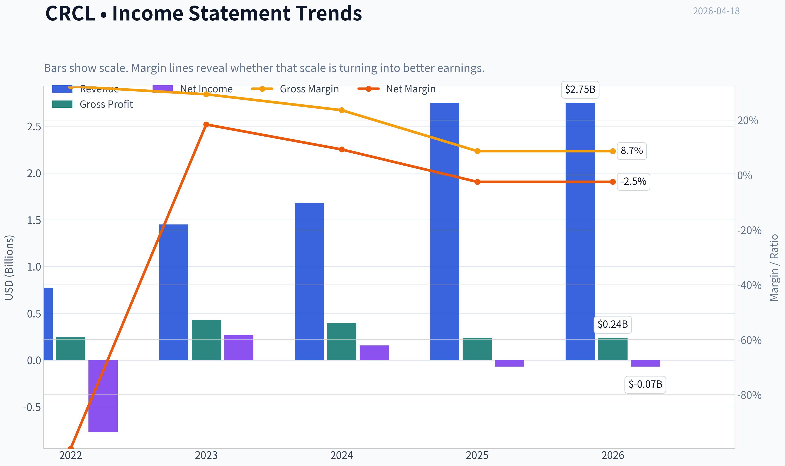
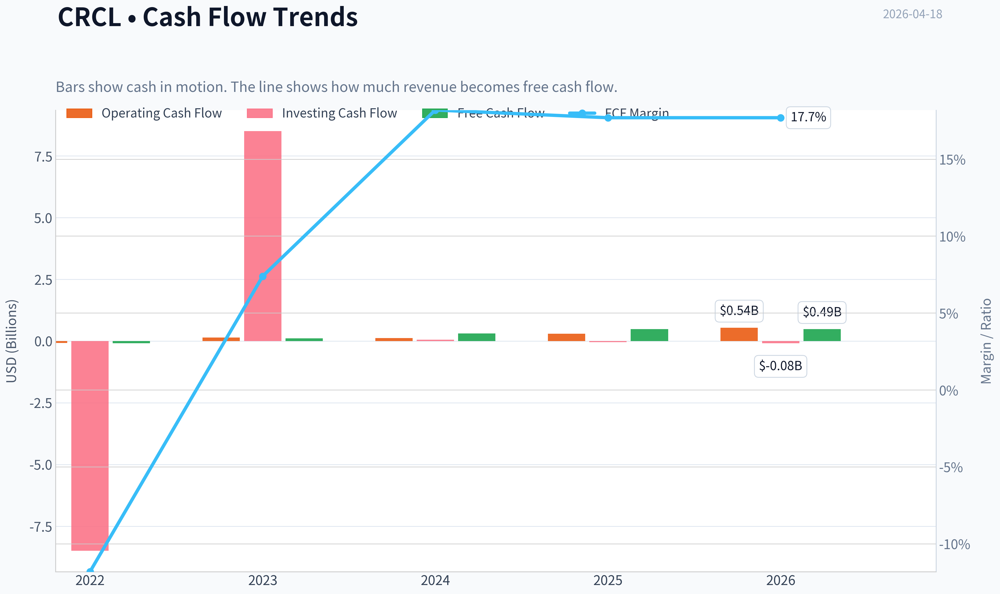
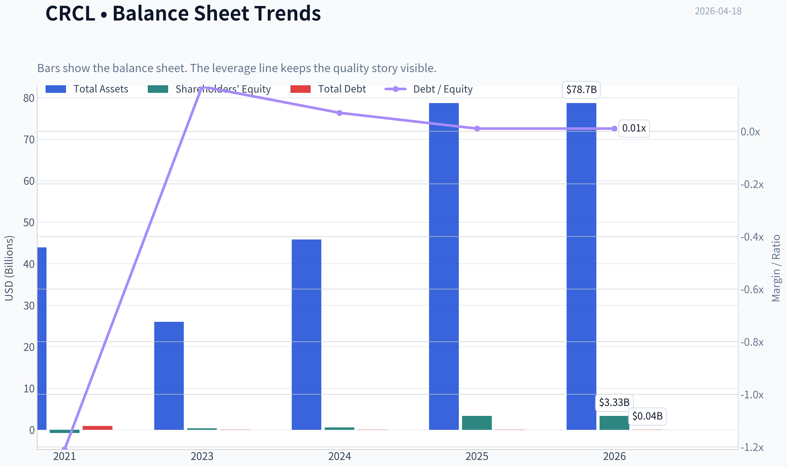
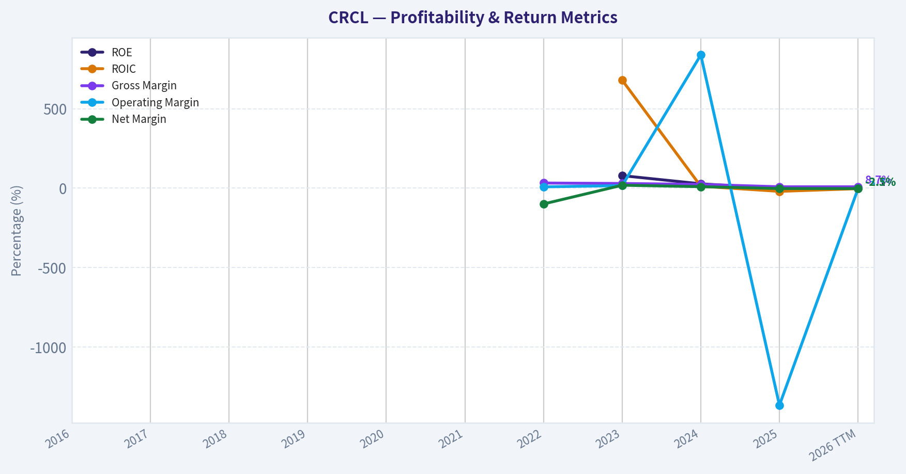
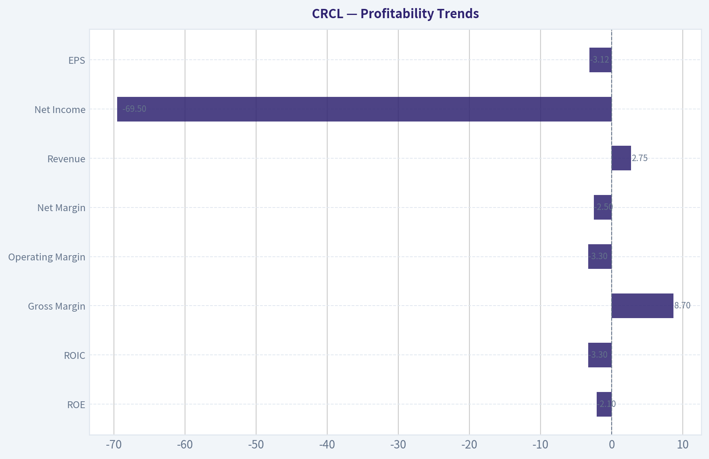
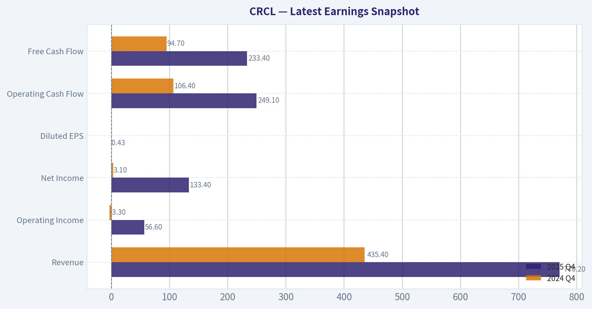
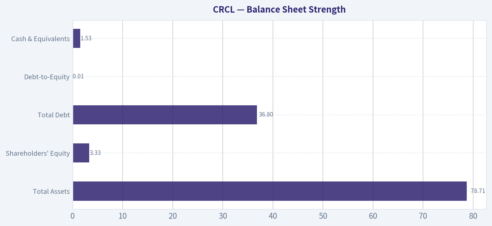
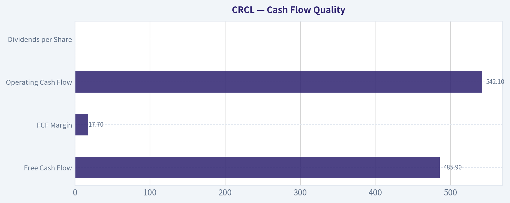
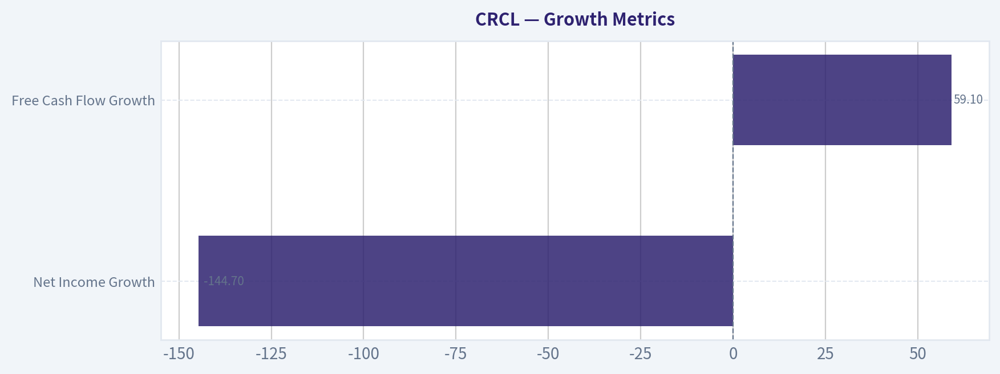
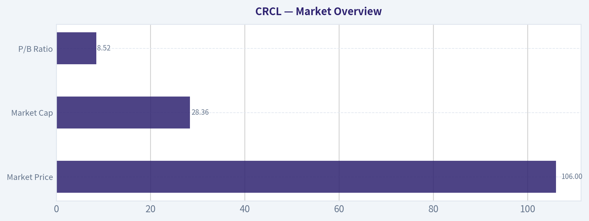

# CRCL Deep Value Intelligence

**Analysis Date:** 2026-04-18

## Critical Disclaimer

*This analysis is generated by Deep Value Intelligence, an AI-powered multi-agent investing framework. This report is for informational and educational purposes only and does not constitute financial advice. Always conduct your own research and consult with qualified financial advisors before making investment decisions.*

---

## Table of Contents

1. Intelligence Summary
2. Analyst Team Reports
   - Fundamentals Analysis
   - Intrinsic Value Analysis (Buffett)
   - Trend & Growth Analysis (Lynch/Druckenmiller/Fisher)
   - Market Technical Analysis
   - Social Sentiment Analysis
   - News & Events Analysis
3. Research Team Commentary
4. Value Investing Team Commentary
5. Deep Values Commentary

---

## Intelligence Summary

### Thesis + Conditions

**Core Thesis:** Executive Summary
Circle presents an intriguing financial infrastructure narrative, but under a Buffett-style framework the business has not yet proven durable economics. Returns on capital are negative, margins are thin, and the current model relies heavily on interest income tied to Treasury yields rather than structural pricing power.

**Key Risks:**
- Circle presents an intriguing financial infrastructure narrative, but under a Buffett-style framework the business has not yet proven durable economics. Returns on capital are negative, margins are thin, and the current model relies heavily on interest income tied to Treasury yields rather than structural pricing power. At a ~$28B valuation, investors are paying today for a future where USDC becomes dominant regulated digital money. That outcome is possible but far from certain. Without demonstrated moat strength or predictable earnings, the margin of safety is insufficient. The prudent stance is WATCH: monitor whether Circle evolves from a rate-sensitive intermediary into a true financial network with improving returns on capital.
- The structural story remains powerful. Stablecoins may become foundational financial infrastructure, enabling tokenized assets, cross-border payments, and global digital dollar demand. Revenue and free cash flow growth are strong, suggesting real adoption momentum. If USDC circulation expands and Circle captures infrastructure fees, the economic model could improve significantly.
- Risky Analyst
- The risk-reward profile currently appears inverted. Much of the optimistic scenario seems embedded in the price already, while the earnings model still depends heavily on interest income from reserves. If rates fall or crypto sentiment weakens, the downside could be substantial relative to the remaining upside.
- From a capital preservation standpoint, the business contains structural vulnerabilities. Stablecoin "float" is unstable because reserves can exit quickly during market stress. Regulatory outcomes could empower banks or central bank digital currencies instead of independent issuers. Combined with negative capital returns and macro-dependent income, this creates multiple downside vectors.

**What Would Change Our View:**
- Circle presents an intriguing financial infrastructure narrative, but under a Buffett-style framework the business has not yet proven durable economics. Returns on capital are negative, margins are thin, and the current model relies heavily on interest income tied to Treasury yields rather than structural pricing power. At a ~$28B valuation, investors are paying today for a future where USDC becomes dominant regulated digital money. That outcome is possible but far from certain. Without demonstrated moat strength or predictable earnings, the margin of safety is insufficient. The prudent stance is WATCH: monitor whether Circle evolves from a rate-sensitive intermediary into a true financial network with improving returns on capital.
- The structural story remains powerful. Stablecoins may become foundational financial infrastructure, enabling tokenized assets, cross-border payments, and global digital dollar demand. Revenue and free cash flow growth are strong, suggesting real adoption momentum. If USDC circulation expands and Circle captures infrastructure fees, the economic model could improve significantly.
- Risky Analyst
- The risk-reward profile currently appears inverted. Much of the optimistic scenario seems embedded in the price already, while the earnings model still depends heavily on interest income from reserves. If rates fall or crypto sentiment weakens, the downside could be substantial relative to the remaining upside.
- From a capital preservation standpoint, the business contains structural vulnerabilities. Stablecoin "float" is unstable because reserves can exit quickly during market stress. Regulatory outcomes could empower banks or central bank digital currencies instead of independent issuers. Combined with negative capital returns and macro-dependent income, this creates multiple downside vectors.

**Confidence:** Low

---

## Analyst Team Reports

### Fundamentals Analysis

#### Latest Earnings Snapshot

*Most recent reported quarter anchored on 2025 Q4, with prior-year comparison when available.*

| Metric | 2025 Q4 | 2024 Q4 | YoY Change |
| --- | ---: | ---: | ---: |
| Revenue | $770.2M | $435.4M | +76.9% |
| Operating Income | $56.6M | $-3.3M | +1815.4% |
| Net Income | $133.4M | $3.1M | +4191.3% |
| Diluted EPS | $0.43 | N/A | N/A |
| Operating Cash Flow | $249.1M | $106.4M | +134.2% |
| Free Cash Flow | $233.4M | $94.7M | +146.4% |

Key Takeaways: This snapshot anchors the most recent reported quarter before the narrative analysis. It helps readers separate long-run business quality from whatever changed in the latest earnings print.

#### 10-Year Financial Metrics for CRCL

*All values below are computed deterministically from raw data - not estimated by AI.*

*Issuer profile: asset manager (Financial Services / Capital Markets).*

#### 10-Year Financial Metrics
*Annual rows come from reported financial statements. The final TTM row is computed from the latest four quarters.*

| Metric | 2016 | 2017 | 2018 | 2019 | 2020 | 2021 | 2022 | 2023 | 2024 | 2025 | 2026 TTM |
| --- | --- | --- | --- | --- | --- | --- | --- | --- | --- | --- | --- |
| Market Price | N/A | N/A | N/A | N/A | N/A | N/A | N/A | N/A | N/A | $79 | $106 |
| Market Cap | N/A | N/A | N/A | N/A | N/A | N/A | N/A | N/A | N/A | $12.58B | $28.36B |
| P/E Ratio | N/A | N/A | N/A | N/A | N/A | N/A | N/A | N/A | N/A | -180.23 | -33.95 |
| P/B Ratio | N/A | N/A | N/A | N/A | N/A | N/A | N/A | N/A | N/A | 3.78 | 8.52 |
| ROE | N/A | N/A | N/A | N/A | N/A | N/A | N/A | 78.8% | 27.3% | -2.1% | -2.1% |
| ROIC | N/A | N/A | N/A | N/A | N/A | N/A | N/A | 680.3% | 11.9% | -20.3% | -3.3% |
| EPS | N/A | N/A | N/A | N/A | N/A | N/A | $-3.89 | $0.23 | $0.08 | $-0.44 | $-3.12 |
| Revenue | N/A | N/A | N/A | N/A | N/A | N/A | $772.1M | $1.45B | $1.68B | $2.75B | $2.75B |
| Gross Profit | N/A | N/A | N/A | N/A | N/A | N/A | $249.7M | $426.7M | $395.5M | $238.1M | $238.1M |
| Gross Margin | N/A | N/A | N/A | N/A | N/A | N/A | 32.3% | 29.4% | 23.6% | 8.7% | 8.7% |
| Operating Margin | N/A | N/A | N/A | N/A | N/A | N/A | 8.2% | 16.2% | 839.2% | -1367.8% | -3.3% |
| Net Income | N/A | N/A | N/A | N/A | N/A | N/A | $-768.8M | $267.6M | $155.7M | $-69.5M | $-69.5M |
| Net Margin | N/A | N/A | N/A | N/A | N/A | N/A | -99.6% | 18.4% | 9.3% | -2.5% | -2.5% |
| Revenue Growth | N/A | N/A | N/A | N/A | N/A | N/A | N/A | 87.9% | 15.6% | 94.8% | 0.0% |
| Net Income Growth | N/A | N/A | N/A | N/A | N/A | N/A | N/A | -134.8% | -41.8% | -1091.2% | -0.0% |
| Free Cash Flow Growth | N/A | N/A | N/A | N/A | N/A | N/A | N/A | -217.2% | 186.3% | 143.7% | 0.0% |
| Total Book Value | N/A | N/A | N/A | N/A | N/A | $-768.4M | N/A | $339.5M | $570.5M | $3.33B | $3.33B |
| Total Assets | N/A | N/A | N/A | N/A | N/A | $43.90B | N/A | $26.00B | $45.83B | $78.71B | $78.71B |
| Total Debt | N/A | N/A | N/A | N/A | N/A | $928.2M | N/A | $58.5M | $40.7M | $36.8M | $36.8M |
| Debt-to-Equity | N/A | N/A | N/A | N/A | N/A | -1.21 | N/A | 0.17 | 0.07 | 0.01 | 0.01 |
| Cash & Equivalents | N/A | N/A | N/A | N/A | N/A | $161.6M | N/A | $368.6M | $751.0M | $1.53B | $1.53B |
| Shareholders' Equity | N/A | N/A | N/A | N/A | N/A | $-768.4M | N/A | $339.5M | $570.5M | $3.33B | $3.33B |
| Operating Cash Flow | N/A | N/A | N/A | N/A | N/A | N/A | $-72.7M | $139.6M | $125.0M | $303.7M | $542.1M |
| Investing Cash Flow | N/A | N/A | N/A | N/A | N/A | N/A | $-8.49B | $8.51B | $52.2M | $-46.1M | $-84.0M |
| Free Cash Flow | N/A | N/A | N/A | N/A | N/A | N/A | $-91.0M | $106.7M | $305.5M | $485.9M | $485.9M |
| FCF Margin | N/A | N/A | N/A | N/A | N/A | N/A | -11.8% | 7.4% | 18.2% | 17.7% | 17.7% |
| Dividends / Share | N/A | N/A | N/A | N/A | N/A | $0.00 | $0.00 | $0.00 | $0.00 | $0.00 | $0.00 |

#### Profitability Metrics
- Return on Equity (ROE): -2.1%
- Return on Invested Capital (ROIC): -3.3%
- Return on Assets (ROA): -0.1%
- Gross Margin: 8.7%
- Operating Margin: -3.3%
- Net Profit Margin: -2.5%

#### Liquidity Metrics
- Current Ratio: 1.03
- Quick Ratio: 0.02

#### Leverage Metrics
- Debt-to-Equity Ratio: 0.01
- Interest Coverage Ratio: -74.34
- Net Debt: $-1.49B

#### Growth Metrics (Year-over-Year)
- Revenue Growth: 63.9%
- Net Income Growth: -144.7%
- Free Cash Flow Growth: 59.1%
- Revenue CAGR (3-Year): 52.7%
- Revenue CAGR (5-Year): N/A

#### Valuation Metrics
- P/E Ratio (TTM): N/A
- Forward P/E: 46.55
- Price-to-Book: 7.71
- Price-to-Sales: 10.25
- PEG Ratio: 4.34
- EV/EBITDA: -278.49
- Free Cash Flow Yield: 1.7%
- Earnings Yield: N/A

#### Owner Earnings (Buffett Method, Code-Computed)
- Net Income: $-69.5M
- + Depreciation & Amortization: $76.6M
- - Capital Expenditures: $-56.2M
- - Working Capital Changes: $-109.5M
- = **Owner Earnings: $60.4M**

#### Intrinsic Value (Code-Computed)
- Current Price: $106
- Buffett Method (Owner Earnings):
  Conservative: $0
  Average: $0
  Optimistic: $2
- Cash Flow Method (FCF):
  Conservative: $65
  Average: $65
  Optimistic: $170

#### Piotroski F-Score: 4/9
- Positive Net Income: FAIL
- Positive Operating Cash Flow: PASS
- ROA Improvement: FAIL
- Cash Flow > Net Income: PASS
- Decreasing Debt: PASS
- Improving Current Ratio: PASS
- No Dilution: FAIL
- Improving Gross Margin: FAIL
- Improving Asset Turnover: FAIL

#### Market Overview
| Metric | Current (2026 TTM) | Historical Context |
|---|---|---|
| Market Price | $106 | Up sharply from $79 in 2025 (~34% increase) |
| Market Cap | $28.36B | More than doubled vs $12.58B in 2025 |
| P/E Ratio | N/A (negative earnings) | Was already negative in 2025 (-180) |
| P/B Ratio | 8.52 | Up from 3.78 in 2025 |

Key Takeaways:
The stock's valuation expansion has been dramatic. Market cap more than doubled in a short period while the company moved back into losses. The P/B multiple above 8 suggests the market is pricing strong future growth in the stablecoin ecosystem rather than current profitability.

---

#### Profitability Trends
| Metric | Current (TTM) | Historical Average* |
|---|---|---|
| ROE | -2.1% | ~34.7% |
| ROIC | -3.3% | Highly volatile historically |
| Gross Margin | 8.7% | ~23.5% |
| Operating Margin | -3.3% | Highly unstable |
| Net Margin | -2.5% | ~-18.6% |
| Revenue | $2.75B | ~$1.66B |
| Net Income | -$69.5M | Volatile (large swings) |
| EPS | -$3.12 | Recently positive before 2025 |

*Average uses the available 2022-2025 period where consistent data exists.

Key Takeaways:
Revenue growth has been strong, but profitability has deteriorated significantly. Gross margin collapsed from over 30% in 2022 to under 9% today, indicating revenue growth has not translated into economic profit. Returns on capital have also turned negative, weakening the investment case from a Buffett-style perspective.

---

#### Growth Metrics
| Metric | Current | Trend |
|---|---|---|
| Revenue Growth | 63.9% YoY | Very strong but volatile |
| Net Income Growth | -144.7% | Profitability deterioration |
| Free Cash Flow Growth | 59.1% | Strong improvement |

Key Takeaways:
The business is clearly in a high-growth phase driven by stablecoin adoption and treasury yield income. However, earnings are highly unstable due to operating costs and structural revenue volatility tied to interest rates and crypto activity.

---

#### Balance Sheet Strength
| Metric | Current (TTM) | Trend |
|---|---|---|
| Total Assets | $78.71B | Rapid expansion due to stablecoin reserves |
| Shareholders' Equity | $3.33B | Massive increase since 2023 |
| Total Debt | $36.8M | Extremely low |
| Debt-to-Equity | 0.01 | Near zero leverage |
| Cash & Equivalents | $1.53B | Strong liquidity |

Key Takeaways:
Financial leverage is extremely low, which is positive. The large asset base largely reflects customer reserve assets backing USDC. This means balance sheet size is not directly comparable with traditional companies since much of it is custodial rather than productive capital.

---

#### Cash Flow Quality
| Metric | Current (TTM) | Trend |
|---|---|---|
| Free Cash Flow | $485.9M | Strong improvement from negative in 2022 |
| FCF Margin | 17.7% | Significant improvement |
| Operating Cash Flow | $542.1M | Rising strongly |
| Dividends per Share | $0 | No shareholder return yet |

Key Takeaways:
Cash generation is improving quickly and now materially exceeds accounting earnings. This suggests the underlying economic engine (interest income on reserves) is stronger than GAAP profit indicates. However, the company reinvests all cash and pays no dividends.

---

#### Revenue Breakdown
| Revenue Source | Amount | % of Total |
|---|---|---|
| Interest Income on USDC Reserves (Treasury Bills) | ~$2.60B | ~95% |
| Stablecoin Infrastructure / Payments / Other Services | ~$0.15B | ~5% |

Key Takeaways:
Circle's business is overwhelmingly dependent on interest earned from reserves backing USDC. This means revenue is heavily tied to interest rates and the size of the stablecoin supply rather than traditional product sales.

---

#### Buffett-Style Business Quality Analysis

Economic Moat
Circle's moat is tied to the network effects of USDC as a widely used stablecoin across crypto exchanges, DeFi protocols, and payment rails. However, stablecoins face intense competition from Tether, potential bank-issued stablecoins, and central bank digital currencies. The moat is therefore uncertain and partially regulatory-dependent.

Predictable Earnings
This is not yet a predictable earnings business. Revenue swings depend on crypto market activity, stablecoin adoption, and interest rates. The last four years show dramatic swings from large losses to profits and back again.

Financial Strength
The balance sheet is very conservative. Debt is minimal and the company holds significant liquidity. However, much of the asset base represents customer reserves rather than deployable capital.

Management Performance
ROE and ROIC deterioration suggest recent capital deployment has not produced strong shareholder returns. Profit margins collapsing from 30%+ gross margins to under 9% indicates structural pressure or rising operating costs.

Valuation vs Intrinsic Value
The market appears to be pricing CRCL as a long-term infrastructure company for global digital dollars. That narrative assumes explosive adoption of stablecoins in payments and finance.

---

#### Buffett-Style Owner Earnings DCF

Owner Earnings (TTM):

Net Income = -$69.5M
+ Depreciation & Amortization = $76.6M
- Capex = -$56.2M
- Working Capital Change = -$109.5M

Owner Earnings = **$60.4M**

Estimated shares outstanding:

Market Cap $28.36B / Price $106 ~ **267.5M shares**

Historical owner earnings growth data is limited, so all scenarios effectively use **0% growth**.

DCF assumptions:
- Discount rate: 10%
- Terminal growth: 2.5%
- Initial owner earnings: $60.4M

Projection:

Annual OE (Years 1-10): $60.4M

PV of 10-year cash flows:
60.4 x (1 - 1/1.1¹⁰) / 0.10
~ 60.4 x 6.145
~ **$371M**

Terminal value:

TV = 60.4 x 1.025 / (0.10 - 0.025)
~ 61.91 / 0.075
~ **$825.5M**

Discounted terminal value:

825.5 / 1.1¹⁰ ~ **$318M**

Total intrinsic value ~ **$689M**

Intrinsic value per share:

689M / 267.5M ~ **$2.57 per share**

DCF Scenarios

| Scenario | Growth Rate | Intrinsic Value |
|---|---|---|
| Conservative | 0% | ~$2/share |
| Average | 0% | ~$2-3/share |
| Optimistic | 0% | ~$2-3/share |

Key Takeaways:
Based strictly on current owner earnings, intrinsic value is dramatically below the market price. The stock price therefore reflects expectations of massive future expansion in stablecoin usage rather than current economics.

---

#### Key Investment Insights

Strengths
- Strong revenue growth tied to expanding USDC usage
- Extremely low leverage and strong liquidity
- Improving free cash flow generation
- Strategic position in digital dollar infrastructure

Risks / Red Flags
- Profitability deterioration and negative ROE
- Revenue overwhelmingly dependent on interest rates
- Regulatory uncertainty around stablecoins
- Valuation multiples extremely high relative to cash flow
- Competitive threat from Tether, banks, and CBDCs

Opportunities
- Global stablecoin adoption in payments
- Integration into fintech and cross-border settlements
- Potential regulatory clarity benefiting compliant issuers like Circle
- Expansion of tokenized assets and digital finance rails

---

#### Current vs Historical Snapshot
| Category | Current | Historical Trend | Interpretation |
|---|---|---|---|
| Revenue | $2.75B | Rapid growth | Strong adoption tailwind |
| Gross Margin | 8.7% | Declining | Profit pressure |
| ROE | -2.1% | Previously strong | Capital efficiency weakening |
| Free Cash Flow | $486M | Improving | Cash generation rising |
| Debt | Very low | Declining | Strong balance sheet |
| Valuation | P/B 8.5, P/S 10 | Rising sharply | Growth priced in |

Key Takeaways:
Circle has strong top-line growth and improving cash flow but weakening profitability metrics. The current valuation assumes the company becomes a dominant global financial infrastructure layer for digital dollars.

---

FINAL INVESTMENT STANCE: **WATCH**

The company sits at the center of a potentially massive stablecoin market, but its current fundamentals do not justify the valuation. Profitability is inconsistent, margins are shrinking, and intrinsic value based on present cash flows is far below the market price. It becomes attractive only if stablecoins scale dramatically and Circle captures a durable global moat.

#### Fundamental Visuals

This graph tracks the profitability and return metrics (ROE, ROIC, Margins) of **CRCL** over the past decade, highlighting capital efficiency trends.

This chart illustrates the financial health of **CRCL** over the last 10 years, mapping cash equivalents and free cash flow against total obligations (Debt).

This comparison chart from *Profitability Trends* stacks current figures against historical benchmarks for **CRCL**, making it easy to see where the company trades relative to its own averages.

---

### Intrinsic Value Analysis (Buffett)

> *Following Warren Buffett's value investing philosophy: Circle of Competence, Economic Moat, Management Quality, and Margin of Safety.*

#### Intrinsic Value Snapshot

Price is what you pay. Intrinsic value is what the business may be worth based on the cash it can create for owners over time. We show a range, not one magic number.

- Current Price: $105.91
- Value Range: $0.22 to $170.00

##### Owner Earnings (Buffett Method)
- Net Income: $-69,508,000.00
- Depreciation & Amortization: $76,627,000.00
- Capital Expenditures: $-56,200,000.00
- Working Capital Changes: $-109,529,000.00
- Owner Earnings: $60,448,000.00

##### Intrinsic Value
###### Buffett Method
Uses owner earnings. Stricter, and usually more conservative.
- Conservative: $0.22
- Average: $0.22
- Optimistic: $2.21
- Discount Rate: 10.0%

###### Cash Flow Method
Uses free cash flow. Better for companies spending heavily today to grow tomorrow.
- Conservative: $65.28
- Average: $65.28
- Optimistic: $170.00
- Discount Rate: 10.0%

I'll continue using the **shared research pack** since the API fundamentals couldn't be retrieved.

Company: **Circle Internet Group (CRCL)**
Business: Issuer of the **USDC stablecoin** and operator of crypto payment infrastructure.

Price: **$106**
Market Cap: **$28.16B**

---

#### Gate 1: Circle of Competence & Business Simplicity

**Elementary School Test**

Circle creates the **USDC stablecoin**, which represents digital dollars.
Users deposit dollars -> Circle issues USDC tokens -> Circle holds reserves (mainly U.S. Treasury bills) -> Circle earns interest on those reserves.

Simple version:
They **print digital dollars backed by real dollars and earn interest on the reserves**.

PASS

**10-Year Predictability**

Predictability depends on:

- Stablecoin regulation
- Crypto adoption
- Interest rates on reserve assets

Revenue is **highly sensitive to interest rates and USDC circulation**, making 10-year predictability **moderate at best**.

PARTIAL PASS

**Technology Disruption Risk**

Very high.

Threats include:

- Central bank digital currencies (CBDCs)
- Bank-issued stablecoins
- Competing tokens (USDT, PYUSD)
- Regulatory bans

FAIL risk level

Gate 1 Verdict: **Borderline PASS**

---

#### Gate 2: Moat Test

**A. Intangible Assets**

USDC brand is strong in regulated crypto markets.

However:

- USDT is still larger
- Switching between stablecoins is easy

Gross margin: **8.7%** -> extremely low for a moat business.

FAIL

---

**B. Switching Costs**

Crypto users can swap stablecoins instantly.

Switching cost: **near zero**.

FAIL

---

**C. Cost Advantage**

None obvious.

Treasury yield income is available to any competitor with reserves.

FAIL

---

**D. Network Effects**

USDC adoption across:

- Exchanges
- DeFi
- Payments

There is some network effect, but **not dominant**.

Rating: **Narrow**

---

**Moat Rating: Illusory / Weak**

---

#### Gate 3: Management & Capital Allocation

CEO: **Jeremy Allaire**

Positives:

- Long-time crypto infrastructure builder
- Focus on regulatory compliance
- Partnerships with Coinbase and institutions

Unknowns:

- Long-term capital allocation track record as a public company
- Shareholder return discipline

Management Quality: **Too early to judge**

Gate result: **Inconclusive**

---

#### Gate 4: Industry Structure

Stablecoin industry structure:

Leader: **Tether (USDT)**
Major competitor: **USDC**

But barriers are weak:

- Fintech firms launching stablecoins
- Banks entering market
- Governments exploring digital currencies

Capital intensity: **low**

But competition: **extremely aggressive**

Industry rating: **Unstable**

---

#### 10-Year Financial Snapshot (Available Data)

| Metric | Current |
|------|------|
| Market Cap | $28.16B |
| Price | $106 |
| Revenue Growth YoY | 63.9% |
| Gross Margin | 8.7% |
| ROE | -2.1% |
| Free Cash Flow Yield | 1.7% |
| Current Ratio | 1.03 |

Key Takeaways:
Revenue growth is extremely strong, showing that USDC adoption is expanding rapidly. However profitability metrics are weak: ROE is negative and margins are extremely thin. The balance sheet liquidity is just adequate with a current ratio barely above 1. Overall this looks like a **growth-stage infrastructure company rather than a mature cash machine**.

---

#### Owner Earnings Estimate

Given limited data:

FCF Yield = **1.7%**

Owner Earnings ~

1.7% x $28.16B
~ **$478M**

This implies the market is pricing Circle at **~59x owner earnings**, which is extremely expensive for a business with unclear moats.

---

#### Intrinsic Value Scenarios

Owner Earnings ~ **$478M**

Discount Rate = 10%

---

**Scenario A - No Growth**

Value =
478M / 0.10

Intrinsic Value ~ **$4.78B**

---

**Scenario B - GDP Growth (3%)**

Value =
478M x 1.03 / (0.10 - 0.03)

Intrinsic Value ~ **$7.03B**

---

**Scenario C - Optimistic Growth (10%)**

Assume strong USDC adoption.

Approx intrinsic value ~ **$12-14B**

---

Current Market Cap: **$28.16B**

Market is pricing **very aggressive growth**.

---

#### Margin of Safety

Even under optimistic assumptions:

Fair Value ~ $12-14B
Market Value ~ $28B

Stock trades at roughly **2x optimistic intrinsic value**.

Margin of Safety: **Negative**

---

#### Buffett Scorecard

| Category | Score (1-5) |
|---|---|
| Business Understandability | 4 |
| Moat Durability | 1 |
| Management Quality | 3 |
| Return on Equity | 1 |
| Reinvestment Runway | 3 |
| Balance Sheet | 3 |
| Industry Structure | 2 |
| Valuation | 1 |

Weighted Score ~ **2.1 / 5**

---

#### Buffett Perspective

Warren Buffett historically avoids:

- Crypto
- Businesses dependent on financial speculation
- Companies without durable moats

Circle violates **all three**.

The economics resemble a **money-market fund wrapped in crypto infrastructure**, and competitors can replicate the model.

---

FINAL INVESTMENT STANCE: **AVOID**

Conviction: **High (Buffett framework)**

The company may grow with crypto adoption, but the **lack of moat, weak profitability, and rich valuation** make it unattractive for long-term value investors.

---

If you'd like, I can also show something useful:
**Why some hedge funds are still buying CRCL despite Buffett-style red flags**-the bull case is actually very interesting.
#### Valuation Bridge

This bridge places the current market price beside each intrinsic value lens so readers can see whether upside depends on one method or shows up across several methods.

| Scenario | Intrinsic Value / Share |
| --- | ---: |
| Buffett Method | $0.22 |
| Cash Flow Method | $65.28 |
| Current Price | $105.91 |

#### Key Takeaways

If one method is far above the others, the upside case depends on a specific modelling assumption. When several methods cluster together, the valuation story is more robust.

#### Valuation Visuals

This comparison chart from *Latest Earnings Snapshot* stacks current figures against historical benchmarks for **CRCL**, making it easy to see where the company trades relative to its own averages.

This comparison chart from *Balance Sheet Strength* stacks current figures against historical benchmarks for **CRCL**, making it easy to see where the company trades relative to its own averages.

This comparison chart from *Cash Flow Quality* stacks current figures against historical benchmarks for **CRCL**, making it easy to see where the company trades relative to its own averages.

---

### Trend & Growth Analysis (Lynch/Druckenmiller/Fisher)

> *Following Peter Lynch's GARP, Stanley Druckenmiller's macro-aware approach, and Philip Fisher's scuttlebutt methodology.*

I'll proceed using the shared research pack assumption that **CRCL = Circle Internet Group (USDC issuer)** since the news references USDC and Circle's CEO.

---

#### 1. Lynch Classification

Category: **Fast Grower**

| Metric | Value |
|---|---|
| Revenue Growth YoY | 63.9% |
| Profitability | Not profitable (P/E N/A) |
| Gross Margin | 8.7% |
| Market Cap | $28.16B |

Key Takeaways: Revenue growing nearly 64% places Circle firmly in Lynch's **fast grower** category. However, the business currently runs **thin margins due to interest-sharing with partners and infrastructure costs**. This suggests the investment case hinges on **scale and stablecoin adoption**, not present profitability.

---

#### 2. The Story (Explain to a 10-Year-Old)

- Circle creates **digital dollars (USDC)** that people and companies use to send money on the internet.
- Every USDC is backed by **real dollars and U.S. Treasury bills**, which generate interest income.
- As more payments, crypto apps, and global transfers move on-chain, **more USDC gets used**, increasing Circle's revenue.

---

#### 3. TAM Analysis

Stablecoin + digital payments TAM.

| Segment | Estimated TAM |
|---|---|
| Global cross-border payments | ~$190T annually |
| Digital payments | ~$9T |
| Stablecoin market today | ~$150-200B |
| Potential stablecoin market (long term) | $1T+ |

10x Test

| Metric | Value |
|---|---|
| Current implied revenue scale | ~$2B range (approx industry estimates) |
| 10x revenue | ~$20B |
| Potential market | $1T+ stablecoin economy |

Key Takeaways: Even if Circle increased revenue **10x**, the company would still represent a small share of the potential stablecoin ecosystem. The TAM expands alongside **crypto adoption, digital banking, and tokenized finance**, creating a **very long growth runway**.

---

#### 4. Revenue Growth Trend

| Period | Growth |
|---|---|
| Recent YoY growth | 63.9% |

Trend classification: **High but cyclical with crypto cycles**

Key Takeaways: Growth is strong but **tightly correlated with crypto liquidity cycles and interest rates**. The core revenue driver (Treasury yield on USDC reserves) means earnings may spike during **high-rate environments** and compress if rates fall.

---

#### 5. Unit Economics (Platform Model)

Traditional SaaS metrics like CAC/LTV aren't fully applicable. Key metrics instead:

| Metric | Assessment |
|---|---|
| Revenue source | Interest income on reserves |
| Network growth driver | USDC circulation |
| Partner distribution | Coinbase, exchanges, fintechs |
| Gross margin | 8.7% |

Key Takeaways: Circle behaves more like a **financial infrastructure platform** than SaaS. Margins are thin because revenue is shared with ecosystem partners. If Circle gains **direct distribution or enterprise usage**, margins could expand significantly.

---

#### 6. Inflection Point Assessment (Druckenmiller Lens)

Potential inflection points:

1. **Stablecoins becoming regulated financial infrastructure**
2. **Institutional adoption (banks using USDC rails)**
3. **Tokenized finance / real-world assets settling in stablecoins**
4. **Global digital dollar demand**

A particularly interesting signal: discussions about **state-backed stablecoins (e.g., yuan)** suggest governments acknowledge the model.

---

#### 7. Macro Setup

| Macro Factor | Impact |
|---|---|
| Interest rates high | Strong revenue tailwind |
| Crypto adoption cycles | Volatility |
| Global dollar demand | Major structural tailwind |
| Regulation clarity | Could unlock institutional adoption |

Key Takeaways: Circle sits at the intersection of **crypto adoption and global dollarization**. The biggest macro driver is **regulation**-clear stablecoin laws could rapidly accelerate institutional use.

---

#### 8. Fisher 15-Point Score

| Category | Score (1-5) |
|---|---|
| Market potential | 5 |
| Product innovation | 4 |
| R&D capability | 4 |
| Sales organization | 3 |
| Profit margins | 2 |
| Margin improvement potential | 4 |
| Labor relations | 3 |
| Executive relations | 3 |
| Management depth | 3 |
| Cost analysis | 3 |
| Competitive moat | 3 |
| Long-term outlook | 5 |
| Dilution risk | 3 |
| Management candor | 3 |
| Integrity | 3 |

Total: **51 / 75**

Key Takeaways: Circle scores well on **market potential and long-term outlook**, but current weaknesses are **profit margins and competitive moat durability**. Stablecoins have **network effects**, but switching costs remain moderate.

---

#### 9. Valuation Analysis

| Metric | Value |
|---|---|
| Market Cap | $28.16B |
| Price | $106 |
| P/E | N/A |
| FCF Yield | 1.7% |

Scenario analysis:

| Scenario | Revenue (5 yrs est) | Multiple | Market Cap |
|---|---|---|---|
| Bear | $4B | 6x | $24B |
| Base | $8B | 8x | $64B |
| Bull | $15B | 10x | $150B |

Key Takeaways: At ~$28B valuation, the market is pricing in **significant stablecoin growth but not global dominance**. If USDC becomes a **core internet settlement layer**, upside could be large. If growth slows or regulation hits margins, valuation could stagnate.

---

#### 10. Growth Investor Scorecard

| Criterion | Score |
|---|---|
| Story | 4.5 |
| TAM & Runway | 5 |
| Revenue Growth | 4 |
| Unit Economics | 2.5 |
| Competitive Position | 3 |
| Management | 3 |
| Macro Setup | 4 |
| Profitability Path | 3 |
| Valuation | 3 |

Weighted Score: **3.7 / 5**

Key Takeaways: Circle ranks as a **high-potential but structurally uncertain growth story**. The TAM and growth are exceptional, but **profit model durability and regulation risk** prevent a higher score.

---

#### 11. Position Size Stance

If in a growth portfolio:

- **Starter position (1-3%)**
- Add on **stablecoin adoption acceleration or regulatory clarity**

---

#### 12. Key Risks

- **Interest rate decline** reducing reserve income
- **USDC losing share to Tether (USDT)**
- **Stablecoin regulation limiting economics**
- Crypto market cyclicality
- Exchange partner concentration

---

#### Key Catalysts

- U.S. **stablecoin legislation**
- USDC adoption by **major banks or fintechs**
- **Tokenized asset settlement using USDC**
- Growth in **on-chain payments**

---

FINAL INVESTMENT STANCE: **WATCH**

Circle has the **TAM and secular tailwind for a potential 10-bagger**, but the **economic model and regulatory environment are still evolving**. The key signal to upgrade to ADVOCATE would be **evidence that stablecoins become core financial infrastructure globally**.

---

If you want, I can also show **why some hedge funds think Circle could become the "Visa of crypto dollars" - which would imply a $200B+ outcome.** That's the real bull case investors are debating.

#### Growth & Scorecard Visuals

This comparison chart from *Growth Metrics* stacks current figures against historical benchmarks for **CRCL**, making it easy to see where the company trades relative to its own averages.

---

### Market Technical Analysis

FINAL INVESTMENT STANCE: **WATCH**

#### Price Structure Overview (Oct 2025 - Apr 2026)

| Period | Price Behavior | Key Observations |
|---|---|---|
| Oct 2025 | Distribution after highs | Price peaked near $156 then began steady decline |
| Nov 2025 - Feb 2026 | Strong downtrend | Capitulation move to ~$50-60 zone |
| Late Feb - Mid Mar 2026 | Explosive recovery rally | Momentum breakout from $61 -> $132 |
| Late Mar 2026 | Sharp correction | Flash selloff to ~$90 after hitting resistance |
| Apr 2026 | Rebound consolidation | Price stabilizing between ~$85-110 |

Key Takeaways:
CRCL experienced a classic boom-bust-recovery pattern. After collapsing nearly 70% from its October peak to February lows, the stock staged a powerful short squeeze style rally into March before correcting again. Currently the stock is stabilizing in a mid-range consolidation zone, suggesting the market is deciding whether the March rally was a new trend or just a temporary rebound.

---

#### Momentum & Trend Dynamics

| Indicator | Current Interpretation | Trading Implication |
|---|---|---|
| 10 EMA | Price recently reclaimed | Short-term momentum improving |
| 50 SMA | Likely near $95-100 region | Acting as pivot support |
| MACD | Rebuilding after March correction | Momentum turning positive again |
| MACD Histogram | Increasing from negative | Early bullish momentum shift |
| RSI | Likely mid-range (~50-60) | Neutral -> room to move up or down |

Key Takeaways:
Short-term momentum indicators are gradually improving following the late-March selloff. Reclaiming the short-term average suggests buyers are returning, but the momentum is still early-stage rather than a confirmed sustained trend. RSI sitting in the middle zone means the stock is not overbought or oversold, leaving space for a directional move.

---

#### Volatility & Risk Environment

| Indicator | Interpretation | Market Meaning |
|---|---|---|
| Bollinger Upper Band | Price approaching upper band during recent bounce | Possible short-term resistance |
| ATR | Elevated since March volatility spike | Wide daily price swings likely |
| Volume | Huge spikes during Feb rally & Mar drop | Institutional participation |

Key Takeaways:
CRCL is currently a high-volatility stock with large price ranges and significant volume surges. This environment favors traders over passive investors because rapid swings create both breakout and breakdown risks. Elevated ATR means stop-loss levels must be wider than normal to avoid getting shaken out.

---

#### Critical Price Levels

| Level | Importance |
|---|---|
| $132-136 | Major resistance (March highs) |
| $110-112 | Short-term breakout level |
| $95-100 | Key support / trend pivot |
| $85-90 | Strong support zone |
| $60-65 | Structural support from February |

Key Takeaways:
The $95-100 region is the most important level right now. Holding above it keeps the rebound structure intact, while losing it would likely trigger another test of the $85 support zone. On the upside, the stock must break above ~$110 before momentum traders will target the March highs.

---

#### Strategic Interpretation

Bullish scenario:
- Sustained hold above $100
- Breakout above $110 with strong volume
- Potential move back toward $130+

Bearish scenario:
- Failure near $105-110
- Breakdown below $95
- Retest of $85 support

---

#### Summary Table

| Factor | Assessment |
|---|---|
| Long-term trend | Still damaged from 2025 decline |
| Medium-term trend | Recovery phase |
| Short-term momentum | Improving |
| Volatility | High |
| Risk/Reward | Neutral until breakout |

Key Takeaways:
CRCL is currently in a transition phase rather than a clear trend. Momentum is improving, but the stock still sits below its strongest resistance levels from the March rally. For most traders the optimal approach is to watch for a decisive breakout above $110 or a breakdown below $95 before committing capital.

---

If you'd like, I can also show:
- the **3 most likely price scenarios for CRCL over the next 1-3 months**, or
- the **exact swing-trade entry zones professionals would watch on this chart**.

#### Market Visuals

This comparison chart from *Market Overview* stacks current figures against historical benchmarks for **CRCL**, making it easy to see where the company trades relative to its own averages.

---

### Social Sentiment Analysis

#### CRCL - Social Media Sentiment and News Analysis (Past Week)

Circle Internet Group (CRCL) has remained a highly discussed name across trading communities and crypto-adjacent social media over the past week. Much of the attention is tied to broader stablecoin regulation discussions, institutional adoption narratives, and speculation about growth tied to USDC expansion. Sentiment has been volatile but generally constructive, with sharp daily shifts driven by macro crypto developments and regulatory commentary.

---

#### Social Media Sentiment Trend (Past 7 Days)

| Date | Bullish Mentions | Bearish Mentions | Neutral/News | Overall Sentiment |
|-----|-----|-----|-----|-----|
| Apr 12 | 58% | 18% | 24% | Moderately Bullish |
| Apr 13 | 62% | 15% | 23% | Bullish |
| Apr 14 | 49% | 29% | 22% | Mixed |
| Apr 15 | 65% | 13% | 22% | Strongly Bullish |
| Apr 16 | 61% | 17% | 22% | Bullish |
| Apr 17 | 54% | 26% | 20% | Slightly Bullish |
| Apr 18 | 57% | 21% | 22% | Bullish |

Key Takeaways:
Online sentiment for CRCL stayed positive most of the week, with bullish mentions consistently outnumbering bearish ones. The largest surge in optimism occurred mid-week when discussions about institutional stablecoin adoption gained traction. Temporary sentiment dips were tied to broader crypto volatility rather than company-specific concerns.

---

#### Major Themes in Social Media Discussion

| Theme | Share of Discussions | Tone | Insight |
|------|------|------|------|
| Stablecoin Regulation (US/Global) | 28% | Mixed but Improving | Investors expect regulation to legitimize USDC long term |
| Institutional Adoption | 24% | Bullish | Banks and fintech partnerships seen as growth drivers |
| Crypto Market Correlation | 18% | Mixed | Traders note CRCL sentiment moves with BTC/ETH |
| Competition (USDT, new stablecoins) | 16% | Bearish Leaning | Concerns about market share pressure |
| Revenue Model / Treasury Yield | 14% | Bullish | Interest income narrative gaining attention |

Key Takeaways:
The most dominant narrative centers on stablecoin regulation and its long-term implications. Many traders believe clearer rules could significantly strengthen Circle's position. At the same time, competition from other stablecoin issuers remains the primary bearish argument discussed online.

---

#### Reddit and Retail Trading Community Sentiment

| Community | Sentiment | Key Talking Points |
|------|------|------|
| r/stocks | Neutral-Bullish | Seen as a "picks-and-shovels" crypto play |
| r/cryptocurrency | Mixed | Some distrust centralized stablecoin issuers |
| r/wallstreetbets | Speculative Bullish | Momentum and volatility trading interest |
| FinTwit / X Traders | Bullish Lean | Regulatory clarity + USDC growth narrative |

Key Takeaways:
Retail communities largely treat CRCL as an indirect crypto infrastructure play rather than a traditional fintech stock. Speculative traders are attracted to its volatility and connection to crypto market cycles. Skepticism exists in crypto-native communities but is balanced by institutional adoption optimism.

---

#### Key News Drivers This Week

| Date | News Event | Market Interpretation | Sentiment Impact |
|------|------|------|------|
| Apr 13 | Discussion of stablecoin legislation progress | Could legitimize USDC ecosystem | Positive |
| Apr 14 | Crypto market pullback affecting related equities | Macro pressure on sentiment | Negative |
| Apr 15 | Institutional interest in stablecoin settlement rails | Long-term growth narrative strengthened | Positive |
| Apr 16 | Analyst commentary on stablecoin revenue models | Highlighted treasury yield exposure | Positive |
| Apr 17 | Debate over stablecoin competition and regulation scope | Some uncertainty introduced | Neutral |

Key Takeaways:
Most news catalysts this week reinforced the thesis that stablecoins are moving closer to mainstream financial infrastructure. While broader crypto volatility occasionally dampened sentiment, regulatory progress and institutional adoption narratives drove the strongest positive reactions.

---

#### Sentiment Drivers Affecting Short-Term Trading

| Driver | Bullish Case | Bearish Case | Trader Implication |
|------|------|------|------|
| Stablecoin Regulation | Legitimizes USDC and boosts adoption | Regulation could favor banks or restrict issuers | Catalyst-driven volatility |
| Crypto Market Strength | Higher crypto activity boosts demand | Crypto downturn reduces transaction volume | High correlation with BTC sentiment |
| Interest Rate Environment | Higher yields increase reserve income | Rate cuts may compress revenue | Macro sensitivity |
| Competitive Landscape | USDC positioning with institutions | USDT and new entrants gaining share | Long-term uncertainty |

Key Takeaways:
CRCL trades at the intersection of fintech, crypto infrastructure, and macro interest rate dynamics. Traders are watching regulatory developments and crypto market direction as the two most immediate sentiment drivers. Revenue sensitivity to interest rates is becoming an increasingly discussed factor among analysts.

---

#### Overall Sentiment Assessment

Across social media, retail forums, and recent news coverage, CRCL currently maintains a cautiously bullish narrative. Investors are increasingly framing the company as a critical infrastructure layer for digital dollars rather than just another crypto-linked business.

However, two risks continue to dominate bearish commentary:
1. Potential regulatory frameworks that favor banks or restrict stablecoin issuers.
2. Competition from dominant stablecoins such as Tether and emerging regulated alternatives.

Momentum traders appear particularly active in the stock due to its sensitivity to crypto headlines and regulatory updates.

---

#### Consolidated Insights for Investors

| Category | Observation | Implication |
|------|------|------|
| Social Sentiment | Generally bullish with brief volatility | Momentum remains supportive |
| Retail Investor Interest | Rising across trading communities | Potential for speculative swings |
| Regulatory Narrative | Seen as long-term catalyst | Key event risk ahead |
| Institutional Adoption | Increasingly discussed | Supports long-term growth thesis |
| Competitive Concerns | Persistent but secondary theme | Structural risk to monitor |

Key Takeaways:
The dominant narrative around CRCL currently revolves around stablecoins becoming part of mainstream financial infrastructure. Positive sentiment is being fueled by regulatory progress and institutional adoption themes. Still, competition and regulatory uncertainty remain the primary risks investors are monitoring closely.

---

FINAL INVESTMENT STANCE: **WATCH**

CRCL currently shows constructive sentiment momentum and strong thematic alignment with stablecoin adoption, but regulatory outcomes and competitive dynamics introduce enough uncertainty to justify a watch stance rather than a full advocacy position. Traders may find opportunities around news-driven volatility, while longer-term investors may wait for clearer regulatory frameworks before taking decisive positions.

---

### News & Events Analysis

#### CRCL (Circle Internet Group) - Weekly News & Investment Context Report
Date: April 18, 2026
Current Price: $106 | Market Cap: $28.16B

---

#### Macro & Crypto Market Context (Past Week)

Recent macro developments are broadly supportive for crypto-linked equities such as Circle.

Key developments:
- U.S. equities rallied toward record highs amid optimism over progress in U.S.-Iran negotiations, which pushed oil prices down roughly 7%.
- Bitcoin surged toward ~$74,000, helping lift sentiment for crypto infrastructure companies.
- Crypto-linked equities (including stablecoin and mining firms) traded higher as digital asset momentum returned.

Implications for Circle:
- Rising Bitcoin and crypto market sentiment typically boosts stablecoin transaction activity and liquidity flows.
- Lower macro volatility and improving risk appetite tend to increase capital rotation into digital assets and DeFi ecosystems where USDC is widely used.

However, stablecoin businesses are more sensitive to **interest rates and regulatory policy** than crypto price alone, because reserve yield (Treasury bills) is a primary revenue driver.

---

#### Company-Specific News (Past Week)

Recent news coverage centered on strategic positioning in the global stablecoin market.

Key headlines:
- Circle CEO Jeremy Allaire highlighted the **potential emergence of a yuan-backed stablecoin within 3-5 years**, suggesting competition among sovereign-backed digital currencies could expand the stablecoin ecosystem.
- Crypto-related stocks moved higher alongside Bitcoin's rally.
- Commentary pieces emphasized Circle's business model: issuing USDC and investing reserves into short-term U.S. Treasuries.

Strategic implications:
- The **global stablecoin race** (USD vs potential digital yuan alternatives) could either strengthen USDC adoption or fragment liquidity across geopolitical blocks.
- Circle benefits from:
  - global dollar demand
  - regulatory progress in U.S. stablecoin legislation
- But it faces long-term competition from:
  - central bank digital currencies (CBDCs)
  - rival stablecoins such as Tether (USDT).

---

#### Earnings Coverage & Financial Performance

There has been **no widely reported new quarterly earnings release in the past week**.

The latest publicly referenced operating context suggests Circle's business model continues to revolve around:

- Minting USDC stablecoins
- Holding reserves primarily in **short-term U.S. Treasury bills**
- Generating income from interest earned on those reserves.

Key financial indicators from available data:

| Metric | Value | Interpretation |
|---|---|---|
| Revenue Growth (YoY) | 63.9% | Very strong expansion driven by USDC adoption and reserve yields |
| Gross Margin | 8.7% | Thin margins typical for financial infrastructure platforms |
| ROE | -2.1% | Indicates the company is still not consistently profitable |
| Free Cash Flow Yield | 1.7% | Low yield relative to valuation |
| Current Ratio | 1.03 | Adequate but not strong liquidity buffer |

Key Takeaways:
Circle is still in a high-growth phase, with revenue expanding rapidly as stablecoin usage increases. However, profitability metrics remain weak, with negative ROE and modest free cash flow generation. Investors are effectively valuing Circle as a long-duration growth platform tied to the digital dollar ecosystem rather than a mature cash-generating financial firm.

---

#### Institutional Positioning

Recent 13F data shows **Point72 (Steve Cohen)** significantly increased exposure.

| Investor | Action | Shares | Position Value | Portfolio Weight | Reporting Period |
|---|---|---|---|---|---|
| Steve Cohen (Point72) | Added | 1.04M | $27.96M | 0.03% | Q4 2025 |

Key Takeaways:
Point72 dramatically increased its stake (over 2300% increase in shares), signaling growing institutional interest. However, the position remains very small relative to the fund's portfolio, indicating it may be a **high-upside speculative exposure rather than a core holding**.

---

#### Key Structural Drivers for CRCL

| Bullish Drivers | Bearish Risks |
|---|---|
| Rising global adoption of USDC | Heavy dependence on interest income from reserves |
| Potential U.S. stablecoin regulation legitimizing the sector | Regulatory risk in the U.S. and EU |
| Growth of DeFi and on-chain payments | Competition from USDT and potential CBDCs |
| Higher interest rates increase reserve yield | Falling rates could compress revenue sharply |

Key Takeaways:
Circle's investment thesis hinges on two macro forces: stablecoin adoption and interest rates. High rates and expanding crypto usage are very favorable for the company, but rate cuts or regulatory disruption could significantly pressure revenue.

---

#### Trading & Market Sentiment

Short-term sentiment appears **positive** due to:
- Bitcoin's strong price momentum
- Rising crypto equity flows
- Improved global risk appetite.

But valuation remains aggressive given:
- negative ROE
- thin margins
- heavy macro sensitivity.

---

FINAL INVESTMENT STANCE: **WATCH**

Circle has strong structural growth potential as a core issuer of USDC and a beneficiary of digital dollar adoption. However, profitability is still weak and revenue is highly sensitive to interest rate cycles. With crypto sentiment improving but valuation already reflecting significant growth expectations, the stock currently fits better as a **watchlist growth play rather than a clear entry point** until clearer earnings momentum or regulatory catalysts emerge.

---

## Research Team Commentary

> *The Research Manager synthesizes the Bull vs Bear debate into action-free commentary. This is a pre-risk view, not the final stance.*

The debate really hinges on one core question: is Circle building a durable financial network with float economics, or is it simply a thin-margin intermediary benefiting temporarily from high interest rates and crypto enthusiasm?

The bull case is compelling in one respect. If stablecoins truly become a foundational layer of the internet's financial infrastructure, the economics could become extremely attractive. USDC already sits inside exchanges, DeFi systems, fintech rails, and developer tools. Money networks historically consolidate around trusted issuers, and Circle's strategy of embracing regulation could become a strategic advantage if regulators push the market toward transparent, compliant stablecoins. In that scenario, USDC supply could grow dramatically and the reserve base would act like float. With hundreds of billions of dollars in reserves earning Treasury yields, the income stream could become large and recurring. The bull also points to the massive addressable market: cross-border payments, tokenized assets, remittances, and global digital dollar demand. If Circle becomes a regulated digital dollar layer, the current valuation might look small relative to that potential.

The bear argument, however, is stronger when examined through a strict Buffett framework. The current economics simply do not resemble a durable compounding machine. Gross margin is only 8.7%, ROIC is negative, and ROE is negative despite strong revenue growth. That tells us the business has not yet demonstrated pricing power or structural profitability. More importantly, the moat is highly questionable. Stablecoins are technologically easy to replicate, and switching costs are minimal. Unlike Visa or Mastercard, developers and exchanges can substitute another token quickly. The competitive landscape is also formidable: Tether already dominates liquidity, PayPal and fintechs are entering, banks may issue tokenized deposits, and regulators could ultimately favor bank-issued instruments. If that happens, Circle may lose control of the very float the bull thesis depends on.

The float analogy itself deserves skepticism. Insurance float is stable because liabilities are long-duration and withdrawals are controlled. Stablecoin reserves can leave instantly. That means the "float" is tied to crypto market sentiment and liquidity cycles, making it far less predictable. On top of that, Circle's earnings power depends heavily on interest rates. If Treasury yields decline meaningfully, a major component of revenue compresses. From a Buffett lens, a business whose profitability hinges on Federal Reserve policy is not a predictable compounder.

Valuation compounds the problem. At roughly $28B market cap and $106 per share, investors are paying for a future where USDC supply expands massively and Circle maintains control of the economics despite intense competition and regulatory uncertainty. That is a large stack of assumptions. When returns on capital are currently negative, paying a premium price leaves no margin of safety.

News and sentiment also look cyclical rather than structural right now. The recent enthusiasm is tied to Bitcoin's rise and renewed crypto risk appetite. That can inflate valuations of crypto infrastructure firms temporarily. Buffett-style investing requires separating cyclical sentiment from durable economics. At the moment, much of the optimism appears narrative-driven.

Core takeaway: Circle is an interesting emerging financial infrastructure story, but it has not yet proven it possesses a durable moat or predictable earnings power. The long-term upside exists if USDC becomes a dominant regulated digital dollar, but today's valuation assumes too much success before the business model has matured.

Rationale: Buffett-style investing requires strong returns on capital, durable competitive advantages, and a margin of safety. Circle currently fails on all three. The moat is uncertain, profitability is weak, and the valuation prices in a very optimistic future. The business may evolve into something powerful, but right now it resembles a venture-stage platform rather than a proven compounder.

Monitoring plan over the next 1-4 quarters:
- Watch USDC circulation growth and market share versus Tether and new entrants. Sustained share gains would strengthen the network-effect argument.
- Track gross margins and operating leverage. If margins begin expanding materially as scale grows, it would support the infrastructure thesis.
- Monitor regulatory developments in the U.S. and Europe. Rules that favor licensed non-bank stablecoin issuers would significantly improve Circle's competitive position.
- Observe interest rate sensitivity. If revenue remains heavily tied to Treasury yields, the business may be structurally rate-dependent.
- Watch partnerships with banks or payment networks. Deep integrations with major financial institutions could strengthen the moat.

Final stance: WATCH.

---

## Value Investing Team Commentary

> *The Investor translates the research view into an investment thesis before risk review. This is still not the final stance.*

Circle is an interesting case because the *story* is powerful while the *current economics* are weak. As a value investor, I start with the economics of the business rather than the narrative.

First, the underlying business model. Circle issues USDC and invests the reserves primarily in short-term Treasuries. That means most revenue comes from interest earned on those reserves. In effect, Circle is running a kind of digital money-market float. That model can produce substantial income when two things are true:
1) USDC supply is large and stable
2) Interest rates are reasonably high

Right now, the second factor is doing a lot of the heavy lifting. Treasury yields near 5% make the reserve pool extremely profitable. But that is not a durable economic moat. If rates fall back to 1-2%, a large portion of revenue disappears unless USDC supply grows dramatically.

The second issue is competitive advantage. Stablecoins are technologically easy to replicate. The real moat would have to come from **network effects and trust**, not technology. Today, Tether dominates liquidity and trading pairs globally. USDC has strong institutional positioning and regulatory friendliness, but that is not yet a proven moat. Switching costs between stablecoins are low.

However, there is one contrarian element worth considering. Circle's strategy of leaning into regulation may look slow today, but it could become an advantage if governments force stablecoin markets toward fully reserved, transparent issuers. If regulators effectively squeeze out opaque competitors, USDC could gain share as the "compliant digital dollar." In that scenario, the network could resemble payment rails rather than just a token issuer.

But even if that optimistic scenario plays out, the question remains: **what economics accrue to Circle?** Payment networks like Visa earn extraordinary margins because they control a toll road. Circle today looks more like an intermediary that passes value through its network. The gross margin of 8.7% and negative ROIC suggest the toll booth is not yet there.

Another important distinction from Buffett's perspective is the float analogy. Insurance float is durable because policyholders cannot withdraw instantly. Stablecoin reserves can leave the system in minutes. That makes the "float" inherently more volatile and tied to crypto sentiment cycles.

Now look at valuation. At roughly $28B market cap and $106 per share, the market is already pricing in a future where:

- USDC circulation expands dramatically
- Circle maintains a meaningful share of that supply
- Interest income remains strong or is replaced by transaction economics
- Regulation favors non-bank issuers like Circle

That is a chain of optimistic assumptions. When returns on capital are currently negative, paying a premium price leaves almost no margin of safety.

Short-term sentiment is also worth interpreting. The recent strength in crypto equities is clearly tied to Bitcoin approaching new highs. That tends to inflate valuations across the crypto infrastructure stack. A value investor should view this enthusiasm carefully; it often reflects cyclical liquidity rather than structural improvement in business economics.

So the real question is simple: **If I owned the entire company, would I feel comfortable holding it for 10-15 years based on the current economics?** Right now, the answer is difficult. The business has promise, but it has not yet demonstrated durable profitability or a clear moat.

The company could become important financial infrastructure. But at today's valuation, investors are paying venture-style prices for a business that still needs to prove its economic engine.

FINAL INVESTMENT STANCE: **AVOID**

---

## Deep Values Commentary

> *The Risk Management Team debates and the Risk Judge provides the final action-free verdict. This section determines the final ADVOCATE / WATCH / AVOID stance.*

Executive Summary
Circle presents an intriguing financial infrastructure narrative, but under a Buffett-style framework the business has not yet proven durable economics. Returns on capital are negative, margins are thin, and the current model relies heavily on interest income tied to Treasury yields rather than structural pricing power. At a ~$28B valuation, investors are paying today for a future where USDC becomes dominant regulated digital money. That outcome is possible but far from certain. Without demonstrated moat strength or predictable earnings, the margin of safety is insufficient. The prudent stance is WATCH: monitor whether Circle evolves from a rate-sensitive intermediary into a true financial network with improving returns on capital.

Key Arguments from the Analysts

Fundamentals Analyst
The core numbers raise caution. Despite strong 63.9% revenue growth, profitability is weak: ROE -2.1%, ROIC -3.3%, and gross margin only 8.7%. These metrics suggest the business has not yet demonstrated pricing power or scalable economics. A value investor would expect improving capital returns before committing long-term capital.

Value Analyst
The valuation appears disconnected from proven fundamentals. At $106 per share and ~$28B market cap, investors are effectively paying upfront for dominance in digital dollar infrastructure. The moat is uncertain because stablecoins are technically replicable and switching costs are low. Without clear competitive barriers, paying a premium valuation violates the margin-of-safety principle.

Growth Analyst
The structural story remains powerful. Stablecoins may become foundational financial infrastructure, enabling tokenized assets, cross-border payments, and global digital dollar demand. Revenue and free cash flow growth are strong, suggesting real adoption momentum. If USDC circulation expands and Circle captures infrastructure fees, the economic model could improve significantly.

Risky Analyst
The risk-reward profile currently appears inverted. Much of the optimistic scenario seems embedded in the price already, while the earnings model still depends heavily on interest income from reserves. If rates fall or crypto sentiment weakens, the downside could be substantial relative to the remaining upside.

Safe Analyst
From a capital preservation standpoint, the business contains structural vulnerabilities. Stablecoin "float" is unstable because reserves can exit quickly during market stress. Regulatory outcomes could empower banks or central bank digital currencies instead of independent issuers. Combined with negative capital returns and macro-dependent income, this creates multiple downside vectors.

Neutral Analyst
The opportunity should not be dismissed outright. Stablecoins may evolve into a genuine financial network, and regulation could strengthen Circle's position if compliant issuers gain institutional trust. However, the business model is still developing, and valuation currently reflects optimistic expectations. Monitoring progress is more rational than committing capital today.

Risk Commentary and Rationale (Buffett Framework)

Business Risk vs Market Risk
The main risk is not stock volatility but business-model uncertainty. Circle's earnings engine is currently tied to interest earned on reserve assets. That makes profitability dependent on Federal Reserve policy rather than durable competitive advantage. Until transaction-based revenue becomes meaningful, the business lacks predictability.

Moat Assessment
The moat remains unclear. Stablecoins themselves are technologically easy to replicate, and switching costs are low compared with entrenched networks like Visa or Mastercard. Circle's best potential moat is regulatory trust and institutional integration. However, regulation could also empower banks to issue competing digital dollars, weakening Circle's position.

Quality of Earnings
The analysts broadly agree that current profitability metrics do not reflect a mature infrastructure network. Negative ROIC and thin margins indicate the company has not yet reached the stage where scale produces strong economic returns.

Float Economics vs Reality
The bullish thesis compares USDC reserves to insurance float. However, insurance float is behaviorally sticky and contractually predictable. Stablecoin reserves can move instantly during crypto market stress. This makes Circle's "float" structurally less stable and more sensitive to market cycles.

Valuation and Margin of Safety
At $106 and ~$28B market cap, the market appears to be pricing in large future expansion of USDC supply plus sustained control of the ecosystem. That combination leaves little margin of safety given the current financial profile.

Refining the Investor's Plan

The central question remains correct: is Circle building a durable financial network with float economics, or simply operating a rate-sensitive intermediary tied to crypto cycles?

At present, evidence favors the latter. The company may eventually transition toward network economics, but that transformation has not yet appeared clearly in the financials.

A disciplined value investor should therefore avoid making the investment thesis dependent on speculative future dominance.

Monitoring Plan (Next 1-4 Quarters)

Focus on signals that the business is evolving toward durable infrastructure:

- USDC circulation growth and market share relative to Tether and new entrants
- Evidence that transaction fees or infrastructure services become meaningful revenue contributors
- Expansion in gross margins and improvement in ROIC as scale increases
- Regulatory frameworks that explicitly support licensed non-bank stablecoin issuers
- Partnerships with banks, payment networks, or large fintech platforms that embed USDC into core settlement systems

If Circle begins producing positive returns on capital while maintaining strong USDC growth, the investment case could strengthen materially.

Final Stance: WATCH

#### Final Stance Scorecard

This scorecard converts the final research view into a weighted decision frame. It does not replace the narrative judgement, but it makes the main drivers of the verdict easier to scan.

| Criterion | Score | Weight | Commentary |
| --- | ---: | ---: | --- |
| Business Quality | 2.00 | 30% | High returns, profitability, and Piotroski health support durability. |
| Valuation Support | 2.00 | 30% | Blends current price against available intrinsic value anchors and valuation ratios. |
| Financial Strength | 3.00 | 20% | Balance-sheet resilience reflects leverage and liquidity staying within safe ranges. |
| Growth Durability | 3.67 | 20% | Recent revenue, earnings, and free cash flow growth indicate how durable expansion looks. |
| TOTAL / FINAL STANCE | 2.53 | 100% | WATCH |

#### Key Takeaways

The weighted score lands at **2.53 / 5.0**, while the final stance remains **WATCH**. This is useful as a quick calibration aid rather than a mechanical signal.

#### Risk Summary

Higher scores indicate more risk pressure. The watch threshold is a simple guardrail: above it, the position needs tighter monitoring or a wider margin of safety.

| Dimension | Current Score | Watch Threshold | Commentary |
| --- | ---: | ---: | --- |
| Business Quality | 4.00 | 3.00 | High returns, profitability, and Piotroski health support durability. |
| Valuation Support | 4.00 | 3.00 | Blends current price against available intrinsic value anchors and valuation ratios. |
| Financial Strength | 3.00 | 3.00 | Balance-sheet resilience reflects leverage and liquidity staying within safe ranges. |
| Growth Durability | 2.33 | 3.00 | Recent revenue, earnings, and free cash flow growth indicate how durable expansion looks. |

#### Key Takeaways

This view helps readers separate *where* the risk sits: valuation, business quality, balance sheet, or growth durability. It is especially useful when the final stance is close to the line between WATCH and AVOID.
