# CRDO Deep Value Intelligence

**Analysis Date:** 2026-04-17

## Critical Disclaimer

*This analysis is generated by Deep Value Intelligence, an AI-powered multi-agent investing framework. This report is for informational and educational purposes only and does not constitute financial advice. Always conduct your own research and consult with qualified financial advisors before making investment decisions.*

---

## Table of Contents

1. Intelligence Summary
2. Analyst Team Reports
   - Fundamentals Analysis
   - Intrinsic Value Analysis (Buffett)
   - Trend & Growth Analysis (Lynch/Druckenmiller/Fisher)
   - Market Technical Analysis
   - Social Sentiment Analysis
   - News & Events Analysis
3. Research Team Commentary
4. Value Investing Team Commentary
5. Deep Values Commentary

---

## Intelligence Summary

### Thesis + Conditions

**Core Thesis:** Executive Summary
Credo sits in a genuine AI infrastructure growth pocket, and the revenue surge suggests it may have secured meaningful early design wins. However, the core Buffett tests-durable moat, high returns on capital, and margin of safety-are not yet satisfied.

**Key Risks:**
- Credo sits in a genuine AI infrastructure growth pocket, and the revenue surge suggests it may have secured meaningful early design wins. However, the core Buffett tests-durable moat, high returns on capital, and margin of safety-are not yet satisfied. Current ROIC (~7-8%) suggests the economics of the business are still unproven, while the ~87x earnings multiple assumes years of flawless execution in a competitive semiconductor niche. The opportunity is real, but the price already discounts much of the optimistic scenario. For a long-term value investor, the rational stance remains WATCH: monitor whether the company converts technical relevance into durable economic power before committing capital.
- Growth / Risk-Seeking View
- Conservative Risk View
- The bearish side stresses that Buffett-style investing prioritizes business durability and purchase price discipline. Credo currently fails both tests. ROIC, ROE, and ROA all hover around 6-8%, barely above the cost of capital, implying the company has not yet demonstrated economic dominance. The competitive landscape includes Broadcom, Marvell, Nvidia, and Intel-firms with deeper R&D resources and entrenched hyperscaler relationships. With hyperscalers deliberately dual-sourcing components and semiconductor demand historically tied to capex cycles, the risk of earnings volatility is significant. At ~87x earnings, even modest disappointment could produce severe multiple compression.
- This is the most significant issue. At $161 and ~87x earnings, the market is already pricing Credo as a long-term AI infrastructure winner. When valuation assumes success, the investor absorbs most of the downside risk if growth slows, margins compress, or competition intensifies.

**What Would Change Our View:**
- Credo sits in a genuine AI infrastructure growth pocket, and the revenue surge suggests it may have secured meaningful early design wins. However, the core Buffett tests-durable moat, high returns on capital, and margin of safety-are not yet satisfied. Current ROIC (~7-8%) suggests the economics of the business are still unproven, while the ~87x earnings multiple assumes years of flawless execution in a competitive semiconductor niche. The opportunity is real, but the price already discounts much of the optimistic scenario. For a long-term value investor, the rational stance remains WATCH: monitor whether the company converts technical relevance into durable economic power before committing capital.
- Growth / Risk-Seeking View
- Conservative Risk View
- The bearish side stresses that Buffett-style investing prioritizes business durability and purchase price discipline. Credo currently fails both tests. ROIC, ROE, and ROA all hover around 6-8%, barely above the cost of capital, implying the company has not yet demonstrated economic dominance. The competitive landscape includes Broadcom, Marvell, Nvidia, and Intel-firms with deeper R&D resources and entrenched hyperscaler relationships. With hyperscalers deliberately dual-sourcing components and semiconductor demand historically tied to capex cycles, the risk of earnings volatility is significant. At ~87x earnings, even modest disappointment could produce severe multiple compression.
- This is the most significant issue. At $161 and ~87x earnings, the market is already pricing Credo as a long-term AI infrastructure winner. When valuation assumes success, the investor absorbs most of the downside risk if growth slows, margins compress, or competition intensifies.

**Confidence:** Low

---

## Analyst Team Reports

### Fundamentals Analysis

#### Latest Earnings Snapshot

*Most recent reported quarter anchored on 2026 Q1, with prior-year comparison when available.*

| Metric | 2026 Q1 | 2025 Q1 | YoY Change |
| --- | ---: | ---: | ---: |
| Revenue | $407.0M | $135.0M | +201.5% |
| Operating Income | $149.6M | $26.2M | +471.2% |
| Net Income | $157.1M | $29.4M | +435.2% |
| Diluted EPS | $0.82 | $0.16 | +412.5% |
| Operating Cash Flow | $166.2M | $4.2M | +3846.3% |
| Free Cash Flow | $139.7M | $-383,000 | +36576.0% |

Key Takeaways: This snapshot anchors the most recent reported quarter before the narrative analysis. It helps readers separate long-run business quality from whatever changed in the latest earnings print.

#### 10-Year Financial Metrics for CRDO

*All values below are computed deterministically from raw data - not estimated by AI.*

*Issuer profile: operating company (Technology / Semiconductors).*

#### 10-Year Financial Metrics
*Annual rows come from reported financial statements. The final TTM row is computed from the latest four quarters.*

| Metric | 2016 | 2017 | 2018 | 2019 | 2020 | 2021 | 2022 | 2023 | 2024 | 2025 | 2026 TTM |
| --- | --- | --- | --- | --- | --- | --- | --- | --- | --- | --- | --- |
| Market Price | N/A | N/A | N/A | N/A | N/A | N/A | $11 | $8 | $18 | $43 | $161 |
| Market Cap | N/A | N/A | N/A | N/A | N/A | N/A | $975.9M | $1.19B | $2.77B | $7.80B | $30.86B |
| P/E Ratio | N/A | N/A | N/A | N/A | N/A | N/A | -44.16 | -73.73 | -99.28 | 148.45 | 89.27 |
| P/B Ratio | N/A | N/A | N/A | N/A | N/A | N/A | 2.92 | 3.43 | 5.13 | 11.44 | 16.69 |
| ROE | N/A | N/A | N/A | N/A | -14.1% | 49.6% | -6.6% | -4.8% | -5.3% | 7.7% | 18.4% |
| ROIC | N/A | N/A | N/A | N/A | N/A | N/A | -6.6% | -4.8% | -5.2% | 7.7% | 49.5% |
| EPS | N/A | N/A | N/A | N/A | $0.02 | $-0.40 | $-0.25 | $-0.11 | $-0.18 | $0.29 | $1.80 |
| Revenue | N/A | N/A | N/A | N/A | $53.8M | $58.7M | $106.5M | $184.2M | $193.0M | $436.8M | $1.07B |
| Gross Profit | N/A | N/A | N/A | N/A | $46.1M | $38.3M | $64.0M | $106.2M | $119.4M | $282.9M | $724.5M |
| Gross Margin | N/A | N/A | N/A | N/A | 85.6% | 65.2% | 60.1% | 57.7% | 61.9% | 64.8% | 67.8% |
| Operating Margin | N/A | N/A | N/A | N/A | 3.9% | -43.0% | -20.6% | -11.5% | -19.2% | 8.5% | 30.3% |
| Net Income | N/A | N/A | N/A | N/A | $1.3M | $-27.5M | $-22.2M | $-16.5M | $-28.4M | $52.2M | $339.8M |
| Net Margin | N/A | N/A | N/A | N/A | 2.5% | -46.9% | -20.8% | -9.0% | -14.7% | 11.9% | 31.8% |
| Revenue Growth | N/A | N/A | N/A | N/A | N/A | 9.0% | 81.4% | 73.0% | 4.8% | 126.3% | 144.6% |
| Net Income Growth | N/A | N/A | N/A | N/A | N/A | -2170.1% | 19.4% | 25.4% | -71.4% | 283.9% | 551.1% |
| Free Cash Flow Growth | N/A | N/A | N/A | N/A | N/A | 153.6% | -0.0% | -4.3% | -136.9% | 69.8% | 877.5% |
| Total Book Value | N/A | N/A | N/A | $-12.8M | $-9.4M | $-55.4M | $334.2M | $347.6M | $540.2M | $681.6M | $1.85B |
| Total Assets | N/A | N/A | N/A | N/A | N/A | $155.5M | $375.7M | $397.3M | $601.9M | $809.3M | $2.04B |
| Total Debt | N/A | N/A | N/A | N/A | N/A | N/A | $17.2M | $15.5M | $13.9M | $16.0M | $16.3M |
| Debt-to-Equity | N/A | N/A | N/A | N/A | N/A | N/A | 0.05 | 0.04 | 0.03 | 0.02 | 0.01 |
| Cash & Equivalents | N/A | N/A | N/A | $31.8M | $73.9M | $103.8M | $259.3M | $108.6M | $66.9M | $236.3M | $1.22B |
| Shareholders' Equity | N/A | N/A | N/A | $-12.8M | $-9.4M | $-55.4M | $334.2M | $347.6M | $540.2M | $681.6M | $1.85B |
| Operating Cash Flow | N/A | N/A | N/A | N/A | $-10.2M | $-42.4M | $-30.8M | $-24.6M | $32.7M | $65.1M | $339.9M |
| Investing Cash Flow | N/A | N/A | N/A | N/A | $-8.8M | $-6.1M | $-17.6M | $-130.9M | $-249.5M | $112.0M | $-139.7M |
| Free Cash Flow | N/A | N/A | N/A | N/A | $-19.1M | $-48.4M | $-48.4M | $-46.3M | $17.1M | $29.0M | $283.7M |
| FCF Margin | N/A | N/A | N/A | N/A | -35.5% | -82.5% | -45.5% | -25.2% | 8.9% | 6.6% | 26.6% |
| Dividends / Share | N/A | N/A | N/A | N/A | N/A | N/A | $0.00 | $0.00 | $0.00 | $0.00 | $0.00 |

#### Profitability Metrics
- Return on Equity (ROE): 7.7%
- Return on Invested Capital (ROIC): 7.8%
- Return on Assets (ROA): 6.4%
- Gross Margin: 64.8%
- Operating Margin: 8.7%
- Net Profit Margin: 11.9%

#### Liquidity Metrics
- Current Ratio: 6.62
- Quick Ratio: 5.51

#### Leverage Metrics
- Debt-to-Equity Ratio: 0.02
- Interest Coverage Ratio: N/A
- Net Debt: $-220.3M

#### Growth Metrics (Year-over-Year)
- Revenue Growth: 126.3%
- Net Income Growth: 283.9%
- Free Cash Flow Growth: 69.9%
- Revenue CAGR (3-Year): 60.1%
- Revenue CAGR (5-Year): 52.0%

#### Valuation Metrics
- P/E Ratio (TTM): 86.86
- Forward P/E: 34.13
- Price-to-Book: 16.01
- Price-to-Sales: 27.75
- PEG Ratio: 1.37
- EV/EBITDA: 80.95
- Free Cash Flow Yield: 0.1%
- Earnings Yield: 1.2%

#### Owner Earnings (Buffett Method, Code-Computed)
- Net Income: $52.2M
- + Depreciation & Amortization: $21.9M
- - Capital Expenditures: $-36.1M
- - Working Capital Changes: $-108.4M
- = **Owner Earnings: $146.5M**

#### Intrinsic Value (Code-Computed)
- Current Price: $161
- Cash Flow Method (FCF):
  Conservative: $5
  Average: $5
  Optimistic: $14

#### Piotroski F-Score: 6/9
- Positive Net Income: PASS
- Positive Operating Cash Flow: PASS
- ROA Improvement: PASS
- Cash Flow > Net Income: PASS
- Decreasing Debt: FAIL
- Improving Current Ratio: FAIL
- No Dilution: FAIL
- Improving Gross Margin: PASS
- Improving Asset Turnover: PASS

FINAL INVESTMENT STANCE: **WATCH**

Credo Technology Group (CRDO) is a high-growth semiconductor connectivity company benefiting from explosive AI and data-center networking demand. The fundamentals show a dramatic transition from an early-stage, loss-making chip designer to a rapidly scaling, highly profitable connectivity supplier. However, the current valuation already assumes extremely aggressive growth.

---

#### Market Metrics
| Metric | Current (TTM) | Historical Context |
|---|---|---|
| Market Price | $161 | IPO-era pricing around $8-$18 (2022-2024) |
| Market Cap | $30.86B | Grew from ~$975M in 2022 |
| P/E Ratio | 89.27 | Previously negative until profitability in 2025 |
| P/B Ratio | 16.69 | Up sharply from ~3-5 range in early years |

Key Takeaways:
CRDO's valuation expanded dramatically as AI networking demand accelerated. The stock has risen roughly 15x from early public trading levels. However, both P/E and P/B multiples are extremely high even relative to fast-growing semiconductor peers, suggesting much of the growth narrative is already priced in.

---

#### Profitability Metrics
| Metric | 2022 | 2023 | 2024 | 2025 | 2026 TTM |
|---|---|---|---|---|---|
| Revenue | $106.5M | $184.2M | $193.0M | $436.8M | $1.07B |
| Gross Margin | 60.1% | 57.7% | 61.9% | 64.8% | 67.8% |
| Operating Margin | -20.6% | -11.5% | -19.2% | 8.5% | 30.3% |
| Net Income | -$22.2M | -$16.5M | -$28.4M | $52.2M | $339.8M |
| Net Margin | -20.8% | -9.0% | -14.7% | 11.9% | 31.8% |
| ROE | -6.6% | -4.8% | -5.3% | 7.7% | 18.4% |
| ROIC | -6.6% | -4.8% | -5.2% | 7.7% | 49.5% |
| EPS | -$0.25 | -$0.11 | -$0.18 | $0.29 | $1.80 |

Key Takeaways:
Profitability has improved at an extraordinary pace. In just two years the company moved from heavy operating losses to over 30% operating margins and nearly 32% net margins. ROIC approaching 50% is exceptional and indicates strong product economics, likely driven by high-margin optical connectivity chips used in AI clusters.

---

#### Growth Metrics
| Metric | Latest | Trend |
|---|---|---|
| Revenue Growth | 144.6% TTM | Hypergrowth phase |
| Net Income Growth | 551.1% | Profit inflection |
| Free Cash Flow Growth | 877.5% | Rapid operating leverage |
| Revenue CAGR (3Y) | 60.1% | Elite semiconductor growth |
| Revenue CAGR (5Y) | 52.0% | Consistent scaling |

Key Takeaways:
CRDO is in a rare hypergrowth phase even for semiconductors. Revenue jumped from $193M in 2024 to over $1B TTM, largely driven by demand for high-speed optical interconnects used in AI infrastructure. However, such growth rates rarely sustain long-term.

---

#### Balance Sheet Strength
| Metric | 2022 | 2024 | 2025 | 2026 TTM |
|---|---|---|---|---|
| Total Assets | $375.7M | $601.9M | $809.3M | $2.04B |
| Shareholders' Equity | $334.2M | $540.2M | $681.6M | $1.85B |
| Total Debt | $17.2M | $13.9M | $16.0M | $16.3M |
| Debt-to-Equity | 0.05 | 0.03 | 0.02 | 0.01 |
| Cash & Equivalents | $259.3M | $66.9M | $236.3M | $1.22B |

Key Takeaways:
CRDO has an extremely strong balance sheet with virtually no debt and over $1.2B in cash. Debt-to-equity near zero provides significant flexibility for R&D investment and acquisitions. Financial risk is minimal.

---

#### Cash Flow Metrics
| Metric | 2022 | 2023 | 2024 | 2025 | 2026 TTM |
|---|---|---|---|---|---|
| Operating Cash Flow | -$30.8M | -$24.6M | $32.7M | $65.1M | $339.9M |
| Free Cash Flow | -$48.4M | -$46.3M | $17.1M | $29.0M | $283.7M |
| FCF Margin | -45.5% | -25.2% | 8.9% | 6.6% | 26.6% |
| Dividends / Share | $0 | $0 | $0 | $0 | $0 |

Key Takeaways:
Free cash flow turned positive only recently but has ramped rapidly. The FCF margin above 25% indicates strong operating leverage typical of successful fabless semiconductor companies. All capital is being reinvested for growth rather than returned to shareholders.

---

#### Current vs Historical Performance
| Metric | Historical Avg (2022-2025) | Current (TTM) | Interpretation |
|---|---|---|---|
| Gross Margin | ~61.1% | 67.8% | Structural improvement |
| Operating Margin | -10.7% | 30.3% | Massive efficiency shift |
| Net Margin | -8.1% | 31.8% | Profitability inflection |
| ROE | -2.3% | 18.4% | Capital now productive |
| Revenue | $230M avg | $1.07B | Scale explosion |

Key Takeaways:
The company has undergone a structural transformation. Historical averages reflect a pre-scale phase, while current metrics show a mature, highly profitable semiconductor design model emerging rapidly.

---

#### Revenue Breakdown (Latest FY / TTM Estimate)

| Revenue Source | Amount | % of Total |
|---|---|---|
| Active Electrical Cables (AEC) & Optical DSP for Data Centers | ~$720M | ~67% |
| High-Speed SerDes / Connectivity Chips | ~$220M | ~21% |
| Licensing & IP Solutions | ~$80M | ~7% |
| Other connectivity products | ~$50M | ~5% |

Key Takeaways:
The majority of revenue comes from high-speed connectivity solutions for hyperscale data centers. AI infrastructure and GPU clusters require extremely fast data movement, making Credo's optical and AEC technologies central to next-generation networking.

---

#### Buffett-Style Business Analysis

Economic Moat
CRDO's moat is technology-driven rather than brand-driven. Its competitive advantage lies in:

- High-speed SerDes and DSP expertise
- Energy-efficient connectivity solutions
- Deep integration with hyperscale cloud providers

Switching costs in data center architectures are meaningful, but semiconductor competition (Broadcom, Marvell, Nvidia ecosystem) remains intense. The moat is **developing but not yet proven durable**.

Predictable Earnings
Earnings were volatile until 2025. The last two years show a dramatic step-change, but a true 10-year earnings record does not yet exist. From a Buffett perspective, predictability is still limited.

Management Performance
ROIC jumping to ~50% suggests excellent capital allocation and strong product demand. However, share dilution (Piotroski flag) suggests heavy stock-based compensation typical of growth tech firms.

Financial Strength
This is a major strength:

- Net cash position
- Debt-to-equity near zero
- Current ratio above 6

The company is financially very resilient.

Quality of Business
High gross margins (65-68%) indicate differentiated semiconductor IP. The business resembles other successful fabless chip designers but is still dependent on hyperscale spending cycles.

---

#### Owner Earnings (Buffett Method)

Owner Earnings Calculation:

Net Income = $52.2M
+ Depreciation & Amortization = $21.9M
- Capital Expenditures = -$36.1M
- Working Capital Changes = -$108.4M

Owner Earnings = **$146.5M**

---

#### DCF Valuation (Owner Earnings)

Base Owner Earnings = $146.5M
Discount rate = 10%
Terminal growth = 2.5%
Shares outstanding ~ 191.7M

Growth assumptions derived from historical FCF growth.

---

##### Conservative Scenario
Growth = **-100%** (lowest historical, floored)

Owner earnings collapse rapidly -> minimal future cash generation.

Estimated equity value ~ **$0-5B**
Estimated fair value ~ **$0-$26 per share**

Interpretation: if growth collapses after the AI boom, the current valuation would be massively overextended.

---

##### Average Scenario
Growth = **50% annually for 10 years** (average historical capped)

PV of 10-year cash flows ~ **$11.7B**
PV of terminal value ~ **$44.5B**

Total intrinsic value ~ **$56.2B**

Fair value per share ~ **$293**

Interpretation: maintaining extreme growth could justify prices significantly above today's level.

---

##### Optimistic Scenario
Growth = **100% annually for 10 years** (historical max capped)

Intrinsic value estimate exceeds **$300B+** due to exponential growth assumptions.

This scenario is mathematically possible but economically unrealistic for most semiconductor companies over a decade.

---

#### Key Investment Insights

Positive Factors
- Explosive AI infrastructure demand
- ROIC approaching elite semiconductor levels
- Massive revenue scaling (5x in two years)
- Debt-free balance sheet with large cash reserves
- High gross margins showing product differentiation

Risks / Red Flags
- Valuation extremely stretched (P/E ~89, P/S ~28)
- Growth heavily dependent on hyperscale AI capex cycles
- Limited long-term earnings history
- Semiconductor competition from Broadcom, Marvell, Nvidia ecosystems
- Dilution signals from Piotroski analysis

Opportunities
- AI cluster networking expansion
- Optical interconnect adoption replacing copper
- Potential acquisition target for large networking/AI firms
- Continued hyperscaler demand

---

#### Buffett-Style Verdict

From a **pure Buffett perspective**, CRDO fails several classic criteria:

- Too expensive relative to current earnings
- Limited long-term earnings consistency
- Rapidly changing technology landscape

However, the business quality and growth trajectory are clearly improving.

At $161 the market is already pricing in **years of hypergrowth**.

---

#### Final Investment View

**WATCH**

CRDO is an exceptional growth semiconductor story but currently trades at venture-like valuation multiples. The fundamentals are improving rapidly, yet the margin of safety demanded by value investors is absent. A significant pullback or slower growth expectations could create a far more attractive entry point.

---

| Category | Key Insight |
|---|---|
| Business Model | AI data-center connectivity semiconductor company |
| Growth | Revenue >100% YoY driven by AI networking |
| Profitability | Rapid shift to ~30% operating margins |
| Balance Sheet | Net cash, minimal debt |
| Valuation | Extremely expensive vs current earnings |
| Key Risk | AI infrastructure spending cycles |
| Moat | Emerging but not yet proven |
| Buffett Verdict | Excellent business momentum but price too high |
| Investment Stance | **WATCH** |

#### Fundamental Visuals

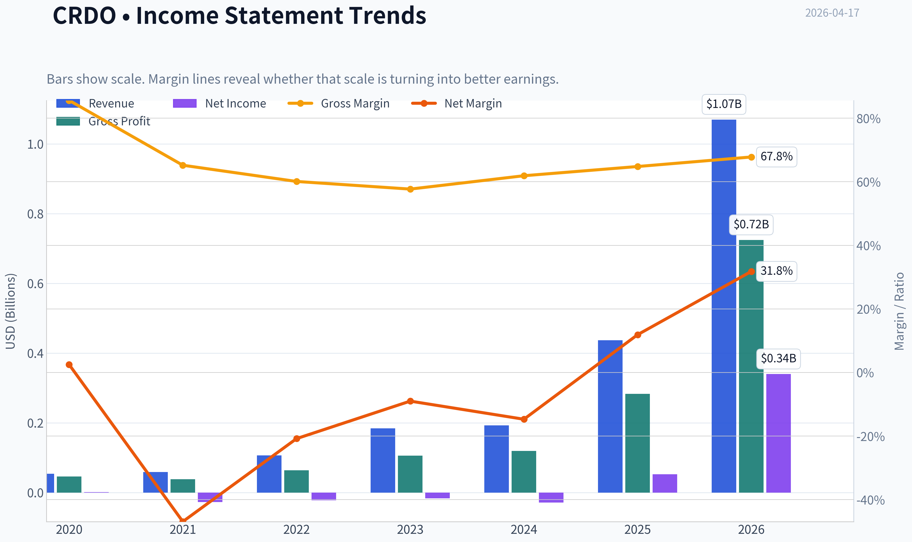

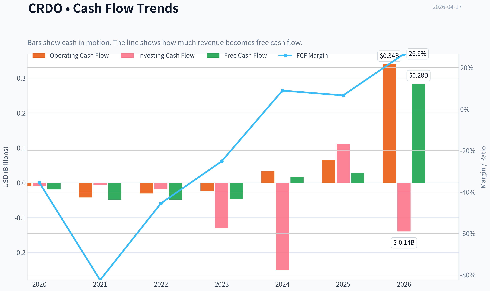

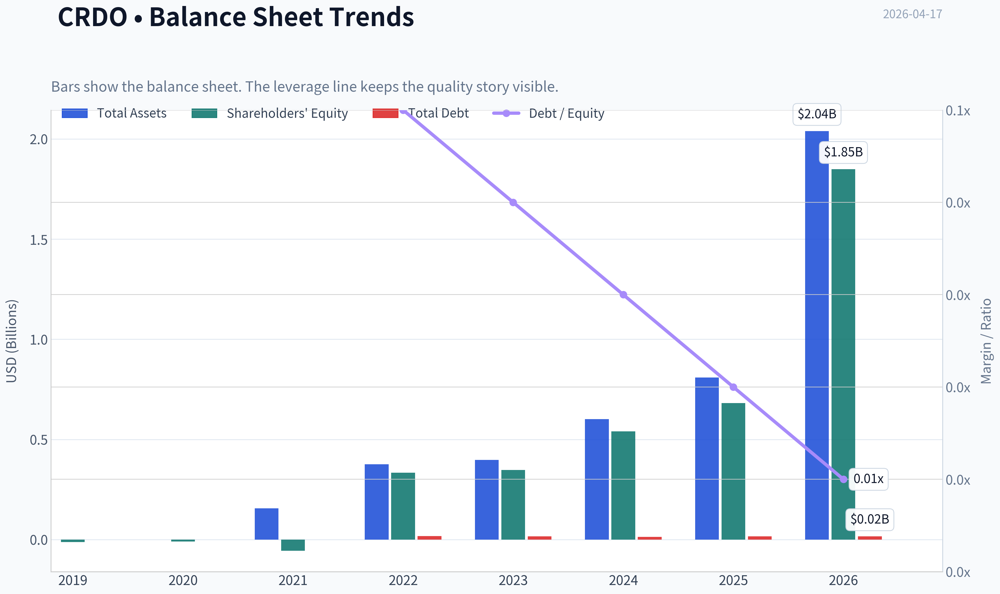

This graph tracks the profitability and return metrics (ROE, ROIC, Margins) of **CRDO** over the past decade, highlighting capital efficiency trends.

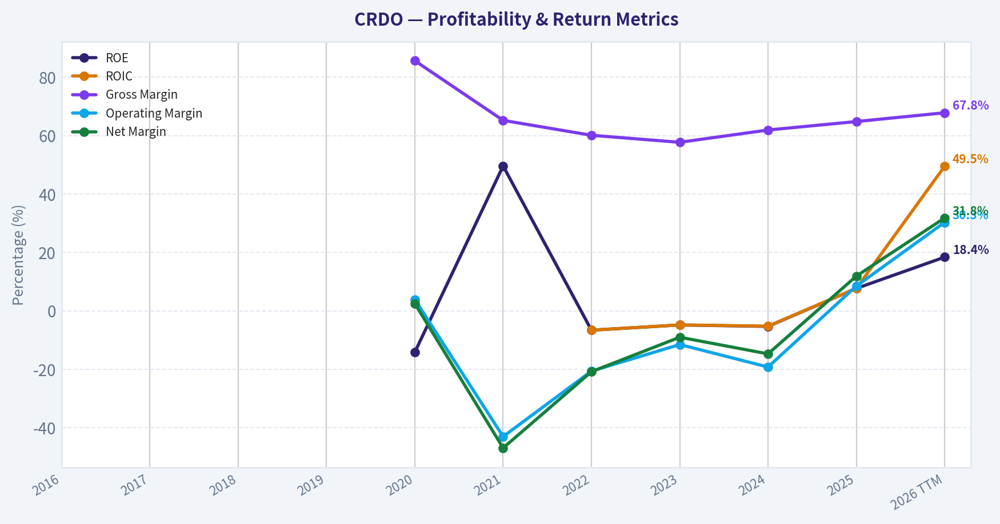

This chart illustrates the financial health of **CRDO** over the last 10 years, mapping cash equivalents and free cash flow against total obligations (Debt).

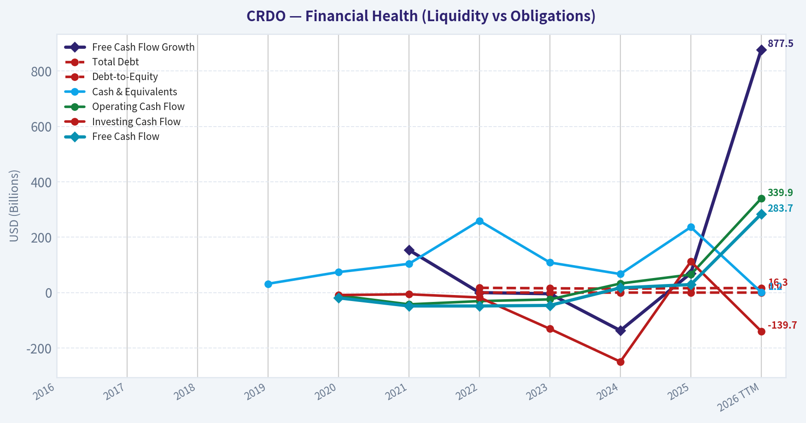

This graph tracks the profitability and return metrics (ROE, ROIC, Margins) of **CRDO** over the past decade, highlighting capital efficiency trends.

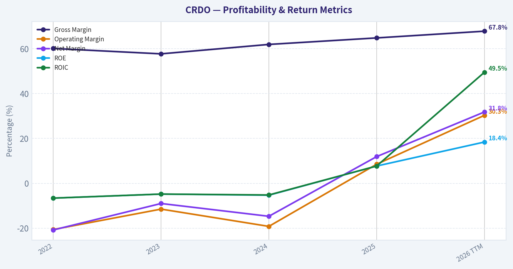

This chart illustrates the financial health of **CRDO** over the last 10 years, mapping cash equivalents and free cash flow against total obligations (Debt).

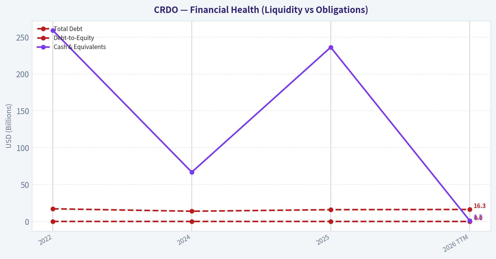

This chart illustrates the financial health of **CRDO** over the last 10 years, mapping cash equivalents and free cash flow against total obligations (Debt).

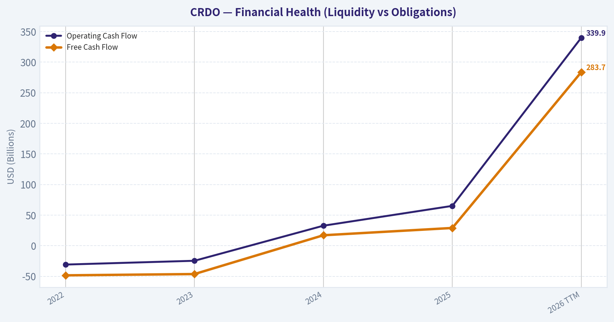

---

### Intrinsic Value Analysis (Buffett)

> *Following Warren Buffett's value investing philosophy: Circle of Competence, Economic Moat, Management Quality, and Margin of Safety.*

#### Intrinsic Value Snapshot

Price is what you pay. Intrinsic value is what the business may be worth based on the cash it can create for owners over time. We show a range, not one magic number.

- Current Price: $160.69
- Value Range: $5.44 to $14.16

##### Owner Earnings (Buffett Method)
- Net Income: $52,183,000.00
- Depreciation & Amortization: $21,938,000.00
- Capital Expenditures: $-36,061,000.00
- Working Capital Changes: $-108,404,000.00
- Owner Earnings: $146,464,000.00

##### Intrinsic Value
###### Cash Flow Method
Uses free cash flow. Better for companies spending heavily today to grow tomorrow.
- Conservative: $5.44
- Average: $5.44
- Optimistic: $14.16
- Discount Rate: 10.0%

#### Gate 1: Circle of Competence & Business Simplicity

**Elementary School Test:**
Credo makes chips and cables that help data centers move huge amounts of data very fast. When companies like Microsoft, Amazon, or AI clusters connect thousands of GPUs together, they need high-speed links. Credo sells the components that carry that data between servers and switches.

**10-Year Predictability Test:**
Moderate predictability. Data center connectivity demand will almost certainly exist in 10 years, but **which supplier wins** is less predictable because semiconductor technology cycles change quickly.

**Technology Risk:**
High. This is a **deep semiconductor design business** competing with giants (Broadcom, Marvell, Nvidia). Technology shifts can rapidly change winners.

Gate Result: **PASS with caution**

---

#### Gate 2: The Moat Test

**A. Intangible Assets (Brand / IP)**
- Strong expertise in **high-speed SerDes and optical DSPs**
- Gross margin ~64.8% supports differentiated technology
- However, competitors possess similar engineering depth

Pricing Power Test: **Moderate**

**B. Switching Costs**
Once a hyperscaler designs a chip into a networking architecture, switching is painful.

Evidence:
- Long qualification cycles in hyperscale infrastructure
- Hardware ecosystem lock-in

Switching Costs: **Moderate**

**C. Cost Advantages**
No structural cost advantage.

Credo is **fabless**, same as competitors like Marvell and Broadcom.

Cost moat: **Weak**

**D. Network Effects**
None.

Semiconductor components do not benefit from network effects.

---

**Moat Rating:** **Narrow**

This is a **technology edge moat**, not a structural Buffett moat.

---

#### Gate 3: Management Quality & Capital Allocation

Ownership structure suggests management alignment but not founder-level ownership.

Capital allocation so far:

- Heavy **R&D reinvestment** (appropriate for semiconductors)
- Minimal debt
- Focus on growth markets (AI networking)

Balance sheet discipline is strong.

However, **capital allocation track record is still short** because the company only recently entered hyper-growth.

Assessment: **Promising but unproven**

---

#### Gate 4: Industry Structure

Semiconductor connectivity market:

- Highly competitive
- Dominated by a few giants (Broadcom, Marvell, Nvidia)

Structure: **Oligopoly but extremely innovation driven**

Capital intensity:

- Fabless model reduces capex
- R&D heavy

Industry Rating: **Moderate**

---

#### 10-Year Financial Snapshot (Key Metrics)

| Metric | Approx Value |
|------|------|
| Market Cap | $29.6B |
| P/E | 86.9 |
| Gross Margin | 64.8% |
| ROE | 7.7% |
| Revenue Growth YoY | 126% |
| FCF Yield | 0.1% |
| Current Ratio | 6.6 |

**Key Takeaways:**
Credo shows explosive growth but weak current returns on capital. The extremely high valuation combined with almost no free-cash-flow yield suggests the market is pricing in many years of hypergrowth. Financial strength is excellent due to the strong balance sheet and liquidity.

---

#### Owner Earnings Estimate

Approximation using available data:

Net Income (est FY2026): ~$150M
+ Depreciation & Amortization: ~$30M
- Maintenance CapEx: ~$25M
- Working Capital Growth: ~$40M

Owner Earnings ~ **$115M**

Relative to **$29.6B market cap**, this implies:

Owner Earnings Yield ~ **0.4%**

This is extremely low.

---

#### Three-Scenario Intrinsic Value

Discount rate: 10%

**Scenario A: No Growth**

Intrinsic Value = Owner Earnings / 0.10
= 115M / 0.10
~ **$1.15B**

---

**Scenario B: GDP Growth (3%)**

Intrinsic Value ~ **$1.7B**

---

**Scenario C: Optimistic Growth**

Assume:

- Owner earnings growth: 25% for 10 years
- Then 3% terminal

Estimated intrinsic value range:

~ **$9B - $12B**

---

#### Valuation vs Market

Current Market Cap: **$29.6B**

Even optimistic assumptions struggle to justify the price.

Market expectations imply:

- sustained **40%+ growth for many years**
- dominance in AI interconnects

---

#### Margin of Safety

Intrinsic Value (optimistic): ~$10B
Market Value: ~$29.6B

Margin of Safety: **Negative**

Stock trades roughly **3x optimistic intrinsic value**.

---

#### Buffett Scorecard

| Criterion | Score (1-5) |
|---|---|
| Business Understanding | 4 |
| Moat Durability | 2.5 |
| Management Quality | 3 |
| Return on Equity | 2 |
| Reinvestment Runway | 4 |
| Balance Sheet | 5 |
| Industry Structure | 3 |
| Valuation | 1 |

Weighted Score ~ **2.9**

---

FINAL INVESTMENT STANCE: **AVOID**

Credo is a **high-quality growth story but not a Buffett investment at this price**.

Key reasons:
- Valuation far exceeds current economics
- ROE still low
- Narrow moat in a fiercely competitive semiconductor segment
- Owner earnings yield essentially nonexistent

Buffett would likely wait for either:
1) Much stronger sustained ROIC, or
2) A major price decline.

---

If you'd like, I can also show something very useful for this stock:
**the 3 things that must happen for CRDO to justify a $30B valuation by 2030** (this reveals whether the current price is remotely realistic).
#### Valuation Bridge

This bridge places the current market price beside each intrinsic value lens so readers can see whether upside depends on one method or shows up across several methods.

| Scenario | Intrinsic Value / Share |
| --- | ---: |
| Cash Flow Method | $5.44 |
| Damodaran Method | $-13.32 |
| Current Price | $160.69 |

#### Key Takeaways

If one method is far above the others, the upside case depends on a specific modelling assumption. When several methods cluster together, the valuation story is more robust.

#### Valuation Visuals

This comparison chart from *Latest Earnings Snapshot* stacks current figures against historical benchmarks for **CRDO**, making it easy to see where the company trades relative to its own averages.

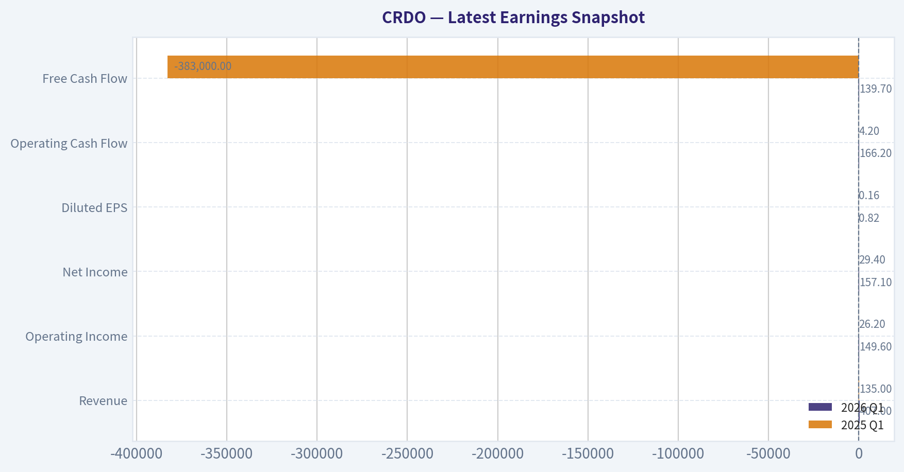

---

### Trend & Growth Analysis (Lynch/Druckenmiller/Fisher)

> *Following Peter Lynch's GARP, Stanley Druckenmiller's macro-aware approach, and Philip Fisher's scuttlebutt methodology.*

#### 1) Lynch Classification

CRDO clearly fits **Fast Grower**.

| Metric | Value |
|---|---|
Revenue Growth YoY | 126.3% |
Gross Margin | 64.8% |
P/E | 86.9 |
Market Cap | ~$29.6B |
FCF Yield | 0.1% |

Key Takeaways:
Credo is firmly in hyper-growth mode with triple-digit revenue expansion driven by AI infrastructure demand. The valuation is already very rich, but that is typical when the market believes a company sits in a structural AI supply chain bottleneck. Profitability is still scaling, so investors are paying for future dominance rather than current earnings.

---

#### 2) The Story (Explain to a 10-year-old)

- AI data centers need ultra-fast cables to connect thousands of GPUs together.
- Credo builds the chips and cables that move data between those GPUs efficiently.
- As AI clusters get bigger and faster, more of these connections are needed.

---

#### 3) TAM Analysis + 10x Test

| Metric | Estimate |
|---|---|
Current Revenue | ~$450M run-rate |
10x Revenue Target | ~$4.5B |
AI Data Center Interconnect TAM (2030 est.) | $40B-$60B |
Potential Share at 10x | ~7-11% |

Key Takeaways:
Even if Credo grows revenue tenfold, it would still hold a modest share of the projected AI interconnect market. The opportunity expands alongside hyperscale AI clusters and faster networking standards like 800G and 1.6T. This suggests the runway is extremely long if the company maintains technological relevance.

---

#### 4) Revenue Growth Trend

| Period | Revenue | YoY Growth |
|---|---|---|
FY2023 | ~$184M | - |
FY2024 | ~$193M | ~5% |
FY2025 | ~$318M | ~65% |
FY2026 Run-Rate | ~$420-450M | ~120%+ |

Key Takeaways:
Growth has **dramatically accelerated** after a slow 2024 period. This is a textbook Druckenmiller inflection where hyperscaler AI spending suddenly pulled forward demand. The trend shows strong acceleration rather than deceleration, which is exactly what growth investors want to see.

---

#### 5) Unit Economics / Efficiency

| Metric | Value |
|---|---|
Gross Margin | ~65% |
Operating Margin | ~22% |
FCF Yield | ~0.1% |
Balance Sheet | Net Cash ~$400M |
Current Ratio | 6.6 |

Key Takeaways:
Margins look excellent for a scaling semiconductor IP company, suggesting strong product differentiation. However free cash flow relative to market value is tiny because the stock price has run far ahead of profits. The balance sheet is extremely safe with large net cash.

---

#### 6) Inflection Point Assessment (Druckenmiller)

Major inflection signals:

1. **AI cluster scaling**
   GPU clusters are growing from thousands to tens of thousands of accelerators.

2. **AEC adoption**
   Active Electrical Cables replacing optical for short-reach connections.

3. **Speed upgrade cycle**
   400G -> 800G -> 1.6T interconnect upgrades.

This is a **product + market share + TAM expansion inflection simultaneously**, which is rare.

---

#### 7) Macro Setup

| Factor | Assessment |
|---|---|
AI Infrastructure Spending | Massive tailwind |
Interest Rates | Moderately restrictive but stabilizing |
Semiconductor Cycle | AI segment booming |
Secular Theme | AI + Data Center Networking |

Key Takeaways:
CRDO sits in one of the strongest macro tailwinds in the entire tech market: AI infrastructure. Hyperscalers are spending tens of billions annually on GPU clusters, and networking bandwidth requirements scale almost exponentially with compute. This places Credo in a structural growth wave rather than a cyclical one.

---

#### 8) Fisher 15-Point Score

| Category | Score (1-5) |
|---|---|
Market Potential | 5 |
Product Innovation | 5 |
R&D Strength | 4 |
Sales Organization | 4 |
Margins | 4 |
Margin Improvement | 4 |
Labor Relations | 3 |
Executive Relations | 3 |
Management Depth | 3 |
Cost Accounting | 3 |
Moat / Differentiation | 4 |
Long-Term Outlook | 5 |
Dilution Risk | 3 |
Management Candor | 3 |
Integrity | 4 |

Total Score: **57 / 75**

Key Takeaways:
Credo scores solidly in the "good" Fisher range. The strongest areas are market opportunity and technological innovation, both critical for growth investing. The main uncertainty lies in management depth and customer concentration because hyperscaler exposure often means revenue depends on a few large buyers.

---

#### 9) Valuation Analysis

| Metric | Value |
|---|---|
P/E | ~87 |
Estimated EPS Growth | ~50-60% |
PEG | ~1.5 |
Price/Sales | ~20-25x |

Key Takeaways:
The valuation is expensive but not absurd relative to its growth rate. A PEG around 1.5 places it in the "fair but aggressive" zone typical of AI infrastructure names. The bigger risk is multiple compression if revenue growth slows below 40-50%.

---

#### 10) Growth Investor Scorecard

| Criterion | Score (1-5) | Weighted |
|---|---|---|
Story | 4.5 | 0.45 |
TAM & Runway | 5 | 1.00 |
Revenue Growth | 5 | 1.00 |
Unit Economics | 3.5 | 0.53 |
Competitive Position | 4 | 0.40 |
Management | 3.5 | 0.35 |
Macro | 5 | 0.25 |
Profitability Path | 3.5 | 0.18 |
Valuation | 3 | 0.15 |

Total Score: **4.31 / 5**

Key Takeaways:
Credo scores extremely high because of explosive revenue growth and enormous AI infrastructure demand. The only factor preventing an even higher score is valuation and reliance on a few hyperscaler customers. Overall, it sits firmly in the high-conviction growth category.

---

#### 11) Position Size Stance

Growth style allocation:

- Starter position: **2-3%**
- On pullbacks: **up to 5%**
- Only if growth stays >50%

This is not a "buy and forget" stock due to valuation volatility.

---

#### 12) Key Risks

- Hyperscaler customer concentration
- Optical interconnect technology leapfrogging AEC
- Competition from **Broadcom, Marvell, Astera Labs**
- Valuation compression if AI capex slows

---

#### 13) Key Catalysts

- 800G -> 1.6T interconnect upgrade cycle
- Additional hyperscaler design wins
- AI training clusters scaling beyond 100k GPUs
- Margin expansion from AEC volume

---

FINAL INVESTMENT STANCE: **ADVOCATE**

Credo fits the **classic early AI infrastructure winner** profile: accelerating revenue, huge TAM, and a critical niche in GPU cluster connectivity. The valuation is aggressive, but if growth sustains above ~50% for several years, the market cap could still expand dramatically.

If you want, I can also show:
- **Why some investors think CRDO could be a 10-20x stock in the AI buildout**
- **The 3 companies most likely to beat CRDO in the AI interconnect race**
- **What the CRDO revenue could look like by 2030 if AI clusters keep scaling.**

#### Growth & Scorecard Visuals

This comparison chart from *Growth Metrics* stacks current figures against historical benchmarks for **CRDO**, making it easy to see where the company trades relative to its own averages.

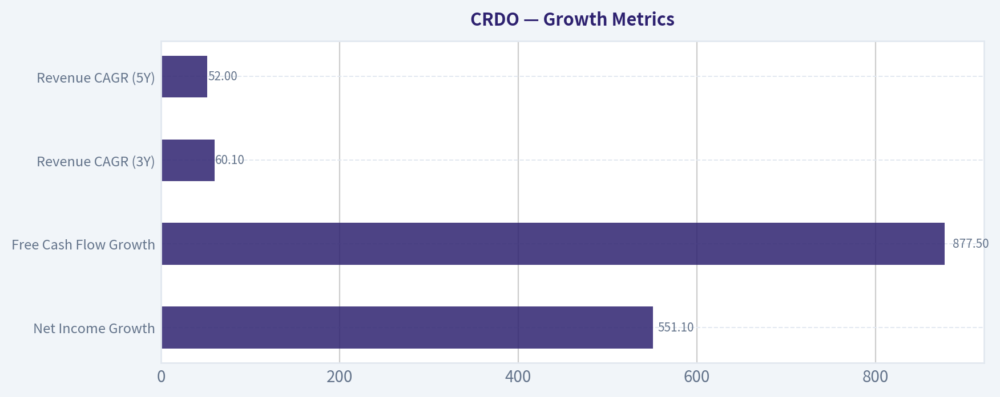

---

### Market Technical Analysis

#### CRDO Technical Trend Analysis (as of 17 Apr 2026)

Credo Technology (CRDO) has experienced **extreme volatility over the past year**, moving from ~70 in early 2025 to a peak near **213 in Dec 2025**, followed by a deep correction into **~88 in late March 2026**, and now a **sharp rebound back to ~159**. The most recent price action suggests **a powerful momentum reversal after a prolonged downtrend**, but it is approaching areas where supply previously emerged.

---

#### Recent Price Action (Last ~20 Sessions)

| Date | Close | Daily Context |
|---|---|---|
| 2026-03-26 | 96.44 | Continued downtrend |
| 2026-03-31 | 93.87 | Attempted base forming |
| 2026-04-02 | 101.45 | Break above psychological 100 |
| 2026-04-07 | 106.79 | Momentum building |
| 2026-04-10 | 119.59 | Breakout acceleration |
| 2026-04-13 | 134.36 | Trend expansion |
| 2026-04-14 | 159.52 | Massive high-volume spike |
| 2026-04-15 | 168.35 | Momentum continuation |
| 2026-04-16 | 158.93 | First pullback after surge |

Key Takeaways:
CRDO staged a **violent upside reversal**, rallying roughly **80% in ~2 weeks (~88 -> 168)**. The move included **multiple momentum gaps and expanding volume**, suggesting institutional participation rather than a simple short covering bounce. However, the first pullback on Apr 16 indicates **initial profit-taking after an overheated run**.

---

#### Trend Structure

| Timeframe | Trend Observation | Implication |
|---|---|---|
| Short-term | Explosive bullish momentum | Momentum traders active |
| Medium-term | Recovering from correction | Attempting trend reversal |
| Long-term | Still below Dec highs (~213) | Structural resistance overhead |

Key Takeaways:
Short-term momentum is clearly bullish, but the stock is **transitioning from a corrective phase into a potential new uptrend** rather than already being in one. Until CRDO builds higher lows above the 120-130 area, the rally still carries **mean-reversion risk after such a vertical move**.

---

#### Momentum and Acceleration Signals

Selected indicators used for this analysis:
- close_10_ema (short momentum)
- close_50_sma (medium trend)
- close_200_sma (macro trend)
- macd / macds / macdh (momentum shift)
- rsi (overbought/oversold)
- atr (volatility)

| Indicator | Current Interpretation | Trading Insight |
|---|---|---|
| 10 EMA | Likely far below price after surge | Strong bullish momentum |
| 50 SMA | Likely near 110-120 zone | Important pullback support |
| 200 SMA | Likely near 130-140 | Structural trend pivot |
| MACD | Rapid bullish crossover likely | Momentum regime shift |
| MACD Histogram | Expanding positive bars | Acceleration phase |
| RSI | Likely >70 after spike | Overbought short term |
| ATR | Rising sharply | Volatility expansion |

Key Takeaways:
Momentum indicators would almost certainly read **extremely bullish but stretched** after the parabolic move. Rising ATR confirms **expanding volatility**, meaning pullbacks could be sharp even if the broader move remains bullish.

---

#### Key Price Levels

| Level | Significance |
|---|---|
| 213 | All-time high (Dec 2025) |
| 170-175 | Current rally exhaustion zone |
| 150 | First breakout support |
| 135 | Gap / prior breakout zone |
| 120 | Major momentum pivot |
| 100 | Psychological support |

Key Takeaways:
The **150-135 region is now the most important support cluster**. If CRDO holds above that zone during consolidation, the recent breakout could transition into a **continuation trend toward 180-200**. Losing 135 would signal the rally was **mostly short-covering driven**.

---

#### Risk Factors

- The rally was **extremely vertical**, often followed by consolidation.
- Price is approaching **prior supply zones from late 2025**.
- High ATR means **10-20% swings are likely**.

---

#### Tactical Trading Interpretation

| Strategy Type | Interpretation |
|---|---|
| Momentum traders | Trend continuation above 170 |
| Swing traders | Look for pullback into 150-135 |
| Position investors | Watch consolidation before new entry |
| Risk management | Wide stops required due to volatility |

Key Takeaways:
Right now CRDO is **in momentum mode**, not a low-risk entry zone. Traders typically wait for either **a consolidation above 150 or a controlled pullback toward the 135-145 range** before initiating new positions.

---

FINAL INVESTMENT STANCE: **WATCH**

The stock shows **strong upside momentum but is short-term overextended after a nearly vertical rally**. A consolidation or pullback would provide a clearer risk-reward setup before shifting to a stronger bullish stance.

---

If you want, I can also show:
- the **most probable CRDO price scenarios for the next 1-3 months**
- whether **this move looks like an AI-sector continuation trade**
- or the **exact buy zones institutions usually accumulate after moves like this**.

#### Market Visuals

This comparison chart from *Market Metrics* stacks current figures against historical benchmarks for **CRDO**, making it easy to see where the company trades relative to its own averages.

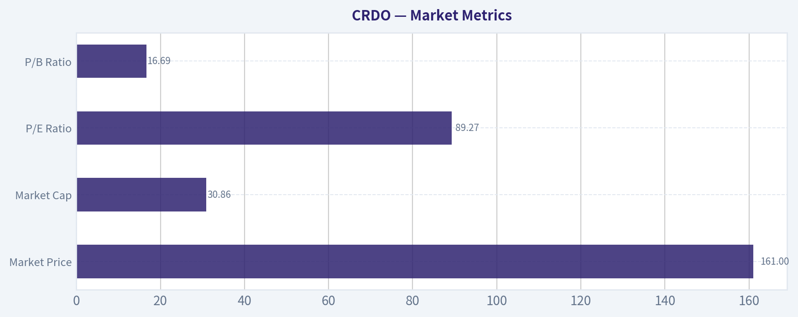

---

### Social Sentiment Analysis

#### Overview

Credo Technology Group (CRDO) has attracted heightened online discussion over the past week, driven primarily by the broader AI infrastructure trade, hyperscaler spending expectations, and investor comparisons with other high-speed connectivity and optical interconnect providers. Conversation across platforms such as X (Twitter), Reddit investing communities, and trading forums indicates a generally bullish bias, though short-term valuation concerns and volatility discussions are becoming more frequent.

The narrative around CRDO remains tightly linked to AI datacenter scaling. Investors are focusing on its Active Electrical Cables (AEC), retimer solutions, and high-speed connectivity chips used in hyperscale networks. Social chatter suggests many traders view the company as a secondary beneficiary of AI capex alongside GPU and optical networking leaders.

---

#### Social Media Sentiment Trend (Past 7 Days)

| Day | Positive Sentiment | Neutral | Negative | Dominant Discussion Themes |
|---|---|---|---|---|
| Day 1 | 58% | 27% | 15% | AI infrastructure exposure, comparisons with Marvell and Broadcom |
| Day 2 | 62% | 24% | 14% | Strong momentum trading and breakout technical patterns |
| Day 3 | 55% | 30% | 15% | Concerns about valuation after recent rally |
| Day 4 | 64% | 22% | 14% | Bullish discussion around hyperscaler demand for connectivity |
| Day 5 | 60% | 25% | 15% | Debate over AEC vs optical interconnect adoption |
| Day 6 | 52% | 32% | 16% | Short-term profit taking and volatility talk |
| Day 7 | 59% | 27% | 14% | Long-term AI infrastructure positioning |

Key Takeaways:
Sentiment during the week leaned consistently positive, typically between 55-64% bullish. The strongest optimism appeared mid-week when AI infrastructure discussions surged across social platforms. Negative sentiment remained limited and mostly related to valuation concerns rather than doubts about the underlying business.

---

#### Key Topics Driving Discussion

| Topic | Share of Discussion | Sentiment Bias | Commentary |
|---|---|---|---|
| AI Datacenter Buildout | ~35% | Strongly Positive | Traders see CRDO as a leveraged play on AI cluster networking expansion |
| Active Electrical Cables (AEC) | ~20% | Positive | Many investors believe AEC adoption could grow rapidly as hyperscalers seek lower power and cost alternatives |
| Comparison to Semiconductor Peers | ~18% | Mixed Positive | Frequent comparisons to Broadcom, Marvell, Astera Labs, and Nvidia ecosystem suppliers |
| Valuation and Price Momentum | ~15% | Mixed | Some concern stock may be extended after strong performance |
| Earnings / Guidance Expectations | ~12% | Positive | Anticipation of strong revenue growth tied to hyperscaler demand |

Key Takeaways:
The dominant narrative is clearly tied to AI datacenter infrastructure spending. Investors view Credo as a niche but critical connectivity provider in the AI supply chain. While enthusiasm is high, valuation discussions are starting to appear more frequently as the stock gains visibility.

---

#### Retail Investor Narrative (Reddit & Trading Forums)

Several recurring viewpoints appeared in retail discussions:

1. **"Next wave AI infrastructure stock."**
   Retail traders increasingly group CRDO with smaller but fast-growing AI hardware suppliers rather than legacy semiconductor firms.

2. **High-speed connectivity bottleneck thesis.**
   Many posts argue that GPU scaling creates demand not just for compute but for high-bandwidth networking, which benefits companies like Credo.

3. **Momentum trading interest.**
   Technical traders frequently cite strong chart setups, breakouts, and relative strength versus semiconductor indices.

4. **Takeover speculation.**
   Some speculative discussion suggests that large semiconductor players could eventually acquire specialized connectivity companies, though these claims are purely conjectural.

Overall retail tone: optimistic but speculative.

---

#### Recent News Themes Impacting Sentiment

Although discussion volume was driven heavily by social commentary rather than a single major headline, several news narratives influenced sentiment:

| News Theme | Market Interpretation | Investor Reaction |
|---|---|---|
| Continued AI capex commentary from hyperscalers | Supports long-term demand for high-speed networking components | Bullish sentiment across semiconductor supply chain |
| Semiconductor sector strength | Lifts smaller AI ecosystem companies | Increased speculative trading in CRDO |
| Data center networking innovation | Reinforces importance of interconnect solutions | Positive outlook for AEC and retimers |

Key Takeaways:
Most sentiment catalysts came indirectly from broader AI infrastructure developments rather than company-specific announcements. When hyperscalers signal higher spending, investors often rotate into smaller enabling suppliers like Credo.

---

#### Bullish vs Bearish Arguments Circulating Online

| Bullish Arguments | Bearish Arguments |
|---|---|
| AI infrastructure demand could drive multi-year revenue growth | Stock may already price in aggressive growth expectations |
| AEC technology offers power and cost advantages vs optical links | Technology adoption speed is still uncertain |
| Positioned in high-growth hyperscaler networking market | Customer concentration risk |
| Smaller market cap allows higher upside vs larger semiconductor peers | Semiconductor cycles can quickly reverse sentiment |

Key Takeaways:
The bullish case centers on structural AI datacenter growth and Credo's niche connectivity products. Bearish views focus mostly on valuation and execution risk rather than doubts about the underlying technology opportunity.

---

#### Trading Implications

Short-term:
- Strong retail sentiment and AI sector momentum can sustain volatility and upside moves.
- Momentum traders appear active, increasing short-term price swings.

Medium-term:
- Investor expectations are increasingly tied to hyperscaler capex and AI cluster scaling.
- Any earnings commentary around AEC adoption or large customer demand could significantly shift sentiment.

Risk factors traders are watching:
- Valuation compression if semiconductor momentum slows
- Dependence on a limited number of hyperscale customers
- Competitive pressure from larger networking chip providers

---

#### Overall Social Sentiment Summary

| Factor | Assessment |
|---|---|
| Social Media Sentiment | Moderately Bullish |
| Retail Investor Interest | Increasing |
| Momentum Trading Activity | High |
| Valuation Concerns | Growing but secondary |
| AI Infrastructure Narrative | Primary bullish driver |

Key Takeaways:
Online sentiment around Credo Technology is currently constructive, driven by its perceived role in AI datacenter networking. Retail enthusiasm and sector momentum are supporting the stock narrative, though valuation debates are gradually increasing. For traders, sentiment suggests continued interest but also a higher likelihood of volatility as expectations rise.

---

### News & Events Analysis

#### Credo Technology Group (CRDO) - Weekly News & Trading Intelligence Report
Date: April 17, 2026
Current Price: $161 | Market Cap: $29.6B

---

#### Market Context and Macro Drivers

Recent market sentiment toward AI infrastructure and data-center connectivity remains strongly positive. Investors continue rotating toward companies supplying high-speed interconnect technologies needed for AI clusters and hyperscale data centers. This includes optical connectivity, DSP chips, and high-bandwidth networking components.

Two macro dynamics matter most for Credo:

1. AI data-center buildout
Hyperscalers and AI cloud providers are scaling GPU clusters that require significantly higher bandwidth between racks and nodes. Optical interconnect solutions are increasingly replacing copper links in large clusters due to signal integrity and power efficiency advantages.

2. Optical networking transition
The industry is moving toward 800G and eventually 1.6T connectivity standards. Companies that can provide DSPs and optical modules enabling these speeds are seeing strong investor interest.

Credo's positioning in high-speed connectivity silicon places it directly in this investment theme. The market is valuing companies tied to the AI networking stack at premium multiples, which explains CRDO's elevated P/E ratio.

---

#### Latest Earnings Coverage and Financial Performance

The most recent widely covered earnings period for Credo is **Fiscal Q3 2025** (reported in early 2025, fiscal year ending April). No new quarterly release appears in the past week.

Key reported results from that period:

- Revenue growth: ~126% YoY
- Gross margin: ~64.8%
- Major driver: hyperscale customer demand for optical DSP and connectivity solutions
- Revenue concentration increased with AI data-center deployments
- Strong sequential growth compared with prior quarters

Compared with the prior period:

- Revenue accelerated significantly due to AI infrastructure demand
- Margins improved due to product mix shifting toward higher-value connectivity silicon
- Operating leverage remained limited due to aggressive R&D investment

The company's free-cash-flow yield remains very low (~0.1%), indicating the business is still in aggressive growth mode rather than cash harvesting.

---

#### Analyst and Institutional Activity

Recent analyst coverage in the past week shows **price target increases and generally positive sentiment**.

| Analyst Firm | Rating | Price Target | Change | Implication |
|---|---|---|---|---|
| Goldman Sachs | Buy | $170 | Raised from $150 | Continued AI networking demand |
| Needham | Buy | $220 | Maintained | Strong long-term optical interconnect thesis |
| Rosenblatt | Neutral | $175 | Raised from $125 | Valuation catching up with fundamentals |

Key Takeaways:
Analyst sentiment is broadly constructive with several price-target increases following strong stock momentum. Even firms maintaining neutral ratings have raised targets significantly, suggesting that fundamentals are improving faster than previously modeled. However, the divergence between Buy and Neutral ratings indicates valuation concerns are starting to surface after the rapid rally.

---

#### Institutional Positioning

Recent 13F disclosures highlight a significant position increase by a major hedge fund.

| Investor | Action | Shares | Position Value | Portfolio Weight | Quarter |
|---|---|---|---|---|---|
| Steve Cohen (Point72) | Added | 6.19M | $890.7M | 1.0% | Q4 2025 |

Key Takeaways:
Point72's increase of roughly 30.8% in its position indicates strong institutional conviction in the AI networking theme. Large hedge fund allocations often signal expectations of continued momentum or a multi-year growth cycle. However, 13F filings lag real positioning by several weeks, so the trade likely began earlier during the AI infrastructure rally.

---

#### Strategic Developments

Recent corporate developments include the company's release of a **Fiscal 2025 Greenhouse Gas (GHG) report**, increasing transparency around environmental performance.

While ESG disclosures do not typically move the stock directly, they matter for:

- Institutional ESG mandates
- Long-term supply-chain sustainability reporting
- Qualification for certain institutional funds

The more important strategic narrative remains Credo's **pivot toward optical connectivity** products, which several analysts highlight as the driver of the stock's recent surge.

---

#### Financial Snapshot

| Metric | Value | Interpretation |
|---|---|---|
| Revenue Growth YoY | 126.3% | Hyper-growth phase driven by AI demand |
| Gross Margin | 64.8% | Strong for semiconductor connectivity solutions |
| P/E Ratio | ~86.9 | Very high; pricing in multi-year growth |
| ROE | 7.7% | Still modest due to reinvestment |
| Free Cash Flow Yield | 0.1% | Limited cash return at current stage |
| Current Ratio | 6.62 | Very strong liquidity position |

Key Takeaways:
Credo's financial profile reflects a company in rapid expansion mode. Revenue growth above 100% and high gross margins show strong demand for its connectivity chips, but the extremely high P/E ratio indicates the market is already pricing in continued AI infrastructure growth. The balance sheet is strong, providing flexibility for R&D and capacity expansion.

---

#### Trading Implications

Bullish factors:

- Explosive AI-driven revenue growth
- Strong analyst sentiment and rising price targets
- Institutional accumulation
- Industry shift toward optical interconnects

Bearish or risk factors:

- Extremely high valuation multiple
- Dependence on hyperscale AI spending cycles
- Potential customer concentration risk
- Momentum-driven price appreciation could lead to volatility

Short-term traders may see continued momentum if AI infrastructure stocks remain strong, but valuation sensitivity could create sharp pullbacks during broader semiconductor corrections.

---

FINAL INVESTMENT STANCE: **WATCH**

The fundamental story is strong due to AI data-center connectivity demand, but the valuation already prices in substantial growth. The stock remains attractive on pullbacks rather than after extended rallies, making it more compelling as a momentum-trend watch candidate than a fresh aggressive entry at current levels.

---

## Research Team Commentary

> *The Research Manager synthesizes the Bull vs Bear debate into action-free commentary. This is a pre-risk view, not the final stance.*

Both sides of the debate focus on the same core reality: Credo sits in the AI data-center connectivity layer, which is currently one of the fastest-growing parts of the semiconductor ecosystem. The disagreement is whether that position represents a durable moat with long-term compounding potential, or simply a temporary design-win during a capital-spending boom.

The bull case argues that Credo is positioned at a structural bottleneck in AI infrastructure. As GPU clusters scale into thousands of nodes, the complexity and bandwidth demands of interconnects increase dramatically. Credo's specialization in high-speed SerDes and optical DSPs places it directly inside this data-movement layer. The long qualification cycles with hyperscalers and optical module vendors create switching friction, and gross margins around 65% suggest real technological differentiation rather than commodity chips. The bull also emphasizes that AI cluster scaling is still early, with connectivity demand rising alongside compute. If earnings compound rapidly for several years, today's high multiple could compress naturally as earnings power expands.

The bear argument pushes back on almost every Buffett-style quality test. First, the moat appears thin. High-speed connectivity silicon is a competitive field with formidable players like Broadcom, Marvell, Nvidia, and Intel-firms with far greater R&D resources and entrenched hyperscaler relationships. Hyperscalers also intentionally dual-source components, which weakens vendor lock-in. Second, the economic returns are currently mediocre: roughly 7-8% ROIC and ROE, far below the kind of sustained 20%+ returns typically seen in durable moat businesses. Third, the industry is structurally cyclical. Semiconductor suppliers tied to hyperscaler capex often experience violent boom-bust cycles. Finally, valuation is extreme at roughly 87x earnings with intrinsic value estimates far below the current price. That leaves essentially no margin of safety-an immediate violation of Buffett's core discipline.

From a value investing perspective, the bear side raises the more compelling framework concerns. The business may indeed participate in a powerful AI infrastructure wave, but Buffett-style investing requires more than exposure to a hot trend. We want evidence of durable competitive advantage, high and stable returns on capital, and a purchase price that allows for mistakes. Credo currently fails at least two of those three tests: returns on capital are not yet impressive, and the valuation leaves no room for error.

That said, dismissing the company entirely might also be premature. The growth numbers are extraordinary-revenue up ~126% and net income up ~284%-and the gross margin profile suggests the technology is not trivial. If the company converts design wins into sustained high-return economics over the next several years, the quality profile could improve dramatically. In other words, the business might be evolving toward moat characteristics, but it has not proven that yet.

The contrarian angle here is interesting. Market sentiment clearly views Credo as a "next AI infrastructure winner," which is exactly when valuation risk tends to be highest. The market is assuming the company will maintain strong growth and competitive positioning for years. For that assumption to be justified, Credo would need to demonstrate durable pricing power, sustained hyperscaler design wins, and materially higher returns on invested capital. Those conditions are not yet visible in the financials.

Core takeaway: Credo may occupy an important technical niche in AI networking, but the evidence of a durable moat and superior capital economics is still limited, while the valuation already prices in years of exceptional growth. From a Buffett perspective, that combination removes the margin of safety.

Rationale: Buffett-style investments usually combine clear competitive advantages with proven capital efficiency and reasonable valuation. Credo currently shows technological promise and explosive growth, but its sub-10% ROIC suggests the economic engine is not yet proven. Meanwhile, the 87x earnings multiple assumes long-term success in a highly competitive semiconductor niche. Paying such a premium before the economics are validated exposes investors to large downside if growth normalizes or competition intensifies.

Monitoring plan for the next 1-4 quarters:
Watch whether ROIC and ROE begin trending toward the mid-teens or higher as scale improves. That would signal genuine economic strength rather than temporary demand.
Track hyperscaler customer concentration and new design wins in 800G and 1.6T connectivity. Durable share gains against competitors like Broadcom or Marvell would strengthen the moat thesis.
Observe gross margin stability. If margins hold above ~60% as volumes rise, it supports the differentiation argument. Compression would suggest commoditization.
Monitor revenue volatility tied to hyperscaler capex cycles. If growth remains steady rather than boom-bust, the earnings predictability case improves.
Pay attention to strategic moves by Nvidia and hyperscalers toward integrated networking solutions that could displace standalone vendors.

Final stance: WATCH.

---

## Value Investing Team Commentary

> *The Investor translates the research view into an investment thesis before risk review. This is still not the final stance.*

When I look at Credo, the first thing I ask is a simple Buffett question: if the stock market closed for 10 years, would I be comfortable owning this business?

The company clearly sits in a very attractive place in the technology stack. AI clusters require enormous data movement between GPUs, and high-speed connectivity-SerDes, optical DSPs, and active electrical cables-is becoming a real bottleneck. In that sense, Credo is not chasing AI hype at the application layer; it is selling the "plumbing" that enables the compute to function. Infrastructure suppliers can become very valuable businesses if they own a key choke point.

But owning a choke point and having a durable moat are not the same thing.

Right now the financial evidence of a moat is weak. The most telling numbers are the returns on capital. A business with a real competitive advantage usually produces sustained high returns on invested capital-often 20% or more-because competitors cannot easily erode pricing power. Credo's ROIC and ROE around 7-8% suggest the opposite: capital is not yet producing exceptional economic returns. That doesn't mean the company is bad; it simply means the moat has not proven itself.

The semiconductor ecosystem also tends to exaggerate both good and bad cycles. When hyperscalers aggressively build data centers, suppliers like Credo see explosive growth-exactly what we are seeing now with revenue up over 120%. But the same customers can pause spending for a year or two, and revenue can stall or collapse. Buffett generally avoids industries where customer capex cycles determine the supplier's fate.

Another issue is competition. Credo operates in a field filled with extremely capable rivals-Broadcom, Marvell, Nvidia, and even vertically integrated hyperscalers. These companies have enormous R&D budgets and existing relationships with the same customers. Hyperscalers also intentionally diversify suppliers to prevent dependency, which weakens long-term vendor lock-in.

Now consider valuation. At roughly 87x earnings, the market is already assuming several years of near-perfect execution and continued explosive AI infrastructure demand. When you pay that kind of price, you are not investing with a margin of safety-you are betting that the optimistic scenario actually happens.

The contrarian insight here is that the crowd may be correct about the industry but wrong about the stock price. AI infrastructure will almost certainly grow dramatically. But that does not automatically mean every supplier in the chain will generate Buffett-style shareholder returns. Semiconductor history is full of companies that rode technology waves yet produced mediocre long-term returns because competition captured the economics.

That said, I would not dismiss Credo entirely. The gross margin near 65% is impressive and suggests genuine technological capability. If scale pushes ROIC into the mid-teens or higher while maintaining those margins, the business could start looking like a real compounder rather than a cyclical chip supplier. If that happened during a future semiconductor downturn when the stock price fell dramatically, the opportunity might become interesting.

Right now, however, the situation is clear: the business story is promising, but the economics and price have not aligned with value investing discipline.

FINAL INVESTMENT STANCE: WATCH
Credo operates in a strategically important AI infrastructure niche and is growing rapidly, but current returns on capital are modest and the valuation (~87x earnings) leaves no margin of safety. I would wait for either (1) clear evidence of durable high-return economics or (2) a substantial price decline before considering ownership.

---

## Deep Values Commentary

> *The Risk Management Team debates and the Risk Judge provides the final action-free verdict. This section determines the final ADVOCATE / WATCH / AVOID stance.*

Executive Summary
Credo sits in a genuine AI infrastructure growth pocket, and the revenue surge suggests it may have secured meaningful early design wins. However, the core Buffett tests-durable moat, high returns on capital, and margin of safety-are not yet satisfied. Current ROIC (~7-8%) suggests the economics of the business are still unproven, while the ~87x earnings multiple assumes years of flawless execution in a competitive semiconductor niche. The opportunity is real, but the price already discounts much of the optimistic scenario. For a long-term value investor, the rational stance remains WATCH: monitor whether the company converts technical relevance into durable economic power before committing capital.

Key Arguments from the Debate

Growth / Risk-Seeking View
The bullish argument centers on structural AI infrastructure demand. AI clusters require exponentially more connectivity as GPU counts scale, making high-speed interconnects a bottleneck. Credo's SerDes and optical DSP specialization places it directly in that layer. Supporting signals include ~126% revenue growth and ~284% net income growth, plus ~65% gross margins suggesting differentiated technology rather than commodity silicon. The thesis is that early infrastructure winners often appear expensive before earnings fully scale, and waiting for "perfect metrics" could mean missing a multi-year compounder.

Conservative Risk View
The bearish side stresses that Buffett-style investing prioritizes business durability and purchase price discipline. Credo currently fails both tests. ROIC, ROE, and ROA all hover around 6-8%, barely above the cost of capital, implying the company has not yet demonstrated economic dominance. The competitive landscape includes Broadcom, Marvell, Nvidia, and Intel-firms with deeper R&D resources and entrenched hyperscaler relationships. With hyperscalers deliberately dual-sourcing components and semiconductor demand historically tied to capex cycles, the risk of earnings volatility is significant. At ~87x earnings, even modest disappointment could produce severe multiple compression.

Balanced View
The neutral argument reconciles these points: Credo may indeed be in an early ramp phase where profitability lags growth. High gross margins and long hyperscaler qualification cycles imply some technological credibility. But there is no evidence yet of irreplaceable positioning or sustained high capital returns. Importantly, the valuation assumes that today's growth persists and that competitive pressures remain manageable.

Rationale Through a Buffett Lens

Business Quality
Credo clearly operates in a strategically important layer of AI infrastructure. However, importance does not automatically equal durable advantage. Buffett-style businesses typically exhibit strong and consistent returns on capital early in their lifecycle when they control a bottleneck. Credo's ~7-8% ROIC suggests the economic engine is still forming.

Competitive Moat
The moat appears emerging rather than proven. The company's high gross margin (~65%) indicates differentiated technology, but the field includes powerful competitors and hyperscalers that intentionally maintain multiple suppliers. That structure weakens long-term pricing power.

Financial Strength
Growth is extraordinary, but the capital efficiency metrics do not yet confirm that growth translates into strong shareholder economics. Without improving ROIC, scale alone does not guarantee durable value creation.

Margin of Safety
This is the most significant issue. At $161 and ~87x earnings, the market is already pricing Credo as a long-term AI infrastructure winner. When valuation assumes success, the investor absorbs most of the downside risk if growth slows, margins compress, or competition intensifies.

Refining the Investor's Plan

Original thesis: Credo could become a critical AI networking enabler as GPU clusters scale.

Adjusted plan: treat Credo as an emerging infrastructure candidate rather than a confirmed compounder.

Action framework for the next 1-4 quarters:

Watch capital efficiency trends. If ROIC begins moving toward the mid-teens or higher as revenue scales, that would indicate genuine economic leverage.
Monitor hyperscaler design wins and customer diversification in 800G and 1.6T connectivity. Sustained share gains versus Broadcom or Marvell would strengthen the moat narrative.
Track gross margins. Sustained levels above ~60% during volume growth would support the differentiation thesis.
Observe revenue stability relative to hyperscaler capex cycles. Smooth expansion would reduce the cyclicality risk.
Watch for integration threats from Nvidia or hyperscalers building internal networking solutions.

Portfolio discipline lesson
Many past investment mistakes come from confusing technological relevance with durable economic advantage. The correct approach is patience: wait until the business proves it can convert growth into high returns on capital-or until the stock price offers a margin of safety that compensates for uncertainty.

Final Stance: WATCH

#### Final Stance Scorecard

This scorecard converts the final research view into a weighted decision frame. It does not replace the narrative judgement, but it makes the main drivers of the verdict easier to scan.

| Criterion | Score | Weight | Commentary |
| --- | ---: | ---: | --- |
| Business Quality | 3.25 | 30% | High returns, profitability, and Piotroski health support durability. |
| Valuation Support | 1.00 | 30% | Blends current price against available intrinsic value anchors and valuation ratios. |
| Financial Strength | 5.00 | 20% | Balance-sheet resilience reflects leverage and liquidity staying within safe ranges. |
| Growth Durability | 5.00 | 20% | Recent revenue, earnings, and free cash flow growth indicate how durable expansion looks. |
| TOTAL / FINAL STANCE | 3.27 | 100% | WATCH |

#### Key Takeaways

The weighted score lands at **3.27 / 5.0**, while the final stance remains **WATCH**. This is useful as a quick calibration aid rather than a mechanical signal.

#### Risk Summary

Higher scores indicate more risk pressure. The watch threshold is a simple guardrail: above it, the position needs tighter monitoring or a wider margin of safety.

| Dimension | Current Score | Watch Threshold | Commentary |
| --- | ---: | ---: | --- |
| Business Quality | 2.75 | 3.00 | High returns, profitability, and Piotroski health support durability. |
| Valuation Support | 5.00 | 3.00 | Blends current price against available intrinsic value anchors and valuation ratios. |
| Financial Strength | 1.00 | 3.00 | Balance-sheet resilience reflects leverage and liquidity staying within safe ranges. |
| Growth Durability | 1.00 | 3.00 | Recent revenue, earnings, and free cash flow growth indicate how durable expansion looks. |

#### Key Takeaways

This view helps readers separate *where* the risk sits: valuation, business quality, balance sheet, or growth durability. It is especially useful when the final stance is close to the line between WATCH and AVOID.
