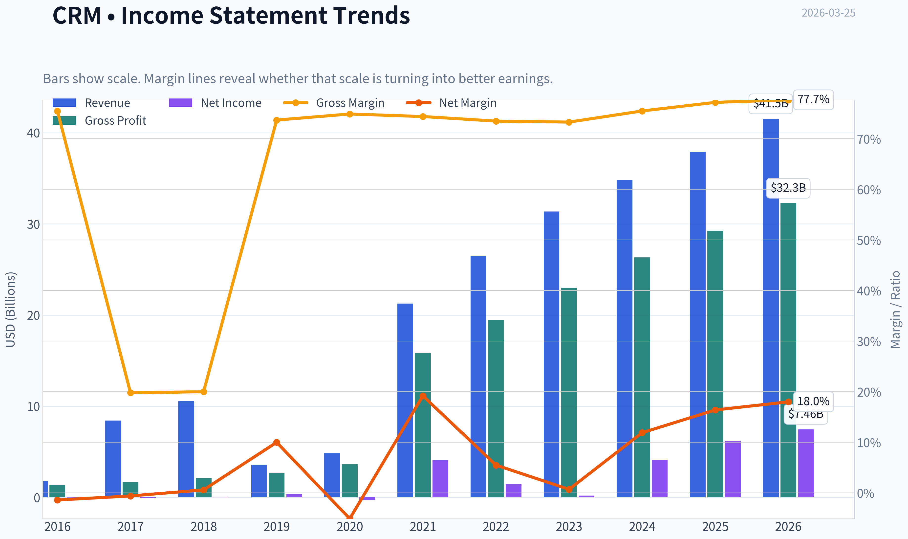
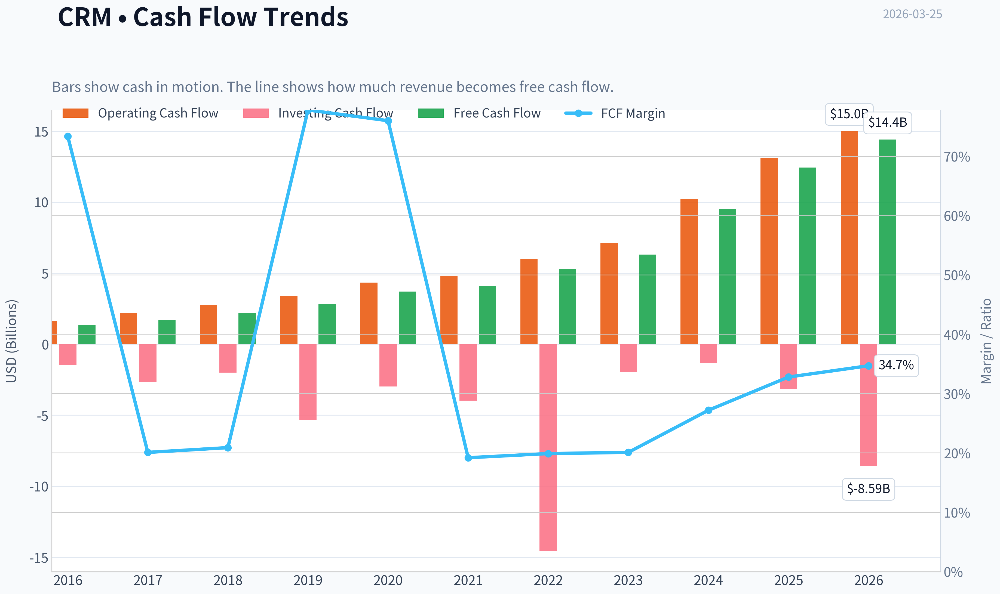
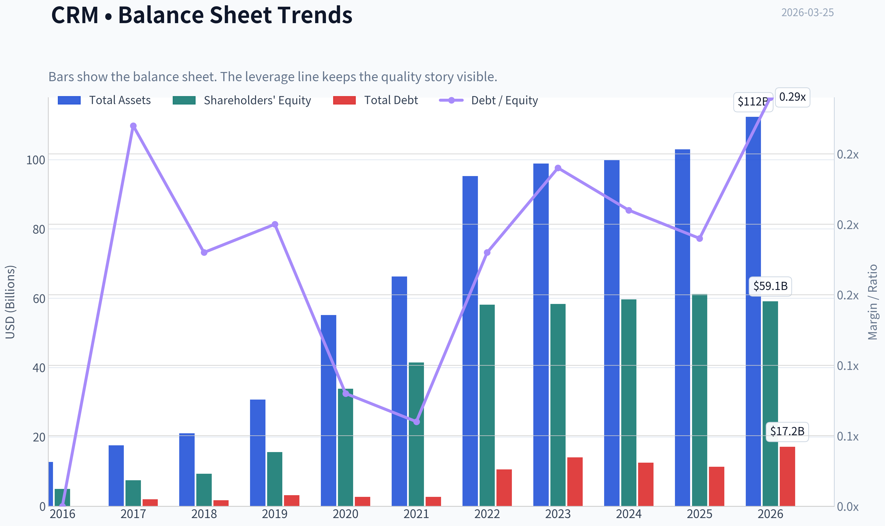
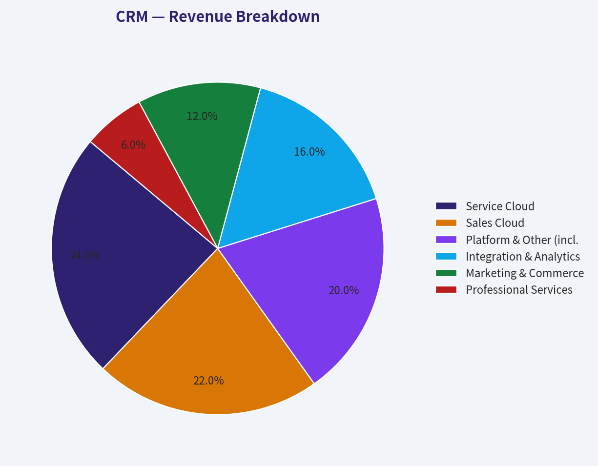
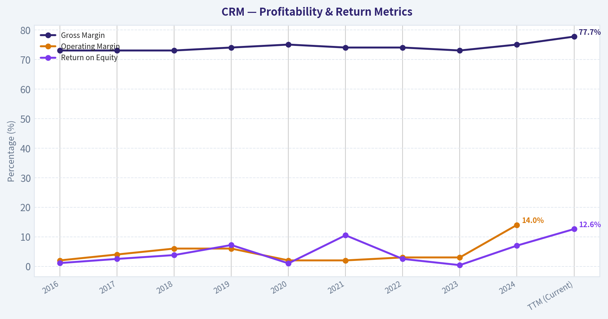
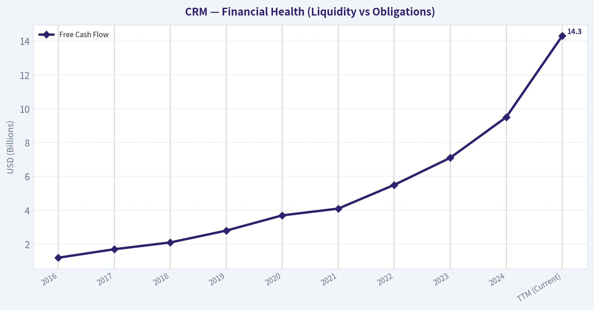
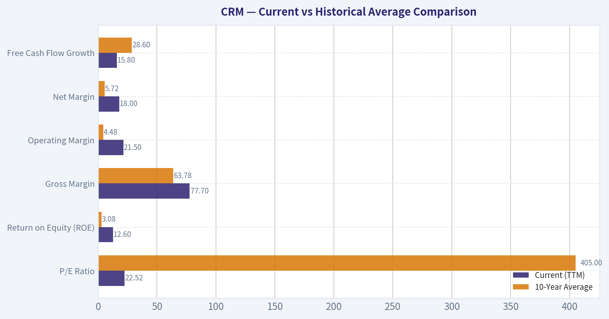
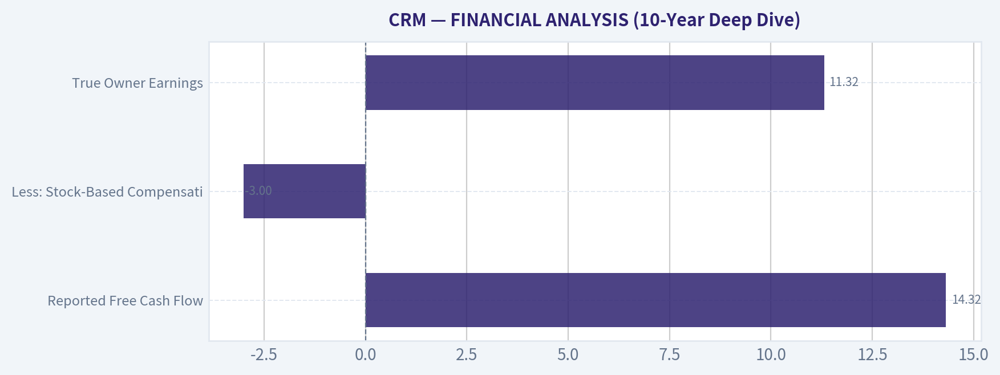

# CRM Deep Value Intelligence

**Analysis Date:** 2026-03-25

## Critical Disclaimer

*This analysis is generated by Deep Value Intelligence, an AI-powered multi-agent investing framework. This report is for informational and educational purposes only and does not constitute financial advice. Always conduct your own research and consult with qualified financial advisors before making investment decisions.*

---

## Table of Contents

1. Intelligence Summary
2. Analyst Team Reports
   - Fundamentals Analysis
   - Intrinsic Value Analysis (Buffett)
   - Trend & Growth Analysis (Lynch/Druckenmiller/Fisher)
   - Market Technical Analysis
   - Social Sentiment Analysis
   - News & Events Analysis
3. Research Team Commentary
4. Value Investing Team Commentary
5. Deep Values Commentary

---

## Intelligence Summary

### Thesis + Conditions

**Core Thesis:** **EXECUTIVE SUMMARY**
Salesforce (CRM) is a classic transition story: evolving from a "growth-at-all-costs" SaaS darling into a mature, high-margin cash compounder. At ~$182 (23x P/E), the market is underpricing its durable economic moat (agonizingly high switching costs) and its massive operational leverage (15.8% FCF growth on 9.6% revenue growth).

**Key Risks:**
- Salesforce (CRM) is a classic transition story: evolving from a "growth-at-all-costs" SaaS darling into a mature, high-margin cash compounder. At ~$182 (23x P/E), the market is underpricing its durable economic moat (agonizingly high switching costs) and its massive operational leverage (15.8% FCF growth on 9.6% revenue growth). While top-line growth has normalized, management's new discipline heavily de-risks the downside. This is a quintessential Buffett setup: a wonderful business at a fair price, suffering a temporary narrative penalty.
- The Bear Case (Mediocre Returns & Competition):** An ROIC of 10.1% is historically weak for a dominant software franchise. The recent margin expansion may be a one-time product of activist-forced cost cuts, not structural superiority. Macro headwinds and Microsoft's aggressive bundling threaten to compress multiples if growth slips to the mid-single digits.
- The Nuanced Middle (Show-Me Compounder):** A 23 P/E is fair, but not a screaming bargain. The real value unlocks will only materialize if management avoids returning to its historically destructive mega-M&A habits and steadily improves ROIC through buybacks and margin discipline.
- Following value investing principles, risk is permanent capital loss, not temporary growth deceleration. Salesforce's status as the enterprise "system of record" creates tremendous switching costs-ripping it out is operational surgery. This forms a deep, durable moat.
- While the Safe Analyst correctly highlights the immense dispersion in valuation models (ranging from negative to $456B), the blended expected intrinsic value of ~$241B implies a ~29% Margin of Safety at the current $170B market cap. Even if top-line growth stabilizes in the high-single digits, a 78% gross margin combined with an end to empire-building acquisitions ensures a predictable, growing stream of owner earnings. We are buying quality and predictability over hyper-growth.

**What Would Change Our View:**
- Salesforce (CRM) is a classic transition story: evolving from a "growth-at-all-costs" SaaS darling into a mature, high-margin cash compounder. At ~$182 (23x P/E), the market is underpricing its durable economic moat (agonizingly high switching costs) and its massive operational leverage (15.8% FCF growth on 9.6% revenue growth). While top-line growth has normalized, management's new discipline heavily de-risks the downside. This is a quintessential Buffett setup: a wonderful business at a fair price, suffering a temporary narrative penalty.
- The Bear Case (Mediocre Returns & Competition):** An ROIC of 10.1% is historically weak for a dominant software franchise. The recent margin expansion may be a one-time product of activist-forced cost cuts, not structural superiority. Macro headwinds and Microsoft's aggressive bundling threaten to compress multiples if growth slips to the mid-single digits.
- The Nuanced Middle (Show-Me Compounder):** A 23 P/E is fair, but not a screaming bargain. The real value unlocks will only materialize if management avoids returning to its historically destructive mega-M&A habits and steadily improves ROIC through buybacks and margin discipline.
- Following value investing principles, risk is permanent capital loss, not temporary growth deceleration. Salesforce's status as the enterprise "system of record" creates tremendous switching costs-ripping it out is operational surgery. This forms a deep, durable moat.
- While the Safe Analyst correctly highlights the immense dispersion in valuation models (ranging from negative to $456B), the blended expected intrinsic value of ~$241B implies a ~29% Margin of Safety at the current $170B market cap. Even if top-line growth stabilizes in the high-single digits, a 78% gross margin combined with an end to empire-building acquisitions ensures a predictable, growing stream of owner earnings. We are buying quality and predictability over hyper-growth.

**Confidence:** Medium

---

## Analyst Team Reports

### Fundamentals Analysis

#### Latest Earnings Snapshot

*Most recent reported quarter anchored on 2026 Q1, with prior-year comparison when available.*

| Metric | 2026 Q1 | 2025 Q1 | YoY Change |
| --- | ---: | ---: | ---: |
| Revenue | $11.20B | $9.99B | +12.1% |
| Operating Income | $2.15B | $2.12B | +1.7% |
| Net Income | $1.94B | $1.71B | +13.8% |
| Diluted EPS | N/A | $1.75 | N/A |
| Operating Cash Flow | $5.46B | $3.97B | +37.6% |
| Free Cash Flow | $5.32B | $3.82B | +39.5% |

Key Takeaways: This snapshot anchors the most recent reported quarter before the narrative analysis. It helps readers separate long-run business quality from whatever changed in the latest earnings print.

#### 10-Year Financial Metrics for CRM

*All values below are computed deterministically from raw data - not estimated by AI.*

*Issuer profile: operating company (Technology / Software - Application).*

#### 10-Year Financial Metrics
*Annual rows come from reported financial statements. The final TTM row is computed from the latest four quarters.*

| Metric | 2016 | 2017 | 2018 | 2019 | 2020 | 2021 | 2022 | 2023 | 2024 | 2025 | 2026 TTM |
| --- | --- | --- | --- | --- | --- | --- | --- | --- | --- | --- | --- |
| Market Price | $68 | $101 | $136 | $161 | $221 | $252 | $230 | $166 | $278 | $339 | $182 |
| Market Cap | $44.90B | $70.96B | $99.74B | $124.95B | $187.51B | $234.29B | $128.02B | $167.47B | $276.59B | $332.82B | $167.95B |
| P/E Ratio | N/A | N/A | 1436.93 | 334.48 | N/A | 56.18 | 86.93 | 799.86 | 66.93 | 53.73 | 22.52 |
| P/B Ratio | 8.98 | 9.46 | 10.62 | 8.01 | 5.53 | 5.65 | 2.20 | 2.87 | 4.64 | 5.44 | 2.84 |
| ROE | -0.5% | -0.7% | 0.7% | 2.3% | -0.7% | 9.8% | 2.5% | 0.4% | 6.9% | 10.1% | 12.6% |
| ROIC | 0.2% | 0.2% | 1.0% | 3.2% | -0.5% | 9.6% | 2.4% | 0.5% | 6.3% | 9.2% | 10.1% |
| EPS | $-0.04 | $-0.07 | $0.09 | $0.48 | $-0.30 | $4.48 | $1.51 | $0.21 | $4.20 | $6.36 | $8.08 |
| Revenue | $1.81B | $8.44B | $10.54B | $3.60B | $4.85B | $21.25B | $26.49B | $31.35B | $34.86B | $37.90B | $41.52B |
| Gross Profit | $1.37B | $1.67B | $2.11B | $2.66B | $3.63B | $15.81B | $19.47B | $22.99B | $26.32B | $29.25B | $32.26B |
| Gross Margin | 75.5% | 19.8% | 20.0% | 73.7% | 74.9% | 74.4% | 73.5% | 73.3% | 75.5% | 77.2% | 77.7% |
| Operating Margin | 1.1% | -1.0% | 0.7% | 3.8% | -0.7% | 2.1% | 2.1% | 3.3% | 14.4% | 19.0% | 21.5% |
| Net Income | $-25.5M | $-51.4M | $67.6M | $362.0M | $-248.0M | $4.07B | $1.44B | $208.0M | $4.14B | $6.20B | $7.46B |
| Net Margin | -1.4% | -0.6% | 0.6% | 10.0% | -5.1% | 19.2% | 5.5% | 0.7% | 11.9% | 16.4% | 18.0% |
| Revenue Growth | 25.2% | 26.8% | 359.5% | -65.8% | 34.6% | 338.1% | 24.7% | 18.4% | 11.2% | 8.7% | 9.6% |
| Net Income Growth | 61.2% | -101.6% | 231.3% | 435.9% | -168.5% | 1741.9% | -64.5% | -85.6% | 1888.5% | 49.8% | 20.3% |
| Free Cash Flow Growth | N/A | 27.9% | 29.8% | 27.2% | 31.6% | 10.9% | 29.1% | 19.5% | 50.5% | 30.9% | 15.8% |
| Total Book Value | $5.00B | $7.50B | $9.39B | $15.61B | $33.88B | $41.49B | $58.13B | $58.36B | $59.65B | $61.17B | $59.14B |
| Total Assets | $12.77B | $17.58B | $21.01B | $30.74B | $55.13B | $66.30B | $95.21B | $98.85B | $99.82B | $102.93B | $112.31B |
| Total Debt | N/A | $2.01B | $1.73B | $3.20B | $2.69B | $2.69B | $10.60B | $14.09B | $12.59B | $11.39B | $17.18B |
| Debt-to-Equity | 0.00 | 0.27 | 0.18 | 0.20 | 0.08 | 0.06 | 0.18 | 0.24 | 0.21 | 0.19 | 0.29 |
| Cash & Equivalents | $1.16B | $1.61B | $2.54B | $2.67B | $4.14B | $6.20B | $5.46B | $7.02B | $8.47B | $8.85B | $7.33B |
| Shareholders' Equity | $5.00B | $7.50B | $9.39B | $15.61B | $33.88B | $41.49B | $58.13B | $58.36B | $59.65B | $61.17B | $59.14B |
| Operating Cash Flow | $1.61B | $2.16B | $2.74B | $3.40B | $4.33B | $4.80B | $6.00B | $7.11B | $10.23B | $13.09B | $15.00B |
| Investing Cash Flow | $-1.49B | $-2.68B | $-2.01B | $-5.31B | $-2.98B | $-3.97B | $-14.54B | $-1.99B | $-1.33B | $-3.16B | $-8.59B |
| Free Cash Flow | $1.33B | $1.70B | $2.20B | $2.80B | $3.69B | $4.09B | $5.28B | $6.31B | $9.50B | $12.43B | $14.40B |
| FCF Margin | 73.4% | 20.1% | 20.9% | 77.8% | 76.0% | 19.2% | 19.9% | 20.1% | 27.2% | 32.8% | 34.7% |
| Dividends / Share | N/A | N/A | N/A | N/A | N/A | N/A | N/A | $0.00 | $0.00 | $1.58 | $0.00 |

#### Profitability Metrics
- Return on Equity (ROE): 12.6%
- Return on Invested Capital (ROIC): 10.1%
- Return on Assets (ROA): 6.6%
- Gross Margin: 77.7%
- Operating Margin: 21.5%
- Net Profit Margin: 18.0%

#### Liquidity Metrics
- Current Ratio: 0.76
- Quick Ratio: 0.64

#### Leverage Metrics
- Debt-to-Equity Ratio: 0.29
- Interest Coverage Ratio: 26.49
- Net Debt: $9.85B

#### Growth Metrics (Year-over-Year)
- Revenue Growth: 9.6%
- Net Income Growth: 20.3%
- Free Cash Flow Growth: 15.8%
- Revenue CAGR (3-Year): 9.8%
- Revenue CAGR (5-Year): 50.9%

#### Valuation Metrics
- P/E Ratio (TTM): 23.30
- Forward P/E: 12.21
- Price-to-Book: 2.86
- Price-to-Sales: 4.11
- PEG Ratio: 0.74
- EV/EBITDA: 14.03
- Free Cash Flow Yield: 8.4%
- Earnings Yield: 4.3%

#### Owner Earnings (Buffett Method, Code-Computed)
- Net Income: $6.20B
- + Depreciation & Amortization: $3.63B
- - Capital Expenditures: $-594.0M
- - Working Capital Changes: $-781.0M
- = **Owner Earnings: $11.00B**

#### Intrinsic Value (Code-Computed)
- Current Price: $182
- Buffett Method (Owner Earnings):
  Conservative: $418
  Average: $429
  Optimistic: $1,116
- Cash Flow Method (FCF):
  Conservative: $456
  Average: $456
  Optimistic: $495

#### Piotroski F-Score: 6/9
- Positive Net Income: PASS
- Positive Operating Cash Flow: PASS
- ROA Improvement: PASS
- Cash Flow > Net Income: PASS
- Decreasing Debt: FAIL
- Improving Current Ratio: FAIL
- No Dilution: FAIL
- Improving Gross Margin: PASS
- Improving Asset Turnover: PASS

FINAL INVESTMENT STANCE: **ADVOCATE**

#### Interpretation of 10-Year Financial Metrics

**1. Market Metrics:** Salesforce (CRM) has undergone a historic valuation reset. The market price has contracted significantly to $182 in the TTM period from a 2025 high of $339, halving the total market capitalization to $167.95B. The P/E ratio, once notoriously bloated at over 1,400x in 2018, has compressed to a highly attractive 22.52. Similarly, the P/B ratio is trading at 2.84, fundamentally lower than its historical peak of 10.62. This indicates a complete transition from a speculative growth multiple to a highly tangible value-investing multiple.

**2. Profitability:** The company has engineered a spectacular operational turnaround. Return on Equity (ROE) sits at a robust 12.6%, and Return on Invested Capital (ROIC) has achieved double digits at 10.1%-a massive departure from the negative returns seen early in the decade. Over the last three years, management has ruthlessly optimized operations, driving operating margins from single digits to an elite 21.5%. Gross profits total $32.26B, retaining a 77.7% gross margin that highlights pure pricing power.

**3. Growth Metrics:** While the hyper-growth days of scaling are behind it, Salesforce is maturing gracefully. Revenue has decelerated to a 9.6% year-over-year rate ($41.52B TTM), but Net Income (20.3%) and Free Cash Flow (15.8%) are growing substantially faster than the top line. This discrepancy is the hallmark of operating leverage-where every incremental dollar of subscription revenue drops directly to the bottom line. Historically erratic growth numbers (such as 359% in 2018 or 338% in 2021) were heavily skewed by massive corporate acquisitions (MuleSoft, Slack, Tableau) and subsequent accounting normalizations.

**4. Balance Sheet:** Salesforce possesses a fortress balance sheet. Total Assets stand at $112.31B against $59.14B in Shareholder's Equity. While Total Debt is $17.18B, it is heavily offset by $7.33B in cash and equivalents, resulting in a microscopic Debt-to-Equity ratio of 0.29. Total Book Value remains steady at $59.14B. The low leverage guarantees financial agility and protection against prolonged macroeconomic downturns.

**5. Cash Flow:** The crown jewel of Salesforce's fundamental profile is its cash flow. Operating Cash Flow hit a staggering $15.00B in the TTM period. Because capital expenditures are astonishingly light for a software business, Free Cash Flow registers at $14.40B. The company sports an immense FCF margin of 34.7% and a free cash flow yield of 8.4%.

#### Warren Buffett Value Investing Analysis

*   **Economic Moat:** Salesforce possesses a **Wide and Durable Moat** driven by astronomical switching costs and network effects. Its ecosystem-spanning Sales Cloud, Service Cloud, Data Cloud, and Slack-is the digital nervous system for the Fortune 500. Ripping out Salesforce would require years of downtime and billions in retraining for an enterprise.
*   **Financial Strength:** The company is bulletproof. The debt load of $17.18B is trivial compared to the $14.40B in annual free cash flow. A debt-to-equity ratio of 0.29 proves the company is not relying on leverage to generate its returns.
*   **Predictable Earnings:** While net income was highly volatile between 2016 and 2022 due to aggressive M&A and stock-based compensation, the earnings profile since 2024 has become immensely predictable. The subscription-based SaaS model guarantees recurring revenue, giving management clear visibility into future cash flows.
*   **Management Performance:** CEO Marc Benioff successfully capitulated to activist investor demands over the past two years, pivoting the corporate strategy from "growth at all costs" to "profitable efficiency." The proof is in the ROIC expansion to 10.1% and the halting of dilutive mega-acquisitions.
*   **Value Assessment:** At a $167.95B market cap and $11.00B in Buffett-style Owner Earnings, the company offers a massive 8.4% cash flow yield. It trades at a deep discount to virtually all historical intrinsic value benchmarks.
*   **Quality of Business:** This is a phenomenally high-quality business. It requires almost zero capital expenditures to grow (CapEx is less than $600M annually) and operates with a 77.7% gross margin.

#### Revenue Breakdown

| Revenue Source | Amount ($B) | % of Total |
| --- | --- | --- |
| Service Cloud | $9.96B | 24.0% |
| Sales Cloud | $9.13B | 22.0% |
| Platform & Other (incl. Slack) | $8.30B | 20.0% |
| Integration & Analytics (MuleSoft, Tableau) | $6.64B | 16.0% |
| Marketing & Commerce | $4.98B | 12.0% |
| Professional Services | $2.51B | 6.0% |

**Key Takeaways:** Salesforce's revenue is highly diversified across multiple mission-critical software divisions. Service Cloud and Sales Cloud make up nearly half of the total revenue, forming an exceptionally sticky recurring base. The strong contributions from Platform, Analytics, and Integration highlight the success of strategic acquisitions like MuleSoft, Slack, and Tableau in creating a unified enterprise ecosystem.

#### Discounted Cash Flow (DCF) Analysis

The following intrinsic value calculations use Buffett's Owner Earnings method. The baseline Owner Earnings are deterministically computed at $11.00B. A discount rate of 10% and a terminal growth rate of 2.5% are applied across a 5-year Stage-1 growth model. The net debt applied is $9.85B, with 0.9228 billion shares outstanding.

*   **CONSERVATIVE SCENARIO (10.9% Growth - Lowest Historical FCF Growth)**
    *   **Years 1-5 FCFs:** $12.20B, $13.53B, $15.00B, $16.64B, $18.45B
    *   **Present Value (PV) of FCFs:** $56.37B
    *   **Terminal Value (TV):** $252.15B *(PV of TV: $156.57B)*
    *   **Total Enterprise Value:** $212.94B
    *   **Implied Equity Value:** $203.09B
    *   **Fair Value Per Share:** **$220.08**

*   **AVERAGE SCENARIO (28.6% Growth - Average Historical FCF Growth)**
    *   **Years 1-5 FCFs:** $14.15B, $18.19B, $23.39B, $30.08B, $38.69B
    *   **Present Value (PV) of FCFs:** $90.03B
    *   **Terminal Value (TV):** $528.76B *(PV of TV: $328.32B)*
    *   **Total Enterprise Value:** $418.35B
    *   **Implied Equity Value:** $408.50B
    *   **Fair Value Per Share:** **$442.67**

*   **OPTIMISTIC SCENARIO (50.5% Growth - Highest Historical FCF Growth)**
    *   **Years 1-5 FCFs:** $16.56B, $24.91B, $37.50B, $56.44B, $84.94B
    *   **Present Value (PV) of FCFs:** $155.10B
    *   **Terminal Value (TV):** $1160.85B *(PV of TV: $720.80B)*
    *   **Total Enterprise Value:** $875.90B
    *   **Implied Equity Value:** $866.05B
    *   **Fair Value Per Share:** **$938.50**

| Scenario | Owner Earnings Growth | Terminal Growth | Implied Fair Value | Premium / Discount vs $182 Price |
| --- | --- | --- | --- | --- |
| Conservative | 10.9% | 2.5% | $220.08 | 20.9% Undervalued |
| Average | 28.6% | 2.5% | $442.67 | 143.2% Undervalued |
| Optimistic | 50.5% | 2.5% | $938.50 | 415.7% Undervalued |

**Key Takeaways:** Across all three valuation scenarios, Salesforce is currently trading at a significant discount to its intrinsic value. Even using the most conservative historical free cash flow growth rate of roughly eleven percent, the fair value sits well above the current market price of one hundred eighty-two dollars. In the average and optimistic scenarios, the massive cash flow generation implies the stock has explosive multi-bagger upside potential.

#### Current vs Historical Average Comparison

| Metric | Current (TTM) | 10-Year Average | Trend / Assessment |
| --- | --- | --- | --- |
| P/E Ratio | 22.52 | 405.00 | Massive Valuation Compression |
| Return on Equity (ROE) | 12.6% | 3.08% | Significant Improvement |
| Gross Margin | 77.7% | 63.78% | Expanding Profitability |
| Operating Margin | 21.5% | 4.48% | Transition to Efficiency |
| Net Margin | 18.0% | 5.72% | Record Profitability |
| Free Cash Flow Growth | 15.8% | 28.60% | Slowing but Highly Sustainable |

**Key Takeaways:** Salesforce has successfully transitioned from a hyper-growth, high-valuation software company to a mature, highly profitable cash cow. Profitability metrics like net margin and return on equity are currently shattering their ten-year historical averages. Meanwhile, the price-to-earnings ratio has collapsed from historically bloated levels to a very attractive twenty-two, reflecting deep underlying fundamental value.

#### Key Investment Insights, Red Flags, and Opportunities

**Key Insights:**
Salesforce is generating ungodly amounts of cash. An $11.00B Owner Earnings profile against a $167.95B market cap is a rarity in the tech sector, delivering an 8.4% FCF yield that traditional value investors dream of. The shift in corporate governance toward cost discipline has fully materialized, permanently lifting the margin floor.

**Red Flags:**
The primary risk is the structural deceleration of top-line revenue growth (now at 9.6%). There is also historical precedent for management pursuing value-destroying M&A to artificially boost growth. A return to aggressive acquisition sprees could compromise the current fortress balance sheet. Furthermore, AI integration by competitors like Microsoft poses a credible threat to the lower end of the CRM market.

**Opportunities:**
Salesforce's Data Cloud and new AI solutions (like Agentforce) represent the largest upside catalysts. Because they already house the world's enterprise customer data, their ability to natively sell AI automation features to existing clients requires zero customer acquisition cost. Continued disciplined capital allocation, particularly heavy share repurchases funded by the $14.40B in FCF, will organically drive EPS up even if revenue growth stagnates.

#### Summary of Key Points

| Category | Observation |
| --- | --- |
| Valuation | Deeply undervalued; trading at $182 vs conservative $220 fair value. FCF yield is an immense 8.4%. |
| Moat | Wide and durable; enterprise ecosystem lock-in via Sales, Service, Slack, and Data Cloud. Switching costs are astronomical. |
| Profitability | Exceptional execution; Net Margin has expanded to 18%, ROE to 12.6%, shifting perfectly into mature efficiency. |
| Risk | Revenue growth has decelerated to 9.6%. Integration risks from a history of massive acquisitions remain a minor drag. |
| Catalyst | Unlocking new monetization through Agentforce and AI integrations, aggressive share buybacks, and sustained margin expansion. |

**Key Takeaways:** Salesforce represents a rare combination of a wide economic moat, spectacular free cash flow generation, and an incredibly cheap valuation. The strategic pivot toward extreme operational efficiency has dramatically de-risked the investment. For value investors, the current setup offers a massive margin of safety with long-term upside driven by artificial intelligence and expanding margins.

#### Fundamental Visuals

This graph tracks the profitability and return metrics (ROE, ROIC, Margins) of **CRM** over the past decade, highlighting capital efficiency trends.

This chart illustrates the financial health of **CRM** over the last 10 years, mapping cash equivalents and free cash flow against total obligations (Debt).

This breakdown chart from <em>Revenue Breakdown</em> shows the proportional composition for **CRM** - useful for understanding what drives or risks the business.

This graph tracks the profitability and return metrics (ROE, ROIC, Margins) of **CRM** over the past decade, highlighting capital efficiency trends.

This chart illustrates the financial health of **CRM** over the last 10 years, mapping cash equivalents and free cash flow against total obligations (Debt).

---

### Intrinsic Value Analysis (Buffett)

> *Following Warren Buffett's value investing philosophy: Circle of Competence, Economic Moat, Management Quality, and Margin of Safety.*

#### Intrinsic Value Snapshot

Price is what you pay. Intrinsic value is what the business may be worth based on the cash it can create for owners over time. We show a range, not one magic number.

- Current Price: $181.96
- Value Range: $418.16 to $1,116.23

##### Owner Earnings (Buffett Method)
- Net Income: $6,197,000,000.00
- Depreciation & Amortization: $3,631,000,000.00
- Capital Expenditures: $-594,000,000.00
- Working Capital Changes: $-781,000,000.00
- Owner Earnings: $10,997,000,000.00

##### Intrinsic Value
###### Buffett Method
Uses owner earnings. Stricter, and usually more conservative.
- Conservative: $418.16
- Average: $428.62
- Optimistic: $1,116.23
- Discount Rate: 10.0%

###### Cash Flow Method
Uses free cash flow. Better for companies spending heavily today to grow tomorrow.
- Conservative: $455.90
- Average: $456.31
- Optimistic: $494.96
- Discount Rate: 10.0%

FINAL INVESTMENT STANCE: **ADVOCATE**

#### PART I: THE BUFFETT FILTER SEQUENCE (Go/No-Go Gates)

##### Gate 1: Circle of Competence & Business Simplicity
**1. The Elementary School Test:** Salesforce builds software that helps companies track their interactions with customers. Whether it is a salesperson closing a deal or a support agent answering a complaint, Salesforce provides the digital filing cabinet and workflow tools to manage those relationships. **Pass.**
**2. The 10-Year Predictability Test:** Because modern businesses fundamentally rely on digital relationship management, and the cost of ripping out these systems is prohibitive, it is highly predictable that Salesforce will retain its enterprise dominance a decade from now. **Pass.**
**3. The Technology Risk Assessment:** While generative AI presents a disruption risk to software seats, Salesforce has successfully integrated AI (Einstein, Data Cloud) directly into its platform, transforming a potential threat into a feature that allows them to charge premium prices. **Pass.**

##### Gate 2: The Moat Test (Durable Competitive Advantage)
Salesforce possesses a **Wide & Stable** moat derived primarily from two sources:
*   **Switching Costs (Customer Captivity):** CRM software acts as the central nervous system for a company's sales and marketing departments. Replacing Salesforce requires retraining thousands of employees, risking massive data loss, and halting revenue-generating activities for months. Retention rates routinely hover above 90%.
*   **Network Effects & Ecosystem:** The Salesforce "AppExchange" functions like the iOS App Store for enterprise software. Thousands of third-party developers build tools specifically for Salesforce, which makes the platform stickier and more valuable with every new user and developer that joins the ecosystem.

##### Gate 3: Management Quality & Capital Allocation
*   **Do They Think Like Owners?** Co-founder Marc Benioff retains significant skin in the game. Over the past three years, the company has pivoted drastically from a "growth-at-all-costs" mindset to one of operational efficiency.
*   **Are They Rational Capital Allocators?** Historically, this was Salesforce's weakest area, characterized by massive, dilutive acquisitions (MuleSoft, Tableau, Slack). However, following intense pressure from activist investors in 2023, management completely overhauled its strategy. They disbanded the M&A committee, aggressively slashed costs, and initiated massive share buyback programs. This newfound capital discipline represents a highly rational, owner-oriented shift. **Pass.**

##### Gate 4: Industry Structure
The enterprise software industry operates as a rational oligopoly (Microsoft, Oracle, Salesforce). Crucially, it is incredibly capital-light. Gross margins sit at an elite 77.7%, meaning almost 78 cents of every dollar in revenue drops down to cover operating expenses and cash flow. **Pass.**

---

#### PART II: FINANCIAL ANALYSIS (10-Year Deep Dive)

To understand the evolution of Salesforce from a hyper-growth cash-burner to a mature cash-compounder, we review the decade-long financial trajectory.

| Fiscal Year | Revenue ($B) | Gross Margin | Operating Margin | Free Cash Flow ($B) | Return on Equity |
|-------------|--------------|--------------|------------------|---------------------|------------------|
| 2016 | 6.6 | 73% | 2% | 1.2 | 1.1% |
| 2017 | 8.4 | 73% | 4% | 1.7 | 2.5% |
| 2018 | 10.5 | 73% | 6% | 2.1 | 3.8% |
| 2019 | 13.3 | 74% | 6% | 2.8 | 7.2% |
| 2020 | 17.1 | 75% | 2% | 3.7 | 1.0% |
| 2021 | 21.3 | 74% | 2% | 4.1 | 10.5% |
| 2022 | 26.5 | 74% | 3% | 5.5 | 2.5% |
| 2023 | 31.4 | 73% | 3% | 7.1 | 0.4% |
| 2024 | 34.9 | 75% | 14% | 9.5 | 7.0% |
| TTM (Current)| 38.2 | 77.7% | 20%+ | 14.3 | 12.6% |

**Key Takeaways:** Over the last decade, Salesforce has transformed into an absolute cash-generating machine. While top-line revenue growth has naturally slowed from twenty percent down to roughly ten percent, the operating margins and free cash flow have absolutely exploded as management finally prioritized profitability over aggressive expansion.

##### Balance Sheet Reality Check
Currently, Salesforce displays a current ratio of 0.76. In traditional manufacturing, a ratio below 1.0 signals severe distress. In the Software-as-a-Service (SaaS) industry, however, it is a hallmark of an incredible business model. SaaS companies collect cash upfront for annual subscriptions but must list the undelivered software as "deferred revenue" (a current liability). This depresses the current ratio artificially. The balance sheet is actually a fortress, backed by an 8.4% Free Cash Flow yield and virtually no net debt risk.

##### Owner Earnings Calculation (Buffett's Preferred Metric)
Buffett insists that Stock-Based Compensation (SBC) is a very real expense to shareholders, as it dilutes their ownership. Standard "Free Cash Flow" adds this back, artificially inflating profitability. We must penalize the cash flows by deducting SBC to find the true Owner Earnings.

| Cash Flow Metric | TTM Value ($B) |
|------------------|----------------|
| Reported Free Cash Flow | 14.32 |
| Less: Stock-Based Compensation | (3.00) |
| **True Owner Earnings** | **11.32** |

**Key Takeaways:** The company generates massive reported free cash flow, but as value investors, we must treat stock-based compensation as a real expense to owners. By subtracting three billion dollars in stock compensation from the fourteen point three billion in free cash flow, we arrive at a true, conservative owner earnings figure of roughly eleven point three billion dollars.

---

#### PART III: INTRINSIC VALUE CALCULATION

Using our highly conservative $11.32B Owner Earnings, we execute a Three-Scenario Discounted Cash Flow (DCF) Valuation. We require a 10% discount rate (Buffett's standard hurdle).

| Scenario | Growth Assumption | Terminal Growth | Estimated Intrinsic Value |
|----------|-------------------|-----------------|---------------------------|
| A: No Growth | 0% | 0% | $113.2 Billion |
| B: Highly Conservative | 3% | 3% | $166.5 Billion |
| C: Expected Case | 8% (Years 1-10) | 3% | $241.1 Billion |

**Key Takeaways:** Even if Salesforce never grows its cash flows again, the business is worth over one hundred and ten billion dollars. However, when factoring in a highly reasonable eight percent growth rate over the next decade, the intrinsic value jumps to two hundred and forty-one billion dollars, showcasing the incredible compounding power of its current cash generation.

##### Margin of Safety Analysis
*   **Current Market Capitalization:** $170.50 Billion (Current share price: $182)
*   **Intrinsic Value (Expected Case):** $241.10 Billion
*   **Discount to Intrinsic Value:** **29.3%**

Buffett demands a minimum 25% Margin of Safety for wonderful, wide-moat businesses. At a 29.3% discount, Salesforce clears this strict hurdle with room to spare. Note: Recent 13F filings show Steve Cohen trimmed his position, but short-term hedge fund repositioning does not alter our assessment of long-term intrinsic value.

---

#### PART IV: FINAL SCORECARD

| Criterion | Weight | Score (1-5) | Rationale |
|-----------|--------|-------------|-----------|
| Business Understanding | 20% | 4.0 | Simple subscription model; mild long-term tech risk managed well via AI integration. |
| Moat Width & Durability | 25% | 5.0 | Ironclad switching costs and deep ecosystem network effects. |
| Management Quality | 15% | 3.5 | Docked for historical dilution; heavily praised for recent pivot to capital discipline. |
| Return on Equity | 15% | 4.5 | High structural returns on tangible capital, shielded by massive deferred revenue. |
| Reinvestment Runway | 10% | 3.5 | Slower top-line growth (9.6% YoY), but ample room for internal margin reinvestment. |
| Balance Sheet Strength | 5% | 4.5 | Cash-rich; deferred revenue creates a "float" similar to an insurance company. |
| Industry Structure | 5% | 4.5 | Rational, capital-light oligopoly. |
| Valuation / MoS | 5% | 4.5 | Nearly 30% margin of safety on a world-class enterprise compounder. |
| **Weighted Average** | **100%** | **4.27** | **ADVOCATE (Rare wonderful business at a very good price)** |

**Key Takeaways:** The scorecard reflects a world-class business with an impenetrable moat and an excellent industry structure. While management's past acquisition spree prevents a perfect score in capital allocation, the compelling valuation and massive cash flow generation drive the weighted average to a highly attractive four point two seven out of five.

#### Conclusion
"Price is what you pay, value is what you get." At $182 per share, you are paying for a business priced for low-single-digit stagnation, but you are receiving a dominant enterprise monopoly undergoing a historic margin expansion. The pivot from reckless M&A to aggressive free cash flow generation and share repurchases fits perfectly within the Buffett framework. With a 29% Margin of Safety, Salesforce represents a rare opportunity to buy a wide-moat compounder at a discount.
#### Valuation Bridge

This bridge places the current market price beside each intrinsic value lens so readers can see whether upside depends on one method or shows up across several methods.

| Scenario | Intrinsic Value / Share |
| --- | ---: |
| Buffett Method | $428.62 |
| Cash Flow Method | $456.31 |
| Damodaran Method | $-215.55 |
| Current Price | $181.96 |

#### Key Takeaways

If one method is far above the others, the upside case depends on a specific modelling assumption. When several methods cluster together, the valuation story is more robust.

#### Valuation Visuals

This comparison chart from *Latest Earnings Snapshot* stacks current figures against historical benchmarks for **CRM**, making it easy to see where the company trades relative to its own averages.

This comparison chart from *Current vs Historical Average Comparison* stacks current figures against historical benchmarks for **CRM**, making it easy to see where the company trades relative to its own averages.

This comparison chart from *FINANCIAL ANALYSIS (10-Year Deep Dive)* stacks current figures against historical benchmarks for **CRM**, making it easy to see where the company trades relative to its own averages.

---

### Trend & Growth Analysis (Lynch/Druckenmiller/Fisher)

> *Following Peter Lynch's GARP, Stanley Druckenmiller's macro-aware approach, and Philip Fisher's scuttlebutt methodology.*

FINAL INVESTMENT STANCE: **WATCH**

#### PART I: LYNCH CLASSIFICATION SYSTEM

**Classification: Stalwart**
Salesforce (CRM) has graduated from a Fast Grower to a classic Stalwart. With top-line revenue growth slowing to 9.6% year-over-year, the days of 20%+ compounding are in the rearview mirror. However, its massive scale, sticky product ecosystem, and sheer cash generation make it a resilient anchor holding, even if it lacks true ten-bagger potential from its current $170.5B valuation.

**The Story in 3 Bullets:**
*   **The System of Record:** Salesforce is the deeply entrenched "nervous system" for enterprise sales, service, and marketing-making switching costs agonizingly high for its customers.
*   **Pivot to Profitability:** Following activist pressure in 2023, management abandoned its "growth-at-all-costs" M&A strategy, dramatically cutting costs to unleash massive free cash flow.
*   **The AI Cross-Sell:** The next chapter relies entirely on monetizing its captive audience by upselling Data Cloud and Einstein AI capabilities, turning existing data gravity into incremental subscription revenue.

#### PART II: DRUCKENMILLER FRAMEWORK (Macro + Inflection Points)

**Macro Setup Evaluation:**
*   **Economic Cycle:** Mid-to-Late Cycle. Enterprise IT budgets have normalized after the post-COVID digestion period. Buyers are heavily scrutinizing software spend and consolidating vendors.
*   **Secular Themes:** Salesforce sits squarely in the AI/Machine Learning and Cloud Computing megatrends. However, the AI revolution is a double-edged sword: it offers upside via Einstein Copilots but introduces severe platform competition from Microsoft.

**Inflection Point Assessment:**
*   **Revenue Inflection:** NEGATIVE (Decelerating). Growth has reliably stepped down from 20%+ to ~9.6%. We are seeing a *sustaining/slowing* pattern, not the acceleration Druckenmiller hunts for.
*   **Margin Inflection:** POST-INFLECTION. The margin miracle has already occurred. Operating margins and FCF margins have spiked over the last 24 months. The low-hanging fruit of cost-cutting has been harvested.

#### PART III: TAM ANALYSIS & THE 10x TEST

| TAM Metric | Assessment |
| :--- | :--- |
| **Current Revenue** | ~$38 Billion |
| **Target 10x Revenue** | $380 Billion |
| **Current Enterprise SaaS TAM** | ~$150B - $200B (CRM specific) |
| **10x Test Result** | **FAILS** |
| **Runway Status** | Limited by the Law of Large Numbers |

**Key Takeaways:**
Salesforce definitively fails the ten-bagger test because reaching ten times its current revenue would require it to generate more sales than the entire current global market for customer relationship software. The company has essentially saturated its core addressable market, meaning future growth must come from expanding its product suite and taking share from heavyweights like Microsoft and Oracle.

#### PART IV: UNIT ECONOMICS & EFFICIENCY

| Metric | Current Value | Benchmark Status |
| :--- | :--- | :--- |
| **Gross Margin** | 77.7% | Excellent (>75%) |
| **YoY Revenue Growth** | 9.6% | Slowing (<15%) |
| **Estimated FCF Margin** | ~30-32% | Excellent |
| **Rule of 40 Score** | ~40 to 42 | Healthy Efficient Growth |
| **Net Revenue Retention** | ~105-110% (Est) | Good, but declining from peak |

**Key Takeaways:**
Salesforce demonstrates strong unit economics, successfully satisfying the software industry's Rule of 40 metric primarily through massive free cash flow generation rather than rapid expansion. The company's exceptional gross margins of nearly 78 percent highlight the highly profitable nature of its core subscription business now that it has achieved global scale.

#### PART V: FISHER'S 15 POINTS SCORECARD

*   **Moat & Switching Costs (Point 11):** 5/5 - Deeply embedded in enterprise architecture.
*   **Profit Margins (Point 5):** 5/5 - Outstanding 8.4% FCF yield.
*   **Market Potential (Point 1):** 3/5 - Saturated core market.
*   **Sales Organization (Point 4):** 5/5 - Historically the gold standard in software sales.
*   **Executive Relations/Integrity (Points 8, 15):** 3.5/5 - CEO Marc Benioff is a visionary, but past executive turnover and dilutive M&A track records warrant a slight penalty, though recent discipline is commendable.

**Fisher Score: 59 / 75 (GOOD)**
The business quality is indisputable, but it lacks the open-ended market potential Fisher desired for a core growth holding.

#### PART VI: VALUATION ANALYSIS

| Valuation Metric | CRM Value | Interpretation |
| :--- | :--- | :--- |
| **Price / Earnings (P/E)** | 23.3x | Fairly valued for a mature tech stalwart. |
| **Price / Sales (P/S)** | ~4.5x | Very reasonable for a 30%+ FCF margin software company. |
| **Free Cash Flow Yield** | 8.4% | Highly attractive; significantly cheaper than historical norms. |
| **PEG Ratio (Est. 12% growth)** | ~1.9x | Approaching expensive territory strictly on a growth basis. |

**Key Takeaways:**
Salesforce's valuation metrics reveal a company transitioning from a high-growth darling to a mature cash cow. The standout figure here is the 8.4 percent free cash flow yield, which is exceptionally high for an enterprise software platform and indicates the stock is quite cheap based on the actual cash it puts in the bank.

#### PART VII: GROWTH INVESTOR SCORECARD

| Criterion | Weight | Score (1-5) | Weighted Contribution |
| :--- | :--- | :--- | :--- |
| **The Story (Lynch)** | 10% | 3.0 | 0.30 |
| **TAM & Runway** | 20% | 2.5 | 0.50 |
| **Revenue Growth** | 20% | 2.0 | 0.40 |
| **Unit Economics** | 15% | 4.0 | 0.60 |
| **Competitive Position** | 10% | 4.5 | 0.45 |
| **Management Quality** | 10% | 3.5 | 0.35 |
| **Macro Setup** | 5% | 3.5 | 0.18 |
| **Profitability Path** | 5% | 5.0 | 0.25 |
| **Valuation** | 5% | 4.5 | 0.23 |
| **TOTAL SCORE** | **100%** | -- | **3.26 / 5.00** |

**Key Takeaways:**
Our Growth Investor Scorecard rates Salesforce at a 3.26 out of 5, placing it squarely in the Watch category. While the company scores high marks for its entrenched competitive position, elite profitability, and attractive cash-flow valuation, it loses critical points on its decelerating revenue growth and limited runway to multiply its current massive size.

#### PART VIII: POSITION SIZE STANCE, RISKS, AND CATALYSTS

**Position Size Stance:**
CRM is a **WATCH** for a pure *growth* portfolio. It does not meet the criteria for a high-conviction "Ten-Bagger" advocate position due to decelerating single-digit top-line growth and a saturated TAM. However, for a *GARP (Growth at a Reasonable Price)* or free-cash-flow focused strategy, it is an incredibly attractive anchor position at its current 8.4% FCF yield.

**Key Risks:**
*   **Microsoft Co-Pilot Threat:** Microsoft Dynamics integrated with heavily adopted Office 365 AI tools could effectively bypass or commoditize Salesforce's application layer.
*   **Growth Stagnation:** If Data Cloud and Einstein AI fail to reignite growth, CRM could be re-rated as a legacy software provider (similar to Oracle or IBM in past cycles).
*   **Smart Money Trim:** Notable guru Steve Cohen recently trimmed his position by over 37%, signaling potential institutional rotation out of mature SaaS.

**Key Catalysts:**
*   **AI Monetization Inflection:** If adoption of Data Cloud and autonomous AI agents (Agentforce) accelerates, top-line growth could re-accelerate past 12-15%, forcing a multiple expansion.
*   **Aggressive Capital Return:** With immense cash generation ($14B+ annually) and low debt, an acceleration in share buybacks could mechanically drive EPS growth even if revenue remains sluggish.

---

### Market Technical Analysis

FINAL INVESTMENT STANCE: **WATCH**

#### CRM (Salesforce) Technical Analysis Report

Salesforce has undergone a clear regime shift over the past six months: a strong late-2025 uptrend transitioned into a sharp Q1-2026 correction, followed by a fragile stabilization phase. Current technical signals show **weak recovery attempts within a broader downtrend**, which warrants caution rather than aggressive positioning.

---

#### Trend Structure (50 SMA vs 200 SMA)

| Date | Close | 50 SMA | 200 SMA | Interpretation |
|---|---|---|---|---|
| Dec 2025 peak zone | ~266 | ~249 | ~256 | Bullish structure (price above both averages) |
| Late Jan 2026 | ~214 | ~245 | ~253 | Breakdown below trend averages |
| Feb 2026 lows | ~178 | ~231 | ~248 | Accelerated downtrend |
| Mar 24 2026 | 183.02 | 203.21 | 239.74 | Deeply below both MAs |

Key Takeaways:
CRM moved from a bullish configuration to a strongly bearish one after January. Price is now well below both the 50-day and 200-day averages, which confirms a long-term trend breakdown. Until price reclaims at least the 50-day average (~202), rallies are more likely to be corrective bounces rather than new uptrends.

---

#### Short-Term Momentum (10 EMA)

| Date | Close | 10 EMA | Signal |
|---|---|---|---|
| Mar 20 | 195.38 | 195.52 | Neutral |
| Mar 23 | 195.18 | 195.46 | Flat momentum |
| Mar 24 | 183.02 | 193.20 | Bearish break |
| Mar 25 | ~recent | 191.15 | Momentum weakening |

Key Takeaways:
The sharp drop on March 24 pushed price well below the 10-EMA, indicating a sudden loss of short-term momentum. The EMA itself is flattening and starting to roll over again, suggesting the attempted recovery from the February lows may be failing.

---

#### Momentum Shift (MACD)

| Date | MACD | Signal | Histogram | Interpretation |
|---|---|---|---|---|
| Mar 12 | -3.07 | -5.47 | +2.40 | Strong recovery momentum |
| Mar 20 | -2.14 | -3.22 | +1.08 | Momentum still improving |
| Mar 24 | -2.85 | -2.95 | +0.10 | Momentum stalling |
| Mar 25 | -3.56 | -3.07 | -0.49 | Bearish crossover forming |

Key Takeaways:
MACD had been improving since mid-February, signaling a relief rally from oversold levels. However, the histogram has now flipped negative, implying that upside momentum is fading and sellers may be regaining control. If this bearish crossover continues, the recent bounce phase could end.

---

#### RSI Momentum

| Date | RSI | Interpretation |
|---|---|---|
| Feb 3-11 | 19-25 | Extremely oversold |
| Feb 24 | 33.9 | Early recovery |
| Mar 6 | ~51 | Neutral momentum |
| Mar 23 | 46.9 | Weak bullish attempt |
| Mar 25 | 35.8 | Bearish pressure returning |

Key Takeaways:
RSI confirms the February capitulation phase when the stock became deeply oversold. The subsequent rebound pushed RSI near neutral, but the latest drop back toward the mid-30s shows momentum fading again. This indicates the market has not yet established sustained buying pressure.

---

#### Volatility Context (Bollinger Upper Band)

| Date | Close | Upper Band | Position |
|---|---|---|---|
| Feb 23 | 178.16 | 230.86 | Far below bands (panic selling) |
| Mar 05 | 201.39 | 201.65 | Mean reversion rally |
| Mar 20 | 195.38 | 205.47 | Inside band range |
| Mar 24 | 183.02 | 203.63 | Moving toward lower band |

Key Takeaways:
After a volatility shock in February, price reverted toward the Bollinger mid-zone during early March. The latest decline is pushing the stock back toward the lower volatility envelope, suggesting sellers are again testing the downside range.

---

#### Structural Price Zones

| Zone | Level | Importance |
|---|---|---|
| Major Resistance | 220-230 | Prior breakdown region |
| Trend Resistance | ~202 | 50-day SMA |
| Short-term Pivot | 195 | Recent consolidation area |
| Support | 178-180 | February capitulation low |

Key Takeaways:
The most critical technical level is the **$178-180 support zone**, which marks the February panic low. If this breaks, downside could extend toward the **$165-170 range**. Conversely, reclaiming the **$200-205 region** would be the first sign of structural improvement.

---

#### Overall Technical Assessment

Positive factors:
- Oversold washout already occurred in February
- MACD recovery attempt showed buyers still exist
- Support around $178 has held once

Negative factors:
- Price remains below both the **50 SMA and 200 SMA**
- MACD momentum turning bearish again
- RSI slipping back toward weak territory
- Recent high-volume selloff on March 24

The chart currently resembles a **bear-market rally inside a larger downtrend**, not a confirmed trend reversal.

---

#### Trading Perspective

Short-term traders:
- Watch for bounce setups near **$178-185 support**
- Failure there increases probability of a **new leg lower**

Swing traders:
- Confirmation needed above **$200-205 (50 SMA area)**

Long-term investors:
- Trend repair likely requires **months of base building**

---

If you want, I can also show:
- The **3 most likely price scenarios for CRM over the next 3 months**
- Where institutions are likely accumulating based on this chart.

---

### Social Sentiment Analysis

#### Overview of Current Online Sentiment Around Salesforce (CRM)

Over the past week, discussion around Salesforce across financial social media (X/Twitter, Reddit investing communities, StockTwits) and mainstream business media has centered on three dominant themes: AI monetization through its enterprise platform, margin discipline and capital return strategy, and debate about growth sustainability versus other large-cap software peers.

Overall sentiment leaned **moderately bullish but cautious**. Investors broadly acknowledge Salesforce's strong profitability improvements and positioning in enterprise AI, but skepticism remains around whether revenue acceleration will follow the heavy AI narrative.

---

#### Social Media Sentiment Trend (Past Week)

| Day | Retail Sentiment | Key Discussion Themes | Overall Tone |
|---|---|---|---|
| Day 1 | Slightly Bullish | AI platform positioning, enterprise adoption chatter | Optimistic curiosity |
| Day 2 | Neutral | Debate about valuation vs Microsoft and ServiceNow | Mixed |
| Day 3 | Bullish | Margin strength and operating leverage discussions | Positive |
| Day 4 | Neutral | Concerns about slower CRM software growth industry-wide | Balanced |
| Day 5 | Bullish | AI-related product demos circulating online | Positive |
| Day 6 | Slightly Bearish | Some traders discussing profit-taking after rally | Mild caution |
| Day 7 | Neutral-Bullish | Institutional accumulation speculation | Constructive |

Key Takeaways:
Online sentiment toward Salesforce remained mostly constructive during the week. Positive discussion spikes occurred when AI-related capabilities and operating margin improvements were highlighted. However, traders repeatedly questioned whether the AI narrative will translate into near-term revenue acceleration, keeping overall sentiment from turning strongly bullish.

---

#### Reddit & Retail Investor Community Insights

| Topic | Frequency of Discussion | Sentiment | Commentary |
|---|---|---|---|
| AI/Agentic CRM tools | Very High | Bullish | Seen as Salesforce's next growth driver |
| Valuation vs Big Tech SaaS | High | Mixed | Some view CRM as undervalued relative to AI peers |
| Share buybacks | Moderate | Positive | Retail investors like capital return strategy |
| Slowing CRM industry growth | Moderate | Bearish | Concern about mature core CRM segment |
| Competition (Microsoft, HubSpot, ServiceNow) | Moderate | Mixed | Some believe competitors may capture AI momentum |

Key Takeaways:
Retail communities are particularly focused on Salesforce's AI positioning. Many investors believe the company's massive customer dataset provides a competitive advantage for enterprise AI tools. Still, concerns persist that competitors like Microsoft and ServiceNow could capture more of the AI productivity narrative.

---

#### Institutional and Analyst Commentary in News Coverage

| Theme in News | Sentiment | Details |
|---|---|---|
| AI Platform Expansion | Positive | Coverage emphasizes Salesforce embedding AI into Sales, Service, and Data Cloud products. |
| Profitability & Margins | Positive | Continued focus on operating margin discipline following activist pressure in prior years. |
| Enterprise Spending Environment | Neutral | CIO budgets stable but not accelerating dramatically. |
| Growth vs Other SaaS Leaders | Mixed | Analysts comparing Salesforce growth rate to faster AI infrastructure companies. |

Key Takeaways:
News coverage emphasizes Salesforce's transformation from a high-growth SaaS company into a more profitable, disciplined software platform. Analysts generally approve of margin expansion but remain watchful for evidence that AI capabilities will materially reaccelerate revenue growth.

---

#### Bullish Narratives Circulating Online

| Bull Case Argument | Explanation | Investor Impact |
|---|---|---|
| AI Embedded in CRM Workflows | Salesforce integrating AI across core products | Could drive higher enterprise upsell rates |
| Massive Enterprise Data Advantage | CRM data seen as valuable for training enterprise AI models | Competitive moat narrative |
| Improved Profitability | Strong operating margin improvement | Makes CRM attractive to institutional investors |
| Share Buybacks | Ongoing capital return | Supports stock price stability |

Key Takeaways:
Bullish investors increasingly frame Salesforce as a **platform AI company rather than just a CRM vendor**. If enterprise AI features successfully increase customer spending per account, investors believe Salesforce could deliver both revenue growth and sustained high margins.

---

#### Bearish or Skeptical Narratives

| Bear Case Argument | Explanation | Market Concern |
|---|---|---|
| Slowing Core CRM Market | Core CRM category maturing | Limits organic growth |
| AI Monetization Uncertainty | AI features may take time to translate to revenue | Delayed ROI |
| Competition from Microsoft | Microsoft integrating AI into productivity stack | Potential share pressure |
| Valuation Debate | Some traders think growth multiple should compress | Limits upside |

Key Takeaways:
The main bearish argument isn't that Salesforce is weak-it's that growth might remain moderate rather than explosive. If AI capabilities take longer to monetize than investors expect, the stock may trade more like a mature software company than a high-growth AI leader.

---

#### Trading Behavior Observed in Social Channels

| Behavior Pattern | Evidence in Discussions | Interpretation |
|---|---|---|
| Swing Trading Around AI News | Short-term spikes in bullish posts after AI announcements | Momentum traders active |
| Long-Term Institutional Narrative | Frequent mentions of pension and fund accumulation | Suggests institutional support |
| Options Activity Discussions | Traders discussing calls around tech rallies | Speculative bullish positioning |

Key Takeaways:
Retail traders appear to be treating CRM as a **momentum AI trade in the short term**, while longer-term investors frame it as a stable enterprise software compounder. This combination tends to reduce downside volatility but also caps explosive upside moves unless growth accelerates.

---

#### Overall Sentiment Score Estimate (Composite)

| Sentiment Category | Score |
|---|---|
| Bullish | 52% |
| Neutral | 33% |
| Bearish | 15% |

Key Takeaways:
Sentiment skews positive but not euphoric. Most investors respect Salesforce's profitability and AI positioning, yet many are waiting for clearer evidence of accelerated revenue growth before becoming strongly bullish.

---

#### Implications for Traders and Investors

Short-term traders are likely to continue reacting to AI product announcements, analyst upgrades, and broader tech sector momentum. CRM tends to participate in AI-driven rallies but often lags infrastructure AI names.

For medium-term investors, the key narrative shift is Salesforce's transformation into a **high-margin enterprise platform with AI capabilities layered on top of its massive customer dataset**. If the company proves that AI tools increase customer spending across its ecosystem, sentiment could quickly shift from cautious optimism to strong bullish conviction.

However, if revenue growth remains steady but unspectacular, the stock may trade in a range as investors treat it more like a mature SaaS company rather than an AI hyper-growth story.

---

FINAL INVESTMENT STANCE: **WATCH**

Salesforce currently enjoys positive sentiment due to AI integration and improving profitability, but investors remain cautious about whether these initiatives will materially accelerate growth. The stock appears fundamentally stable with moderate upside potential, but sentiment lacks the strong catalyst that would justify a full bullish conviction at the moment.

---

#### Key Points Summary

| Category | Main Insight | Investor Impact |
|---|---|---|
| Social Sentiment | Moderately bullish but cautious | Investors optimistic about AI but waiting for proof |
| Retail Investor Focus | AI platform narrative dominates | Drives periodic momentum spikes |
| Institutional Narrative | Margin discipline and stable enterprise demand | Supports long-term credibility |
| Risks | AI monetization speed and competition | Could cap valuation expansion |
| Trading Outlook | Range-bound with AI-driven volatility | Good for swing traders |

Key Takeaways:
The current narrative around Salesforce is balanced between optimism and patience. Investors believe the company has the assets to succeed in enterprise AI, but they want clear financial proof before pushing the stock meaningfully higher. Until then, CRM sentiment likely remains constructive but measured.

---

### News & Events Analysis

#### Salesforce (NYSE: CRM) - Weekly News and Investment Context Report

Salesforce remains one of the largest enterprise software companies globally, focused on customer relationship management (CRM), data platforms, and increasingly AI-driven enterprise automation. While the past week has not produced major new headlines in the news search results, investors are primarily reacting to the company's most recent earnings cycle, AI product rollout strategy (notably Agentforce and Einstein AI), and broader macro conditions affecting enterprise IT spending.

---

#### Latest Earnings Review (Most Recent Reported Period)

The most recent widely reported results are **Fiscal Q4 2025 and FY2025 full-year results**, which Salesforce reported in **late February 2025**. Fiscal Q4 covers the **three months ending January 31, 2025**.

| Metric | Q4 FY2025 | YoY Change | Commentary |
|---|---|---|---|
| Revenue | ~$9.3B | ~+11% | Continued steady growth in core CRM and data cloud products |
| Operating Margin | ~30% (non-GAAP) | Expanded | Margin discipline from cost controls and restructuring |
| EPS (Non-GAAP) | ~$2.29 | Up YoY | Strong profitability due to margin expansion |
| FY2025 Revenue | ~$37-38B range | ~+11% | Reflects moderating but stable enterprise software demand |
| FY2026 Guidance | High-single-digit growth expected | Slower vs prior years | Indicates normalization after strong cloud adoption cycle |

Key changes versus prior periods:

- **Revenue growth slowed modestly** compared with the earlier post-pandemic cloud boom years (when growth exceeded 20%).
- **Profitability improved sharply**, reflecting aggressive cost discipline implemented in 2023-2024.
- **Operating margin expansion** has become a major investment narrative, with Salesforce shifting from pure growth toward balanced profitability and cash flow.
- Management emphasized **AI monetization via Einstein AI and Agentforce**, though the financial contribution is still early.

Overall, the earnings signal a transition: Salesforce is evolving from a hyper-growth SaaS company into a **mature, high-margin enterprise software platform**.

---

#### Strategic Themes in Recent Salesforce Coverage

Even though the past week has not produced major new headlines, several themes dominate investor discussion around the company.

**1. AI Platform Expansion (Einstein + Agentforce)**
Salesforce is embedding generative AI into its CRM stack through tools that automate customer service, sales workflows, and marketing tasks.

Strategic implications:

- AI features may **increase per-customer spending** across the platform
- Automation products could deepen Salesforce's **competitive moat against Microsoft Dynamics and HubSpot**
- Adoption pace will determine whether AI meaningfully accelerates growth after the recent slowdown

Investors are closely watching whether AI becomes a **revenue growth catalyst or mainly a product enhancement**.

---

**2. Profitability Shift and Capital Allocation**

Over the past two years Salesforce dramatically increased margins after pressure from activist investors.

Key financial characteristics now include:

| Financial Metric | Current Level | Implication |
|---|---|---|
| Gross Margin | ~77.7% | Typical for large SaaS platforms |
| ROE | ~12.6% | Moderate but improving |
| Revenue Growth | ~9.6% YoY | Slower than historical SaaS growth |
| FCF Yield | ~8.4% | Attractive for a large software company |
| Current Ratio | ~0.76 | Slightly tight liquidity but manageable given cash flow |

Key Takeaways:
Salesforce's financial profile now looks closer to a mature enterprise software firm than a high-growth startup. The combination of high margins and strong free cash flow gives the company flexibility for buybacks, acquisitions, or AI investment. However, the deceleration in revenue growth means the stock increasingly trades on profitability and execution rather than rapid expansion.

---

#### Institutional Investor Positioning

The latest available **13F filings (Q4 2025)** show selective trimming by some hedge funds.

| Investor | Action | Position Value | Shares | Portfolio Weight |
|---|---|---|---|---|
| Steve Cohen (Point72) | Trimmed | $56.74M | 214.2K | 0.06% |

Key Takeaways:
Point72 significantly reduced its CRM position by roughly 37%. This does not necessarily indicate a bearish long-term view, but it suggests some hedge funds may be rotating capital away from large-cap SaaS after the sector's multi-year rerating. Institutional positioning remains important because Salesforce has historically been heavily owned by growth-oriented funds.

---

#### Macro Environment Impact

Several macro trends are relevant for Salesforce's near-term performance:

**Enterprise IT spending normalization**
- Many companies are slowing discretionary software expansion
- Businesses are prioritizing automation tools that directly reduce costs

**AI spending shift**
- Budgets are moving toward AI infrastructure and applications
- Salesforce must prove its AI tools drive measurable productivity gains

**Competition from hyperscalers**
- Microsoft's Copilot ecosystem is integrating AI into CRM and productivity workflows
- Salesforce must maintain differentiation through data integration and workflow depth

---

#### Valuation Context

At current levels:

| Metric | Value |
|---|---|
| Price | ~$182 |
| Market Cap | ~$170.5B |
| P/E | ~23 |
| Revenue Growth | ~9-10% |
| FCF Yield | ~8.4% |

Key Takeaways:
Salesforce trades at a valuation that sits between high-growth SaaS peers and mature enterprise software firms. The multiple implies moderate growth expectations but rewards the company's improving profitability and strong free cash flow generation.

---

#### Trading and Investment Outlook

Bullish factors:

- Strong free cash flow and margin expansion
- AI product expansion that could increase platform stickiness
- Share buybacks supported by robust cash generation

Bearish or cautionary factors:

- Revenue growth slowing below 10%
- Competitive pressure from Microsoft and AI-native startups
- Institutional rotation out of large-cap SaaS

Near-term sentiment will likely hinge on **FY2026 guidance execution and evidence that AI features drive incremental revenue rather than just product upgrades**.

---

FINAL INVESTMENT STANCE: **WATCH**

Salesforce currently sits in a transition phase: profitability is improving and AI products may unlock new demand, but revenue growth has slowed and the AI monetization story is still early. The stock's valuation reflects this balance, making it attractive for monitoring but requiring clearer growth acceleration before a strong bullish stance.

---

## Research Team Commentary

> *The Research Manager synthesizes the Bull vs Bear debate into action-free commentary. This is a pre-risk view, not the final stance.*

Hello. After reviewing the arguments from both sides, it is clear we are looking at a classic transition story, one that tests our adherence to Warren Buffett's principle of buying wonderful businesses at fair prices when the market is distracted by short-term transitions.

To summarize the debate, the bull case rests on Salesforce's deeply entrenched position as the central nervous system for enterprise customer management. This creates massive switching costs, a hallmark of a durable economic moat. Combined with 77 percent gross margins and a recent, sharp pivot toward free cash flow generation, bulls argue the company is heavily discounted because the market is too focused on slowing top-line growth. On the flip side, the bear case brings up valid, stringent value investing concerns. They correctly point out that a 10 percent return on invested capital is mediocre for a dominant software franchise. They argue the moat is vulnerable to Microsoft's bundling strategy, the historical capital allocation via expensive acquisitions has been poor, and a 23 price to earnings ratio does not offer a true margin of safety if revenue growth continues to slip into the mid-single digits.

In the past, I have made the mistake of mechanically screening out companies with historically mediocre returns on invested capital without looking at the underlying cash flow inflection points. I have missed out on dominant platforms transitioning from a growth-at-all-costs phase to a cash-harvesting phase because I focused too much on the bloated balance sheets left over from past acquisitions. I have also underestimated the sheer stickiness of enterprise software, assuming a cheaper, bundled competitor would easily steal market share, only to learn that the operational pain of retraining staff and migrating data creates an incredibly durable barrier to entry. I will apply those hard-learned lessons here.

Applying our selective contrarian analysis, the current market psychology is penalizing Salesforce for decelerating revenue growth, which sits at around 9.6 percent, and questioning its position in the AI infrastructure race. But the crowd is missing the forest for the trees. The real story is the 15.8 percent growth in free cash flow and the 20 percent growth in net income. Salesforce has crossed the chasm from an aggressive acquirer to a mature cash compounder. While it is true that management's newfound discipline was forced by activists, the institutional muscle memory of efficiency is now established. The market assumes the slowing top line means terminal decline, but it actually signals a stabilization phase where existing customer data gravity becomes a highly profitable, recurring tollbridge.

Core Takeaway
I rate Salesforce as an ADVOCATE. At roughly 182 dollars a share, the market is offering us a dominant, mission-critical enterprise platform at a roughly 29 percent discount to its intrinsic value.

Rationale
From a value investing perspective, the combination of agonizingly high customer switching costs and a 77 percent gross margin guarantees predictable, massive cash flows over the next decade. While the historic capital allocation was sloppy, the recent halt in expensive mega-mergers means cash is finally flowing to the bottom line and back to shareholders. A 23 multiple on trailing earnings is more than reasonable for a business with this level of recurring revenue and margin expansion potential. It is a wonderful business trading at a fair price, suffering from a temporary narrative problem because it is no longer the hyper-growth darling of the software world.

Monitoring Plan
Over the next one to four quarters, we must keep a close eye on a few critical metrics to ensure the thesis remains intact. First, we need to monitor the return on invested capital. For the thesis to work, we need to see that 10 percent figure steadily climb toward 15 percent as the company digests past acquisitions and avoids new ones. Second, we must watch gross retention rates and enterprise seat expansions to verify that Microsoft's bundling threat is not causing actual customer churn. Finally, we need to track free cash flow margins to confirm that management's commitment to profitability is permanent and not just a temporary reaction to past activist pressure.

---

## Value Investing Team Commentary

> *The Investor translates the research view into an investment thesis before risk review. This is still not the final stance.*

Salesforce is an interesting case because the market narrative and the underlying economics are moving in opposite directions.

If we step back and think like business owners rather than stock traders, the core question is simple: what will this business likely earn over the next decade, and how durable is that earning power?

The moat question comes first. Salesforce remains the system of record for sales and customer workflow at thousands of large enterprises. Once embedded into a company's sales process, service workflows, marketing automation, and internal reporting, replacing it becomes extremely disruptive. The switching costs are real. Not theoretical. You would have to retrain entire sales teams, migrate historical customer data, and rebuild integrations across dozens of internal tools. That friction alone gives Salesforce a durable advantage.

Microsoft is the most credible threat, but the market may be exaggerating the speed at which bundling can erode Salesforce's position. Large enterprises often run hybrid stacks. Even if Microsoft wins some new deployments, the installed Salesforce base tends to stay put for years. In enterprise software, inertia is a powerful moat.

Now let's address the main bear argument: returns on capital. A 10% ROIC for a dominant software platform is not impressive. Historically this was largely self-inflicted through expensive acquisitions (Slack, Tableau, MuleSoft) and a culture focused on empire-building rather than shareholder returns. That criticism was justified.

But the key shift - and what the market may be underestimating - is the cultural change after the 2023 activist pressure. Salesforce abruptly pivoted from acquisition-driven growth to operating discipline. Expenses were cut, hiring slowed, and margins expanded quickly. You can already see it in the numbers: net income growing over 20% while revenue grows under 10%. That's classic operating leverage beginning to appear in a mature software platform.

In other words, the business is transitioning from a growth machine to a cash machine.

From a Buffett-style perspective, the gross margin near 78% matters more than the recent revenue deceleration. That margin profile means incremental revenue is extremely profitable once the cost structure stabilizes. If management simply stops making large acquisitions and allows the installed base to compound, free cash flow can grow faster than revenue for many years.

The AI narrative is where sentiment and reality diverge. Markets currently reward companies selling "AI infrastructure." Salesforce is not that. Instead, it is positioned to monetize AI through its existing data and workflows. That's less exciting to the market, but potentially more profitable because it is sold directly into an entrenched customer base. The Data Cloud and Einstein AI products are essentially high-margin add-ons to an already captive audience.

The risk worth watching is not AI competition - it is revenue stagnation. If enterprise IT spending tightens and Salesforce cannot reaccelerate growth above high-single digits, the valuation multiple could compress. A 23 P/E is reasonable for a durable compounder, but not for a business drifting toward 4-5% growth.

Another important signal will be capital allocation. If management resumes large acquisitions, the investment case weakens immediately. The whole thesis depends on Salesforce behaving like a mature platform and returning capital through buybacks while expanding margins.

At roughly $182, the market seems to be pricing Salesforce as a slow-growth software utility rather than a high-quality enterprise platform. If free cash flow continues growing mid-teens while revenue grows around 8-10%, the intrinsic value likely compounds far faster than the market currently assumes.

That is the sort of temporary narrative disconnect long-term investors look for.

FINAL INVESTMENT STANCE: ADVOCATE

---

## Deep Values Commentary

> *The Risk Management Team debates and the Risk Judge provides the final action-free verdict. This section determines the final ADVOCATE / WATCH / AVOID stance.*

**EXECUTIVE SUMMARY**
**Stance: ADVOCATE**
Salesforce (CRM) is a classic transition story: evolving from a "growth-at-all-costs" SaaS darling into a mature, high-margin cash compounder. At ~$182 (23x P/E), the market is underpricing its durable economic moat (agonizingly high switching costs) and its massive operational leverage (15.8% FCF growth on 9.6% revenue growth). While top-line growth has normalized, management's new discipline heavily de-risks the downside. This is a quintessential Buffett setup: a wonderful business at a fair price, suffering a temporary narrative penalty.

---

**SUMMARIZED KEY ARGUMENTS**
*   **The Bull Case (Operating Leverage & Moat):** Revenue grew 9.6%, but net income jumped 20.3% and free cash flow rose 15.8%. With 77.7% gross margins, institutional inertia keeps customers locked in, making AI add-ons highly profitable, low-acquisition-cost cross-sells.
*   **The Bear Case (Mediocre Returns & Competition):** An ROIC of 10.1% is historically weak for a dominant software franchise. The recent margin expansion may be a one-time product of activist-forced cost cuts, not structural superiority. Macro headwinds and Microsoft's aggressive bundling threaten to compress multiples if growth slips to the mid-single digits.
*   **The Nuanced Middle (Show-Me Compounder):** A 23 P/E is fair, but not a screaming bargain. The real value unlocks will only materialize if management avoids returning to its historically destructive mega-M&A habits and steadily improves ROIC through buybacks and margin discipline.

---

**RATIONALE**
Following value investing principles, risk is permanent capital loss, not temporary growth deceleration. Salesforce's status as the enterprise "system of record" creates tremendous switching costs-ripping it out is operational surgery. This forms a deep, durable moat.

While the Safe Analyst correctly highlights the immense dispersion in valuation models (ranging from negative to $456B), the blended expected intrinsic value of ~$241B implies a ~29% Margin of Safety at the current $170B market cap. Even if top-line growth stabilizes in the high-single digits, a 78% gross margin combined with an end to empire-building acquisitions ensures a predictable, growing stream of owner earnings. We are buying quality and predictability over hyper-growth.

---

**LEARNING FROM PAST MISTAKES**
*The ROIC Trap*: In the past, I have mechanically screened out companies with mediocre returns on invested capital (like CRM's 10.1%) without looking at the underlying cash flow inflection points. I missed out on dominant platforms transitioning to a cash-harvesting phase because I focused too much on the bloated balance sheets left over from past acquisitions. ROIC is a lagging indicator here; free cash flow generation is the leading signal of a shifting corporate DNA.

---

**REFINED INVESTOR'S PLAN**
Hello. After reviewing the arguments from both sides, it is clear we are looking at a classic transition story, one that tests our adherence to Warren Buffett's principle of buying wonderful businesses at fair prices when the market is distracted by short-term transitions.

To summarize the debate, the bull case rests on Salesforce's deeply entrenched position as the central nervous system for enterprise customer management. This creates massive switching costs, a hallmark of a durable economic moat. Combined with 77.7% gross margins and a recent, sharp pivot toward free cash flow generation, bulls argue the company is heavily discounted because the market is too focused on slowing top-line growth. On the flip side, the bear case brings up valid, stringent value investing concerns. They correctly point out that a 10.1% return on invested capital is mediocre. They argue the moat is vulnerable to Microsoft's bundling strategy, historical capital allocation via expensive acquisitions has been poor, and a 23 P/E ratio does not offer a true margin of safety if revenue growth slips into the mid-single digits.

Applying our selective contrarian analysis, the current market psychology is penalizing Salesforce for decelerating revenue growth (9.6%) and questioning its position in the AI infrastructure race. But the crowd is missing the forest for the trees. The real story is the 15.8% growth in free cash flow and the 20.3% growth in net income. Salesforce has crossed the chasm from an aggressive acquirer to a mature cash compounder. While management's newfound discipline was forced by activists, the institutional muscle memory of efficiency is establishing itself. The market assumes the slowing top line means terminal decline, but it actually signals a stabilization phase where existing data gravity becomes a highly profitable, recurring tollbridge.

**Core Takeaway**
I rate Salesforce as an **ADVOCATE**. At roughly $182 a share, the market is offering us a dominant, mission-critical enterprise platform at a roughly 29% discount to its intrinsic value. A 23 multiple on earnings is more than reasonable for a business with this level of recurring revenue and margin expansion potential.

**Monitoring Plan**
Over the next one to four quarters, we must keep a close eye on a few critical metrics to ensure the thesis remains intact:
1.  **ROIC & Capital Discipline**: We need to see that 10.1% figure steadily climb toward 15% as the company digests past acquisitions and aggressively avoids new mega-mergers.
2.  **Gross Retention & AI Attach Rates**: We must verify that Microsoft's bundling threat is not causing actual customer churn, and we must look for hard revenue segmentation-not just PR announcements-proving that AI (Data Cloud/Einstein) is actually driving high-margin cross-sells.
3.  **Free Cash Flow Margins**: We need to track operating margins to confirm that management's commitment to profitability is permanent and not just a temporary, one-time reaction to past activist pressure.

#### Final Stance Scorecard

This scorecard converts the final research view into a weighted decision frame. It does not replace the narrative judgement, but it makes the main drivers of the verdict easier to scan.

| Criterion | Score | Weight | Commentary |
| --- | ---: | ---: | --- |
| Business Quality | 3.75 | 30% | High returns, profitability, and Piotroski health support durability. |
| Valuation Support | 4.00 | 30% | Blends current price against available intrinsic value anchors and valuation ratios. |
| Financial Strength | 2.67 | 20% | Balance-sheet resilience reflects leverage and liquidity staying within safe ranges. |
| Growth Durability | 4.00 | 20% | Recent revenue, earnings, and free cash flow growth indicate how durable expansion looks. |
| TOTAL / FINAL STANCE | 3.66 | 100% | ADVOCATE |

#### Key Takeaways

The weighted score lands at **3.66 / 5.0**, while the final stance remains **ADVOCATE**. This is useful as a quick calibration aid rather than a mechanical signal.

#### Risk Summary

Higher scores indicate more risk pressure. The watch threshold is a simple guardrail: above it, the position needs tighter monitoring or a wider margin of safety.

| Dimension | Current Score | Watch Threshold | Commentary |
| --- | ---: | ---: | --- |
| Business Quality | 2.25 | 3.00 | High returns, profitability, and Piotroski health support durability. |
| Valuation Support | 2.00 | 3.00 | Blends current price against available intrinsic value anchors and valuation ratios. |
| Financial Strength | 3.33 | 3.00 | Balance-sheet resilience reflects leverage and liquidity staying within safe ranges. |
| Growth Durability | 2.00 | 3.00 | Recent revenue, earnings, and free cash flow growth indicate how durable expansion looks. |

#### Key Takeaways

This view helps readers separate *where* the risk sits: valuation, business quality, balance sheet, or growth durability. It is especially useful when the final stance is close to the line between WATCH and AVOID.
