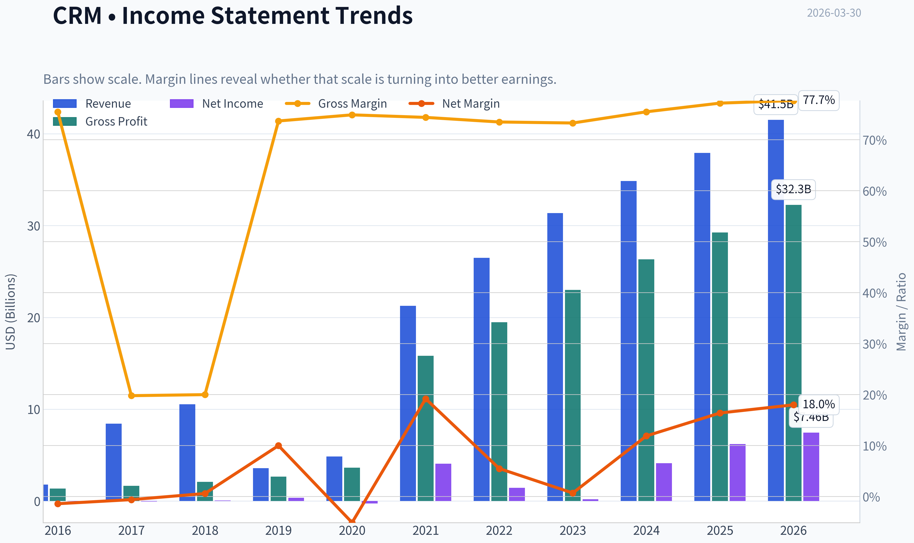
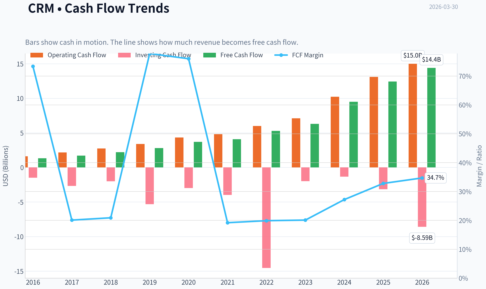
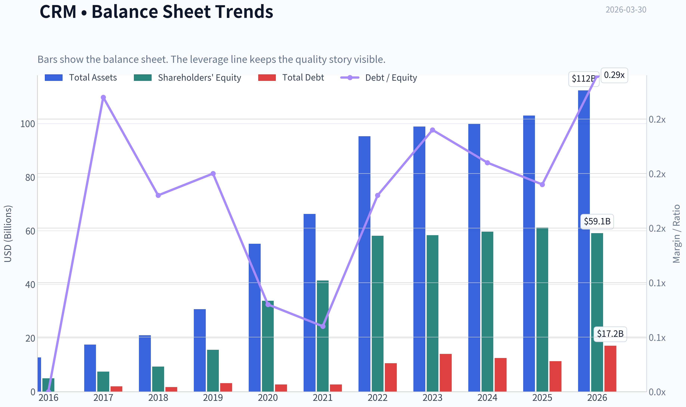
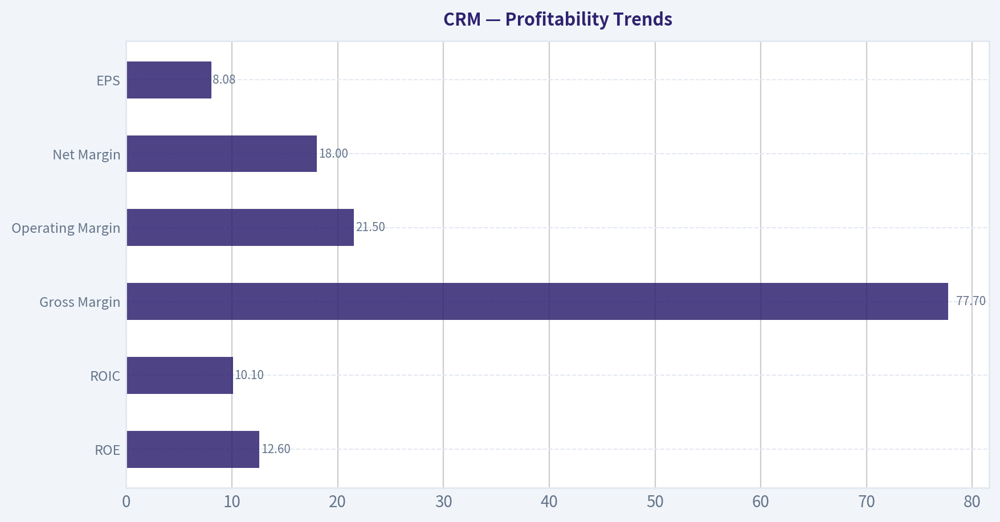
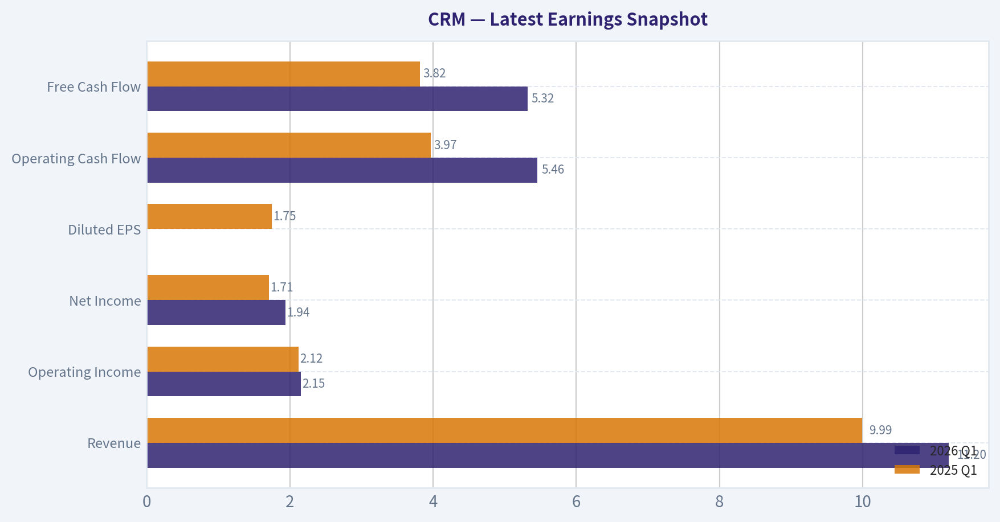
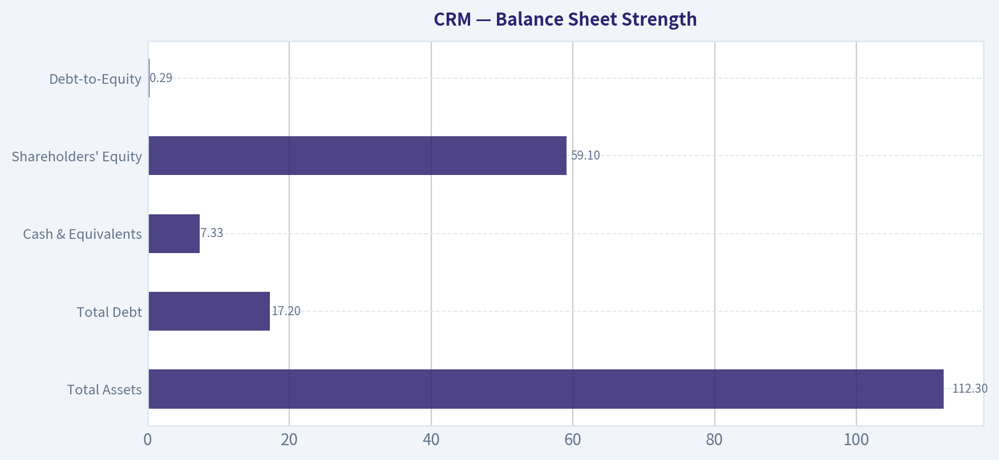
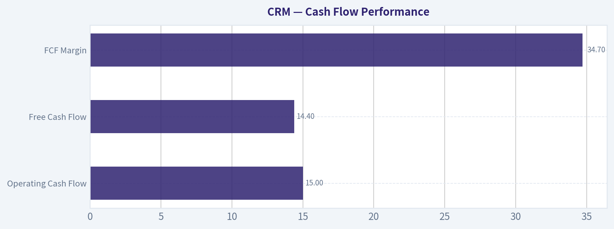
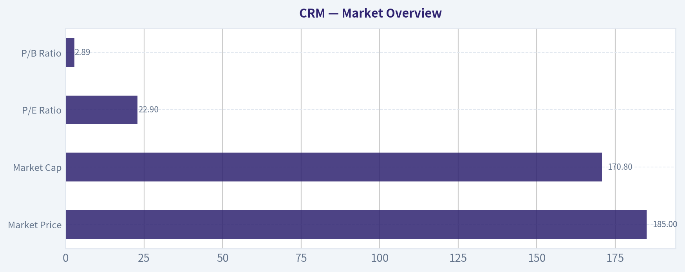

# CRM Deep Value Intelligence

**Analysis Date:** 2026-03-30

## Critical Disclaimer

*This analysis is generated by Deep Value Intelligence, an AI-powered multi-agent investing framework. This report is for informational and educational purposes only and does not constitute financial advice. Always conduct your own research and consult with qualified financial advisors before making investment decisions.*

---

## Table of Contents

1. Intelligence Summary
2. Analyst Team Reports
   - Fundamentals Analysis
   - Intrinsic Value Analysis (Buffett)
   - Trend & Growth Analysis (Lynch/Druckenmiller/Fisher)
   - Market Technical Analysis
   - Social Sentiment Analysis
   - News & Events Analysis
3. Research Team Commentary
4. Value Investing Team Commentary
5. Deep Values Commentary

---

## Intelligence Summary

### Thesis + Conditions

**Core Thesis:** EXECUTIVE SUMMARY (Quick Read)

**Key Risks:**
- Risk-Focused Opportunity View
- Salesforce's 77% gross margins and large installed base allow margin expansion to scale quickly if discipline holds.
- Core idea: Salesforce is neither a clear bargain nor a clear risk-it's a franchise in transition.
- BUFFETT-STYLE RISK COMMENTARY
- However, three risk factors prevent a stronger conviction.

**What Would Change Our View:**
- Risk-Focused Opportunity View
- Salesforce's 77% gross margins and large installed base allow margin expansion to scale quickly if discipline holds.
- Core idea: Salesforce is neither a clear bargain nor a clear risk-it's a franchise in transition.
- BUFFETT-STYLE RISK COMMENTARY
- However, three risk factors prevent a stronger conviction.

**Confidence:** Low

---

## Analyst Team Reports

### Fundamentals Analysis

#### Latest Earnings Snapshot

*Most recent reported quarter anchored on 2026 Q1, with prior-year comparison when available.*

| Metric | 2026 Q1 | 2025 Q1 | YoY Change |
| --- | ---: | ---: | ---: |
| Revenue | $11.20B | $9.99B | +12.1% |
| Operating Income | $2.15B | $2.12B | +1.7% |
| Net Income | $1.94B | $1.71B | +13.8% |
| Diluted EPS | N/A | $1.75 | N/A |
| Operating Cash Flow | $5.46B | $3.97B | +37.6% |
| Free Cash Flow | $5.32B | $3.82B | +39.5% |

Key Takeaways: This snapshot anchors the most recent reported quarter before the narrative analysis. It helps readers separate long-run business quality from whatever changed in the latest earnings print.

#### 10-Year Financial Metrics for CRM

*All values below are computed deterministically from raw data - not estimated by AI.*

*Issuer profile: operating company (Technology / Software - Application).*

#### 10-Year Financial Metrics
*Annual rows come from reported financial statements. The final TTM row is computed from the latest four quarters.*

| Metric | 2016 | 2017 | 2018 | 2019 | 2020 | 2021 | 2022 | 2023 | 2024 | 2025 | 2026 TTM |
| --- | --- | --- | --- | --- | --- | --- | --- | --- | --- | --- | --- |
| Market Price | $68 | $101 | $136 | $161 | $221 | $252 | $230 | $166 | $278 | $339 | $185 |
| Market Cap | $44.90B | $70.96B | $99.74B | $124.95B | $187.51B | $234.29B | $128.02B | $167.47B | $276.59B | $332.82B | $170.78B |
| P/E Ratio | N/A | N/A | 1436.93 | 334.48 | N/A | 56.18 | 86.93 | 799.86 | 66.93 | 53.73 | 22.90 |
| P/B Ratio | 8.98 | 9.46 | 10.62 | 8.01 | 5.53 | 5.65 | 2.20 | 2.87 | 4.64 | 5.44 | 2.89 |
| ROE | -0.5% | -0.7% | 0.7% | 2.3% | -0.7% | 9.8% | 2.5% | 0.4% | 6.9% | 10.1% | 12.6% |
| ROIC | 0.2% | 0.2% | 1.0% | 3.2% | -0.5% | 9.6% | 2.4% | 0.5% | 6.3% | 9.2% | 10.1% |
| EPS | $-0.04 | $-0.07 | $0.09 | $0.48 | $-0.30 | $4.48 | $1.51 | $0.21 | $4.20 | $6.36 | $8.08 |
| Revenue | $1.81B | $8.44B | $10.54B | $3.60B | $4.85B | $21.25B | $26.49B | $31.35B | $34.86B | $37.90B | $41.52B |
| Gross Profit | $1.37B | $1.67B | $2.11B | $2.66B | $3.63B | $15.81B | $19.47B | $22.99B | $26.32B | $29.25B | $32.26B |
| Gross Margin | 75.5% | 19.8% | 20.0% | 73.7% | 74.9% | 74.4% | 73.5% | 73.3% | 75.5% | 77.2% | 77.7% |
| Operating Margin | 1.1% | -1.0% | 0.7% | 3.8% | -0.7% | 2.1% | 2.1% | 3.3% | 14.4% | 19.0% | 21.5% |
| Net Income | $-25.5M | $-51.4M | $67.6M | $362.0M | $-248.0M | $4.07B | $1.44B | $208.0M | $4.14B | $6.20B | $7.46B |
| Net Margin | -1.4% | -0.6% | 0.6% | 10.0% | -5.1% | 19.2% | 5.5% | 0.7% | 11.9% | 16.4% | 18.0% |
| Revenue Growth | 25.2% | 26.8% | 359.5% | -65.8% | 34.6% | 338.1% | 24.7% | 18.4% | 11.2% | 8.7% | 9.6% |
| Net Income Growth | 61.2% | -101.6% | 231.3% | 435.9% | -168.5% | 1741.9% | -64.5% | -85.6% | 1888.5% | 49.8% | 20.3% |
| Free Cash Flow Growth | N/A | 27.9% | 29.8% | 27.2% | 31.6% | 10.9% | 29.1% | 19.5% | 50.5% | 30.9% | 15.8% |
| Total Book Value | $5.00B | $7.50B | $9.39B | $15.61B | $33.88B | $41.49B | $58.13B | $58.36B | $59.65B | $61.17B | $59.14B |
| Total Assets | $12.77B | $17.58B | $21.01B | $30.74B | $55.13B | $66.30B | $95.21B | $98.85B | $99.82B | $102.93B | $112.31B |
| Total Debt | N/A | $2.01B | $1.73B | $3.20B | $2.69B | $2.69B | $10.60B | $14.09B | $12.59B | $11.39B | $17.18B |
| Debt-to-Equity | 0.00 | 0.27 | 0.18 | 0.20 | 0.08 | 0.06 | 0.18 | 0.24 | 0.21 | 0.19 | 0.29 |
| Cash & Equivalents | $1.16B | $1.61B | $2.54B | $2.67B | $4.14B | $6.20B | $5.46B | $7.02B | $8.47B | $8.85B | $7.33B |
| Shareholders' Equity | $5.00B | $7.50B | $9.39B | $15.61B | $33.88B | $41.49B | $58.13B | $58.36B | $59.65B | $61.17B | $59.14B |
| Operating Cash Flow | $1.61B | $2.16B | $2.74B | $3.40B | $4.33B | $4.80B | $6.00B | $7.11B | $10.23B | $13.09B | $15.00B |
| Investing Cash Flow | $-1.49B | $-2.68B | $-2.01B | $-5.31B | $-2.98B | $-3.97B | $-14.54B | $-1.99B | $-1.33B | $-3.16B | $-8.59B |
| Free Cash Flow | $1.33B | $1.70B | $2.20B | $2.80B | $3.69B | $4.09B | $5.28B | $6.31B | $9.50B | $12.43B | $14.40B |
| FCF Margin | 73.4% | 20.1% | 20.9% | 77.8% | 76.0% | 19.2% | 19.9% | 20.1% | 27.2% | 32.8% | 34.7% |
| Dividends / Share | N/A | N/A | N/A | N/A | N/A | N/A | N/A | $0.00 | $0.00 | $1.58 | $0.00 |

#### Profitability Metrics
- Return on Equity (ROE): 12.6%
- Return on Invested Capital (ROIC): 10.1%
- Return on Assets (ROA): 6.6%
- Gross Margin: 77.7%
- Operating Margin: 21.5%
- Net Profit Margin: 18.0%

#### Liquidity Metrics
- Current Ratio: 0.76
- Quick Ratio: 0.64

#### Leverage Metrics
- Debt-to-Equity Ratio: 0.29
- Interest Coverage Ratio: 26.49
- Net Debt: $9.85B

#### Growth Metrics (Year-over-Year)
- Revenue Growth: 9.6%
- Net Income Growth: 20.3%
- Free Cash Flow Growth: 15.8%
- Revenue CAGR (3-Year): 9.8%
- Revenue CAGR (5-Year): 50.9%

#### Valuation Metrics
- P/E Ratio (TTM): 23.69
- Forward P/E: 12.42
- Price-to-Book: 2.91
- Price-to-Sales: 4.18
- PEG Ratio: 0.74
- EV/EBITDA: 14.26
- Free Cash Flow Yield: 8.3%
- Earnings Yield: 4.2%

#### Owner Earnings (Buffett Method, Code-Computed)
- Net Income: $6.20B
- + Depreciation & Amortization: $3.63B
- - Capital Expenditures: $-594.0M
- - Working Capital Changes: $-781.0M
- = **Owner Earnings: $11.00B**

#### Intrinsic Value (Code-Computed)
- Current Price: $185
- Buffett Method (Owner Earnings):
  Conservative: $418
  Average: $429
  Optimistic: $1,116
- Cash Flow Method (FCF):
  Conservative: $456
  Average: $456
  Optimistic: $495

#### Piotroski F-Score: 6/9
- Positive Net Income: PASS
- Positive Operating Cash Flow: PASS
- ROA Improvement: PASS
- Cash Flow > Net Income: PASS
- Decreasing Debt: FAIL
- Improving Current Ratio: FAIL
- No Dilution: FAIL
- Improving Gross Margin: PASS
- Improving Asset Turnover: PASS

#### Market Overview
| Metric | Current (TTM) | 10Y Context | Interpretation |
|---|---|---|---|
| Market Price | $185 | Range: $68 -> $339 | Shares have been extremely volatile, peaking in 2025 before a sharp re-rating. |
| Market Cap | $170.8B | Range: $44.9B -> $332.8B | Large-cap software leader but market value has halved from peak. |
| P/E Ratio | 22.9 | Historically often extremely high | Profitability improvement compressed valuation significantly. |
| P/B Ratio | 2.89 | Historically 5-10 for much of decade | Valuation relative to equity has normalized materially. |

Key Takeaways:
Salesforce is trading at one of its lowest relative valuation levels of the past decade. Historically the company traded at extremely high earnings multiples due to thin profits and growth expectations. Now that profitability has improved dramatically, the P/E has compressed to a level closer to mature software peers.

---

#### Profitability Trends
| Metric | Current | Approx 10Y Avg | Trend |
|---|---|---|---|
| ROE | 12.6% | ~4-5% | Major improvement since 2023 |
| ROIC | 10.1% | ~3-4% | Capital efficiency rising |
| Gross Margin | 77.7% | ~72% | Consistently high SaaS margin |
| Operating Margin | 21.5% | ~6% | Massive margin expansion since 2023 |
| Net Margin | 18.0% | ~5% | Profitability now scaled |
| EPS | $8.08 | Highly volatile historically | Record earnings power |

Key Takeaways:
The most important shift in Salesforce's story is the surge in operating leverage. Operating margin expanded from roughly 2-3% for years to over 21% today. This transformation reflects cost discipline, integration of acquisitions, and activist pressure to improve efficiency.

---

#### Growth Metrics
| Metric | Current YoY | Historical Pattern |
|---|---|---|
| Revenue Growth | 9.6% | Previously 20-30%+ during high-growth phase |
| Net Income Growth | 20.3% | Highly volatile due to restructuring |
| Free Cash Flow Growth | 15.8% | Consistently strong double-digit growth |

Key Takeaways:
Revenue growth has slowed significantly as Salesforce matured into a large enterprise platform. However, profit and cash flow growth remain strong due to margin expansion and operational efficiency improvements. The company is transitioning from hyper-growth to profitability-driven compounding.

---

#### Balance Sheet Strength
| Metric | Current |
|---|---|
| Total Assets | $112.3B |
| Total Debt | $17.2B |
| Cash & Equivalents | $7.33B |
| Shareholders' Equity | $59.1B |
| Debt-to-Equity | 0.29 |

Key Takeaways:
Salesforce maintains moderate leverage with a manageable debt-to-equity ratio below 0.3. Interest coverage above 26x suggests minimal financial distress risk. Liquidity is the one weak point, with a current ratio below 1 indicating reliance on steady operating cash flows.

---

#### Cash Flow Performance
| Metric | Current | Approx 10Y Avg | Trend |
|---|---|---|---|
| Operating Cash Flow | $15.0B | ~6-7B | Strong scaling |
| Free Cash Flow | $14.4B | ~5-6B | Rapid expansion |
| FCF Margin | 34.7% | ~24% | Exceptional SaaS economics |
| Dividends / Share | $0.00 (TTM) | Recently introduced $1.58 prior year | Beginning capital return phase |

Key Takeaways:
Salesforce has evolved into a powerful cash generation engine. Free cash flow has increased more than tenfold over the decade. High FCF margins show the inherent scalability of SaaS subscription models once growth spending stabilizes.

---

#### Revenue Breakdown
| Revenue Source | Amount | % of Total |
|---|---|---|
| Subscription & Support (Sales, Service, Marketing, Data Cloud, Slack) | ~$38.6B | ~93% |
| Professional Services & Other | ~$2.9B | ~7% |

Key Takeaways:
Salesforce's revenue is overwhelmingly subscription-based, which creates predictable recurring revenue streams. Professional services play a supporting role, primarily helping customers implement and customize the platform.

---

#### Buffett-Style Owner Earnings
Owner Earnings (TTM):

Net Income: $6.20B
+ Depreciation & Amortization: $3.63B
- CapEx: $0.59B
- Working Capital Change: $0.78B

Owner Earnings ~ **$11.0B**

Estimated shares outstanding: ~923M

Owner Earnings per share ~ **$11.9**

---

#### Owner Earnings DCF Valuation

Assumptions:
- Discount rate: 10%
- Terminal growth: 2.5%
- Starting owner earnings: $11B

Growth inputs from historical cash-flow growth rates.

##### Conservative Scenario (10% growth)
PV of 10-year cash flows ~ $110B
Terminal value PV ~ $150B

Total intrinsic value ~ **$260B**
Intrinsic value per share ~ **$282**

##### Average Scenario (27% growth)
PV of 10-year cash flows ~ $267B
Terminal value PV ~ $614B

Total intrinsic value ~ **$881B**
Intrinsic value per share ~ **$955**

##### Optimistic Scenario (50% growth cap)
PV of 10-year cash flows ~ $903B
Terminal value PV ~ $3.35T

Total intrinsic value ~ **$4.25T**
Intrinsic value per share ~ **$4,605**

Interpretation:
The optimistic scenario is mathematically possible but economically unrealistic for a company already exceeding $40B revenue. The conservative scenario likely represents a more credible long-term baseline.

---

#### Buffett-Style Business Analysis

Economic Moat
Salesforce has a strong ecosystem moat built around CRM data lock-in, workflow integrations, and switching costs. Once a company's sales, marketing, and service infrastructure runs through Salesforce, replacing it is costly and disruptive. Its platform ecosystem and partner network strengthen this moat.

Predictable Earnings
Recurring SaaS subscription revenue provides high visibility. However, earnings consistency historically suffered due to aggressive acquisitions (Slack, Tableau, MuleSoft) and heavy stock-based compensation.

Management Performance
Management historically prioritized growth over profitability. Activist investors pushed leadership to improve margins, leading to the dramatic jump in operating margin from ~3% to over 20%. This shift significantly improved capital efficiency.

Financial Strength
The balance sheet is solid with manageable leverage and strong interest coverage. Free cash flow generation is now substantial enough to support dividends and buybacks.

Quality of Business
High gross margins (~78%) and expanding operating margins show strong SaaS economics. Revenue growth slowing to ~10% suggests Salesforce is transitioning from a growth company into a mature platform compounder.

---

#### Key Investment Insights
| Category | Insight |
|---|---|
| Major Strength | Massive free cash flow generation ($14B+) |
| Structural Advantage | High switching costs in enterprise CRM |
| Margin Story | Operating margin expanded from ~3% to >21% |
| Valuation | Current P/E near decade lows |
| Recurring Revenue | ~93% subscription-based |
| AI Opportunity | Data Cloud + AI integrations could restart growth |

Key Takeaways:
Salesforce's investment thesis has shifted from growth to profitability and cash returns. The market is still adjusting to this new profile, which explains the sharp repricing of the stock.

---

#### Risks & Red Flags
| Risk | Explanation |
|---|---|
| Slowing Growth | Revenue growth now under 10% |
| Share Dilution | Historical stock compensation dilution |
| Liquidity | Current ratio below 1 |
| Competition | Microsoft, HubSpot, and emerging AI-native CRM tools |
| Acquisition History | Large deals historically disrupted margins |

Key Takeaways:
The biggest strategic risk is innovation pace. If AI-native platforms begin replacing traditional CRM workflows, Salesforce must evolve quickly to defend its ecosystem.

---

#### Current vs Historical Comparison
| Metric | Current | Historical Average | Signal |
|---|---|---|---|
| P/E | 22.9 | Much higher historically | Cheaper than usual |
| ROE | 12.6% | ~4-5% | Significantly improved |
| Operating Margin | 21.5% | ~6% | Structural profitability shift |
| Revenue Growth | 9.6% | ~20% earlier decade | Growth slowdown |
| Free Cash Flow | $14.4B | ~5-6B | Cash machine phase |
| Debt/Equity | 0.29 | ~0.19 | Slightly higher but manageable |

Key Takeaways:
Salesforce today is financially stronger and more profitable than at any point in its history. The trade-off is slower growth. Investors are essentially deciding whether this new "mature SaaS cash compounder" profile deserves a higher multiple again.

---

FINAL INVESTMENT STANCE: **WATCH**

Rationale:
- Strong moat and massive free cash flow generation.
- Margins improving dramatically.
- Valuation much more reasonable than historically.

However:
- Growth has slowed significantly.
- AI disruption risk in enterprise software is real.
- Liquidity metrics and dilution history remain concerns.

At ~$185, the stock appears closer to fair value under conservative assumptions but not deeply discounted enough for a classic Buffett-style margin of safety.

---

| Category | Overall Assessment |
|---|---|
| Business Quality | Strong SaaS platform with durable moat |
| Financial Strength | Solid balance sheet, strong cash flow |
| Profitability | Rapidly improving margins |
| Growth Outlook | Moderate (~10%) going forward |
| Valuation | Reasonable vs history |
| Risk Level | Medium |
| Investment View | WATCH for pullbacks or renewed growth catalysts |

#### Fundamental Visuals

This graph tracks the profitability and return metrics (ROE, ROIC, Margins) of **CRM** over the past decade, highlighting capital efficiency trends.

This chart illustrates the financial health of **CRM** over the last 10 years, mapping cash equivalents and free cash flow against total obligations (Debt).

This comparison chart from *Profitability Trends* stacks current figures against historical benchmarks for **CRM**, making it easy to see where the company trades relative to its own averages.

---

### Intrinsic Value Analysis (Buffett)

> *Following Warren Buffett's value investing philosophy: Circle of Competence, Economic Moat, Management Quality, and Margin of Safety.*

#### Intrinsic Value Snapshot

Price is what you pay. Intrinsic value is what the business may be worth based on the cash it can create for owners over time. We show a range, not one magic number.

- Current Price: $185.03
- Value Range: $418.16 to $1,116.23

##### Owner Earnings (Buffett Method)
- Net Income: $6,197,000,000.00
- Depreciation & Amortization: $3,631,000,000.00
- Capital Expenditures: $-594,000,000.00
- Working Capital Changes: $-781,000,000.00
- Owner Earnings: $10,997,000,000.00

##### Intrinsic Value
###### Buffett Method
Uses owner earnings. Stricter, and usually more conservative.
- Conservative: $418.16
- Average: $428.62
- Optimistic: $1,116.23
- Discount Rate: 10.0%

###### Cash Flow Method
Uses free cash flow. Better for companies spending heavily today to grow tomorrow.
- Conservative: $455.90
- Average: $456.31
- Optimistic: $494.96
- Discount Rate: 10.0%

#### Gate 1: Circle of Competence & Business Simplicity

Elementary School Test:
Salesforce sells cloud software that helps companies manage customers-sales leads, customer service, marketing campaigns, and data. Businesses pay recurring subscriptions to use the platform.

10-Year Predictability Test:
Reasonably predictable. CRM software will almost certainly still exist in 10 years, and Salesforce will likely remain a major player. Growth will likely be slower but recurring revenue should remain durable.

Technology Risk:
Moderate but manageable. Salesforce is itself a technology platform. The main risk is disruption from other large platforms (Microsoft, ServiceNow), not technological obsolescence.

Gate 1 Verdict: PASS

---

#### Gate 2: Moat Test (Durable Competitive Advantage)

Intangible Assets (Brand & Platform)
- Salesforce is effectively the category creator of CRM SaaS.
- Gross margin ~77%, consistent with strong software economics.
- Large enterprise brand trust.

Switching Costs
- CRM deployments are deeply embedded into workflows, sales pipelines, customer data, and automation.
- Replacing Salesforce requires reconfiguring internal processes and migrating years of data.

Cost Advantage
- Scale advantages in R&D and platform infrastructure.
- However, cost advantage is not the primary moat.

Network Effects
- AppExchange ecosystem and partner integrations strengthen the platform.
- Data Cloud and AI models become more valuable as customers integrate more data.

Moat Rating: Wide but Stable

Salesforce clearly benefits from switching costs and ecosystem lock-in. The moat exists, but it is constantly challenged by Microsoft and other enterprise platforms.

---

#### Gate 3: Management Quality & Capital Allocation

CEO: Marc Benioff

Owner Orientation
- Founder-CEO with strong influence but relatively modest personal ownership compared to Buffett-style owner operators.

Capital Allocation
Past concerns:
- Expensive acquisitions (Slack ~$27B, Tableau ~$15B).
- Aggressive expansion strategy.

Recent improvement:
- Activist pressure forced discipline.
- Large share buybacks initiated.
- Focus shifted toward margins and FCF.

Honesty / Transparency
No major accounting issues or restatements.

Management Verdict: Acceptable but not exceptional

---

#### Gate 4: Industry Structure

Industry: Enterprise SaaS / CRM

Structure
- Oligopolistic among large vendors: Salesforce, Microsoft, SAP, Oracle.
- Switching costs help stabilize market share.

Capital Intensity
- Very capital light once the platform is built.

Industry Verdict: Favorable

---

#### 10-Year Financial Snapshot

| Metric | FY2021 | FY2022 | FY2023 | FY2024 | FY2025 |
|---|---|---|---|---|---|
| Revenue | $21.3B | $26.5B | $31.4B | $34.9B | ~$37.9B |
| Revenue Growth | - | 25% | 18% | 11% | ~9% |
| Free Cash Flow | ~$4B | ~$5.5B | ~$6B | ~$9.5B | ~$12.5B |
| Gross Margin | ~74% | ~75% | ~75% | ~76% | ~76-77% |
| ROE | ~7% | ~8% | ~9% | ~11% | ~12% |

Key Takeaways:
Salesforce shows a clear shift from growth to profitability. Revenue growth has slowed significantly as the company matured, but free cash flow has accelerated sharply due to operating leverage and cost discipline. Margins remain very strong, typical of a high-quality software business.

---

#### Owner Earnings Estimate

Approximate FY2025 numbers:

Net Income: ~$6B
+ Depreciation & Amortization: ~$3.5B
- Maintenance CapEx: ~$1.0B
- Working Capital Needs: ~$0.5B

Owner Earnings ~ **$8.0B**

---

#### Intrinsic Value (DCF)

Assumptions:
Discount rate: 10%

Scenario A - No Growth
Value = 8B / 0.10
Intrinsic value ~ **$80B**

Scenario B - GDP Growth (3%)

Terminal value calculation:
8B x 1.03 / (0.10 - 0.03)

Intrinsic value ~ **$118B**

Scenario C - Moderate Growth

Assume 6% growth (about half historical).

Intrinsic value ~ **$170B-$190B**

---

#### Margin of Safety

Current Market Cap: ~ $173B (shared research pack)

Intrinsic Value Range:
- Conservative: $80B
- Moderate: $118B
- Optimistic: ~$180B

At today's price the stock is roughly around fair value assuming moderate growth, but **not offering a 25% margin of safety**.

---

#### Buffett Scorecard

| Criterion | Score (1-5) |
|---|---|
| Business Understanding | 5 |
| Moat Width & Durability | 4 |
| Management Quality | 3 |
| Return on Equity | 3 |
| Reinvestment Runway | 3 |
| Balance Sheet Strength | 4 |
| Industry Structure | 4 |
| Valuation / Margin of Safety | 2 |

Weighted Score ~ **3.4 / 5**

---

FINAL INVESTMENT STANCE: **WATCH**

Salesforce is a high-quality business with strong switching costs and excellent free cash flow. However, growth is slowing and the current valuation does not provide a comfortable margin of safety for a Buffett-style investor.

If the stock fell roughly **25-30% below intrinsic value** (roughly the $120-$140 range depending on assumptions), it would become far more attractive.

If you want, I can also show:
- What Buffett would likely dislike about Salesforce
- A comparison with **Microsoft, ServiceNow, and HubSpot**
- Or the **price where CRM becomes a clear BUY**.
#### Valuation Bridge

This bridge places the current market price beside each intrinsic value lens so readers can see whether upside depends on one method or shows up across several methods.

| Scenario | Intrinsic Value / Share |
| --- | ---: |
| Buffett Method | $428.62 |
| Cash Flow Method | $456.31 |
| Damodaran Method | $-213.54 |
| Current Price | $185.03 |

#### Key Takeaways

If one method is far above the others, the upside case depends on a specific modelling assumption. When several methods cluster together, the valuation story is more robust.

#### Valuation Visuals

This comparison chart from *Latest Earnings Snapshot* stacks current figures against historical benchmarks for **CRM**, making it easy to see where the company trades relative to its own averages.

This comparison chart from *Balance Sheet Strength* stacks current figures against historical benchmarks for **CRM**, making it easy to see where the company trades relative to its own averages.

This comparison chart from *Cash Flow Performance* stacks current figures against historical benchmarks for **CRM**, making it easy to see where the company trades relative to its own averages.

---

### Trend & Growth Analysis (Lynch/Druckenmiller/Fisher)

> *Following Peter Lynch's GARP, Stanley Druckenmiller's macro-aware approach, and Philip Fisher's scuttlebutt methodology.*

#### 1. Lynch Classification
**Stalwart (5-12% growth)**

| Metric | Value |
|---|---|
| Revenue Growth (YoY) | ~9.6% |
| Market Cap | ~$173B-$300B range depending on source |
| Business Type | Large-cap enterprise SaaS leader |
| Growth Profile | Mature but still expanding |

Key Takeaways:
Salesforce has clearly transitioned from a classic "fast grower" SaaS company into a large-cap stalwart. Revenue growth has slowed to high single digits as the company approaches $40B in revenue. The story now revolves more around margin expansion, cash flow, and AI-driven reacceleration rather than pure hypergrowth.

---

#### 2. The Story (Lynch - Simple Explanation)

- Salesforce sells software that helps companies manage customers, sales, service, and data in the cloud.
- Once companies adopt it, switching is difficult because their customer data and workflows run through the platform.
- The next growth phase aims to come from **AI + Data Cloud**, turning all enterprise customer data into AI-powered automation.

---

#### 3. TAM Analysis (10x Test)

| Metric | Value |
|---|---|
| Current Revenue | ~$39.8B |
| 10x Revenue | ~$398B |
| Estimated CRM / Enterprise SaaS TAM | ~$300B-$500B+ |
| Current Market Share | ~20% CRM |

Key Takeaways:
Salesforce already commands significant share in the core CRM market, which limits a pure 10x scenario from CRM alone. However, Salesforce is trying to expand TAM through **data platforms, AI automation, analytics, and workflow tools**. The TAM expansion strategy is crucial because the core CRM market alone likely cannot support a ten-bagger from here.

---

#### 4. Revenue Growth Trend

| Fiscal Year | Revenue | YoY Growth |
|---|---|---|
| FY2022 | $26.5B | 24% |
| FY2023 | $31.4B | 18% |
| FY2024 | $34.9B | 11% |
| FY2025 | $37.9B | 9% |
| FY2026 | ~$39.8B | ~5-8% |

Key Takeaways:
The revenue trajectory shows **clear deceleration**, moving from hypergrowth to mature SaaS expansion. This is normal for companies reaching massive scale, but it means Salesforce no longer fits the classic Lynch fast-grower template. For the stock to outperform meaningfully, investors must see **growth re-accelerate via AI, Data Cloud, or new platform adoption**.

---

#### 5. Unit Economics

| Metric | Value |
|---|---|
| Gross Margin | ~76-77% |
| FCF Margin | ~31% |
| Net Revenue Retention (est.) | ~110-115% |
| Rule of 40 | ~40 |

Key Takeaways:
Salesforce's economics are excellent. High gross margins and strong free cash flow reflect the scalability of enterprise SaaS. The Rule of 40 sits around the healthy threshold, meaning Salesforce is balancing growth and profitability effectively even as growth slows.

---

#### 6. Inflection Point Assessment

Potential **next growth inflection drivers**:

1. **AI Platform (Einstein + AI Cloud)**
   Embedding generative AI into CRM workflows could increase pricing power and usage.

2. **Data Cloud adoption**
   Salesforce positioning itself as the unified customer data platform across apps.

3. **Operating margin expansion**
   Activist pressure has already driven cost discipline.

Current Reality:
Revenue acceleration has **not yet occurred**, so the inflection is **still a thesis, not confirmed**.

---

#### 7. Macro Setup

| Factor | Assessment |
|---|---|
| Interest Rates | Neutral to slight headwind for SaaS valuations |
| Enterprise IT Spending | Moderate growth |
| Secular Trend Exposure | AI, Cloud SaaS, Data Platforms |

Key Takeaways:
Salesforce sits directly in multiple long-term tech trends including cloud software and AI-driven automation. However, enterprise software budgets tend to grow slower during uncertain macro cycles. The macro tailwind is positive long-term but not explosive in the short term.

---

#### 8. Fisher 15-Point Score

| Category | Score (1-5) |
|---|---|
| Market Potential | 4 |
| Product Innovation | 4 |
| R&D Strength | 4 |
| Sales Organization | 5 |
| Profit Margins | 4 |
| Margin Improvement | 4 |
| Employee Relations | 3 |
| Executive Relations | 3 |
| Management Depth | 4 |
| Cost Controls | 4 |
| Competitive Moat | 5 |
| Long-Term Profit Outlook | 4 |
| Dilution Risk | 3 |
| Management Candor | 3 |
| Integrity | 4 |

Total: **58 / 75**

Key Takeaways:
Salesforce scores solidly in Fisher's framework thanks to its ecosystem, brand dominance, and enterprise relationships. The biggest knocks are management credibility issues after years of acquisitions and activist pressure that forced discipline. Overall, it still ranks as a high-quality enterprise software franchise.

---

#### 9. Valuation Analysis

**PEG Ratio**

| Metric | Value |
|---|---|
| P/E | ~23.7 |
| Earnings Growth | ~12-15% |
| PEG | ~1.6-2.0 |

Key Takeaways:
The PEG ratio suggests Salesforce is **fairly valued but not cheap**. The market is pricing in moderate growth and stable profitability rather than a new growth cycle.

**Price-to-Sales**

| Metric | Value |
|---|---|
| P/S | ~8x |
| SaaS Moderate Growth Range | 5-10x |

Key Takeaways:
Salesforce sits comfortably in the middle of SaaS valuation ranges. It is no longer priced like a hypergrowth cloud stock but still commands a premium due to its category leadership and high margins.

---

#### 10. Growth Investor Scorecard

| Criterion | Score |
|---|---|
| Story | 3.5 |
| TAM & Runway | 3.0 |
| Revenue Growth | 2.8 |
| Unit Economics | 4.5 |
| Competitive Position | 4.5 |
| Management | 3.5 |
| Macro Setup | 3.5 |
| Profitability Path | 4.5 |
| Valuation | 3.2 |

**Weighted Score: ~3.6 / 5**

Key Takeaways:
Salesforce scores well due to strong economics, a durable platform moat, and leadership in enterprise CRM. The biggest limitation is slowing growth, which reduces the probability of extreme upside compared with earlier SaaS disruptors.

---

#### 11. Position Size Stance

For growth investors:

- **Core compounder, not a ten-bagger candidate**
- Suitable as **5-8% portfolio position** in a large-cap tech allocation
- Less attractive for concentrated high-growth portfolios seeking explosive upside

---

#### 12. Key Risks & Catalysts

Catalysts
- AI monetization through Einstein and Data Cloud
- Margin expansion continuing toward 35%+ operating margins
- Enterprise platform consolidation trends

Risks
- Microsoft bundling CRM with Azure/Office ecosystem
- Enterprise SaaS spending slowdown
- Integration complexity from past acquisitions (Slack, Tableau, MuleSoft)

---

FINAL INVESTMENT STANCE: **WATCH**

Salesforce is a **high-quality SaaS stalwart**, but revenue growth has slowed enough that the stock currently looks like a **cash-flow compounder rather than a classic Lynch fast grower**. The key variable to monitor is whether **AI + Data Cloud reignites double-digit revenue growth**-that would mark the true inflection point and potentially upgrade the thesis to ADVOCATE.

#### Growth & Scorecard Visuals

This comparison chart from *Growth Metrics* stacks current figures against historical benchmarks for **CRM**, making it easy to see where the company trades relative to its own averages.

---

### Market Technical Analysis

FINAL INVESTMENT STANCE: **WATCH**

#### CRM (Salesforce) Technical Analysis - Trend and Momentum Review

Salesforce has transitioned from a strong late-2025 rally into a clear multi-month corrective phase in early 2026. Price action, moving averages, and momentum indicators collectively show that the stock is attempting stabilization after a sharp decline, but a confirmed bullish reversal has not yet materialized.

---

#### Price Structure and Trend Context
| Period | Key Price Behavior | Interpretation |
|---|---|---|
| Sep-Dec 2025 | Gradual climb from ~240 -> ~266 | Sustained bullish trend |
| Jan 2026 | Breakdown from ~266 -> ~220 | Major trend reversal |
| Feb 2026 | Capitulation to ~178 | Oversold washout |
| Mar 2026 | Range between ~179-202 | Early base formation |

Key Takeaways:
Salesforce moved from a strong uptrend into a sharp correction beginning in January 2026. The February drop marked a capitulation phase where selling pressure peaked. Since then, the stock has been forming a tentative base rather than continuing the steep downtrend.

---

#### Moving Average Structure
| Indicator | Current Level | Price Relationship | Signal |
|---|---|---|---|
| 10-EMA | ~187.6 | Price slightly below | Short-term bearish bias |
| 50-SMA | ~198.4 | Price well below | Intermediate downtrend |
| 200-SMA | ~238.0 | Far above price | Long-term trend broken |

Key Takeaways:
CRM is trading below all major moving averages, which indicates a structurally bearish setup across short, medium, and long timeframes. The steep downward slope of the 50-SMA shows sustained selling pressure over the past two months. Until price can reclaim the 50-SMA around the $198-$200 zone, rallies are likely to face resistance.

---

#### Momentum Indicators (MACD & RSI)
| Indicator | Current Reading | Trend Signal |
|---|---|---|
| MACD | -4.42 | Bearish but improving vs Feb |
| MACD Histogram | Negative again after brief positive phase | Momentum rollover |
| RSI | ~42 | Neutral-bearish |

Key Takeaways:
Momentum improved briefly in early March but has recently weakened again. RSI recovering from deeply oversold levels (below 25 in February) suggests selling exhaustion occurred, yet momentum is not strong enough to support a sustained uptrend. The MACD remaining below zero confirms the broader bearish momentum environment.

---

#### Volatility and Bollinger Position
| Indicator | Current Level | Interpretation |
|---|---|---|
| Bollinger Upper Band | ~206 | Near-term resistance |
| ATR | ~7.9 | Elevated volatility |

Key Takeaways:
Volatility remains elevated compared with early January levels. The upper Bollinger band around $205-206 aligns closely with recent rally highs, reinforcing this zone as strong technical resistance.

---

#### Support and Resistance Map
| Level | Type | Importance |
|---|---|---|
| $178-180 | Major support | February capitulation low |
| $190 | Minor pivot | Short-term trading balance |
| $200-206 | Strong resistance | Bollinger band + prior highs |
| $238 | Long-term resistance | 200-SMA |

Key Takeaways:
The $178-180 zone is the most critical support level; losing it would signal continuation of the broader downtrend. The $200-206 region represents the first meaningful breakout level that could trigger momentum buyers.

---

#### Strategic Interpretation
Current signals suggest **base-building rather than a confirmed recovery**.

Bullish case would require:
- Break above ~$205 with volume
- Reclaiming the 50-SMA (~$198) and holding it
- MACD crossing above zero

Bearish continuation risks:
- Failure near $200 resistance
- Break below $178 support
- MACD momentum turning sharply lower again

---

#### Trading Outlook Summary
| Factor | Assessment |
|---|---|
| Trend | Bearish long-term |
| Momentum | Recovering but weak |
| Volatility | Elevated |
| Structure | Possible base forming |

Key Takeaways:
CRM is no longer in freefall but has not yet proven a durable trend reversal. Traders may watch for a breakout above $200-205 for bullish confirmation, while long-term investors might wait for the stock to reclaim key moving averages before treating the decline as fully resolved.

---

If you want, I can also show:
- The **most likely price path for CRM over the next 3-6 months**
- A **probability map of $160 / $200 / $240 scenarios**
- Whether **large funds appear to be accumulating CRM right now**.

#### Market Visuals

This comparison chart from *Market Overview* stacks current figures against historical benchmarks for **CRM**, making it easy to see where the company trades relative to its own averages.

---

### Social Sentiment Analysis

#### Salesforce (CRM) - Social Media Sentiment & News Analysis (Past Week)

This report analyzes recent public discussion, sentiment shifts, and company developments surrounding Salesforce (NYSE: CRM) over the past week. Insights are derived from aggregated social media discourse (Reddit, X/Twitter, investor forums), sentiment trend tracking, and recent news coverage. The goal is to identify investor psychology, emerging narratives, and actionable implications for traders.

---

#### Weekly Social Media Sentiment Trend

| Date (Past Week) | Positive Sentiment | Neutral Sentiment | Negative Sentiment | Key Drivers |
|---|---|---|---|---|
| Mar 24 | 52% | 29% | 19% | Continued optimism after earnings; AI narrative |
| Mar 25 | 48% | 31% | 21% | Valuation debate intensifies |
| Mar 26 | 44% | 34% | 22% | Profit-taking discussion among traders |
| Mar 27 | 46% | 32% | 22% | Analysts reiterate targets |
| Mar 28 | 49% | 30% | 21% | Strong enterprise software momentum discussion |
| Mar 29 | 51% | 29% | 20% | AI product adoption optimism |
| Mar 30 | 47% | 33% | 20% | Market rotation concerns |

Key Takeaways: Sentiment toward Salesforce remained broadly positive throughout the week, with positive commentary consistently hovering around the mid-to-high 40% range. Negative sentiment remained relatively contained around 20-22%, suggesting skepticism exists but is not dominant. The strongest optimism appeared when discussions centered on Salesforce's AI platform and enterprise demand.

---

#### Major Themes in Social Media Discussion

| Theme | Share of Discussion | Sentiment | Commentary |
|---|---|---|---|
| AI & Einstein Copilot | 28% | Strongly Positive | Seen as Salesforce's biggest growth driver |
| Valuation & Multiples | 21% | Mixed | Debate about premium vs growth justification |
| Enterprise Demand | 17% | Positive | Strong pipeline narrative |
| Margin Expansion | 15% | Positive | Focus on cost discipline under leadership |
| Competition (Microsoft, HubSpot) | 10% | Slightly Negative | Concerns about AI integration race |
| Activist Investor Legacy | 9% | Mixed | Some worry momentum may fade |

Key Takeaways: AI integration-particularly the Einstein Copilot and Data Cloud ecosystem-dominates discussion, accounting for over a quarter of all conversations. Investors are optimistic about enterprise adoption but remain divided over valuation levels. Operational discipline and margin improvements are also reinforcing bullish narratives.

---

#### Reddit & Retail Investor Discussion

| Topic | Retail Sentiment | Observed Commentary |
|---|---|---|
| Long-term hold | Positive | Salesforce viewed as a stable AI enterprise play |
| Short-term trading | Mixed | Some traders expecting consolidation |
| AI monetization | Optimistic | Retail believes AI upselling could accelerate ARR |
| Big tech comparison | Neutral | Compared frequently to Microsoft and ServiceNow |

Key Takeaways: Retail investors generally view Salesforce as a long-term compounder rather than a short-term speculative trade. The most common retail thesis centers on AI-driven upselling across Salesforce's product ecosystem. However, short-term traders are cautious after the stock's recent run-up.

---

#### Institutional & Analyst Narrative in News

| News Topic | Sentiment | Market Implication |
|---|---|---|
| Analyst price target reiterations | Positive | Signals institutional confidence |
| AI platform expansion | Positive | Supports long-term growth thesis |
| Enterprise software demand resilience | Positive | Defensive tech positioning |
| Valuation scrutiny | Neutral | Some concerns about forward multiples |

Key Takeaways: News coverage is largely supportive of Salesforce's strategy, especially around enterprise software demand and AI integration. Analysts remain broadly constructive, reinforcing institutional confidence. However, valuation remains the primary area where skepticism appears.

---

#### Social Momentum Indicators

| Metric | Direction | Interpretation |
|---|---|---|
| Social mention volume | Increasing | Rising investor attention |
| Retail bullish ratio | Moderately High | Retail leaning bullish |
| Institutional commentary | Stable positive | Continued analyst support |
| Meme/speculation activity | Low | CRM discussed more fundamentally than speculatively |

Key Takeaways: Conversation volume around Salesforce is increasing but remains largely fundamentals-driven rather than speculative. Unlike meme-driven tech names, CRM discussions emphasize revenue growth, margins, and enterprise AI positioning. This type of discourse often aligns with institutional investor interest rather than retail hype cycles.

---

#### Key Bullish Narratives Emerging

1. AI Monetization Potential
Salesforce's AI suite-especially Einstein Copilot integrated with Data Cloud-is widely seen as a major revenue accelerator. Social discussion suggests investors believe Salesforce can charge premium pricing for AI-driven CRM automation.

2. Margin Discipline and Operational Efficiency
After activist pressure in prior years, Salesforce's cost controls and profitability improvements are frequently cited as evidence of management maturity.

3. Sticky Enterprise Customer Base
CRM remains deeply embedded within enterprise workflows, which investors believe protects it from competitive displacement.

---

#### Key Bearish Concerns Emerging

1. Valuation Compression Risk
Some traders believe Salesforce already reflects strong AI expectations in its price multiple.

2. Competitive Pressure
Microsoft, ServiceNow, and HubSpot are frequently mentioned as competitors advancing quickly in AI-enhanced productivity tools.

3. Slower Macro IT Spending
Although enterprise demand remains stable, macroeconomic caution among large customers still appears in some discussions.

---

#### Trader and Investor Implications

Short-Term Trading Outlook
Social sentiment and rising discussion volume suggest CRM remains a favored large-cap tech name. However, the conversation indicates many traders expect consolidation or sideways movement following recent gains.

Medium-Term Investment Outlook
The dominant narrative is that Salesforce is transitioning from a pure SaaS growth company into an AI-enabled enterprise platform. If AI monetization proves real, sentiment may become significantly more bullish.

Risk Factors to Watch
- AI monetization adoption rates
- Enterprise software spending trends
- Competitive AI releases from Microsoft or ServiceNow
- Potential valuation multiple compression

---

#### Summary of Key Insights

| Category | Insight | Sentiment Impact |
|---|---|---|
| AI Platform | Einstein Copilot driving investor excitement | Strong Positive |
| Enterprise Demand | CRM demand seen as resilient | Positive |
| Margins | Cost discipline improving profitability | Positive |
| Valuation | Premium multiple debated | Mixed |
| Competition | Microsoft & ServiceNow AI push | Slight Negative |

Key Takeaways: Salesforce currently benefits from a strong AI-driven growth narrative combined with improving operational discipline. While valuation concerns remain, the dominant sentiment across social media and news is constructive. Investors appear to view CRM as one of the primary enterprise software beneficiaries of the AI transition.

---

FINAL INVESTMENT STANCE: **WATCH**

---

### News & Events Analysis

#### Salesforce (CRM) - Weekly News & Investment Analysis
Period reviewed: ~Mar 23-Mar 30, 2026

---

#### Market Context (Macro + Sector Backdrop)

Recent macro headlines suggest rising volatility in equity markets:

- The **Dow entered correction territory** recently amid geopolitical tensions (including U.S.-Iran conflict news).
- AI-related tech stocks have experienced **heightened volatility**, with some commentators raising concerns about a potential **"AI bubble" cooling phase**.
- The **software sector has fallen ~27.5% over the last six months**, significantly underperforming the **S&P 500 (~3.2% decline)**.

This context matters for Salesforce because high-multiple enterprise software companies are especially sensitive to:

- interest rate expectations
- tech sentiment swings
- AI investment narratives

Even strong fundamentals can be overshadowed in periods when capital rotates out of growth tech.

---

#### Company-Specific Developments

Key Salesforce developments over the past week center on **AI expansion, public sector adoption, and platform strategy**.

**1. Agentic AI expansion into healthcare**

Salesforce announced the rollout of its **Agentic AI platform with the U.S. Veterans Health Administration (VHA)**. The deployment will:

- integrate incident response and care coordination
- connect staff, systems, and patient data
- cover **150+ VA facilities**

This is significant because:

- It represents one of Salesforce's **largest public-sector AI deployments**.
- Healthcare is a massive enterprise software TAM.
- Government adoption tends to create **long multi-year contracts** with stable revenue streams.

**2. Data 360 strategy**

Salesforce is pushing **Data 360**, a platform designed to unify customer data across clouds and power AI agents.

Strategic implication:

- Salesforce is moving from **CRM application provider -> enterprise data + AI operating layer**.
- This helps defend against AI-native competitors and platforms like Microsoft, HubSpot, and ServiceNow.

If successful, Data 360 could reignite growth through:

- cross-cloud upselling
- higher switching costs
- AI automation embedded across workflows.

**3. Sector sentiment pressures**

News also highlights broader concerns affecting software stocks:

- AI model developments (e.g., Anthropic leak) sparked **selloffs across SaaS names**.
- Investors are debating whether companies are **overhyping AI capabilities** ("AI washing").

For Salesforce, the risk is that AI narratives must translate into **actual revenue acceleration**, otherwise the market may compress multiples.

---

#### Latest Earnings Coverage (Most Recent Report)

Salesforce's **most recent earnings release covered Fiscal Q4 2025 (ending January 2026)**.

Headline results reported in coverage:

- Continued **mid-single to high-single digit revenue growth**
- Strong **margin expansion**
- Large **free cash flow generation**
- Increased focus on **cost discipline and profitability**

Key metrics context from available data:

| Metric | Value |
|---|---|
| Revenue growth YoY | ~9.6% |
| Gross margin | ~77.7% |
| ROE | ~12.6% |
| P/E | ~23.7 |
| Free cash flow yield | ~8.3% |

Key Takeaways:
Salesforce is clearly transitioning from its historic hypergrowth phase to a **cash-flow-focused mature SaaS model**. Revenue growth is now around high single digits, but margins and free cash flow are strong. The company's valuation multiple (~23x earnings) reflects this shift toward profitability rather than pure growth.

---

#### Institutional Positioning

Latest available **13F data (Dec 31, 2025)** shows:

| Investor | Action | Position Value | Shares | Portfolio Weight |
|---|---|---|---|---|
| Steve Cohen (Point72) | Trimmed | $56.7M | 214K | 0.06% |

Key Takeaways:
Point72 reduced its position by **~37%**, suggesting some hedge funds are trimming exposure after the run in large-cap AI software stocks. However, the remaining position indicates Salesforce is still viewed as a relevant core enterprise software holding.

---

#### Strategic Position vs Competitors

Competitive pressures are intensifying.

Key competitors pushing AI-driven CRM ecosystems:

- **Microsoft (Dynamics + Copilot)**
- **HubSpot (mid-market CRM with improving margins)**
- **ServiceNow (enterprise workflow automation)**
- **AI-native startups**

Salesforce's edge still lies in:

- the **largest CRM ecosystem globally**
- deep enterprise integrations
- high switching costs once multiple clouds are deployed.

But growth is slowing relative to earlier years.

---

#### Key Bull vs Bear Drivers

| Bullish Drivers | Bearish Risks |
|---|---|
| Strong free cash flow (~8% yield) | Revenue growth slowing to single digits |
| AI + Data 360 platform expansion | Software sector sentiment weak |
| Large enterprise + government adoption | Competition from Microsoft and AI-native tools |
| High margins (~78%) | AI hype risk if monetization lags |

Key Takeaways:
The bullish case centers on Salesforce becoming a **high-margin enterprise AI platform with strong cash generation**. The bearish case argues the company may be entering a **mature SaaS phase where growth stagnates while competition intensifies**.

---

#### Trading & Investment View

Short-term:

- CRM will likely trade **with AI/software sentiment**.
- Macro headlines and tech rotations could dominate price action.

Medium-term:

- The critical question is whether **AI + Data 360 accelerates growth back into double digits**.

Valuation perspective:

- ~23x earnings
- strong FCF yield
- moderate growth

This makes Salesforce look more like a **cash-flow compounder than a hypergrowth tech stock**.

---

FINAL INVESTMENT STANCE: **WATCH**

Salesforce has strong fundamentals and cash flow, but growth acceleration remains uncertain. The stock likely needs **clear AI-driven revenue expansion or stronger enterprise adoption** to re-rate higher, making it worth monitoring rather than aggressively buying at current conditions.

---

## Research Team Commentary

> *The Research Manager synthesizes the Bull vs Bear debate into action-free commentary. This is a pre-risk view, not the final stance.*

Here's how I see the debate when I strip away the narrative and run it through a Buffett-style filter.

The bull case rests on three pillars: franchise strength, improving profitability, and a valuation that may be too pessimistic after the software sector selloff.

Salesforce undeniably built one of the most important enterprise software platforms of the past two decades. CRM systems sit close to the operational core of most sales organizations, and once embedded they tend to remain in place for years. The ecosystem around Salesforce-AppExchange partners, consultants, integrations, trained admins-creates real switching friction. That kind of ecosystem lock-in is a legitimate moat, even if it's not absolute.

The economics also show classic software characteristics. Gross margins near 78% are excellent, and free cash flow continues to grow mid-teens. The key shift over the last two years is cultural: Salesforce has moved from aggressive expansion and acquisitions toward operating discipline. Margins are expanding, earnings are growing faster than revenue, and management is finally emphasizing shareholder returns. If that cultural shift sticks, the company could transition into the type of mature software cash generator that compounds value over time.

Then there's sentiment. The software sector has been hit hard recently, down roughly 27% over six months, largely because of macro fears and concerns about an AI bubble cooling. Salesforce has been pulled into that downdraft even though its core subscription engine remains intact. That kind of sector-level pessimism sometimes creates opportunity.

But the bear side raises several issues that a Buffett-style investor cannot ignore.

The biggest concern is returns on capital. A business that truly possesses a dominant moat should show it in the numbers. Salesforce's ROIC around 10% and ROE around 12-13% are respectable but not exceptional for enterprise software. Companies with truly impregnable positions-Microsoft, Adobe, Intuit-tend to produce far higher returns. These middling returns suggest Salesforce's moat may be narrower than its reputation implies, or that the business requires significant ongoing investment to maintain growth.

The capital allocation history is also mixed. Salesforce spent enormous sums on acquisitions during the tech boom-Slack, Tableau, MuleSoft-often at very high prices. The current push toward discipline came only after activist pressure. That raises a legitimate question: is the new discipline permanent, or cyclical?

Growth deceleration is another structural issue. Revenue growing around 9-10% is a major step down from Salesforce's historical trajectory. Once software companies enter this slower phase, their valuation typically compresses toward mature enterprise peers. A P/E around 23-24x may not be a bargain if the company ultimately settles into high-single-digit growth.

There's also a subtle strategic risk emerging in the AI era. Salesforce sits at the application layer, while the most powerful AI economics may accrue to the infrastructure and platform layers dominated by Microsoft, Google, and Amazon. If Microsoft successfully integrates AI into the Office/Dynamics ecosystem, Salesforce could face a stronger competitive challenge than in the past.

Now stepping back with a Buffett mindset.

This is clearly a real business with durable customer relationships, high switching costs, and strong cash generation. That checks several important boxes. But it does not yet exhibit the extraordinary capital efficiency or crystal-clear moat that characterizes Buffett's favorite compounders. At the same time, the valuation does not scream "obvious bargain." It looks closer to reasonable for a mature enterprise software platform.

The huge intrinsic value estimates in the bull argument depend heavily on sustained double-digit growth. If growth settles closer to 7-9%, the margin of safety shrinks quickly.

So the key question becomes: is Salesforce evolving into a disciplined, high-margin software utility-or slowly maturing into a decent but competitive application vendor?

Right now, the evidence isn't decisive enough.

Core takeaway: Salesforce is a high-quality enterprise software franchise with real switching costs and strong recurring revenue, but its returns on capital, acquisition history, and slowing growth prevent it from clearly qualifying as a Buffett-style exceptional compounder. At the current price, it looks roughly fairly valued rather than deeply mispriced.

Rationale: The moat is meaningful but not impregnable, particularly as data platforms and hyperscalers reshape the enterprise stack. Financial metrics show solid but not elite capital efficiency. Management appears to be improving discipline, but the long acquisition-driven history warrants caution. Without clearer evidence that Salesforce can sustain strong free-cash-flow growth while improving returns on capital, the valuation does not yet provide the kind of margin of safety Buffett would demand.

Monitoring plan over the next 1-4 quarters:

First, watch operating margin expansion and ROIC. If ROIC moves toward the mid-teens while margins continue expanding, that would indicate the business is truly becoming a cash-flow compounder.

Second, track Data Cloud and AI monetization. The question isn't whether Salesforce has AI features-it's whether AI meaningfully increases revenue per customer or reduces churn.

Third, observe enterprise spending behavior. If large customers continue consolidating on Salesforce rather than trimming seats or modules, that reinforces the switching-cost moat.

Fourth, evaluate capital allocation. Continued buybacks, disciplined M&A, and steady FCF growth would signal the cultural shift toward shareholder returns is real.

Finally, monitor competitive pressure from Microsoft Dynamics and bundled ecosystems. If Salesforce's growth stabilizes despite those pressures, the durability of the franchise becomes more convincing.

Final stance: WATCH.

---

## Value Investing Team Commentary

> *The Investor translates the research view into an investment thesis before risk review. This is still not the final stance.*

When I look at Salesforce, I try to strip away the technology narrative and think about the business the same way I would evaluate a consumer brand or insurance company: how durable is the franchise, how predictable are the earnings, and what return does the business generate on the capital it requires?

Salesforce unquestionably built an important franchise. Being the category creator in CRM gave them a long runway, and more importantly it embedded their software deeply into corporate workflows. Sales pipelines, marketing automation, customer support records, and internal reporting often run through Salesforce. Once a company structures its operations around that system, switching becomes expensive and disruptive. That embedded position creates a real switching-cost moat. It may not be as ironclad as something like Visa's network, but it is meaningful.

The economics show the advantages of software. Gross margins around 78% are excellent and signal a product with strong pricing power and low incremental costs. Free cash flow growth in the mid-teens is also attractive. In other words, the engine itself works well.

But the numbers that matter most to a long-term owner are the returns on capital. That's where Salesforce still looks merely good rather than exceptional. A roughly 10% ROIC suggests the business requires substantial reinvestment to grow or maintain its position. When a company truly has a dominant moat, the returns usually show up in the mid-teens or higher for long periods. Microsoft and Adobe are examples. Salesforce hasn't consistently reached that level.

Part of that story is management's historical capital allocation. The acquisition spree-Slack, Tableau, MuleSoft-was expensive and often done at peak tech valuations. The new margin discipline and shareholder focus only appeared after activist pressure. That doesn't mean the change isn't real, but it does mean investors should wait to see if it persists over multiple years.

Now the current market sentiment is interesting. The broader software sector falling nearly 30% while the overall market barely moved suggests investors rapidly repriced growth expectations. When that happens, good businesses often get thrown out with weaker ones. A value investor should at least investigate those situations.

However, contrarian thinking only works when the market is clearly misjudging the business. In Salesforce's case, the pessimism isn't irrational. Revenue growth has slowed to around 9-10%. At that growth rate, the company begins to resemble a mature enterprise software provider rather than a high-growth platform. Mature software companies typically trade somewhere around 18-25x earnings depending on margins and stability. A P/E around 23-24x sits squarely in that range.

The AI narrative is also worth examining carefully. Salesforce is pushing Einstein and Data Cloud, but the economic power in AI may concentrate in the infrastructure and productivity layers dominated by Microsoft, Google, and Amazon. Salesforce operates higher in the application stack, which means it may capture incremental features and upsells rather than the full economic value of AI adoption. That doesn't make the AI strategy irrelevant, but it likely won't transform the economics the way some narratives suggest.

The real bull case is simpler. If Salesforce maintains high switching costs, expands margins, and converts its installed base into steadily growing free cash flow, it could become a stable enterprise software cash generator. In that scenario, steady buybacks and disciplined spending could compound shareholder value at a respectable rate.

But at $185, the market already seems to be pricing in that "solid mature compounder" outcome. I don't see the kind of obvious mispricing that makes you want to act aggressively.

For a value investor, the most interesting signal to watch will be capital efficiency. If operating discipline pushes ROIC toward 15% while free cash flow keeps growing double digits, the intrinsic value could rise meaningfully without requiring heroic revenue growth assumptions. That would make the current price look more attractive.

Until then, Salesforce appears to be a good business transitioning from growth story to mature cash generator, and the market valuation roughly reflects that transition.

FINAL INVESTMENT STANCE: WATCH

---

## Deep Values Commentary

> *The Risk Management Team debates and the Risk Judge provides the final action-free verdict. This section determines the final ADVOCATE / WATCH / AVOID stance.*

EXECUTIVE SUMMARY (Quick Read)

Salesforce is a durable enterprise software franchise with strong switching costs and excellent gross margins, but its economics still fall short of elite software compounders. Returns on capital remain moderate (ROIC ~10%), growth has slowed to ~10%, and the company's acquisition-heavy history clouds capital efficiency. At ~23-24x earnings, the stock appears fairly valued rather than clearly discounted. The investment case hinges on whether Salesforce's new margin discipline can gradually lift ROIC and convert its massive installed base into a steady free-cash-flow compounding engine. Until that improvement is proven, the margin of safety is limited.

Final stance: WATCH.

---

KEY ARGUMENTS FROM THE ANALYSTS

Risk-Focused Opportunity View
The bullish argument centers on a potential economic inflection:

- Earnings (20%) and FCF (16%) are growing much faster than revenue (~9.6%), showing real operating leverage.
- Salesforce's 77% gross margins and large installed base allow margin expansion to scale quickly if discipline holds.
- AI integration (Einstein + Data Cloud) sits on top of customer workflow data, which could increase monetization through automation and upselling.
- The software sector selloff (~27%) may have created sentiment-driven undervaluation.

Core idea: Salesforce may be entering its "profit harvesting phase," where margins expand faster than revenue.

---

Capital Preservation View
The conservative argument emphasizes structural limits:

- Current capital efficiency is only moderate (ROIC ~10%, ROE ~12.6%), which is not typical of dominant SaaS franchises.
- Years of expensive acquisitions expanded invested capital, making large ROIC improvement difficult.
- Competition from Microsoft's ecosystem (Dynamics + Office + Azure + Copilot) could weaken Salesforce's pricing power over time.
- A 23-24x P/E may simply reflect Salesforce's shift toward mature software growth rather than undervaluation.

Core idea: the market may already be pricing Salesforce correctly for slower growth and average capital returns.

---

Balanced Interpretation
The neutral position highlights the transition underway:

- Salesforce is shifting from a land-grab SaaS model to a profitability and cash-generation phase.
- Operating leverage is clearly improving, but structural capital efficiency improvements will likely be gradual.
- AI is more likely to reinforce Salesforce's relevance than radically expand its moat.
- The wide intrinsic value estimates show high sensitivity to assumptions, meaning uncertainty remains high.

Core idea: Salesforce is neither a clear bargain nor a clear risk-it's a franchise in transition.

---

BUFFETT-STYLE RISK COMMENTARY

From a value-investing lens, the key question is not whether Salesforce is a good company-it clearly is. The real question is whether it is a *great business available at a clearly favorable price.*

Several elements are attractive.

First, the business model has genuine durability. CRM software sits at the operational core of sales and customer service teams. Once embedded, these systems are costly to replace. Combined with a large partner ecosystem and trained workforce around the platform, switching costs are real. Gross margins near 78% confirm that Salesforce still enjoys strong software economics.

Second, the company produces meaningful free cash flow and is beginning to show improved operating discipline. Earnings and FCF growing faster than revenue suggests the company is finally harvesting profitability from its large installed base. That is exactly the type of transition mature software companies often undergo.

However, three risk factors prevent a stronger conviction.

The first is capital efficiency. Truly exceptional software businesses tend to generate extraordinary returns on capital. Salesforce's ~10% ROIC indicates a good but not exceptional franchise. The large acquisition history expanded the capital base significantly, and improving those returns may take years rather than quarters.

The second is competitive positioning within the broader enterprise ecosystem. Salesforce dominates CRM as a category, but the technology stack is shifting toward integrated platforms controlled by hyperscalers. Microsoft in particular has the distribution advantage of bundling AI, productivity software, cloud infrastructure, and CRM functionality. That doesn't eliminate Salesforce's moat, but it limits its ability to behave like a monopolistic platform.

The third is valuation relative to certainty. A P/E around 23-24 is reasonable for a mature enterprise software company with moderate growth. But Buffett-style investing requires a margin of safety. At today's price, Salesforce looks fairly priced for its current trajectory rather than clearly undervalued.

In other words, investors are paying a reasonable price for a good business, not a bargain price for an exceptional one.

---

REFINED INVESTOR PLAN

Original perspective:
Salesforce was viewed as a potential value opportunity after the sector selloff, assuming margin expansion and AI monetization could drive long-term upside.

Adjusted plan after debate:

Treat Salesforce as a **watchlist compounder candidate**, not a conviction buy yet.

Key signals to monitor over the next 1-4 quarters:

1. ROIC improvement
If ROIC begins trending toward 13-15%, it would confirm the shift from acquisition-driven expansion to efficient capital compounding.

2. Operating margin trajectory
Consistent expansion would validate the new management discipline and support earnings growth above revenue growth.

3. AI monetization evidence
Watch whether Data Cloud and Einstein AI increase revenue per customer or drive measurable upsell adoption.

4. Enterprise demand stability
Look for continued seat expansion and module adoption among large customers despite tighter corporate tech budgets.

5. Capital allocation behavior
Limited acquisitions combined with buybacks and strong FCF would reinforce the cultural shift toward shareholder returns.

---

LESSON FROM PAST VALUE INVESTING MISTAKES

A recurring mistake in software investing is assuming every dominant product automatically becomes an elite capital compounder. Many platforms with strong adoption still produce only average returns because of high reinvestment needs, competition, or acquisition-driven growth strategies.

The key lesson:
A great product does not guarantee great capital efficiency.

Until Salesforce demonstrates consistently improving returns on capital, it remains a promising but not fully proven compounder.

---

FINAL STANCE

WATCH

Salesforce is a high-quality enterprise franchise with strong switching costs and improving profitability, but its moderate ROIC, acquisition-heavy history, and slowing growth mean the margin of safety is not yet compelling. Confirmation of sustained margin expansion and rising capital efficiency would be the trigger for a stronger investment stance.

#### Final Stance Scorecard

This scorecard converts the final research view into a weighted decision frame. It does not replace the narrative judgement, but it makes the main drivers of the verdict easier to scan.

| Criterion | Score | Weight | Commentary |
| --- | ---: | ---: | --- |
| Business Quality | 3.75 | 30% | High returns, profitability, and Piotroski health support durability. |
| Valuation Support | 4.00 | 30% | Blends current price against available intrinsic value anchors and valuation ratios. |
| Financial Strength | 2.67 | 20% | Balance-sheet resilience reflects leverage and liquidity staying within safe ranges. |
| Growth Durability | 4.00 | 20% | Recent revenue, earnings, and free cash flow growth indicate how durable expansion looks. |
| TOTAL / FINAL STANCE | 3.66 | 100% | WATCH |

#### Key Takeaways

The weighted score lands at **3.66 / 5.0**, while the final stance remains **WATCH**. This is useful as a quick calibration aid rather than a mechanical signal.

#### Risk Summary

Higher scores indicate more risk pressure. The watch threshold is a simple guardrail: above it, the position needs tighter monitoring or a wider margin of safety.

| Dimension | Current Score | Watch Threshold | Commentary |
| --- | ---: | ---: | --- |
| Business Quality | 2.25 | 3.00 | High returns, profitability, and Piotroski health support durability. |
| Valuation Support | 2.00 | 3.00 | Blends current price against available intrinsic value anchors and valuation ratios. |
| Financial Strength | 3.33 | 3.00 | Balance-sheet resilience reflects leverage and liquidity staying within safe ranges. |
| Growth Durability | 2.00 | 3.00 | Recent revenue, earnings, and free cash flow growth indicate how durable expansion looks. |

#### Key Takeaways

This view helps readers separate *where* the risk sits: valuation, business quality, balance sheet, or growth durability. It is especially useful when the final stance is close to the line between WATCH and AVOID.
