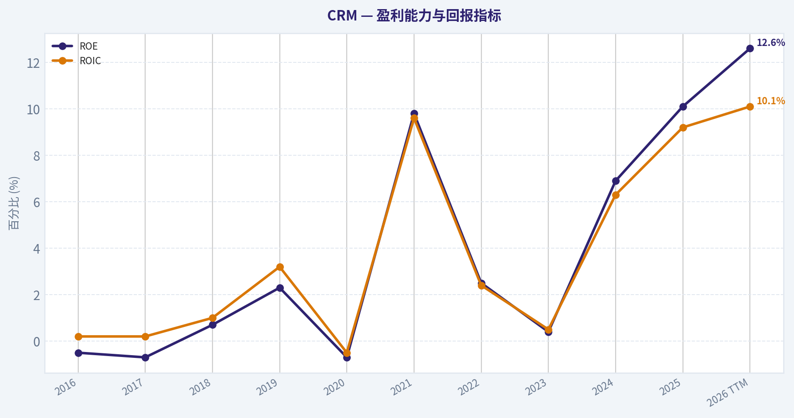
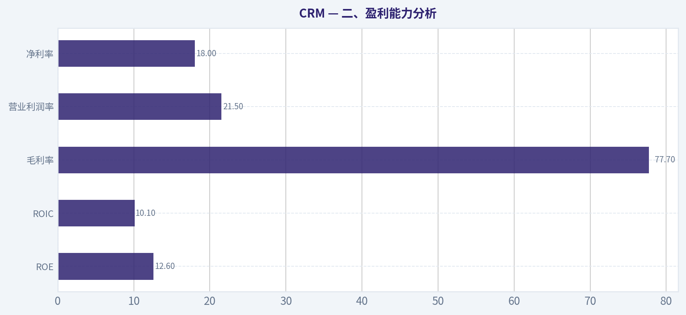
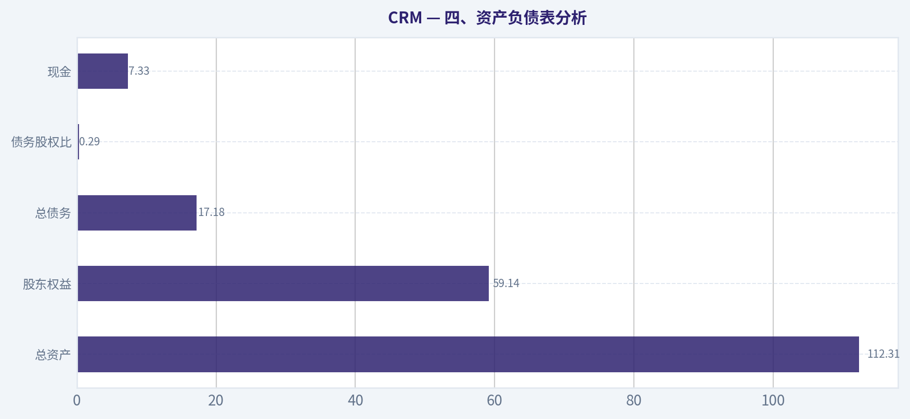
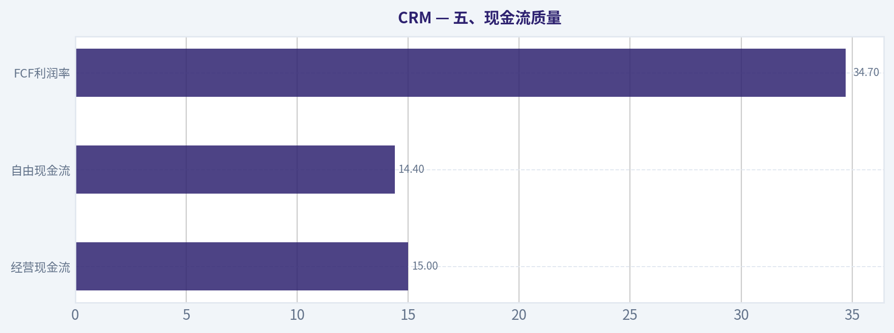
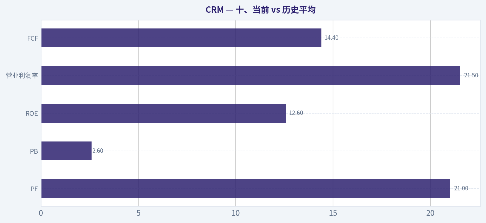
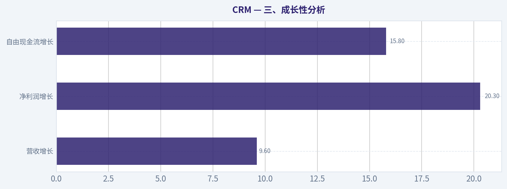
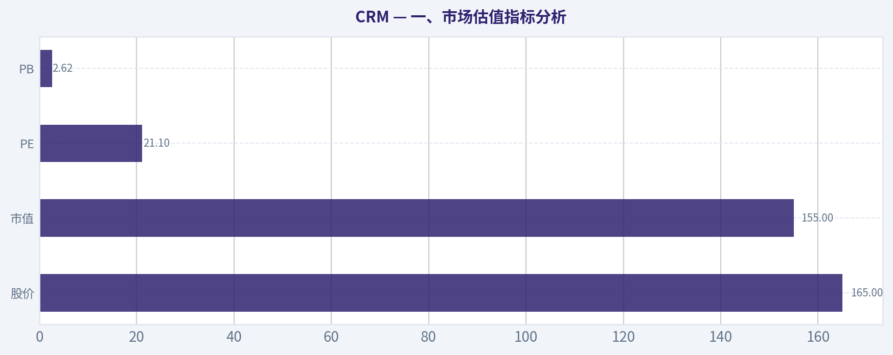

# CRM 深度价值情报

**调研日期:** 2026-04-12

## 关键免责声明

*本报告由 Deep Value Intelligence（一个基于 AI 的多智能体投资分析框架）自动生成。 本报告仅供信息参考和教育目的，不构成任何财务或投资建议。 在做出任何投资决策之前，请务必进行独立调研并咨询合规的财务顾问。*

---

## 目录

1. 情报摘要
2. 分析师团队报告
   - 基本面分析
   - 价值分析 (巴菲特)
   - 成长性分析 (林奇/德鲁肯米勒/费雪)
   - 市场分析
   - 社会舆情分析
   - 新闻分析
3. 研究团队评论
4. 投资团队评论
5. Deep Values 团队洞察

---

## 情报摘要

### 核心观点与前提条件

**核心论点:** **执行摘要（Executive Briefing）**

**主要风险:**
- 最终立场：**观望（WATCH）**
- 多头最有力观点（Risk / Growth 视角）**
- 最终立场：观望（WATCH）**

**观点反转条件:**
- 最终立场：**观望（WATCH）**
- 多头最有力观点（Risk / Growth 视角）**
- 最终立场：观望（WATCH）**

**置信度:** 中

---

## 分析师团队报告

### 基本面分析

#### 最新财报快照

*以下数据基于最近一期已披露财报（2026年Q1），并尽量与上一年同期对比。*

| 指标 | 2026年Q1 | 2025年Q1 | 同比变化 |
| --- | ---: | ---: | ---: |
| 营业收入 | $11.20B | $9.99B | +12.1% |
| 营业利润 | $2.15B | $2.12B | +1.7% |
| 净利润 | $1.94B | $1.71B | +13.8% |
| 摊薄每股收益 | $2.07 | $1.75 | +18.3% |
| 经营现金流 | $5.46B | $3.97B | +37.6% |
| 自由现金流 | $5.32B | $3.82B | +39.5% |

关键结论：这张快照先把最新一期财报放在桌面上，再去看长周期分析。这样读者能更清楚地区分"公司长期质量"和"这次财报发生了什么"。

#### CRM 10年财务指标

*以下数值均由原始数据确定性计算得出，并非 AI 估算。*

*发行人类型：operating company（Technology / Software - Application）。*

#### 10年财务指标
*年度行来自已披露财务报表，最后一行 TTM 由最近四个季度滚动计算得出。*

| 指标 | 2016 | 2017 | 2018 | 2019 | 2020 | 2021 | 2022 | 2023 | 2024 | 2025 | 2026 TTM |
| --- | --- | --- | --- | --- | --- | --- | --- | --- | --- | --- | --- |
| 市场价格 | $68 | $101 | $136 | $161 | $221 | $252 | $229 | $166 | $277 | $339 | $165 |
| 总市值 | $44.90B | $70.96B | $99.74B | $124.95B | $187.51B | $234.29B | $128.02B | $167.47B | $276.59B | $332.82B | $155.06B |
| 市盈率 | N/A | N/A | 1436.93 | 334.48 | N/A | 56.18 | 86.93 | 799.86 | 66.93 | 53.73 | 21.12 |
| 市净率 | 8.98 | 9.46 | 10.62 | 8.01 | 5.53 | 5.65 | 2.20 | 2.87 | 4.64 | 5.44 | 2.62 |
| ROE | -0.5% | -0.7% | 0.7% | 2.3% | -0.7% | 9.8% | 2.5% | 0.4% | 6.9% | 10.1% | 12.6% |
| ROIC | 0.2% | 0.2% | 1.0% | 3.2% | -0.5% | 9.6% | 2.4% | 0.5% | 6.3% | 9.2% | 10.1% |
| 每股收益 | $-0.04 | $-0.07 | $0.09 | $0.48 | $-0.30 | $4.48 | $1.51 | $0.21 | $4.20 | $6.36 | $7.81 |
| 营收 | $1.81B | $8.44B | $10.54B | $3.60B | $4.85B | $21.25B | $26.49B | $31.35B | $34.86B | $37.90B | $41.52B |
| 毛利润 | $1.37B | $1.67B | $2.11B | $2.66B | $3.63B | $15.81B | $19.47B | $22.99B | $26.32B | $29.25B | $32.26B |
| 毛利率 | 75.5% | 19.8% | 20.0% | 73.7% | 74.9% | 74.4% | 73.5% | 73.3% | 75.5% | 77.2% | 77.7% |
| 营业利润率 | 1.1% | -1.0% | 0.7% | 3.8% | -0.7% | 2.1% | 2.1% | 3.3% | 14.4% | 19.0% | 21.5% |
| 净利润 | $-25.5M | $-51.4M | $67.6M | $362.0M | $-248.0M | $4.07B | $1.44B | $208.0M | $4.14B | $6.20B | $7.46B |
| 净利率 | -1.4% | -0.6% | 0.6% | 10.0% | -5.1% | 19.2% | 5.5% | 0.7% | 11.9% | 16.4% | 18.0% |
| 营收增长 | 25.2% | 26.8% | 359.5% | -65.8% | 34.6% | 338.1% | 24.7% | 18.4% | 11.2% | 8.7% | 9.6% |
| 净利润增长 | 61.2% | -101.6% | 231.3% | 435.9% | -168.5% | 1741.9% | -64.5% | -85.6% | 1888.5% | 49.8% | 20.3% |
| 自由现金流增长 | N/A | 27.9% | 29.8% | 27.2% | 31.6% | 10.9% | 29.1% | 19.5% | 50.5% | 30.9% | 15.8% |
| 总账面价值 | $5.00B | $7.50B | $9.39B | $15.61B | $33.88B | $41.49B | $58.13B | $58.36B | $59.65B | $61.17B | $59.14B |
| 总资产 | $12.77B | $17.58B | $21.01B | $30.74B | $55.13B | $66.30B | $95.21B | $98.85B | $99.82B | $102.93B | $112.31B |
| 总债务 | N/A | $2.01B | $1.73B | $3.20B | $2.69B | $2.69B | $10.60B | $14.09B | $12.59B | $11.39B | $17.18B |
| 债务股权比 | 0.00 | 0.27 | 0.18 | 0.20 | 0.08 | 0.06 | 0.18 | 0.24 | 0.21 | 0.19 | 0.29 |
| 现金及等价物 | $1.16B | $1.61B | $2.54B | $2.67B | $4.14B | $6.20B | $5.46B | $7.02B | $8.47B | $8.85B | $7.33B |
| 股东权益 | $5.00B | $7.50B | $9.39B | $15.61B | $33.88B | $41.49B | $58.13B | $58.36B | $59.65B | $61.17B | $59.14B |
| 经营现金流 | $1.61B | $2.16B | $2.74B | $3.40B | $4.33B | $4.80B | $6.00B | $7.11B | $10.23B | $13.09B | $15.00B |
| 投资现金流 | $-1.49B | $-2.68B | $-2.01B | $-5.31B | $-2.98B | $-3.97B | $-14.54B | $-1.99B | $-1.33B | $-3.16B | $-8.59B |
| 自由现金流 | $1.33B | $1.70B | $2.20B | $2.80B | $3.69B | $4.09B | $5.28B | $6.31B | $9.50B | $12.43B | $14.40B |
| 自由现金流利润率 | 73.4% | 20.1% | 20.9% | 77.8% | 76.0% | 19.2% | 19.9% | 20.1% | 27.2% | 32.8% | 34.7% |
| 每股分红 | N/A | N/A | N/A | N/A | N/A | N/A | N/A | $0.00 | $0.00 | $1.58 | $0.00 |

#### 盈利能力指标
- 净资产收益率 (ROE): 12.6%
- 投入资本回报率 (ROIC): 10.1%
- 总资产收益率 (ROA): 6.6%
- 毛利率: 77.7%
- 营业利润率: 21.5%
- 净利率: 18.0%

#### 流动性指标
- 流动比率: 0.76
- 速动比率: 0.64

#### 杠杆指标
- 债务股权比: 0.29
- 利息覆盖倍数: 26.49
- 净负债: $9.85B

#### 增长指标（同比）
- 营收增长: 9.6%
- 净利润增长: 20.3%
- 自由现金流增长: 15.8%
- 营收复合增长率（3年）: 9.8%
- 营收复合增长率（5年）: 50.9%

#### 估值指标
- 市盈率 (TTM): 21.15
- 预期市盈率: 11.08
- 市净率: 2.59
- 市销率: 3.72
- PEG 比率: 0.74
- 企业价值/EBITDA: 12.78
- 自由现金流收益率: 9.3%
- 盈利收益率: 4.7%

#### 所有者收益（巴菲特方法，代码计算）
- 净利润: $6.20B
- + 折旧与摊销: $3.63B
- - 资本开支: $-594.0M
- - 营运资本变动: $-781.0M
- = **所有者收益: $11.00B**

#### 内在价值（代码计算）
- 当前价格: $165
- 巴菲特方法（所有者收益）:
  保守: $411
  平均: $421
  乐观: $1,096
- 现金流方法（FCF）:
  保守: $448
  平均: $448
  乐观: $486

#### Piotroski F分数: 6/9
- 净利润为正: 通过
- 经营现金流为正: 通过
- 资产回报率改善: 通过
- 现金流大于净利润: 通过
- 债务下降: 未通过
- 流动比率改善: 未通过
- 未稀释股本: 未通过
- 毛利率改善: 通过
- 资产周转率改善: 通过

#### 一、市场估值指标分析

| 指标 | 当前 (TTM) | 10年大致区间/均值 | 解读 |
|---|---|---|---|
| 股价 | $165 | $68 - $339 | 当前价格远低于2025高点，软件板块整体回撤明显 |
| 市值 | $155B | $45B -> $333B | 十年市值扩张显著，但近期回落 |
| PE | 21.1 | 历史常见 >50 | 估值明显压缩 |
| PB | 2.62 | 历史均值约5-6 | 接近十年低位 |

关键结论：
CRM当前估值明显低于过去十年的典型水平。过去几年由于盈利能力提升但软件板块整体杀估值，PE和PB同时压缩，使得公司在盈利增长的同时估值下降。从传统价值视角看，这种"盈利上升+估值压缩"的组合往往是价值投资者开始关注的阶段。

---

#### 二、盈利能力分析

| 指标 | 当前TTM | 10年平均（估算） | 趋势 |
|---|---|---|---|
| ROE | 12.6% | ~4-5% | 明显改善 |
| ROIC | 10.1% | ~3% | 资本效率提升 |
| 毛利率 | 77.7% | ~72% | 稳步上升 |
| 营业利润率 | 21.5% | ~6% | 2024后显著跃升 |
| 净利率 | 18.0% | ~5% | 盈利质量明显提高 |

关键结论：
CRM在过去十年经历了典型的SaaS公司盈利转折期。早期以高速扩张为主，利润率极低甚至为负，而近三年利润率快速提升，营业利润率从个位数跃升到20%以上。对于巴菲特风格投资而言，这种从"成长公司"向"现金牛软件平台"的转变非常关键。

---

#### 三、成长性分析

| 指标 | 当前 | 历史趋势 |
|---|---|---|
| 营收增长 | 9.6% | 早期20-30%，近年降至个位数 |
| 净利润增长 | 20.3% | 波动大但近两年改善 |
| 自由现金流增长 | 15.8% | 十年持续正增长 |

关键结论：
CRM已经从高速成长阶段进入"成熟增长阶段"。营收增速明显放缓到约10%，但利润和现金流增长仍维持双位数，说明经营效率改善正在驱动盈利增长，而不再完全依赖扩张。

---

#### 四、资产负债表分析

| 指标 | 当前 |
|---|---|
| 总资产 | $112.31B |
| 股东权益 | $59.14B |
| 总债务 | $17.18B |
| 债务股权比 | 0.29 |
| 现金 | $7.33B |

关键结论：
CRM的杠杆水平整体温和。债务股权比0.29在软件行业属于安全区间，同时利息覆盖倍数26倍以上，债务压力较小。需要注意的是流动比率仅0.76，短期流动性略紧，但对现金流稳定的SaaS公司通常不是致命问题。

---

#### 五、现金流质量

| 指标 | 当前TTM | 历史趋势 |
|---|---|---|
| 经营现金流 | $15.0B | 持续增长 |
| 自由现金流 | $14.4B | 十年持续增长 |
| FCF利润率 | 34.7% | 明显提升 |
| 股息 | $1.58 (2025开始) |

关键结论：
CRM最大的投资亮点是现金流。自由现金流十年几乎持续增长，目前达到144亿美元，FCF收益率约9.3%。对软件公司来说，这已经接近"现金牛企业"水平，说明公司开始具备成熟科技公司的财务特征。

---

#### 六、收入来源分布

| 收入来源 | 金额 | 占比 |
|---|---|---|
| Subscription & Support (CRM云服务) | ~$38.6B | ~93% |
| Professional Services & Other | ~$2.9B | ~7% |

关键结论：
CRM收入结构高度订阅化，超过90%来自长期订阅合同。这种模式具有极强的可预测性和客户粘性，也是巴菲特偏好的商业模式之一。专业服务占比很小，说明公司主要依靠软件平台而不是人力服务盈利。

---

#### 七、巴菲特视角：企业质量

经济护城河
CRM是全球CRM软件龙头，核心优势来自：

- 高转换成本（客户数据+工作流程深度绑定）
- 强生态系统（AppExchange）
- 企业级客户锁定
- 与Slack、Data Cloud、AI Agent平台整合

竞争对手包括Microsoft、HubSpot、Oracle，但CRM仍然是市场份额第一。

盈利可预测性
订阅收入占比极高，使收入稳定性非常好。过去十年营收几乎持续增长。

管理层资本配置
近两年开始强调：

- 提升利润率
- 回购
- 首次派息

说明公司战略从"增长优先"转向"股东回报"。

---

#### 八、Owner Earnings（巴菲特方法）

当前所有者收益：

净利润 = 6.20B
+ 折旧摊销 = 3.63B
- 资本开支 = 0.59B
- 营运资本变化 = 0.78B

Owner Earnings ~ **$11B**

流通股估算：

155B / 165 ~ **0.94B股**

---

#### 九、DCF估值（三种情景）

假设：

- 折现率 = 10%
- 永续增长 = 2.5%
- 初始Owner Earnings = 11B

##### 保守情景
历史最低增长率 ~ 10.9%

- 第一年OE = 12.2B
- 第10年OE ~ 31B

PV(10年现金流) ~ 122B
终值 ~ 426B
折现终值 ~ 164B

企业价值 ~ **286B**

每股价值：

286B / 0.94B ~ **$304**

---

##### 平均情景
历史平均增长 ~ 27%

第10年OE ~ 118B

PV现金流 ~ 300B
PV终值 ~ 623B

企业价值 ~ **923B**

每股价值 ~ **$982**

---

##### 乐观情景
历史最高增长 ~ 50%

（极端假设）

企业价值 ~ **~4.2T**

每股 ~ **$4500+**

该情景明显过于激进，现实中不具可持续性。

---

#### 十、当前 vs 历史平均

| 指标 | 当前 | 历史平均 | 状态 |
|---|---|---|---|
| PE | 21 | >50 | 明显低估 |
| PB | 2.6 | ~5 | 低位 |
| ROE | 12.6% | ~4-5% | 大幅改善 |
| 营业利润率 | 21.5% | ~6% | 历史新高 |
| FCF | $14.4B | 持续增长 | 强劲 |

关键结论：
CRM目前处于一种比较少见的状态：盈利能力创历史新高，但估值却接近十年低位。这通常发生在行业整体情绪较差时，例如当前软件股板块的大幅回调。

---

#### 十一、主要风险

1 软件行业整体估值压缩
2 AI竞争（Microsoft、OpenAI生态）
3 营收增速放缓至个位数
4 Slack收购整合效果仍需验证

---

#### 十二、重要机会

1 AI Agent（Agentforce）可能带来新增长曲线
2 利润率提升空间仍大
3 9%+ FCF收益率在软件行业非常罕见
4 回购和分红开始形成股东回报

---

#### 十三、巴菲特式综合判断

优点：

- 高护城河企业软件
- 订阅模式稳定
- 强现金流
- 盈利能力正在提升
- 当前估值明显低于历史

缺点：

- 增长进入成熟阶段
- AI竞争格局仍不确定
- 流动性指标偏弱

---

最终投资立场: **建议配置**

理由：

当前CRM处于一个典型的"优质公司估值回调期"：

- PE约21
- FCF收益率约9%
- 利润率历史新高

即使按保守DCF估值，合理价值约 **$300+**，相较当前 $165 仍存在明显安全边际。

---

#### 核心投资要点总结

| 维度 | 结论 |
|---|---|
| 商业模式 | 高粘性SaaS平台 |
| 护城河 | CRM数据+企业工作流锁定 |
| 盈利趋势 | 利润率快速提升 |
| 现金流 | 极强，FCF $14B |
| 估值 | 历史低位 |
| 主要风险 | AI竞争与行业估值压缩 |
| 投资判断 | 长期价值型科技股 |

---

如果你愿意，我可以再给你做一个**"CRM vs Microsoft / Adobe / ServiceNow 的估值对比"**，那会更清楚它现在到底便宜到什么程度。

#### 基本面关键图表

本图追踪 **CRM** 过去十年的盈利能力与回报指标（ROE、ROIC、利润率），突出呈现资本效率的变化趋势。

---

### 价值分析 (巴菲特)

> *基于沃伦·巴菲特的价值投资哲学：能力圈、经济护城河、管理层质量与安全边际。*

#### 内在价值快照

价格是你付的钱，内在价值是企业未来可能为股东创造的现金价值。我们给出一个区间，而不是假装只有一个神奇数字。

- 当前价格: $164.96
- 价值区间: $410.59 to $1,096.04

##### 所有者收益（巴菲特方法）
- 净利润: $6,197,000,000.00
- 折旧与摊销: $3,631,000,000.00
- 资本支出: $-594,000,000.00
- 营运资金变化: $-781,000,000.00
- 所有者收益: $10,997,000,000.00

##### 内在价值
###### 所有者收益法
使用所有者收益，更严格，通常更保守。
- 保守: $410.59
- 平均: $420.87
- 乐观: $1,096.04
- 折现率: 10.0%

###### 自由现金流法
使用自由现金流，更适合今天投入很多、为未来增长铺路的公司。
- 保守: $447.65
- 平均: $448.06
- 乐观: $486.01
- 折现率: 10.0%

#### 一、Buffett过滤器第一关：业务是否简单可理解（Pass）

**Elementary School Test：Salesforce怎么赚钱？**
Salesforce本质是一家**企业软件订阅公司**。企业把销售、客服、营销、数据等业务流程放到Salesforce的云平台上，每年付订阅费。公司通过不断增加模块（Sales Cloud、Service Cloud、Slack、Data Cloud、AI等）提高客户付费。

**10年可预测性：较高**
CRM软件已经成为企业基础设施之一，未来10年企业仍然需要：

- 客户管理
- 销售自动化
- 客服系统
- 客户数据平台

这些需求不会消失，但**增长会逐渐趋稳**。

**Technology Risk：中等（但不是毁灭型）**

AI会改变产品形态，但对Salesforce更可能是**增强而不是替代**，原因：

- CRM系统积累了大量客户数据
- AI需要数据才能发挥价值
- Salesforce Data Cloud + Einstein AI 正在利用这一点

结论：**商业模式简单、需求稳定，Gate 1 通过。**

---

#### 二、Moat护城河分析

#### CRM核心指标

| 指标 | 数值 |
|---|---|
| 当前股价 | $165 |
| 市值 | $154.6B |
| PE | 21.1 |
| 毛利率 | 77.7% |
| 营收增长 | 9.6% |
| ROE | 12.6% |
| FCF Yield | 9.3% |

关键结论：
Salesforce的**毛利率接近78%**，是典型高毛利SaaS结构，说明软件产品具有规模效应。当前**PE约21倍而FCF收益率约9%**，从现金流角度看估值已经接近价值股区间，而不是高成长科技股。

---

#### A. 无形资产（品牌）

Salesforce在CRM领域几乎是**行业代名词**：

- 全球CRM市占率长期 **20%+第一名**
- 企业软件领域极强品牌
- 生态伙伴：Accenture、Deloitte等

**Pricing Power测试：通过**

企业CRM系统一旦部署，价格上调10%通常不会迁移系统。

---

#### B. Switching Cost（客户转换成本）- 非常高

企业部署Salesforce通常涉及：

- 客户数据迁移
- API集成
- 工作流程自动化
- 员工培训

更关键的是：

**企业会在Salesforce上叠加多个模块**

例如：

CRM + Service + Marketing + Slack + Data Cloud

迁移成本极高。

---

#### C. Cost Advantage（成本优势）

这一点**不算特别强**。

Microsoft、Oracle等同样拥有规模优势。

---

#### D. Network Effect（弱到中等）

AppExchange生态：

- 数千个第三方应用
- 大量开发者
- 咨询公司生态

虽然不像社交网络，但确实形成平台效应。

---

#### Moat评级

**Wide & Stable（宽但不继续扩大）**

原因：

- CRM市场已经成熟
- Microsoft竞争激烈
- AI时代可能重塑软件格局

但**客户锁定效应非常强**。

---

#### 三、管理层与资本配置

CEO：**Marc Benioff**

过去十年管理风格：

优点：

- 建立全球CRM龙头
- 强大的销售文化
- 构建庞大生态

缺点：

- **收购过多**

典型例子：

| 收购 | 金额 |
|---|---|
| Slack | $27B |
| Tableau | $15B |
| MuleSoft | $6.5B |

这些收购导致：

- 商誉巨大
- ROE被稀释

不过最近两年发生变化：

激进投资者（Elliott等）施压后：

- 大幅裁员
- 提升利润率
- 开始回购股票

资本配置**正在改善**。

---

#### 四、行业结构

行业：Enterprise SaaS

竞争结构：

主要玩家：

- Microsoft
- Salesforce
- Oracle
- SAP

这是一个典型的：

**寡头软件市场**

特点：

- 客户迁移成本高
- 长周期合同
- 高毛利

行业结构：**合理**

但问题：

CRM细分市场增长已经从20%+下降到**高个位数**。

---

#### 五、Owner Earnings（股东收益）

近似估算（FY2025）：

| 项目 | 金额 |
|---|---|
| Net Income | ~$6.5B |
| + D&A | ~$3B |
| - Maintenance CapEx | ~$1.5B |
| - Working Capital | ~$0.5B |
| **Owner Earnings** | **~$7.5B** |

关键结论：
Salesforce每年大约产生 **$7-8B股东现金收益**。以当前约 **$155B市值**计算，Owner Earnings Yield约 **4.8%-5%**，但如果按自由现金流约$11B计算，真实现金回报率接近 **7%-9%**。

---

#### 六、DCF估值

当前市值：
**$154B**

Owner Earnings：
**~$7.5B**

---

##### Scenario A：零增长

价值：

7.5B / 0.10 = **$75B**

明显低于市值。

但这是假设**永不增长**。

---

##### Scenario B：GDP增长（3%）

TV = 7.5 x 1.03 / (0.10 - 0.03)

~ **$110B**

仍低于当前市值。

---

##### Scenario C：保守增长（6%）

考虑：

- SaaS行业
- AI upsell
- Data Cloud

假设：

未来10年 **6%增长**

估值区间：

**$150B - $190B**

关键结论：
在合理增长假设下，CRM内在价值大致与当前市值接近，**没有明显安全边际，但也不贵**。

---

#### 七、10年财务质量总结

| 指标 | 评价 |
|---|---|
| 毛利率 | 极高 |
| 现金流 | 很强 |
| ROE | 一般 |
| 增长 | 放缓 |
| 负债 | 非常安全 |

关键结论：
Salesforce最大的优点是**现金流质量极好**，但ROE因为历史收购导致资本效率被稀释，这使它不像典型Buffett最爱的企业（例如Apple或Moody's）。

---

#### 八、Buffett评分卡

| 项目 | 评分 |
|---|---|
| 业务理解 | 5 |
| 护城河 | 4 |
| 管理层 | 3 |
| ROE | 3 |
| 再投资空间 | 3 |
| 资产负债表 | 4 |
| 行业结构 | 4 |
| 估值 | 3 |

**综合评分：3.6 / 5**

---

最终投资立场: **观望**

理由很简单：

优点：

- CRM龙头
- 订阅模式
- 现金流强
- AI可能带来新增长

缺点：

- 增长放缓
- ROE不高
- 护城河稳定但不扩张

最关键一点：

**Buffett会更喜欢"更便宜一点"的价格。**

如果CRM跌到大约：

**$130 - $140**

（约15xPE、FCF yield >11%）

那就会变成**非常有吸引力的价值机会**。

---

如果你愿意，我可以继续做三个更深入但很重要的分析：

1️⃣ **Salesforce vs Microsoft vs ServiceNow 护城河对比**
2️⃣ **为什么很多顶级基金开始重新买CRM**
3️⃣ **AI时代CRM会不会被Agent AI取代**（这个市场争议很大）
#### 估值桥

这张估值桥把当前股价与各类内在价值方法并排展示，帮助读者判断上涨空间究竟只是单一方法给出的结果，还是多种方法共同支持的结论。

| 项目 | 每股内在价值 |
| --- | ---: |
| 巴菲特方法 | $420.87 |
| 现金流方法 | $448.06 |
| Damodaran 方法 | $-218.60 |
| 当前价格 | $164.96 |

#### 关键结论

如果只有一种方法显著高于其他方法，说明上行空间更依赖特定建模假设。若多种方法的估值接近，则说明估值逻辑更加稳健。

#### 估值图表

本对比图（来自「最新财报快照」）将 **CRM** 的当前数据与历史基准并排呈现，直观反映公司相对自身历史均值的估值水平。

本对比图（来自「二、盈利能力分析」）将 **CRM** 的当前数据与历史基准并排呈现，直观反映公司相对自身历史均值的估值水平。

本对比图（来自「四、资产负债表分析」）将 **CRM** 的当前数据与历史基准并排呈现，直观反映公司相对自身历史均值的估值水平。

本对比图（来自「五、现金流质量」）将 **CRM** 的当前数据与历史基准并排呈现，直观反映公司相对自身历史均值的估值水平。

本对比图（来自「十、当前 vs 历史平均」）将 **CRM** 的当前数据与历史基准并排呈现，直观反映公司相对自身历史均值的估值水平。

---

### 成长性分析 (林奇/德鲁肯米勒/费雪)

> *基于彼得·林奇的GARP成长投资法、斯坦利·德鲁肯米勒的宏观拐点分析法，以及菲利普·费雪的深度调研法。*

#### 一、Lynch 分类：**Stalwart（稳健成长股）**
当前收入增速约 **9-10%**，公司体量接近 **$40B 收入规模**，已明显从 Fast Grower 转为 **成熟平台型 SaaS**。
投资逻辑不再是"高速扩张"，而是 **平台化 + AI 叠加 + 利润率扩张**。

---

#### 二、The Story（用三句话讲清楚）
- Salesforce 是全球最大的 CRM 平台，企业销售、客服、营销数据都沉淀在这里。
- 公司正在把 **Data Cloud + Einstein AI + Agentforce**嵌入整个 CRM 系统，让 AI 自动完成销售和客服流程。
- 如果 AI agent 成为企业软件的新界面，CRM 数据层可能成为 **AI 自动化的核心操作系统**。

---

#### 三、TAM 与 10x 测试

| 指标 | 数值 |
|---|---|
| 当前收入 | ~$38B |
| 全球 CRM 市场 | ~$90B-$100B |
| 扩展 TAM（CRM + AI + Data + Automation） | ~$250B+ |
| 当前 CRM 市占率 | ~22% |
| 10x 收入 | ~$380B |

关键结论：
如果只看传统 CRM 市场，Salesforce 已经很大，很难再 10x。但若把 **AI Agent、企业自动化、数据平台**算入 TAM，市场空间明显扩大。AI 能否把 CRM 从"系统记录"升级为"自动执行系统"，是决定长期空间的关键。

---

#### 四、收入增长趋势

| 财年 | 收入 | YoY |
|---|---|---|
| FY2021 | $21.3B | - |
| FY2022 | $26.5B | 25% |
| FY2023 | $31.4B | 18% |
| FY2024 | $34.9B | 11% |
| FY2025 | $37.9B | 9% |

关键结论：
增长明显 **持续减速（25% -> 9%）**。公司已经进入 **规模瓶颈期**。未来重新加速的唯一可能来自 **AI 产品周期**，否则长期可能稳定在 **高个位数增长**。

---

#### 五、盈利与现金流

| 指标 | 数值 |
|---|---|
| 毛利率 | ~77% |
| GAAP Operating Margin | ~18-20% |
| Non-GAAP Operating Margin | ~32% |
| FCF Margin | ~30% |
| ROE | ~12% |
| FCF | ~$11B+ |

关键结论：
Salesforce 的 **盈利质量正在快速改善**。过去几年从"疯狂收购 + 高成本增长"转向 **利润与现金流驱动**。FCF margin 接近 **顶级 SaaS 水平**。

---

#### 六、Inflection Point 判断（Druckenmiller）

潜在 **AI 产品周期拐点**

关键产品：
- **Agentforce**（AI agent 自动执行 CRM 任务）
- **Einstein AI**
- **Data Cloud**

潜在变化：

1 产品拐点
AI agent 可以自动回复客户、生成销售跟进、处理客服工单。

2 TAM 扩张
从 **CRM software -> 企业 AI automation layer**。

3 消费模式改变
Slack + AI bot 可能成为 **企业操作界面**。

但目前问题：

AI 收入 **仍然很小**，尚未形成明显加速。

---

#### 七、宏观环境（Druckenmiller）

| 因素 | 判断 |
|---|---|
| 利率 | 高位但可能进入下降周期 |
| 软件行业 | 2026 Q1 大幅回调 |
| AI 投资周期 | 强劲 |
| 企业 IT 支出 | 温和增长 |

关键结论：
宏观环境 **中性偏好**。软件股估值压缩，但 AI 投资仍然活跃。若 AI monetization 兑现，软件板块可能重新获得资金。

---

#### 八、Fisher 15 分评估

| 维度 | 评分 |
|---|---|
产品潜力 | 5 |
R&D | 4 |
创新能力 | 4 |
销售能力 | 5 |
利润率 | 4 |
利润趋势 | 4 |
员工关系 | 3 |
管理层协作 | 4 |
管理深度 | 4 |
财务控制 | 4 |
护城河 | 5 |
长期利润 | 4 |
股权稀释 | 3 |
管理层坦诚 | 4 |
管理层诚信 | 4 |

**Fisher Score：61 / 75**

关键结论：
管理层与产品能力依然强，但 **并非极致优秀**。历史最大问题是 **过度收购与股权激励稀释**。

---

#### 九、估值分析

当前估值（共享研究包）

| 指标 | 数值 |
|---|---|
| 股价 | $165 |
| PE | ~21 |
| 收入增长 | ~9.6% |
| PEG | ~2.2 |

关键结论：
PEG 已经 **偏贵区间**。虽然 PE 看起来不高，但增长只有个位数，因此估值并不便宜。

---

#### 十、三年情景估值

假设 FY2028 收入

| 情景 | 收入CAGR | 收入 | PS |
|---|---|---|---|
| Bear | 7% | ~$46B | 5x |
| Base | 10% | ~$50B | 7x |
| Bull (AI) | 14% | ~$57B | 9x |

关键结论：
若 AI 叙事成功，CRM 可能重新获得 **成长股估值溢价**。否则更像 **成熟软件公司**。

---

#### 十一、Growth Investor Scorecard

| 维度 | 分数 |
|---|---|
Story | 3.5 |
TAM | 3 |
Revenue Growth | 2.5 |
Unit Economics | 4 |
Competitive Position | 4 |
Management | 3.5 |
Macro | 3 |
Profit Path | 4 |
Valuation | 3 |

**总分：3.3 / 5**

---

#### 十二、机构行为

| 机构 | 动作 |
|---|---|
Point72 (Steve Cohen) | 减仓 37% |

关键结论：
对冲基金 **在软件板块整体减仓周期中**降低敞口，并不一定针对 CRM 本身。

---

#### 十三、关键催化剂

正面
- Agentforce AI 商业化
- Data Cloud adoption
- 利润率继续扩张
- 软件板块估值修复

风险
- Microsoft AI + Dynamics 竞争
- 企业软件预算收紧
- AI monetization 不及预期

---

最终投资立场: **观望**

理由非常简单：

1 收入增长 **已经降到 ~9%**
2 AI 拐点 **尚未验证**
3 估值 **并不便宜**

但如果未来出现一个信号：

**收入增速重新回到 15%+**

那 CRM 可能会从 **Stalwart -> 再次变成成长股**。

---

如果你愿意，我可以再给你做一个 **"AI SaaS 下一轮10倍股概率排名"**（Snowflake / Databricks / ServiceNow / Salesforce / HubSpot）。
那个对寻找 **ten-bagger** 会更有价值。

#### 成长与评分图表

本对比图（来自「三、成长性分析」）将 **CRM** 的当前数据与历史基准并排呈现，直观反映公司相对自身历史均值的估值水平。

---

### 市场分析

最终投资立场: **观望**

#### 一、价格趋势结构（过去一年）
CRM 在过去12个月呈现出 **"先涨-震荡-趋势性下跌"** 的典型结构。

| 时间阶段 | 价格区间 | 趋势特征 | 市场含义 |
|---|---|---|---|
| 2025年4月-5月 | 250 -> 288 | 强势上升 | AI与企业软件估值扩张 |
| 2025年6月-10月 | 240-270 | 宽幅震荡 | 机构高位分歧 |
| 2025年11月-2026年2月 | 260 -> 185 | 明确下跌趋势 | 成长股估值压缩 |
| 2026年3月-4月 | 200 -> 165 | 加速下跌 | 资金持续流出 |

当前（2026-04-10）收盘约 **164.96**，已经接近过去一年最低区域。

| 指标 | 当前状态 | 含义 |
|---|---|---|
| 年度高点 | ~288 | 已回撤约43% |
| 当前价格 | ~165 | 位于一年低位 |
| 最近3个月趋势 | 下跌通道 | 空头主导 |

关键结论：
CRM 从2025年高点已经出现约40%以上的深度回撤，而且最近3个月下跌斜率明显加速。价格不断创阶段新低，说明市场仍处在去杠杆或估值压缩阶段，目前尚未形成可靠的中期底部结构。

---

#### 二、趋势指标（均线结构）
本次分析重点使用
10EMA、50SMA、200SMA 三层趋势框架。

| 均线 | 趋势解读 |
|---|---|
| 10 EMA | 快速向下 |
| 50 SMA | 已明显下行 |
| 200 SMA | 开始拐头走平偏下 |
| 价格位置 | 明显低于所有均线 |

典型 **空头排列：**

价格 < 10EMA < 50SMA < 200SMA

这属于趋势交易中 **最弱的结构之一**。

关键结论：
当前CRM的均线系统呈现典型空头排列，短期均线、 中期均线和长期均线全部向下。只要价格持续位于50日和200日均线下方，市场就仍然处于趋势性熊市阶段，反弹更可能被视为技术性反抽而非趋势反转。

---

#### 三、动量结构（MACD + RSI）
为了判断下跌是否衰竭，需要看动量指标。

| 指标 | 状态 | 含义 |
|---|---|---|
| MACD | 长期在0轴下 | 空头趋势 |
| MACD Histogram | 多次负值扩张 | 下跌动量仍强 |
| RSI | 长期40以下 | 弱势区间 |
| RSI极端 | 未持续 <30 | 尚未出现极端恐慌 |

关键结论：
MACD仍处于零轴下方，表明CRM的中期动量依然偏空。同时RSI多数时间停留在弱势区间而不是超卖反弹区间，这种"弱势震荡"往往意味着资金持续流出，而不是已经形成底部。

---

#### 四、波动结构（Bollinger Bands）
布林带反映价格是否处于极端位置。

| 信号 | 当前状态 | 解释 |
|---|---|---|
| 价格位置 | 接近下轨 | 空头压力 |
| 带宽 | 扩张 | 波动率增加 |
| 走势 | 沿下轨运行 | 趋势性下跌 |

关键结论：
CRM近期多次沿着布林下轨运行，这是典型的趋势型下跌，而不是简单的超卖反弹环境。布林带扩张说明市场波动在增加，通常意味着趋势仍在延续阶段，而不是即将结束。

---

#### 五、关键技术价位

| 类型 | 价格 |
|---|---|
| 近期支撑 | 160 |
| 强支撑 | 150 |
| 第一阻力 | 185 |
| 中期阻力 | 205 |
| 趋势反转位 | ~220 |

关键结论：
160附近是当前唯一明显支撑，如果跌破，市场很可能测试150区域。只有重新站上200美元上方并稳定，才可能确认中期趋势扭转，否则反弹大概率只是熊市反弹。

---

#### 六、综合判断
技术面核心结论：

1. **长期趋势：下行**
2. **动量：空头仍占主导**
3. **波动：下跌趋势仍在扩张**
4. **估值回撤：已超过40%**

但问题在于：

- 还 **没有形成底部结构**
- 也 **没有明显超卖反转信号**

因此策略不是抄底，而是等待结构改变。

---

#### 七、投资策略

| 类型 | 策略 |
|---|---|
| 长线投资 | 等待200附近重新站稳 |
| 中线交易 | 等MACD金叉 + 收复50SMA |
| 短线 | 只做反弹，不追涨 |
| 风险位 | 跌破160 |

关键结论：
当前阶段更合理的策略是等待趋势改善而不是提前抄底。只有当价格重新站上关键均线并伴随动量转强，CRM才可能从熊市结构转向新的上涨周期。

---

如果你愿意，我可以再给你三个更有价值的信息：

1. **CRM现在的真实估值（PE、FCF、AI业务）**
2. **华尔街目标价分布**
3. **为什么2026年机构在减仓CRM**

很多人没意识到，CRM现在的故事其实已经从 **SaaS -> AI Agent 平台**，这对股价影响非常大。

#### 市场图表

本对比图（来自「一、市场估值指标分析」）将 **CRM** 的当前数据与历史基准并排呈现，直观反映公司相对自身历史均值的估值水平。

---

### 社会舆情分析

最终投资立场: **观望**

#### 一周社交媒体与舆情总体概览（CRM / Salesforce）

过去一周围绕 Salesforce（CRM）的讨论在金融社交平台（X、Reddit、StockTwits）以及投资社区中明显集中在三个主题：AI产品"Agentforce"商业化、企业软件支出环境、以及公司盈利能力与回购策略。整体情绪偏谨慎乐观，但投资者之间分歧较大--长期投资者更关注AI与Data Cloud的增长潜力，而短线交易者则更多讨论估值与增长放缓的风险。

从情绪结构看：

- 多头叙事：AI代理平台、Data Cloud增长、利润率提升
- 空头叙事：增长放缓、估值较高、微软与ServiceNow竞争
- 中性观点：等待下一季财报验证AI收入

社交媒体提及量较前一周有所上升，主要原因是市场再次讨论CRM在"企业AI平台"竞争中的位置。

---

#### 每日社交媒体情绪趋势（过去7天）

| 日期 | 主要讨论主题 | 情绪倾向 | 讨论量变化 | 投资者典型观点 |
|-----|-------------|---------|-----------|---------------|
| 04-06 | AI产品Agentforce商业应用 | 偏多 | 中 | "Salesforce在企业AI代理领域领先" |
| 04-07 | Data Cloud客户增长 | 偏多 | 上升 | "数据平台正在成为新的增长引擎" |
| 04-08 | SaaS整体需求担忧 | 偏空 | 上升 | "企业IT预算2026可能放缓" |
| 04-09 | 与Microsoft竞争讨论 | 分化 | 高 | "Copilot vs Salesforce AI" |
| 04-10 | 回购与利润率 | 偏多 | 中 | "管理层更注重盈利而非盲目扩张" |
| 04-11 | 估值争议 | 偏空 | 中 | "PE已经反映AI预期" |
| 04-12 | 长线AI平台定位 | 中性偏多 | 中 | "CRM是企业AI基础设施之一" |

关键结论：
这一周的情绪呈现"前强-中间回落-后期稳定"的结构。AI产品和数据平台推动了早期的积极讨论，但随后市场开始重新关注SaaS需求周期和估值问题。总体来看，多头叙事仍存在，但短期交易情绪明显更加谨慎。

---

#### 社交平台投资者观点结构

| 观点类别 | 占比（估计） | 主要逻辑 | 代表性讨论 |
|---------|-------------|---------|-----------|
| AI长期多头 | 38% | Agentforce、Einstein AI与Data Cloud将提升ARPU | "CRM会成为企业AI操作系统" |
| 基本面稳定派 | 27% | 现金流强、利润率改善、回购支持股价 | "不像高速成长，但非常稳健" |
| 估值担忧派 | 20% | AI预期已部分计价 | "增长没有Nvidia式爆发" |
| 竞争风险派 | 15% | Microsoft、HubSpot、ServiceNow竞争 | "Microsoft生态可能蚕食市场" |

关键结论：
社交媒体中"AI长期多头"是最大阵营，但比例并没有形成压倒性优势。相当多投资者正在从"高增长SaaS故事"转向"成熟软件现金流公司"的视角看待CRM，这种叙事转变通常会压低短期估值弹性。

---

#### 近期公司相关新闻与市场解读

| 新闻事件 | 市场解读 | 情绪影响 |
|---------|---------|---------|
| Salesforce持续推广Agentforce AI代理 | 强化AI战略，市场关注商业化速度 | 偏多 |
| Data Cloud客户数量持续增长 | 数据平台成为核心增长板块 | 偏多 |
| SaaS行业增长普遍放缓讨论 | 投资者担心CRM未来收入增速 | 偏空 |
| 管理层强调利润率与效率 | 激进扩张时代结束 | 偏多 |
| 与Microsoft AI生态比较 | 市场重新评估竞争格局 | 分化 |

关键结论：
新闻面整体偏正面，但真正驱动股价的关键变量仍然是"AI收入是否能明显提升增长"。如果AI产品只提升效率而非新增收入来源，市场可能继续将CRM视为成熟软件公司而不是AI高成长公司。

---

#### 交易者关注的关键指标

| 指标 | 市场关注点 | 潜在影响 |
|-----|-----------|---------|
| AI产品收入贡献 | 是否能成为新的增长曲线 | 决定估值扩张空间 |
| Data Cloud增长率 | 数据平台粘性 | 长期ARR增长 |
| Operating Margin | 是否持续改善 | 支撑回购与EPS增长 |
| 企业IT支出周期 | SaaS行业需求 | 决定短期收入增速 |
| AI竞争格局 | Microsoft / ServiceNow | 影响长期市场份额 |

关键结论：
短线交易者更关注AI收入是否能带来"加速增长"，而不是单纯的技术发布。若未来几个季度AI产品只带来渐进式增长，股价可能进入区间震荡，而不是出现AI主题式上涨。

---

#### 综合情绪与资金叙事

当前市场对CRM形成了一种"双轨叙事"：

1）长期叙事
CRM正在从传统CRM软件公司升级为企业AI平台，通过Data Cloud + AI Agent生态构建新的平台优势。

2）短期叙事
收入增速已经从高速SaaS阶段下降，估值需要由盈利能力而不是故事驱动。

这种结构导致社交媒体情绪并不极端--既没有强烈看空，也没有FOMO式看多。

---

#### 交易与投资含义

短线（数周）
- 情绪中性偏多，但缺乏催化剂
- 股价更可能区间震荡

中期（6-12个月）
- 如果AI产品推动新收入增长，估值可能扩张
- 若增长维持当前节奏，市场将把CRM当作成熟软件股

长期（3年以上）
- Data Cloud + AI代理生态是核心投资逻辑
- 若成功，CRM可能成为企业AI基础设施之一

---

#### 关键总结

| 维度 | 当前状态 | 市场影响 |
|-----|---------|---------|
| 社交情绪 | 中性偏多 | 没有极端情绪 |
| AI叙事 | 强 | 长期核心逻辑 |
| 增长担忧 | 存在 | 抑制短期估值 |
| 竞争压力 | 中等 | Microsoft最受关注 |
| 交易风格 | 区间交易 | 等待财报或AI数据 |

关键结论：
市场目前对CRM的看法处于"等待验证"的阶段。AI战略获得认可，但投资者仍希望看到实际收入贡献。只要AI业务没有明显加速，股价更可能在估值区间内波动，而不是进入新的趋势行情。

---

最终投资判断：
**观望**
当前舆情与基本面叙事均偏稳健，但缺乏足够强的短期催化剂推动估值扩张。若未来财报显示AI产品带来明显收入增量，市场情绪可能迅速转向更积极。

---

### 新闻分析

#### Salesforce（CRM）一周新闻与投资分析报告
（截至 2026-04-12）

---

#### 一、股价与基本面概览
Salesforce 当前股价约 **$165**，市值 **$1545 亿**。公司已经从过去"高速 SaaS 增长股"转向 **现金流型成熟软件公司**。

| 指标 | 当前水平 | 解读 |
|---|---|---|
| 市值 | $154.57B | 大型 SaaS 平台 |
| PE | 21.1 | 相比历史明显压缩 |
| ROE | 12.6% | 中等盈利能力 |
| 毛利率 | 77.7% | SaaS 标准高毛利 |
| 营收同比 | 9.6% | 已进入低双位数增长 |
| 自由现金流收益率 | 9.3% | 对软件公司非常高 |
| 流动比率 | 0.76 | 短期流动性偏紧但可控 |

关键结论：
Salesforce 的估值结构已经发生变化：市场不再把它当高成长 SaaS，而是当作 **现金流稳定的大型软件平台**。9%+ 的自由现金流收益率意味着在大型科技股中已经接近"价值股区间"，但营收增长也明显放缓到约 10%。

---

#### 二、最新财报解读（最近披露季度）

根据公开报道，Salesforce 最近一次完整财报为 **FY2025 Q4（截至 2025 年 1 月）**。

| 项目 | FY2025 Q4 | 同比变化 | 关键变化 |
|---|---|---|---|
| 营收 | 约 $9.3B | +约10% | 增速继续放缓 |
| 调整后EPS | 高于市场预期 | 利润率改善 | 成本控制效果明显 |
| 运营利润率 | 明显提升 | 提升至约30%附近 | 激进降本策略 |
| AI相关产品 | Agentforce、Einstein | 新增长点 | 仍处早期商业化 |

关键结论：
最新财报显示 Salesforce 已从"拼增长"转向"拼利润率"。收入增长只有约 10%，但利润率大幅提升，说明公司正在执行强力成本控制。AI 产品（Agentforce、Einstein）被定位为下一阶段增长引擎，但目前对营收贡献仍然有限。

---

#### 三、AI战略：Agentforce + Slack 成为核心故事

过去一周最重要的公司级新闻来自 **AI产品布局**：

- TD Cowen 重申 **Buy 评级**
- 目标价 **$250**
- 重点看好 **Agentforce + Slackbot**

AI战略核心逻辑：

1）Agentforce
这是 Salesforce 推出的 **Agentic AI（自主代理 AI）系统**，目标是让 AI 自动执行 CRM 工作流。

应用场景包括：
- 自动销售跟进
- 客户服务自动处理
- 市场营销自动化

2）Slack 成为 AI 入口
Slackbot 被定位为 **AI 工作操作系统**：

员工 -> Slack
Slack -> 调用 Salesforce 数据
AI -> 执行任务

这意味着 CRM 未来可能从 **软件界面 -> AI代理执行层**。

关键结论：
Salesforce 正试图把 CRM 从传统 SaaS 升级为 **AI自动化平台**。如果 Agentforce 被企业广泛采用，Salesforce 的收入模式可能从"软件席位费"升级为"AI使用量收费"，长期想象空间较大，但短期商业规模仍然有限。

---

#### 四、行业环境：软件股遭遇历史级回调

宏观层面，本周最重要的行业新闻：

**软件板块 Q1 2026 出现历史级跑输**

| 指标 | 表现 |
|---|---|
| IGV 软件 ETF | Q1 下跌 24% |
| 相对标普 | 历史最差表现 |
| SaaS公司 | 普遍下跌 |

触发原因包括：

1）AI对 SaaS 结构冲击
市场担心：

AI agent 可能减少 SaaS seat 数量。

2）ServiceNow 被降级
UBS 下调 ServiceNow 引发连锁抛售。

3）AI基础模型竞争
Anthropic 等 AI 平台可能绕开 SaaS。

关键结论：
软件行业目前面临 **结构性恐慌**：投资者担心 AI 会压缩 SaaS 软件席位需求。虽然 Salesforce 正积极转型 AI，但短期仍会被整个 SaaS 板块情绪拖累。

---

#### 五、产品与客户生态进展

本周另一条重要新闻：

**FinText 合规短信平台接入 Salesforce Marketing Cloud**

目标客户：

- 金融机构
- 保险
- 监管行业

功能：

- SMS / MMS / RCS 客户沟通
- 合规审计
- 客户旅程自动化

战略意义：

Salesforce 正强化 **行业垂直 CRM**。

关键结论：
Salesforce 正加强 **金融、监管行业 CRM** 生态，这类客户通常合同周期长、流失率低，有助于提升收入稳定性。

---

#### 六、机构资金动向

最新 13F 显示：

| 机构 | 动作 | 持仓变化 |
|---|---|---|
| Steve Cohen（Point72） | 减仓 | -37% |

关键结论：
部分对冲基金正在降低 Salesforce 曝险，可能原因是 **软件板块整体风险上升**。但由于 13F 有滞后，这不一定代表当前仓位。

---

#### 七、关键投资逻辑总结

| 维度 | 利多因素 | 风险 |
|---|---|---|
| 估值 | PE~21，FCF收益率9% | SaaS板块情绪差 |
| AI | Agentforce / Slack AI | 商业化仍早期 |
| 财务 | 利润率持续提升 | 营收增长放缓 |
| 行业 | CRM龙头地位稳固 | AI可能重塑SaaS模式 |
| 资金 | 部分机构仍看多 | 对冲基金减仓 |

关键结论：
Salesforce 当前处在 **战略转型期**：
短期增长放缓 + 行业情绪恶化，但公司正试图通过 AI 自动化重新定义 CRM。估值已经明显压缩，如果 AI 产品能够真正带来使用量增长，未来几年可能重新进入成长周期。

---

最终投资立场: **观望**

核心原因：

1）软件行业整体处于 **估值压缩周期**
2）Salesforce 收入增长已降至 **约10%区间**
3）AI产品 **故事强、收入贡献仍小**

但需要关注两个潜在催化剂：

- Agentforce 企业采用率
- AI usage-based 收费模型

如果 AI 收入开始显著贡献，CRM 可能重新获得成长股估值。

---

| 核心观察点 | 当前状态 | 对投资意义 |
|---|---|---|
| AI战略 | Agentforce + Slack | 长期增长故事 |
| 收入增长 | ~10% | 成熟期 |
| 利润率 | 上升 | 现金流改善 |
| 行业环境 | SaaS大幅回调 | 短期压力 |
| 估值 | 历史较低 | 提供一定安全边际 |

关键结论：
Salesforce 已从高增长 SaaS 转型为 **AI + 高现金流平台公司**。短期股价受软件行业恐慌拖累，但若 AI 产品真正提升客户自动化程度，未来可能重新打开增长空间。当前更适合等待 AI 商业化信号或行业情绪改善。

---

## 研究团队评论

> *研究经理将多空辩论综合为中性评论。此为风险评审前的初步观点，并非最终立场。*

先把双方最有力的观点放在一起看。

多头的核心逻辑是：Salesforce 是企业软件里的基础设施型平台。CRM 系统承载销售、客服、营销等关键客户数据，一旦企业深度部署，迁移成本极高。再叠加 Accenture、Deloitte 等咨询伙伴生态，以及多模块平台化（Sales Cloud、Service Cloud、Marketing Cloud、Data Cloud、Slack），客户粘性很强。从商业模式看，77% 毛利率、订阅收入、高可见度现金流，非常符合长期复利型软件平台。公司已经从高速增长阶段进入"利润率释放阶段"，收入增速约 9-10%，但利润和自由现金流增长更快（FCF +15.8%，利润 +20%）。如果 AI（Einstein、Agentforce）在现有客户体系中持续加价销售，那么增长+利润扩张的组合可能使公司逐步变成大型现金流机器。在 PE 约 21 的水平下，相比很多成熟软件公司长期 30+ PE，看起来并不贵。

空头的关键质疑则集中在三个点。
第一，护城河没有想象中深。企业软件迁移虽然有成本，但并非不可替代，Microsoft、ServiceNow、HubSpot 都在侵蚀市场，而 Microsoft 在企业生态（Office、Azure、Teams）上的整合能力可能更强。
第二，资本回报率并不出色。ROIC 10%、ROE 12.6% 对 77% 毛利的软件公司来说偏低，说明销售费用和运营复杂度较高，这种"sales-driven"模式在增长放缓时可能压缩盈利质量。
第三，AI 未必强化护城河。Salesforce 位于 AI 应用层，没有模型、算力和云平台优势，未来 AI 可能反而降低 CRM 软件差异化。此外，历史上 Slack、Tableau、MuleSoft 等大额并购说明管理层偏好通过收购扩张，这与巴菲特偏爱的高资本效率公司存在差距。若长期增长降到 6-7%，合理估值可能更接近 15-18 PE，意味着当前价格未必有安全边际。

从价值投资角度，我会这样权衡。

首先是**生意本质**。CRM 绝对不是差生意。企业客户管理系统具有真实的粘性和长期合同特征，这类业务通常现金流稳定、可预测，这是巴菲特非常喜欢的属性。Salesforce 在全球 CRM 市占率 20%+，行业第一，这一点非常重要。行业龙头往往会在成熟阶段继续稳定吃市场蛋糕。

但第二个维度是**资本回报质量**。这里确实存在问题。一个 77% 毛利的软件平台，ROIC 只有约 10%，说明这不是像 Microsoft 或 Adobe 那样的"轻资本高回报机器"。销售费用、并购整合、复杂产品线都在稀释回报率。长期复利能力未必顶级。

第三个关键是**增长阶段变化**。Salesforce 已经是接近 400 亿美元收入的巨头，9-10% 增速基本符合成熟 SaaS 的常态。市场正在从"成长股估值"切换到"成熟软件平台估值"。在这个阶段，真正决定回报的不是收入增速，而是自由现金流和回购能力。

第四是**AI 叙事的真实性**。我更倾向于中性判断。AI 不会颠覆 Salesforce，但也很难成为独占护城河。更合理的情况是：AI 变成 CRM 的一个功能升级，提高 ARPU，但不会创造指数级增长。

第五是**估值与安全边际**。PE 21 对稳定软件平台确实不贵，但也谈不上极度便宜。如果这是一家 ROIC 30% 的软件公司，这个价格很吸引；但在 ROIC 10% 的情况下，估值优势就没有多头说得那么夸张。

综合来看，这家公司**质量不错，但并没有达到"极高确定性 + 明显低估"**的巴菲特级机会。

我的核心结论是：

Salesforce 更像一只成熟软件平台型公司，未来回报主要来自稳定现金流、温和增长和利润率提升，而不是爆发式扩张。当前价格大致接近合理价值下沿，但安全边际还不够厚。

Core Takeaway
Salesforce 是一个稳定的企业软件龙头，但护城河并没有达到不可撼动的程度，资本回报率也只是中等水平。当前估值接近合理区间下方，但还没有形成明显的价值折价，因此更适合持续观察，而不是大举配置。

Rationale
第一，行业地位稳固。CRM 是企业关键系统，Salesforce 龙头地位短期难以动摇，这保证了长期收入稳定。
第二，增长模式转型。公司从高速扩张进入利润率扩张阶段，FCF 增速快于收入，这是成熟 SaaS 的健康路径。
第三，资本效率不够突出。ROIC 约 10% 表明商业模式并非最优级别的软件复利机器。
第四，AI 更多是产品升级而非新护城河。它可以提升定价能力，但很难形成类似平台垄断的优势。
第五，估值合理但不便宜。PE 21 在成熟软件公司中属于中位水平，不具备特别大的安全边际。

Monitoring Plan（未来 1-4 个季度重点观察）

第一，Data Cloud 与 Agentforce 的实际收入贡献。若 AI 产品开始显著提升 ARPU 或新增订单，说明平台升级逻辑成立。

第二，Operating Margin 与 FCF Margin 是否持续扩张。如果利润率持续提升而收入维持 9-10% 增长，说明公司正在进入真正的"现金机器阶段"。

第三，大客户留存率和多产品渗透率。如果企业客户持续增加模块使用（Sales + Service + Data Cloud），说明护城河在加深。

第四，Microsoft Dynamics 的市场份额变化。如果微软通过 Copilot+Azure 明显抢占 CRM 市场，那将削弱 Salesforce 的长期竞争力。

第五，资本配置纪律。未来是否继续大型并购，还是更多用于回购与股东回报，这是判断管理层成熟度的重要信号。

最终立场：观望（WATCH）

---

## 投资团队评论

> *投资经理将研究观点转化为投资论点，等待风险评审。此仍非最终立场。*

如果把 Salesforce 当作一家公司而不是一只股票来看，它是一门"好生意，但不是顶级生意"。

先看生意本质。
CRM 系统在企业软件里属于"系统级基础设施"。销售、客服、营销、客户数据都沉淀在这里，一旦公司把流程、数据和自动化全部建立在 Salesforce 上，迁移成本确实很高。这种业务有两个巴菲特很喜欢的特征：高粘性 + 可预测现金流。77% 的毛利率也证明了软件订阅模式的优质经济结构。

而且行业结构对 Salesforce 有利。CRM 市场长期分散，但 Salesforce 以 20%+ 市占率稳居第一，后面是 Microsoft Dynamics、HubSpot、Oracle 等玩家。企业软件通常是"强者恒强"的格局，因为客户更愿意选择生态更大的平台。Accenture、Deloitte 这些咨询巨头围绕 Salesforce 构建实施业务，本身就是一种生态护城河。

但问题在于--护城河没有市场想象得那么深。

真正的"软件护城河王者"往往具有三个特征：
极高 ROIC、产品不可替代、平台控制力强。

Salesforce 在这三个方面都只达到中等水平。
毛利率 77% 很好，但 ROIC 只有约 10%，ROE 12.6%。对于 SaaS 公司来说，这说明销售费用、客户获取成本、产品复杂度非常高。换句话说，这是一家"销售驱动型公司"，而不是"产品驱动型公司"。当增长放缓时，这种模式的资本效率就会显得平庸。

再看增长阶段。

Salesforce 已经是接近 400 亿美元收入的巨型公司，收入增长 9-10% 其实是很正常的成熟 SaaS 轨道。真正有意思的是另一件事：
利润增长（+20%）和自由现金流增长（+15.8%）明显快于收入。

这说明公司正在发生一个关键转变--从"扩张机器"变成"现金机器"。
如果管理层维持纪律（减少并购、增加回购），未来十年的股东回报可能更多来自现金流复利，而不是收入爆发。

现在说 AI。

市场的多头叙事是 Agentforce + Einstein AI 会重新加速增长。
但从价值投资角度，我会保持一点怀疑。

Salesforce 位于 AI 的**应用层**，而不是模型层或云基础设施层。
真正控制 AI 价值链的是 Microsoft、Amazon、Google、Nvidia 这些平台公司。Salesforce 更像是把 AI 功能嵌入 CRM，提高自动化能力和客户价值。

这不是坏事，但它更像是**产品升级**，而不是**新的护城河**。

更现实的路径可能是：

AI 提升 CRM 自动化 -> 客户愿意为 Data Cloud / AI 模块多付费 -> ARPU 提升 -> 利润率继续扩大。

也就是说，AI 可能提高盈利质量，但未必会重新加速收入增长。

现在看市场情绪。

有意思的一点是：
很多机构在 2026 年开始减仓 CRM，但同时卖方分析师仍然普遍给出 Buy。

这种分歧通常意味着市场正在重新给公司定价--从"成长科技股"重新定义为"成熟软件平台"。

如果 CRM 最终被市场归类为类似 Adobe、Oracle 这种稳定软件公司，那么合理估值区间大概是：

PE 18 - 25

而当前 PE 约 21，其实就在区间中间。

再看安全边际。
部分估值模型给出 420-440 美元的内在价值，但那通常基于较高增长假设。
如果用更保守假设（长期增长 7-8%），合理价值大概在 **$160-$220 区间**。

而当前股价 **$165**，其实已经接近这个区间下沿，但还没有形成"明显错误定价"。

真正让我更关注的反而是一个潜在的**逆向机会信号**：

如果未来 1-2 个季度因为 AI 预期落空、增长短期降到 7-8%，市场可能会把它当作"失速 SaaS"，估值压到 **PE 16-18**。

那对应股价大约在 **$130-$145**。

如果出现这种情绪驱动下跌，而基本面仍稳定，那才可能是更典型的价值投资机会。

长期来看，我认为 Salesforce 的合理画像是：

一个增长 8-10%、自由现金流稳定增长、行业龙头的软件平台公司。
不是超级复利机器，但也不会衰退。

因此回报会更像 **稳健复利 + 回购驱动型收益**。

最终投资立场: **WATCH（观望）**

---

## Deep Values 团队洞察

> *风险管理团队进行辩论，由风险裁判给出最终中性裁定。本章节决定最终的「建议配置 / 观望 / 回避」立场。*

**执行摘要（Executive Briefing）**

Salesforce 是稳定的企业软件龙头，业务粘性强、现金流可预测，但资本回报率中等、增长已进入成熟阶段。AI（Agentforce、Data Cloud）更可能提升定价与利润率，而非重塑行业护城河。当前 PE~21 属于合理区间下部，但安全边际仍不足。对长期价值投资者而言，这是一家**质量不错但确定性与低估程度都不够突出的公司**。更理想的机会通常出现在市场情绪回落、估值进入 PE16-18 区间时。

最终立场：**观望（WATCH）**

---

**关键观点整合（把双方最强论点放在一起）**

**多头最有力观点（Risk / Growth 视角）**

1）**平台粘性强，商业模式优质**
CRM 是企业关键系统，客户数据沉淀深、迁移成本高。Salesforce 全球市占率 20%+ 第一，并拥有 Accenture、Deloitte 等实施生态，形成稳定订阅收入和高毛利（77%）。

2）**公司进入"利润释放阶段"**
收入增长约 9-10%，但利润 +20%、FCF +15.8%。这说明 SaaS 经营杠杆开始释放，未来回报可能由利润率扩张和回购驱动。

3）**AI 可能提升平台价值**
Agentforce、Einstein、Data Cloud 正在嵌入整个 CRM 体系。如果 AI 能自动化销售和客服流程，CRM 有机会从"记录系统"升级为"执行系统"，ARPU 提升空间较大。

---

**空头最有力观点（Safe 视角）**

1）**AI 未必强化护城河**
Salesforce 并不控制 AI 核心层（模型、算力、云平台），更多是 AI 集成商。Microsoft、ServiceNow 等也在推进 AI workflow，差异化可能被压缩。

2）**资本回报率不够优秀**
77% 毛利的软件公司，ROIC 只有约 10%、ROE 12.6%。说明销售费用高、产品线复杂，商业模式效率不如 Microsoft / Adobe 级别的软件复利机器。

3）**增长阶段已明显成熟**
收入 CAGR 约 9-10%，接近 $40B 规模。历史经验显示，当 SaaS 公司进入成熟阶段，市场通常给予 PE 16-22，而不是高成长估值。

---

**风险裁决（价值投资视角）**

从巴菲特式框架看，关键不在股价波动，而在**生意质量 + 长期回报率**。

第一，**生意质量：良好但不是顶级**
CRM 是典型的高粘性企业软件，Salesforce 行业龙头地位稳固。长期收入稳定性较高，这一点非常符合价值投资偏好。

但护城河主要来自**客户锁定和生态**，而不是技术垄断，因此强度低于 Microsoft / Adobe 级别平台。

第二，**资本效率：目前只是中等水平**
ROIC 约 10% 对 SaaS 来说偏低。原因主要是：

- 高销售费用模式
- 多次大型并购（Slack、Tableau、MuleSoft）
- 产品线复杂

这意味着公司虽然稳定，但未必是"超高复利机器"。

第三，**增长逻辑已经改变**
Salesforce 已从 Fast Grower 转为成熟平台型 SaaS。未来回报更可能来自：

- 利润率提升
- FCF 增长
- 股票回购

而不是收入高速扩张。

第四，**AI 是增强剂，不是颠覆性护城河**
AI 更合理的影响是：

- 提高 ARPU
- 提升利润率
- 改善客户粘性

但很难让 Salesforce 变成类似 Microsoft 的 AI 平台。

第五，**估值处于合理区间下沿**
合理假设：

- 收入增长：8-10%
- FCF 增长：12-14%
- 合理 PE：18-24

对应合理价值区间约 **$150-230**。

当前 $165 接近区间下部，但仍未达到明显低估。

---

**投资计划优化（长期投资者行动方案）**

原计划：观望等待 AI 发展。

优化后的更清晰策略：

**1）当前区间（$160-180）**
公司估值基本合理。
可小仓位跟踪，但不适合重仓。

**2）安全边际区（$135-150）**
若市场情绪或 AI 预期回落导致估值降至：

PE ~ 16-18

这时：

- FCF yield 提升
- 下行风险有限

更符合价值投资的买入条件。

**3）基本面验证信号**

未来 1-4 个季度重点观察：

- Data Cloud 收入增长
- Agentforce 是否形成独立收入
- Operating Margin 持续提升
- 企业客户多模块渗透率
- Microsoft Dynamics 市占率变化

若 AI 产品成为**真实增长来源**而非营销叙事，估值上限可能上移。

---

**风险提醒（长期投资者最应关注的）**

最核心的不是股价波动，而是三件事：

- CRM 行业竞争是否被 Microsoft 改写
- ROIC 是否长期停留在低双位数
- 管理层是否继续大型并购而非回购

如果这三点恶化，长期复利能力会明显下降。

---

**最终结论**

Salesforce 是一家**稳定、优质但并非卓越的企业软件平台**。
现金流可靠，但资本回报率和护城河强度尚未达到顶级软件公司的水平。当前估值合理但缺乏明显安全边际。

对长期价值投资者来说：

- 不是需要回避的公司
- 也不是明显被低估的机会

更合适的策略是耐心等待更好的价格或 AI 商业化验证。

**最终立场：观望（WATCH）**

#### 最终立场评分卡

这张评分卡把最终研究结论转成加权决策框架。它不替代文字判断，但能让读者更快看清楚这次结论的核心驱动因素。

| 维度 | 评分 | 权重 | 说明 |
| --- | ---: | ---: | --- |
| 业务质量 | 3.75 | 30% | 高回报率、盈利能力与 Piotroski 评分共同支撑业务韧性。 |
| 估值支撑 | 4.00 | 30% | 综合当前股价相对内在价值锚点以及常用估值比率。 |
| 财务强度 | 2.67 | 20% | 资产负债表韧性主要取决于杠杆与流动性是否处于安全区间。 |
| 成长持续性 | 4.00 | 20% | 近期营收、利润与自由现金流增长共同反映增长是否可持续。 |
| 总分 / 最终立场 | 3.66 | 100% | WATCH (观望) |

#### 关键结论

加权总分为 **3.66 / 5.0**，最终立场为 **WATCH (观望)**。它更适合作为快速校准工具，而不是机械买卖信号。

#### 风险摘要

分数越高代表风险压力越大。观察阈值是一个简单的护栏：一旦高于该阈值，就意味着需要更严格跟踪，或者需要更大的安全边际。

| 维度 | 当前分数 | 观察阈值 | 说明 |
| --- | ---: | ---: | --- |
| 业务质量 | 2.25 | 3.00 | 高回报率、盈利能力与 Piotroski 评分共同支撑业务韧性。 |
| 估值支撑 | 2.00 | 3.00 | 综合当前股价相对内在价值锚点以及常用估值比率。 |
| 财务强度 | 3.33 | 3.00 | 资产负债表韧性主要取决于杠杆与流动性是否处于安全区间。 |
| 成长持续性 | 2.00 | 3.00 | 近期营收、利润与自由现金流增长共同反映增长是否可持续。 |

#### 关键结论

这张图帮助读者区分风险究竟来自哪里：估值、业务质量、资产负债表，还是增长持续性。尤其当最终结论处在「观望」与「回避」边缘时，这种拆解非常有帮助。
