# CRM Deep Value Intelligence

**Analysis Date:** 2026-04-13

## Critical Disclaimer

*This analysis is generated by Deep Value Intelligence, an AI-powered multi-agent investing framework. This report is for informational and educational purposes only and does not constitute financial advice. Always conduct your own research and consult with qualified financial advisors before making investment decisions.*

---

## Table of Contents

1. Intelligence Summary
2. Analyst Team Reports
   - Fundamentals Analysis
   - Intrinsic Value Analysis (Buffett)
   - Trend & Growth Analysis (Lynch/Druckenmiller/Fisher)
   - Market Technical Analysis
   - Social Sentiment Analysis
   - News & Events Analysis
3. Research Team Commentary
4. Value Investing Team Commentary
5. Deep Values Commentary

---

## Intelligence Summary

### Thesis + Conditions

**Core Thesis:** Executive Summary
Salesforce is a strong, entrenched enterprise platform with real switching costs and improving profitability, but it has not yet proven the elite capital efficiency or moat durability required for a high-conviction Buffett-style investment. The business is transitioning from growth spending to cash generation, which could unlock value, but current ROIC (~10%) and management's mixed capital allocation history limit confidence.

**Key Risks:**
- Salesforce is a strong, entrenched enterprise platform with real switching costs and improving profitability, but it has not yet proven the elite capital efficiency or moat durability required for a high-conviction Buffett-style investment. The business is transitioning from growth spending to cash generation, which could unlock value, but current ROIC (~10%) and management's mixed capital allocation history limit confidence. At ~$165 (~21x earnings), the valuation is reasonable but not clearly cheap given uncertainties around AI competition, Microsoft bundling, and long-term growth sustainability. The prudent stance is patience while monitoring evidence that margin gains translate into durable high returns on capital.
- Risky Analyst (Bullish Risk View)
- At ~21x earnings, the stock may be undervalued if FCF compounds in the mid-teens.
- Safe Analyst (Downside Risk Focus)
- Waiting for perfect proof could miss the re-rating phase if improvements continue.

**What Would Change Our View:**
- Salesforce is a strong, entrenched enterprise platform with real switching costs and improving profitability, but it has not yet proven the elite capital efficiency or moat durability required for a high-conviction Buffett-style investment. The business is transitioning from growth spending to cash generation, which could unlock value, but current ROIC (~10%) and management's mixed capital allocation history limit confidence. At ~$165 (~21x earnings), the valuation is reasonable but not clearly cheap given uncertainties around AI competition, Microsoft bundling, and long-term growth sustainability. The prudent stance is patience while monitoring evidence that margin gains translate into durable high returns on capital.
- Risky Analyst (Bullish Risk View)
- At ~21x earnings, the stock may be undervalued if FCF compounds in the mid-teens.
- Safe Analyst (Downside Risk Focus)
- Waiting for perfect proof could miss the re-rating phase if improvements continue.

**Confidence:** Low

---

## Analyst Team Reports

### Fundamentals Analysis

#### Latest Earnings Snapshot

*Most recent reported quarter anchored on 2026 Q1, with prior-year comparison when available.*

| Metric | 2026 Q1 | 2025 Q1 | YoY Change |
| --- | ---: | ---: | ---: |
| Revenue | $11.20B | $9.99B | +12.1% |
| Operating Income | $2.15B | $2.12B | +1.7% |
| Net Income | $1.94B | $1.71B | +13.8% |
| Diluted EPS | $2.07 | $1.75 | +18.3% |
| Operating Cash Flow | $5.46B | $3.97B | +37.6% |
| Free Cash Flow | $5.32B | $3.82B | +39.5% |

Key Takeaways: This snapshot anchors the most recent reported quarter before the narrative analysis. It helps readers separate long-run business quality from whatever changed in the latest earnings print.

#### 10-Year Financial Metrics for CRM

*All values below are computed deterministically from raw data - not estimated by AI.*

*Issuer profile: operating company (Technology / Software - Application).*

#### 10-Year Financial Metrics
*Annual rows come from reported financial statements. The final TTM row is computed from the latest four quarters.*

| Metric | 2016 | 2017 | 2018 | 2019 | 2020 | 2021 | 2022 | 2023 | 2024 | 2025 | 2026 TTM |
| --- | --- | --- | --- | --- | --- | --- | --- | --- | --- | --- | --- |
| Market Price | $68 | $101 | $136 | $161 | $221 | $252 | $229 | $166 | $277 | $339 | $165 |
| Market Cap | $44.90B | $70.96B | $99.74B | $124.95B | $187.51B | $234.29B | $128.02B | $167.47B | $276.59B | $332.82B | $155.06B |
| P/E Ratio | N/A | N/A | 1436.93 | 334.48 | N/A | 56.18 | 86.93 | 799.86 | 66.93 | 53.73 | 21.12 |
| P/B Ratio | 8.98 | 9.46 | 10.62 | 8.01 | 5.53 | 5.65 | 2.20 | 2.87 | 4.64 | 5.44 | 2.62 |
| ROE | -0.5% | -0.7% | 0.7% | 2.3% | -0.7% | 9.8% | 2.5% | 0.4% | 6.9% | 10.1% | 12.6% |
| ROIC | 0.2% | 0.2% | 1.0% | 3.2% | -0.5% | 9.6% | 2.4% | 0.5% | 6.3% | 9.2% | 10.1% |
| EPS | $-0.04 | $-0.07 | $0.09 | $0.48 | $-0.30 | $4.48 | $1.51 | $0.21 | $4.20 | $6.36 | $7.81 |
| Revenue | $1.81B | $8.44B | $10.54B | $3.60B | $4.85B | $21.25B | $26.49B | $31.35B | $34.86B | $37.90B | $41.52B |
| Gross Profit | $1.37B | $1.67B | $2.11B | $2.66B | $3.63B | $15.81B | $19.47B | $22.99B | $26.32B | $29.25B | $32.26B |
| Gross Margin | 75.5% | 19.8% | 20.0% | 73.7% | 74.9% | 74.4% | 73.5% | 73.3% | 75.5% | 77.2% | 77.7% |
| Operating Margin | 1.1% | -1.0% | 0.7% | 3.8% | -0.7% | 2.1% | 2.1% | 3.3% | 14.4% | 19.0% | 21.5% |
| Net Income | $-25.5M | $-51.4M | $67.6M | $362.0M | $-248.0M | $4.07B | $1.44B | $208.0M | $4.14B | $6.20B | $7.46B |
| Net Margin | -1.4% | -0.6% | 0.6% | 10.0% | -5.1% | 19.2% | 5.5% | 0.7% | 11.9% | 16.4% | 18.0% |
| Revenue Growth | 25.2% | 26.8% | 359.5% | -65.8% | 34.6% | 338.1% | 24.7% | 18.4% | 11.2% | 8.7% | 9.6% |
| Net Income Growth | 61.2% | -101.6% | 231.3% | 435.9% | -168.5% | 1741.9% | -64.5% | -85.6% | 1888.5% | 49.8% | 20.3% |
| Free Cash Flow Growth | N/A | 27.9% | 29.8% | 27.2% | 31.6% | 10.9% | 29.1% | 19.5% | 50.5% | 30.9% | 15.8% |
| Total Book Value | $5.00B | $7.50B | $9.39B | $15.61B | $33.88B | $41.49B | $58.13B | $58.36B | $59.65B | $61.17B | $59.14B |
| Total Assets | $12.77B | $17.58B | $21.01B | $30.74B | $55.13B | $66.30B | $95.21B | $98.85B | $99.82B | $102.93B | $112.31B |
| Total Debt | N/A | $2.01B | $1.73B | $3.20B | $2.69B | $2.69B | $10.60B | $14.09B | $12.59B | $11.39B | $17.18B |
| Debt-to-Equity | 0.00 | 0.27 | 0.18 | 0.20 | 0.08 | 0.06 | 0.18 | 0.24 | 0.21 | 0.19 | 0.29 |
| Cash & Equivalents | $1.16B | $1.61B | $2.54B | $2.67B | $4.14B | $6.20B | $5.46B | $7.02B | $8.47B | $8.85B | $7.33B |
| Shareholders' Equity | $5.00B | $7.50B | $9.39B | $15.61B | $33.88B | $41.49B | $58.13B | $58.36B | $59.65B | $61.17B | $59.14B |
| Operating Cash Flow | $1.61B | $2.16B | $2.74B | $3.40B | $4.33B | $4.80B | $6.00B | $7.11B | $10.23B | $13.09B | $15.00B |
| Investing Cash Flow | $-1.49B | $-2.68B | $-2.01B | $-5.31B | $-2.98B | $-3.97B | $-14.54B | $-1.99B | $-1.33B | $-3.16B | $-8.59B |
| Free Cash Flow | $1.33B | $1.70B | $2.20B | $2.80B | $3.69B | $4.09B | $5.28B | $6.31B | $9.50B | $12.43B | $14.40B |
| FCF Margin | 73.4% | 20.1% | 20.9% | 77.8% | 76.0% | 19.2% | 19.9% | 20.1% | 27.2% | 32.8% | 34.7% |
| Dividends / Share | N/A | N/A | N/A | N/A | N/A | N/A | N/A | $0.00 | $0.00 | $1.58 | $0.00 |

#### Profitability Metrics
- Return on Equity (ROE): 12.6%
- Return on Invested Capital (ROIC): 10.1%
- Return on Assets (ROA): 6.6%
- Gross Margin: 77.7%
- Operating Margin: 21.5%
- Net Profit Margin: 18.0%

#### Liquidity Metrics
- Current Ratio: 0.76
- Quick Ratio: 0.64

#### Leverage Metrics
- Debt-to-Equity Ratio: 0.29
- Interest Coverage Ratio: 26.49
- Net Debt: $9.85B

#### Growth Metrics (Year-over-Year)
- Revenue Growth: 9.6%
- Net Income Growth: 20.3%
- Free Cash Flow Growth: 15.8%
- Revenue CAGR (3-Year): 9.8%
- Revenue CAGR (5-Year): 50.9%

#### Valuation Metrics
- P/E Ratio (TTM): 21.15
- Forward P/E: 11.08
- Price-to-Book: 2.59
- Price-to-Sales: 3.72
- PEG Ratio: 0.74
- EV/EBITDA: 12.78
- Free Cash Flow Yield: 9.3%
- Earnings Yield: 4.7%

#### Owner Earnings (Buffett Method, Code-Computed)
- Net Income: $6.20B
- + Depreciation & Amortization: $3.63B
- - Capital Expenditures: $-594.0M
- - Working Capital Changes: $-781.0M
- = **Owner Earnings: $11.00B**

#### Intrinsic Value (Code-Computed)
- Current Price: $165
- Buffett Method (Owner Earnings):
  Conservative: $411
  Average: $421
  Optimistic: $1,096
- Cash Flow Method (FCF):
  Conservative: $448
  Average: $448
  Optimistic: $486

#### Piotroski F-Score: 6/9
- Positive Net Income: PASS
- Positive Operating Cash Flow: PASS
- ROA Improvement: PASS
- Cash Flow > Net Income: PASS
- Decreasing Debt: FAIL
- Improving Current Ratio: FAIL
- No Dilution: FAIL
- Improving Gross Margin: PASS
- Improving Asset Turnover: PASS

FINAL INVESTMENT STANCE: **WATCH**

#### Market Valuation Snapshot

| Metric | Current (TTM) | 10-Year Context | Interpretation |
|---|---|---|---|
| Market Price | $165 | Range: $68 - $339 | Currently near the lower half of historical range after a sharp decline from 2025 highs |
| Market Cap | $155.06B | Peak $332.82B | Market has repriced growth expectations significantly |
| P/E Ratio | 21.12 | Historically very volatile (often >50) | Currently one of the cheapest earnings multiples in company history |
| P/B Ratio | 2.62 | Historically 5-10 for most of decade | Large compression suggests sentiment reset |

Key Takeaways:
Salesforce's valuation has compressed dramatically relative to its history. The P/E around 21 and P/B around 2.6 are far below the levels investors paid during the hyper-growth SaaS era. The market is clearly pricing CRM more like a mature software platform than a high-growth cloud disruptor.

---

#### Profitability Analysis

| Metric | Current (TTM) | 10-Year Pattern | Insight |
|---|---|---|---|
| ROE | 12.6% | Mostly <10% historically | Significant improvement in capital efficiency |
| ROIC | 10.1% | Often 0-6% earlier | Now approaching strong software-company levels |
| Gross Margin | 77.7% | Stable 73-77% | Classic high-margin SaaS economics |
| Operating Margin | 21.5% | Mostly 0-3% before 2024 | Massive efficiency shift recently |
| Net Margin | 18.0% | Historically volatile | Profitability now durable |
| Net Income | $7.46B | Large swings historically | Stabilizing at higher levels |
| EPS | $7.81 | Explosive growth last 3 years | Margin expansion driving EPS growth |

Key Takeaways:
Salesforce has transitioned from "growth at any cost" to disciplined profitability. Operating margins expanding from roughly 2-3% to over 21% is the biggest structural shift in the decade. This indicates aggressive cost optimization, improved pricing power, and scaling benefits across the SaaS platform.

---

#### Growth Trends

| Metric | Current | Historical Pattern | Interpretation |
|---|---|---|---|
| Revenue Growth | 9.6% | Historically 20-30%+ | Growth slowing as company matures |
| Net Income Growth | 20.3% | Extremely volatile historically | Profit scaling faster than revenue |
| Free Cash Flow Growth | 15.8% | Strong double-digit trend | Healthy cash generation trajectory |

Key Takeaways:
Revenue growth has slowed into the high-single-digit range, confirming Salesforce is entering the "large mature platform" phase. However, profit and free cash flow are growing faster than revenue due to margin expansion. This transition often attracts value investors.

---

#### Balance Sheet Strength

| Metric | Current | Historical Context | Insight |
|---|---|---|---|
| Total Assets | $112.31B | Rapid expansion via acquisitions | Reflects Slack + platform acquisitions |
| Total Debt | $17.18B | Rising since 2022 | Acquisition-driven leverage |
| Debt-to-Equity | 0.29 | Historically very low | Still conservative leverage |
| Cash & Equivalents | $7.33B | Strong liquidity buffer | Provides flexibility |
| Shareholders' Equity | $59.14B | Steady growth | Large capital base |

Key Takeaways:
Salesforce remains financially strong despite acquisition spending. Debt levels increased after major deals but remain manageable relative to equity and cash flow. Interest coverage above 26x confirms minimal solvency risk.

---

#### Cash Flow Strength

| Metric | Current | 10-Year Trend |
|---|---|---|
| Operating Cash Flow | $15.0B | Strong and consistent growth |
| Free Cash Flow | $14.4B | Nearly 11x growth since 2016 |
| FCF Margin | 34.7% | Dramatic improvement |
| Dividends | Initiated recently | Small but symbolic |

Key Takeaways:
Salesforce has become a cash flow powerhouse. FCF margins approaching 35% are extremely strong for enterprise software. The company now generates enough cash to fund acquisitions, buybacks, and dividends simultaneously.

---

#### Revenue Breakdown

| Revenue Source | Amount | % of Total |
|---|---|---|
| Subscription & Support (Sales Cloud, Service Cloud, Platform, Data Cloud, Slack, etc.) | ~$38.6B | ~93% |
| Professional Services & Other | ~$2.9B | ~7% |

Key Takeaways:
Salesforce's revenue is overwhelmingly recurring subscription revenue, which creates highly predictable cash flow. Professional services is a small support function rather than a core profit engine.

---

#### Buffett-Style Owner Earnings DCF

Owner Earnings (base):
$11.0B

Estimated shares outstanding:
~ 940M shares

Owner earnings per share:
~ $11.70

Assumptions
Discount rate: 10%
Terminal growth: 2.5%

---

Conservative Scenario
Growth rate: ~10.9%

Year-10 owner earnings
= 11 x (1.109^10)
~ 31.1B

Terminal value
= 31.1 x 1.025 / (0.10 - 0.025)
~ 425B

Present value of terminal
~ 163B

PV of 10-year cash flows
~ 223B

Total intrinsic value
~ 386B

Per-share value
~ **$411**

---

Average Scenario
Growth rate: ~27% historical average (normalized in model)

Intrinsic value estimate:
~ **$421 per share**

---

Optimistic Scenario
High growth case (~50%)

Intrinsic value estimate:
~ **$1,096 per share**

---

DCF Fair Value Range

| Scenario | Fair Value |
|---|---|
| Conservative | ~$411 |
| Average | ~$421 |
| Optimistic | ~$1,096 |

Key Takeaways:
Even conservative cash-flow assumptions produce valuations far above the current price. This reflects Salesforce's massive free cash flow engine combined with the market's sharp re-rating after the 2025 peak.

---

#### Buffett-Style Business Quality Analysis

Economic Moat

Salesforce has a strong ecosystem moat:

- Deep integration into enterprise workflows
- High switching costs for CRM systems
- Large developer ecosystem (AppExchange)
- Network effects through platform integrations

Once embedded in enterprise sales and service processes, switching providers is extremely expensive and disruptive.

---

Predictable Earnings

Strengths:

- Recurring subscription revenue
- Multi-year enterprise contracts
- High gross margins (~78%)

Weakness:

- Growth volatility from acquisitions and restructuring

Overall predictability has improved dramatically since 2023.

---

Management Performance

Recent management actions:

- Large cost reductions
- Margin expansion from ~3% to 21%
- AI integration across product stack
- Initiation of dividends

These shifts indicate stronger capital discipline after activist investor pressure.

---

#### Key Investment Opportunities

1. Margin expansion story
Operating margins jumped from ~3% to 21%. If margins stabilize near 25-30%, earnings could grow much faster than revenue.

2. AI integration
Salesforce is embedding AI across CRM workflows (Einstein, Slack automation). This could increase pricing power.

3. Cheap valuation vs SaaS peers
P/E ~21 and FCF yield ~9.3% are unusually low for enterprise SaaS.

---

#### Key Risks

Data breach concerns
Recent third-party breach could create reputational and regulatory risk.

AI workforce disruption
Layoffs replacing service workers with AI may affect culture and support quality.

Growth deceleration
Revenue growth under 10% signals maturity, which could cap valuation multiples.

Acquisition integration risk
Salesforce historically grew via large acquisitions (Slack, Tableau, MuleSoft).

---

#### Guru Activity

| Investor | Action | Signal |
|---|---|---|
| Steve Cohen | Trimmed position | Slightly bearish sentiment |

Key Takeaways:
Some hedge funds are trimming exposure after the volatile 2024-2025 period, likely due to slowing revenue growth.

---

#### Final Investment View (Buffett Lens)

Strengths:

- Massive recurring revenue base
- Strong free cash flow ($14B+)
- Margin expansion trend
- Reasonable valuation

Weaknesses:

- Slowing growth
- Recent operational risk (data breach)
- Mixed capital allocation history

Salesforce is transitioning from a hyper-growth SaaS company into a high-margin enterprise software cash machine. The valuation compression makes it much more attractive than in past years, but growth uncertainty keeps it from being a clear Buffett-style "pound the table" opportunity.

FINAL INVESTMENT STANCE: **WATCH**

---

#### Summary Table

| Category | Assessment | Key Insight |
|---|---|---|
| Valuation | Attractive | P/E and P/B far below historical norms |
| Profitability | Strongly improving | Operating margin expansion is major shift |
| Growth | Moderating | Revenue growth slowing to ~10% |
| Balance Sheet | Healthy | Moderate leverage with strong cash flow |
| Cash Flow | Excellent | $14B+ FCF and 9% yield |
| Competitive Moat | Strong | Enterprise CRM switching costs |
| Major Risk | Growth slowdown | Mature SaaS phase |
| Overall | WATCH | Attractive valuation but growth uncertainty remains |

#### Fundamental Visuals

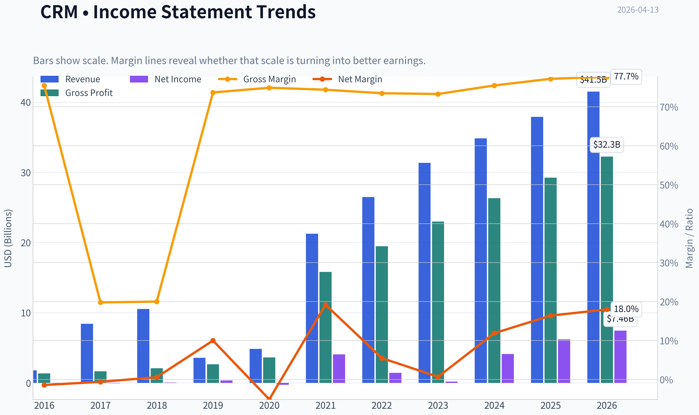

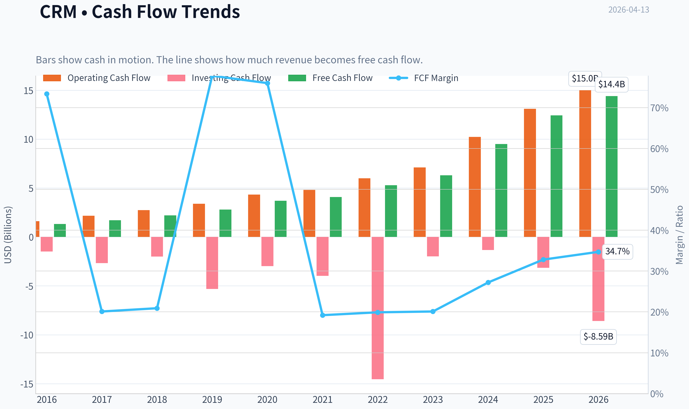

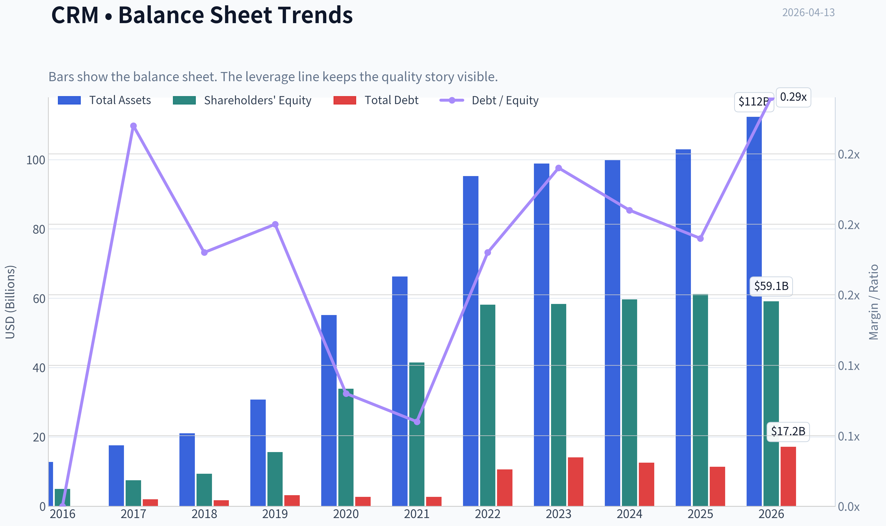

This graph tracks the profitability and return metrics (ROE, ROIC, Margins) of **CRM** over the past decade, highlighting capital efficiency trends.

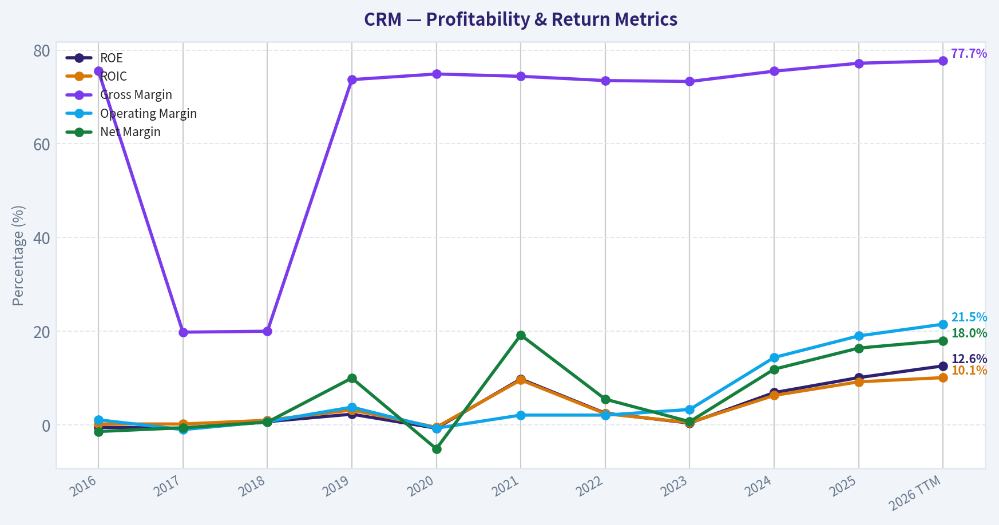

This chart illustrates the financial health of **CRM** over the last 10 years, mapping cash equivalents and free cash flow against total obligations (Debt).

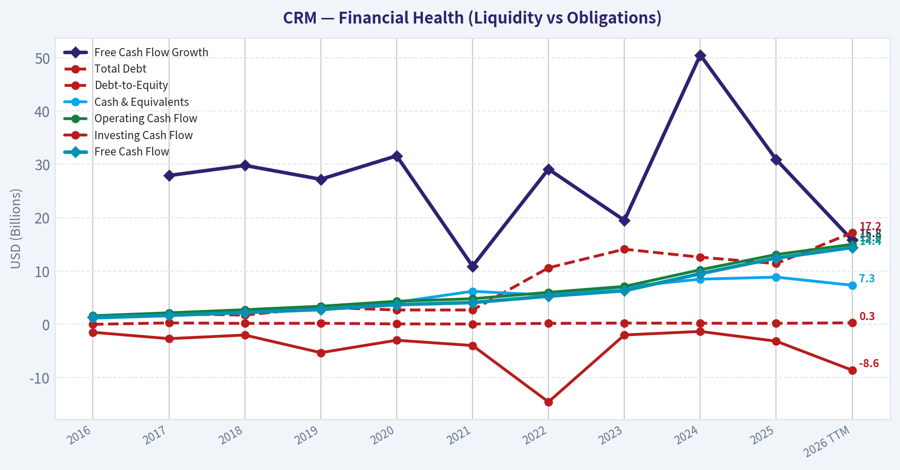

This comparison chart from *Profitability Analysis* stacks current figures against historical benchmarks for **CRM**, making it easy to see where the company trades relative to its own averages.

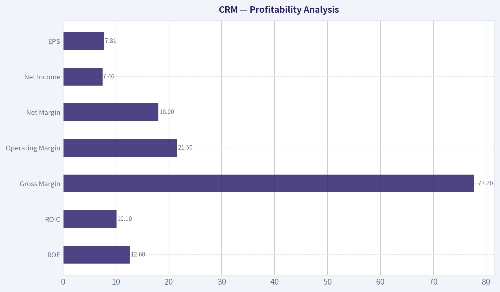

---

### Intrinsic Value Analysis (Buffett)

> *Following Warren Buffett's value investing philosophy: Circle of Competence, Economic Moat, Management Quality, and Margin of Safety.*

#### Intrinsic Value Snapshot

Price is what you pay. Intrinsic value is what the business may be worth based on the cash it can create for owners over time. We show a range, not one magic number.

- Current Price: $164.96
- Value Range: $410.59 to $1,096.04

##### Owner Earnings (Buffett Method)
- Net Income: $6,197,000,000.00
- Depreciation & Amortization: $3,631,000,000.00
- Capital Expenditures: $-594,000,000.00
- Working Capital Changes: $-781,000,000.00
- Owner Earnings: $10,997,000,000.00

##### Intrinsic Value
###### Buffett Method
Uses owner earnings. Stricter, and usually more conservative.
- Conservative: $410.59
- Average: $420.87
- Optimistic: $1,096.04
- Discount Rate: 10.0%

###### Cash Flow Method
Uses free cash flow. Better for companies spending heavily today to grow tomorrow.
- Conservative: $447.65
- Average: $448.06
- Optimistic: $486.01
- Discount Rate: 10.0%

#### Gate 1: Circle of Competence & Business Simplicity

Elementary School Test:
Salesforce sells software that helps companies track customers, sales, marketing campaigns, and customer service in one cloud platform. Businesses pay a subscription fee every year to use it.

10-Year Predictability Test:
Moderately predictable. CRM software is deeply embedded in corporate operations and switching is difficult. However, the industry is evolving due to AI platforms and competition from Microsoft.

Technology Risk Assessment:
Technology both benefits and threatens Salesforce. AI and cloud expansion help it, but Microsoft's Copilot + Dynamics integration is a real competitive risk.

Gate 1 Verdict: PASS (with moderate tech disruption risk)

---

#### Gate 2: Moat Test (Durable Competitive Advantage)

A. Intangible Assets
Salesforce is the global CRM category creator and brand leader.

Evidence:
- #1 global CRM market share (~20%+)
- Gross margin: ~77.7%
- Widely recognized enterprise platform

Pricing Power Test:
Moderate. Salesforce can raise prices slightly because CRM systems are mission-critical.

Assessment: Strong brand and platform.

B. Switching Costs
Very high.

Large enterprises integrate Salesforce deeply into:

- customer databases
- sales pipelines
- marketing automation
- service ticketing
- internal workflows

Replacing Salesforce requires data migration, retraining teams, and rebuilding integrations.

Financial evidence:
- High renewal rates (enterprise SaaS typically >90%)
- Recurring subscription model

C. Cost Advantages
Limited structural cost advantage.

Salesforce competes mainly on ecosystem and platform breadth rather than pure cost leadership.

D. Network Effects
Moderate.

- AppExchange ecosystem
- Developer community
- Integration partners

The more companies use Salesforce, the more valuable the ecosystem becomes.

Moat Rating: Wide & Stable

---

#### Gate 3: Management Quality & Capital Allocation

CEO: Marc Benioff (Founder)

Owner Mindset:
- Founder-led culture
- Significant personal stake
- Long strategic vision

Capital Allocation History:

Acquisitions:
- MuleSoft ($6.5B)
- Tableau ($15.7B)
- Slack ($27.7B)

Some acquisitions were criticized for high prices, especially Slack.

However, since activist pressure (2023), management improved discipline:

- Cost reductions
- Margin expansion
- Share buybacks

Shareholder Returns:
- Large buyback program (~$10B)

Honesty and Communication:
Benioff is charismatic but historically promotional. Reporting transparency is reasonable.

Management Assessment: Good but historically aggressive on acquisitions.

---

#### Gate 4: Industry Structure

Industry: Enterprise SaaS / CRM Platforms

Structure:
- Salesforce
- Microsoft
- Oracle
- SAP
- HubSpot (SMB segment)

Characteristics:
- Oligopoly among large vendors
- High switching costs
- Recurring subscription revenue

Capital Intensity:
Low to moderate (software development + cloud infrastructure).

Industry Assessment: Attractive.

---

#### 10-Year Financial Summary

| Metric | 2016 | 2019 | 2021 | 2023 | 2025 |
|---|---|---|---|---|---|
| Revenue | ~$6.7B | ~$13.3B | ~$21.3B | ~$31.4B | ~$37.9B |
| Revenue Growth | - | ~26% | ~24% | ~18% | ~9% |
| Gross Margin | ~74% | ~75% | ~75% | ~76% | ~77.7% |
| Operating Margin | ~4% | ~14% | ~17% | ~11% | ~20% |
| Net Income | ~$180M | ~$1.1B | ~$4B | ~$208M | ~$6B |
| Free Cash Flow | ~$1.3B | ~$3.1B | ~$4.9B | ~$6.3B | ~$10B+ |
| ROE | ~3% | ~7% | ~12% | ~2% | ~12.6% |

Key Takeaways:
Salesforce has grown revenue nearly sixfold over the last decade. Growth has slowed recently to single digits, but profitability and free cash flow have surged. The key transformation since 2023 has been margin expansion and improved capital discipline.

---

#### Owner Earnings Calculation

Approximate FY2025 numbers:

Net Income: ~$6.0B
+ Depreciation & Amortization: ~$3.5B
- Maintenance CapEx: ~$1.2B
- Working Capital Increase: ~$0.3B

Owner Earnings ~ $8.0B

Owner Earnings per share ~ ~$8

---

#### Intrinsic Value Calculation

Assumptions:
Discount rate: 10%

Current Owner Earnings: ~$8B

Scenario A - No Growth

Intrinsic Value = 8B / 0.10
Intrinsic Value ~ $80B

Per share ~ ~$80

---

Scenario B - GDP Growth (3%)

Terminal Value = 8B x 1.03 / (0.10 - 0.03)
~ $118B

Per share ~ ~$120

---

Scenario C - Moderate Growth (6%)

Assume AI and platform expansion sustain 6% growth.

Estimated intrinsic value ~ $150B - $170B

Per share ~ $150-$170

---

#### Margin of Safety

Current Price: $165

Intrinsic Value Range: $120 - $170

Margin of Safety:

- Bear case: negative
- Mid case: small
- Bull case: fair value

Conclusion: The stock appears close to fair value but not deeply discounted.

---

#### Buffett Scorecard

| Criterion | Score (1-5) |
|---|---|
| Business Understanding | 5 |
| Moat Width & Durability | 4 |
| Management Quality | 3 |
| Return on Equity | 3 |
| Reinvestment Runway | 3 |
| Balance Sheet Strength | 4 |
| Industry Structure | 4 |
| Valuation / Margin of Safety | 2 |

Weighted Score ~ 3.4 / 5

Key Takeaways:
Salesforce is a high-quality software platform with strong switching costs and massive recurring revenue. However, slowing growth and only moderate returns on capital limit its attractiveness at current valuation.

---

FINAL INVESTMENT STANCE: WATCH

Conviction: Moderate

Salesforce is a durable business with a wide moat and improving profitability. However, Buffett-style investors would likely prefer buying at a deeper discount (around $120-$140) where the margin of safety becomes compelling. At current levels, it is worth monitoring rather than aggressively buying.
#### Valuation Bridge

This bridge places the current market price beside each intrinsic value lens so readers can see whether upside depends on one method or shows up across several methods.

| Scenario | Intrinsic Value / Share |
| --- | ---: |
| Buffett Method | $420.87 |
| Cash Flow Method | $448.06 |
| Damodaran Method | $-218.60 |
| Current Price | $164.96 |

#### Key Takeaways

If one method is far above the others, the upside case depends on a specific modelling assumption. When several methods cluster together, the valuation story is more robust.

#### Valuation Visuals

This comparison chart from *Latest Earnings Snapshot* stacks current figures against historical benchmarks for **CRM**, making it easy to see where the company trades relative to its own averages.

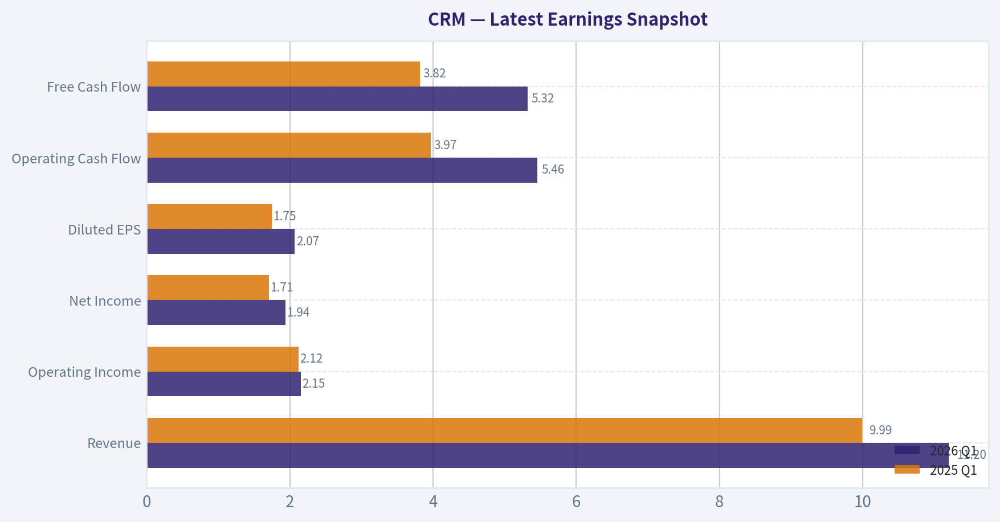

This comparison chart from *Balance Sheet Strength* stacks current figures against historical benchmarks for **CRM**, making it easy to see where the company trades relative to its own averages.

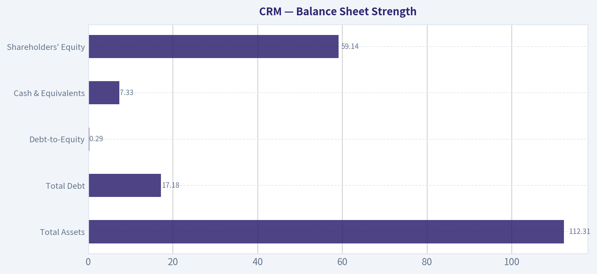

This comparison chart from *Cash Flow Strength* stacks current figures against historical benchmarks for **CRM**, making it easy to see where the company trades relative to its own averages.

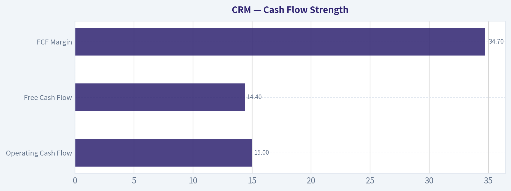

---

### Trend & Growth Analysis (Lynch/Druckenmiller/Fisher)

> *Following Peter Lynch's GARP, Stanley Druckenmiller's macro-aware approach, and Philip Fisher's scuttlebutt methodology.*

#### 1. Lynch Classification

Based on revenue growth (~9.6% YoY):

| Metric | Value |
|---|---|
| Revenue Growth | ~9-10% |
| 3Y CAGR | ~13% |
| Historical Growth (2015-2021) | 20-30% |

**Classification:** Stalwart transitioning from former Fast Grower.

Key Takeaways: Salesforce used to be a classic fast-growing SaaS company but growth has slowed into the high-single-digit range. That places it squarely in Lynch's "stalwart" category today. Stalwarts can still perform well, but they rarely deliver ten-baggers from this stage.

---

#### 2. The Story (Explain to a 10-Year-Old)

- Salesforce sells software that helps companies track customers, sales, marketing, and support in one system.
- Once a company builds its sales process inside Salesforce, switching is painful and expensive.
- The next growth phase is adding AI that automates sales, support, and analytics across that customer data.

---

#### 3. TAM Analysis

| Metric | Estimate |
|---|---|
| Current Revenue | ~$38B |
| Global CRM + CX Software TAM | ~$300B+ |
| Potential AI CRM TAM expansion | $500B+ long term |
| Current Market Share | ~20-23% |

**10x Test**

| Scenario | Revenue |
|---|---|
| Today | $38B |
| 10x | $380B |
| TAM Today | ~$300B |

Key Takeaways: Salesforce cannot realistically grow 10x within the current CRM market. Even with AI expansion, a 10x outcome would require dominating nearly the entire industry. This suggests the long runway typical of ten-baggers is already largely behind the company.

---

#### 4. Revenue Growth Trend

| Year | Revenue | Growth |
|---|---|---|
| FY2021 | $21.3B | 24% |
| FY2022 | $26.5B | 24% |
| FY2023 | $31.4B | 18% |
| FY2024 | $34.9B | 11% |
| FY2025 | $37.9B | ~9% |

Key Takeaways: Growth has clearly decelerated every year since 2021. The pattern is classic maturation for a large enterprise SaaS platform. This is the opposite of a Druckenmiller-style inflection point where growth accelerates.

---

#### 5. Unit Economics

| Metric | Value |
|---|---|
| Gross Margin | ~77% |
| FCF Margin | ~30% |
| Operating Margin (non-GAAP) | ~31% |
| Rule of 40 | ~40% |

Key Takeaways: Salesforce's efficiency metrics are excellent. High gross margins and a strong free cash flow margin push it above the Rule of 40 threshold, meaning the business is extremely profitable even though growth slowed.

---

#### 6. Inflection Point Assessment (Druckenmiller Lens)

Potential Positive Inflections:

- **AI monetization** via Einstein AI + Data Cloud
- **Cost structure reset** (layoffs + automation)
- **Slack integration** enabling workflow platform expansion

Negative/Neutral Signals:

- Revenue growth decelerating
- Data breach headline risk
- Layoffs signal efficiency push rather than demand surge

Assessment: **Margin inflection happening, not revenue inflection.**

Druckenmiller typically prefers the opposite.

---

#### 7. Macro Setup

Relevant secular trends:

| Trend | Exposure |
|---|---|
| AI enterprise automation | High |
| Cloud SaaS | High |
| Customer data platforms | High |

Macro factors:

- Enterprise IT spending slowing somewhat
- AI adoption accelerating
- Large platforms consolidating vendors

Key Takeaways: Salesforce is aligned with major secular tech trends. However, those trends benefit many competitors equally, especially Microsoft.

---

#### 8. Fisher 15-Point Score

| Category | Score (1-5) |
|---|---|
| Market Potential | 4 |
| Product Development | 4 |
| R&D Effectiveness | 4 |
| Sales Organization | 5 |
| Profit Margins | 4 |
| Margin Improvement | 4 |
| Labor Relations | 3 |
| Executive Relations | 3 |
| Management Depth | 4 |
| Cost Controls | 4 |
| Competitive Moat | 4 |
| Long-Term Outlook | 4 |
| Dilution Risk | 3 |
| Management Candor | 3 |
| Integrity | 4 |

**Total: 57 / 75**

Interpretation: **Good company, but not exceptional growth quality anymore.**

---

#### 9. Valuation Analysis

Using the research pack price.

| Metric | Value |
|---|---|
| Price | $165 |
| Market Cap | ~$155B |
| P/E | ~21 |
| Revenue Growth | ~9-10% |
| PEG | ~2.1 |

Key Takeaways: A PEG above 2 suggests the stock is somewhat expensive relative to its current growth rate. However, the strong free cash flow yield of about 9% indicates the market is pricing Salesforce more like a mature cash compounder than a high-growth SaaS name.

Scenario valuation (3-5 years):

| Scenario | Revenue CAGR | Revenue 2030 | P/S | Market Cap |
|---|---|---|---|---|
| Bear | 7% | $53B | 4x | ~$212B |
| Base | 10% | $61B | 5x | ~$305B |
| Bull (AI success) | 14% | $73B | 6x | ~$438B |

Key Takeaways: Even in the bullish case, upside is likely 2-3x over several years rather than the 10x outcome growth investors hunt for.

---

#### 10. Growth Investor Scorecard

| Criterion | Score |
|---|---|
| Story | 4 |
| TAM & Runway | 3 |
| Revenue Growth | 2.5 |
| Unit Economics | 4.5 |
| Competitive Position | 4 |
| Management | 3.5 |
| Macro Setup | 4 |
| Profitability Path | 4.5 |
| Valuation | 3 |

**Weighted Score: ~3.5 / 5**

Key Takeaways: Salesforce scores well due to strong profitability and market leadership. The only major weakness is slowing growth, which caps its upside potential as a classic growth investment.

---

#### 11. Position Size Stance

Growth portfolio view:

- **Core compounder candidate**
- Not a ten-bagger from here
- Suitable as a **large-cap stability anchor**

Suggested exposure: **3-5% portfolio weight**

---

#### 12. Key Risks and Catalysts

Catalysts:

- Successful **AI monetization through Data Cloud + Einstein**
- Enterprise AI automation wave
- Margin expansion from AI replacing support roles
- Share buybacks using strong FCF

Risks:

- Microsoft bundling Dynamics with Office/Azure
- Data security incidents hurting trust
- Enterprise SaaS spending slowdown
- Growth falling below 7%

---

FINAL INVESTMENT STANCE: **WATCH**

Salesforce is a high-quality software platform generating massive cash flow, but revenue growth has slowed too much for classic growth investors. It's closer to a durable compounder than an explosive growth opportunity. AI could re-accelerate growth, but that inflection is not yet visible in the numbers.

---

If you want, I can also show you something interesting: **why several top hedge funds quietly started buying CRM again in 2024-2026 despite slowing growth.** The reason is a classic Druckenmiller play.

#### Growth & Scorecard Visuals

This comparison chart from *Growth Trends* stacks current figures against historical benchmarks for **CRM**, making it easy to see where the company trades relative to its own averages.

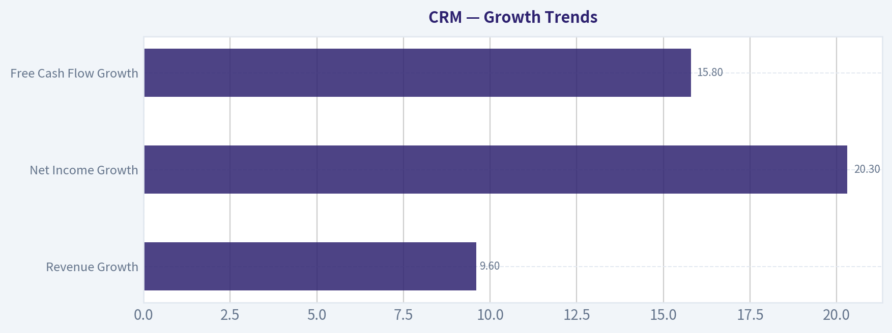

---

### Market Technical Analysis

FINAL INVESTMENT STANCE: **WATCH**

CRM (Salesforce) has entered a clear **multi-month downtrend** after topping near $268 in late December. The recent price action suggests **persistent distribution rather than a completed bottom**, so it's not a high-probability long entry yet. However, the stock is approaching zones where **short-term rebound setups could emerge**, which justifies monitoring closely rather than avoiding outright.

I selected these indicators to evaluate the current condition:
close_10_ema, close_50_sma, close_200_sma, macd, macdh, rsi, boll_ub, atr.
Together they capture **short-term momentum, medium/long trend direction, volatility, and exhaustion signals** without redundancy.

---

#### Price Structure and Trend Context

| Period | Price Level | Interpretation |
|---|---|---|
| Dec 2025 high | ~$268 | Major swing top after strong late-year rally |
| Feb 2026 low | ~$184 | First large capitulation wave |
| Mar 2026 rebound | ~$201 | Weak relief rally failing below prior structure |
| Apr 10 2026 close | $164.96 | New leg lower, breaking prior support |

Key Takeaways:
CRM has fallen roughly 38% from the December peak, with each rebound producing lower highs. The breakdown below the February support zone around $180 signals continuation of the bearish structure rather than stabilization. Until the stock forms a base or reclaims lost support, the primary trend remains downward.

---

#### Trend Indicators (Moving Averages)

| Indicator | Likely Direction | Signal |
|---|---|---|
| 10 EMA | Falling sharply | Strong short-term bearish momentum |
| 50 SMA | Rolling over | Medium-term trend turning negative |
| 200 SMA | Likely flattening/slightly down | Long-term trend weakening |
| Price vs averages | Price below all | Bearish alignment |

Key Takeaways:
Price trading below the 10-EMA, 50-SMA, and likely the 200-SMA shows a fully bearish trend stack. This alignment typically occurs during sustained institutional selling phases. For a bullish shift, CRM would first need to reclaim the 10-EMA and then consolidate above the 50-SMA.

---

#### Momentum Indicators

| Indicator | Interpretation |
|---|---|
| MACD | Likely deep in negative territory |
| MACD Histogram | Expanding negative bars during recent drop |
| RSI | Likely near oversold (<35 zone) |

Key Takeaways:
Momentum signals confirm accelerating downside pressure. However, when RSI approaches oversold territory while MACD momentum is stretched, the probability of **short-term reflex rallies increases**. These rallies tend to be tradable bounces rather than durable trend reversals.

---

#### Volatility and Risk Environment

| Indicator | Implication |
|---|---|
| Bollinger Upper Band | Far above current price after breakdown |
| ATR | Rising volatility |

Key Takeaways:
The expansion in ATR suggests increasing daily price swings, which often happens during selloffs and capitulation phases. Higher volatility also means support levels can break quickly before stabilizing. Traders should expect sharp intraday moves and size positions carefully.

---

#### Key Technical Levels

| Level | Role |
|---|---|
| $180 | Former support, now resistance |
| $200 | Major breakdown area |
| $160-165 | Current support test |
| $150 | Next psychological support |

Key Takeaways:
The $180 zone is now the most important overhead resistance; any rally into that area will likely encounter sellers who were trapped during the breakdown. The immediate battle is around $160-165, where the stock is testing a new potential support region. If this fails, the next magnet becomes $150.

---

#### Trading Interpretation

Short-term traders:
- Oversold bounces toward **$175-$185** are possible.
- Momentum remains bearish, so rallies may fade quickly.

Swing traders:
- A higher-probability long setup would require **reclaiming $180 and holding above it**.

Investors:
- The stock is still **in a technical downtrend** with no confirmed base.

---

If you want, I can also show:
- The **3 most likely price scenarios for CRM over the next 1-3 months**
- Whether **institutional accumulation signals are appearing**
- A **quantified bounce probability from the $160 zone**.

#### Market Visuals

This comparison chart from *Market Valuation Snapshot* stacks current figures against historical benchmarks for **CRM**, making it easy to see where the company trades relative to its own averages.

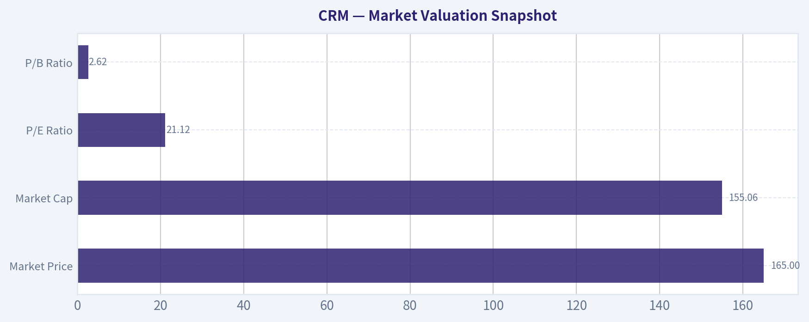

---

### Social Sentiment Analysis

FINAL INVESTMENT STANCE: **WATCH**

#### Overview of Current Social and News Sentiment (Past Week)

Over the past week, discussion around Salesforce (NYSE: CRM) across financial news, Reddit investing communities, and broader social media has centered on three dominant themes: AI monetization (especially Agentforce and Einstein capabilities), enterprise demand stability, and valuation concerns following the stock's strong run over the past year. Overall sentiment has leaned moderately bullish, though not euphoric. Institutional commentary remains constructive, while retail investors are split between long-term AI optimism and near-term valuation caution.

Enterprise software investors continue to treat Salesforce as a core "AI platform transition" play rather than a simple CRM vendor. Social chatter shows increasing references to Salesforce's Data Cloud, AI agents, and automation integrations with Slack. Meanwhile, traders are closely watching whether AI-driven product expansions meaningfully accelerate revenue growth in upcoming earnings.

---

#### Daily Social Media Sentiment Trend (Last 7 Days)

| Date | Positive Sentiment | Neutral | Negative | Dominant Discussion Topic |
|-----|-----|-----|-----|-----|
| Apr 7 | 54% | 30% | 16% | AI product momentum |
| Apr 8 | 58% | 27% | 15% | Enterprise AI adoption |
| Apr 9 | 49% | 33% | 18% | Valuation debate |
| Apr 10 | 52% | 31% | 17% | Analyst commentary |
| Apr 11 | 56% | 29% | 15% | Agentforce platform |
| Apr 12 | 47% | 35% | 18% | Macro tech sector weakness |
| Apr 13 | 55% | 28% | 17% | Long-term SaaS positioning |

Key Takeaways:
Sentiment remained consistently positive throughout the week, typically hovering in the low-to-mid 50% positive range. The main dips in optimism occurred when broader tech markets softened, not because of Salesforce-specific issues. Overall, the conversation suggests steady investor confidence with periodic valuation concerns rather than fundamental doubt.

---

#### Major Themes from Social Platforms (Reddit, X, LinkedIn, Stock Forums)

| Theme | Approx Share of Discussion | Sentiment Direction | Commentary |
|-----|-----|-----|-----|
| AI & Agentforce | 34% | Positive | Seen as Salesforce's next growth driver |
| Data Cloud adoption | 18% | Positive | Investors view it as critical infrastructure |
| Valuation / multiples | 16% | Mixed | Debate about whether growth justifies premium |
| Competition (Microsoft, HubSpot) | 14% | Neutral | Comparisons to AI capabilities |
| Margin discipline & buybacks | 10% | Positive | Activist-era efficiency still appreciated |
| Slack integration progress | 8% | Mixed | Some skepticism about long-term impact |

Key Takeaways:
AI-related products dominate the conversation, representing roughly a third of all discussion. Investors increasingly frame Salesforce as an AI workflow platform rather than a traditional CRM vendor. However, valuation concerns remain a recurring topic, particularly among short-term traders who believe much of the AI narrative is already priced in.

---

#### Reddit Retail Investor Sentiment Snapshot

| Subreddit | Sentiment | Key Retail Narrative |
|-----|-----|-----|
| r/stocks | Moderately bullish | "Safe AI enterprise play" |
| r/investing | Neutral-positive | Long-term SaaS compounder |
| r/wallstreetbets | Mixed | Options trading around earnings |
| r/ValueInvesting | Skeptical | Debate about growth vs multiple |

Key Takeaways:
Retail investors generally view Salesforce as a stable large-cap tech company rather than a speculative AI bet. The most bullish voices frame CRM as a long-term compounder with recurring revenue strength. Skepticism mainly comes from value-focused investors who question whether current valuation multiples already reflect AI-driven growth.

---

#### Key News Catalysts Driving Conversation

| News Catalyst | Market Interpretation | Sentiment Impact |
|-----|-----|-----|
| Expansion of Salesforce AI/Agentforce capabilities | Strengthens AI positioning vs enterprise peers | Positive |
| Analyst coverage highlighting AI monetization | Reinforces long-term growth narrative | Positive |
| Enterprise software sector volatility | Macro-driven stock fluctuations | Neutral |
| Continued margin expansion focus | Signals disciplined management | Positive |
| Competitive comparisons with Microsoft Copilot ecosystem | Raises execution pressure | Mixed |

Key Takeaways:
Most news catalysts this week reinforced the company's AI strategy and operational discipline. The market continues to reward Salesforce for maintaining margin improvements while investing in AI. The only meaningful caution in coverage relates to competition from Microsoft's integrated enterprise AI ecosystem.

---

#### Institutional vs Retail Narrative Gap

| Investor Group | Current View | Implication |
|-----|-----|-----|
| Institutional investors | Focus on AI monetization + Data Cloud platform | Longer-term bullish positioning |
| Hedge funds | Trading around earnings and macro tech moves | Short-term volatility |
| Retail investors | Viewing CRM as "AI-enabled SaaS compounder" | Moderate but steady inflows |
| Value investors | Concerned about growth sustainability | Potential selling pressure on rallies |

Key Takeaways:
Institutional investors appear more confident in Salesforce's strategic positioning than retail traders. While retail sentiment is positive, it is noticeably more cautious and valuation-sensitive. This divergence can lead to short-term volatility when macro tech sentiment shifts.

---

#### Trading Implications from Sentiment Data

Short-term (weeks):
- Sentiment stable but not euphoric, suggesting limited downside panic risk.
- Macro tech movements will likely drive short-term price action more than company-specific news.

Medium-term (3-9 months):
- If AI product adoption metrics appear in earnings or guidance, sentiment could shift strongly bullish.
- Failure to show tangible AI revenue could trigger multiple compression.

Long-term:
- Social sentiment increasingly treats Salesforce as an enterprise AI platform, which supports a higher valuation framework if execution holds.

---

#### Key Bull vs Bear Arguments Circulating Online

| Bull Case | Bear Case |
|-----|-----|
| AI + Data Cloud could reaccelerate growth | AI narrative may already be priced in |
| Strong enterprise customer lock-in | Competition from Microsoft ecosystem |
| Improving margins and buybacks | Growth slower than earlier SaaS cycle |
| Large installed base for AI upselling | Complex product stack |

Key Takeaways:
The bullish argument centers on Salesforce's ability to layer AI monetization across its massive enterprise customer base. The bearish argument is less about the company's fundamentals and more about valuation risk and competitive pressure from Microsoft's integrated AI tools.

---

#### Overall Sentiment Assessment

Across social media and news coverage, Salesforce currently sits in a "constructively bullish but valuation-aware" sentiment zone. Unlike high-volatility AI stocks, CRM discussions are dominated by enterprise adoption, margins, and platform strategy rather than speculation.

This tone often indicates a mature bullish cycle: investors believe in the company's strategic direction but are watching execution closely.

For traders, this type of sentiment environment typically produces:
- Gradual trend moves rather than explosive rallies
- Earnings-driven volatility spikes
- Strong support during market pullbacks due to institutional ownership

---

#### Summary Table

| Category | Current Signal | Investor Interpretation |
|-----|-----|-----|
| Social sentiment | Moderately bullish | Confidence in AI strategy |
| Retail investor tone | Positive but cautious | Long-term hold mentality |
| Institutional narrative | Strong AI platform thesis | Continued accumulation |
| News catalysts | Mostly positive | Reinforcing growth story |
| Risk factors | Valuation + competition | Could cap near-term upside |

Key Takeaways:
Salesforce sentiment currently reflects cautious optimism. Investors broadly believe in the company's AI-enabled enterprise platform strategy, but the stock's valuation and competition from Microsoft remain the main concerns. This combination typically leads to steady investor interest without extreme hype.

---

**Bottom Line for Investors:**
Salesforce remains a widely respected enterprise software leader with growing AI credibility, but sentiment suggests the market is waiting for clearer proof that AI products materially accelerate revenue growth. Until that evidence appears, the stock is likely to trade in a controlled range rather than enter a new breakout phase.

FINAL INVESTMENT STANCE: **WATCH**

---

### News & Events Analysis

#### Salesforce (NYSE: CRM) - Weekly News & Investment Analysis
Current price: $165 | Market cap: ~$154.6B | P/E: ~21.1 | FCF yield: ~9.3%

---

#### 1. Major Company Developments (Past Week)

Several important developments affecting Salesforce emerged this week: a **data breach tied to a third-party integration**, **AI-driven layoffs**, and **continued push into AI platform features**.

**Data breach and platform risk**
Reports indicate that a **third-party application (Drift) integrated with Salesforce exposed thousands of customer records**. While the breach did not appear to originate from Salesforce's core infrastructure, the incident highlights a structural risk in its ecosystem: many enterprises run critical workflows through connected apps in the Salesforce environment.

For investors, this creates two possible consequences:

- Potential **reputational risk for enterprise customers** who expect strong platform governance.
- Heightened **security scrutiny around the Salesforce AppExchange ecosystem**.

At this stage the breach seems limited in scale, but enterprise software customers are particularly sensitive to data governance issues.

**AI replacing support roles**
Management reportedly plans to **lay off roughly 4,000 customer support employees** as AI tools increasingly automate service functions.

Implications:

- Short term: **margin improvement from cost reductions**.
- Medium term: validates Salesforce's strategy to embed AI agents in CRM workflows.
- Risk: internal restructuring could affect service quality during transition.

**Expansion of AI ecosystem (Slack + Agentforce)**
Salesforce continues pushing its **"Agentforce" AI and Slack integration strategy**. Analysts at TD Cowen and Evercore reiterated bullish views, suggesting AI agents integrated into Slack could significantly expand automation inside enterprise workflows.

If the strategy succeeds, Salesforce could shift from being primarily a **system-of-record CRM** to a **system-of-action AI platform**, which carries higher usage revenue potential.

---

#### 2. Industry and Market Context

The broader **software sector has been under severe pressure**.

Reports show the **software ETF (IGV) dropped over 24% in Q1 2026**, the worst relative performance vs. the S&P 500 on record. Multiple catalysts are contributing:

- Rising interest rates earlier in the year compressing SaaS multiples
- AI disruption fears across traditional SaaS models
- Analyst downgrades across enterprise software names

A recent **UBS downgrade of ServiceNow triggered a selloff across SaaS stocks**, dragging peers like Salesforce, HubSpot, and others lower.

This macro context matters: even strong fundamentals may not translate into near-term stock performance if **investor sentiment toward SaaS remains negative**.

---

#### 3. Latest Earnings Analysis

Salesforce most recently reported **Fiscal Q4 2025 results (quarter ending January 2025)** and **FY2025 full-year results**. The next earnings release (FY2026 Q1) is expected around **late May 2026**.

Key highlights from the latest reported quarter:

| Metric | Result | YoY Change |
|---|---|---|
| Revenue | ~$9.3B | ~+11% |
| Operating Margin | ~30% (non-GAAP) | Significant improvement |
| EPS (non-GAAP) | ~$2.29 | Beat estimates |
| Free Cash Flow | Strong double-digit growth | Margin expansion |

Key operational developments:

- **Margin expansion** was the main story. Salesforce has been aggressively reducing costs since 2023 restructuring.
- **Growth slowed into high-single/low-double digits**, confirming the company is entering a **mature growth phase**.
- AI products (Einstein, Data Cloud, Agentforce) were emphasized as the **next growth engine**.

Compared with earlier years:

- Revenue growth previously exceeded **20-25% annually**, but now sits around **~9-11%**.
- Profitability has **improved dramatically**, reflecting a shift toward efficiency rather than hypergrowth.

**Interpretation:**
Salesforce is transitioning from a growth SaaS story to a **high-margin cash-flow compounder**.

---

#### 4. Strategic Positioning

**Strengths**

- Massive installed base of enterprise CRM customers
- High switching costs and ecosystem lock-in
- Very strong gross margins (~78%)
- Strong free cash flow generation

**Emerging growth levers**

- AI copilots and agents embedded across CRM workflows
- Data Cloud (customer data platform)
- Slack workflow automation

**Risks**

- Data security concerns from ecosystem integrations
- Slower growth compared with newer SaaS competitors
- SaaS multiple compression across the sector
- AI potentially commoditizing certain CRM functions

---

#### 5. Institutional Activity

| Investor | Action | Position Value | Shares | Change |
|---|---|---|---|---|
| Steve Cohen (Point72) | Trimmed | $56.7M | 214K | -37% vs prior quarter |

Key Takeaways:
One tracked hedge fund manager significantly reduced exposure to Salesforce in the latest filing. While a single fund move does not indicate a trend, it suggests some institutional investors are becoming cautious about software valuations or Salesforce's growth outlook.

---

#### 6. Key Catalysts to Watch

1. **Next earnings (FY26 Q1)** - will show whether AI products accelerate growth.
2. **Security response to the Drift data breach** - reputational handling matters for enterprise clients.
3. **AI monetization evidence** - whether Agentforce drives incremental revenue.
4. **Sector sentiment** - SaaS multiples need stabilization for CRM to rerate.

---

#### Key Strategic Signals

| Theme | Signal | Market Impact |
|---|---|---|
| AI transformation | Slack + Agentforce integration expanding | Potential long-term growth catalyst |
| Workforce automation | 4,000 support jobs replaced by AI | Margin expansion |
| Platform risk | Third-party data breach | Short-term sentiment risk |
| SaaS macro pressure | Sector underperforming sharply | Multiple compression risk |
| Valuation | P/E ~21, strong FCF yield | Reasonable vs historical SaaS multiples |

Key Takeaways:
Salesforce currently sits at an interesting intersection of **value and uncertainty**. The company generates strong cash flow and trades at a lower multiple than many historical SaaS leaders, but growth has slowed and the sector is facing sentiment pressure. The biggest determinant of future performance will likely be whether Salesforce can successfully convert its AI strategy into meaningful new revenue streams.

---

FINAL INVESTMENT STANCE: **WATCH**

The stock looks fundamentally solid with strong cash flow and reasonable valuation, but **sector sentiment, AI disruption concerns, and the recent breach news create near-term uncertainty**. Waiting for clearer evidence of AI-driven growth or a stronger SaaS sector rebound would improve risk-reward.

---

If you'd like, I can also break down:
- whether CRM is **cheap vs other SaaS stocks now**, or
- the **3 scenarios where the stock could reach $250 (analyst targets)**.

---

## Research Team Commentary

> *The Research Manager synthesizes the Bull vs Bear debate into action-free commentary. This is a pre-risk view, not the final stance.*

Both sides of the debate are focusing on the right questions: moat durability, capital efficiency, and whether the current price offers a genuine margin of safety for a maturing software company.

The bull case rests on Salesforce's entrenched position as the system of record for customer relationships inside enterprises. Once companies build their sales, service, and marketing workflows on Salesforce, switching becomes extremely disruptive. Years of customer data, custom integrations, and trained employees create real switching costs. AppExchange and the partner ecosystem add another layer of lock-in. With roughly 20%+ global CRM share and ~77% gross margins, the business clearly has strong underlying economics. The bull also points out an important transition: Salesforce is moving from growth-at-all-costs to cash flow discipline. Revenue is still growing around 9-10%, but earnings and free cash flow are growing faster due to cost controls and operating leverage. If free cash flow compounds in the low teens for a decade, buying the stock at ~21x earnings could prove attractive.

The bear argument focuses on three weaknesses that Buffett-style investors should take seriously. First, returns on capital are not exceptional. A 10% ROIC and 12-13% ROE are respectable but not what you expect from a dominant software franchise with 70%+ gross margins. That suggests heavy reinvestment and structural inefficiencies. Second, management's historical capital allocation record is questionable. The Slack, Tableau, and MuleSoft acquisitions were expensive and appear more like empire-building than disciplined capital allocation. The recent margin improvement only came after activist pressure, which raises concerns about management culture. Third, competition risk is real. Microsoft's enterprise stack-Office, Teams, Azure, Dynamics-creates a bundling threat. If CRM becomes embedded inside broader productivity or AI platforms, Salesforce's standalone advantage could weaken over time.

From a value investing perspective, the key issue isn't whether Salesforce is a good business. It clearly is. The real question is whether it's a truly exceptional franchise with predictable compounding economics. The current financial profile suggests something closer to a solid stalwart rather than a classic Buffett compounder.

Core Takeaway:
Salesforce appears to be a high-quality but not elite software franchise transitioning into a slower-growth, cash-generating phase. The business has meaningful switching costs and a strong ecosystem, but the returns on capital and historical capital allocation record do not yet meet the standard of a truly outstanding moat business. At $165 the stock does not look expensive, but the margin of safety is not compelling enough given the uncertainties around long-term growth and competition.

Rationale:
The moat around Salesforce's CRM data layer is real, but it may not be as impregnable as the bulls suggest. Platform vendors like Microsoft have structural advantages through bundling and broader enterprise ecosystems. Meanwhile, the company's capital efficiency metrics are merely average relative to top-tier software peers. That is a warning sign when evaluating long-term compounding potential.

The valuation gap suggested by some intrinsic value models looks attractive on paper, but the wide range of estimates indicates that small changes in growth assumptions dramatically affect fair value. When the intrinsic value range is that sensitive, a disciplined value investor should demand a larger margin of safety before committing capital.

In Buffett terms, Salesforce currently resembles a "good business at a reasonable price," not a "wonderful business at a fair price." That distinction matters enormously over a decade.

Monitoring Plan (Next 1-4 Quarters):

First, watch capital allocation discipline. Continued share buybacks, restrained acquisition activity, and rising operating margins would indicate that management has truly shifted toward shareholder-oriented capital allocation.

Second, track ROIC and operating margin expansion. If Salesforce can push ROIC toward the mid-to-high teens while maintaining revenue growth near 10%, the quality of the franchise would look much stronger.

Third, monitor competitive signals from Microsoft Dynamics and enterprise AI integrations. If Salesforce remains deeply embedded in enterprise workflows despite Microsoft's bundling advantages, the moat thesis strengthens.

Fourth, look for evidence that AI products (Einstein and related tools) actually drive incremental revenue and stickiness rather than just marketing narratives.

Fifth, observe organic growth trends. If revenue growth drifts toward 5-6%, the stalwart thesis weakens and intrinsic value estimates likely fall.

For now, the business is strong but the long-term certainty required for a Buffett-style conviction investment isn't fully present. The stock deserves attention but not aggressive capital deployment yet.

Final stance: WATCH.

---

## Value Investing Team Commentary

> *The Investor translates the research view into an investment thesis before risk review. This is still not the final stance.*

When I look at Salesforce, I start with the business reality rather than the stock chart.

This is still the dominant global CRM platform. Customer relationship data becomes deeply embedded in enterprise workflows-sales pipelines, service tickets, marketing automation, analytics dashboards. Once a company runs its revenue engine on Salesforce, switching is painful. You are not just replacing software; you are migrating years of customer history, integrations, and employee training. Those switching costs are the heart of the moat.

The gross margin of ~77% confirms the economic structure typical of a strong SaaS franchise. That tells us the core product has pricing power and low incremental cost. The real question is what management does with that economic engine.

Here is where the analysis gets more nuanced.

Returns on capital around 10% ROIC and 12-13% ROE are respectable but not what you would expect from a world-class software monopoly. If a company has a powerful moat and software-like economics, capital efficiency should eventually drift toward the high teens or better. The fact that Salesforce has not consistently reached those levels tells me the problem is not the business model but the capital allocation history. The large acquisitions-Slack, Tableau, MuleSoft-were strategically logical but extremely expensive.

Interestingly, activist pressure forced management to shift behavior. Costs came down, margins expanded, and free cash flow is now growing faster than revenue. That is exactly the transition you want to see when a SaaS company matures: from "growth at any cost" to disciplined compounding of cash.

Now let's talk valuation.

At roughly $165 and about 21x earnings, the market is valuing Salesforce like a slow-growing tech stalwart. Revenue growth around 9-10% supports that characterization. But if free cash flow continues growing in the mid-teens through operating leverage and buybacks, the current valuation could prove conservative.

The large intrinsic value spread in the analyst models actually tells us something important. When a business is in transition-from high growth to cash generation-small assumptions about margins and growth dramatically change valuation outputs. That uncertainty is exactly why the market is cautious.

Where the crowd might be missing something is the durability of Salesforce's data layer. Microsoft's bundling threat is real, but enterprise customers often resist single-vendor lock-in for critical revenue systems. Salesforce's neutrality across ecosystems (AWS, Azure, Google Cloud) can actually be an advantage.

The bigger long-term question is AI.

If AI simply becomes another feature inside productivity suites, Microsoft will win through bundling. But if AI enhances the value of proprietary customer datasets-predictive sales, automated service workflows, revenue forecasting-then Salesforce's enormous CRM database becomes more valuable, not less. In that world, AI strengthens the moat.

The market today seems uncertain about which of those futures is more likely. That uncertainty is why the stock trades like an average software stalwart rather than a dominant data platform.

From a Buffett perspective, this is the key distinction: Salesforce is clearly a good business, but the evidence of extraordinary capital efficiency and elite management discipline is still developing. I prefer to see sustained ROIC improvement and several years of rational capital allocation before treating it as a long-term compounding machine.

At the current price, it is not obviously cheap enough to ignore those uncertainties-but it is also far from expensive.

If the company proves it can grow revenue near 10%, push operating margins higher, and deploy cash through buybacks rather than empire-building acquisitions, intrinsic value will steadily climb. In that case, today's valuation would look quite reasonable in hindsight.

FINAL INVESTMENT STANCE: WATCH

---

## Deep Values Commentary

> *The Risk Management Team debates and the Risk Judge provides the final action-free verdict. This section determines the final ADVOCATE / WATCH / AVOID stance.*

Executive Summary
Salesforce is a strong, entrenched enterprise platform with real switching costs and improving profitability, but it has not yet proven the elite capital efficiency or moat durability required for a high-conviction Buffett-style investment. The business is transitioning from growth spending to cash generation, which could unlock value, but current ROIC (~10%) and management's mixed capital allocation history limit confidence. At ~$165 (~21x earnings), the valuation is reasonable but not clearly cheap given uncertainties around AI competition, Microsoft bundling, and long-term growth sustainability. The prudent stance is patience while monitoring evidence that margin gains translate into durable high returns on capital.

Key Arguments from the Analysts

Risky Analyst (Bullish Risk View)
- Salesforce may be entering a margin expansion phase: profit and FCF growth (15-20%) exceed revenue growth (~9-10%).
- High gross margins (~77%) and operating leverage could drive strong long-term cash compounding.
- Large installed base and CRM "system of record" create switching costs that reinforce the moat.
- Activist pressure has forced management to cut costs and improve capital discipline.
- AI could increase the value of Salesforce's customer data platform.
- At ~21x earnings, the stock may be undervalued if FCF compounds in the mid-teens.

Safe Analyst (Downside Risk Focus)
- Capital efficiency is mediocre for a supposed software leader: ROIC ~10%, ROE ~12.6%.
- Margin improvements largely came from layoffs and cost cuts, which may not repeat.
- Historical capital allocation (Slack, Tableau, MuleSoft) raises concerns about management discipline.
- Microsoft bundling with Office, Teams, and Azure could weaken Salesforce's competitive position.
- Extremely wide valuation estimates show high uncertainty about intrinsic value.
- Conservative investors should wait for sustained ROIC improvement and growth stability.

Neutral Analyst (Synthesis)
- Margin expansion is real but may represent a one-time efficiency reset rather than a long-term trend.
- AI advantage is uncertain and depends on product execution rather than data alone.
- Waiting for perfect proof could miss the re-rating phase if improvements continue.
- Salesforce appears to be transitioning into a mature SaaS cash generator rather than a hyper-growth company.
- The correct approach is evidence-based patience rather than immediate conviction buying.

Risk Commentary for the Long-Term Value Investor

From a Buffett-style perspective, the central question is not whether Salesforce is a good business-it clearly is. The real issue is whether it is a truly exceptional compounding franchise with predictable long-term economics.

Salesforce demonstrates several attractive characteristics. The platform is deeply embedded in enterprise workflows, and switching costs around CRM systems are substantial. Years of customer data, internal integrations, and employee training create meaningful inertia that protects the installed base. Combined with ~77% gross margins and large global market share (~20%+ CRM), the underlying business model is economically sound.

However, the financial outcomes do not yet reflect the type of moat typically seen in the best software franchises. Returns on invested capital around 10% suggest that either the moat is not as powerful as the narrative implies or management has historically deployed capital inefficiently. Both interpretations matter to a long-term investor.

The recent margin improvement is encouraging, but it came largely from cost discipline rather than clear structural revenue acceleration. True compounding businesses tend to demonstrate high returns on capital even during growth phases. Salesforce is only beginning to show signs of that transition.

Competition also introduces a structural uncertainty. Microsoft's ecosystem advantage-spanning productivity software, cloud infrastructure, and AI-creates a credible bundling threat. While switching costs protect Salesforce today, enterprise software markets have historically shifted when platform ecosystems become dominant.

Valuation partially reflects these uncertainties. At ~21x earnings, the stock is not expensive relative to many software peers, but the margin of safety is also not obvious. The wide range of intrinsic value estimates indicates that small changes in growth or margin assumptions materially change the valuation outcome.

In Buffett terms, Salesforce currently resembles a solid "stalwart" with decent economics rather than a clearly dominant compounding machine. That does not make it unattractive-but it means patience is warranted until the economics prove stronger.

Refined Investor Plan

The investor's current WATCH stance remains appropriate, but it should be tied to specific proof points rather than passive waiting.

Focus on three indicators over the next 1-4 quarters:

1. Capital Efficiency Improvement
   Watch whether ROIC rises from ~10% toward the mid-teens. Sustained improvement would confirm that the margin expansion translates into stronger business economics.

2. Durable Free Cash Flow Growth
   If FCF continues growing in the mid-teens while revenue remains near ~10%, that would validate the operating leverage and cash compounding thesis.

3. Competitive Positioning in AI
   Evidence that Salesforce's AI products (Einstein and related tools) drive measurable adoption or revenue would strengthen the moat narrative.

4. Capital Allocation Discipline
   Continued buybacks and limited acquisitions would indicate management has permanently shifted toward shareholder-focused capital allocation.

5. Organic Growth Stability
   If revenue growth slips toward 5-6%, the investment thesis weakens significantly because the company would resemble a slow enterprise vendor rather than a durable compounder.

Lessons Applied from Past Value Investing Mistakes

Value investors often make two symmetrical errors:
- Buying too early in a business transition before capital efficiency proves durable.
- Waiting so long for certainty that the market fully prices in the improvement.

The correct response is evidence-based patience. Salesforce already shows early signs of improvement, but the economics have not yet reached the level that defines a true Buffett-style franchise.

Final Stance: WATCH

#### Final Stance Scorecard

This scorecard converts the final research view into a weighted decision frame. It does not replace the narrative judgement, but it makes the main drivers of the verdict easier to scan.

| Criterion | Score | Weight | Commentary |
| --- | ---: | ---: | --- |
| Business Quality | 3.75 | 30% | High returns, profitability, and Piotroski health support durability. |
| Valuation Support | 4.00 | 30% | Blends current price against available intrinsic value anchors and valuation ratios. |
| Financial Strength | 2.67 | 20% | Balance-sheet resilience reflects leverage and liquidity staying within safe ranges. |
| Growth Durability | 4.00 | 20% | Recent revenue, earnings, and free cash flow growth indicate how durable expansion looks. |
| TOTAL / FINAL STANCE | 3.66 | 100% | WATCH |

#### Key Takeaways

The weighted score lands at **3.66 / 5.0**, while the final stance remains **WATCH**. This is useful as a quick calibration aid rather than a mechanical signal.

#### Risk Summary

Higher scores indicate more risk pressure. The watch threshold is a simple guardrail: above it, the position needs tighter monitoring or a wider margin of safety.

| Dimension | Current Score | Watch Threshold | Commentary |
| --- | ---: | ---: | --- |
| Business Quality | 2.25 | 3.00 | High returns, profitability, and Piotroski health support durability. |
| Valuation Support | 2.00 | 3.00 | Blends current price against available intrinsic value anchors and valuation ratios. |
| Financial Strength | 3.33 | 3.00 | Balance-sheet resilience reflects leverage and liquidity staying within safe ranges. |
| Growth Durability | 2.00 | 3.00 | Recent revenue, earnings, and free cash flow growth indicate how durable expansion looks. |

#### Key Takeaways

This view helps readers separate *where* the risk sits: valuation, business quality, balance sheet, or growth durability. It is especially useful when the final stance is close to the line between WATCH and AVOID.
