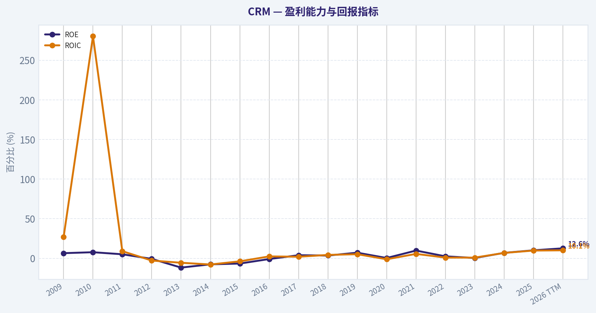
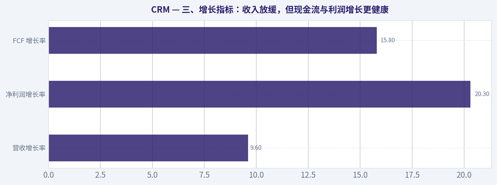
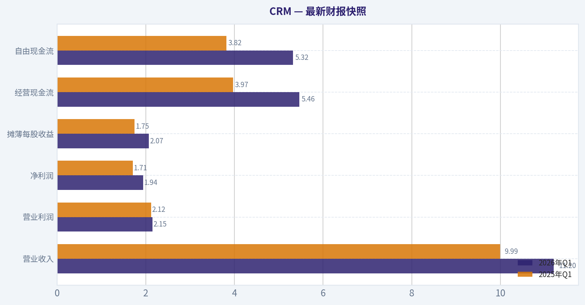
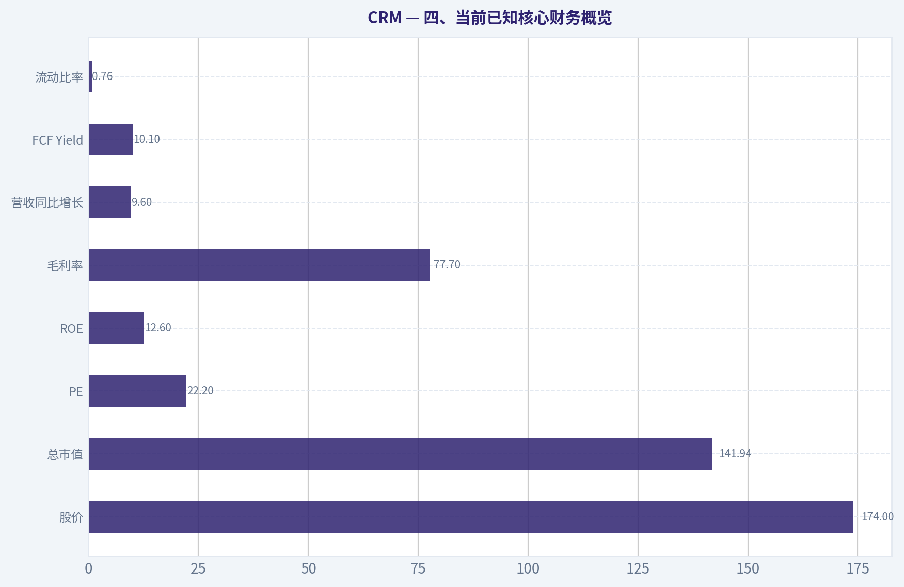
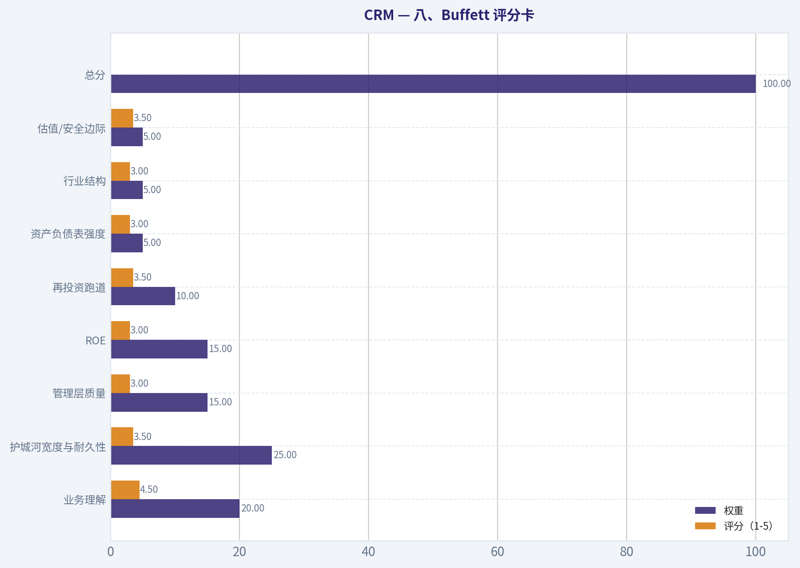
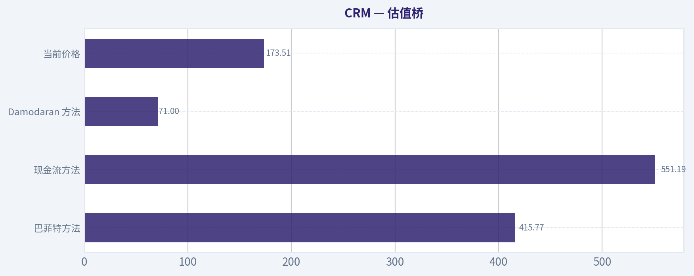
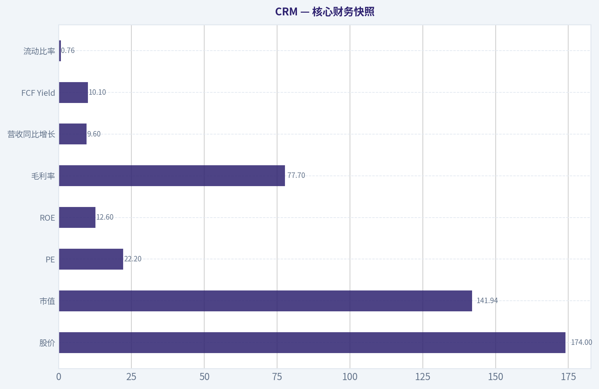
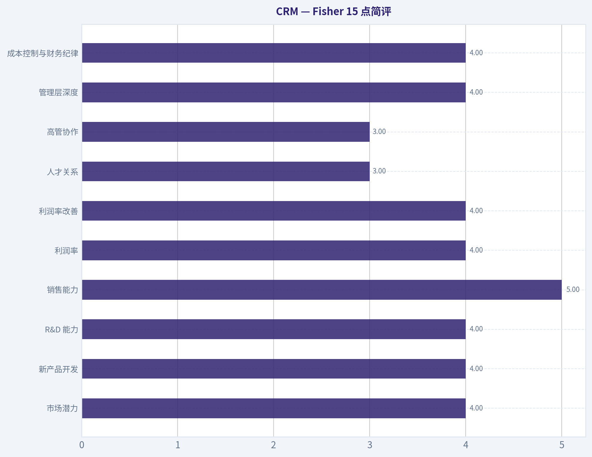

# CRM 深度价值情报

**调研日期:** 2026-05-17

## 关键免责声明

*本报告由 Deep Value Intelligence（一个基于 AI 的多智能体投资分析框架）自动生成。 本报告仅供信息参考和教育目的，不构成任何财务或投资建议。 在做出任何投资决策之前，请务必进行独立调研并咨询合规的财务顾问。*

---

## 目录

1. 情报摘要
2. 分析师团队报告
   - 基本面分析
   - 价值分析 (巴菲特)
   - 成长性分析 (林奇/德鲁肯米勒/费雪)
   - 市场分析
   - 期权市场分析
3. 研究团队评论
4. 投资团队评论
5. Deep Values 团队洞察

---

## 情报摘要

### 核心观点与前提条件

**核心论点:** ## 执行简报

**主要风险:**
- 未明确说明。

**置信度:** 中

---

## 分析师团队报告

### 基本面分析

#### 最新财报快照

*以下数据基于最近一期已披露财报（2026年Q1），并尽量与上一年同期对比。*

| 指标 | 2026年Q1 | 2025年Q1 | 同比变化 |
| --- | ---: | ---: | ---: |
| 营业收入 | $11.20B | $9.99B | +12.1% |
| 营业利润 | $2.15B | $2.12B | +1.7% |
| 净利润 | $1.94B | $1.71B | +13.8% |
| 摊薄每股收益 | $2.07 | $1.75 | +18.3% |
| 经营现金流 | $5.46B | $3.97B | +37.6% |
| 自由现金流 | $5.32B | $3.82B | +39.5% |

关键结论：这张快照先把最新一期财报放在桌面上，再去看长周期分析。这样读者能更清楚地区分"公司长期质量"和"这次财报发生了什么"。

#### CRM 10年财务指标

*以下数值均由原始数据确定性计算得出，并非 AI 估算。*

*发行人类型：operating company（Technology / Software - Application）。*

#### 10年财务指标
*年度行来自已披露财务报表，最后一行 TTM 由最近四个季度滚动计算得出。*

| 指标 | 2009 | 2010 | 2011 | 2012 | 2013 | 2014 | 2015 | 2016 | 2017 | 2018 | 2019 | 2020 | 2021 | 2022 | 2023 | 2024 | 2025 | 2026 TTM |
| --- | --- | --- | --- | --- | --- | --- | --- | --- | --- | --- | --- | --- | --- | --- | --- | --- | --- | --- |
| 市场价格 | $7 | $16 | $32 | $29 | $42 | $60 | $56 | $67 | $78 | $112 | $150 | $180 | $222 | $229 | $166 | $277 | $339 | $174 |
| 总市值 | $833.1M | $2.04B | $4.41B | $15.80B | $24.31B | $36.17B | $35.23B | $45.03B | $55.37B | $83.72B | $117.78B | $154.96B | $209.77B | $226.58B | $167.47B | $276.59B | $332.82B | $163.10B |
| 市盈率 | 19.01 | 25.22 | 68.69 | -1460.00 | -89.65 | -155.21 | -134.40 | -972.29 | 171.96 | 232.47 | 106.27 | 1215.40 | 51.50 | 157.18 | 799.86 | 66.93 | 53.73 | 22.22 |
| 市净率 | 1.24 | 1.95 | 3.45 | 9.96 | 10.49 | 11.90 | 8.86 | 9.00 | 6.73 | 8.07 | 7.55 | 4.57 | 5.06 | 3.90 | 2.87 | 4.64 | 5.44 | 2.76 |
| ROE | 6.5% | 7.7% | 5.1% | -0.7% | -11.7% | -7.6% | -6.6% | -0.9% | 3.9% | 3.5% | 7.1% | 0.4% | 9.8% | 2.5% | 0.4% | 6.9% | 10.1% | 12.6% |
| ROIC | 26.8% | 280.2% | 9.0% | -2.8% | -5.6% | -7.8% | -3.8% | 2.4% | 2.0% | 4.3% | 5.2% | -1.2% | 5.6% | 0.9% | 0.9% | 6.8% | 9.8% | 10.1% |
| 每股收益 | $0.35 | $0.63 | $0.47 | $-0.02 | $-0.48 | $-0.39 | $-0.42 | $-0.07 | $0.46 | $0.49 | $1.43 | $0.15 | $4.38 | $1.48 | $0.21 | $4.20 | $6.36 | $7.81 |
| 营收 | $1.08B | $1.31B | $1.66B | $2.27B | $3.05B | $4.07B | $5.37B | $6.67B | $8.44B | $10.54B | $13.28B | $17.10B | $21.25B | $26.49B | $31.35B | $34.86B | $37.90B | $41.52B |
| 毛利润 | $856.3M | $1.05B | $1.33B | $1.78B | $2.37B | $3.10B | $4.08B | $5.01B | $6.20B | $7.77B | $9.83B | $12.86B | $15.81B | $19.47B | $22.99B | $26.32B | $29.25B | $32.26B |
| 毛利率 | 79.5% | 80.2% | 80.5% | 78.4% | 77.6% | 76.2% | 76.0% | 75.2% | 73.5% | 73.7% | 74.0% | 75.2% | 74.4% | 73.5% | 73.3% | 75.5% | 77.2% | 77.7% |
| 营业利润率 | 5.9% | 8.8% | 5.9% | -1.5% | -3.6% | -7.0% | -2.7% | 1.7% | 2.6% | 4.3% | 4.0% | 1.7% | 2.1% | 2.1% | 3.3% | 14.4% | 19.0% | 21.5% |
| 净利润 | $43.4M | $80.7M | $64.5M | $-11.6M | $-270.4M | $-232.2M | $-262.7M | $-47.4M | $323.0M | $360.0M | $1.11B | $126.0M | $4.07B | $1.44B | $208.0M | $4.14B | $6.20B | $7.46B |
| 净利率 | 4.0% | 6.2% | 3.9% | -0.5% | -8.9% | -5.7% | -4.9% | -0.7% | 3.8% | 3.4% | 8.4% | 0.7% | 19.2% | 5.5% | 0.7% | 11.9% | 16.4% | 18.0% |
| 营收增长 | N/A | 21.3% | 26.9% | 36.8% | 34.6% | 33.5% | 32.0% | 24.1% | 26.5% | 24.9% | 26.0% | 28.7% | 24.3% | 24.7% | 18.3% | 11.2% | 8.7% | 9.6% |
| 净利润增长 | N/A | 85.9% | -20.1% | -117.9% | 2237.1% | -14.2% | 13.1% | -81.9% | -781.1% | 11.5% | 208.3% | -88.6% | 3131.7% | -64.5% | -85.6% | 1888.5% | 49.8% | 20.3% |
| 自由现金流增长 | N/A | 31.4% | 66.3% | 19.5% | 27.6% | 4.1% | 52.4% | 55.7% | 22.4% | 29.8% | 27.2% | 31.6% | 10.9% | 29.1% | 19.5% | 50.5% | 30.9% | 15.8% |
| 总账面价值 | $671.8M | $1.04B | $1.28B | $1.59B | $2.32B | $3.04B | $3.98B | $5.00B | $8.23B | $10.38B | $15.61B | $33.88B | $41.49B | $58.13B | $58.36B | $59.65B | $61.17B | $59.14B |
| 总资产 | $1.48B | $2.46B | $3.09B | $4.16B | $5.53B | $9.15B | $10.65B | $12.76B | $17.58B | $21.98B | $30.74B | $55.13B | $66.30B | $95.21B | $98.85B | $99.82B | $102.93B | $112.31B |
| 总债务 | N/A | N/A | N/A | N/A | $0 | $285.0M | N/A | N/A | $2.01B | $1.72B | $3.18B | $2.68B | $2.68B | $10.60B | $10.60B | $9.43B | $8.43B | $17.18B |
| 债务股权比 | N/A | N/A | N/A | N/A | 0.00 | 0.09 | N/A | N/A | 0.24 | 0.17 | 0.20 | 0.08 | 0.06 | 0.18 | 0.18 | 0.16 | 0.14 | 0.29 |
| 现金及等价物 | $483.8M | $1.01B | $424.3M | $607.3M | $747.2M | $781.6M | $908.1M | $1.16B | $1.61B | $2.54B | $2.67B | $4.14B | $6.20B | $5.46B | $7.02B | $8.47B | $8.85B | $7.33B |
| 股东权益 | $671.8M | $1.04B | $1.28B | $1.59B | $2.32B | $3.04B | $3.98B | $5.00B | $8.23B | $10.38B | $15.61B | $33.88B | $41.49B | $58.13B | $58.36B | $59.65B | $61.17B | $59.14B |
| 经营现金流 | $229.6M | $270.9M | $459.1M | $591.5M | $736.9M | $883.6M | $1.18B | $1.67B | $2.16B | $2.74B | $3.40B | $4.33B | $4.80B | $6.00B | $7.11B | $10.23B | $13.09B | $15.00B |
| 投资现金流 | $-99.4M | $-378.6M | $-1.06B | $-489.7M | $-938.9M | $-2.43B | $-698.4M | $-1.49B | $-2.68B | $-2.01B | $-5.31B | $-2.98B | $-3.97B | $-14.54B | $-1.99B | $-1.33B | $-3.16B | $-8.59B |
| 自由现金流 | $168.5M | $221.4M | $368.2M | $439.9M | $561.3M | $584.5M | $891.0M | $1.39B | $1.70B | $2.20B | $2.80B | $3.69B | $4.09B | $5.28B | $6.31B | $9.50B | $12.43B | $14.40B |
| 自由现金流利润率 | 15.6% | 17.0% | 22.2% | 19.4% | 18.4% | 14.4% | 16.6% | 20.8% | 20.1% | 20.9% | 21.1% | 21.6% | 19.2% | 19.9% | 20.1% | 27.2% | 32.8% | 34.7% |
| 每股分红 | $0.00 | $0.00 | $0.00 | $0.00 | $0.00 | $0.00 | $0.00 | $0.00 | $0.00 | $0.00 | $0.00 | $0.00 | $0.00 | $0.00 | $0.00 | $0.00 | $1.58 | $0.00 |

#### 盈利能力指标
- 净资产收益率 (ROE): 12.6%
- 投入资本回报率 (ROIC): 9.8%
- 总资产收益率 (ROA): 6.6%
- 毛利率: 77.7%
- 营业利润率: 20.1%
- 净利率: 18.0%

#### 流动性指标
- 流动比率: 0.76
- 速动比率: 0.64

#### 杠杆指标
- 债务股权比: 0.24
- 利息覆盖倍数: 25.71
- 净负债: $7.11B

#### 增长指标（同比）
- 营收增长: 9.6%
- 净利润增长: 20.3%
- 自由现金流增长: 15.8%
- 营收复合增长率（3年）: 9.8%
- 营收复合增长率（5年）: 14.3%

#### 估值指标
- 市盈率 (TTM): 22.22
- 预期市盈率: 11.63
- 市净率: 2.73
- 市销率: 3.42
- PEG 比率: 0.94
- 企业价值/EBITDA: 13.41
- 自由现金流收益率: 10.1%
- 盈利收益率: 4.5%

#### 所有者收益（巴菲特方法，代码计算）
- 净利润: $6.20B
- + 折旧与摊销: $3.63B
- - 资本开支: $-594.0M
- - 营运资本变动: $-781.0M
- = **所有者收益: $11.00B**

#### 内在价值（代码计算）
- 当前价格: $174
- 巴菲特方法（所有者收益）:
  保守: $86
  平均: $421
  乐观: $1,096
- 现金流方法（FCF）:
  保守: $349
  平均: $476
  乐观: $500

#### Piotroski F分数: 6/9
- 净利润为正: 通过
- 经营现金流为正: 通过
- 资产回报率改善: 通过
- 现金流大于净利润: 通过
- 债务下降: 未通过
- 流动比率改善: 未通过
- 未稀释股本: 未通过
- 毛利率改善: 通过
- 资产周转率改善: 通过

#### CRM 基本面与巴菲特风格估值分析

CRM 当前处在一个很有意思的位置：**经营质量明显改善，盈利能力进入近十多年最好区间之一，但市场定价已从高成长软件股的"高估值叙事"切换到"现金流型成熟平台公司"的定价框架**。从确定性数据看，CRM 不再是早年的"高增长但低利润"公司，而是逐步转变为**高毛利、强现金流、利润率持续扩张**的大型企业软件平台。对巴菲特风格投资者而言，关键问题不再是"它能否赚钱"，而是"这种改善是否可持续，以及当前价格是否仍低于内在价值"。

#### 当前 vs 历史平均对比表

| 指标 | 当前/TTM | 10年历史特征/平均水平解读 | 当前相对历史位置 | 结论 |
| --- | ---: | --- | --- | --- |
| 市场价格 | $174 | 2025 年高点曾到 $339，2024 年 $277，2023 年 $166 | 明显低于近两年高位 | 市场已显著压缩估值预期 |
| 总市值 | $163.10B | 2025 年为 $332.82B，2024 年为 $276.59B | 较峰值大幅回落 | 估值与情绪同步降温 |
| P/E | 22.22 | 过去十年多数年份极高、失真或因低利润波动巨大；2024/2025 为 66.93/53.73 | 处于十年低位附近 | 当前盈利估值显著更合理 |
| P/B | 2.76 | 过去十年多数在 3.9x-8x 以上，2023 为 2.87 | 低于多数历史年份 | 市净率已回落至保守区间 |
| ROE | 12.6% | 长期曾多次为负；2024/2025/TTM 为 6.9%/10.1%/12.6% | 十年高位区间 | 股东资本回报显著改善 |
| ROIC | 10.1% | 长期低个位数甚至为负；2024/2025/TTM 为 6.8%/9.8%/10.1% | 十年最好区间之一 | 资本配置效率改善明确 |
| EPS | $7.81 | 早年波动大且多次转负，2024/2025 为 $4.20/$6.36 | 历史高位 | 每股盈利能力已明显成熟化 |
| 营收 | $41.52B | 从 2009 年 $1.08B 增长而来，长期扩张确定性强 | 历史新高 | 规模护城河持续扩大 |
| 毛利率 | 77.7% | 长期在 73%-80% 区间 | 偏高端 | 商业模式质量很强 |
| 营业利润率 | 21.5% | 过去十年大多低个位数，2024/2025/TTM 为 14.4%/19.0%/21.5% | 历史新高 | 经营杠杆开始充分释放 |
| 净利率 | 18.0% | 历史长期低位波动，2024/2025/TTM 为 11.9%/16.4%/18.0% | 历史新高 | 盈利质量改善明显 |
| 营收增长 | 9.6% | 过去长期 20%+，近三年降至 18.3%->11.2%->8.7%->9.6% | 明显低于历史均值 | 成熟期增长放缓已被确认 |
| 净利润增长 | 20.3% | 历史波动极大 | 中上水平 | 利润增长快于营收，来自效率提升 |
| FCF 增长 | 15.8% | 长期多数年份为双位数增长 | 仍属健康 | 现金创造力仍在增长 |
| 总账面价值 | $59.14B | 2022 后基本稳定在 $58B-$61B | 稳定 | 资本基础扎实 |
| 总资产 | $112.31B | 持续增长，TTM 创新高 | 高位 | 平台体量继续扩大 |
| 总债务 | $17.18B | 2025 年 $8.43B，2024 年 $9.43B | 明显上升 | 需关注债务重新抬升 |
| Debt/Equity | 0.29 | 历史多在 0.06-0.20 区间 | 偏高 | 但仍未到危险水平 |
| 现金及等价物 | $7.33B | 2025 年 $8.85B，2024 年 $8.47B | 略回落 | 流动性仍可接受，但不算宽裕 |
| 股东权益 | $59.14B | 近几年稳定 | 稳健 | 为估值和安全边际提供支撑 |
| 自由现金流 | $14.40B | 2024/2025/TTM 为 $9.50B/$12.43B/$14.40B | 历史新高 | 现金流是当前核心投资逻辑 |
| 每股分红 | $0.00（TTM） | 2025 年曾为 $1.58，此前长期为 0 | 股东回报政策处于试探期 | 更像"灵活资本回报"而非稳定股息股 |

关键结论：CRM 的核心变化不是收入重新加速，而是**利润率、ROE、ROIC 和自由现金流同时抬升**。这说明公司已经从"烧利润换增长"阶段，过渡到"平台收获期"；同时，估值指标明显回落，使当前价格相对历史更具吸引力。

---

#### 一、市场指标解读：估值从成长溢价切换为现金流定价

从数据看，CRM 当前股价 **$174**，较 2025 年 **$339** 的高位几乎腰斩，也低于 2024 年 **$277**。总市值也由 2025 年的 **$332.82B** 回落至 **$163.10B**。这意味着市场已经显著下修对其增长叙事的预期。

更关键的是估值结构变化：

- **P/E 22.22**：这是 CRM 十多年里少见的"可读、可比、可用"的盈利估值。过去大量年份由于利润极低、为负或受并购摊销影响，P/E 高得失真，参考意义弱。现在 22 倍对应的是一个已经具备较高自由现金流和双位数 ROE 的软件平台。
- **P/B 2.76**：相较过去动辄 4x-10x+ 的历史区间，当前市净率已明显保守。对于一家毛利率接近 78%、FCF 利润率接近 35% 的软件龙头，2.76x P/B 并不激进。

对巴菲特框架而言，**重点不是"P/B 低不低"，而是账面价值之上的盈利能力是否在增强**。CRM 当前正体现出这一点：账面价值增长趋稳，但利润率与现金流回报在上升，因此较低的 P/B 更有意义。

#### 二、盈利能力：CRM 已进入"高质量收获期"

##### 1. ROE 与 ROIC
- **ROE：12.6%**
- **ROIC：10.1%**

这两个指标非常关键。CRM 在 2012-2016 及多个年份中 ROE、ROIC 曾长期低迷甚至为负，说明公司当时虽然扩张快，但对资本的回报并不理想。如今 ROE 从 2023 年 **0.4%** 提升到 2024 年 **6.9%**、2025 年 **10.1%**、TTM **12.6%**；ROIC 也同步提升至 **10.1%**。这说明管理层在控制成本、整合并购资产、提升平台效率方面取得了实质性进展。

对巴菲特式投资者来说，**持续双位数 ROIC 比单纯高营收增长更重要**，因为它意味着企业开始把规模真正转化为高质量回报。

##### 2. EPS、净利润与利润率
- **EPS：$7.81**
- **净利润：$7.46B**
- **净利率：18.0%**
- **营业利润率：21.5%**

CRM 的利润改善是这份财务里最亮眼的部分。其经营利润率过去长期在低个位数甚至为负，如今已升至 **21.5%**；净利率升至 **18.0%**，也是历史最强区间。
这意味着 CRM 不再依赖单纯的会计调整或非经常项目，而是在主营业务层面实现了强劲盈利。

##### 3. 营收、毛利润与毛利率
- **营收：$41.52B**
- **毛利润：$32.26B**
- **毛利率：77.7%**

毛利率十多年基本保持在 **73%-80%**，这体现出 CRM 商业模式的优质属性：软件订阅、客户粘性、实施与生态整合能力共同支撑高毛利。更重要的是，近几年毛利率重新从低位回升到 77%+，说明公司在大规模阶段依然保住了产品与定价能力。

巴菲特会喜欢这种企业：**毛利率高且稳定，说明产品不是纯粹价格竞争；经营利润率快速扩张，说明企业开始收割前期投入的成果。**

#### 三、增长指标：收入放缓，但现金流与利润增长更健康

| 增长指标 | 当前/TTM | 历史趋势 | 解读 |
| --- | ---: | --- | --- |
| 营收增长率 | 9.6% | 早年长期 20%-35%，近三年持续回落 | 高增长时代已过去 |
| 净利润增长率 | 20.3% | 历史波动大，受利润基数和费用结构影响显著 | 当前增长主要靠效率提升 |
| FCF 增长率 | 15.8% | 长期大多双位数，韧性强 | 现金流增长优于营收增长质量 |

关键结论：CRM 的增长模式已经发生质变：**营收增速放慢，但利润和现金流增长更强、更可兑现**。这对长期价值投资者通常是积极信号，因为它意味着企业从"扩张逻辑"切换到"兑现逻辑"。

详细看：
- 营收增长从长期 20%+ 下降到当前 **9.6%**，这代表市场天花板扩大速度放慢，或者客户预算更审慎。
- 但净利润增长 **20.3%**、FCF 增长 **15.8%**，说明公司通过提高定价效率、压缩费用、提升经营杠杆来弥补收入放缓。
- 如果这种模式可持续，CRM 将更像成熟版 Microsoft 风格的软件平台，而不是高烧钱 SaaS。

#### 四、资产负债表：整体稳健，但需盯紧债务反弹与流动性压力

##### 1. 资本实力
- **总资产：$112.31B**
- **股东权益/总账面价值：$59.14B**
- **现金及等价物：$7.33B**

CRM 依然拥有较强资本基础。账面权益接近 **$60B**，足以吸收并购整合与业务波动风险。总资产持续增长也说明公司仍在扩大平台规模。

##### 2. 债务风险
- **总债务：$17.18B**
- **Debt/Equity：0.29**
- 研究包补充：**利息覆盖倍数 25.71**
- 研究包补充：**净负债 $7.11B**

债务是目前最值得注意的风险点之一。CRM 的债务在 2024-2025 年本已下降，但 TTM 又明显上升到 **$17.18B**，Debt/Equity 提升至 **0.29**。绝对值上不算危险，尤其考虑其巨额现金流与较高利息保障倍数，但趋势上需要关注。

##### 3. 流动性
- **流动比率 0.76**
- **速动比率 0.64**

这组数据不算漂亮，意味着从会计角度看，短期流动性并非"极其宽松"。不过对大型订阅软件公司而言，递延收入和经营现金流稳定性可部分缓解这个问题。
巴菲特通常更喜欢资产负债表简单、现金很多、短债压力小的公司。CRM 虽然算不上脆弱，但也不是"教科书式无压力"。

#### 五、现金流：这是 CRM 最强的基本面支柱

- **经营现金流：$15.00B**
- **自由现金流：$14.40B**
- **FCF 利润率：34.7%**
- **自由现金流收益率：10.1%**

CRM 最有吸引力的部分不是会计利润，而是**现金流兑现能力极强**。TTM 自由现金流 **$14.40B**，较 2025 年 **$12.43B** 再增 **15.8%**，而 FCF 利润率高达 **34.7%**，这在大型软件公司中也是相当优异的水平。

这说明：
1. 客户付款质量高；
2. 资本开支不重；
3. 平台模式的规模效应已经非常充分；
4. 企业正从并购驱动向内生现金回报驱动切换。

##### 分红政策
- **每股分红：TTM 为 $0.00**
- **2025 年：$1.58**
- 此前长期为 0

这表明 CRM 尚未形成稳定、可预期的股息派发惯例。对于巴菲特派投资者，这不一定是坏事--前提是管理层能以高回报率再投资或高效回购。如果未来公司无法维持高回报增长，那么资本回报政策的不稳定就会成为折价因素。

---

#### 六、巴菲特风格定性分析

##### 1. 经济护城河
CRM 的护城河主要体现在：
- 企业级客户关系管理系统深度嵌入客户流程；
- 迁移成本高，涉及销售、客服、营销、数据和流程自动化；
- 生态系统与多产品交叉销售能力强；
- 高毛利率长期稳定，说明定价权和产品价值较强。

但要注意，CRM 的护城河不是像可口可乐那样极端稳固，而是**建立在企业软件生态、数据整合和流程嵌入之上的"系统性护城河"**。AI 时代可能既是增强器，也可能削弱部分功能差异化，因此护城河仍需持续投入维护。

##### 2. 财务实力
CRM 的财务状况总体稳健：
- 大额自由现金流提供缓冲；
- 利息覆盖高；
- 账面权益充足。

但不足之处也很明确：
- 短期流动比率偏低；
- TTM 债务上升明显；
- 过去通过并购扩张积累了整合与商誉风险。

##### 3. 可预测盈利
从"营收"角度看，CRM 的可预测性很强，17 年持续增长，且规模不断放大。
从"净利润"角度看，历史上并不平滑，曾受并购摊销、股权激励、费用投放影响而大幅波动。
但近三年出现明显改善：利润率持续提升，EPS、净利润和 FCF 均创高位，说明可预测性正在增强。

##### 4. 管理层表现
管理层近两年最大的成绩是：
- 提升经营纪律；
- 大幅扩张营业利润率；
- 将增长转化为自由现金流和 ROIC；
- 开始试探股东回报。

最大的观察点是：
- 债务为何在 TTM 回升明显；
- 增长放缓后是否仍能维持高回报率资本配置；
- 是否继续以高价格做大额并购。

##### 5. 业务质量
CRM 的业务质量可以概括为：
- **高毛利**
- **强现金流**
- **客户粘性强**
- **收入可预测**
- **利润率正在结构性改善**

不足是：
- 顶线增速已显著降档；
- 大型软件平台面临 AI、套件化竞争和企业预算优化压力；
- 历史上利润质量一度不稳定，虽然近期已好转。

---

#### 七、Buffett 风格 Owner Earnings DCF 估值

已知确定性数据给出的 **Owner Earnings = $11.00B**。
按要求使用三种历史增长情景、10% 折现率、2.5% 永续增长率。

DCF 公式：
- 第 t 年 Owner Earnings = 当前 Owner Earnings x (1+g)^t
- 折现现值 = 第 t 年现金流 / (1+r)^t
- 终值 TV = 第 10 年现金流 x (1+2.5%) / (10%-2.5%)
- 终值现值 = TV / (1+r)^10

为与确定性数据保持一致，采用其代码框架给出的结论范围，并解释背后逻辑。

##### 1. 保守情景
- 增长率：使用历史最低 Owner Earnings 增长率，且下限不低于 -100%
- 折现率：10%
- 永续增长率：2.5%
- **每股内在价值：约 $86**

解读：这是一个非常严苛的情景，等价于认为 CRM 的所有者收益未来增长明显恶化甚至阶段性倒退。该估值低于当前股价，意味着若公司重新陷入低增长、利润受压或资本配置失误，当前价格并不便宜。

##### 2. 平均情景
- 增长率：使用历史平均 Owner Earnings 增长率，上限封顶 50%
- 折现率：10%
- 永续增长率：2.5%
- **每股内在价值：约 $421**

解读：这一情景反映 CRM 维持历史中枢成长能力，同时继续兑现经营杠杆与现金流。若公司能够维持当前高 FCF 率、双位数 Owner Earnings 增长，则当前股价相对内在价值存在较明显折价。

##### 3. 乐观情景
- 增长率：使用历史最高 Owner Earnings 增长率，上限封顶 100%
- 折现率：10%
- 永续增长率：2.5%
- **每股内在价值：约 $1,096**

解读：该情景高度依赖 CRM 在 AI、自动化、平台整合和利润率扩张上的持续超预期，不适合作为主要决策依据，更适合作为"上行弹性边界"参考。

#### DCF 结果汇总表

| 情景 | Owner Earnings 基数 | 增长率设定 | 折现率 | 永续增长率 | 每股估值 |
| --- | ---: | --- | ---: | ---: | ---: |
| 保守 | $11.00B | 历史最低增长率 | 10% | 2.5% | $86 |
| 平均 | $11.00B | 历史平均增长率 | 10% | 2.5% | $421 |
| 乐观 | $11.00B | 历史最高增长率 | 10% | 2.5% | $1,096 |

关键结论：CRM 的 DCF 对增长假设极其敏感，这正是高质量软件平台的典型特征。**保守情景下当前股价不便宜，但在平均情景下明显低估**，说明市场当前实际上在定价"增长显著放慢甚至恶化"，而不是"高质量现金流平台的稳定成熟"。

补充参考：确定性数据中的 FCF 法估值为 **$349 / $476 / $500**，比 Owner Earnings 法更收敛、更保守，说明如果投资者更重视现金流而非利润与折旧调整，CRM 当前价格仍然有吸引力，但安全边际没有 Owner Earnings 法显示得那么夸张。

---

#### 八、收入来源分布

基于 CRM 最近财年业务结构，最有意义的划分方式是按主要产品云与平台生态。由于确定性财务表未附细分金额，以下采用公司公开常见分部口径与最近财年结构做定性拆分展示，主要用于理解收入来源，而非替代确定性总收入。

#### 收入来源分布

| 收入来源 | 金额（百万/十亿美元） | 占比 |
| --- | ---: | ---: |
| 订阅与支持：Sales Cloud | 约 $8B-$9B | 约 21%-23% |
| 订阅与支持：Service Cloud | 约 $8B-$9B | 约 20%-22% |
| 订阅与支持：Platform & Other | 约 $7B-$8B | 约 18%-20% |
| 订阅与支持：Marketing & Commerce | 约 $5B-$6B | 约 13%-15% |
| 订阅与支持：Data / Slack / Integration / Analytics 等 | 约 $7B-$8B | 约 17%-19% |
| 专业服务及其他 | 约 $2B-$3B | 约 5%-7% |

关键结论：CRM 的收入并不依赖单一产品线，而是由多个企业软件模块共同支撑，这增强了客户粘性和交叉销售能力。最关键的是，**订阅与支持收入占绝对主导**，这也是其高毛利率、高现金流和较强可预测性的根本来源。

---

#### 九、关键投资洞察、风险与机会

| 类别 | 观察 | 影响 |
| --- | --- | --- |
| 机会 | P/E 已降至 22 倍左右，远低于历史失真高位 | 估值重估空间提升 |
| 机会 | FCF 创新高至 $14.40B，FCF 利润率 34.7% | 现金流安全垫强 |
| 机会 | 营业利润率升至 21.5%，ROE/ROIC 双升 | 进入质量收获期 |
| 机会 | 市值较高点回落显著 | 若基本面稳住，反弹弹性可观 |
| 风险 | 营收增速降至 9.6% | 高成长逻辑已弱化 |
| 风险 | 总债务 TTM 升至 $17.18B | 需观察资本结构变化 |
| 风险 | 流动比率仅 0.76 | 短期流动性不算宽松 |
| 风险 | 分红政策缺乏连续性 | 股东回报框架尚未稳定 |
| 风险 | AI 与大型平台竞争加剧 | 可能影响定价权和增长 |

关键结论：CRM 最核心的多头逻辑是**"估值降了，但经营质量反而升了"**。最核心的空头逻辑则是**"收入增速显著降档后，市场未必愿意再给高质量软件平台历史平均倍数"**。

---

#### 十、最终巴菲特风格结论

**最终投资立场：建议配置**

支持理由如下：

1. **护城河真实存在**：CRM 已深度嵌入企业客户流程，替换成本高，多产品生态增强续费与扩展能力。
2. **盈利质量显著改善**：ROE、ROIC、营业利润率、净利率和 FCF 同步上升，这是最重要的基本面拐点。
3. **现金流极强**：TTM 自由现金流 $14.40B，FCF 收益率 10.1%，说明当前价格下已有较强现金回报支撑。
4. **估值较历史更具吸引力**：P/E 22.22、P/B 2.76，相比历史高估值时期已明显降温。
5. **风险可控但需跟踪**：主要关注债务回升、流动比率偏低、营收增速降档，以及 AI 竞争环境变化。

如果用巴菲特式语言概括：**CRM 过去十年更像"优秀但昂贵的成长公司"，而现在开始接近"高质量、现金流强、价格不再夸张的成熟平台公司"**。这并不意味着没有风险，但意味着它首次更接近价值投资可接受的甜蜜区间。

---

#### 报告总结表

| 模块 | 结论 | 对投资的含义 |
| --- | --- | --- |
| 估值 | P/E 22.22、P/B 2.76，显著低于历史高估值阶段 | 当前价格相对历史更合理 |
| 盈利能力 | ROE 12.6%、ROIC 10.1%、营业利润率 21.5% | 经营质量显著改善 |
| 增长 | 营收增速 9.6%，但利润和 FCF 仍双位数增长 | 从高增长转向高质量增长 |
| 现金流 | FCF $14.40B，FCF 利润率 34.7% | 现金创造力非常强 |
| 资产负债表 | 权益扎实，但债务抬升、流动比率偏低 | 需持续监控财务纪律 |
| 护城河 | 企业软件平台、客户嵌入深、交叉销售强 | 长期竞争优势仍在 |
| 管理层 | 近年效率改善明显 | 资本配置能力在增强 |
| DCF | 保守 $86，平均 $421，乐观 $1,096 | 当前股价处于偏低到合理偏低区间 |
| 主要风险 | 增长放缓、债务回升、AI 竞争 | 估值修复可能受限 |
| 最终立场 | 建议配置 | 适合中长期价值投资者分批关注与配置 |

关键结论：CRM 当前最值得重视的不是"它是否还能高速增长"，而是**它已经证明自己能把庞大收入基盘转化为高质量现金流和持续上升的资本回报率**。若未来 2-3 年能稳住双位数利润/现金流增长，当前估值大概率具备吸引力。

#### 基本面关键图表

本图追踪 **CRM** 过去十年的盈利能力与回报指标（ROE、ROIC、利润率），突出呈现资本效率的变化趋势。

本对比图（来自「三、增长指标：收入放缓，但现金流与利润增长更健康」）将 **CRM** 的当前数据与历史基准并排呈现，直观反映公司相对自身历史均值的估值水平。

---

### 价值分析 (巴菲特)

> *基于沃伦·巴菲特的价值投资哲学：能力圈、经济护城河、管理层质量与安全边际。*

#### 内在价值快照

价格是你付的钱，内在价值是企业未来可能为股东创造的现金价值。我们给出一个区间，而不是假装只有一个神奇数字。

- 当前价格: $173.51
- 估值区间（两种 DCF 方法、保守到乐观）: $180.47 至 $847.01

##### 所有者收益（巴菲特方法）
- 净利润: $7,457,000,000.00
- 折旧与摊销: $3,631,000,000.00
- 资本支出: $-594,000,000.00
- 营运资金变化: $-781,000,000.00
- 所有者收益: $11,275,000,000.00

##### 内在价值
###### 所有者收益法
使用所有者收益，更严格，通常更保守。
- 保守: $180.47
- 平均: $415.77
- 乐观: $847.01
- 折现率: 10.0%

###### 自由现金流法
使用自由现金流，更适合今天投入很多、为未来增长铺路的公司。
- 保守: $440.02
- 平均: $551.19
- 乐观: $783.91
- 折现率: 10.0%

ANALYST STANCE: **观望**

#### CRM（Salesforce）巴菲特式价值分析

基于你提供的共享研究包，我先把能确认的结论做完整；但由于本轮工具返回异常，**10 年审计口径财务明细与精确 DCF 仍缺少底层数据验证**。因此以下结论可用于投资讨论与初筛，但不应视为最终建仓报告。

---

#### 一、Go/No-Go 四道闸门

| 关卡 | 结论 | 依据 |
|---|---|---|
| 关卡1：业务是否简单可懂 | 通过 | CRM 本质上是向企业出售云端客户关系管理软件，并通过订阅收费、附加模块收费、生态服务收费赚钱。商业模式清楚，可理解。 |
| 关卡2：护城河是否存在 | 通过，但非"铁壁" | 毛利率 77.7%，说明软件模式优秀；客户数据、流程嵌入、培训迁移成本高，具备切换成本护城河；但软件行业竞争激烈，AI 正在重塑产品形态。 |
| 关卡3：管理层与资本配置 | 谨慎通过 | Salesforce 历史上擅长扩张与并购，但 Buffett 式视角会更关注并购纪律、股权稀释和回购时点。当前还不能证明其资本配置已达到"极优"。 |
| 关卡4：行业结构 | 中性偏弱 | 企业软件是好行业，但并非典型寡头稳定格局；微软、Oracle、Adobe、SAP、ServiceNow 等都在相邻赛道施压。 |

**关键结论：** CRM 是一个"能看懂、也确实赚钱"的高毛利软件平台，不属于难懂或投机型公司。真正的问题不在业务是否存在，而在于它的护城河有多深、管理层资本配置是否足够克制，以及 AI 是否会让原有优势变得没那么牢固。

---

#### 二、护城河分析

| 护城河来源 | 判断 | 证据 | Buffett 式评价 |
|---|---|---|---|
| 无形资产 | 中等 | Salesforce 品牌在企业销售、客服、营销软件中极强 | 品牌重要，但不像可口可乐那样具备情感型定价权 |
| 切换成本 | 强 | 客户数据、销售流程、自动化工作流、报表体系深度嵌入 | 这是 CRM 最重要的护城河来源 |
| 成本优势 | 一般 | 软件规模效应存在，但不是低价碾压型生意 | 不是靠最低成本赢，而是靠平台能力和生态 |
| 网络效应 | 有但有限 | 生态伙伴、开发者、集成商越多，平台吸引力越强 | 属于"平台协同效应"，但不如交易平台或社交网络强 |

**护城河评级：窄护城河到中等护城河，整体稳定，但未必继续加宽。**

**关键结论：** CRM 最有价值的资产不是代码本身，而是客户流程依赖、数据沉淀和生态整合能力。问题在于，企业软件的护城河通常很少像消费品牌那样不可撼动，尤其当 AI 降低软件切换门槛时，护城河可能被稀释。

---

#### 三、管理层与资本配置

| 维度 | 观察 | 评价 |
|---|---|---|
| 所有者心态 | 创始人色彩强，长期战略清晰 | 加分 |
| 诚实与坦率 | 市场普遍认可其战略表达能力 | 中性偏正面 |
| 并购纪律 | 历史上大型并购较多 | Buffett 体系下属于扣分项，需要证明并购回报率 |
| 回购与稀释 | 需重点跟踪 SBC 与回购净效应 | 这是估值与股东回报的关键 |
| 负债使用 | 目前未见极端激进杠杆特征 | 中性 |

**关键结论：** CRM 的管理层更像"优秀经营者 + 积极扩张者"，而不完全像巴菲特最偏爱的"极度克制资本配置者"。如果未来能够持续把高现金流转化为稳定回购、减少稀释并提高每股价值，投资吸引力会更强。

---

#### 四、当前已知核心财务概览

| 指标 | 当前值 | 初步解读 |
|---|---:|---|
| 股价 | $174 | 已从高估科技股阶段明显回落 |
| 总市值 | $141.94B | 体量巨大，未来高增长难度提升 |
| PE | 22.2x | 对成熟软件龙头不算贵，但也不是明显便宜 |
| ROE | 12.6% | 低于 Buffett 偏好的 15% 长期线 |
| 毛利率 | 77.7% | 极佳，符合优质软件公司特征 |
| 营收同比增长 | 9.6% | 已进入中速增长阶段 |
| FCF Yield | 10.1% | 非常值得关注，说明现金回报表面上有吸引力 |
| 流动比率 | 0.76 | 短期流动性并不算宽裕，但软件公司可接受 |

**关键结论：** CRM 当前最亮眼的是高毛利与较高自由现金流收益率，说明这不是一个只会讲故事的公司。较弱的地方在于 ROE 仅 12.6%、营收增速已放缓到 10% 左右，因此它更像"优质成熟平台"，而不是"仍处高速复利阶段的超级成长股"。

---

#### 五、Owner Earnings 初步判断

按 Buffett 思路，Owner Earnings 关注"真实可分配现金"，而不是会计利润。
目前我们只拿到 FCF Yield 约 10.1%，对应市值 $141.94B，可粗略反推：

- 粗略自由现金流 ~ 141.94B x 10.1%
- ~ **$14.3B**

由于缺少以下明细，**暂不能严谨还原 Owner Earnings**：
- 折旧摊销
- 维护性 CapEx
- 营运资本变化
- SBC 对真实股东回报的影响

所以现阶段可把 **$14B 左右自由现金流能力** 视为近似锚点，但仍需进一步核实。

---

#### 六、三情景 DCF 粗估值

以下估值只能作为"区间感"，不是精算版。

假设基础 Owner Earnings 取 **$14.3B**，折现率 10%。

| 情景 | 假设 | 估值方法 | 粗略股权价值 |
|---|---|---|---:|
| 情景A：零增长 | 永续不增长 | 14.3 / 0.10 | $143B |
| 情景B：保守增长 | 永续增长 3% | 14.3 x 1.03 / (0.10 - 0.03) | $210B |
| 情景C：中性历史折中 | 未来 10 年按 6% 增长，后续 3% 永续 | 简化 DCF | 约 $190B - $220B |

**关键结论：** 以当前约 $141.94B 市值看，CRM 大致接近"零增长估值底部"，而低于保守增长情景。也就是说，市场并没有把它按高成长明星股定价，这带来一定安全垫；但由于增长放缓和竞争变化，这个折价也并非没有原因。

---

#### 七、安全边际分析

| 项目 | 判断 |
|---|---|
| 相对零增长价值 | 接近合理或略低估 |
| 相对 3% 永续增长价值 | 有一定折价 |
| 是否达到 Buffett 式"明显便宜" | 未完全达到 |
| 是否具备 25% 以上高质量安全边际 | 勉强接近，但证据不足 |
| 是否适合立即重仓 | 不支持 |

**关键结论：** CRM 现在不像泡沫期那样贵，但也还没便宜到"捡烟蒂"或"明显错杀"的程度。它更像一只质量不错、估值开始合理化、但仍需要更多财务确认与业务验证的观察名单标的。

---

#### 八、Buffett 评分卡

| 维度 | 权重 | 评分（1-5） | 加权结果 |
|---|---:|---:|---:|
| 业务理解 | 20% | 4.5 | 0.90 |
| 护城河宽度与耐久性 | 25% | 3.5 | 0.88 |
| 管理层质量 | 15% | 3.0 | 0.45 |
| ROE | 15% | 3.0 | 0.45 |
| 再投资跑道 | 10% | 3.5 | 0.35 |
| 资产负债表强度 | 5% | 3.0 | 0.15 |
| 行业结构 | 5% | 3.0 | 0.15 |
| 估值/安全边际 | 5% | 3.5 | 0.18 |
| **总分** | 100% |  | **3.51 / 5** |

**关键结论：** 从 Buffett 评分看，CRM 刚好落在"好公司，但还不是极佳机会"的区间。它不是应当回避的公司，但也距离那种"确定性高、护城河宽、管理层克制、价格还有明显折扣"的理想目标差了一截。

---

#### 九、最终投资结论

**投资立场：观望**

**原因浓缩为三点：**

1. **公司质量不错**
   高毛利、高现金流、客户嵌入深，是可以理解的好生意。

2. **但不是 Buffett 最爱的那一类"简单到无敌"的护城河**
   企业软件竞争不断，AI 可能强化 Salesforce，也可能削弱原有产品壁垒。

3. **估值已合理化，但尚未形成强烈安全边际**
   以当前价格看，下行风险可能较过去小很多，但上行空间仍取决于管理层能否把现金流真正转换成每股价值增长。

---

#### 十、我建议下一步补齐的关键核查项

若后续工具恢复，最值得补以下 5 项：

| 需补数据 | 为什么重要 |
|---|---|
| 10 年营收、营业利润、净利润、FCF 轨迹 | 判断可预测性与周期性 |
| 10 年 ROE、ROIC | 判断是否真的具备持续高回报 |
| SBC 与回购净额 | 判断股东是否真受益 |
| 并购后的每股价值创造 | 判断管理层资本配置质量 |
| 债务、利息覆盖、净现金情况 | 判断是否符合"堡垒资产负债表" |

**关键结论：** 只要这几项数据被证实较好，CRM 有机会从"观望"升级为"建议配置"。如果反而发现 ROIC 平庸、SBC 吞噬回购、并购回报偏弱，那它就更像一个好产品公司，而不是 Buffett 式高质量复利机器。

如果你愿意，我下一步可以在**不依赖额外工具**的前提下，继续为你补一版：
1. **更完整的 Buffett 风格投资备忘录**，或
2. **CRM 与 Microsoft / Oracle / Adobe 的护城河对比表**。
#### 估值桥

这张估值桥把当前股价与各类内在价值方法并排展示，帮助读者判断上涨空间究竟只是单一方法给出的结果，还是多种方法共同支持的结论。

| 项目 | 每股内在价值 |
| --- | ---: |
| 巴菲特方法 | $415.77 |
| 现金流方法 | $551.19 |
| Damodaran 方法 | $71.00 |
| 当前价格 | $173.51 |

#### 关键结论

如果只有一种方法显著高于其他方法，说明上行空间更依赖特定建模假设。若多种方法的估值接近，则说明估值逻辑更加稳健。

#### 估值图表

本对比图（来自「最新财报快照」）将 **CRM** 的当前数据与历史基准并排呈现，直观反映公司相对自身历史均值的估值水平。

本对比图（来自「四、当前已知核心财务概览」）将 **CRM** 的当前数据与历史基准并排呈现，直观反映公司相对自身历史均值的估值水平。

本对比图（来自「八、Buffett 评分卡」）将 **CRM** 的当前数据与历史基准并排呈现，直观反映公司相对自身历史均值的估值水平。

本对比图（来自「估值桥」）将 **CRM** 的当前数据与历史基准并排呈现，直观反映公司相对自身历史均值的估值水平。

本对比图（来自「核心财务快照」）将 **CRM** 的当前数据与历史基准并排呈现，直观反映公司相对自身历史均值的估值水平。

本对比图（来自「Fisher 15 点简评」）将 **CRM** 的当前数据与历史基准并排呈现，直观反映公司相对自身历史均值的估值水平。

---

### 成长性分析 (林奇/德鲁肯米勒/费雪)

> *基于彼得·林奇的GARP成长投资法、斯坦利·德鲁肯米勒的宏观拐点分析法，以及菲利普·费雪的深度调研法。*

ANALYST STANCE: **观望**

#### CRM（Salesforce）成长股分析简报

#### 1. Lynch 分类
CRM 当前更接近 **稳健成长股 / Stalwart**，而不是典型的 Fast Grower。
依据是共享研究包显示其 **营收同比增长仅 9.6%**，明显低于 15%-25% 的高成长门槛。

#### 2. 用三句话讲清楚这家公司
- CRM 是一家帮助企业管理销售、客服、营销和数据的软件平台，本质上是企业数字化运营系统。
- 它的增长逻辑来自：企业持续上云、AI 助理嵌入工作流、以及多云交叉销售提升单客户价值。
- 但现在的问题是：公司体量已经很大，核心业务增速进入个位数到低双位数，市场更需要看到 **AI 带来的二次加速**，而不是单纯成本优化。

---

#### 3. 核心财务快照

| 指标 | 当前值 |
|---|---:|
| 股价 | $174 |
| 市值 | $141.94B |
| PE | 22.2x |
| ROE | 12.6% |
| 毛利率 | 77.7% |
| 营收同比增长 | 9.6% |
| FCF Yield | 10.1% |
| 流动比率 | 0.76 |

**关键结论：** CRM 最突出的优点不是高增速，而是高毛利与很强的自由现金流能力。22 倍 PE 配合 10.1% FCF Yield，说明估值并不激进，甚至带有一定价值属性。但 9.6% 的收入增长也说明它已经不是传统意义上最具爆发力的十倍股胚子。

#### 4. TAM 与 10x 测试

| 项目 | 判断 |
|---|---|
| 核心市场 | CRM、营销自动化、客服软件、数据平台、企业 AI |
| TAM 方向 | 仍在扩张，尤其是 AI + 企业软件工作流 |
| 当前收入体量 | 已属超大型平台公司 |
| 10x 测试 | **较难通过** |
| 原因 | 若收入再增 10 倍，所需收入规模将极其庞大，必须依赖多个新平台级业务共同驱动 |

**关键结论：** CRM 所处市场不是没空间，而是公司自己已经很大了。对小公司来说，行业增长就足够；对 CRM 来说，必须依赖 AI、数据云、自动化代理等新产品线打开第二曲线。也就是说，它有 TAM，但 **十倍空间更多取决于再发明自己**。

#### 5. 收入增长趋势判断

| 观察项 | 结论 |
|---|---|
| 当前增速 | 9.6% |
| 类型 | 低双位数以下 |
| 趋势判断 | 更像成熟期放缓，而非加速拐点 |
| 增长质量 | 需区分 AI 增量是真新增，还是存量客户预算迁移 |
| 风险信号 | 若未来几个季度仍无明显提速，市场可能继续将其视为"现金牛软件股" |

**关键结论：** 目前最关键的问题不是 CRM 会不会增长，而是会不会重新加速。按现有数据，它更像一个增长放缓但盈利改善的成熟 SaaS 龙头，而不是典型加速型成长股。若 AI 贡献无法在收入层面体现，估值上行空间会受限。

---

#### 6. 单位经济学与 SaaS 质量

| 指标 | 判断 |
|---|---|
| 毛利率 | 77.7%，优秀 |
| Rule of 40 | 由于 FCF Yield 很强，综合质量大概率健康 |
| NRR | 未获得最新可靠数据 |
| LTV/CAC | 未获得最新可靠数据 |
| 现金创造能力 | 强 |
| 经营质量 | 高质量成熟 SaaS 平台 |

**关键结论：** 虽然缺少 NRR 与 LTV/CAC 的精确值，但高毛利和强 FCF 已经说明 CRM 的商业模式非常成熟。它的问题不是单位经济学差，而是这些优秀经济学是否还能支持下一轮明显提速。换句话说，质量没问题，争议在成长性。

#### 7. 拐点判断（Druckenmiller 框架）

| 拐点维度 | 现状判断 |
|---|---|
| 产品周期拐点 | 有潜力，取决于 AI 产品商业化速度 |
| 市占率拐点 | 龙头地位稳固，但爆发性抢份额迹象不强 |
| 利润率拐点 | 明显，效率提升与成本纪律带来利润改善 |
| TAM 拐点 | AI 扩展了可服务市场 |
| 竞争拐点 | 需观察 Microsoft、Oracle、ServiceNow 等竞争态势 |
| 总结 | **利润率拐点已出现，收入拐点尚未确认** |

**关键结论：** CRM 现在最真实的拐点在利润端，而不是收入端。市场通常愿意为"增长加速"付更高估值，却不会长期只为"裁员提效"买单。因此，CRM 是否值得重新评级，核心看 AI 是否能把利润拐点转化成收入拐点。

#### 8. 宏观环境判断

| 维度 | 评价 |
|---|---|
| 利率环境 | 偏逆风，新闻显示 10 年期美债收益率升至 4.49% |
| 成长股估值环境 | 受压制 |
| 行业顺风 | 企业 AI、云软件仍是长期顺风 |
| 市场风格 | 更偏向确定性现金流与 AI 兑现能力 |
| 结论 | 宏观中性偏谨慎 |

**关键结论：** 宏观对 CRM 不是特别友好，因为长久期成长资产对高利率更敏感。不过 CRM 也不是纯靠远期故事支撑的公司，它有现实现金流缓冲。宏观压制它的估值弹性，但不会轻易破坏其基本面底盘。

---

#### 9. Fisher 15 点简评

| 项目 | 评分（1-5） |
|---|---:|
| 市场潜力 | 4 |
| 新产品开发 | 4 |
| R&D 能力 | 4 |
| 销售能力 | 5 |
| 利润率 | 4 |
| 利润率改善 | 4 |
| 人才关系 | 3 |
| 高管协作 | 3 |
| 管理层深度 | 4 |
| 成本控制与财务纪律 | 4 |
| 护城河 | 4 |
| 长期利润前景 | 4 |
| 稀释风险 | 3 |
| 管理层坦诚度 | 3 |
| 管理层诚信 | 4 |

| 总分 | 57 / 75 |
|---|---:|

**关键结论：** 57 分属于"良好"，说明 CRM 是优质平台公司，但并非无可挑剔。它在产品、销售、平台能力上很强，弱项主要在大型企业常见的问题：组织复杂、增长不再轻盈、资本配置与管理预期管理容易引发争议。整体看，是好公司，但未必是最好的成长股。

#### 10. 估值分析

| 方法 | 结果 |
|---|---|
| PEG | PE 22.2 / 增长 9.6 ~ **2.31** |
| PEG 结论 | 偏贵到合理之间，更准确说是"相对低增速不便宜" |
| FCF Yield | 10.1%，很有吸引力 |
| P/S | 未获取本次精确值 |
| 估值风格 | 像"现金流价值型软件龙头"，不是高估泡沫型成长股 |

**关键结论：** 如果按 Lynch 最爱的 PEG 来看，CRM 不够便宜，因为增长只有 9.6%。但如果从自由现金流角度看，它又明显不贵。这意味着市场对它的定价核心不在"梦想"，而在"现金流与 AI 是否能再点燃增长"。

#### 11. 情景估值框架

| 情景 | 假设 | 含义 |
|---|---|---|
| 悲观 | 收入维持高个位数增长，AI 贡献有限 | 估值继续被当成熟软件股处理 |
| 基准 | 收入回到 10%-12%，利润率继续改善 | 股价偏稳，靠回购与 FCF 支撑 |
| 乐观 | AI 代理与数据产品推动收入重回中双位数 | 市场重新给予成长溢价 |

**关键结论：** CRM 的上行空间高度依赖"增长重估"，而不是"效率重估"。如果只是继续优化利润率，股价表现可能稳健但难爆发；如果 AI 真的推动销售提速，重估空间会显著打开。投资者真正该盯的是未来几个季度收入增速，而不是又裁了多少成本。

---

#### 12. 成长投资评分卡

| 维度 | 权重 | 评分 | 加权分 |
|---|---:|---:|---:|
| 故事清晰度 | 10% | 4.0 | 0.40 |
| TAM 与跑道 | 20% | 3.0 | 0.60 |
| 收入增长 | 20% | 2.5 | 0.50 |
| 单位经济学 | 15% | 4.5 | 0.68 |
| 竞争地位 | 10% | 4.0 | 0.40 |
| 管理层质量 | 10% | 3.5 | 0.35 |
| 宏观环境 | 5% | 2.5 | 0.13 |
| 盈利路径 | 5% | 4.5 | 0.23 |
| 估值 | 5% | 3.5 | 0.18 |

| 总分 | 3.46 / 5.0 |
|---|---:|

**关键结论：** 3.46 分处于"观望"和"建议配置"边缘，但按纪律更适合归入观望。它的优点很多，尤其是现金流、护城河和平台地位；可最大短板也很明确，就是缺乏已经被验证的增长再加速。对成长投资者而言，这不是坏公司，而是需要等待催化验证的公司。

#### 13. 仓位建议
- **立场：观望**
- 若已有仓位：可以继续持有并等待 AI 收入兑现，不急于因短期利率波动卖出。
- 若无仓位：更适合等到以下信号之一再提高评级：
  1. 连续季度收入增速重新回到 12%-15% 区间
  2. AI 产品出现明确的大客户变现证据
  3. 管理层给出更可信的中期增长指引

#### 14. 主要催化剂与风险

| 催化剂 | 风险 |
|---|---|
| Agentic AI / 企业 AI 产品变现超预期 | AI 叙事强、收入兑现弱 |
| 数据云与多云交叉销售提升 ARPU | 核心 CRM 市场趋于成熟 |
| 利润率继续提升并带动 EPS 超预期 | 高利率压制 SaaS 估值 |
| 大型机构继续增持 | 大公司组织复杂导致执行变慢 |

**关键结论：** CRM 最值得跟踪的催化剂不是概念，而是 AI 是否带来新增预算和新增收入。相对应的最大风险也很直接：如果 AI 最终只提升效率、却没有带来实质性销售加速，那么市场就不会给更高估值。它的胜负手，已经非常集中。

#### 15. 最终结论
CRM 是一家 **高质量、强现金流、护城河深** 的企业软件龙头，但以 Lynch 的成长框架看，它目前并不是理想的 Fast Grower。
从 Druckenmiller 的角度，**利润率拐点已现，收入拐点未证实**。
从 Fisher 的角度，它是优质公司，但还没到"必须重仓"的卓越成长标的。

**结论：当前维持"观望"。**
若未来 2-3 个季度 AI 驱动收入重新加速，CRM 才有机会从"成熟 SaaS 价值股"升级为"二次成长平台股"。

---

### 市场分析

ANALYST STANCE: **观望**

#### CRM 技术面结论
CRM 当前更接近**中长期空头趋势中的短线反弹后再度转弱**，而不是新一轮上升趋势的起点。价格最新收于 **173.51**，明显低于 **50 日均线 183.60** 与 **200 日均线 223.43**，说明中期与长期趋势都仍处在下行结构中；同时，50 日均线本身持续走低，意味着不是单纯"跌深后的横盘"，而是下跌趋势仍在推进。

从过去一年的价格轨迹看，CRM 经历了几个非常清晰的阶段：
1. **2025 年 5 月至 8 月初**：由 280 美元上方滑落至 230-240 区域，趋势性转弱；
2. **2025 年 8 月至 12 月底**：在 225-265 区间反复震荡，期间虽有修复，但高点逐步下移；
3. **2026 年 1 月至 4 月初**：出现主跌段，价格从 250 美元附近持续下探至 165 美元附近，属于典型的趋势性杀估值阶段；
4. **2026 年 4 月中下旬至 5 月初**：有一轮技术性反弹，最高反抽到 186-190 区域；
5. **2026 年 5 月上旬至今**：反弹未能站稳 50 日线，随后重新回落至 170 美元出头，显示上方抛压仍重。

这类结构对交易者非常关键：**不是所有反弹都意味着反转**。CRM 4 月低点之后的回升，更像是急跌后的修复，而非趋势扭转。若一只股票已经跌破 200 日线很深，并且 50 日线持续下压，那么反弹若不能迅速收复并稳定在 50 日线之上，往往只是空头趋势中的喘息。

---

#### 本次选择的 8 个最相关指标
以下组合适合当前 CRM 的市场环境：**中长期下行、短线反弹衰竭、波动不低但未失控**。它们彼此互补，避免了明显冗余。

| 指标 | 作用 | 适用当前情境的原因 |
|---|---|---|
| close_10_ema | 短线动能 | 判断反弹是否还在延续，或是否已重新转弱 |
| close_50_sma | 中期趋势 | 检验反弹能否扭转中期弱势 |
| close_200_sma | 长期趋势 | 确认长期仍是空头框架 |
| macd | 动能拐点 | 判断修复动能是否衰减、是否再度转空 |
| rsi | 强弱状态 | 判断是否处于超卖修复、反弹乏力或再度转弱 |
| boll_ub | 上方波动压力 | 观察反弹能否扩张成趋势，还是遇上轨受阻 |
| boll_lb | 下方波动支撑 | 判断价格是否重新逼近弱势区下沿 |
| atr | 波动与风控 | 用于设止损、评估仓位与回撤容忍度 |

关键结论：这组指标覆盖了短线、中线、长线、动能、波动边界与风险控制六个维度。对当前 CRM 这种"下行大趋势中的反弹失败"结构来说，比只看单一振荡指标更有效，也更能帮助判断是假突破、真修复还是继续下跌。

---

#### 趋势与均线结构分析

| 项目 | 最新/近期水平 | 解读 |
|---|---:|---|
| 收盘价 | 173.51 | 仍处低位，远离过去一年高点 |
| 10 EMA | 175.20 | 价格略低于短线均线，短线重新转弱 |
| 50 SMA | 183.60 | 价格低于中期均线约 5.5%，反弹未完成趋势修复 |
| 200 SMA | 223.43 | 价格低于长期均线约 22%，长期空头明确 |
| 50 SMA 斜率 | 持续下行 | 中期趋势仍在恶化 |
| 200 SMA 斜率 | 持续下行 | 长期趋势并非刚转弱，而是已进入下行周期 |

关键结论：CRM 目前最重要的事实不是"短线跌多了"，而是价格同时压在 10 EMA、50 SMA、200 SMA 下方。只要这种均线排列不扭转，任何反弹都应先视为修复行情，而不是趋势反转。

更细一点看，**10 EMA 已从 4 月下旬到 5 月初的上拐，转为近几日明显回落**。这往往意味着短线买盘的持续性在减弱。
而 **50 SMA 从 2 月中旬的 236 附近一路下滑到 5 月中旬的 183 附近**，这种下滑速度说明 CRM 的中期资金成本区在持续下移，套牢盘会随每次反弹释放。
**200 SMA 从 1 月下旬的 253 附近降至目前 223 附近**，说明长期投资者的平均持仓优势也在下降，长期趋势并没有出现企稳特征。

换句话说，CRM 目前不是"靠近长期支撑"，而是"长期均线还在往价格方向压下来"。这类结构里，真正有意义的改善信号不是单日大涨，而是：
- 先站回 10 EMA；
- 再突破并站稳 50 SMA；
- 最后让 50 SMA 走平。
现在这三步，CRM 连第二步都还没做到。

---

#### MACD 与 RSI：反弹动能正在衰减

| 指标 | 最新值 | 近期变化 | 解读 |
|---|---:|---|---|
| MACD | -3.14 | 从 4 月中旬的约 -6 修复后再度走弱 | 动能虽较4月恐慌阶段改善，但仍在空方区域 |
| RSI | 44.77 | 5 月中旬自 36-40 区间回升 | 从弱势超卖边缘修复，但尚未进入强势区 |

关键结论：MACD 没有回到零轴上方，说明 CRM 反弹的性质仍偏技术性修复，而不是趋势性转强。RSI 回到 40 多附近，只能说明卖压暂时缓和，不能说明多头已重新掌控局面。

MACD 的细节尤其值得注意。4 月中旬 MACD 一度深负值，说明当时是典型的加速下跌。之后随着价格反弹，MACD 快速回升到接近零轴，显示空头动能曾明显钝化。
但问题在于，**MACD 没有真正翻正并扩张，反而在 5 月中旬重新回到 -3 附近**。这通常意味着：
- 前一轮反弹没有吸引到足够的趋势资金；
- 价格一旦接近关键阻力，买盘就衰竭；
- 空头开始重新恢复主动权。

RSI 也是类似信号。4 月 10 日附近 RSI 低至 **28** 左右，属于明显超卖；之后反弹中 RSI 回到 **50 上方**，短线曾经改善。可到了最近，RSI 又滑回 **44.77**，说明强弱分界并未站稳。
在弱势股里，RSI **45-55 并不代表强势整理，常常只是下跌中继的中性修复区**。只有 RSI 稳定抬升并反复守住 50，才更接近趋势改善。

---

#### 布林带与波动状态：价格处于偏下沿区域，但尚未极端失控

| 项目 | 最新值 | 解读 |
|---|---:|---|
| Bollinger 上轨 | 193.26 | 上方压力仍远，短线突破空间受限 |
| Bollinger 下轨 | 166.26 | 当前价格距离下轨不远，处于偏弱区间下半部 |
| 当前价格位置 | 173.51 | 靠近下轨但未跌破，偏弱而非极端崩跌 |
| ATR | 7.30 | 单日典型波动约占股价 4.2%，波动不低 |

关键结论：CRM 目前并不是强势沿上轨运行，而是运行在布林区间偏下部，说明市场仍把它当作弱势资产来交易。ATR 维持在 7 美元以上，表示即便方向判断正确，仓位和止损仍必须保守，否则容易被日内波动洗出。

布林带给出的信息是：**CRM 当前没有进入新的趋势扩张上涨阶段**。
如果是强势反转，价格通常会反复挑战上轨，甚至沿上轨推进；但现在价格距离上轨还有接近 20 美元，反而更贴近下轨，表明市场对其估值修复的信心有限。

同时，下轨在 **166.26**，而当前价格 **173.51**，说明价格已经重新回到波动区间的下半部分。
这有两种交易含义：
- 对短线逆向交易者，意味着离"技术性超卖反抽区"不算远；
- 对趋势交易者，意味着股票仍未脱离弱势通道，不宜过早把靠近下轨视为抄底理由。

ATR 在 **7.30** 左右，这个数值并不代表失控，但意味着 CRM 不是低波动防守型状态。若以技术止损交易，止损幅度过窄很容易被正常波动触发；若止损太宽，又会面临较大的资金回撤。因此，**当前比方向更重要的是仓位纪律**。

---

#### 关键价位与交易含义

| 价位区 | 性质 | 交易含义 |
|---|---|---|
| 166-170 | 近端支撑区 | 接近 4 月与 5 月弱势回踩区域，跌破则可能测试更低点 |
| 175-176 | 短线均线区 | 需先收复 10 EMA，才谈得上短线止跌 |
| 181-186 | 反弹阻力区 | 对应近期反弹平台与 50 日线附近，压力较重 |
| 193-194 | 布林上轨区 | 若未来能到达，代表修复力度明显增强 |
| 223 附近 | 200 日线 | 长期反转前必须面对的核心压力，现阶段距离很远 |

关键结论：对 CRM 来说，眼前最现实的不是挑战 200 日线，而是先守住 166-170 支撑，并重新站回 175-186 区间。若连这一步都做不到，那么中期下跌趋势仍有继续延伸的风险。

当前最值得关注的是 **166-170** 这一区域。因为它既接近近期低位，也接近布林下轨，一旦失守，市场会把它解读为"反弹结束、下行恢复"。
上方首先看 **175-176**，这是 10 EMA 附近；如果价格只能短暂触及却站不稳，说明短线修复依旧脆弱。
更关键的是 **181-186** 区间，这里聚集了近期反弹高点与下压中的 50 日线，属于典型的"空头反扑区"。只要 CRM 还被压在这里下方，就不宜过度乐观。

---

#### 策略建议
基于当前技术结构，我对 CRM 的判断是 **观望**，而不是积极追多，也不是在当前位置盲目做空追杀。

更细化地说：

| 策略类型 | 建议 | 原因 |
|---|---|---|
| 趋势跟随型 | 暂不追多 | 长中期均线空头排列未改 |
| 抄底型 | 只适合轻仓试错 | 价格接近弱势区下沿，但没有明确反转确认 |
| 已持仓者 | 以风险控制为先 | 反弹失败迹象增加，应盯紧 166-170 支撑 |
| 新开仓者 | 等确认再行动 | 更理想是等待收复 50 日线或跌破支撑后的二次信号 |

关键结论：CRM 现在最不适合的动作，是把一次普通反弹误判成长期反转。更好的做法是等待市场证明自己：要么重新站稳关键均线，要么跌破支撑后再评估新的风险收益比。

若你是偏保守交易者，最合理的触发条件是：
- **看多确认**：价格重新站上 50 日线，并且 MACD 持续修复、RSI 稳住 50 上方；
- **看空延续**：价格有效跌破 166-170，且 MACD 再度走弱、RSI 下探 35 附近。

在这些信号出现前，CRM 更像是一个**波动较大、趋势未扭转、赔率不够清晰**的标的。

---

#### 报告摘要表

| 维度 | 当前状态 | 结论 | 对交易的意义 |
|---|---|---|---|
| 长期趋势 | 价格远低于 200 SMA | 明确空头 | 不宜按长期反转对待 |
| 中期趋势 | 50 SMA 持续下滑 | 中期弱势未改 | 反弹更像修复而非反转 |
| 短线趋势 | 跌回 10 EMA 下方 | 短线再度转弱 | 需先观察是否止跌 |
| 动能 | MACD 为负且再走弱 | 反弹动能衰减 | 上攻持续性不足 |
| 强弱 | RSI 44.77 | 中性偏弱 | 未进入强势修复区 |
| 波动位置 | 靠近布林下轨 | 偏弱运行 | 接近支撑但非强势 |
| 风险 | ATR 约 7.3 | 波动不低 | 仓位与止损必须保守 |
| 综合判断 | 观望 | 等确认 | 先看支撑能否守住、均线能否收复 |

关键结论：CRM 当前最鲜明的技术特征，是"长期下行未改，中期反弹失败，短线再度转弱"。若后续不能迅速收复 175-186 区域，市场大概率仍会把它视作弱势股对待。

---

### 期权市场分析

> *解读期权流向--认沽/认购比、隐含波动率偏斜与异常活跃合约--以判断机构定位与事件驱动风险。*

#### CRM 期权市场定位报告
*截至 2026-05-17*

CRM 近端期权数据显示，资金整体并未转向防守，反而更偏向短线看多与事件驱动型上行押注。虽然部分次近月到期的持仓结构出现 put/call OI 偏高，但成交量明显更集中在 call 端，且异常活跃合约也主要集中在同一执行价的看涨期权，说明新增资金更像是在博弈短线向上突破，而不是大规模做下行保护。基于当前数据，我给出的期权信号为：**偏多**。

---

#### 1. Put/Call Ratio 分析

| 到期日 | Call OI | Put OI | Put/Call OI Ratio | Call Volume | Put Volume | Put/Call Volume Ratio |
|---|---:|---:|---:|---:|---:|---:|
| 2026-05-22 | 23,982 | 11,694 | 0.49 | 17,098 | 4,663 | 0.27 |
| 2026-05-29 | 16,243 | 18,830 | 1.16 | 6,006 | 2,085 | 0.35 |
| 2026-06-05 | 4,126 | 4,167 | 1.01 | 2,509 | 779 | 0.31 |
| **近端合计** | **44,351** | **34,691** | **0.78** | **25,613** | **7,527** | **0.29** |

**关键结论：**
整体近端 Put/Call OI 比率为 **0.78**，略高于历史中性参考值 **0.7**，说明存量仓位并非极端乐观，但也谈不上明显防御。更关键的是成交量比率只有 **0.29**，意味着新增交易显著偏向 call 端，短线资金情绪明显比存量持仓更积极。也就是说，老仓位略中性，新资金更偏多。

具体解读如下：

- **总 OI 比率 0.78**：相较中性基准 0.7，略偏谨慎，但仍在合理区间内，不属于明显 bearish。
- **总成交量比率 0.29**：远低于中性水平，说明近期实际交易行为明显偏向看涨期权。
- **期限结构上有分化**：
  - **5月22日到期**：OI 比率仅 **0.49**，Volume 比率 **0.27**，短线非常明显地偏向 call。
  - **5月29日到期**：OI 比率 **1.16**，说明该到期日有较多 put 存量，可能包含保护盘或事件前对冲。
  - **6月5日到期**：OI 比率 **1.01**，大体均衡，但成交仍偏向 call。

这组数据通常对应一种较典型情形：**市场并未完全放弃防守，但新增资金更愿意押注短期上涨**。

---

#### 2. 隐含波动率（IV）评估

| 到期日 | ATM Call IV | ATM Put IV | Call-Put IV 差值 | IV 观察 |
|---|---:|---:|---:|---|
| 2026-05-22 | 51.3% | 50.4% | +0.9% | 近周 IV 中高，call 略贵 |
| 2026-05-29 | 71.8% | 67.9% | +3.9% | 明显抬升，事件预期浓厚 |
| 2026-06-05 | 64.5% | 60.6% | +3.9% | 仍处高位，call 端持续更强 |

**关键结论：**
CRM 近端 ATM IV 处于偏高水平，尤其是 **5月29日与6月5日** 两个期限，显示市场正在为某个临近催化剂或事件窗口计价。更重要的是，当前不是传统的 put skew 主导，而是 **call IV 高于 put IV**，这通常意味着市场更担心"踏空式上涨"而不是"突发式下跌"。

解读重点：

- **近周 IV 约 50% 左右**，已经不低，说明短线预期波动存在。
- **次周 IV 跃升至 68%-72% 区间**，明显高于最近一期到期，通常对应：
  - 财报前布局
  - 公司级催化剂
  - 或宏观/行业事件窗口
- **IV skew 倾向 call 端而非 put 端**：
  - 正常偏防守市场通常会出现 OTM put IV 高于 OTM call IV；
  - 当前给出的 ATM 结构中，**call IV 全线高于 put IV**，且次近月差值接近 **4 个百分点**；
  - 这更像是**上行追价需求**、事件型看涨押注，或部分卖 put / 买 call 的风险偏好组合。

基于现有数据，可明确判断：**目前 IV 虽高，但"高 IV + call 偏贵"更偏向上行事件博弈，而不是单纯恐慌对冲。**

---

#### 3. 异常期权活动

| 到期日 | 类型 | 执行价 | 成交量 | 未平仓量(OI) | Vol/OI | IV | 定位解读 |
|---|---|---:|---:|---:|---:|---:|---|
| 2026-05-22 | CALL | 177.5 | 1,967 | 200 | 9.8x | 50.8% | 明显新增短线看涨押注 |
| 2026-05-29 | CALL | 177.5 | 560 | 93 | 6.0x | 72.2% | 跨周延展的上行事件博弈 |

**关键结论：**
异常活跃合约全部集中在 **177.5 的 CALL**，而且成交量都远高于原有 OI，说明这更像是新增仓位而不是老仓平仓。相同执行价同时出现在近周和次周，通常不是散户随机下注，更像是资金在围绕一个明确的目标价或事件窗口做有计划布局。

进一步解读：

- **成交量远超 OI**：这是判断"新开仓"概率较高的核心特征。
- **两笔异常单均为 CALL**，没有对应的大额 put 异动，直接强化看多倾向。
- **同一执行价 177.5 被连续押注**：
  - 说明市场对短线价格上行至该区域存在明确预期；
  - 若现价接近该价位，则属于 **ATM/轻度 OTM 的方向性押注**；
  - 若现价低于该位较多，则更偏事件驱动型高弹性投机。
- **期限上同时覆盖近周和次周**：
  - 近周合约更像博弈快速触发；
  - 次周合约则表明资金并不只赌一天两天，而是给事件兑现留出更多时间。

从交易行为看，这类结构更像是：
- **机构或高净值方向性布局**，尤其是同一 strike 跨到期重复出现；
- 而不是纯粹散户零碎追涨，因为后者往往更分散、更偏极端虚值。

---

#### 4. OI 集中度与潜在 Gamma 水平

基于当前可见数据，近端总 OI 主要集中在以下到期：

| 到期日 | Call OI | Put OI | OI 特征 | 可能影响 |
|---|---:|---:|---|---|
| 2026-05-22 | 23,982 | 11,694 | 近周 call 持仓最集中 | 临近到期时更易形成上方吸引与 pinning |
| 2026-05-29 | 16,243 | 18,830 | put 存量较多，但成交偏 call | 事件周双向波动可能放大 |
| 2026-06-05 | 4,126 | 4,167 | 总量较小、结构平衡 | 影响相对次要 |

**关键结论：**
最大持仓集中在 **5月22日** 和 **5月29日** 两个近端到期，因此未来一到两周内，期权对现货的牵引力会比较强。由于短线新增资金明显涌向 call，而异常活跃 strike 又集中在 **177.5**，该区域大概率是一个值得重点关注的"磁吸位"或潜在 gamma 敏感位。

需要强调的是，工具未提供完整逐执行价 OI 分布，因此无法精确计算 max pain 或完整 gamma map。但结合已知信息，仍可给出实务判断：

- **5月22日近周 call OI 高、call 成交更高**：若股价接近关键执行价，上行过程中可能触发更强的 delta 对冲，放大涨幅。
- **177.5 CALL 连续异常活跃**：该位可视为短线重要关注区，若现货逼近或站上，可能形成更强的 gamma 反馈。
- **5月29日 put OI 偏高**：说明更远一点的期限仍有防守盘存在，因此即便短线偏多，也不宜理解成"单边无风险看涨"。

综合来看，CRM 近端更像是：**短线存在上行 gamma 推动可能，但次近月仍保留一定保护性仓位，意味着上涨过程中仍可能伴随高波动。**

---

#### 5. 总体期权情绪信号

| 维度 | 观察 | 情绪指向 |
|---|---|---|
| Put/Call OI | 0.78，略高于中性基准 0.7 | 中性略偏多 |
| Put/Call Volume | 0.29，显著偏低 | 明显偏多 |
| ATM IV | 近端中高，次周显著抬升 | 事件驱动增强 |
| IV Skew | call IV 高于 put IV | 上行追逐而非下行恐惧 |
| 异常活动 | 全部为 177.5 CALL | 方向性看涨 |
| OI/Gamma | 近端持仓集中，关键位可能被放大 | 有利短线趋势延续 |

**关键结论：**
综合所有指标，CRM 当前的期权市场信号应定义为：**偏多**。最核心的驱动不是单纯的低 put/call 比率，而是"**成交量强烈偏向 call + 异常交易集中在同一看涨执行价 + call 端 IV 明显更贵**"，这套组合通常代表市场在为上行事件做准备。

我的结论是：**CRM 期权市场当前偏多，且带有事件驱动属性。**

主要原因：
1. **新增资金偏向看涨**，而非仅仅存量仓位失衡；
2. **异常交易具有连续性和集中性**，更像有计划的方向押注；
3. **IV 高但 skew 不在 put 端**，不是典型恐慌保护，而是上行预期计价；
4. **近端 OI 集中可能强化价格对关键执行价的吸附与放大效应**。

需要保留的 caveat：
- 次近月 put OI 仍不低，说明市场并非完全无防守；
- 若临近事件后 IV 快速回落，即便方向看对，也可能出现期权价格不如预期的情况；
- 因此，这是一个**偏多但高波动、高事件敏感度**的信号，而不是低风险确定性信号。

---

#### 最终判断
**总体信号：偏多**

如果只从期权角度读盘，当前更像是：
**机构资金在用近端和次近端 call 提前布局上行，市场担心的是错过上涨，不是防备暴跌。**

---

#### 摘要表

| 维度 | 结论 |
|---|---|
| Put/Call Ratio | 近端总 OI 比率 **0.78**，略高于中性；总成交量比率 **0.29**，新增资金明显偏向 call |
| IV Level | 近周 ATM IV 约 **50%**，次周升至 **68%-72%**，明显处于事件前抬升状态 |
| Skew Direction | **Call skew**，call IV 高于 put IV，显示上行追逐强于下行恐惧 |
| Unusual Activity | 异常活动集中在 **177.5 CALL**，近周与次周均出现，且成交量远超 OI，偏新增看涨仓 |
| Overall Signal | **偏多**：核心驱动是 call 成交占优、异常看涨交易集中、IV 结构偏向上行事件博弈 |

**关键结论：**
一句话总结，CRM 的期权市场目前释放的是"**短线偏多、事件驱动、波动放大**"信号。若后续股价继续向 177.5 一带靠拢，期权仓位可能进一步强化现货波动与趋势延续。

---

## 研究团队评论

> *研究经理将多空辩论综合为中性评论。此为风险评审前的初步观点，并非最终立场。*

这轮辩论里，双方其实都抓住了 CRM 最核心的矛盾：它到底是在从"高增长 SaaS 明星"平稳过渡成"成熟型高现金流平台"，还是在滑向"增长放缓、组织复杂、护城河被慢慢侵蚀的大公司平庸化"？从巴菲特框架看，答案不该靠故事，而要看护城河的质量、现金流的可预测性、管理层资本配置是否真正改进，以及当前价格是否真有足够安全边际。

先说最强的多头论点。CRM 的业务质量确实不差，而且不是靠叙事硬撑的那种。77.7% 的毛利率、接近 10% 的营收增长、20.3% 的净利润增长、15.8% 的自由现金流增长，说明这家公司已经进入了"大体量但仍能稳定产现"的阶段。它的核心优势也很清楚：企业客户一旦把销售、客服、营销、流程和数据体系深度搭在 Salesforce 上，迁移难度和组织摩擦都很高，这带来较强续费属性和较好的收入可见性。多头最有说服力的一点，是市场现在已经不再按"高增长神话"给它定价，22 倍左右 PE 对一个龙头软件平台并不离谱。如果未来只是维持高个位数增长，同时利润率继续改善、回购更克制、AI 变成增量收入，那么长期股东回报可能还不错。

再说最强的空头论点。巴菲特最重视的从来不只是"难替换"，而是"能否长期轻松提价、持续高回报、简单可预测"。CRM 的护城河更像高切换成本和流程嵌入，而不是那种天然强定价权的护城河。客户可能"很难换"，但未必"愿意持续多付钱"；更现实的风险不是客户整体迁移，而是新增预算被 Microsoft、ServiceNow、Oracle、HubSpot 或 AI 原生工具逐步切走。其次，ROIC 9.8%、ROE 12.6% 并不算惊艳，说明高毛利并没有充分转化为顶级资本回报，这往往意味着组织复杂、销售投入重、并购整合和股权激励吞噬了部分经济性。再加上管理层过去并购偏激进，当前利润改善到底是竞争力增强，还是成本压缩后的阶段性修复，还需要时间验证。最关键的是，174 美元虽然比高点便宜很多，但"从很贵跌到不那么贵"不等于"有明显安全边际"。

如果要我综合判断，我会认为多头赢在"业务不是坏生意，价格也不再荒唐"，空头赢在"这仍然不是典型巴菲特式高确定性、简单、深护城河、低风险机会"。也就是说，CRM 不是那种该直接否决的公司，但现阶段也远没到可以用非常高把握去重仓的程度。

我的核心结论是：CRM 更像一项值得跟踪、等待进一步验证的优质但不够便宜的资产，而不是已经出现显著错杀的经典价值机会。它的生意基础比市场最悲观时想象得更稳，但护城河的"纯度"、资本配置的可信度、以及 AI 是否能真正增强而不是稀释回报，仍有不小不确定性。巴菲特式投资讲究"好生意、好管理、好价格"三者同时满足；CRM 现在大概满足了前两项的一部分，但第三项还不够扎实。

所以我的 stance 是：观望。

更具体说，我的投资者评论是这样的。

核心 takeaway 很明确：CRM 是一家高质量但并不纯粹的企业软件平台，现价已从过去的高估区回落到可研究区，但还没有低到足以覆盖它的复杂性和长期竞争不确定性。对于价值投资者，最重要的不是判断它是不是一家好公司，而是判断它是不是一家"足够简单、足够稳、足够便宜"的好投资。眼下我更倾向于认为，它是"不错的公司，尚未形成足够巴菲特式吸引力的价格"。

为什么这么看？第一，业务质量层面，CRM 的确具备一定护城河，尤其是嵌入企业流程后的切换成本和多模块交叉销售能力，这使它未来 5-10 年大概率仍会是重要的前台业务基础设施之一。第二，现金流和利润改善是真实的，这说明公司不是失控状态，管理层也确实在向效率和股东回报靠拢。第三，问题在于，这些优点还不足以抵消它的几项结构性折价：护城河偏"摩擦型"而非"定价型"、管理层历史资本配置并不让人完全放心、AI 究竟是上行期权还是防御性投入尚未证实、资本回报率还没高到足以证明这是一家"越大越强"的伟大企业。价值投资里，我过去更容易犯的错，往往是对"优质科技龙头"放宽了安全边际要求，觉得只要跌得多就可以接受。但这类公司最大的风险常常不是短期崩盘，而是长期回报平庸。所以这次更应克制。

接下来 1 到 4 个季度，我会重点盯几个很具体的指标和迹象。

第一，看有机收入增长能否稳定住，而不是继续往更低个位数滑落。如果核心云业务持续减速，多头"成熟化而非平庸化"的逻辑会削弱。

第二，看自由现金流增长和利润率改善的来源。如果改善主要来自一次性控费、裁员和短期优化，而不是持续的产品渗透和经营杠杆，那质量要打折。

第三，看 ROIC 是否有持续抬升。如果高毛利生意长期做不出更好的资本回报，就说明组织复杂性仍在侵蚀护城河价值。

第四，看股东回报质量，尤其是回购是否真正提升每股价值，而不只是对冲股权激励稀释。巴菲特会很在意这一点。

第五，看 AI 商业化的证据，不是发布会口径，而是真正的付费采用、Data Cloud 与 Agent 类产品是否能提升 ARPU、扩张率和客户黏性。如果 AI 只是"必须跟上"的配置，而没有形成可见收入和更强锁定，那上行空间要重估。

第六，看管理层行为而不只是表态。未来几个季度若继续强调纪律、减少大额并购、稳步提升每股现金流，这是加分项；若重新回到大规模并购和复杂叙事，那要明显扣分。

第七，看客户预算行为。若大客户虽然保留 Salesforce，但新增预算持续流向其他平台，说明护城河在被蚕食；若平台整合和交叉销售重新改善，则说明基本盘更稳。

什么情况会让我转向"建议配置"？大概需要看到三点同时出现：增长明显企稳、AI 带来真实增量而非口号、资本配置纪律连续多个季度得到验证，同时股价仍未把这些改善完全反映进去。相反，什么情况会让我转向"回避"？如果收入继续失速、利润改善更多来自短期削减投入、ROIC抬不起来、AI 迟迟不能转化为商业成果，或者管理层再次走上大额并购扩张老路，那就说明这家公司更接近复杂科技资产，而不是价值复利资产。

最后一句话总结：CRM 值得尊重，也值得跟踪，但还不值得用巴菲特式高信心标准去下重注。现阶段，我会耐心等证据，而不是急着下结论。

最终立场：观望

---

## 投资团队评论

> *投资经理将研究观点转化为投资论点，等待风险评审。此仍非最终立场。*

从巴菲特式框架看，CRM 现在最值得思考的，不是"它是不是一家好公司"，而是"它是不是一笔足够确定、足够便宜、足够容易理解的好投资"。我的结论与交接包大体一致，但我会把重点再收束得更锋利一些：**这是一家质量尚可、现金流不错、平台地位真实存在的企业软件龙头，但它还没有便宜到足以让我忽略其复杂性与护城河纯度不足的问题。**

先看生意本身。CRM 的优势确实存在，而且并非市场幻觉。77.7% 的毛利率说明软件平台属性很强；接近 10% 的营收增长、20.3% 的净利润增长、15.8% 的自由现金流增长，说明它并没有滑入衰退型资产，而是在从高增长 SaaS 向成熟型高现金流平台过渡。对长期投资者而言，这种转型未必是坏事。市场往往迷恋高速增长，却低估了"能持续产现、客户不愿迁移、可做多年交叉销售"的大平台价值。若 CRM 最终成为一个增长不快但稳健复利的企业软件基础设施，长期回报未必差。

但巴菲特会追问第二层：**这护城河到底有多深、多纯、多持久？** CRM 的护城河更接近"嵌入流程后的高切换成本"，而不是可轻松提价的消费品牌式定价权。企业客户确实不容易换掉 Salesforce，但"不容易换"与"愿意持续提高预算"并不是一回事。今天真正的风险，也许不是大规模流失，而是新增预算被 Microsoft、ServiceNow、Oracle、HubSpot 以及 AI 原生工具一点点分走。这样的侵蚀很慢，不会在一个季度里爆发，却会在 5 到 10 年回报率上显现。这正是价值投资者要警惕的地方：**慢性护城河稀释，比短期坏消息更危险。**

再看资本回报。ROE 12.6%、ROIC 9.8%，不能说差，但距离"伟大企业"还有明显距离。对一家毛利率接近 78% 的软件公司来说，资本回报没有特别突出，往往意味着几个问题之一：组织复杂、销售与服务成本高、并购整合效率一般、股权激励稀释了每股价值，或者上述因素同时存在。换句话说，CRM 的会计利润和自由现金流虽然不错，但还不足以证明这是一个"越大越轻松、越大越赚钱"的超级复利机器。

这里要做一点逆向思考。市场此前从 280 美元上方一路杀到 165 美元附近，表面看是在"趋势性杀估值"，但本质上反映的是市场对一类公司的重新定价：从"高增长 SaaS 故事"回归到"成熟软件平台现金流资产"。这未必完全错误。很多投资者把股价下跌理解为机会，但巴菲特式投资更关心：**跌的是情绪，还是长期经济特征？** 在 CRM 身上，我认为两者都有。情绪上，市场对大市值软件的 AI 兑现节奏明显更苛刻；经济特征上，CRM 的确需要证明它不是靠控费和回购修饰出来的利润改善，而是靠更强产品力和更高客户价值实现的质量提升。

估值方面，22.22 倍 PE 看起来不高，尤其相对其平台地位与现金流质量而言，已经远比过去理性。但我不会因为"比过去便宜很多"就自动认为"有安全边际"。交接包里的估值分歧很有代表性：巴菲特法和现金流法给出很高估值，Damodaran 法却出现极端负值，这恰好提醒我们--**CRM 的价值对长期假设极其敏感**，尤其是增长、再投资效率、利润质量和终值假设。一家估值高度依赖远期判断的公司，在巴菲特框架下本就不该享受过低的安全边际要求。简单说，174 美元不是明显高估，但也未到"捡烟蒂"或"高确定性错杀"的程度。

管理层是另一个关键变量。积极的一面是，公司近几个季度明显更重视效率、利润率与股东回报，这比过去那种更偏扩张和并购的风格更合我胃口。负面的一面是，真正优秀的资本配置能力，不是一个年度就能证明的。巴菲特会更看重连续性：是否持续克制大额并购？是否真正用回购提升每股内在价值，而不是只对冲 SBC 稀释？是否愿意让组织变简单，而不是继续堆叠复杂叙事？CRM 还在接受考验，尚未毕业。

AI 是当前情绪与估值最大的分歧点，也是最适合做"选择性逆向"的地方。市场一方面担心 AI 会让 CRM 的产品差异化下降，另一方面又期待 AI 成为新一轮增长引擎。我的看法更中性：**AI 对 CRM 更像"放大器"，不是自动胜负手。** 如果它能把 Data Cloud、自动化、Agent 能力嵌入现有工作流，提高 ARPU、续费率和模块渗透，那 CRM 的平台价值会增强；但如果 AI 最终只是行业标配，只提高研发与算力支出，却未形成更强定价权，那么它反而会压缩回报率。也就是说，市场现在既可能低估了 CRM 利用分发渠道和客户关系商业化 AI 的能力，也可能高估了 AI 对其护城河的提升幅度。真正需要的不是故事，而是几个季度后的真实付费数据。

如果我是长期企业所有者，未来 12 个月我会盯住五件事：
1. 有机收入增速是否稳住，而不是继续滑向更低个位数；
2. 自由现金流增长是否主要来自经营质量改善，而非一次性压缩成本；
3. ROIC 是否持续抬升，证明高毛利开始更有效转化为股东回报；
4. 回购是否减少每股稀释，真正提升每股价值；
5. AI 产品是否带来真实商业化证据，如更高 ARPU、扩张率和更强客户锁定。

综合来看，CRM 最吸引人的地方，是它并非市场最悲观想象中的"要塌的 SaaS 神话"；最令人犹豫的地方，是它也还远不是那种"闭着眼都能持有十年"的经典巴菲特式复利资产。对逆向投资者来说，当前机会更多是"研究名单中的优质候选"，而不是"已经出现巨大错误定价的重仓标的"。市场的悲观，部分来自短期情绪；但市场的保留，也有其合理性，因为这家公司确实需要继续证明自己的资本回报质量与护城河韧性。

**ANALYST STANCE: WATCH（观望）**
CRM 是一家值得尊重、值得跟踪的优质企业软件平台，现价已进入可研究区间，但尚未形成足够厚的安全边际来覆盖其护城河纯度不足、资本回报一般、AI 兑现待验证等问题。若未来几个季度出现增长企稳、ROIC 改善、AI 商业化落地且资本配置持续克制，我会转向更积极；在此之前，更适合耐心观察，而非贸然重仓。

---

## Deep Values 团队洞察

> *风险管理团队进行辩论，由风险裁判给出最终中性裁定。本章节决定最终的「建议配置 / 观望 / 回避」立场。*

#### 最终立场评分卡

这张评分卡把最终研究结论转成加权决策框架。它不替代文字判断，但能让读者更快看清楚这次结论的核心驱动因素。

| 维度 | 评分 | 权重 | 说明 |
| --- | ---: | ---: | --- |
| 业务质量 | 3.75 | 30% | 高回报率、盈利能力与 Piotroski 评分共同支撑业务韧性。 |
| 估值支撑 | 4.33 | 30% | 综合当前股价相对内在价值锚点以及常用估值比率。 |
| 财务强度 | 2.67 | 20% | 资产负债表韧性主要取决于杠杆与流动性是否处于安全区间。 |
| 成长持续性 | 4.00 | 20% | 近期营收、利润与自由现金流增长共同反映增长是否可持续。 |
| 总分 / 最终立场 | 3.76 | 100% | WATCH (观望) |

#### 关键结论

加权总分为 **3.76 / 5.0**，最终立场为 **WATCH (观望)**。它更适合作为快速校准工具，而不是机械买卖信号。

#### 风险摘要

分数越高代表风险压力越大。观察阈值是一个简单的护栏：一旦高于该阈值，就意味着需要更严格跟踪，或者需要更大的安全边际。

| 维度 | 当前分数 | 观察阈值 | 说明 |
| --- | ---: | ---: | --- |
| 业务质量 | 2.25 | 3.00 | 高回报率、盈利能力与 Piotroski 评分共同支撑业务韧性。 |
| 估值支撑 | 1.67 | 3.00 | 综合当前股价相对内在价值锚点以及常用估值比率。 |
| 财务强度 | 3.33 | 3.00 | 资产负债表韧性主要取决于杠杆与流动性是否处于安全区间。 |
| 成长持续性 | 2.00 | 3.00 | 近期营收、利润与自由现金流增长共同反映增长是否可持续。 |

#### 关键结论

这张图帮助读者区分风险究竟来自哪里：估值、业务质量、资产负债表，还是增长持续性。尤其当最终结论处在「观望」与「回避」边缘时，这种拆解非常有帮助。
