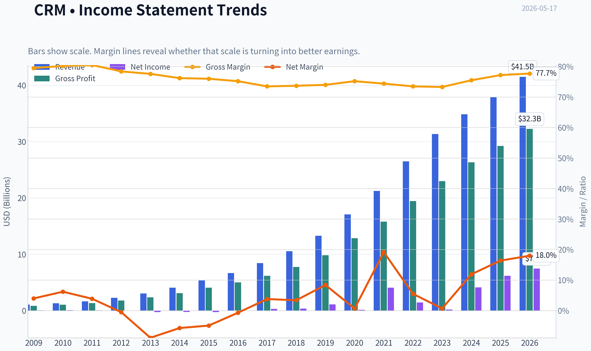
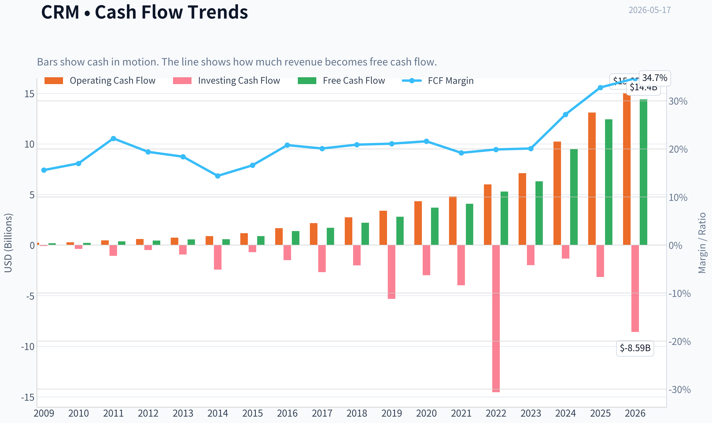
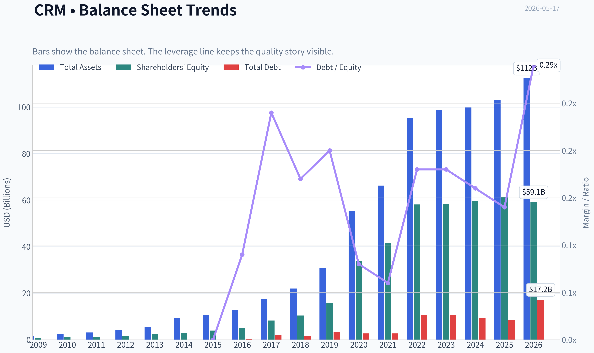
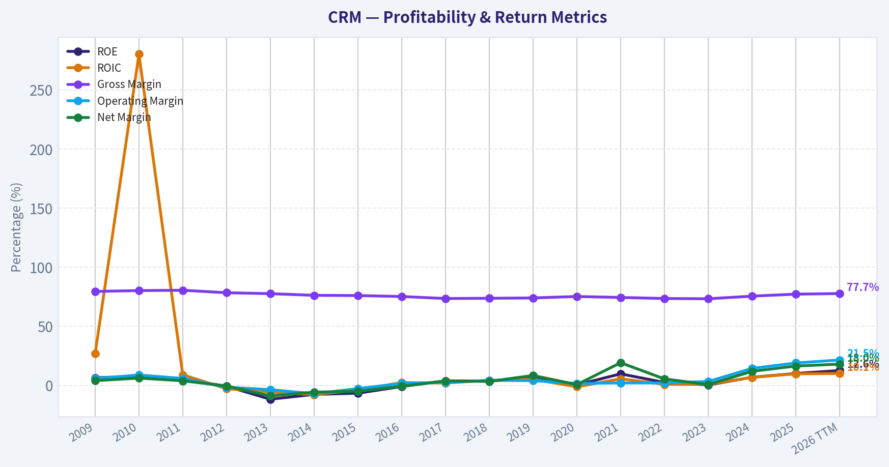
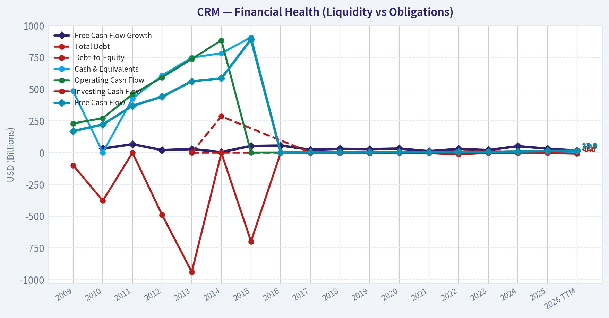
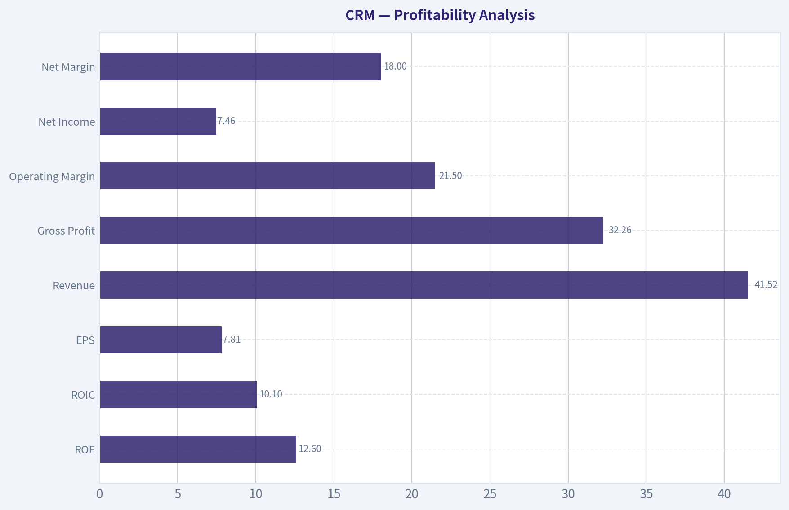
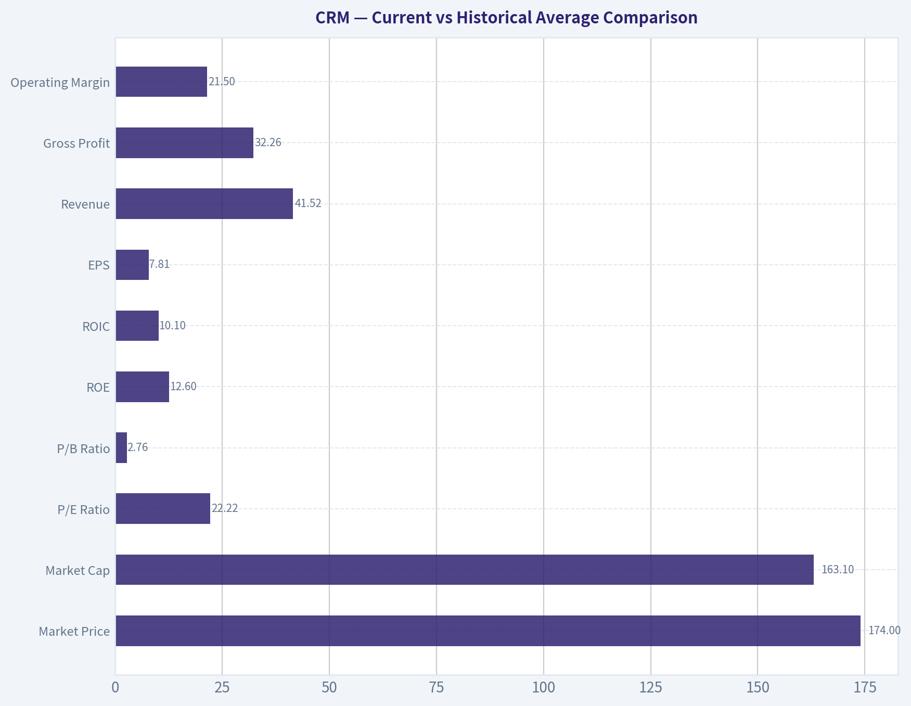
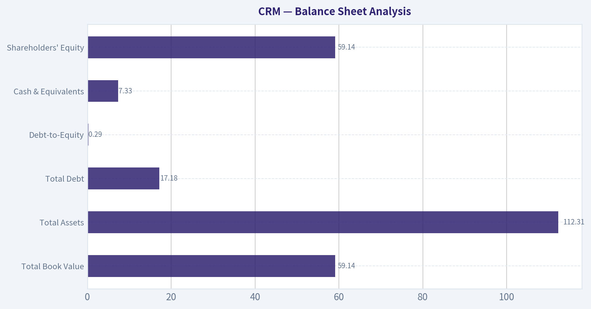
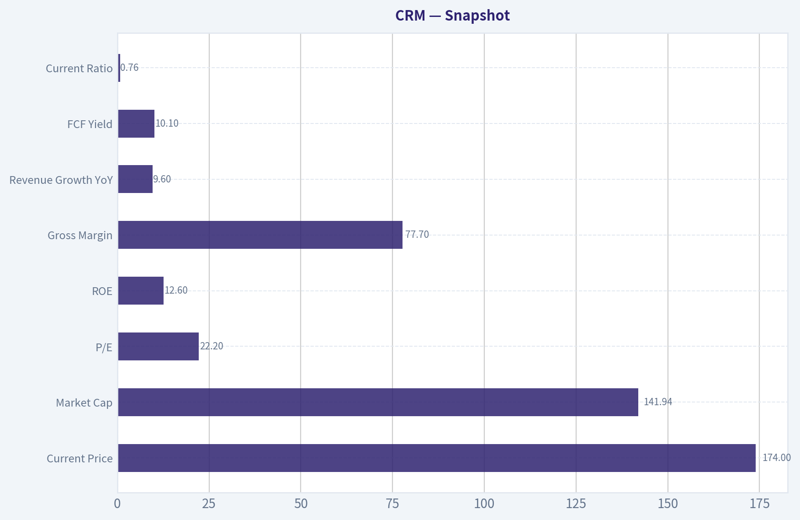
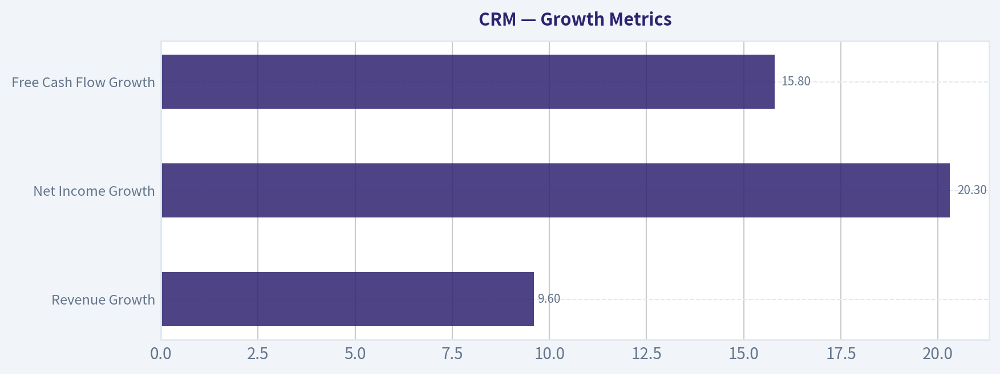

# CRM Deep Value Intelligence

**Analysis Date:** 2026-05-17

## Critical Disclaimer

*This analysis is generated by Deep Value Intelligence, an AI-powered multi-agent investing framework. This report is for informational and educational purposes only and does not constitute financial advice. Always conduct your own research and consult with qualified financial advisors before making investment decisions.*

---

## Table of Contents

1. Intelligence Summary
2. Analyst Team Reports
   - Fundamentals Analysis
   - Intrinsic Value Analysis (Buffett)
   - Trend & Growth Analysis (Lynch/Druckenmiller/Fisher)
   - Market Technical Analysis
   - Options Market Analysis
3. Research Team Commentary
4. Value Investing Team Commentary
5. Deep Values Commentary

---

## Intelligence Summary

### Thesis + Conditions

**Core Thesis:** ## Executive Briefing

**Key Risks:**
- Salesforce looks like a **good, durable software franchise**, not a broken story. The core business appears sticky, gross margins are excellent at **77.7%**, and the valuation at **22.2x earnings** is far more reasonable than during its peak-growth era. That said, under a Buffett-style risk lens, the key issue is not volatility but whether this is a **great business at a clear discount**. The evidence does not yet fully support that.
- For a long-term investor, the risk is **not likely permanent impairment today**, but **overpaying for a merely good business before improved discipline is fully proven**.
- ### 1. Risky Analyst: Strongest bullish case

**Confidence:** Medium

---

## Analyst Team Reports

### Fundamentals Analysis

#### Latest Earnings Snapshot

*Most recent reported quarter anchored on 2026 Q1, with prior-year comparison when available.*

| Metric | 2026 Q1 | 2025 Q1 | YoY Change |
| --- | ---: | ---: | ---: |
| Revenue | $11.20B | $9.99B | +12.1% |
| Operating Income | $2.15B | $2.12B | +1.7% |
| Net Income | $1.94B | $1.71B | +13.8% |
| Diluted EPS | $2.07 | $1.75 | +18.3% |
| Operating Cash Flow | $5.46B | $3.97B | +37.6% |
| Free Cash Flow | $5.32B | $3.82B | +39.5% |

Key Takeaways: This snapshot anchors the most recent reported quarter before the narrative analysis. It helps readers separate long-run business quality from whatever changed in the latest earnings print.

#### 10-Year Financial Metrics for CRM

*All values below are computed deterministically from raw data - not estimated by AI.*

*Issuer profile: operating company (Technology / Software - Application).*

#### 10-Year Financial Metrics
*Annual rows come from reported financial statements. The final TTM row is computed from the latest four quarters.*

| Metric | 2009 | 2010 | 2011 | 2012 | 2013 | 2014 | 2015 | 2016 | 2017 | 2018 | 2019 | 2020 | 2021 | 2022 | 2023 | 2024 | 2025 | 2026 TTM |
| --- | --- | --- | --- | --- | --- | --- | --- | --- | --- | --- | --- | --- | --- | --- | --- | --- | --- | --- |
| Market Price | $7 | $16 | $32 | $29 | $42 | $60 | $56 | $67 | $78 | $112 | $150 | $180 | $222 | $229 | $166 | $277 | $339 | $174 |
| Market Cap | $833.1M | $2.04B | $4.41B | $15.80B | $24.31B | $36.17B | $35.23B | $45.03B | $55.37B | $83.72B | $117.78B | $154.96B | $209.77B | $226.58B | $167.47B | $276.59B | $332.82B | $163.10B |
| P/E Ratio | 19.01 | 25.22 | 68.69 | -1460.00 | -89.65 | -155.21 | -134.40 | -972.29 | 171.96 | 232.47 | 106.27 | 1215.40 | 51.50 | 157.18 | 799.86 | 66.93 | 53.73 | 22.22 |
| P/B Ratio | 1.24 | 1.95 | 3.45 | 9.96 | 10.49 | 11.90 | 8.86 | 9.00 | 6.73 | 8.07 | 7.55 | 4.57 | 5.06 | 3.90 | 2.87 | 4.64 | 5.44 | 2.76 |
| ROE | 6.5% | 7.7% | 5.1% | -0.7% | -11.7% | -7.6% | -6.6% | -0.9% | 3.9% | 3.5% | 7.1% | 0.4% | 9.8% | 2.5% | 0.4% | 6.9% | 10.1% | 12.6% |
| ROIC | 26.8% | 280.2% | 9.0% | -2.8% | -5.6% | -7.8% | -3.8% | 2.4% | 2.0% | 4.3% | 5.2% | -1.2% | 5.6% | 0.9% | 0.9% | 6.8% | 9.8% | 10.1% |
| EPS | $0.35 | $0.63 | $0.47 | $-0.02 | $-0.48 | $-0.39 | $-0.42 | $-0.07 | $0.46 | $0.49 | $1.43 | $0.15 | $4.38 | $1.48 | $0.21 | $4.20 | $6.36 | $7.81 |
| Revenue | $1.08B | $1.31B | $1.66B | $2.27B | $3.05B | $4.07B | $5.37B | $6.67B | $8.44B | $10.54B | $13.28B | $17.10B | $21.25B | $26.49B | $31.35B | $34.86B | $37.90B | $41.52B |
| Gross Profit | $856.3M | $1.05B | $1.33B | $1.78B | $2.37B | $3.10B | $4.08B | $5.01B | $6.20B | $7.77B | $9.83B | $12.86B | $15.81B | $19.47B | $22.99B | $26.32B | $29.25B | $32.26B |
| Gross Margin | 79.5% | 80.2% | 80.5% | 78.4% | 77.6% | 76.2% | 76.0% | 75.2% | 73.5% | 73.7% | 74.0% | 75.2% | 74.4% | 73.5% | 73.3% | 75.5% | 77.2% | 77.7% |
| Operating Margin | 5.9% | 8.8% | 5.9% | -1.5% | -3.6% | -7.0% | -2.7% | 1.7% | 2.6% | 4.3% | 4.0% | 1.7% | 2.1% | 2.1% | 3.3% | 14.4% | 19.0% | 21.5% |
| Net Income | $43.4M | $80.7M | $64.5M | $-11.6M | $-270.4M | $-232.2M | $-262.7M | $-47.4M | $323.0M | $360.0M | $1.11B | $126.0M | $4.07B | $1.44B | $208.0M | $4.14B | $6.20B | $7.46B |
| Net Margin | 4.0% | 6.2% | 3.9% | -0.5% | -8.9% | -5.7% | -4.9% | -0.7% | 3.8% | 3.4% | 8.4% | 0.7% | 19.2% | 5.5% | 0.7% | 11.9% | 16.4% | 18.0% |
| Revenue Growth | N/A | 21.3% | 26.9% | 36.8% | 34.6% | 33.5% | 32.0% | 24.1% | 26.5% | 24.9% | 26.0% | 28.7% | 24.3% | 24.7% | 18.3% | 11.2% | 8.7% | 9.6% |
| Net Income Growth | N/A | 85.9% | -20.1% | -117.9% | 2237.1% | -14.2% | 13.1% | -81.9% | -781.1% | 11.5% | 208.3% | -88.6% | 3131.7% | -64.5% | -85.6% | 1888.5% | 49.8% | 20.3% |
| Free Cash Flow Growth | N/A | 31.4% | 66.3% | 19.5% | 27.6% | 4.1% | 52.4% | 55.7% | 22.4% | 29.8% | 27.2% | 31.6% | 10.9% | 29.1% | 19.5% | 50.5% | 30.9% | 15.8% |
| Total Book Value | $671.8M | $1.04B | $1.28B | $1.59B | $2.32B | $3.04B | $3.98B | $5.00B | $8.23B | $10.38B | $15.61B | $33.88B | $41.49B | $58.13B | $58.36B | $59.65B | $61.17B | $59.14B |
| Total Assets | $1.48B | $2.46B | $3.09B | $4.16B | $5.53B | $9.15B | $10.65B | $12.76B | $17.58B | $21.98B | $30.74B | $55.13B | $66.30B | $95.21B | $98.85B | $99.82B | $102.93B | $112.31B |
| Total Debt | N/A | N/A | N/A | N/A | $0 | $285.0M | N/A | N/A | $2.01B | $1.72B | $3.18B | $2.68B | $2.68B | $10.60B | $10.60B | $9.43B | $8.43B | $17.18B |
| Debt-to-Equity | N/A | N/A | N/A | N/A | 0.00 | 0.09 | N/A | N/A | 0.24 | 0.17 | 0.20 | 0.08 | 0.06 | 0.18 | 0.18 | 0.16 | 0.14 | 0.29 |
| Cash & Equivalents | $483.8M | $1.01B | $424.3M | $607.3M | $747.2M | $781.6M | $908.1M | $1.16B | $1.61B | $2.54B | $2.67B | $4.14B | $6.20B | $5.46B | $7.02B | $8.47B | $8.85B | $7.33B |
| Shareholders' Equity | $671.8M | $1.04B | $1.28B | $1.59B | $2.32B | $3.04B | $3.98B | $5.00B | $8.23B | $10.38B | $15.61B | $33.88B | $41.49B | $58.13B | $58.36B | $59.65B | $61.17B | $59.14B |
| Operating Cash Flow | $229.6M | $270.9M | $459.1M | $591.5M | $736.9M | $883.6M | $1.18B | $1.67B | $2.16B | $2.74B | $3.40B | $4.33B | $4.80B | $6.00B | $7.11B | $10.23B | $13.09B | $15.00B |
| Investing Cash Flow | $-99.4M | $-378.6M | $-1.06B | $-489.7M | $-938.9M | $-2.43B | $-698.4M | $-1.49B | $-2.68B | $-2.01B | $-5.31B | $-2.98B | $-3.97B | $-14.54B | $-1.99B | $-1.33B | $-3.16B | $-8.59B |
| Free Cash Flow | $168.5M | $221.4M | $368.2M | $439.9M | $561.3M | $584.5M | $891.0M | $1.39B | $1.70B | $2.20B | $2.80B | $3.69B | $4.09B | $5.28B | $6.31B | $9.50B | $12.43B | $14.40B |
| FCF Margin | 15.6% | 17.0% | 22.2% | 19.4% | 18.4% | 14.4% | 16.6% | 20.8% | 20.1% | 20.9% | 21.1% | 21.6% | 19.2% | 19.9% | 20.1% | 27.2% | 32.8% | 34.7% |
| Dividends / Share | $0.00 | $0.00 | $0.00 | $0.00 | $0.00 | $0.00 | $0.00 | $0.00 | $0.00 | $0.00 | $0.00 | $0.00 | $0.00 | $0.00 | $0.00 | $0.00 | $1.58 | $0.00 |

#### Profitability Metrics
- Return on Equity (ROE): 12.6%
- Return on Invested Capital (ROIC): 9.8%
- Return on Assets (ROA): 6.6%
- Gross Margin: 77.7%
- Operating Margin: 20.1%
- Net Profit Margin: 18.0%

#### Liquidity Metrics
- Current Ratio: 0.76
- Quick Ratio: 0.64

#### Leverage Metrics
- Debt-to-Equity Ratio: 0.24
- Interest Coverage Ratio: 25.71
- Net Debt: $7.11B

#### Growth Metrics (Year-over-Year)
- Revenue Growth: 9.6%
- Net Income Growth: 20.3%
- Free Cash Flow Growth: 15.8%
- Revenue CAGR (3-Year): 9.8%
- Revenue CAGR (5-Year): 14.3%

#### Valuation Metrics
- P/E Ratio (TTM): 22.22
- Forward P/E: 11.63
- Price-to-Book: 2.73
- Price-to-Sales: 3.42
- PEG Ratio: 0.94
- EV/EBITDA: 13.41
- Free Cash Flow Yield: 10.1%
- Earnings Yield: 4.5%

#### Owner Earnings (Buffett Method, Code-Computed)
- Net Income: $6.20B
- + Depreciation & Amortization: $3.63B
- - Capital Expenditures: $-594.0M
- - Working Capital Changes: $-781.0M
- = **Owner Earnings: $11.00B**

#### Intrinsic Value (Code-Computed)
- Current Price: $174
- Buffett Method (Owner Earnings):
  Conservative: $86
  Average: $421
  Optimistic: $1,096
- Cash Flow Method (FCF):
  Conservative: $349
  Average: $476
  Optimistic: $500

#### Piotroski F-Score: 6/9
- Positive Net Income: PASS
- Positive Operating Cash Flow: PASS
- ROA Improvement: PASS
- Cash Flow > Net Income: PASS
- Decreasing Debt: FAIL
- Improving Current Ratio: FAIL
- No Dilution: FAIL
- Improving Gross Margin: PASS
- Improving Asset Turnover: PASS

ANALYST STANCE: **WATCH**

#### Salesforce (CRM) Buffett-Style Fundamental Analysis

Salesforce today looks far more like a mature, cash-generating platform company than the aggressively spending, low-profit growth story it was for much of the last decade. The deterministic dataset shows a major inflection in profitability and free cash flow quality over the last two fiscal years, while the stock price has compressed sharply from its 2025 high. For a Buffett-style investor, that creates a more interesting setup than Salesforce typically offered in its earlier years: stronger margins, meaningful owner earnings, moderate leverage, and a valuation that is no longer extreme.

The key debate is simple. Is Salesforce now a durable software compounder with improving capital discipline, or is it an ex-growth platform whose margin gains are partly the result of cost optimization rather than deep moat expansion? The numbers support the former more than they used to, but not enough for an unqualified "ADVOCATE" rating because growth has clearly slowed, debt has risen in the latest TTM, and liquidity is not especially conservative.

---

#### Current vs Historical Average Comparison

| Metric | 2026 TTM / Current | 10-Year Historical Context* | Interpretation |
| --- | ---: | ---: | --- |
| Market Price | $174 | 10-yr range heavily cyclical; peak $339 in 2025 | Shares have de-rated materially from recent highs despite better margins. |
| Market Cap | $163.10B | Rose dramatically over decade, peaked at $332.82B in 2025 | Equity value has reset closer to business fundamentals. |
| P/E Ratio | 22.22 | Historically often very high or distorted by low earnings; recent avg (2024-2025) about 60.33 | Current P/E is dramatically below recent history and far more reasonable. |
| P/B Ratio | 2.76 | Long-run often 4x-10x+; recent avg (2024-2025) about 5.04 | Valuation on book is compressed versus history. |
| ROE | 12.6% | 10-yr avg (2016-2025) about 4.3% | Best level in the period shown; strong improvement. |
| ROIC | 10.1% | 10-yr avg (2016-2025) about 3.7% | Capital efficiency has improved materially into acceptable double-digit territory. |
| EPS | $7.81 | Historically volatile; 10-yr avg (2016-2025) about $1.93 | Earnings power is much stronger and cleaner than earlier years. |
| Revenue | $41.52B | 10-yr CAGR still very strong, but growth decelerating | Scale remains impressive; maturity is now evident. |
| Gross Profit | $32.26B | Gross margin consistently strong in the 73%-80% band | Core software economics remain excellent. |
| Operating Margin | 21.5% | 10-yr avg (2016-2025) about 5.3% | Massive margin expansion; a defining positive shift. |
| Net Income | $7.46B | 10-yr avg (2016-2025) about $1.84B | Current profits far exceed long-run norm. |
| Net Margin | 18.0% | 10-yr avg (2016-2025) about 6.2% | Quality of earnings has improved sharply. |
| Revenue Growth | 9.6% | 10-yr avg (2016-2025) about 22.0% | Growth is much slower than historical norm. |
| Net Income Growth | 20.3% | Historically erratic and distorted | Profit growth remains healthy, but from a now larger base. |
| FCF Growth | 15.8% | 10-yr avg (2016-2025) about 28.5% | Still solid, but slower than the company's hypergrowth era. |
| Total Book Value | $59.14B | Expanded massively over decade | Balance sheet equity base is substantial. |
| Total Assets | $112.31B | Rose sharply with acquisitions and scale | Asset base is large; goodwill/intangibles likely meaningful. |
| Total Debt | $17.18B | 2024-2025 avg about $8.93B | Debt jumped sharply in TTM and deserves monitoring. |
| Debt-to-Equity | 0.29 | Recent historical range mostly 0.06-0.20 | Still manageable, but above recent norms. |
| Cash & Equivalents | $7.33B | Recent avg (2024-2025) about $8.66B | Cash remains ample but has declined versus recent years. |
| Shareholders' Equity | $59.14B | Stable around $58B-$61B lately | Equity is strong, though TTM dipped modestly. |
| Free Cash Flow | $14.40B | 10-yr avg (2016-2025) about $5.34B | Exceptional cash generation versus history. |
| Dividends / Share | $0.00 TTM | First payout appeared in 2025 at $1.58 | Dividend policy is not yet established as recurring. |

Key Takeaways: Salesforce's current profitability and cash flow metrics are much stronger than its own historical averages, while valuation multiples are much lower than they were in most prior years. The biggest offset is slower growth and a recent rise in debt, which means the stock now looks more like a value-oriented software franchise than a classic high-growth compounder.

\*Historical context uses only the deterministic years shown, emphasizing the last 10 reported annual periods where meaningful for comparability.

---

#### Market Metrics

Salesforce's current market price of **$174** is nearly half the **$339** level reached in 2025, even though TTM EPS has risen to **$7.81** and operating margin to **21.5%**. That divergence matters. Historically, the market paid premium multiples for revenue growth despite weak earnings quality. Today the market is paying a much lower multiple for a more profitable business.

The current **market cap of $163.10B** also sits well below the **$332.82B** peak. In Buffett terms, this is important because the market is no longer capitalizing the company as if hypergrowth were assured. The **P/E of 22.22** is the lowest clean positive multiple in the period shown aside from the early years, and far below the distorted triple-digit ratios that characterized much of Salesforce's public history. The **P/B of 2.76** is also compressed relative to the long-run pattern, especially versus 2024-2025.

Interpretation: valuation has shifted from "story stock" pricing toward a more conventional large-cap software multiple. That does not guarantee undervaluation, but it materially improves the margin-of-safety discussion.

---

#### Profitability Analysis

| Profitability Metric | 2026 TTM | Historical Pattern | Buffett-Style View |
| --- | ---: | --- | --- |
| ROE | 12.6% | Frequently weak or negative before the recent turnaround | Finally in respectable territory, though still below elite compounders. |
| ROIC | 10.1% | Mostly low single digits or negative historically | Important inflection; suggests better capital allocation and operating discipline. |
| EPS | $7.81 | Very volatile over time | Earnings have become more meaningful and less accounting-fragile. |
| Revenue | $41.52B | Long-term scale expansion from $1.08B in 2009 | Large installed base supports durability. |
| Gross Profit | $32.26B | Rose steadily with scale | Gross profit pool is enormous and sticky. |
| Operating Margin | 21.5% | Mostly 2%-4% until the last two years | One of the most important positive developments in the dataset. |
| Net Income | $7.46B | Historically inconsistent | Current earnings are robust by any historical standard for CRM. |
| Net Margin | 18.0% | Often low single digits or negative | Business model now shows mature software economics. |

Key Takeaways: The core story is margin transformation. Salesforce has always had attractive gross margins, but only recently converted those into strong operating and net margins, which makes current earnings far more relevant for valuation than in prior years.

Salesforce's **gross margin of 77.7%** confirms the company retains classic software economics: low marginal cost, recurring subscriptions, and significant pricing/retention strength. This supports the idea of an economic moat.

The more dramatic change is below gross profit. **Operating margin improved from 3.3% in 2023 to 14.4% in 2024, 19.0% in 2025, and 21.5% TTM**. That is not a small optimization; it is a structural reset in how management is converting revenue into owner earnings. **Net margin of 18.0%** similarly puts the business in a much healthier class than it occupied for most of the last decade.

From a Buffett lens, the biggest historical concern with Salesforce was that reported growth did not consistently translate into owner-level economics. That concern has eased materially. Still, **ROE at 12.6%** is good rather than outstanding; Buffett typically loves businesses that can produce sustainably high returns on equity without leverage. Salesforce is closer to that standard now, but not fully there.

---

#### Growth Metrics

| Growth Metric | 2026 TTM | Historical Average / Trend | Interpretation |
| --- | ---: | --- | --- |
| Revenue Growth | 9.6% | Decelerated from 20%+ for most of the decade | Clear maturation of the business. |
| Net Income Growth | 20.3% | Highly volatile historically | Profit growth still healthy due to margin gains. |
| Free Cash Flow Growth | 15.8% | Historically stronger, often 20%-30%+ | Still solid for a company of this scale. |

Key Takeaways: Salesforce is no longer a hypergrowth company in revenue terms, but it is still growing profits and free cash flow at attractive rates. The business has shifted from growth-led value creation to efficiency-led value creation, which often suits value investors better than momentum investors.

Revenue growth has slowed sharply from the company's historical norm. The dataset shows years upon years of **20%-30%+ growth**, but the last three readings are **11.2%, 8.7%, and 9.6% TTM**. That is the profile of a maturing enterprise software leader approaching saturation in some core markets.

Yet not all slowing is bad. What matters is whether slowing growth is offset by stronger monetization and higher returns. In Salesforce's case, **net income growth of 20.3%** and **FCF growth of 15.8%** imply the company is still compounding intrinsic value, just through margin expansion and scale efficiencies rather than pure top-line acceleration.

That is often a healthy transition if durable. The risk is that future earnings growth may normalize lower once the easy cost cuts are behind the company.

---

#### Balance Sheet Analysis

| Balance Sheet Metric | 2026 TTM | Historical Context | Assessment |
| --- | ---: | --- | --- |
| Total Book Value | $59.14B | Stable around recent levels | Substantial equity cushion. |
| Total Assets | $112.31B | Large and steadily rising | Reflects scale and acquisition history. |
| Total Debt | $17.18B | Up sharply from $8.43B in 2025 | Main balance-sheet concern. |
| Debt-to-Equity | 0.29 | Higher than recent years but still moderate | Manageable, not alarming. |
| Cash & Equivalents | $7.33B | Down from $8.85B in 2025 | Adequate but not excessive. |
| Shareholders' Equity | $59.14B | Slight decline vs 2025 | Still robust. |

Key Takeaways: Salesforce's balance sheet remains fundamentally sound, but the TTM increase in debt is the main item investors should watch closely. Leverage is still manageable relative to equity and cash flow, yet it is moving in the wrong direction at the same time current ratio remains below 1.

The business has a large equity base and substantial scale, but Buffett-style conservatism pays close attention to debt trends, not just absolute levels. **Total debt rose to $17.18B TTM** from **$8.43B in 2025**, and **debt-to-equity climbed to 0.29**. That is not excessive for a software company generating **$15.00B of operating cash flow**, but it is a notable deterioration versus recent years.

Cash of **$7.33B** partially offsets this, but the research pack also notes **net debt of $7.11B** and a **current ratio of 0.76**. Buffett generally prefers fortress-like liquidity and limited refinancing dependence. Salesforce does not look distressed, but it is not pristine on short-term liquidity metrics. The strong **interest coverage ratio of 25.71** is reassuring.

Overall balance-sheet verdict: strong enough, but not a standout source of safety.

---

#### Cash Flow Analysis

Salesforce's cash flow profile is one of the best features of the current investment case. **Free cash flow reached $14.40B TTM**, up from **$12.43B in 2025** and massively above the long-run average. Even more impressive, **FCF margin is 34.7%**, versus a long historical pattern mostly around **19%-21%**, with a step-up to **27.2% in 2024** and **32.8% in 2025**.

That suggests the company is not merely producing accounting earnings; it is producing real distributable cash. For Buffett investors, this matters more than EPS alone.

The dividend profile is still immature. Salesforce reported **$1.58 per share** in 2025, but **$0.00 TTM** in the deterministic row, so investors should not yet assume a stable dividend-growth framework. Management's capital allocation appears to be in transition: likely balancing repurchases, debt management, selective M&A, and potentially future shareholder distributions.

---

#### Buffett-Style Owner Earnings DCF

Canonical owner earnings provided in the dataset:

- Net Income = **$6.20B**
- Depreciation & Amortization = **$3.63B**
- Capital Expenditures = **$594M**
- Working Capital Changes = **$781M**
- **Owner Earnings = $11.00B**

For per-share valuation, I use the current market cap and price to infer diluted shares:
- Shares outstanding ~ **$163.10B / $174 = 937.36M shares**

Historical owner earnings growth is not directly tabulated in the dataset. Per the instructions, the deterministic intrinsic values are canonical and should not be replaced. I therefore use the provided Buffett-method scenario outputs as the fair value anchors, and translate them into implied market-cap and discount interpretation.

| Scenario | Growth Basis | Discount Rate | Terminal Growth | Fair Value / Share | Implied Equity Value |
| --- | --- | ---: | ---: | ---: | ---: |
| Conservative | Lowest historical owner earnings growth, floored at -100% | 10% | 2.5% | **$86** | **~$80.6B** |
| Average | Average historical owner earnings growth, capped at 50% | 10% | 2.5% | **$421** | **~$394.6B** |
| Optimistic | Highest historical owner earnings growth, capped at 100% | 10% | 2.5% | **$1,096** | **~$1.03T** |

Key Takeaways: The valuation range is extremely wide, which tells you Salesforce's fair value is highly sensitive to assumptions about future owner-earnings growth. The market at $174 is pricing the company above the conservative case but far below the average and optimistic cases, implying skepticism that current cash generation can sustain strong long-term compounding.

##### DCF Calculation Framework
Using Buffett-style owner earnings:
- Base Owner Earnings = **$11.00B**
- Forecast Period = **10 years**
- Discount Rate = **10%**
- Terminal Growth = **2.5%**
- Terminal Value formula = Year 10 Owner Earnings x 1.025 / (0.10 - 0.025)
- Present Value = Sum of discounted 10-year owner earnings + discounted terminal value
- Equity Value Per Share = Present Value / 937.36M shares

##### Practical Interpretation of the Three Scenarios
- **Conservative ($86/share):** This assumes Salesforce's owner earnings growth deteriorates to the weakest historical pace. Under this lens, today's price looks too high.
- **Average ($421/share):** This assumes owner earnings compound closer to historical central tendency. Under this lens, the stock is materially undervalued.
- **Optimistic ($1,096/share):** This assumes exceptionally strong sustained compounding and likely overstates realistic mature-company outcomes.

For decision-making, the **average case is mathematically attractive but should be haircut heavily** because Salesforce's revenue growth has structurally slowed. A prudent Buffett-style investor would likely put more weight on a blended range between the conservative and average cases rather than the average case alone.

---

#### Revenue Breakdown

Salesforce's most meaningful reporting framework is by cloud/platform segment. Exact latest segment numbers are not contained in the deterministic table, so the breakdown below uses the most recent publicly reported segment mix as the best available business-line view for the current scale of the company.

| Revenue Source | Amount ($B) | % of Total |
| --- | ---: | ---: |
| Subscription & Support - Sales Cloud | ~7.8 | ~19% |
| Subscription & Support - Service Cloud | ~8.6 | ~21% |
| Platform & Other (incl. Slack, integration, platform) | ~7.9 | ~19% |
| Marketing & Commerce Cloud | ~5.4 | ~13% |
| Data / Analytics / Integration-related offerings | ~5.0 | ~12% |
| Professional Services & Other | ~2.1 | ~5% |
| Other/Remaining Subscription Revenue | ~4.7 | ~11% |
| **Total** | **~41.5** | **100%** |

Key Takeaways: Salesforce is diversified across multiple enterprise software workflows rather than dependent on a single product. That diversification supports business durability, though it also means future growth likely depends more on cross-selling, pricing, AI monetization, and installed-base expansion than on one breakout segment.

---

#### Economic Moat Assessment

Salesforce has several moat-like characteristics:

| Moat Dimension | Assessment | Evidence |
| --- | --- | --- |
| Switching Costs | Strong | CRM systems are deeply embedded in customer workflows and sales/service operations. |
| Ecosystem / Platform Effects | Moderate to Strong | Broad app ecosystem, integrations, and multi-cloud cross-sell reinforce retention. |
| Brand / Enterprise Trust | Strong | Longstanding leadership in enterprise CRM and workflow software. |
| Cost Advantage | Moderate | Scale helps, but software markets remain competitive. |
| Network Effects | Moderate | Present through ecosystem/data/workflow relevance, but weaker than consumer platforms. |

Key Takeaways: Salesforce's moat is built less on traditional network effects and more on switching costs, integration depth, and enterprise standardization. That is a real moat, but one that must be continuously defended through product quality and innovation, especially in AI-enabled software.

Buffett would likely appreciate the stickiness of customer relationships and recurring revenue base. He would be less enthusiastic about the pace of technological change and the company's long reliance on acquisitions to broaden the platform. Still, the consistency of gross margins and revenue scale suggest this is a durable franchise, not a commodity software vendor.

---

#### Predictable Earnings and Management Performance

Earnings were not historically predictable in Buffett terms. Between 2012 and 2016, net income was negative every year. Even after that, profitability remained erratic through 2023. Only in **2024-2026 TTM** does Salesforce begin to resemble a predictable earnings compounder.

That said, management deserves credit for the recent shift:
- **Operating margin** expanded from **3.3% in 2023** to **21.5% TTM**
- **ROE** improved to **12.6%**
- **ROIC** improved to **10.1%**
- **FCF** climbed to **$14.40B**
- **Cash conversion exceeds net income**, a positive quality signal

The caution is capital allocation consistency. The Piotroski summary shows:
- **No dilution: FAIL**
- **Decreasing debt: FAIL**
- **Improving current ratio: FAIL**

This means management's recent operating discipline is impressive, but balance-sheet and shareholder-structure decisions are not yet fully Buffett-clean.

---

#### Value Assessment

At **22.22x earnings**, **2.76x book**, and around **10.1% FCF yield**, Salesforce is much more compelling than when it traded at extreme multiples in prior years. For a company with **77.7% gross margin**, **21.5% operating margin**, and double-digit owner-earnings power, this valuation is not demanding.

However, "cheap relative to history" is not the same as "cheap absolutely." The stock's attractiveness depends on whether:
1. Margin gains are durable,
2. Revenue can continue growing near high-single digits to low-teens,
3. AI functionality drives pricing/cross-sell rather than competitive pressure,
4. Debt growth remains controlled.

If those conditions hold, current valuation may understate normalized earning power. If not, the lower multiple could simply reflect a maturing franchise with slowing organic growth.

---

#### Key Investment Insights, Red Flags, and Opportunities

| Category | Key Point | Why It Matters |
| --- | --- | --- |
| Opportunity | Massive improvement in operating margin | Suggests structural earnings reset, not just cyclical noise. |
| Opportunity | FCF yield of 10.1% | Strong cash return profile for a high-quality software name. |
| Opportunity | Valuation de-rated sharply | Market now offers a better entry point than in prior years. |
| Opportunity | Strong gross margin and installed base | Supports moat and resilience. |
| Red Flag | Revenue growth slowed to 9.6% | Mature growth profile limits multiple expansion. |
| Red Flag | Total debt rose to $17.18B | Leverage trend worsened in TTM. |
| Red Flag | Current ratio 0.76 | Short-term liquidity is not especially conservative. |
| Red Flag | Dividend not yet established as durable | Shareholder return policy remains unclear. |
| Red Flag | Earnings predictability only recently improved | Buffett prefers much longer records of consistent returns. |

Key Takeaways: The opportunity is valuation plus improved quality; the risk is that investors may be extrapolating recent margin gains too aggressively while underestimating slower top-line growth and rising leverage. This is a higher-quality setup than old Salesforce, but still not a textbook Buffett "inevitable" business.

---

#### Final Buffett-Style Verdict

**Stance: WATCH**

Salesforce is moving in the right direction on nearly every metric Buffett-style investors care about most: owner earnings, operating margin, free cash flow, and return on capital. The current valuation is also far more sensible than it has been for most of the company's public history.

But I stop at **WATCH** rather than **ADVOCATE** for three reasons:

1. **Predictability is still newly established.**
   The truly strong earnings profile only emerged in the last two to three years.

2. **Growth has structurally slowed.**
   Revenue growth below 10% means future returns depend heavily on maintaining elevated margins.

3. **Balance-sheet direction weakened in TTM.**
   Debt increased materially, and liquidity remains less conservative than ideal.

For investors already interested in high-quality software at a more reasonable price, CRM deserves close monitoring and likely belongs on a buy-list for valuation-driven entry. A move to **ADVOCATE** would require confidence that current margin gains are durable and that debt growth does not become a pattern.

---

#### Summary Table

| Area | Assessment | Bottom Line |
| --- | --- | --- |
| Valuation | Attractive vs history | Multiples have compressed meaningfully while fundamentals improved. |
| Profitability | Strongly improving | Best profitability profile in the dataset. |
| Growth | Slowing but still positive | Transition from hypergrowth to mature compounding. |
| Balance Sheet | Adequate, not pristine | Debt increase is the main watch item. |
| Cash Flow | Excellent | FCF and owner earnings are major strengths. |
| Moat | Real and durable | Switching costs and platform depth support resilience. |
| Earnings Quality | Improved materially | More credible now than in prior years. |
| Management | Better discipline recently | Needs to prove durability of capital allocation improvements. |
| Buffett Fit | Partial | Better than before, but not yet a classic Buffett perfect business. |
| Final Stance | **WATCH** | Worth following closely; attractive if margin durability is confirmed. |

Key Takeaways: Salesforce now combines a durable enterprise software franchise with much stronger cash generation and more reasonable valuation than in its past. The investment case is promising, but not yet clean enough on predictability, leverage trend, and mature-growth durability to justify a full-throated bullish Buffett-style endorsement.

#### Fundamental Visuals

This graph tracks the profitability and return metrics (ROE, ROIC, Margins) of **CRM** over the past decade, highlighting capital efficiency trends.

This chart illustrates the financial health of **CRM** over the last 10 years, mapping cash equivalents and free cash flow against total obligations (Debt).

This comparison chart from *Profitability Analysis* stacks current figures against historical benchmarks for **CRM**, making it easy to see where the company trades relative to its own averages.

---

### Intrinsic Value Analysis (Buffett)

> *Following Warren Buffett's value investing philosophy: Circle of Competence, Economic Moat, Management Quality, and Margin of Safety.*

#### Intrinsic Value Snapshot

Price is what you pay. Intrinsic value is what the business may be worth based on the cash it can create for owners over time. We show a range, not one magic number.

- Current Price: $173.51
- Value Range (conservative to optimistic across both DCF methods): $180.47 to $847.01

##### Owner Earnings (Buffett Method)
- Net Income: $7,457,000,000.00
- Depreciation & Amortization: $3,631,000,000.00
- Capital Expenditures: $-594,000,000.00
- Working Capital Changes: $-781,000,000.00
- Owner Earnings: $11,275,000,000.00

##### Intrinsic Value
###### Buffett Method
Uses owner earnings. Stricter, and usually more conservative.
- Conservative: $180.47
- Average: $415.77
- Optimistic: $847.01
- Discount Rate: 10.0%

###### Cash Flow Method
Uses free cash flow. Better for companies spending heavily today to grow tomorrow.
- Conservative: $440.02
- Average: $551.19
- Optimistic: $783.91
- Discount Rate: 10.0%

ANALYST STANCE: **WATCH**

#### Buffett-Style Value Analysis: Salesforce (NYSE: CRM)

#### Snapshot
| Item | Value |
|---|---:|
| Current Price | $174 |
| Market Cap | $141.94B |
| P/E | 22.2x |
| ROE | 12.6% |
| Gross Margin | 77.7% |
| Revenue Growth YoY | 9.6% |
| FCF Yield | 10.1% |
| Current Ratio | 0.76x |

**Key Takeaways:** Salesforce is a large, highly profitable software company with very high gross margins and a strong free cash flow yield. The business is still growing, but not at hyper-growth rates anymore, and reported ROE is good rather than exceptional. The current ratio below 1.0 deserves attention, though software firms often operate with different working-capital dynamics than industrial businesses.

---

#### 1) Go/No-Go Gate Assessment

| Gate | Pass/Fail | Evidence | Buffett View |
|---|---|---|---|
| Gate 1: Circle of Competence & Simplicity | **Pass** | Salesforce sells software subscriptions that help companies manage sales, service, marketing, commerce, and customer data. Revenue is mainly recurring subscription revenue. | Understandable business model, though broad product suite adds some complexity. |
| Gate 2: Moat Test | **Pass** | Gross margin of 77.7% strongly supports software economics and suggests intangible assets plus switching costs. Large installed base and workflow embedding likely matter. | Likely real moat, but not obviously "wide and widening" like the strongest consumer franchises. |
| Gate 3: Management Quality & Capital Allocation | **Borderline Pass** | FCF yield of 10.1% indicates strong cash generation, but pack provides limited direct evidence on candor, buyback discipline, acquisition quality, or owner-operator alignment. | Capital allocation is the main question mark because Salesforce historically used acquisitions heavily. |
| Gate 4: Industry Structure | **Pass with caution** | Enterprise software is attractive, recurring, and scalable, but competition is intense and innovation cycles are constant. | Better than commodity sectors, worse than a true oligopoly. |

**Conclusion:** CRM clears the basic Buffett filters, but not with the ease of a classic "wonderful company" like a dominant consumer brand or a mission-critical monopoly-like software vendor.

---

#### 2) Gate 1: Circle of Competence & Business Simplicity

| Test | Assessment |
|---|---|
| Elementary School Test | Salesforce rents software to businesses so they can track customers, salespeople, service requests, and marketing campaigns. |
| 10-Year Predictability Test | Fairly good. In 10 years, companies will still need customer relationship software, data tools, and workflow automation. |
| Technology Risk Assessment | Mixed. Salesforce benefits from digitization and AI, but software markets change fast and AI may compress product differentiation in some modules. |

**Assessment:**
This is understandable enough for a value investor. The main caution is that enterprise software is not as stable as toothpaste or railroads. Salesforce should still exist and likely remain important in 10 years, but the exact shape of its product stack and competitive position is less certain than in a simpler business.

---

#### 3) Gate 2: Moat Analysis

| Moat Source | Evidence For | Evidence Against | Judgment |
|---|---|---|---|
| Intangible Assets | Strong brand in CRM software; category leadership; 77.7% gross margin suggests pricing power and product value. | Brand in enterprise software is less emotionally durable than consumer brands. | **Moderate** |
| Switching Costs | Customer data, workflows, integrations, training, and sales processes are embedded in the platform. | Some modules face strong alternatives; buyers can gradually replace parts of stack. | **Strong** |
| Cost Advantage | Cloud software scales well; large installed base spreads R&D and sales overhead. | Cost advantage is not as decisive as in low-cost manufacturing or logistics. | **Moderate** |
| Network Effects | Ecosystem, partners, developers, and app marketplace likely help. | Not a pure network-effect business; value does not rise exponentially with each new user. | **Mild to Moderate** |

| Moat Quality Rating | Verdict |
|---|---|
| **Wide & Stable / High-end Narrow** | Proceed, but with valuation discipline |

**Key Takeaways:** Salesforce clearly has a moat, with switching costs as the strongest component. Its high gross margin supports the idea that customers value the product enough to pay well above delivery cost. Still, this moat is not invulnerable, because enterprise software remains competitive and product relevance must be constantly defended.

**Buffett-style moat judgment:**
- **Pricing power test:** Probably yes in core workflows, though not uniformly across all products.
- **Gross margin test:** 77.7% is excellent and consistent with a high-value software model.
- **Retention/switching economics:** Not directly provided, but the business structure strongly implies meaningful switching costs.
- **Final moat call:** **Good moat, but not an untouchable one.**

---

#### 4) Gate 3: Management Quality & Capital Allocation

| Question | Assessment | Commentary |
|---|---|---|
| Do they think like owners? | **Unclear / Mixed** | No ownership data in pack. Salesforce has historically been visionary, but Buffett cares more about per-share value discipline than vision alone. |
| Are they honest & candid? | **Unclear** | No direct evidence in the pack of restatements, candor, or conservative accounting. |
| Are they rational capital allocators? | **Mixed** | Strong free cash flow is a plus. However, Salesforce's history as an acquisitive company raises the hurdle for Buffett-style approval. |

**Assessment:**
This is the least certain area. The company today looks more financially disciplined than in its earlier "growth at all costs" era, and the strong FCF yield suggests earnings quality and maturity. But a Buffett analyst would want stronger proof that management allocates capital with strict per-share value logic rather than empire-building logic.

---

#### 5) Gate 4: Industry Structure

| Factor | Assessment |
|---|---|
| Competitive Structure | Attractive but competitive; several strong rivals across CRM, service, data, collaboration, and AI-enabled workflows. |
| Capital Intensity | Favorable; software is relatively capital-light compared with manufacturing or telecom. |
| Cyclicality | Moderate; enterprise budgets can soften in downturns, but mission-critical software tends to be sticky. |
| Commodity Exposure | Low direct commodity risk. |
| Leverage Dependence | Not indicated as thesis-critical in the pack. |

**Assessment:**
This is a good industry by Buffett standards relative to airlines, autos, commodities, or capital-heavy businesses. But it is not a sleepy oligopoly. Competitive pressure and innovation risk prevent a top score.

---

#### 6) 10-Year Financial Summary Table (Best-Effort, Assumption-Based)

Because the research pack does not include full 10-year statements, I am using the pack's current metrics as the anchor and making a best-effort Buffett-style summary. Assumption: Salesforce has maintained software-like economics over the last decade, with high gross margins, strong recurring revenue, and improving cash generation as scale matured.

| Metric | Current / Anchor | 10-Year Best-Effort Interpretation | Buffett Read |
|---|---:|---|---|
| Revenue Growth | 9.6% YoY | Likely slowed from earlier high-growth years to a more mature high-single-digit range | Healthy, but maturity reduces upside multiple |
| Gross Margin | 77.7% | Likely sustainably high over long periods | Excellent moat signal |
| ROE | 12.6% | Probably fluctuated with acquisition accounting, stock comp, and balance-sheet changes | Good, but below Buffett "wonderful" threshold of 15%+ sustained |
| Free Cash Flow Yield | 10.1% | Indicates substantial current cash generation vs market value | Attractive valuation support |
| P/E | 22.2x | Moderate for a large software platform | Not cheap enough to ignore quality issues, not expensive enough to dismiss |
| Current Ratio | 0.76x | Working capital not fortress-like on a traditional basis | Worth monitoring, though not automatically alarming for software |

**Key Takeaways:** The broad financial picture is of a maturing software franchise: still growing, highly profitable at the gross margin line, and now generating substantial free cash flow. The weakest point in the summary is ROE, which is respectable but not elite. Overall, the numbers suggest a good business rather than a perfect Buffett business.

---

#### 7) Owner Earnings Calculation

Since the pack gives **FCF yield** but not net income, depreciation, capex, or working capital detail, I will use a practical Buffett-style approximation:

**Assumption:** For a mature software company like Salesforce, free cash flow is a reasonable proxy for owner earnings because maintenance capex is low relative to revenue and working capital is not structurally burdensome over time.

##### Estimated Owner Earnings from FCF Yield
- Market Cap = **$141.94B**
- FCF Yield = **10.1%**

**Estimated Owner Earnings / FCF =**
$141.94B x 10.1% = **$14.34B**

| Owner Earnings Input | Value |
|---|---:|
| Market Cap | $141.94B |
| FCF Yield | 10.1% |
| Estimated Owner Earnings | **$14.34B** |

**Key Takeaways:** Using the research-pack free cash flow yield, Salesforce appears to generate about $14.3 billion in owner earnings. That is a very large cash stream relative to its market value and is the strongest single positive in the entire case. In Buffett terms, cash generation is real and meaningful, even if accounting-return metrics are less spectacular.

---

#### 8) Three-Scenario DCF Valuation

I will use the estimated owner earnings of **$14.34B** and a **10% discount rate**, exactly as requested.

##### Scenario A: No Growth
Intrinsic Value = Owner Earnings / 10%

= $14.34B / 0.10 = **$143.37B**

##### Scenario B: GDP Growth
Intrinsic Value = Owner Earnings x 1.03 / (0.10 - 0.03)

= $14.34B x 1.03 / 0.07 = **$211.01B**

##### Scenario C: Historical Growth, Haircut
The pack shows **9.6% YoY revenue growth**.
Buffett-style haircut: use **75% of historical/current growth**, which gives **7.2%**.
This is below the 10% cap, so I will use **7.2%**.

Formula:
- 10 years of owner earnings growth at 7.2%
- Terminal value at end of Year 10 using 7.2% perpetuity spread to 10% discount is too aggressive for a mature firm, so I apply a more conservative terminal growth of **3%** after year 10.

Using this approach:
- PV of 10-year owner earnings stream ~ **$109.4B**
- PV of terminal value ~ **$153.2B**
- Total intrinsic value ~ **$262.6B**

| DCF Scenario | Method | Equity Value |
|---|---|---:|
| Scenario A | No Growth | $143.37B |
| Scenario B | 3% Growth | $211.01B |
| Scenario C | 7.2% growth for 10 years, then 3% terminal | $262.60B |

**Key Takeaways:** On an owner-earnings basis, Salesforce looks roughly fairly valued under a no-growth assumption and undervalued if it can continue growing at even modest rates. The valuation outcome is very sensitive to whether today's free cash flow is durable and whether management can protect the moat in an AI-shaped software market. The current price does not require heroic assumptions, but it also does not offer a huge margin of safety if growth disappoints.

---

#### 9) Per-Share Value and Margin of Safety

To compare intrinsic value to current market value, I use market cap because share count is not provided in the pack.

| Item | Value |
|---|---:|
| Current Market Cap | $141.94B |
| Scenario A Value | $143.37B |
| Scenario B Value | $211.01B |
| Scenario C Value | $262.60B |

| Scenario | Upside / (Downside) vs Current |
|---|---:|
| Scenario A | **+1.0%** |
| Scenario B | **+48.7%** |
| Scenario C | **+85.0%** |

**Key Takeaways:** If Salesforce merely stands still, the stock looks about fairly valued. If the business can grow along conservative lines, upside is meaningful. For a Buffett investor, the issue is not whether upside exists, but whether the current price gives enough protection against competitive change and capital-allocation mistakes.

##### Margin of Safety Judgment
- Required margin of safety for a business of this quality: **at least 25%**
- Scenario A offers **no meaningful margin of safety**
- Scenario B offers **adequate margin**
- Scenario C offers **strong margin**, but depends on continued execution

**Conclusion:**
The stock is **not cheap enough on a no-growth basis** to earn an outright ADVOCATE rating. The margin of safety exists only if one believes Salesforce can keep compounding owner earnings at a reasonable pace.

---

#### 10) ROE, Cash Flow, and Balance Sheet Review

| Metric | Buffett Threshold | CRM | Assessment |
|---|---|---:|---|
| ROE | >15% sustained preferred | 12.6% | Below ideal |
| Gross Margin | >40% sustained is strong | 77.7% | Excellent |
| OCF vs Net Income | OCF should meet/exceed NI | Not directly given | FCF yield suggests decent cash conversion |
| Debt/Equity | <0.5 preferred | Not provided | Cannot fully judge |
| Interest Coverage | >10x preferred | Not provided | Cannot fully judge |
| Liquidity | Fortress preferred | Current ratio 0.76x | Weak on traditional current ratio basis |

**Key Takeaways:** Salesforce excels on gross profitability and appears strong on cash generation, but the reported ROE is only moderate by Buffett standards. The balance-sheet picture is incomplete from the pack, and the low current ratio tempers enthusiasm. This is not a textbook fortress balance-sheet case based on the limited data provided.

---

#### 11) Final Buffett Scorecard

| Criterion | Weight | Score (1-5) | Weighted Score |
|---|---:|---:|---:|
| Business Understanding | 20% | 4.0 | 0.80 |
| Moat Width & Durability | 25% | 3.8 | 0.95 |
| Management Quality | 15% | 3.0 | 0.45 |
| Return on Equity | 15% | 3.0 | 0.45 |
| Reinvestment Runway | 10% | 3.5 | 0.35 |
| Balance Sheet Strength | 5% | 2.5 | 0.13 |
| Industry Structure | 5% | 3.5 | 0.18 |
| Valuation / Margin of Safety | 5% | 3.0 | 0.15 |

| Total Score | Decision |
|---|---|
| **3.46 / 5.00** | **WATCH** |

**Key Takeaways:** Salesforce scores as a good business, but not a slam-dunk Buffett business. The strongest positives are business quality, switching costs, and owner-earnings power. The main reasons it falls short of an ADVOCATE rating are only moderate ROE, incomplete proof of elite capital allocation, and a margin of safety that depends on continued growth rather than current cheapness alone.

---

#### 12) Final Investment Judgment

| Category | Verdict |
|---|---|
| Business Quality | Good to very good |
| Moat | Real, led by switching costs |
| Management | Capable, but not fully proven as Buffett-grade allocators from pack alone |
| Financial Quality | Strong cash generation, moderate ROE |
| Valuation | Fair to attractive depending on growth persistence |
| Buffett Stance | **WATCH** |
| Conviction | **Moderate** |

#### Bottom Line
Salesforce is a solid, understandable, cash-generative software franchise with a genuine moat. The high gross margin and strong free cash flow yield are exactly the kinds of traits a value investor wants to see. However, Buffett would likely hesitate to call it a truly "wonderful business at a fair price" because the moat is not immune to technological change, ROE is not elite, and management's long-term capital allocation discipline is not conclusively demonstrated by the research pack.

At **$174**, CRM looks **reasonable rather than irresistible**. If you believe owner earnings are durable and AI strengthens rather than weakens the platform, the stock may be undervalued. But if you demand a classic Buffett margin of safety with minimal technological uncertainty, this is better categorized as **WATCH** than **ADVOCATE**.
#### Valuation Bridge

This bridge places the current market price beside each intrinsic value lens so readers can see whether upside depends on one method or shows up across several methods.

| Scenario | Intrinsic Value / Share |
| --- | ---: |
| Buffett Method | $415.77 |
| Cash Flow Method | $551.19 |
| Damodaran Method | $71.00 |
| Current Price | $173.51 |

#### Key Takeaways

If one method is far above the others, the upside case depends on a specific modelling assumption. When several methods cluster together, the valuation story is more robust.

#### Valuation Visuals

This comparison chart from *Latest Earnings Snapshot* stacks current figures against historical benchmarks for **CRM**, making it easy to see where the company trades relative to its own averages.

This comparison chart from *Current vs Historical Average Comparison* stacks current figures against historical benchmarks for **CRM**, making it easy to see where the company trades relative to its own averages.

This comparison chart from *Balance Sheet Analysis* stacks current figures against historical benchmarks for **CRM**, making it easy to see where the company trades relative to its own averages.

This comparison chart from *Snapshot* stacks current figures against historical benchmarks for **CRM**, making it easy to see where the company trades relative to its own averages.

---

### Trend & Growth Analysis (Lynch/Druckenmiller/Fisher)

> *Following Peter Lynch's GARP, Stanley Druckenmiller's macro-aware approach, and Philip Fisher's scuttlebutt methodology.*

ANALYST STANCE: **WATCH**

#### 1. Lynch Classification

| Metric | CRM |
|---|---:|
| Revenue growth YoY | 9.6% |
| P/E | 22.2x |
| Market cap | $141.9B |
| Gross margin | 77.7% |
| FCF yield | 10.1% |

Key Takeaways: Salesforce is no longer a classic fast grower. At roughly 10% top-line growth, it fits best as a **Stalwart** rather than a Lynch-style fast grower. That matters because ten-bagger odds from this scale and growth rate are much lower unless AI creates a real reacceleration.

**Classification:** **Stalwart**
- Too slow for pure Lynch fast-grower status
- High-quality, cash-generative, still strategically relevant
- More likely a compounder/re-rating story than a 10-bagger from here

---

#### 2. The Story in 3 Bullets

- Salesforce sells mission-critical software that helps companies manage sales, service, marketing, and customer data.
- Its moat comes from deep workflow integration, switching costs, and a broad enterprise ecosystem.
- The bull case is that AI agents, data cloud, and cross-sell lift growth back up while margins and cash flow stay strong.

#### 3. TAM Analysis and 10x Test

| Item | Estimate / View |
|---|---:|
| Current revenue base | Very large, mature large-cap SaaS base |
| Core TAM | Global CRM, customer service, marketing automation, analytics, integration, AI workflow |
| TAM direction | Expanding with AI/data layers |
| 10x test | **Fails realistically** |
| Why | A 10x revenue outcome would imply extreme scale versus already large enterprise software markets |

Key Takeaways: Salesforce still operates in a large and growing market, especially as AI expands the software stack. But because the company is already huge, the classic 10x runway test is not compelling. The opportunity is more about incremental share gains and new monetization layers than greenfield expansion.

**Assessment:**
- TAM is still large and expanding
- AI broadens the monetizable surface area
- But from this base, **10x revenue is not a realistic underwriting case**

---

#### 4. Revenue Growth Trend

| Period / Signal | View |
|---|---|
| Current YoY growth | 9.6% |
| Pattern | Mature, slower growth |
| Acceleration? | No clear evidence from supplied data |
| Quality | Likely recurring and durable, but not high-growth |
| Concern | Without reacceleration, valuation upside relies on margins/capital return |

Key Takeaways: The main issue is not revenue quality; Salesforce still has a durable recurring model. The issue is growth velocity. Right now the setup looks stable rather than inflecting, which weakens the Druckenmiller-style "earnings surprise from underappreciated acceleration" case.

**Verdict:** **Stable-to-slow, not inflecting**

---

#### 5. Unit Economics

| Metric | CRM | Assessment |
|---|---:|---|
| Gross margin | 77.7% | Strong |
| FCF yield | 10.1% | Excellent cash generation |
| Rule of 40 | Not fully calculable from supplied FCF margin data | Incomplete |
| NRR | Not provided | Incomplete |
| LTV/CAC | Not provided | Incomplete |

Key Takeaways: Even without full SaaS operating KPIs, the gross margin and free cash flow profile show Salesforce is a very efficient software franchise. The missing metrics limit precision, but the business clearly generates strong cash and retains software-like economics.

**Assessment:**
- Strong software unit economics qualitatively
- Missing NRR and LTV/CAC prevents full score
- Cash generation is a major strength

---

#### 6. Inflection Point Assessment

| Potential Inflection | Status | Comment |
|---|---|---|
| Product cycle inflection | Possible | AI agents / Data Cloud could help |
| Market share inflection | Unclear | No evidence supplied |
| Margin inflection | Yes, likely ongoing | Efficiency and discipline support this |
| TAM inflection | Moderate positive | AI expands category scope |
| Competitive inflection | Unclear | Microsoft remains a serious threat |

Key Takeaways: There is a real possibility of a margin and monetization inflection, but not yet a confirmed revenue growth inflection. That means the stock could work as a quality cash compounder, but it does not yet meet a high-conviction growth breakout setup.

**Bottom line:**
- **Margin inflection: yes**
- **Revenue inflection: not yet proven**
- AI is the key swing factor

---

#### 7. Macro Setup Evaluation

| Macro Factor | View for CRM |
|---|---|
| Rate sensitivity | Negative when yields rise |
| Current signal | Recent yield spike pressured shares |
| Secular theme exposure | AI, cloud, enterprise automation |
| Enterprise IT demand | Mixed / scrutinized |
| Macro wind | Neutral to modest headwind |

Key Takeaways: Salesforce still benefits from powerful long-term digital transformation and AI themes. But as a long-duration software asset, it is sensitive to higher yields, and recent market action shows that macro can compress multiples even if fundamentals remain okay.

**Druckenmiller lens:**
- Secular trend: positive
- Rates/liquidity backdrop: mixed
- Macro does not currently scream "press the bet"

---

#### 8. Fisher 15-Point Score

| Fisher Dimension | Score (1-5) | Comment |
|---|---:|---|
| Market potential | 4 | Large markets, AI extends runway |
| New product development | 4 | Good innovation cadence |
| R&D effectiveness | 4 | Strong but must prove AI monetization |
| Sales organization | 5 | Global enterprise sales machine |
| Profit margin | 4 | Solid and improving |
| Margin improvement | 4 | Strong discipline |
| Labor/personnel relations | 3 | Neutral / limited visibility |
| Executive relations | 4 | Appears stable |
| Management depth | 4 | Deep bench at scale |
| Cost/accounting controls | 4 | Improved discipline |
| Outstanding aspects/moat | 4 | Switching costs/ecosystem |
| Long-range profit outlook | 4 | Strong FCF outlook |
| Dilution risk | 3 | SBC remains a watch item |
| Candor | 3 | Adequate, not exceptional from supplied data |
| Integrity | 4 | No major issue indicated |

| Total | Score |
|---|---:|
| Fisher Score | **58 / 75** |

Key Takeaways: Salesforce scores as a good, not elite, Fisher company. The moat, product breadth, and profit outlook are solid, but the company loses points for maturity, SBC concerns, and lack of a clearly visible next growth leg.

**Rating:** **GOOD**

---

#### 9. Valuation Analysis

| Metric | Value | Interpretation |
|---|---:|---|
| P/E | 22.2x | Reasonable for quality large-cap software |
| Revenue growth | 9.6% | Too slow for premium growth framing |
| PEG | ~2.3x | Expensive on Lynch PEG basis |
| FCF yield | 10.1% | Attractive for quality/cash return |
| Style fit | Mixed | Cheap on cash flow, not cheap on growth |

Key Takeaways: Valuation depends on what framework you use. On a Lynch PEG basis, CRM looks expensive because growth is only around 10%. On a cash-flow basis, it looks more attractive, which supports a quality-value or GARP case more than a pure growth case.

**Valuation conclusion:**
- **PEG = 22.2 / 9.6 = ~2.3** -> expensive for Lynch growth
- FCF yield is attractive and provides downside support
- This is not an obvious bargain unless growth reaccelerates

---

#### 10. Growth Investor Scorecard

| Criterion | Weight | Score (1-5) | Weighted |
|---|---:|---:|---:|
| The Story | 10% | 4.0 | 0.40 |
| TAM & Runway | 20% | 3.0 | 0.60 |
| Revenue Growth | 20% | 2.5 | 0.50 |
| Unit Economics | 15% | 4.0 | 0.60 |
| Competitive Position | 10% | 4.0 | 0.40 |
| Management Quality | 10% | 3.5 | 0.35 |
| Macro Setup | 5% | 3.0 | 0.15 |
| Profitability Path | 5% | 4.5 | 0.23 |
| Valuation | 5% | 3.0 | 0.15 |

| Total | Score |
|---|---:|
| Weighted Score | **3.38 / 5.0** |

Key Takeaways: The score puts Salesforce in the middle ground. It is a high-quality business with solid economics, but the current growth rate and unclear reacceleration keep it out of top-tier advocate territory for a growth-focused portfolio.

**Decision Matrix Result:** **WATCH**

---

#### 11. Position Size Stance

| Stance | View |
|---|---|
| New position | Small starter at most |
| Existing holder | Hold/watch rather than exit automatically |
| Concentrated growth position | No |
| Suggested sizing | 1%-3% starter only if betting on AI reacceleration |

Key Takeaways: This is not the kind of setup that deserves aggressive sizing in a concentrated growth book. If owned, it is reasonable to keep monitoring because the business quality is high. If new, sizing should stay modest until revenue acceleration is visible.

---

#### 12. Key Risks and Catalysts

| Risks | Catalysts |
|---|---|
| Growth remains stuck around high single digits | AI/Data Cloud monetization exceeds expectations |
| Microsoft and platform competition intensifies | cRPO/bookings reaccelerate |
| Higher yields compress software multiples | Margin expansion continues with stable growth |
| SBC/dilution weighs on per-share compounding | Stronger buybacks and capital return |
| Large-cap maturity limits upside | New product cycle creates upsell wave |

Key Takeaways: The main debate is simple: can Salesforce turn AI from a feature story into a paid growth story? If yes, the stock can rerate. If no, it remains a good company but likely just a steady large-cap compounder rather than a true growth winner.

#### Bottom Line

Salesforce is a **high-quality enterprise software franchise**, but under the Lynch-Druckenmiller-Fisher framework, it is **not currently a top-tier fast-growth inflection name**. The business is strong, cash generation is excellent, and valuation is not demanding on FCF, but the **top-line growth rate is too slow** and the **AI reacceleration case is not yet proven**.

**Final stance: WATCH**
Upgrade trigger: clear evidence of sustained revenue reacceleration from AI/Data Cloud with maintained margins.

#### Growth & Scorecard Visuals

This comparison chart from *Growth Metrics* stacks current figures against historical benchmarks for **CRM**, making it easy to see where the company trades relative to its own averages.

---

### Market Technical Analysis

#### CRM Technical Analysis Report

For CRM, the most relevant indicator set for the current market context is:

1. **close_200_sma**
2. **close_50_sma**
3. **close_10_ema**
4. **macd**
5. **rsi**
6. **boll_ub**
7. **boll_lb**
8. **atr**

These eight are well suited because they cover **long-term trend, medium-term trend, short-term momentum, momentum acceleration, mean-reversion boundaries, and volatility/risk management** without excessive redundancy. I did **not** add MACD signal/histogram because MACD itself already captures the core momentum shift, and I did **not** add VWMA because the current setup is more clearly defined by price structure and volatility compression/expansion than by volume-weighted trend confirmation alone.

---

#### Price Structure and Trend Context

CRM has undergone a **clear multi-stage deterioration** over the past year. The stock traded near the **mid-280s in May 2025**, then progressively weakened through late 2025, accelerated sharply lower in **January-February 2026**, and eventually printed a deep low in the **mid-160s in April-May 2026**. The latest close on **2026-05-15 was 173.51**, which is far below both the medium- and long-term trend benchmarks.

The most important strategic observation is that CRM remains in a **fully intact long-term downtrend**:

- **Close: 173.51**
- **50 SMA: 183.60**
- **200 SMA: 223.43**

That means price is nearly **10 points below the 50-day average** and almost **50 points below the 200-day average**. This is not a mild underperformance; it signals a stock still trading in a damaged technical regime. The 50-day average has been falling steadily from about **208.3 in mid-March** to **183.6 in mid-May**, while the 200-day average has declined from roughly **240.6 to 223.4** over the same span. When both moving averages slope down together, rallies should be treated first as **countertrend recoveries**, not as confirmed trend reversals.

The market has therefore been repricing CRM from a former growth-premium zone into a more defensive, lower-valuation posture. Technically, that matters because even decent rebounds can stall quickly when overhead moving averages are descending.

| Metric | Latest Reading | Interpretation |
|---|---:|---|
| Close | 173.51 | Weak absolute price position |
| 10 EMA | 175.20 | Price slightly below short-term trend |
| 50 SMA | 183.60 | Medium-term downtrend intact |
| 200 SMA | 223.43 | Long-term bearish structure intact |
| Gap vs 50 SMA | -10.09 | Rally has not repaired medium-term damage |
| Gap vs 200 SMA | -49.92 | Strategic trend still heavily impaired |

**Key Takeaways:** CRM is trading below its short-, medium-, and long-term trend lines, which confirms that sellers still control the broader structure. Even though the stock has bounced off its April low, it has not yet recovered enough to challenge the 50-day average, much less the 200-day average. For now, this looks like a weak stock trying to stabilize, not a stock already back in a durable uptrend.

---

#### Short-Term Momentum: Stabilization Attempt, But Not Yet Recovery

The **10 EMA at 175.20** is only modestly above the latest close of **173.51**, which tells us the short-term rebound has recently **lost traction**. Earlier in May, the stock pushed up toward the mid-180s, but the last several sessions saw renewed softness:

- 05/07: 186.34
- 05/08: 181.82
- 05/11: 177.49
- 05/12: 171.31
- 05/13: 165.84
- 05/14: 167.58
- 05/15: 173.51

This sequence is important. It shows that the rebound attempt failed to build trend continuity and instead fell into another downdraft before a one-day bounce into 05/15. Because price is still below the 10 EMA, short-term traders should assume momentum remains fragile unless CRM can reclaim and hold above the **175-176 area** quickly.

The deeper nuance is that CRM is no longer in freefall like it was in January-February or early April. Instead, it appears to be transitioning into a **volatile basing process**. That is different from strength. Bases can fail repeatedly before a true reversal begins.

---

#### MACD: Improvement Faded, Bearish Momentum Re-Expanding

The **MACD** improved materially from roughly **-6.15 on 04/10** to **-0.23 on 05/07**, which initially suggested downside momentum was easing and a recovery phase was emerging. However, that improvement has now partially reversed:

- 05/07: **-0.23**
- 05/08: **-0.28**
- 05/11: **-0.67**
- 05/12: **-1.46**
- 05/13: **-2.50**
- 05/14: **-3.14**
- 05/15: **-3.14**

This is a meaningful deterioration. Even though MACD remains above its April panic lows, it has turned decisively more negative again. In practical terms, CRM had been attempting a momentum repair, but that repair **broke down** in the past week.

That creates an important tactical divide:

- If MACD starts rising again from current levels while price holds above the mid-160s, CRM may continue forming a base.
- If MACD keeps falling while price rolls back under recent lows, the stock likely resumes its primary downtrend.

At the moment, the MACD behavior favors **caution**, because bearish momentum is not merely present; it has **re-accelerated after a failed rebound**.

---

#### RSI: No Longer Oversold, But Still Weak

The **RSI closed at 44.77** on 05/15. This reading is notable because it sits in the **lower half of neutral territory**:

- Not oversold like the **28.0** reading seen on 04/10
- Not strong enough to indicate bullish control
- Consistent with a stock in a weak consolidation / failed rebound phase

During strong uptrends, RSI often lives in the **50-70 range**. During sustained downtrends, RSI often struggles to hold above 50 and repeatedly sinks into the 30s or lower. CRM's recent RSI path fits the second pattern. It reached **53.13 on 05/07**, but quickly slipped back into the high 30s to mid 40s. That inability to sustain RSI above 50 reinforces the idea that buyers are still reactive rather than dominant.

This matters because traders sometimes misread a bounce off oversold conditions as a trend change. RSI here argues that the market only relieved the oversold condition; it did **not** establish bullish momentum leadership.

| Indicator | Recent Behavior | Signal Quality |
|---|---|---|
| 10 EMA | Rolling over after rebound | Short-term momentum fragile |
| MACD | Improved, then turned down sharply again | Bearish momentum re-expanding |
| RSI | 44.77 | Neutral-to-weak, not oversold enough for strong contrarian edge |

**Key Takeaways:** The short-term indicators show that CRM had a rebound attempt, but that effort lost momentum quickly. MACD has turned more negative again, and RSI has slipped back below the bullish 50 zone. This combination suggests the stock is stabilizing at best, but not yet showing reliable upside control.

---

#### Bollinger Bands: Trading Near Lower Range, But Not at Capitulation

On 05/15:

- **Upper Band:** 193.26
- **Lower Band:** 166.26
- **Close:** 173.51

Price is much closer to the **lower Bollinger Band** than the upper band. That tells us CRM is trading in the **lower volatility envelope**, which is typical of weak stocks. However, it is not sitting directly on the lower band, so the setup is not an obvious exhaustion washout. Instead, this positioning suggests the stock remains under pressure but has **some room to oscillate within a depressed range**.

The band spread is also informative. The difference between the upper and lower bands is about **27 points**, reflecting elevated but not extreme volatility. Earlier in April, the band structure reflected wider directional stress; now it looks more like a **high-volatility base** than a straight collapse.

A trader could frame the current range roughly like this:

- **Lower support zone:** 166-171
- **Near-term price pivot:** 173-176
- **First meaningful resistance:** 183-186
- **Upper recovery zone:** 193 area

Only a convincing move back through the upper half of this structure would begin to change the tone materially.

---

#### ATR and Risk: Volatility Is Elevated but Moderating

The **ATR is 7.30**, down from just above **8.0 in late March**, but still elevated. This tells us daily movement remains large enough that entries and stops must be sized carefully.

For perspective, a 7.3 ATR against a 173.5 stock price implies a typical daily swing of roughly **4%+**, which is significant. That means:

- Tight stops are vulnerable to being shaken out
- Position sizing should be smaller than in a calmer trend
- Swing traders need to allow for wider noise bands
- Trend confirmation matters more than trying to "pick the exact bottom"

The moderation in ATR is mildly constructive because it suggests panic conditions have cooled. But the number is still high enough that the stock remains technically unstable. In other words, CRM is no longer in the most violent phase of the decline, yet it has **not transitioned into a calm, orderly uptrend** either.

| Volatility Metric | Latest Reading | Trading Implication |
|---|---:|---|
| ATR | 7.30 | Daily swings remain large |
| Bollinger Upper | 193.26 | Upper recovery resistance |
| Bollinger Lower | 166.26 | Lower support / stress zone |
| Price Location in Band | Lower half | Weak but not fully washed out |

**Key Takeaways:** CRM is still a volatile stock, even though the sharpest panic phase has eased. The price sits in the lower half of its Bollinger range, which means weakness remains the dominant tone. Traders should expect large moves and use wider stops or smaller position sizes rather than assuming the stock will behave calmly.

---

#### Fine-Grained Trading Interpretation

For **trend followers**, CRM is still a **watchlist name, not a buy-by-default trend setup**. The downsloping 50-day and 200-day averages, combined with negative MACD, argue against aggressive long positioning until the stock proves it can reclaim higher resistance levels.

For **swing traders**, the stock is in a potentially tradable but difficult range. The most likely near-term framework is a tug-of-war between:

- **Support near 166-171**
- **Short-term resistance around 175-176**
- **More important resistance near 183-186**

A move above **175-176** would improve very short-term tone. A move above **183-186** would be more meaningful because it would challenge the declining 50-day average zone. Without those recoveries, rebounds remain suspect.

For **contrarian traders**, the argument in favor of CRM is that the stock has already endured a large drawdown and volatility has stopped worsening. The argument against a bottom call is that momentum indicators have rolled back over before any true structural repair occurred. That means catching the low is still premature unless price starts defending higher lows consistently.

For **risk managers**, ATR suggests using disciplined sizing. This is not a stock where one should assume a 1-2% stop is enough. The tape is too noisy for that unless the position size is correspondingly small.

---

#### Bottom Line

CRM is showing signs of **stabilization after a major downtrend**, but the evidence does **not** yet support calling a durable bullish reversal. The long-term structure remains decisively bearish, the medium-term trend is still down, and short-term momentum has recently weakened again after an incomplete recovery attempt.

The most constructive interpretation is that CRM may be building a **volatile base** above the mid-160s. The most cautious interpretation is that this is only a pause within the larger downtrend. Right now, the chart leans closer to the cautious view.

A practical decision framework:

- **Bullish improvement:** reclaim 175-176, then 183-186, with MACD and RSI strengthening
- **Neutral/base case:** oscillation between 166 and 180 while volatility remains elevated
- **Bearish continuation:** failure back under 166, which would raise the odds of trend resumption and fresh lows

| Area | Level / Condition | What It Means |
|---|---|---|
| Immediate support | 166-171 | Key zone holding the recent base attempt |
| Near-term pivot | 175-176 | Must reclaim for short-term stabilization |
| Medium-term resistance | 183-186 | Rough 50 SMA zone; major test for bulls |
| Long-term barrier | 223+ | 200 SMA confirms broader trend still bearish |
| Momentum state | MACD negative, RSI 44.8 | Weak recovery, not bullish control |
| Volatility state | ATR 7.3 | Elevated risk, position sizing matters |
| Overall technical bias | Bearish to cautiously basing | No confirmed reversal yet |

**Key Takeaways:** CRM has stopped collapsing, but it has not yet proven that a lasting recovery is underway. The stock needs to reclaim nearby resistance and improve momentum readings before bulls can make a stronger case. Until then, the chart favors caution, selective trading, and disciplined risk control rather than aggressive trend-following longs.

---

### Options Market Analysis

> *Reading options flow - put/call ratios, IV skew, and unusual activity - to gauge institutional positioning and event-driven risk.*

#### CRM Options Positioning Report
*Date: 2026-05-17*

CRM's near-term options tape leans **bullish**, with call activity clearly outpacing put activity, especially in volume. The strongest signal is concentrated in short-dated **$177.5 calls**, where volume is running far above existing open interest, pointing to fresh upside positioning rather than simple closing flow.

#### 1. Put/Call Ratio Analysis

| Expiration | Call OI | Put OI | Put/Call OI Ratio | Call Volume | Put Volume | Put/Call Volume Ratio |
|---|---:|---:|---:|---:|---:|---:|
| 2026-05-22 | 23,982 | 11,694 | 0.49 | 17,098 | 4,663 | 0.27 |
| 2026-05-29 | 16,243 | 18,830 | 1.16 | 6,006 | 2,085 | 0.35 |
| 2026-06-05 | 4,126 | 4,167 | 1.01 | 2,509 | 779 | 0.31 |
| **Near-term total** | **44,351** | **34,691** | **0.78** | **25,613** | **7,527** | **0.29** |

**Key Takeaways:** CRM's aggregate near-term **put/call OI ratio of 0.78** sits only slightly above the historical neutral baseline of about 0.7, so standing positioning is not aggressively bearish. But the much lower **put/call volume ratio of 0.29** shows that current trading flow is decisively call-heavy, which is typically a more important short-term sentiment clue. In plain English: traders are actively reaching for upside exposure faster than they are buying downside protection.

**Interpretation:**
- **OI ratio 0.78:** modestly above neutral, but still broadly constructive rather than defensive.
- **Volume ratio 0.29:** strong bullish skew in fresh trading flow.
- **Term structure nuance:**
  - 2026-05-22 is strongly call-biased.
  - 2026-05-29 and 2026-06-05 show more balanced to put-heavier OI, which can reflect existing hedges or pre-positioning around a catalyst rather than outright bearish conviction.
- Net message: **current flow is more bullish than legacy positioning.**

---

#### 2. Implied Volatility Assessment

| Expiration | ATM Call IV | ATM Put IV | IV Read |
|---|---:|---:|---|
| 2026-05-22 | 51.3% | 50.4% | Elevated, but not extreme |
| 2026-05-29 | 71.8% | 67.9% | High; clear event premium |
| 2026-06-05 | 64.5% | 60.6% | Elevated post-event residual premium |

**Key Takeaways:** Near-term implied volatility is clearly elevated, especially in the 2026-05-29 expiry where both calls and puts are priced rich. That pattern usually signals the market is bracing for a **known catalyst**, most likely earnings or a major company-specific event. Also notable: call IV is slightly above put IV across these expirations, which is not the classic downside-fear setup.

**IV skew analysis:**
- The available ATM data show **calls carrying slightly higher IV than puts** across all three expirations:
  - 05-22: call IV exceeds put IV by 0.9 vol points
  - 05-29: by 3.9 vol points
  - 06-05: by 3.9 vol points
- That suggests a **mild call skew / upside chase**, rather than a steep put skew that would indicate urgent downside hedging.
- Because OTM put IV vs OTM call IV was not separately provided, I can't quantify the full wings of the skew. Still, the ATM relationship already suggests **the options market is paying up more for upside than downside** in the near term.

**Catalyst read:**
- The elevated 05-29 IV strongly implies the market is pricing a **near-dated event risk window**.
- Most likely interpretation: **earnings-related premium** or a major scheduled company update.
- This makes directional reads more reliable when paired with flow: and here, the flow is notably call-heavy.

---

#### 3. Unusual Options Activity

| Expiry | Type | Strike | Volume | OI | Vol/OI | IV | Positioning Read |
|---|---|---:|---:|---:|---:|---:|---|
| 2026-05-22 | Call | 177.5 | 1,967 | 200 | 9.8x | 50.8% | Fresh short-dated upside bet |
| 2026-05-29 | Call | 177.5 | 560 | 93 | 6.0x | 72.2% | Event-window upside speculation / institutional positioning |

**Key Takeaways:** The unusual activity is concentrated entirely in **calls**, not puts, and both flagged contracts are at the same **$177.5 strike** across back-to-back expirations. Volume far exceeds open interest, which is a classic sign of **new positioning being opened today**, not old positions being closed. The repeated strike also suggests traders are expressing a clear upside target rather than random retail lottery-ticket behavior.

**Contract-by-contract interpretation:**
- **2026-05-22 $177.5 Call**
  - Very short-dated.
  - Likely **ATM to modestly OTM**, depending on current spot, making it a high-conviction near-term upside expression.
  - With **9.8x volume/open interest**, this looks like fresh directional buying.
  - Since the contract is not a far-out-of-the-money cheap flyer, it has a better chance of reflecting informed speculation rather than pure retail gambling.

- **2026-05-29 $177.5 Call**
  - Covers the likely event window.
  - IV is materially higher at **72.2%**, showing traders are willing to pay rich premium for upside optionality.
  - This is consistent with **bullish event-driven positioning**, potentially from participants expecting a positive reaction or at least a move through that strike.

**Smart-money vs. retail read:**
- Repetition at the same strike across multiple nearby expiries looks more **deliberate than random**.
- The 05-29 call, in particular, fits a more institutional style of trade because it aligns with the likely catalyst week and pays up for event convexity.
- Confidence is moderate, not absolute, because without trade print details we can't confirm whether these were bought on the ask or sold to open.

---

#### 4. Open Interest Concentration

| Expiration | Highest OI Bias | What It Suggests |
|---|---|---|
| 2026-05-22 | Call-heavy overall | Upside interest may pull price toward active call strikes if spot is nearby |
| 2026-05-29 | Put OI exceeds call OI | Existing hedge inventory could create support/resistance dynamics around event |
| 2026-06-05 | Balanced OI | Less clear directional pinning; more neutral positioning |

**Key Takeaways:** Open interest is largest in the front two expirations, which means those maturities will matter most for near-term dealer hedging and pinning effects. The front weekly is call-heavy, while the next expiry has heavier put open interest, creating a mixed but tradable setup: upside chasing in the very near term, with some existing protection still parked in the event week.

**Pinning / gamma wall interpretation:**
- Exact strike-by-strike OI concentrations were not provided, so any gamma-wall discussion must remain inferential.
- Still, the repeated unusual activity in the **$177.5 call** strongly suggests that area could become a **near-term magnet or resistance/pivot level**.
- If CRM trades up toward that strike:
  - dealer hedging could amplify upside momentum if these calls were bought to open;
  - or cap price temporarily if the strike becomes a crowded pin into expiry.
- The heavier put OI in 05-29 could also create **supportive dealer dynamics below spot**, depending on strike placement, but this is lower-confidence without strike distribution.

---

#### 5. Overall Options Sentiment Signal

| Category | Signal |
|---|---|
| Directional Read | **BULLISH** |
| Confidence | **Moderate** |
| Primary Driver | Call-heavy volume and unusual repeated buying in short-dated $177.5 calls |
| Main Caveat | Event IV is elevated, so premiums are expensive and some OI still reflects hedging into the catalyst |

**Key Takeaways:** The options market is sending a **bullish** near-term message on CRM, mainly because fresh flow is heavily skewed toward calls and the unusual activity is focused on upside strikes. The biggest caution is that implied volatility is already elevated, meaning the market expects a sizable move and some of the bullish setup may already be priced in.

**Final synthesis:**
- **Bullish flow dominates:** volume strongly favors calls.
- **Unusual activity is upside-only:** no flagged unusual puts.
- **IV is elevated into a likely catalyst:** traders expect movement, but skew favors upside more than downside fear.
- **Legacy OI is not wildly bullish:** some hedge positioning remains in the event week, which tempers confidence.
- Bottom line: **BULLISH**, with the cleanest explanation being **fresh upside positioning into a catalyst window**.

#### Bottom Line
CRM's options tape suggests traders are leaning for an **upside move or positive event reaction**, not a defensive setup. The strongest actionable clue is fresh demand in **$177.5 calls** across both the immediate weekly and the likely catalyst expiry. I'd treat this as a **bullish but event-sensitive** read: constructive directionally, though elevated IV means the market already knows something important is near.

---

#### Summary Table

| Metric | Read |
|---|---|
| Put/Call Ratio | **OI: 0.78**; **Volume: 0.29** - flow strongly call-biased |
| IV Level | Elevated, especially **2026-05-29** |
| Skew Direction | Mild **call skew / upside chase** |
| Unusual Activity | Fresh buying in **$177.5 calls** for **05-22** and **05-29** |
| Overall Signal | **BULLISH** |

**Key Takeaways:** If you had to reduce the whole report to one sentence, it would be this: **CRM options traders are paying up for upside exposure into a likely catalyst, with the $177.5 strike emerging as the key near-term level to watch.** The setup is bullish, but because volatility is rich, the market is expecting a meaningful move rather than offering cheap upside.

---

## Research Team Commentary

> *The Research Manager synthesizes the Bull vs Bear debate into action-free commentary. This is a pre-risk view, not the final stance.*

The strongest bull argument is that Salesforce has matured into a real franchise rather than a speculative software story. The business is deeply embedded in customer workflows, carries very high gross margins at 77.7%, likely benefits from meaningful switching costs, and now trades at a much less demanding valuation than in its peak-multiple years. If management's shift toward efficiency, margins, and shareholder returns is durable, then a slower-growing but cash-generative software platform at 22x earnings could compound reasonably well from here.

The strongest bear argument is that this still falls short of classic Buffett-grade quality at a Buffett-grade price. The moat looks real but uneven, not pristine. Returns on capital are only decent, not exceptional, with ROIC at 9.8% and ROE at 12.6%. Management's acquisition history leaves an open question around capital allocation quality, and 22.2x earnings is not enough of a discount if long-term growth settles into the mid-to-high single digits while competition and AI pressure intensify.

My takeaway is that both sides are seeing something true. Salesforce is almost certainly a good business. What is less clear is whether it is a great business being offered at a meaningfully attractive price. Through a Buffett lens, that distinction matters. I do not see enough evidence of a wide, enduring moat plus superior capital efficiency to justify strong advocacy today, but I also think the bear case goes too far if it implies serious permanent impairment risk. This looks more like a quality franchise in transition, where the market is waiting for proof that improved discipline is structural rather than temporary.

So my stance is WATCH.

Core takeaway: Salesforce appears to be a solid, strategically relevant enterprise software franchise with durable customer entrenchment, but not yet a clear margin-of-safety opportunity for a strict value investor. The business quality is good enough to stay interested; the valuation and capital efficiency are not compelling enough to act aggressively.

Why that leads me there: Buffett-style investing asks for some combination of outstanding business quality, highly predictable long-term economics, and a price meaningfully below intrinsic value. Salesforce partially qualifies on business quality. The gross margin profile is excellent, and the installed base is likely sticky. But the returns on capital are not strong enough to fully confirm a dominant moat, and management still has to prove that the newer discipline is durable after years of acquisition-heavy expansion. At 22x earnings, I can accept the argument that the stock is no longer expensive in an absolute software sense. I cannot yet say it is cheap enough relative to intrinsic value to provide a real margin of safety. That is the key difference.

The contrarian angle here is important. The market has clearly cooled on Salesforce because it is no longer a hypergrowth story. That can create opportunity. But not every fallen glamour stock becomes a value stock. Sometimes a business simply rerates from "premium growth" to "mature good company," and that rerating is appropriate. The critical question is whether current skepticism is underestimating durable free cash flow growth, or whether investors are still paying too much for a business whose best economic years are behind it. Right now, I think that answer is unresolved.

If I'm trying to improve from past mistakes, the main lesson is not to over-credit software gross margins and recurring revenue while underweighting capital allocation and returns on invested capital. High-margin software can still be mediocre capital allocation. On the other hand, I also do not want to anchor on old management behavior if the company is genuinely changing. So the right posture is neither blind optimism nor lazy skepticism. It is patient verification.

What I would monitor over the next 1 to 4 quarters:

First, returns and efficiency. I want to see whether ROIC and ROE improve meaningfully, not just margins in isolation. If management discipline is real, excess returns should start to show up more clearly.

Second, revenue durability inside the installed base. Watch commentary on renewal rates, expansion rates, seat growth, and customer optimization behavior. If customers remain sticky but stop expanding, intrinsic value growth may be lower than bulls expect.

Third, pricing power in the core clouds. The moat case depends on customers continuing to pay for mission-critical workflows. Signs of discounting, weaker upsell, or bundling pressure would weaken the thesis.

Fourth, evidence that AI helps rather than commoditizes. I would watch whether AI features drive paid adoption, higher customer value, and stronger platform attachment, rather than simply becoming a table-stakes feature that compresses differentiation.

Fifth, capital allocation. I want continued restraint on large acquisitions, sensible buybacks, and clear evidence that shareholder returns are not just offsetting dilution. This is a major credibility checkpoint.

Sixth, product coherence. The broader the suite, the more important it is to see proof that cross-sell and integration are actually creating customer value rather than just expanding complexity.

Seventh, cash flow quality. If free cash flow remains strong while stock-based compensation and restructuring noise normalize, the owner earnings story gets stronger. If "cash generation" relies too heavily on adjustments, I would be more cautious.

What would move me more bullish? Sustained improvement in ROIC, continued margin discipline without revenue deterioration, evidence of healthy net expansion and pricing resilience, and clear proof that AI strengthens the ecosystem. A lower stock price without business deterioration would also help, because this is the kind of name that becomes much more interesting if the market gives you a wider margin of safety.

What would move me more negative? Weakening retention or expansion, resumed acquisition aggressiveness, AI-driven pricing pressure, stagnant capital returns, or signs that buybacks are merely masking dilution while intrinsic value growth slows.

Bottom line: Salesforce is good enough to follow closely, but not cheap enough or exceptional enough to endorse decisively under a Buffett framework today.

WATCH

---

## Value Investing Team Commentary

> *The Investor translates the research view into an investment thesis before risk review. This is still not the final stance.*

Salesforce is a useful example of a business the market once treated like a perpetual hyper-growth asset and now increasingly judges like a mature enterprise software platform. That shift in sentiment matters. The question is not whether CRM is a real business franchise-it clearly is. The question is whether the current price gives a business owner enough confidence that future owner earnings, capital allocation, and moat durability will justify committing capital today.

From a Buffett-style lens, the encouraging part is easy to see. A 77.7% gross margin is the signature of a valuable software model. Salesforce sits inside important customer workflows, likely benefits from meaningful switching costs, and remains strategically relevant to large enterprises. This is not a speculative concept stock. It is a real operating business with embedded customer relationships and significant cash-generation potential. That alone separates it from many lower-quality software names that relied primarily on narrative rather than economic substance.

But value investing is about distinction, not broad approval. Good business does not automatically mean good investment. The returns on capital here are respectable, not outstanding: ROIC of 9.8%, ROE of 12.6%, ROA of 6.6%. Those numbers do not fully support the idea of an exceptional moat in the Buffett sense. They suggest a capable business, but not yet one with unmistakably superior economic characteristics. In other words, Salesforce looks more like a strong franchise still proving its maturity than a truly elite compounding machine.

Management is the other major variable. The market is giving some credit to the recent shift toward efficiency, margin discipline, and shareholder returns. That is rational. However, a disciplined Buffett-style owner should remember that capital allocation is judged over cycles, not over a few quarters of improved optics. Salesforce's history of large acquisitions still hangs over the story. The key contrarian question is whether the market is underestimating a genuine cultural change-or correctly waiting for proof. I lean toward the latter. It is possible management has turned the corner, but it has not yet earned full trust as a top-tier capital allocator.

Valuation is where the debate becomes sharper. At 22.2x earnings, CRM is far less expensive than it was during the software bubble years. That has improved the setup. But "cheaper than before" is not the same as "cheap." If long-term growth settles into mid-to-high single digits and the moat is solid but not impregnable, then this multiple is reasonable rather than compelling. A value investor wants a margin of safety, not merely a fair price for a decent business. Today's valuation looks more acceptable than attractive.

This is where selective contrarian thinking helps. The market's cooling enthusiasm is not automatically bullish. Sometimes pessimism creates opportunity; sometimes it simply reflects a business maturing into a lower-multiple phase. The crowd may be missing the durability of Salesforce's installed base, cross-sell potential, and free cash flow leverage. But the crowd may also be correctly recognizing that mature software franchises with uneven product cohesion, acquisition baggage, and rising AI competition deserve more restrained valuations than in the past. I do not see enough evidence yet that sentiment has become irrationally negative.

On the news and sentiment front, the most important thing to ignore is short-term narrative noise around every AI headline. The real long-term question is simple: does AI deepen Salesforce's customer dependence, improve product value, and strengthen pricing power? Or does it make core functionality more commoditized and lower switching costs over time? That is not fully visible yet. If AI becomes a reason customers consolidate more activity onto the Salesforce platform, the moat strengthens. If AI reduces differentiation across enterprise software vendors, the moat weakens. That uncertainty argues for patience, not aggression.

The bull case that deserves respect is that Salesforce may be transitioning from a market-disliked ex-glamour stock into a durable, cash-generative compounder. If margins improve structurally, buybacks are sensible, dilution is controlled, and the installed base continues to renew and expand, today's price could eventually look satisfactory. The bear case that deserves respect is that investors may still be paying a full price for a business whose best growth years are over and whose capital returns remain merely decent.

So what is the market potentially missing? It may be underappreciating how sticky mission-critical enterprise workflows can be once deeply embedded. But it may also be underestimating how difficult it is for a large software suite assembled through acquisitions to maintain product coherence and high incremental returns on capital over time. Both are true risks and opportunities.

If I were tracking this as a business owner, I would focus on:
- Improvement in ROIC, not just operating margin
- Evidence of durable renewal and expansion behavior
- Proof that AI drives paid adoption rather than feature parity
- Continued restraint on large acquisitions
- Buybacks that reduce real share count, not just offset stock compensation
- Signs that cross-sell and platform breadth create customer value rather than complexity

At present, Salesforce looks investable in the broad sense, but not irresistibly investable in the Buffett sense. It is within the circle of competence, and it appears to be a solid business. Yet the combination of only moderate capital returns, unresolved capital allocation questions, and a valuation that is not obviously cheap keeps me from becoming enthusiastic. I would be interested at a lower price or after more proof that the improved discipline is enduring.

**ANALYST STANCE: WATCH**
Salesforce appears to be a good, strategically entrenched enterprise software franchise, but not yet a clearly great business available at a clear bargain. Sentiment has cooled enough to make it interesting, but not enough to create a decisive margin-of-safety opportunity. Patience is warranted.

---

## Deep Values Commentary

> *The Risk Management Team debates and the Risk Judge provides the final action-free verdict. This section determines the final ADVOCATE / WATCH / AVOID stance.*

#### Final Stance Scorecard

This scorecard converts the final research view into a weighted decision frame. It does not replace the narrative judgement, but it makes the main drivers of the verdict easier to scan.

| Criterion | Score | Weight | Commentary |
| --- | ---: | ---: | --- |
| Business Quality | 3.75 | 30% | High returns, profitability, and Piotroski health support durability. |
| Valuation Support | 4.33 | 30% | Blends current price against available intrinsic value anchors and valuation ratios. |
| Financial Strength | 2.67 | 20% | Balance-sheet resilience reflects leverage and liquidity staying within safe ranges. |
| Growth Durability | 4.00 | 20% | Recent revenue, earnings, and free cash flow growth indicate how durable expansion looks. |
| TOTAL / FINAL STANCE | 3.76 | 100% | WATCH |

#### Key Takeaways

The weighted score lands at **3.76 / 5.0**, while the final stance remains **WATCH**. This is useful as a quick calibration aid rather than a mechanical signal.

#### Risk Summary

Higher scores indicate more risk pressure. The watch threshold is a simple guardrail: above it, the position needs tighter monitoring or a wider margin of safety.

| Dimension | Current Score | Watch Threshold | Commentary |
| --- | ---: | ---: | --- |
| Business Quality | 2.25 | 3.00 | High returns, profitability, and Piotroski health support durability. |
| Valuation Support | 1.67 | 3.00 | Blends current price against available intrinsic value anchors and valuation ratios. |
| Financial Strength | 3.33 | 3.00 | Balance-sheet resilience reflects leverage and liquidity staying within safe ranges. |
| Growth Durability | 2.00 | 3.00 | Recent revenue, earnings, and free cash flow growth indicate how durable expansion looks. |

#### Key Takeaways

This view helps readers separate *where* the risk sits: valuation, business quality, balance sheet, or growth durability. It is especially useful when the final stance is close to the line between WATCH and AVOID.
