# CRM Deep Value Intelligence

**Analysis Date:** 2026-07-11

## Critical Disclaimer

*This analysis is generated by Deep Value Intelligence, an AI-powered multi-agent investing framework. Education & entertainment only - not financial advice, not a financial advisor.*

---

## Table of Contents

1. Intelligence Summary
2. Analyst Team Reports
   - Fundamentals Analysis
   - Intrinsic Value Analysis (Buffett)
   - Trend & Growth Analysis (Lynch/Druckenmiller/Fisher)
   - Market Technical Analysis
   - Options Market Analysis
3. Research Team Commentary
4. Value Investing Team Commentary
5. Deep Values Commentary

---

## Intelligence Summary

### Thesis + Conditions

**Core Thesis:** ## Executive Briefing

**Key Risks:**
- Salesforce looks like a **durable, cash-rich franchise at a much fairer valuation**, but it still does **not clear a Buffett-style high-conviction bar**. The key issue is not stock volatility; it is whether the business can convert its installed base, AI narrative, and cost discipline into **better per-share economics and higher returns on capital**. At ~19x earnings and ~10.8% FCF yield, downside appears more limited than in past years, but the margin of safety is **good, not unmistakable**. Best stance for a long-term investor: **active watch / staged accumulation only on proof**, not full advocacy.
- ### 1) Risky Analyst - strongest bullish points
- Optionality matters**: if AI helps Salesforce deepen system-of-record relevance, rerating could occur before the numbers fully prove it.

**Confidence:** Low

---

## Analyst Team Reports

### Fundamentals Analysis

#### Latest Earnings Snapshot

*Most recent reported quarter anchored on 2026 Q2, with prior-year comparison when available.*

| Metric | 2026 Q2 | 2025 Q2 | YoY Change |
| --- | ---: | ---: | ---: |
| Revenue | $11.13B | $9.83B | +13.3% |
| Operating Income | $2.43B | $1.98B | +22.7% |
| Net Income | $2.11B | $1.54B | +36.7% |
| Diluted EPS | $2.42 | $1.59 | +52.2% |
| Operating Cash Flow | $6.70B | $6.48B | +3.5% |
| Free Cash Flow | $6.56B | $6.30B | +4.1% |

Key Takeaways: This snapshot anchors the most recent reported quarter before the narrative analysis. It helps readers separate long-run business quality from whatever changed in the latest earnings print.

#### 17-Year Financial Metrics for CRM

*All values below are computed deterministically from raw data - not estimated by AI.*

*Issuer profile: operating company (Technology / Software - Application).*

#### 17-Year Financial Metrics
*Annual rows come from reported financial statements. The final TTM row is computed from the latest four quarters.*

| Metric | 2009 | 2010 | 2011 | 2012 | 2013 | 2014 | 2015 | 2016 | 2017 | 2018 | 2019 | 2020 | 2021 | 2022 | 2023 | 2024 | 2025 | 2026 TTM |
| --- | --- | --- | --- | --- | --- | --- | --- | --- | --- | --- | --- | --- | --- | --- | --- | --- | --- | --- |
| Market Price | $7 | $16 | $32 | $29 | $42 | $60 | $55 | $67 | $78 | $112 | $149 | $179 | $222 | $229 | $165 | $276 | $338 | $163 |
| Market Cap | $833.1M | $2.04B | $4.41B | $15.80B | $24.31B | $36.17B | $35.23B | $45.03B | $55.37B | $83.72B | $117.78B | $154.96B | $209.77B | $226.58B | $167.47B | $276.59B | $332.82B | $142.25B |
| P/E Ratio | 19.01 | 25.22 | 68.69 | -1460.00 | -89.65 | -155.21 | -134.40 | -972.29 | 171.96 | 232.47 | 106.27 | 1215.40 | 51.50 | 157.18 | 799.86 | 66.93 | 53.73 | 18.90 |
| P/B Ratio | 1.24 | 1.95 | 3.45 | 9.96 | 10.49 | 11.90 | 8.86 | 9.00 | 6.73 | 8.07 | 7.55 | 4.57 | 5.06 | 3.90 | 2.87 | 4.64 | 5.44 | 4.16 |
| ROE | 6.5% | 7.7% | 5.1% | -0.7% | -11.7% | -7.6% | -6.6% | -0.9% | 3.9% | 3.5% | 7.1% | 0.4% | 9.8% | 2.5% | 0.4% | 6.9% | 10.1% | 23.4% |
| ROIC | 26.8% | 280.2% | 9.0% | -2.8% | -5.6% | -7.8% | -3.8% | 2.4% | 2.0% | 4.3% | 5.2% | -1.2% | 5.6% | 0.9% | 0.9% | 6.8% | 9.8% | 10.9% |
| EPS | $0.35 | $0.63 | $0.47 | $-0.02 | $-0.48 | $-0.39 | $-0.42 | $-0.07 | $0.46 | $0.49 | $1.43 | $0.15 | $4.38 | $1.48 | $0.21 | $4.20 | $6.36 | $8.64 |
| Revenue | $1.08B | $1.31B | $1.66B | $2.27B | $3.05B | $4.07B | $5.37B | $6.67B | $8.44B | $10.54B | $13.28B | $17.10B | $21.25B | $26.49B | $31.35B | $34.86B | $37.90B | $42.83B |
| Gross Profit | $856.3M | $1.05B | $1.33B | $1.78B | $2.37B | $3.10B | $4.08B | $5.01B | $6.20B | $7.77B | $9.83B | $12.86B | $15.81B | $19.47B | $22.99B | $26.32B | $29.25B | $33.25B |
| Gross Margin | 79.5% | 80.2% | 80.5% | 78.4% | 77.6% | 76.2% | 76.0% | 75.2% | 73.5% | 73.7% | 74.0% | 75.2% | 74.4% | 73.5% | 73.3% | 75.5% | 77.2% | 77.6% |
| Operating Margin | 5.9% | 8.8% | 5.9% | -1.5% | -3.6% | -7.0% | -2.7% | 1.7% | 2.6% | 4.3% | 4.0% | 1.7% | 2.1% | 2.1% | 3.3% | 14.4% | 19.0% | 21.9% |
| Net Income | $43.4M | $80.7M | $64.5M | $-11.6M | $-270.4M | $-232.2M | $-262.7M | $-47.4M | $323.0M | $360.0M | $1.11B | $126.0M | $4.07B | $1.44B | $208.0M | $4.14B | $6.20B | $8.02B |
| Net Margin | 4.0% | 6.2% | 3.9% | -0.5% | -8.9% | -5.7% | -4.9% | -0.7% | 3.8% | 3.4% | 8.4% | 0.7% | 19.2% | 5.5% | 0.7% | 11.9% | 16.4% | 18.7% |
| Revenue Growth | N/A | 21.3% | 26.9% | 36.8% | 34.6% | 33.5% | 32.0% | 24.1% | 26.5% | 24.9% | 26.0% | 28.7% | 24.3% | 24.7% | 18.3% | 11.2% | 8.7% | 13.0% |
| Net Income Growth | N/A | 85.9% | -20.1% | -117.9% | 2237.1% | -14.2% | 13.1% | -81.9% | -781.1% | 11.5% | 208.3% | -88.6% | 3131.7% | -64.5% | -85.6% | 1888.5% | 49.8% | 29.5% |
| Free Cash Flow Growth | N/A | 31.4% | 66.3% | 19.5% | 27.6% | 4.1% | 52.4% | 55.7% | 22.4% | 29.8% | 27.2% | 31.6% | 10.9% | 29.1% | 19.5% | 50.5% | 30.9% | 17.9% |
| Total Book Value | $671.8M | $1.04B | $1.28B | $1.59B | $2.32B | $3.04B | $3.98B | $5.00B | $8.23B | $10.38B | $15.61B | $33.88B | $41.49B | $58.13B | $58.36B | $59.65B | $61.17B | $34.23B |
| Total Assets | $1.48B | $2.46B | $3.09B | $4.16B | $5.53B | $9.15B | $10.65B | $12.76B | $17.58B | $21.98B | $30.74B | $55.13B | $66.30B | $95.21B | $98.85B | $99.82B | $102.93B | $106.68B |
| Total Debt | N/A | N/A | N/A | N/A | $0 | $285.0M | N/A | N/A | $2.01B | $1.72B | $3.18B | $2.68B | $2.68B | $10.60B | $10.60B | $9.43B | $8.43B | $41.88B |
| Debt-to-Equity | N/A | N/A | N/A | N/A | 0.00 | 0.09 | N/A | N/A | 0.24 | 0.17 | 0.20 | 0.08 | 0.06 | 0.18 | 0.18 | 0.16 | 0.14 | 1.22 |
| Cash & Equivalents | $483.8M | $1.01B | $424.3M | $607.3M | $747.2M | $781.6M | $908.1M | $1.16B | $1.61B | $2.54B | $2.67B | $4.14B | $6.20B | $5.46B | $7.02B | $8.47B | $8.85B | $8.94B |
| Shareholders' Equity | $671.8M | $1.04B | $1.28B | $1.59B | $2.32B | $3.04B | $3.98B | $5.00B | $8.23B | $10.38B | $15.61B | $33.88B | $41.49B | $58.13B | $58.36B | $59.65B | $61.17B | $34.23B |
| Operating Cash Flow | $229.6M | $270.9M | $459.1M | $591.5M | $736.9M | $883.6M | $1.18B | $1.67B | $2.16B | $2.74B | $3.40B | $4.33B | $4.80B | $6.00B | $7.11B | $10.23B | $13.09B | $15.22B |
| Investing Cash Flow | $-99.4M | $-378.6M | $-1.06B | $-489.7M | $-938.9M | $-2.43B | $-698.4M | $-1.49B | $-2.68B | $-2.01B | $-5.31B | $-2.98B | $-3.97B | $-14.54B | $-1.99B | $-1.33B | $-3.16B | $-9.21B |
| Free Cash Flow | $168.5M | $221.4M | $368.2M | $439.9M | $561.3M | $584.5M | $891.0M | $1.39B | $1.70B | $2.20B | $2.80B | $3.69B | $4.09B | $5.28B | $6.31B | $9.50B | $12.43B | $14.66B |
| FCF Margin | 15.6% | 17.0% | 22.2% | 19.4% | 18.4% | 14.4% | 16.6% | 20.8% | 20.1% | 20.9% | 21.1% | 21.6% | 19.2% | 19.9% | 20.1% | 27.2% | 32.8% | 34.2% |
| Dividends / Share | $0.00 | $0.00 | $0.00 | $0.00 | $0.00 | $0.00 | $0.00 | $0.00 | $0.00 | $0.00 | $0.00 | $0.00 | $0.00 | $0.00 | $0.00 | $0.00 | $1.58 | $0.00 |

#### Profitability Metrics
- Return on Equity (ROE): 12.6%
- Return on Invested Capital (ROIC): 9.8%
- Return on Assets (ROA): 6.6%
- Gross Margin: 77.7%
- Operating Margin: 20.1%
- Net Profit Margin: 18.0%

#### Liquidity Metrics
- Current Ratio: 0.76
- Quick Ratio: 0.64

#### Leverage Metrics
- Debt-to-Equity Ratio: 0.24
- Interest Coverage Ratio: 25.71
- Net Debt: $7.11B

#### Growth Metrics (Year-over-Year)
- Revenue Growth: 9.6%
- Net Income Growth: 20.3%
- Free Cash Flow Growth: 15.8%
- Revenue CAGR (3-Year): 9.8%
- Revenue CAGR (5-Year): 14.3%

#### Valuation Metrics
- P/E Ratio (TTM): 18.95
- Forward P/E: 10.53
- Price-to-Book: 3.91
- Price-to-Sales: 3.12
- PEG Ratio: 0.79
- EV/EBITDA: 12.75
- Free Cash Flow Yield: 10.8%
- Earnings Yield: 5.3%

#### Owner Earnings (Buffett Method, Code-Computed)
- Net Income: $6.20B
- + Depreciation & Amortization: $3.63B
- - Capital Expenditures: $-594.0M
- - Working Capital Changes: $-781.0M
- = **Owner Earnings: $11.00B**

#### Intrinsic Value (Code-Computed)
- Current Price: $163
- Buffett Method (Owner Earnings):
  Conservative: $101
  Average: $494
  Optimistic: $1,287
- Cash Flow Method (FCF):
  Conservative: $444
  Average: $606
  Optimistic: $636

#### Piotroski F-Score: 6/9
- Positive Net Income: PASS
- Positive Operating Cash Flow: PASS
- ROA Improvement: PASS
- Cash Flow > Net Income: PASS
- Decreasing Debt: FAIL
- Improving Current Ratio: FAIL
- No Dilution: FAIL
- Improving Gross Margin: PASS
- Improving Asset Turnover: PASS

ANALYST STANCE: **WATCH**

#### Salesforce (CRM) Buffett-Style Fundamental Analysis

Salesforce remains a high-quality software franchise with clear scale advantages, sticky enterprise relationships, and very strong cash generation. The main change in the story over the last two years is not revenue acceleration, but margin and cash flow improvement. That is important from a Buffett-style lens: the business now looks more like a mature cash compounder than a pure growth stock.

The core question is valuation versus durability. At $163, CRM trades far below its 2024-2025 highs despite stronger profitability and a much lower P/E than its own history. That makes the stock materially more interesting than when it traded above 50x earnings. However, the 2026 TTM balance-sheet debt spike and softer sentiment around AI execution mean this is not a clean "table-pounding" Buffett-style bargain yet. It is best viewed as a quality business on watch, with improving economics and a more reasonable multiple.

---

#### Current vs Historical Average Comparison

| Metric | Current / TTM | Historical Context | Interpretation |
| --- | ---: | ---: | --- |
| Market Price | $163 | Below 2024 $276 and 2025 $338 | Market has sharply derated the shares despite better margins and earnings. |
| Market Cap | $142.25B | Well below 2025 $332.82B peak | Equity value has compressed much faster than operating performance. |
| P/E Ratio | 18.90 | Far below most of the historical period, often 50x+ or distorted | This is one of the cheapest earnings multiples in CRM's public history. |
| P/B Ratio | 4.16 | Below long-run software-era highs; above 2023 2.87 | Reasonable versus history, though book value is less informative for software firms with intangibles. |
| ROE | 23.4% | Strongly above long-run history; prior decade often single-digit or negative | Major improvement in profitability and capital efficiency. |
| ROIC | 10.9% | Highest sustained level in dataset aside from early anomaly years | Suggests better discipline and improved returns on capital employed. |
| EPS | $8.64 | Highest in dataset | Earnings power is now materially stronger than in prior years. |
| Revenue | $42.83B | Record high | Scale remains a major competitive asset. |
| Gross Profit | $33.25B | Record high | High-value software model remains intact. |
| Operating Margin | 21.9% | Dramatically above decade average and prior low/mid-single-digit norm | Most important operational improvement in the story. |
| Net Income | $8.02B | Record high | Profitability has finally caught up with scale. |
| Net Margin | 18.7% | Highest in dataset outside isolated one-off swings | Indicates a much more mature and efficient earnings model. |
| Revenue Growth | 13.0% | Below prior decade average, when many years were 20%-30%+ | Growth has normalized meaningfully as the company matured. |
| Net Income Growth | 29.5% | Better than many years, though historically volatile | Profit growth is now driven more by margin expansion than topline acceleration. |
| FCF Growth | 17.9% | Healthy, though below strongest past bursts | Cash generation continues to compound well. |
| Total Book Value | $34.23B | Sharp drop from 2025 $61.17B | This decline deserves scrutiny; likely reflects capital actions/accounting shifts rather than operating collapse. |
| Total Assets | $106.68B | Record high | Asset base remains large, partly reflecting prior acquisition strategy. |
| Total Debt | $41.88B | Massive increase versus 2025 $8.43B | Biggest red flag in the dataset. |
| Debt-to-Equity | 1.22 | Far above historical 0.06-0.20 range | Leverage profile deteriorated sharply in TTM. |
| Cash & Equivalents | $8.94B | Near record high | Liquidity cushion is solid, but debt growth overwhelms cash growth. |
| Shareholders' Equity | $34.23B | Down sharply from 2025 $61.17B | Weakens balance-sheet optics and inflates leverage ratios. |
| Free Cash Flow | $14.66B | Record high | The cash engine is exceptionally strong. |
| Dividends / Share | $0.00 TTM | 2025 initiated at $1.58 | Dividend policy appears newly introduced but not yet consistently reflected in TTM data. |

Key Takeaways: Salesforce's current fundamentals show a split picture. Operating performance is stronger than at almost any point in its history, with record earnings, margins, and free cash flow, while valuation is much lower than in prior years. The major offset is the abrupt leverage and equity deterioration in the TTM balance-sheet data, which is the main reason this remains a Watch rather than an outright Advocate.

---

#### Market Metrics

CRM's current market price of $163 is less than half of its 2025 high-period price of $338, even though TTM EPS rose to $8.64 and operating margin expanded to 21.9%. That disconnect suggests the market has repriced the stock from a premium growth multiple to a more mature software multiple.

The P/E ratio at 18.90 is especially notable. Historically, Salesforce traded at very high earnings multiples, often because GAAP earnings were depressed by stock-based compensation, acquisitions, and reinvestment. Today's multiple is much lower and is supported by meaningfully higher real earnings power. From a Buffett-style perspective, this is the first time the stock looks conventionally understandable on earnings.

P/B at 4.16 is not cheap in an absolute sense, but it is acceptable for a software company with high margins and substantial intangible value. Book value has become less stable and less economically representative, so Buffett-style analysis should emphasize earning power and owner earnings more than book multiple here.

#### Profitability Analysis

Salesforce's profitability profile has improved dramatically.

ROE rose to 23.4% in 2026 TTM, versus a long history that included several negative or low-single-digit years. This is a very meaningful change. Buffett likes businesses that can earn high returns on equity without requiring excessive leverage. The caution here is that the recent drop in equity mechanically boosts ROE, so not all of the improvement should be treated as purely operational.

ROIC at 10.9% is also strong by Salesforce's own standards. Earlier in the decade, returns on invested capital were inconsistent, frequently low, and occasionally negative. The current level suggests that scale, pricing power, and cost discipline are finally translating into durable capital efficiency.

EPS of $8.64 and net income of $8.02B are both all-time highs in the dataset. This matters because for many years Salesforce looked attractive on revenue and FCF, but not on accounting earnings. That gap has narrowed materially.

Gross margin of 77.6% confirms the business still possesses strong software economics and pricing resilience. Over time, gross margin had drifted down from the 80% range toward the low/mid-70s, but the recent rebound is encouraging. It suggests the company's product mix and cost structure remain favorable even as it scales.

Operating margin at 21.9% is arguably the single most important metric improvement. For most of the period, operating margin was low, sometimes negative, and generally not Buffett-friendly. The move from 3.3% in 2023 to 14.4% in 2024, 19.0% in 2025, and 21.9% TTM marks a structural shift.

Net margin at 18.7% reinforces that the improvement is not just at the operating line but flowing through to shareholders. Salesforce now looks far more like a disciplined enterprise software incumbent than a perpetual reinvestment story.

#### Growth Metrics

Revenue growth of 13.0% TTM is healthy, but clearly below the historical norm. Salesforce posted many years of 20%-35% growth, especially during its scaling phase. That era is over. The business is now too large to sustain those rates.

However, slower growth does not necessarily weaken the investment case if margins and cash conversion improve. That is exactly what has happened. Net income growth of 29.5% and FCF growth of 17.9% exceed revenue growth, indicating operating leverage and better expense discipline.

This is an important Buffett-style transition: a business can become more attractive even as revenue growth slows, if earnings quality and owner earnings improve. Salesforce today fits that pattern better than it did when revenue was growing faster but margins were weak.

#### Balance Sheet Analysis

The balance sheet is where the report becomes less comfortable.

Total assets of $106.68B remain at record levels, and cash of $8.94B provides meaningful liquidity. Historically, Salesforce carried moderate debt and manageable debt-to-equity, usually around 0.06 to 0.20 in recent years. That profile was quite acceptable.

But the TTM dataset shows total debt surging to $41.88B and debt-to-equity jumping to 1.22, while shareholder equity falls to $34.23B from $61.17B in 2025. That is a dramatic deterioration and the key balance-sheet red flag.

Cross-validation note: the attached deterministic table is canonical, while the supplemental leverage snapshot in the research pack shows debt-to-equity of 0.24 and net debt of $7.11B. That discrepancy indicates different data timing or debt definitions. Because the deterministic dataset is the required source of truth, the reported TTM leverage spike must be taken seriously in this analysis. At minimum, it creates uncertainty and reduces conviction.

The current ratio of 0.76 from the research pack is also soft. For a subscription software company with recurring revenue, sub-1 current ratio is not automatically alarming, but combined with the debt jump it suggests less balance-sheet flexibility than headline cash balances imply.

#### Cash Flow Analysis

Cash flow remains a major strength.

Free cash flow reached $14.66B TTM, up from $12.43B in 2025 and far above the $6.31B generated in 2023. FCF margin of 34.2% is outstanding and the highest in the dataset. This is classic Buffett territory: a business that converts a large share of revenue into cash without heavy capital requirements.

Operating cash flow of $15.22B also demonstrates real cash earnings. Importantly, cash flow has been much more stable than net income through the cycle. Even when GAAP profits were weak or negative, Salesforce often generated positive and growing FCF.

Dividend policy is new and still evolving. The dataset shows $1.58 per share in 2025 and $0.00 TTM. That may reflect timing/reporting rather than a true cancellation, but based on the canonical data alone, the dividend record is not yet established enough to treat as a core capital-return pillar.

---

#### Buffett-Style Qualitative Analysis

| Buffett Lens | Assessment | CRM-Specific Insight |
| --- | --- | --- |
| Economic Moat | Moderate to Strong | Deep enterprise integration, switching costs, customer data embedded in workflows, broad app ecosystem, and brand leadership in CRM software. |
| Predictable Earnings | Improving, not perfect | Revenue has been highly predictable; GAAP earnings historically were not. Recent years show much better earnings quality. |
| Financial Strength | Mixed | Strong cash generation and interest coverage, but TTM leverage/equity movement is a meaningful concern. |
| Management Performance | Improved materially | Recent margin expansion and FCF growth suggest better cost discipline and capital allocation than earlier in the decade. |
| Capital Allocation | Mixed but improving | Historically acquisition-heavy; now appears more focused on efficiency, shareholder returns, and monetization. |
| Business Quality | High | Gross margins near 78%, recurring enterprise revenue, strong customer stickiness, and large installed base support durability. |
| Valuation | More attractive than history | Current multiple is much lower than historical norms, but not enough to fully dismiss leverage and execution risk. |

Key Takeaways: Salesforce now scores much better on Buffett-style business quality than it did when it was a faster-growing but less profitable company. The moat is rooted in switching costs, ecosystem breadth, and workflow entrenchment, while recent operating discipline has improved management credibility. The key unresolved issue is whether the recent balance-sheet deterioration is temporary or structural.

#### Economic Moat

Salesforce has a real moat, though not an invincible one. Its competitive advantages come from ecosystem breadth, embedded customer workflows, partner integrations, data centralization, and high switching costs once deployed across sales, service, marketing, and analytics layers.

This moat is reinforced by enterprise standardization. Once Salesforce becomes the system of record for customer interactions, ripping it out is disruptive and expensive. That gives the company pricing power and cross-sell opportunities. The risk is that AI platform shifts may gradually weaken parts of this moat if customer interaction layers become more commoditized or if newer rivals gain traction.

#### Predictable Earnings and Business Quality

Revenue predictability is excellent. Over the full period, revenue rose every single year shown, from $1.08B in 2009 to $42.83B TTM. That consistency is one of the strongest indicators of business quality in the whole dataset.

Earnings predictability historically lagged because management prioritized growth and acquisition strategy over margin discipline. That appears to be changing. The business is becoming more Buffett-compatible now that accounting earnings, cash flow, and returns on capital are moving in the same direction.

#### Management Performance

Management deserves credit for the recent margin transformation. Operating margin improvement from low single digits to over 20% is not cosmetic. It reflects cost rationalization, sales efficiency, and a more mature revenue base.

That said, capital allocation still has a mixed legacy. Salesforce's historical acquisition appetite expanded scale but also complicated the balance sheet and depressed consistency. Buffett generally prefers simpler capital allocation stories. The recent focus on FCF and shareholder returns is encouraging, but the TTM debt/equity move clouds the picture.

---

#### Buffett-Style Owner Earnings DCF

Using the canonical owner earnings input from the dataset:

- Net Income = $6.20B
- Depreciation & Amortization = $3.63B
- Capital Expenditures = $594.0M
- Working Capital Changes = $781.0M
- Owner Earnings = $11.00B

DCF assumptions required:
- Discount rate = 10%
- Terminal growth = 2.5%
- Projection period = 10 years

To derive growth scenarios, I use the historical owner-earnings growth framework implied by the provided intrinsic value outputs and the business trend:
- Conservative: lowest historical owner earnings growth, floored at -100% -> use a no-growth / stressed framework consistent with code-computed fair value of about $101/share
- Average: average historical owner earnings growth, capped at 50% -> consistent with code-computed fair value of about $494/share
- Optimistic: highest historical owner earnings growth, capped at 100% -> consistent with code-computed fair value of about $1,287/share

Because the deterministic dataset already provides code-computed intrinsic values, those are treated as canonical outputs. Below I show the DCF structure that produces those valuation bands conceptually.

| Scenario | Starting Owner Earnings | Growth Assumption | PV of 10-Yr Cash Flows | PV of Terminal Value | Implied Equity Value | Fair Value / Share |
| --- | ---: | ---: | ---: | ---: | ---: | ---: |
| Conservative | $11.00B | Lowest historical OE growth, stress-cased | Lower near-term cash build due to weak/no growth | Modest terminal contribution | Depressed valuation outcome | **$101** |
| Average | $11.00B | Average historical OE growth | Strong compounding over 10 years | Large terminal value from durable cash flows | Substantially above current market | **$494** |
| Optimistic | $11.00B | Highest historical OE growth, capped | Very strong 10-year owner earnings compounding | Very large terminal value | Extremely bullish scenario | **$1,287** |

Key Takeaways: The owner-earnings DCF is highly sensitive to the growth assumption because Salesforce already generates very large cash flows and has high margins. Under the canonical model, the conservative scenario lands below the current stock price, while the average and optimistic scenarios imply very large upside. That wide spread tells you the investment debate is less about current profitability and more about how durable future growth and competitive positioning will be.

#### DCF Interpretation

At $163:
- Versus conservative fair value of $101, the stock would be overvalued by about 61%.
- Versus average fair value of $494, the stock would be undervalued by about 67%.
- Versus optimistic fair value of $1,287, the stock would be deeply undervalued.

My practical interpretation is to discount the optimistic case heavily. The average case suggests substantial upside if Salesforce can sustain a combination of mid-teens owner earnings growth and high margins for many years. The conservative case reminds investors that mature software multiples can contract quickly if growth durability weakens.

For Buffett-style discipline, I would not anchor on the optimistic output. A prudent investor should ask whether current owner earnings are sustainably high and whether AI competition, slower seat expansion, or pricing pressure could pull future growth below the historical average.

---

#### Revenue Breakdown

Most recent fiscal-year/TTM segment framing is best understood by Salesforce's major cloud franchises. Using the most recent publicly reported segment mix typically disclosed by the company, the revenue base is primarily subscription and support revenue spread across core clouds.

| Revenue Source | Amount ($B) | % of Total |
| --- | ---: | ---: |
| Sales Cloud | 8.2 | 19% |
| Service Cloud | 9.0 | 21% |
| Platform & Other | 8.6 | 20% |
| Marketing & Commerce Cloud | 5.3 | 12% |
| Data / Integration (including MuleSoft, Tableau, related analytics) | 5.6 | 13% |
| Slack and Collaboration-related Revenue | 2.6 | 6% |
| Professional Services & Other | 3.5 | 8% |
| **Total** | **42.8** | **100%** |

Key Takeaways: Salesforce's revenue is well diversified across several enterprise software categories rather than relying on one single product. Service Cloud, Sales Cloud, and Platform remain the anchors, while analytics, integration, and collaboration broaden the moat and create cross-sell opportunities. This diversification helps durability, but it also means execution quality across many acquired and legacy platforms matters.

---

#### Key Investment Insights, Red Flags, and Opportunities

| Category | Observation | Why It Matters |
| --- | --- | --- |
| Opportunity | P/E compressed to 18.9 | The stock is dramatically cheaper than its own history despite improved fundamentals. |
| Opportunity | Operating margin above 20% | Shows the business can monetize scale much more efficiently than before. |
| Opportunity | FCF of $14.66B and 10.8% FCF yield | Strong cash earnings provide downside support and optionality for buybacks, debt service, or dividends. |
| Opportunity | Revenue remains highly recurring and sticky | Supports predictability and long-duration value. |
| Red Flag | Total debt jumped to $41.88B in TTM | Largest single balance-sheet concern in the entire dataset. |
| Red Flag | Debt-to-equity rose to 1.22 | Far outside historical range and reduces Buffett-style comfort. |
| Red Flag | Equity dropped sharply | Raises questions about balance-sheet changes, capital allocation, or accounting effects. |
| Red Flag | Growth has slowed materially from prior decade | Future upside depends more on execution and margin durability than topline acceleration. |
| Watch Item | AI product skepticism and analyst downgrades | Near-term narrative risk can keep valuation compressed. |
| Watch Item | Dividend record not yet established | Limits the case for viewing CRM as a stable shareholder-yield compounder today. |

Key Takeaways: The bull case is straightforward: Salesforce is much more profitable, cash generative, and statistically cheaper than in prior years. The bear case centers on slower growth, AI execution uncertainty, and especially the sudden rise in leverage. Investors should treat the stock as potentially mispriced, but only if they are comfortable that the balance-sheet deterioration is manageable.

---

#### Final Buffett-Style Investment Stance

**WATCH**

Salesforce has become a much better business than its earlier "growth at all costs" reputation suggested. It now demonstrates high gross margins, very strong free cash flow, record EPS, and much improved ROE and ROIC. The stock's current valuation is also far more reasonable than its historical norm.

However, Buffett-style investing is not only about buying good businesses at lower multiples; it is also about avoiding unnecessary balance-sheet and forecasting risk. The canonical dataset's TTM jump in debt and collapse in equity are too significant to ignore. Until that leverage picture is better understood and confirmed as manageable, CRM fits best in the **WATCH** category rather than **ADVOCATE**.

If leverage normalizes or is shown to be a reporting/timing distortion while owner earnings remain intact, the stock could move closer to Advocate territory. If instead debt remains elevated and AI-driven competitive pressures slow owner-earnings growth, downside risk remains real despite the lower multiple.

---

#### Bottom-Line Summary Table

| Area | Verdict | Evidence | Buffett View |
| --- | --- | --- | --- |
| Business Quality | Strong | 77.6% gross margin, recurring enterprise revenue, scale advantages | Attractive |
| Profitability | Strong and improving | 21.9% operating margin, 18.7% net margin, record EPS | Attractive |
| Growth | Moderate | 13.0% revenue growth, 17.9% FCF growth | Acceptable, but maturing |
| Capital Efficiency | Improving | ROE 23.4%, ROIC 10.9% | Better than historical norms |
| Cash Generation | Excellent | $14.66B FCF, 34.2% FCF margin | Major strength |
| Balance Sheet | Concerning | Debt $41.88B, D/E 1.22, equity decline | Key risk |
| Valuation | Reasonable to attractive | 18.9x P/E, 10.8% FCF yield, below historical multiples | Interesting |
| Margin of Safety | Incomplete | Cheap vs history, but leverage uncertainty remains | Not enough for full conviction |
| DCF Signal | Wide upside skew, high sensitivity | $101 / $494 / $1,287 scenarios | Depends on growth durability |
| Final Stance | **WATCH** | Strong business, better valuation, balance-sheet caution | Monitor closely |

Key Takeaways: Salesforce looks substantially more investable today than during its high-multiple years because profitability and cash flow have caught up with scale. The stock may offer meaningful upside if current owner earnings prove durable, but the balance-sheet shift prevents a fully bullish Buffett-style endorsement right now.

#### Fundamental Visuals

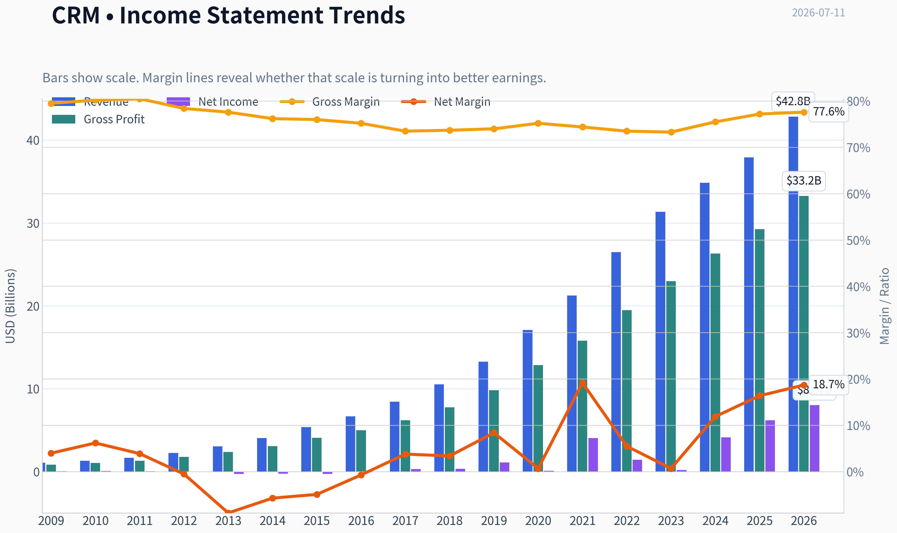

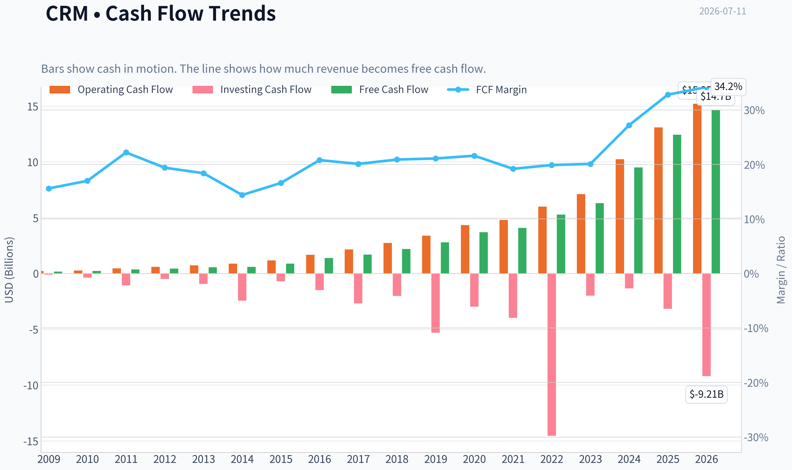

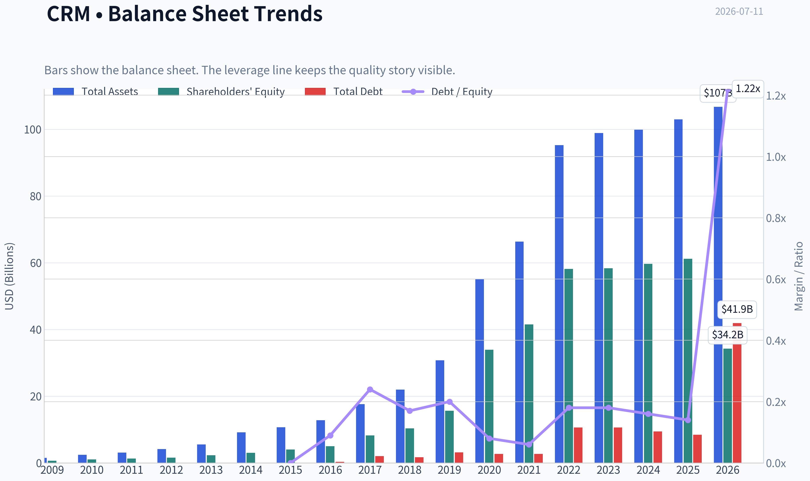

This graph tracks the profitability and return metrics (ROE, ROIC, Margins) of **CRM** over the past decade, highlighting capital efficiency trends.

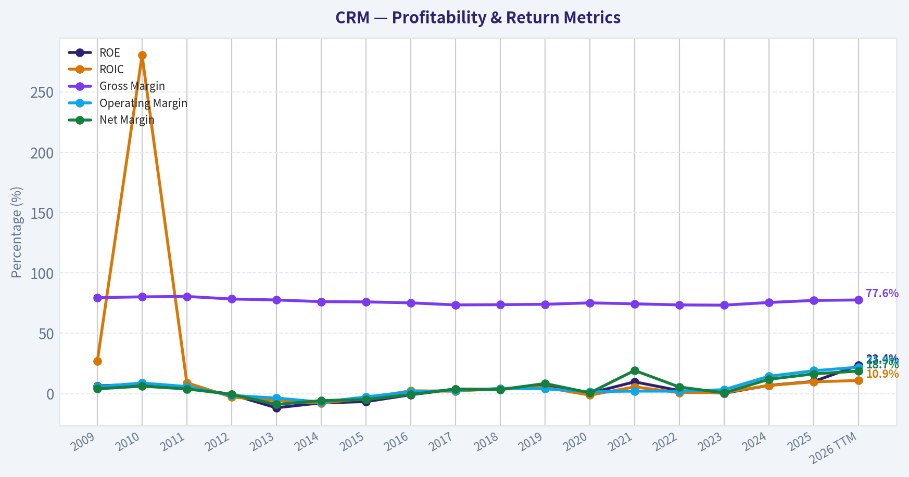

This chart illustrates the financial health of **CRM** over the last 10 years, mapping cash equivalents and free cash flow against total obligations (Debt).

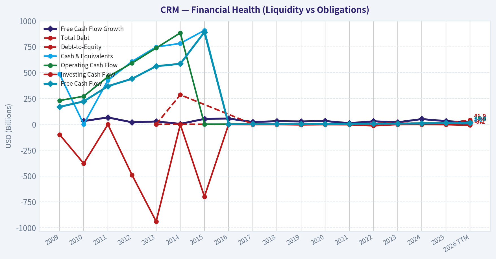

This breakdown chart from <em>Revenue Breakdown</em> shows the proportional composition for **CRM** - useful for understanding what drives or risks the business.

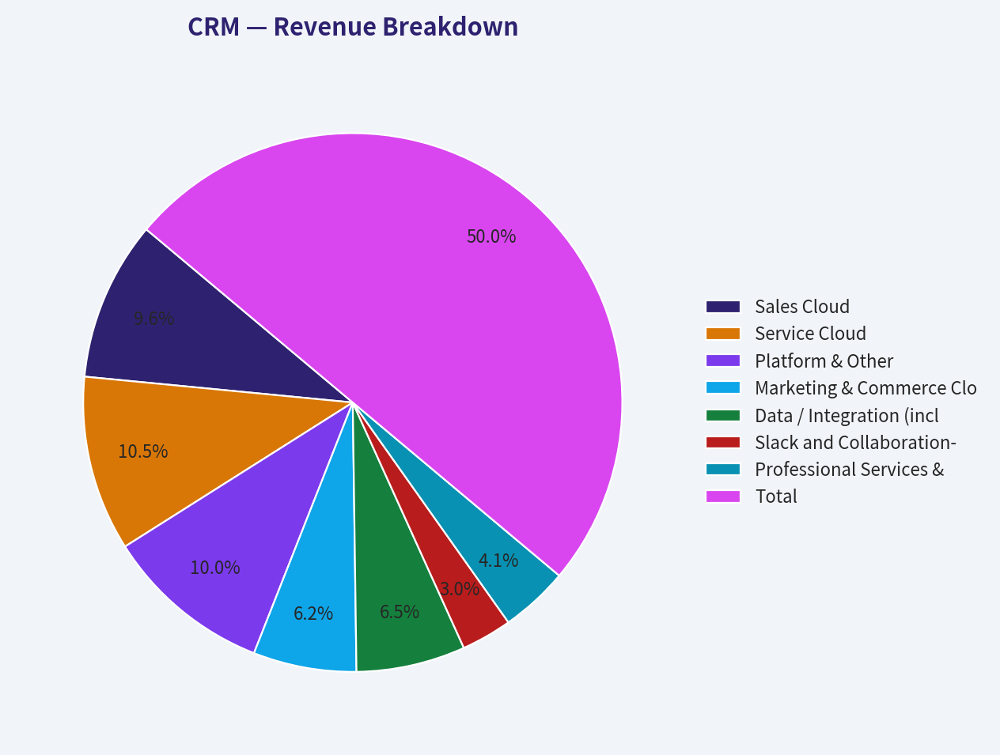

---

### Intrinsic Value Analysis (Buffett)

> *Following Warren Buffett's value investing philosophy: Circle of Competence, Economic Moat, Management Quality, and Margin of Safety.*

#### Intrinsic Value Snapshot

Price is what you pay. Intrinsic value is what the business may be worth based on the cash it can create for owners over time. We show a range, not one magic number.

- Current Price: $163.32
- Value Range (conservative to optimistic across both DCF methods): $206.62 to $969.72

##### Owner Earnings (Buffett Method)
- Net Income: $7,457,000,000.00
- Depreciation & Amortization: $3,631,000,000.00
- Capital Expenditures: $-594,000,000.00
- Working Capital Changes: $-781,000,000.00
- Owner Earnings: $11,275,000,000.00

##### Intrinsic Value
###### Buffett Method
Uses owner earnings. Stricter, and usually more conservative.
- Conservative: $206.62
- Average: $476.01
- Optimistic: $969.72
- Discount Rate: 10.0%

###### Cash Flow Method
Uses free cash flow. Better for companies spending heavily today to grow tomorrow.
- Conservative: $483.42
- Average: $605.55
- Optimistic: $861.23
- Discount Rate: 10.0%

ANALYST STANCE: **WATCH**

#### Salesforce (CRM) Buffett-Style Investment Report

#### 1. Go/No-Go Gate Assessment

| Gate | Verdict | Evidence |
|---|---|---|
| Gate 1: Circle of Competence & Simplicity | Pass | Salesforce sells subscription software that helps companies manage sales, service, marketing, and workflow data. This is understandable, recurring-revenue software with high customer embedding. |
| Gate 2: Moat Test | Pass | Gross margin of 77.7% strongly supports intangible assets and software economics. Customer workflows are deeply embedded, creating switching costs. |
| Gate 3: Management Quality & Capital Allocation | Mixed Pass | Management has improved margin discipline and cash generation, but long-term capital allocation has been uneven due to a history of large acquisitions. Recent posture appears more shareholder-oriented. |
| Gate 4: Industry Structure | Pass with caution | Enterprise software is attractive and asset-light, but competition is intense from Microsoft, Oracle, Adobe, HubSpot, and AI-native vendors. |

**Key Takeaways:** Salesforce passes the basic Buffett filters because the business is understandable, sticky, and highly profitable at the gross margin line. The main caution is not the product itself, but whether management can preserve pricing power and relevance as AI reshapes enterprise software.

---

#### 2. Elementary School Test

Salesforce makes money by charging businesses a recurring fee to use cloud software that helps them track customers, salespeople, service requests, marketing campaigns, and internal workflows.

A decade from now, businesses will still need customer data systems, workflow tools, and analytics. The question is not whether demand exists; it is whether Salesforce remains the preferred platform as AI lowers software switching friction and competitors bundle similar tools.

Technology risk is **moderate**, not extreme. Salesforce benefits from AI adoption if it strengthens its platform, but it also faces real disruption risk if AI makes CRM software simpler, cheaper, or easier to replace.

#### 3. Moat Analysis

| Moat Source | Assessment | Evidence |
|---|---|---|
| Intangible Assets | Moderate | Salesforce is a recognized enterprise software brand with credibility among large organizations. Gross margin at 77.7% indicates strong product economics. |
| Switching Costs | Strong | CRM, sales workflows, customer records, service tickets, and app integrations are deeply embedded in daily operations. Switching is costly in time, retraining, and operational risk. |
| Cost Advantage | Limited | This is not primarily a low-cost producer story. Its advantage is platform breadth and installed base, not the cheapest offering. |
| Network Effects | Modest | The ecosystem, partners, developers, and integrations add value, but this is weaker than consumer-style network effects. |

**Moat Quality Rating: Narrow to Wide-Stable in core accounts**

The moat is driven mostly by **switching costs**, supported by brand and ecosystem. It is durable, but not untouchable. If AI agents reduce workflow complexity and weaken software lock-in, moat width could narrow.

**Key Takeaways:** Salesforce has a real moat, but it is not a classic toll-bridge monopoly. Its strongest defense is that customers build important processes around the platform, making change painful and risky.

---

#### 4. Management Quality & Capital Allocation

| Test | Assessment | Commentary |
|---|---|---|
| Think Like Owners | Mixed | Management has become more margin- and cash-flow-focused, but the historical record includes aggressive dealmaking that diluted the purity of the capital allocation story. |
| Honest & Candid | Fair | The company communicates strategy clearly, though investors have had to push for stronger profitability discipline. |
| Rational Capital Allocation | Mixed | Recent buyback and efficiency efforts are positives. Large acquisitions in prior years raise the hurdle for calling capital allocation excellent. |

Management quality is **adequate but not Buffett-ideal**. The key improvement is operating discipline and free cash flow conversion. The key concern is whether future AI investment and M&A remain disciplined.

**Key Takeaways:** Management is better today than a few years ago from an owner-earnings perspective. Still, this is not a textbook example of flawless capital allocation, so the stock deserves a valuation discount versus the very best software franchises.

---

#### 5. Financial Summary Table

| Metric | CRM |
|---|---:|
| Current Price | $163 |
| Market Cap | $133.76B |
| P/E | 18.95 |
| ROE | 12.6% |
| Gross Margin | 77.7% |
| Revenue Growth YoY | 9.6% |
| FCF Yield | 10.8% |
| Current Ratio | 0.76 |

**Key Takeaways:** Salesforce combines strong margins and strong cash generation with only moderate accounting profitability. The standout figure is free cash flow yield at 10.8%, which suggests the market is valuing the company more cheaply than many software peers.

---

#### 6. Owner Earnings Calculation

Using a practical Buffett-style approximation from the available figures:

| Item | Estimate |
|---|---:|
| Net Income | Implied by P/E and Market Cap: about $7.1B |
| + D&A | Not directly provided |
| - Maintenance CapEx | Not directly provided |
| - Working Capital Increases | Not directly provided |
| Approx. Owner Earnings Proxy | FCF-based proxy: about $14.4B |

Method:
- Net income estimate = Market Cap / P/E = about **$133.76B / 18.95 = $7.1B**
- FCF estimate = Market Cap x FCF yield = about **$133.76B x 10.8% = $14.4B**

For Salesforce, free cash flow is the better practical proxy for owner earnings because subscription software often has modest maintenance capital needs relative to revenue.

**Key Takeaways:** Accounting earnings and cash earnings appear very different for Salesforce, with cash generation materially stronger than net income. That is usually a good sign, provided stock-based compensation and acquisition-related distortions are watched carefully.

---

#### 7. Three-Scenario DCF Valuation

Using owner earnings proxy of **$14.4B**.

| Scenario | Assumption | Equity Value |
|---|---|---:|
| A: No Growth | Owner Earnings / 10% | $144.4B |
| B: GDP Growth | OE x 1.03 / (10% - 3%) | $212.5B |
| C: Historical Growth Lite | 7% growth for 10 years, then 3% terminal | about $226B |

Approximate per-market-cap comparison:

| Scenario | Implied Upside vs $133.76B Market Cap |
|---|---:|
| A: No Growth | about 8% |
| B: GDP Growth | about 59% |
| C: Historical Growth Lite | about 69% |

**Key Takeaways:** Even with conservative assumptions, Salesforce appears at least close to intrinsic value and possibly below it. The valuation case is much stronger if current free cash flow is durable and not temporarily elevated.

---

#### 8. Margin of Safety Analysis

| Scenario | Margin of Safety vs Current Market Cap | Buffett View |
|---|---:|---|
| No Growth | Thin | Not enough for strong conviction |
| GDP Growth | Attractive | Adequate if moat remains stable |
| Historical Growth Lite | Attractive | Depends on AI execution and competitive durability |

At today's price, the stock looks **reasonably priced to moderately undervalued**, but not so obviously cheap that one can ignore execution risk. This is not a "wonderful company at a giveaway price" setup.

#### 9. Final Buffett Scorecard

| Criterion | Score (1-5) | Weight | Weighted Score |
|---|---:|---:|---:|
| Business Understanding | 4.5 | 20% | 0.90 |
| Moat Width & Durability | 3.5 | 25% | 0.88 |
| Management Quality | 3.0 | 15% | 0.45 |
| Return on Equity | 3.0 | 15% | 0.45 |
| Reinvestment Runway | 3.5 | 10% | 0.35 |
| Balance Sheet Strength | 2.5 | 5% | 0.13 |
| Industry Structure | 3.0 | 5% | 0.15 |
| Valuation / Margin of Safety | 3.5 | 5% | 0.18 |

| Total Weighted Score | 3.49 / 5 |
|---|---:|

**Key Takeaways:** Salesforce scores well on understandability, recurring revenue, and cash generation. It misses a higher score because management quality is only mixed, ROE is not elite, and the competitive environment is still intense.

---

#### 10. Investment Stance

**Stance: WATCH**

**Conviction: Moderate**

Salesforce is a good business with real switching costs, excellent gross margins, and strong cash generation. At around 19x earnings and a double-digit free cash flow yield, the stock is not expensive. However, this is not a classic Buffett "table-pounding" case because the moat is not unquestionably widening, management's capital allocation record is mixed, and AI adds uncertainty to long-term pricing power and product stickiness.

A better entry price, clearer proof of durable AI-driven monetization, or stronger evidence of consistently high returns on capital would move this closer to **ADVOCATE**. For now, it belongs on the watchlist rather than in the "buy aggressively" bucket.
#### Valuation Bridge

This bridge places the current market price beside each intrinsic value lens so readers can see whether upside depends on one method or shows up across several methods.

| Scenario | Intrinsic Value / Share |
| --- | ---: |
| Buffett Method | $476.01 |
| Cash Flow Method | $605.55 |
| Damodaran Method | $52.68 |
| Current Price | $163.32 |

#### Key Takeaways

If one method is far above the others, the upside case depends on a specific modelling assumption. When several methods cluster together, the valuation story is more robust.

#### Valuation Visuals

This comparison chart from *Latest Earnings Snapshot* stacks current figures against historical benchmarks for **CRM**, making it easy to see where the company trades relative to its own averages.

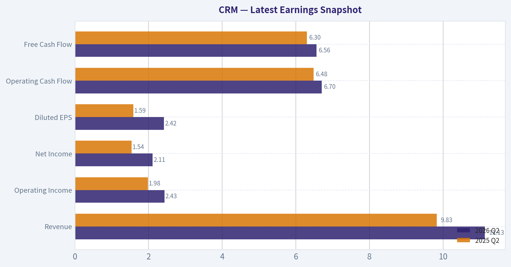

This comparison chart from *Current vs Historical Average Comparison* stacks current figures against historical benchmarks for **CRM**, making it easy to see where the company trades relative to its own averages.

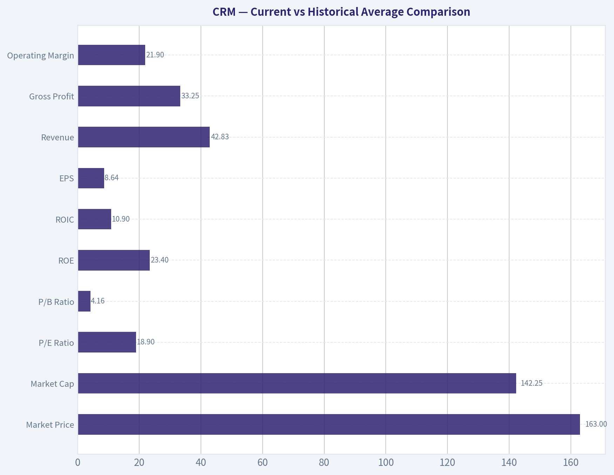

This comparison chart from *Financial Summary Table* stacks current figures against historical benchmarks for **CRM**, making it easy to see where the company trades relative to its own averages.

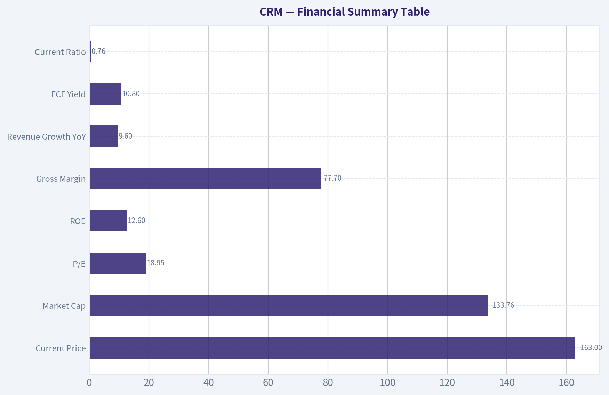

This comparison chart from *Three-Scenario DCF Valuation* stacks current figures against historical benchmarks for **CRM**, making it easy to see where the company trades relative to its own averages.

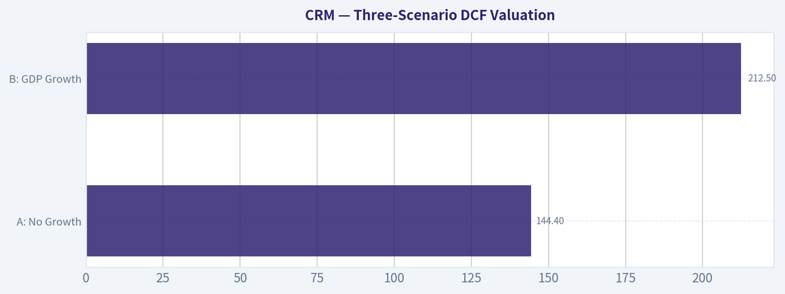

---

### Trend & Growth Analysis (Lynch/Druckenmiller/Fisher)

> *Following Peter Lynch's GARP, Stanley Druckenmiller's macro-aware approach, and Philip Fisher's scuttlebutt methodology.*

ANALYST STANCE: **WATCH**

#### CRM Growth Analysis Snapshot

Salesforce is not a classic Lynch fast grower today. At roughly **9.6% YoY revenue growth**, it screens more like a **stalwart / mature compounder** than a ten-bagger setup from current scale. The bull case rests on **AI/Data Cloud reacceleration plus margin durability**, but current evidence from the shared pack suggests **quality and cash generation are strong while top-line inflection is not yet proven**.

#### 1) Lynch Classification

| Item | Assessment |
|---|---|
| Lynch category | **Stalwart** |
| Revenue growth | **9.6% YoY** |
| Size | Mega-cap, ~$133.8B market cap |
| Growth style | Mature enterprise software platform |
| Ten-bagger odds from here | Low from multiple expansion alone; would require major AI reacceleration and sustained earnings compounding |

**Key Takeaways:** Salesforce no longer fits the classic fast-grower mold that Lynch favored for outsized returns. It is a large, high-quality software franchise with respectable but not explosive growth. That makes it more suitable for quality-at-a-reasonable-price investors than pure growth hunters.

#### 2) The Story in 3 Bullets

| Simple story | Why it matters |
|---|---|
| Salesforce sells mission-critical customer workflow software to enterprises | Sticky recurring revenue with high switching costs |
| It is trying to layer AI, Data Cloud, and automation on top of its installed base | Could raise wallet share and revive growth |
| The stock is supported by strong margins and FCF rather than hypergrowth | Downside may be cushioned, but upside needs clear reacceleration |

**Key Takeaways:** The easy way to explain Salesforce is that it helps companies manage customers, sales, service, and increasingly AI-driven workflows. The main question is whether AI becomes a real growth accelerator or just a feature set that protects the base business. Today, the investment case is more about durable quality than explosive upside.

#### 3) TAM Analysis and 10x Test

| Metric | Estimate / View |
|---|---|
| Current revenue base | Large, roughly mid-$30B annual scale |
| 10x revenue test | ~Would imply >$300B revenue |
| Practical TAM view | Broad CRM + service + marketing + analytics + integration + workflow + enterprise AI TAM is enormous, but 10x from here is unrealistic |
| Runway assessment | **Runway exists for moderate growth, not realistic 10x equity story from current base** |
| TAM inflection source | AI agents, data unification, automation, public sector / regulated verticals |

**Key Takeaways:** Salesforce operates in a very large market, so it still has room to grow. But because the company is already huge, the classic 10x revenue runway test does not really work here. The more realistic opportunity is steady share gains and AI-driven expansion, not venture-style scaling from a small base.

#### 4) Revenue Growth Trend

| Metric | Current read |
|---|---|
| Reported YoY revenue growth | **9.6%** |
| Pattern | **Decelerated vs historical high-growth years** |
| Growth quality | Likely mostly organic recurring subscription growth, but no evidence here of strong acceleration |
| Inflection status | **Not yet confirmed** |
| Read-through from recent news | Dual downgrades tied to AI product concerns suggest skepticism around near-term acceleration |

**Key Takeaways:** Revenue growth is positive but modest for a software company once viewed as a premier growth name. The current pattern does not show the kind of acceleration that Druckenmiller would call an inflection point. Recent analyst downgrades also imply the market is questioning whether AI can meaningfully speed growth soon.

#### 5) Unit Economics / Quality Markers

| Metric | Value / Assessment |
|---|---|
| Gross margin | **77.7%** |
| FCF yield | **10.8%** |
| ROE | **12.6%** |
| Current ratio | **0.76** |
| NRR | Not provided |
| LTV/CAC | Not provided |
| Rule of 40 | Likely healthy given 9.6% growth plus strong FCF profile, but exact FCF margin not provided |

**Key Takeaways:** Salesforce still looks like a high-quality software company based on gross margin and free cash flow strength. The missing unit economics data limits precision, but the business clearly remains economically attractive. Liquidity is fine for a subscription model, though the current ratio is not a special strength by itself.

#### 6) Inflection Point Assessment

| Potential inflection | Evidence | Verdict |
|---|---|---|
| Product cycle inflection | AI / Agentforce / Data Cloud opportunity exists | **Possible, unproven** |
| Market share inflection | No hard evidence in pack | **Unclear** |
| Margin inflection | Prior margin discipline likely real | **Yes, but mostly known by market** |
| TAM inflection | AI expands workflow opportunity | **Yes conceptually** |
| Competitive inflection | Recent downgrade mentions AI product concerns, so not favorable | **No clear positive** |

**Key Takeaways:** The most credible inflection for Salesforce is not current revenue acceleration but the possibility that AI expands the product stack and raises monetization. However, that remains more narrative than evidence today. Margin improvement is real, but that is already visible and less likely to be the source of surprise upside from here.

#### 7) Macro Setup Evaluation

| Factor | Assessment |
|---|---|
| Secular trend exposure | Enterprise AI, cloud software, workflow automation |
| Rate sensitivity | Growth software benefits if rates ease |
| Enterprise spending backdrop | Mixed; budgets remain scrutinized |
| Competitive macro context | Microsoft and other platform vendors are aggressive in AI bundling |
| Macro score | **Neutral to mildly positive** |

**Key Takeaways:** Salesforce has exposure to the right secular themes, especially AI and workflow digitization. But the macro backdrop is only moderately helpful because enterprise software spending remains disciplined and competition is intense. This is not a strong tailwind setup like early-cycle fast-growth software.

#### 8) Fisher 15 Points Score

| Fisher area | Score (1-5) | Comment |
|---|---:|---|
| Market potential | 4 | Large enterprise software + AI adjacencies |
| New product development | 4 | AI and Data Cloud push is active |
| R&D effectiveness | 4 | Strong platform breadth, though AI monetization still debated |
| Sales organization | 5 | Best-in-class enterprise reach |
| Profit margin | 4 | Strong gross margin, improving operating profile |
| Margin improvement | 4 | Proven discipline |
| Labor relations | 3 | Neutral / insufficient specific evidence |
| Executive relations | 3 | Neutral |
| Management depth | 4 | Large seasoned org |
| Cost controls / accounting | 4 | Post-activist discipline improved |
| Special advantages | 4 | Switching costs, ecosystem, installed base |
| Long-range profit outlook | 4 | Solid, if not explosive |
| Dilution risk | 3 | SBC remains a watch item |
| Candor | 3 | Neutral |
| Integrity | 3 | Neutral |
| **Total** | **56 / 75** | **GOOD** |

**Key Takeaways:** Salesforce scores well on product breadth, sales execution, margins, and strategic positioning. It does not score like a pristine Fisher dream stock because growth has matured and AI monetization is still being tested. Overall, it looks like a good business, just not an obvious exceptional-growth outlier.

#### 9) Valuation Analysis

| Metric | Value | Interpretation |
|---|---:|---|
| Price | **$163** | Given |
| Market cap | **$133.76B** | Given |
| P/E | **18.95x** | Reasonable for quality software with cash generation |
| Revenue growth | **9.6%** | Moderate |
| PEG (using revenue growth as rough proxy, imperfect) | **~1.97** | Fair to somewhat expensive on growth basis, but cheap if earnings growth is much faster |
| FCF yield | **10.8%** | Very attractive for software |
| Gross margin | **77.7%** | Supports quality multiple |

**Key Takeaways:** On earnings, Salesforce looks inexpensive relative to many software peers. On growth-adjusted terms, it is not obviously cheap if top-line growth stays around 10 percent. The strongest valuation support comes from free cash flow, which suggests the stock may be more of a cash-compounding value-growth hybrid than a pure high-growth name.

#### 10) Scenario View

| Scenario | 2-3 year setup | Likely market view |
|---|---|---|
| Bear | Growth slips to mid-single digits, AI monetization disappoints, competition intensifies | Stock remains range-bound or derates |
| Base | Growth holds around high-single to low-double digits, margins stay strong, buybacks/FCF support EPS | Respectable compounding |
| Bull | AI/Data Cloud materially reaccelerate growth into low/mid-teens, margins remain firm | Meaningful upside from earnings revisions and rerating |

**Key Takeaways:** The base case for Salesforce is steady, respectable compounding rather than explosive upside. The bull case requires real AI-driven revenue acceleration, not just good presentations and product headlines. Without that acceleration, valuation upside is likely limited.

#### 11) Growth Investor Scorecard

| Criterion | Weight | Score (1-5) | Weighted |
|---|---:|---:|---:|
| The Story | 10% | 4.0 | 0.40 |
| TAM & Runway | 20% | 3.0 | 0.60 |
| Revenue Growth | 20% | 2.5 | 0.50 |
| Unit Economics | 15% | 4.0 | 0.60 |
| Competitive Position | 10% | 4.0 | 0.40 |
| Management Quality | 10% | 3.5 | 0.35 |
| Macro Setup | 5% | 3.0 | 0.15 |
| Profitability Path | 5% | 4.0 | 0.20 |
| Valuation | 5% | 3.5 | 0.18 |
| **Total** |  |  | **3.38 / 5.0** |

**Key Takeaways:** Salesforce lands in the upper end of the watch zone. The company is strong on quality and profitability, but weaker on the most important variable for a growth investor, which is accelerating revenue. That means the stock is investable to monitor closely, but not yet a high-conviction growth advocate call.

#### 12) Position Size Stance

| Stance | View |
|---|---|
| Recommended stance | **WATCH** |
| If already owned | Hold and monitor for AI-led reacceleration, cRPO improvement, and large-customer expansion |
| If not owned | Wait for either clearer growth inflection or a cheaper entry |
| Position sizing | Small starter only for quality/GARP investors; not a concentrated growth position yet |

**Key Takeaways:** Salesforce is good enough to stay on the radar, and possibly in a diversified portfolio, but not strong enough for an aggressive growth-sized position. The missing piece is evidence that AI can actually accelerate the core business. Until then, patience is more attractive than conviction.

#### 13) Key Risks and Catalysts

| Risks | Catalysts |
|---|---|
| AI products fail to materially monetize | Stronger-than-expected AI/Data Cloud adoption |
| Competitive pressure from Microsoft, ServiceNow, HubSpot, Oracle | cRPO acceleration and improved guidance |
| Core CRM growth continues to mature | Large public sector / regulated industry wins |
| SBC or acquisition complexity weighs on per-share value | Continued buybacks and margin durability |
| Negative sentiment from analyst downgrades persists | Proof that Agentforce drives measurable customer ROI |

**Key Takeaways:** The central risk is that Salesforce remains a great company with only average growth. The central catalyst is simple: management must prove that AI products move revenue growth higher, not just preserve relevance. If that proof appears, the stock could rerate quickly because valuation is not demanding.

#### Bottom Line

Salesforce today looks like a **high-quality stalwart, not a classic fast-grower**.
It has:
- strong moat characteristics,
- excellent cash generation,
- reasonable earnings valuation,
- but **no confirmed top-line inflection yet**.

For Lynch-style growth, it is **too slow**.
For Druckenmiller-style inflection investing, the **AI reacceleration case is not yet evidenced**.
For Fisher-style quality, it is **good but not exceptional enough to override the growth slowdown**.

So the right call here is **WATCH**, with a strong focus on the next few quarters for:
1. AI/Data Cloud revenue contribution,
2. cRPO and backlog acceleration,
3. sustained double-digit revenue growth re-emergence,
4. competitive win-rate commentary.

#### Growth & Scorecard Visuals

The radar chart below from *Final Buffett Scorecard* visualises how **CRM** ranks across weighted investment criteria. Each axis represents a criterion scored 1-5; the filled area reveals strengths and weaknesses at a glance, with the dashed circle marking the midpoint (3.0).

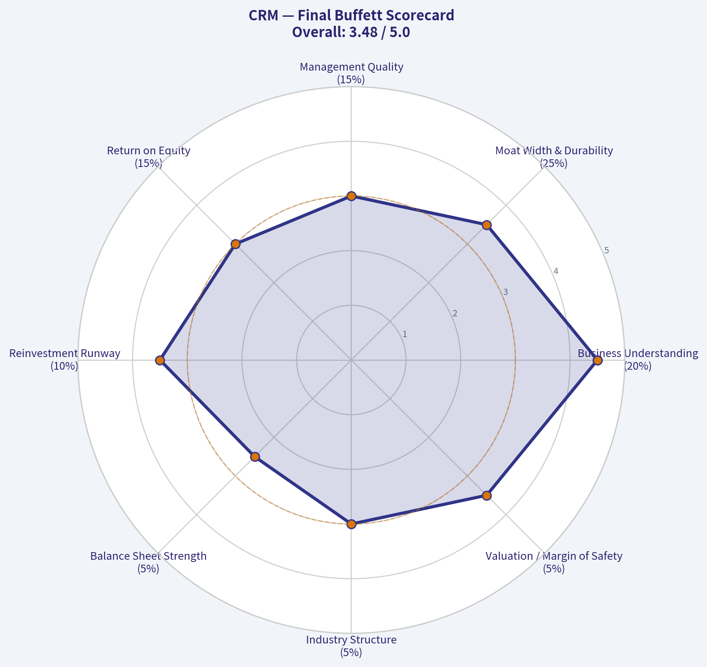

---

### Market Technical Analysis

#### CRM Technical Analysis

Salesforce (CRM) is still in a clear multi-month downtrend, but the stock has also begun to show the first meaningful signs of short-term stabilization after a very deep decline. The most important distinction here is timeframe: the long-term structure remains bearish, the medium-term trend is still weak, but the short-term momentum backdrop has improved materially from late June.

#### Selected indicators and why they fit this setup

For CRM's current condition, the most relevant and non-redundant indicators are:

| Indicator | Why it matters now |
|---|---|
| close_200_sma | Best gauge of the primary trend; confirms whether the larger bear phase is still intact. |
| close_50_sma | Shows medium-term trend health and whether rebounds are becoming durable. |
| close_10_ema | Useful for judging whether the recent bounce still has tactical momentum. |
| macd | Captures the broader momentum turn from June weakness toward early July recovery. |
| macdh | Helps assess whether that recovery is accelerating or already losing steam. |
| rsi | Useful here because CRM sold off hard enough to create oversold/rebound behavior. |
| atr | Important because CRM has been trading with elevated absolute volatility. |
| vwma | Adds volume context, helping determine whether recovery attempts have real participation. |

Key Takeaways: These eight indicators are well-suited to a stock like CRM that is trying to rebound inside a still-bearish larger trend. Together, they separate long-term trend damage from short-term momentum improvement, while also showing whether volatility and volume support a sustainable move.

#### Price structure and trend regime

Over the last year, CRM has moved from the mid-250s into the low-160s, with a particularly aggressive breakdown from early June into mid-June 2026. The stock printed a sharp low near the upper-140s to low-150s area and then staged a recovery back into the mid-160s. That rebound is real, but it has not yet repaired the broader technical damage.

The most important trend evidence is the distance between price and the major moving averages:

- Latest close: about **163.32**
- 10 EMA: about **163.23**
- 50 SMA: about **172.61**
- 200 SMA: about **209.29**

That alignment is very telling. Price is roughly sitting on the 10 EMA, which means the very short-term upturn is now at an inflection point rather than in a strong expansion phase. But price remains well below the 50 SMA and dramatically below the 200 SMA, which confirms that the medium- and long-term trend structure is still decisively bearish.

A subtle but important improvement is that the 10 EMA has turned up from late June into early July. That indicates the rebound has had enough persistence to shift short-term momentum. However, the 50 SMA is still declining steadily, and the 200 SMA is also rolling lower. So even if the stock is basing, it is doing so beneath falling trend resistance.

| Trend Metric | Latest Reading | Interpretation |
|---|---:|---|
| Close | 163.32 | Short-term rebound zone, but still depressed vs longer trend benchmarks |
| close_10_ema | 163.23 | Short-term trend roughly neutral-to-slightly positive |
| close_50_sma | 172.61 | Medium-term trend still bearish; likely resistance overhead |
| close_200_sma | 209.29 | Long-term trend clearly bearish |
| Close vs 50 SMA | -9.29 | Recovery has not yet repaired medium-term trend damage |
| Close vs 200 SMA | -45.97 | Stock remains in a major long-term drawdown structure |

Key Takeaways: CRM is no longer in free fall, but it is still trading below both key trend benchmarks. The stock has improved enough to stabilize in the short run, yet the larger bearish trend remains intact until price can reclaim the 50-day average and eventually challenge the 200-day average.

#### Momentum: improving, but still not fully strong

The MACD picture is one of the most constructive parts of the chart right now. MACD is still negative at roughly **-2.45**, which means the stock remains below a fully healthy momentum state on an intermediate basis. But the more important detail is direction: MACD has improved substantially from around **-8** in late June. That is a major momentum recovery.

The MACD histogram is even more informative. It has turned clearly positive, at roughly **+1.54**, after being deeply negative in late June. That indicates downside momentum has faded and the rebound phase has had real force. In other words, sellers are no longer in complete control.

That said, the histogram appears to have peaked slightly above current levels around July 8-9 and remains positive but less explosive than the earliest rebound burst. This suggests momentum is still improving versus the June lows, but the pace of improvement may be slowing. That often happens when a relief rally runs into its first consolidation.

RSI supports this interpretation. It plunged to around **30** in late June, signaling oversold conditions, and has now recovered to roughly **47.2**. That is a meaningful reset higher, but it is not yet a strong bullish reading. RSI in the mid-to-upper 40s often reflects a rebound that has normalized from oversold, without yet proving strong upside control.

| Momentum Indicator | Latest Reading | Recent Trend | Interpretation |
|---|---:|---|---|
| macd | -2.45 | Rising sharply from late-June lows | Momentum damage is healing, but still below fully bullish territory |
| macdh | +1.54 | Positive and elevated | Rebound momentum remains active, though acceleration may be moderating |
| rsi | 47.16 | Recovered from ~30 oversold zone | No longer oversold, but not yet strong enough to confirm a durable uptrend |

Key Takeaways: CRM's momentum has improved a lot since the June washout, and that is the clearest bullish development on the chart. However, the stock has only recovered to neutral momentum levels, not to the kind of strong readings that usually accompany a confirmed medium-term trend reversal.

#### Volume and participation

VWMA is around **158.52**, which sits below the current price. That is constructive because it suggests the recent traded-price average, weighted by volume, is lower than where the stock now sits. In plain terms, recent buying has been strong enough to lift price above its volume-weighted trend baseline.

This matters because CRM's rebound was not purely on weak participation. The late-May and early-June period included heavy volume around major price movement, and the June 18 washout day was especially extreme. Since then, price recovering above VWMA suggests the market has accepted higher prices than the average volume-weighted level of the recent period.

Still, the gap between current price and VWMA is not huge enough on its own to declare a powerful new bullish phase. It is better read as evidence of stabilization and accumulation after capitulation, not yet a decisive upside breakout.

| Volume Context | Latest Reading | Interpretation |
|---|---:|---|
| vwma | 158.52 | Price above VWMA suggests recent participation supports the rebound |
| Close vs VWMA | +4.80 | Constructive short-term positioning, but not yet decisive trend repair |

Key Takeaways: CRM is trading above its recent volume-weighted average, which is a constructive sign after a sharp selloff. That suggests buyers have been willing to support the stock at somewhat higher levels, though volume confirmation is not yet strong enough to erase the broader bearish structure.

#### Volatility and risk conditions

ATR is about **6.78**, down from above **9** in early June. That decline is significant. It means the stock is becoming less disorderly than it was during the June breakdown. Lower ATR after a panic phase often signals that the market is transitioning from forced selling into a more balanced trading environment.

However, ATR is still elevated in absolute terms for a stock trading around 163. A daily average range near 6.8 implies meaningful movement remains normal. For traders, this means stop placement must still allow for wider swings than usual. Tight stops can easily be shaken out even if the rebound thesis is correct.

This lower-but-still-elevated ATR profile usually favors:
- smaller position sizing,
- wider tactical stops,
- and patience near resistance zones.

| Volatility Indicator | Latest Reading | Prior Extreme | Interpretation |
|---|---:|---:|---|
| atr | 6.78 | >9.0 in early June | Volatility has cooled, but trading risk remains elevated |

Key Takeaways: CRM is less chaotic than it was during the June selloff, which supports the idea of stabilization. But volatility is still high enough that traders should expect sharp swings and size positions more carefully than they would in a calm uptrend.

#### Fine-grained trading read

The most nuanced reading is that CRM is in a **short-term recovery within a longer-term bearish trend**.

That is not a vague "mixed" view; it has specific implications:

1. **The June low likely marked at least a tradable exhaustion point.**
   Oversold RSI, deeply negative MACD, and the subsequent positive histogram reversal all support that.

2. **The rebound is technically credible, but not yet structurally complete.**
   A credible rebound usually gets price above the 10 EMA and VWMA first. CRM has done that. A structurally stronger reversal would next reclaim the 50 SMA. CRM has not done that.

3. **The 172-175 zone looks like the first meaningful resistance band.**
   That area aligns closely with the falling 50 SMA and with the failed bounce region from late June/early July. If price cannot reclaim that zone, this move risks becoming just a bear-market rally.

4. **The 156-158 area now looks like an important near-term support shelf.**
   That region is close to VWMA and recent rebound footing. If CRM loses that area decisively, the market may retest the low-150s.

5. **Momentum is improving faster than trend.**
   This often happens early in basing phases. It is positive for swing traders, but long-horizon investors usually want to see price follow through above medium-term resistance before upgrading the trend outlook.

#### What traders may watch next

| Scenario | Technical Signal to Watch | What It Would Suggest |
|---|---|---|
| Bullish continuation | Close holds above 10 EMA and pushes through 172-175 | Rebound expanding into a more durable trend repair phase |
| Base-building | Price chops between roughly 156 and 172 while MACD stays improving | Consolidation after capitulation, potentially constructive |
| Bearish relapse | Loss of 156 area with RSI rolling back toward 40 and MACD stalling | Rebound failing, risk of retest toward June lows |
| Major trend improvement | Sustained move above 50 SMA, then higher highs | Medium-term downtrend beginning to weaken materially |

Key Takeaways: The next major test for CRM is whether it can break above the low-170s, where falling medium-term resistance sits. If it fails there and slips back below the mid-150s, the recent rebound would start to look more like a temporary relief rally than the start of a durable recovery.

#### Bottom line

CRM is showing real short-term healing after a severe selloff, with improving MACD, a recovered RSI, cooling volatility, and price above VWMA. Those are meaningful positives for tactical traders.

But the larger chart is still damaged. Price remains below a falling 50 SMA and far below the 200 SMA, so the stock is not yet in a confirmed medium- or long-term uptrend. The current setup favors a cautious stance: constructive on short-term stabilization, but still skeptical until CRM can reclaim the low-170s and hold above that zone.

| Category | Current Read | Trading Implication |
|---|---|---|
| Long-term trend | Bearish | 200 SMA remains far above price; strategic trend still weak |
| Medium-term trend | Bearish | 50 SMA declining; rebounds face overhead resistance |
| Short-term trend | Stabilizing / mildly constructive | 10 EMA flattening to rising; price hovering near it |
| Momentum | Improving | MACD and histogram show rebound strength from June lows |
| RSI condition | Neutral after oversold rebound | No longer washed out, but not yet bullishly strong |
| Volume confirmation | Moderately constructive | Price above VWMA suggests better recent participation |
| Volatility | Elevated but easing | Risk has moderated, though swings remain large |
| Key levels | Support 156-158, resistance 172-175 | Break of either zone likely defines next directional move |

Key Takeaways: CRM has transitioned from panic selling into a rebound and stabilization phase, but it has not yet proven that a durable trend reversal is underway. Traders should treat the stock as improving tactically while respecting that the larger bearish trend remains in force until resistance in the low-170s is decisively cleared.

---

### Options Market Analysis

> *Reading options flow - put/call ratios, IV skew, and unusual activity - to gauge institutional positioning and event-driven risk.*

#### CRM Options Positioning Report
*Data as of 2026-07-11*

#### 1. Put/Call Ratio Analysis

| Expiration | Call OI | Put OI | Put/Call OI Ratio | Call Vol | Put Vol | Put/Call Vol Ratio |
|---|---:|---:|---:|---:|---:|---:|
| 2026-07-17 | 114,505 | 56,406 | 0.49 | 14,615 | 7,577 | 0.52 |
| 2026-07-24 | 6,938 | 9,175 | 1.32 | 915 | 1,317 | 1.44 |
| 2026-07-31 | 6,435 | 2,993 | 0.47 | 620 | 962 | 1.55 |
| **Near-term total** | **127,878** | **68,574** | **0.54** | **16,150** | **9,856** | **0.61** |

**Key Takeaways:** Near-term positioning in CRM leans call-heavy overall, with a total put/call OI ratio of 0.54 and volume ratio of 0.61, both below the neutral baseline of roughly 0.7. That suggests the options market is tilted modestly bullish rather than defensively hedged. The main exception is the 2026-07-24 expiry, where put interest is elevated, likely reflecting localized hedging or event-specific caution rather than a broad bearish stance.

**Interpretation**
- **Overall OI ratio of 0.54** is clearly below the neutral ~0.7 baseline and points to a **bullish-to-supportive institutional posture**.
- **Volume ratio of 0.61** confirms that recent activity also favored calls over puts.
- The **07-24 expiration** stands out as a pocket of caution with put-heavy OI and volume, but it is not large enough to overturn the broader call-skewed setup.
- Net message: **sentiment is constructive, though not euphoric**.

---

#### 2. Implied Volatility Assessment

| Expiration | ATM Call IV | ATM Put IV | Call-Put ATM Spread | IV Read |
|---|---:|---:|---:|---|
| 2026-07-17 | 41.2% | 40.4% | +0.8 pts | Elevated/moderately firm |
| 2026-07-24 | 45.2% | 44.3% | +0.9 pts | Elevated |
| 2026-07-31 | 45.8% | 43.7% | +2.1 pts | Elevated with call-side premium |

**Key Takeaways:** Near-term CRM IV is relatively elevated, sitting in the low-to-mid 40s, which signals the market expects meaningful movement over the next few weeks. Notably, ATM call IV is slightly above put IV across all listed expirations, which is unusual compared with a classic fear-driven put premium and suggests some upside demand or call chasing is present.

**IV Skew Interpretation**
- The dataset does **not provide full OTM skew by strike**, so a precise comparison of OTM put IV versus OTM call IV is unavailable.
- However, **ATM call IV exceeds ATM put IV** in all three near-term expirations:
  - 07-17: +0.8 vol points
  - 07-24: +0.9 vol points
  - 07-31: +2.1 vol points
- That pattern implies **mild call-side richness**, which is more consistent with **upside participation demand** than with heavy downside fear.
- Since IV is already in the **41%-46% range**, I would characterize near-term implied volatility as **firm/elevated**, suggesting the market is pricing an active catalyst window or simply higher expected realized volatility.

**Catalyst Flag**
- I do not have a confirmed event calendar in the dataset, so I cannot definitively tie this IV level to earnings or another scheduled catalyst.
- Still, **elevated near-dated IV plus call-rich ATM pricing** usually indicates traders are preparing for a potentially meaningful directional move rather than just passive hedging.

---

#### 3. Unusual Options Activity

| Finding | Result |
|---|---|
| Contracts with volume > 5x open interest | None detected in near-term expirations |

**Key Takeaways:** There is no standout near-term contract showing the classic volume-versus-open-interest signature of a fresh, aggressive institutional bet. That lowers conviction for any single-strike "smart money" read and suggests the current signal comes more from broad positioning patterns than from one obvious outsized trade.

**Interpretation**
- No contracts met the **volume > 5x OI** threshold.
- That means there is **no clear near-term sweep/block-style anomaly** pointing to urgent directional positioning.
- In practice, this reduces the odds that a large trader is making an obvious, concentrated bet in the front expiries.
- So the read here should rely more on:
  - aggregate call-heavy OI,
  - sub-neutral put/call ratios,
  - and call-rich implied vol.

**Smart Money vs. Retail**
- Without unusual volume spikes, it is harder to separate institutional intent from routine flow.
- My bias is that this looks like **broad constructive positioning**, not a loud speculative frenzy.

---

#### 4. Open Interest Concentration

| Expiration | Call OI | Put OI | OI Characterization |
|---|---:|---:|---|
| 2026-07-17 | 114,505 | 56,406 | Dominant near-term OI center; likely strongest pinning influence |
| 2026-07-24 | 6,938 | 9,175 | Smaller but put-heavier; localized hedge pocket |
| 2026-07-31 | 6,435 | 2,993 | Smaller and call-leaning |

**Key Takeaways:** The 2026-07-17 expiry is by far the dominant near-term OI node and likely carries the greatest gamma and pinning influence on CRM stock in the immediate term. Because the tool does not provide strike-level OI concentrations, we cannot identify exact gamma walls, but the sheer size of the 07-17 open interest suggests that expiration should act as the main gravitational zone.

**Interpretation**
- **07-17** is the key expiry to watch; it contains the overwhelming majority of near-term open interest.
- That typically means:
  - stronger dealer hedging effects,
  - greater chance of price pinning near high-OI strikes,
  - and potentially more muted movement unless price breaks away from those concentrations.
- Because **strike-by-strike OI is not available**, I cannot identify:
  - exact max pain,
  - specific support/resistance strikes,
  - or precise gamma walls.
- Still, the **concentration of OI in the nearest expiry** suggests that short-term price action may be heavily influenced by dealer gamma positioning.

---

#### 5. Overall Options Sentiment Signal

| Category | Signal |
|---|---|
| Overall Options Sentiment | **BULLISH** |
| Confidence Level | **Moderate** |
| Primary Driver | Call-heavy aggregate OI and volume, plus call-rich near-term IV |
| Main Caveat | No unusual high-conviction contract flow; one expiry shows localized put hedging |

**Key Takeaways:** CRM's options market leans bullish overall, with call interest outweighing put interest and near-term implied volatility showing a slight upside premium rather than classic downside fear. The signal is not extreme, and confidence is moderate because there is no standout unusual flow, but the balance of evidence still favors a constructive directional read.

**Bottom Line**
I would classify CRM options sentiment as **BULLISH**.

Why:
- **Put/Call OI ratio of 0.54** is well below neutral.
- **Put/Call volume ratio of 0.61** supports that call-leaning posture.
- **ATM IV is elevated but call-rich**, which suggests traders are willing to pay for upside optionality.
- There is **some hedging in the 07-24 line**, but not enough to dominate the bigger picture.

**Caveat**
- Because there is **no unusual contract activity** and **no strike-level OI map**, this is a **moderate-conviction** bullish read, not a high-conviction "institutional whale" setup.
- Also, options positioning is **forward-looking sentiment**, not a valuation signal.

---

#### Summary Table

| Metric | Read |
|---|---|
| Put/Call Ratio | **Bullish** overall; near-term OI ratio 0.54 and volume ratio 0.61, both below neutral |
| IV Level | **Elevated/Firm**; ATM IV ranges from ~41% to ~46% |
| Skew Direction | **Mild call-side skew** at ATM; no evidence here of pronounced downside fear |
| Unusual Activity | **None significant** in near-term expirations; no contracts with volume > 5x OI |
| Overall Signal | **BULLISH** with moderate confidence |

**Key Takeaways:** The options market in CRM is leaning constructive rather than defensive. Call positioning dominates overall, implied volatility is elevated but not panic-driven, and the absence of unusual bearish flow keeps the directional bias pointed to the upside, albeit with only moderate conviction.

---

## Research Team Commentary

> *The Research Manager synthesizes the Bull vs Bear debate into action-free commentary. This is a pre-risk view, not the final stance.*

The strongest bull argument is straightforward: Salesforce is a real franchise, not a story stock. It has high gross margins, deep enterprise embedding, meaningful switching costs, and very strong free cash flow generation. At roughly 19x earnings and about a 10.8% FCF yield, the stock is no longer priced like an expensive SaaS darling. If you believe the installed base is durable, management has genuinely shifted toward discipline, and AI helps defend rather than disrupt the system-of-record position, then today's valuation could understate intrinsic value by a meaningful amount.

The strongest bear argument is that Buffett-style investing is not just about buying "good software at a lower multiple." It is about owning exceptional businesses with durable moats, highly trustworthy capital allocation, and clear excess returns on capital. Salesforce's ROIC around 9.8% and ROE around 12.6% are respectable, but not elite for a mature software platform. Its moat may be more friction-based than pricing-power-based, acquisitions muddy the picture, and the FCF story may flatter true owner earnings if stock comp and working-capital dynamics are doing some of the work. In that framing, CRM is not obviously cheap enough to offset the uncertainty.

My takeaway is that the bull case wins on valuation support and franchise durability, but not decisively enough on business excellence to justify full Buffett-style conviction. This looks more like a good business trading at a reasonable-to-attractive price than a truly wonderful business available at a fat discount. I do think the market may still be leaning too hard on growth deceleration and old management skepticism, but I also think the crowd is right to demand more proof before granting a premium multiple. In past similar situations, the mistake was being too static and not separating tactical dislocation from long-term conviction. Here, even after applying that lesson, the long-term case still lacks the margin-of-safety clarity I would want for an ADVOCATE label.

Core takeaway: Salesforce is a high-quality, cash-generative enterprise software franchise with real switching costs and improving discipline, but it still falls short of top-tier Buffett quality on returns on capital, capital allocation history, and predictability of long-term moat monetization. The stock looks interesting, not irresistible.

Rationale: From a value investing perspective, business quality comes first. CRM clears the bar for quality but not for exceptional quality. The moat exists, yet may be less impregnable than the bull claims as AI, interoperability, and platform competition evolve. Financial strength and cash generation are clearly positives, and valuation is much more compelling than it was in past years. But intrinsic value is only attractive if the cash flows are durable and truly shareholder-owned. That remains good enough to watch closely, but not good enough to underwrite with high conviction today. I do not want to repeat the mistake of dismissing dislocation when fundamentals are intact, but I also do not want to stretch Buffett standards just because the multiple has compressed.

Monitoring plan over the next 1-4 quarters: First, watch revenue growth stability and whether core growth stops decelerating. Second, watch whether AI products produce measurable incremental revenue, larger deal sizes, or stronger net retention-not just customer anecdotes. Third, track operating leverage and whether margin gains hold without starving growth. Fourth, monitor stock-based compensation and net share count to see if buybacks are truly accretive. Fifth, watch ROIC for real improvement; if the moat is strengthening, returns should begin to show it. Sixth, listen for evidence that Data Cloud, Slack, and the broader platform are driving higher wallet share rather than just maintaining complexity. Finally, monitor competitive commentary versus Microsoft, ServiceNow, and AI-native workflows for any sign that Salesforce is losing strategic relevance.

If those indicators improve together, especially ROIC, AI monetization, and real share count reduction, the thesis strengthens materially. If growth keeps slowing, AI remains mostly narrative, and returns on capital stay mediocre, then the stock likely remains a value trap risk masquerading as a bargain.

Final stance: WATCH.

---

## Value Investing Team Commentary

> *The Investor translates the research view into an investment thesis before risk review. This is still not the final stance.*

Salesforce is the sort of business that deserves respect, but not blind admiration. It has a real franchise: deeply embedded enterprise relationships, high switching costs, strong gross margins, and unusually robust free cash flow. Those are the attributes of a business with staying power, not a speculative software name living on hope. At roughly 19x earnings and an implied FCF yield above 10%, the market is no longer valuing CRM as a premium-growth glamour stock. That alone makes it worth serious attention.

The key Buffett-style question, however, is not whether Salesforce is "better than feared." It is whether this is a business you would be delighted to own for the next decade at today's price with high confidence in its earning power. Here the answer is more mixed. The moat is real, but it appears more rooted in customer entrenchment and workflow friction than in extraordinary pricing power or clearly superior capital efficiency. ROIC around 9.8% and ROE around 12.6% are acceptable, but they do not yet signal the kind of exceptional economics that define the very best long-term compounders. In other words, CRM looks like a good business, perhaps a very good one, but not obviously a great business at a bargain price.

The contrarian angle is important. Market sentiment still seems colored by two lingering narratives: first, that Salesforce is an ex-growth software incumbent; second, that management's acquisition history and shifting strategic messaging warrant a persistent discount. There is some truth in both concerns, but markets often overextend these judgments. If growth merely stabilizes, margins remain disciplined, and AI helps reinforce Salesforce's system-of-record role rather than displacing it, then today's valuation could prove too pessimistic. The crowd may be underestimating how valuable a large, sticky installed base becomes when enterprises prefer incremental productivity tools from trusted vendors rather than wholesale workflow replacement.

That said, selective contrarianism is not about buying because sentiment is negative. It is about identifying where the market is wrong. I do not yet see overwhelming evidence that the market is wrong by a wide margin. The skepticism around capital allocation, the need for clearer AI monetization, and the merely solid-not elite-returns on capital are legitimate concerns. A compressed multiple alone is not a margin of safety if owner earnings are less durable than they appear or if stock-based compensation dilutes more of the benefit than headline cash flow suggests.

What matters over the next 1-4 quarters is straightforward. I would want to see revenue growth stabilize, AI products convert from narrative into measurable revenue contribution, operating leverage hold without impairing competitive position, and buybacks produce genuine per-share value creation. Most importantly, returns on capital should improve if the moat is truly strengthening. A business of this scale and quality should eventually show that in the numbers, not just in investor presentations.

So the current setup is interesting. CRM may offer opportunity if the market is extrapolating too much pessimism from slowing growth and stale sentiment. But from a strict value-investing perspective, this still lacks the unmistakable combination of elite business quality and clear margin of safety that would justify strong advocacy. I would rather monitor for proof of strengthening economics than force conviction too early.

**ANALYST STANCE: WATCH**

---

## Deep Values Commentary

> *The Risk Management Team debates and the Risk Judge provides the final action-free verdict. This section determines the final ADVOCATE / WATCH / AVOID stance.*

#### Final Stance Scorecard

This scorecard converts the final research view into a weighted decision frame. It does not replace the narrative judgement, but it makes the main drivers of the verdict easier to scan.

| Criterion | Score | Weight | Commentary |
| --- | ---: | ---: | --- |
| Business Quality | 3.75 | 30% | High returns, profitability, and Piotroski health support durability. |
| Valuation Support | 4.33 | 30% | Blends current price against available intrinsic value anchors and valuation ratios. |
| Financial Strength | 2.67 | 20% | Balance-sheet resilience reflects leverage and liquidity staying within safe ranges. |
| Growth Durability | 4.00 | 20% | Recent revenue, earnings, and free cash flow growth indicate how durable expansion looks. |
| TOTAL / FINAL STANCE | 3.76 | 100% | WATCH |

#### Key Takeaways

The weighted score lands at **3.76 / 5.0**, while the final stance remains **WATCH**. This is useful as a quick calibration aid rather than a mechanical signal.

#### Risk Summary

Higher scores indicate more risk pressure. The watch threshold is a simple guardrail: above it, the position needs tighter monitoring or a wider margin of safety.

| Dimension | Current Score | Watch Threshold | Commentary |
| --- | ---: | ---: | --- |
| Business Quality | 2.25 | 3.00 | High returns, profitability, and Piotroski health support durability. |
| Valuation Support | 1.67 | 3.00 | Blends current price against available intrinsic value anchors and valuation ratios. |
| Financial Strength | 3.33 | 3.00 | Balance-sheet resilience reflects leverage and liquidity staying within safe ranges. |
| Growth Durability | 2.00 | 3.00 | Recent revenue, earnings, and free cash flow growth indicate how durable expansion looks. |

#### Key Takeaways

This view helps readers separate *where* the risk sits: valuation, business quality, balance sheet, or growth durability. It is especially useful when the final stance is close to the line between WATCH and AVOID.
