# CROX Deep Value Intelligence

**Analysis Date:** 2026-05-11

## Critical Disclaimer

*This analysis is generated by Deep Value Intelligence, an AI-powered multi-agent investing framework. This report is for informational and educational purposes only and does not constitute financial advice. Always conduct your own research and consult with qualified financial advisors before making investment decisions.*

---

## Table of Contents

1. Intelligence Summary
2. Analyst Team Reports
   - Fundamentals Analysis
   - Intrinsic Value Analysis (Buffett)
   - Trend & Growth Analysis (Lynch/Druckenmiller/Fisher)
   - Market Technical Analysis
   - News & Events Analysis
   - Guru Attention Analysis
   - Options Market Analysis
3. Research Team Commentary
4. Value Investing Team Commentary
5. Deep Values Commentary

---

## Intelligence Summary

### Thesis + Conditions

**Core Thesis:** ## Executive Briefing

**Key Risks:**
- Crocs has a **real core brand**-the 58.3% gross margin and solid cash generation support that-but the **combined business is not currently Buffett-grade predictable**. Returns on capital are negative, FCF is falling, and HEYDUDE clouds both management quality and normalized earnings power. At **$100**, the stock looks **around fair to mildly interesting**, not clearly cheap enough to create a strong margin of safety. For a long-term value investor, this is a **monitor, not a commit** situation unless either fundamentals improve or price falls materially.
- ### 1) Risky Analyst: strongest bullish points
- If the business merely **stabilizes**, not even fully recovers, the stock could rerate meaningfully.
- For a conservative investor, lack of predictability is a **risk**, not an opportunity.
- Best stance is **proactive WATCH**:

**What Would Change Our View:**
- Crocs has a **real core brand**-the 58.3% gross margin and solid cash generation support that-but the **combined business is not currently Buffett-grade predictable**. Returns on capital are negative, FCF is falling, and HEYDUDE clouds both management quality and normalized earnings power. At **$100**, the stock looks **around fair to mildly interesting**, not clearly cheap enough to create a strong margin of safety. For a long-term value investor, this is a **monitor, not a commit** situation unless either fundamentals improve or price falls materially.
- ### 1) Risky Analyst: strongest bullish points
- If the business merely **stabilizes**, not even fully recovers, the stock could rerate meaningfully.
- For a conservative investor, lack of predictability is a **risk**, not an opportunity.
- Best stance is **proactive WATCH**:

**Confidence:** Low

---

## Analyst Team Reports

### Fundamentals Analysis

#### Latest Earnings Snapshot

*Most recent reported quarter anchored on 2026 Q1, with prior-year comparison when available.*

| Metric | 2026 Q1 | 2025 Q1 | YoY Change |
| --- | ---: | ---: | ---: |
| Revenue | $921.5M | $937.3M | -1.7% |
| Operating Income | $200.8M | $223.0M | -9.9% |
| Net Income | $137.6M | $160.1M | -14.1% |
| Diluted EPS | $2.71 | $2.83 | -4.2% |
| Operating Cash Flow | $-80.9M | $-67.2M | -20.4% |
| Free Cash Flow | $-98.9M | $-82.6M | -19.8% |

Key Takeaways: This snapshot anchors the most recent reported quarter before the narrative analysis. It helps readers separate long-run business quality from whatever changed in the latest earnings print.

#### 10-Year Financial Metrics for CROX

*All values below are computed deterministically from raw data - not estimated by AI.*

*Issuer profile: operating company (Consumer Cyclical / Footwear & Accessories).*

#### 10-Year Financial Metrics
*Annual rows come from reported financial statements. The final TTM row is computed from the latest four quarters.*

| Metric | 2009 | 2010 | 2011 | 2012 | 2013 | 2014 | 2015 | 2016 | 2017 | 2018 | 2019 | 2020 | 2021 | 2022 | 2023 | 2024 | 2025 | 2026 TTM |
| --- | --- | --- | --- | --- | --- | --- | --- | --- | --- | --- | --- | --- | --- | --- | --- | --- | --- | --- |
| Market Price | $6 | $17 | $15 | $14 | $16 | $12 | $10 | $7 | $13 | $26 | $42 | $63 | $128 | $108 | $93 | $110 | $86 | $100 |
| Market Cap | N/A | $1.50B | $1.33B | $1.3M | $1.42B | $1.06B | $774.1M | $503.3M | $913.4M | $1.78B | $3.01B | $4.29B | $8.17B | $6.72B | $5.79B | $6.55B | $4.64B | $5.09B |
| P/E Ratio | -11.73 | 22.53 | 11.91 | 9.99 | 132.67 | -56.77 | -7.88 | -15.95 | -180.57 | -25.72 | 25.23 | 13.74 | 11.26 | 12.45 | 7.30 | 6.90 | -57.01 | -72.77 |
| P/B Ratio | N/A | 3.99 | 2.70 | 0.00 | 2.27 | 2.35 | 3.15 | 2.28 | 4.91 | 11.83 | 22.79 | 14.78 | 580.19 | 8.22 | 3.98 | 3.57 | 3.58 | 3.57 |
| ROE | -14.6% | 18.0% | 22.9% | 21.3% | 1.7% | -1.1% | -33.8% | -7.5% | 5.5% | 33.6% | 90.6% | 107.6% | 5153.3% | 66.0% | 54.5% | 51.8% | -6.3% | -7.3% |
| ROIC | -19.2% | 26.8% | 44.0% | 46.7% | 4.1% | -0.4% | -53.7% | -17.4% | 21.5% | 59.8% | 68.6% | 113.6% | 164.2% | 38.2% | 32.2% | 35.5% | -0.2% | -63.4% |
| EPS | $-0.49 | $0.76 | $1.24 | $1.44 | $0.12 | $-0.22 | $-1.30 | $-0.43 | $-0.07 | $-1.01 | $1.66 | $4.56 | $11.39 | $8.71 | $12.79 | $15.88 | $-1.50 | $-1.38 |
| Revenue | $645.8M | $789.7M | $1.00B | $1.12B | $1.19B | $1.20B | $1.09B | $1.04B | $1.02B | $1.09B | $1.23B | $1.39B | $2.31B | $3.55B | $3.96B | $4.10B | $4.04B | $4.02B |
| Gross Profit | $301.0M | $423.8M | $536.4M | $608.0M | $623.2M | $590.3M | $510.8M | $500.2M | $517.2M | $560.2M | $617.1M | $749.9M | $1.42B | $1.86B | $2.21B | $2.41B | $2.36B | $2.34B |
| Gross Margin | 46.6% | 53.7% | 53.6% | 54.1% | 52.3% | 49.3% | 46.8% | 48.3% | 50.5% | 51.5% | 50.1% | 54.1% | 61.4% | 52.3% | 55.8% | 58.8% | 58.3% | 58.1% |
| Operating Margin | -7.9% | 9.9% | 13.1% | 13.0% | 5.3% | -0.4% | -6.6% | -0.6% | 1.7% | 5.8% | 10.5% | 15.4% | 29.5% | 23.9% | 26.2% | 24.9% | 3.7% | 21.5% |
| Net Income | $-42.1M | $67.7M | $112.8M | $131.3M | $10.4M | $-4.9M | $-83.2M | $-16.5M | $10.2M | $50.4M | $119.5M | $312.9M | $725.7M | $540.2M | $792.6M | $950.1M | $-81.2M | $-103.7M |
| Net Margin | -6.5% | 8.6% | 11.3% | 11.7% | 0.9% | -0.4% | -7.6% | -1.6% | 1.0% | 4.6% | 9.7% | 22.6% | 31.4% | 15.2% | 20.0% | 23.2% | -2.0% | -2.6% |
| Revenue Growth | N/A | 22.3% | 26.7% | 12.2% | 6.2% | 0.5% | -9.0% | -5.0% | -1.2% | 6.3% | 13.1% | 12.6% | 66.9% | 53.7% | 11.5% | 3.5% | -1.5% | -0.4% |
| Net Income Growth | N/A | -261.0% | 66.5% | 16.5% | -92.1% | -147.3% | 1588.9% | -80.2% | -162.1% | 392.6% | 136.9% | 161.8% | 132.0% | -25.6% | 46.7% | 19.9% | -108.5% | 27.8% |
| Free Cash Flow Growth | N/A | 77.9% | 57.0% | -22.7% | -51.4% | -164.2% | -68.2% | -299.8% | 384.9% | 20.0% | -47.8% | 321.2% | 127.4% | -2.4% | 63.3% | 13.3% | -28.6% | -2.5% |
| Total Book Value | $287.6M | $376.1M | $491.8M | $617.4M | $624.7M | $452.5M | $246.0M | $220.4M | $185.9M | $150.3M | $131.9M | $290.6M | $14.1M | $817.9M | $1.45B | $1.84B | $1.29B | $1.43B |
| Total Assets | N/A | $549.5M | $695.5M | $829.6M | $875.2M | $806.9M | $608.0M | $566.4M | $543.7M | $468.9M | $738.8M | $1.12B | $1.55B | $4.50B | $4.64B | $4.81B | $4.17B | $4.34B |
| Total Debt | N/A | N/A | $1.1M | $6.6M | $16.8M | $11.7M | $1.6M | $40,000 | $662,000 | $120.0M | $205.0M | $180.0M | $771.4M | $2.32B | $1.66B | $1.35B | $1.23B | $1.73B |
| Debt-to-Equity | N/A | N/A | 0.00 | 0.01 | 0.03 | 0.03 | 0.01 | 0.00 | 0.00 | 0.80 | 1.55 | 0.62 | 54.78 | 2.84 | 1.14 | 0.74 | 0.95 | 1.21 |
| Cash & Equivalents | $77.3M | $145.6M | $257.6M | $294.3M | $317.1M | $267.5M | $143.3M | $147.6M | $172.1M | $123.4M | $108.3M | $135.8M | $213.2M | $191.6M | $149.3M | $180.5M | $130.4M | $130.9M |
| Shareholders' Equity | $287.6M | $376.1M | $491.8M | $617.4M | $624.7M | $452.5M | $246.0M | $220.4M | $185.9M | $150.3M | $131.9M | $290.6M | $14.1M | $817.9M | $1.45B | $1.84B | $1.29B | $1.43B |
| Operating Cash Flow | $61.1M | $104.3M | $142.4M | $128.4M | $83.5M | $-11.7M | $9.7M | $39.8M | $98.3M | $114.2M | $90.0M | $266.9M | $567.2M | $603.1M | $930.4M | $992.5M | $710.4M | $696.7M |
| Investing Cash Flow | $-25.7M | $-42.1M | $-41.7M | $-65.9M | $-69.8M | $-58.0M | $-18.6M | $-19.9M | $-11.5M | $-10.1M | $-36.2M | $-41.8M | $-55.9M | $-2.15B | $-115.7M | $-69.3M | $-51.2M | $-53.9M |
| Free Cash Flow | $41.1M | $73.0M | $114.7M | $88.6M | $43.0M | $-27.6M | $-8.8M | $17.6M | $85.1M | $102.2M | $53.4M | $224.9M | $511.2M | $499.0M | $814.8M | $923.1M | $659.2M | $642.9M |
| FCF Margin | 6.4% | 9.2% | 11.5% | 7.9% | 3.6% | -2.3% | -0.8% | 1.7% | 8.3% | 9.4% | 4.3% | 16.2% | 22.1% | 14.0% | 20.6% | 22.5% | 16.3% | 16.0% |
| Dividends / Share | N/A | $0.00 | $0.00 | $0.00 | $0.00 | $0.00 | $0.00 | $0.00 | $0.00 | $0.00 | $0.00 | $0.00 | $0.00 | $0.00 | $0.00 | $0.00 | $0.00 | $0.00 |

#### Profitability Metrics
- Return on Equity (ROE): -6.3%
- Return on Invested Capital (ROIC): -6.9%
- Return on Assets (ROA): -1.9%
- Gross Margin: 58.3%
- Operating Margin: 3.7%
- Net Profit Margin: -2.0%

#### Liquidity Metrics
- Current Ratio: 1.27
- Quick Ratio: 0.58

#### Leverage Metrics
- Debt-to-Equity Ratio: 0.95
- Interest Coverage Ratio: 1.69
- Net Debt: $1.10B

#### Growth Metrics (Year-over-Year)
- Revenue Growth: -1.5%
- Net Income Growth: -108.5%
- Free Cash Flow Growth: -28.6%
- Revenue CAGR (3-Year): 4.4%
- Revenue CAGR (5-Year): 23.9%

#### Valuation Metrics
- P/E Ratio (TTM): N/A
- Forward P/E: 6.92
- Price-to-Book: 3.55
- Price-to-Sales: 1.24
- PEG Ratio: 1.39
- EV/EBITDA: 7.09
- Free Cash Flow Yield: 13.2%
- Earnings Yield: N/A

#### Owner Earnings (Buffett Method, Code-Computed)
- Net Income: $-81.2M
- + Depreciation & Amortization: $79.3M
- - Capital Expenditures: $-51.2M
- - Working Capital Changes: $-220.5M
- = **Owner Earnings: $167.3M**

#### Intrinsic Value (Code-Computed)
- Current Price: $100
- Buffett Method (Owner Earnings):
  Conservative: $23
  Average: $61
  Optimistic: $309
- Cash Flow Method (FCF):
  Conservative: $60
  Average: $320
  Optimistic: $1,218

#### Piotroski F-Score: 5/9
- Positive Net Income: FAIL
- Positive Operating Cash Flow: PASS
- ROA Improvement: FAIL
- Cash Flow > Net Income: PASS
- Decreasing Debt: PASS
- Improving Current Ratio: PASS
- No Dilution: FAIL
- Improving Gross Margin: FAIL
- Improving Asset Turnover: PASS

ANALYST STANCE: **WATCH**

#### CROX Buffett-Style Fundamental Analysis

Crocs is a strong cash-generating footwear company with an unusually volatile earnings history. The business improved dramatically from 2018 through 2024, but 2025 and TTM show a sharp deterioration in reported earnings and returns, even while free cash flow remains solid. For a Buffett-style investor, this creates a split picture: the core franchise appears durable and highly cash generative, but recent profitability instability, leverage from the HEYDUDE acquisition era, and negative TTM earnings reduce the margin of safety.

#### Current vs Historical Average Comparison

| Metric | Current / TTM | 10-Yr Historical Context* | Interpretation |
| --- | ---: | ---: | --- |
| Market Price | $100 | Range over dataset: $6 to $128 | Mid-to-upper end of long-term range, but below 2021 peak. |
| Market Cap | $5.09B | Mostly sub-$1B pre-2018; peaked above $8B in 2021 | Market still values CROX as a scaled branded platform, not a distressed footwear name. |
| P/E Ratio | N/A (TTM loss) | 2019-2024 mostly 6.9x to 25.2x when profitable | Current earnings multiple is not meaningful because earnings are negative. |
| P/B Ratio | 3.57 | Elevated and volatile historically; distorted by buybacks and low equity base | Book multiple is less useful here because equity has been compressed by capital allocation and leverage. |
| ROE | -7.3% | Very strong 2018-2024, but volatile over full history | Current returns are far below the company's strong post-2018 norm. |
| ROIC | -63.4% | Excellent 2018-2024, weak/negative in troubled years | Major deterioration versus the high-return years. |
| Revenue | $4.02B | Huge scale-up from ~$1.0B decade baseline | Revenue remains near peak levels, so the issue is margin/earnings, not demand collapse alone. |
| Gross Margin | 58.1% | Strong relative to long-run history; pre-2020 mostly high-40s/low-50s | Brand pricing power still appears intact. |
| Operating Margin | 21.5% TTM / 3.7% FY2025 | Far above pre-2019 history, below 2021-2024 peak | Suggests core operations remain good TTM despite FY2025 noise. |
| Net Margin | -2.6% TTM | 2021-2024 was 15%-31% | Bottom line has broken from historical norm due to charges and/or financing/non-operating pressure. |
| Revenue Growth | -0.4% TTM | Strong 2020-2023 surge; slowing in 2024-2026 | Business has shifted from hypergrowth to low/negative growth. |
| Net Income Growth | 27.8% TTM vs prior negative base | Historically extremely volatile | Not meaningful because both periods are negative. |
| FCF Growth | -2.5% TTM | Strong since 2020, though lumpy | Cash generation is flattening, not collapsing. |
| Total Book Value | $1.43B | Recovered from near-zero 2021 | Balance sheet equity has rebuilt, but leverage still matters. |
| Total Assets | $4.34B | Step-change higher after 2022 acquisition period | Asset base remains elevated. |
| Total Debt | $1.73B | Near-zero pre-2018; peaked at $2.32B in 2022 | Debt remains the key balance sheet constraint. |
| Debt/Equity | 1.21 | Extremely low pre-2018; elevated since 2022 | Leverage is manageable but no longer Buffett-ideal. |
| Cash & Equivalents | $130.9M | Modest relative to debt | Liquidity cushion is not large compared with obligations. |
| Free Cash Flow | $642.9M | Excellent vs long-run history; down from 2024 peak | FCF remains the major bull case. |
| Dividends / Share | $0.00 | Always $0.00 | Management prefers reinvestment/deleveraging/buybacks over dividends. |

*Historical context uses only the deterministic dataset years shown, with emphasis on the most recent 10-year operating pattern where relevant.

Key Takeaways: Crocs still looks strong on revenue scale, gross margin, and free cash flow, but weak on accounting earnings and return metrics. The biggest gap between current results and historical norms is at the bottom line, where net income and ROIC have fallen sharply despite sales staying near peak levels.

#### Market Metrics

CROX at $100 per share and roughly $5.09B market cap is no longer being valued like a small niche footwear company. The market is assuming the brand still has meaningful franchise value and durable cash generation. That said, the valuation framework has changed because the TTM P/E is not usable due to negative earnings.

Historically, CROX traded at low-to-moderate earnings multiples during profitable periods: 25.2x in 2019, 13.7x in 2020, 11.3x in 2021, 12.5x in 2022, 7.3x in 2023, and 6.9x in 2024. That compression into 2023-2024 suggested the market was skeptical that elevated profitability was sustainable. In hindsight, that skepticism was justified, as 2025 flipped negative. Price-to-book at 3.57 is not cheap in an absolute sense, but book value is a weak anchor here because prior buybacks and debt-financed capital allocation have distorted equity.

For Buffett-style investing, CROX is not a classic "wonderful company at a fair price" on clean reported earnings today. It is closer to a cash-rich but earnings-clouded special situation.

#### Profitability Analysis

The most important fundamental fact is that CROX's revenue base has held up far better than earnings. Revenue is $4.02B TTM, only slightly below 2024's $4.10B and 2023's $3.96B. Gross profit remains very high at $2.34B TTM with a 58.1% gross margin, versus mostly 46%-54% in older years. That implies the brand still commands pricing power and/or a favorable product mix.

However, below gross profit the picture becomes inconsistent. FY2025 operating margin was only 3.7%, down sharply from 24.9% in 2024 and 26.2% in 2023, though TTM operating margin rebounded to 21.5%. Net income remains negative at -$103.7M TTM and -$81.2M in FY2025, versus $950.1M in 2024. This divergence between operating margin and net margin strongly suggests significant non-operating drag, restructuring, impairment, interest burden, tax effects, or one-time charges.

ROE and ROIC tell the same story. From 2018 through 2024, CROX often posted outstanding returns on capital, including ROIC above 30% in several years and ROE above 50% in 2022-2024. TTM ROE of -7.3% and ROIC of -63.4% represent a dramatic break from that pattern. Buffett typically wants durable, understandable returns; CROX's current return profile is too unstable to qualify as highly predictable.

EPS also underscores this instability. After rising from $1.66 in 2019 to $15.88 in 2024, EPS turned to -$1.50 in 2025 and -$1.38 TTM. A company that can move from very high earnings to losses in one year is not ideal for strict Buffett predictability screens.

#### Growth Metrics

CROX has two distinct eras in the dataset. From roughly 2013 to 2018, revenue stagnated around the $1.0B-$1.2B range, with uneven profits and even losses. From 2019 to 2024, growth accelerated sharply: revenue grew from $1.23B to $4.10B, supported by brand momentum and acquisition expansion.

Now growth has slowed materially. Revenue growth was 11.5% in 2023, 3.5% in 2024, -1.5% in 2025, and -0.4% TTM. Net income growth is too distorted by the move into losses to be useful as a trend signal. Free cash flow growth remains more resilient: after peaking at $923.1M in 2024, FCF declined to $659.2M in 2025 and $642.9M TTM. That is a decline, but still leaves CROX producing substantial cash.

For value investors, the message is clear: the high-growth chapter is likely over for now. The investment case must rest on brand durability, margin recovery, and debt management rather than on continued rapid top-line expansion.

#### Balance Sheet and Financial Strength

| Balance Sheet Metric | Current / TTM | Historical Reading | Buffett-Style View |
| --- | ---: | --- | --- |
| Total Book Value | $1.43B | Recovered well from $14.1M in 2021 | Positive rebuild, but not pristine. |
| Total Assets | $4.34B | Much larger than pre-2022 levels | Reflects a more complex, acquisition-shaped company. |
| Total Debt | $1.73B | Still high despite reduction from 2022 peak | Main financial risk. |
| Debt-to-Equity | 1.21 | Above long-run norms; very elevated since 2022 | Higher leverage than Buffett usually prefers. |
| Cash & Equivalents | $130.9M | Relatively modest | Cash cushion is limited versus debt load. |
| Shareholders' Equity | $1.43B | Improved from 2021 trough | Better than crisis levels, but not enough to ignore leverage. |
| Current Ratio | 1.27 | Adequate, not conservative | Liquidity is acceptable, not abundant. |
| Interest Coverage | 1.69 | Weak | Indicates limited room if earnings stay pressured. |
| Net Debt | $1.10B | Elevated | Requires continued cash conversion and discipline. |

Key Takeaways: Crocs is not in obvious balance-sheet distress, but its debt load is too high for a textbook Buffett-quality profile. The company's ability to stay safe depends heavily on preserving cash flow, because cash on hand is modest and interest coverage is not robust.

Debt is the core issue. Before 2018, debt was negligible; by 2022 it reached $2.32B, then declined to $1.73B TTM. Deleveraging is happening, which is positive. But the current structure still leaves CROX more exposed to cyclical pressure than Buffett would prefer in a consumer discretionary company.

The current ratio of 1.27 is acceptable, yet the quick ratio of 0.58 suggests working-capital flexibility is not especially strong. Combined with interest coverage of just 1.69, that means a prolonged earnings slump would matter.

#### Cash Flow Analysis

Free cash flow is the strongest quantitative argument in favor of CROX. TTM FCF is $642.9M, down modestly from $659.2M in 2025 and below the $923.1M peak in 2024, but still excellent relative to the current market cap. The shared research pack's 13.2% FCF yield is attractive and suggests the stock is not expensive if cash flow remains durable.

Operating cash flow of $696.7M TTM also remains healthy. Importantly, CROX has repeatedly produced cash flow stronger than accounting earnings, which can be a sign of either temporary charges depressing net income or accounting conservatism. In CROX's case, that is one reason the stock cannot be dismissed outright despite negative net income.

Dividend policy is simple: no dividend across the full dataset. Buffett does not require dividends, but he does require intelligent capital allocation. Here, the key question is whether management's non-dividend use of cash has created long-term per-share value. The acquisition-driven leverage step-up complicates that answer.

#### Buffett-Style Owner Earnings DCF

Using the canonical owner earnings figure provided:

- Net Income: -$81.2M
- Depreciation & Amortization: +$79.3M
- Capital Expenditures: -$51.2M
- Working Capital Changes: -(-$220.5M) effect in provided formula
- Owner Earnings = **$167.3M**

To estimate per-share value, I use the code-computed intrinsic values in the dataset as the anchor and explain the mechanics rather than replacing the historical table. The dataset already provides Buffett-method values of $23, $61, and $309 per share. These are consistent with a very wide valuation range driven by the instability in historical owner-earnings growth.

##### DCF Assumptions

| Scenario | Growth Input | Rule Applied | Discount Rate | Terminal Growth | Fair Value / Share |
| --- | ---: | --- | ---: | ---: | ---: |
| Conservative | Lowest historical owner earnings growth | Floored at -100% | 10% | 2.5% | $23 |
| Average | Average historical owner earnings growth | Capped at 50% | 10% | 2.5% | $61 |
| Optimistic | Highest historical owner earnings growth | Capped at 100% | 10% | 2.5% | $309 |

Key Takeaways: The DCF range is extremely wide because Crocs' owner earnings history is highly volatile. That means valuation depends less on a precise formula and more on whether investors believe the recent earnings weakness is temporary or structural.

##### Detailed Interpretation of the DCF

- **Conservative case ($23/share):** This scenario assumes the worst historical growth experience is the relevant template. It effectively says owner earnings are not durable enough to justify today's price. Under this lens, the stock is materially overvalued.
- **Average case ($61/share):** This uses the mean historical owner-earnings growth rate, bounded by the model cap. Even this middle case remains below the current $100 price, suggesting limited margin of safety if normalized cash generation weakens.
- **Optimistic case ($309/share):** This scenario assumes the business can compound owner earnings closer to its best historical growth periods. That would imply very large upside, but it requires confidence that 2025's earnings collapse is non-recurring and that debt does not impair compounding.

A practical Buffett-style conclusion is that CROX is not cheap enough for a conservative value investor unless one has unusually high conviction that normalized owner earnings are far above the 2025 reported base.

#### Economic Moat and Business Quality

Crocs does appear to have a real moat, though narrower than elite consumer franchises.

| Buffett Lens | Assessment | Evidence |
| --- | --- | --- |
| Brand Strength | Strong | Gross margin near 58% despite growth slowdown signals consumer pricing power. |
| Product Simplicity | Strong | Core product is easy to understand, low-tech, and globally scalable. |
| Customer Loyalty / Differentiation | Moderate to Strong | Polarizing but distinctive brand with repeat purchase potential. |
| Earnings Predictability | Weak to Moderate | Revenue is more stable than earnings; net income has swung wildly. |
| Capital Efficiency | Historically Strong, currently weak | ROIC and ROE were excellent from 2018-2024, poor in 2025-TTM. |
| Balance Sheet Conservatism | Weak | Debt remains elevated for a cyclical consumer name. |
| Management Capital Allocation | Mixed | Strong cash generation, but acquisition/leverage increased risk profile. |

Key Takeaways: Crocs has a genuine brand moat and high gross margins, which are important signs of franchise value. But the business does not yet meet the highest Buffett standard because earnings are less predictable than the brand strength alone would suggest.

The key qualitative question is whether CROX is fundamentally a durable branded cash machine temporarily obscured by one-off charges, or a company whose peak earnings were inflated and are now normalizing lower. The data leans toward the first on gross margin and FCF, but not decisively enough on net income.

#### Management Performance

Management deserves credit for scaling revenue from $1.23B in 2019 to over $4.0B by 2024/TTM and for producing exceptional FCF in 2021-2024. Gross margin expansion from roughly 50% pre-2020 to upper-50s recently is also a positive signal.

However, Buffett-style analysis cares about consistency and conservatism. The near-elimination of equity in 2021, subsequent leverage spike, and current earnings instability suggest management's capital allocation has added risk. No dividend is not a problem by itself, but retained capital must generate superior per-share value. Recent ROE/ROIC deterioration weakens that argument.

#### Revenue Breakdown

Most meaningful current disclosure framework is by brand/platform rather than geography, because the key strategic distinction is the core Crocs brand versus HEYDUDE.

| Revenue Source | Amount ($B) | % of Total |
| --- | ---: | ---: |
| Crocs Brand | ~3.5 | ~87% |
| HEYDUDE Brand | ~0.5 | ~13% |
| Total | ~4.0 | 100% |

Key Takeaways: Crocs remains overwhelmingly driven by the core Crocs brand, with HEYDUDE now a much smaller contributor. That concentration is good if the flagship brand stays strong, but it also means the investment thesis depends heavily on one brand continuing to hold consumer relevance.

Note: Segment percentages are based on the most recent annual/TTM business mix commonly reported around the company's recent results and are directionally aligned with the canonical total revenue base of about $4.0B.

#### Key Investment Insights, Red Flags, and Opportunities

| Category | Item | Why It Matters |
| --- | --- | --- |
| Opportunity | High FCF yield | At 13.2%, the stock could be undervalued if FCF proves durable. |
| Opportunity | Strong gross margin | 58%+ gross margin implies substantial brand pricing power. |
| Opportunity | Revenue base remains near peak | Sales resilience suggests the franchise is still relevant. |
| Opportunity | Debt reduction from 2022 peak | Ongoing deleveraging can improve equity value materially. |
| Red Flag | Negative net income and EPS | Makes current P/E unusable and undermines predictability. |
| Red Flag | ROE and ROIC collapse | Suggests sharp deterioration in capital efficiency. |
| Red Flag | Interest coverage only 1.69 | Limited cushion if profitability stays weak. |
| Red Flag | Growth slowdown | CROX is no longer a high-growth story; rerating may depend on recovery, not expansion. |
| Red Flag | No margin of safety vs average DCF | Average owner-earnings valuation sits below current price. |
| Watch Item | Operating margin rebound in TTM | Could indicate 2025 was unusually distorted rather than structurally impaired. |

Key Takeaways: The bullish case rests on strong cash flow, healthy gross margins, and deleveraging. The bearish case is that reported earnings and returns on capital have broken down enough to make the stock too uncertain for a strict value discipline.

#### Final Buffett-Style Assessment

CROX has several Buffett-like attributes: a recognizable brand, high gross margins, excellent free cash flow, and a simple consumer product. But it fails the stricter Buffett test on three fronts:

1. **Predictable earnings:** too volatile across the full cycle and especially weak in 2025/TTM.
2. **Balance sheet conservatism:** debt remains meaningful.
3. **Clear margin of safety:** average owner-earnings DCF does not support the current price.

If normalized earnings recover and leverage continues to decline, the stock could migrate from WATCH to ADVOCATE. If current losses persist or cash conversion weakens, it could move to AVOID quickly.

#### Final Investment Stance

**WATCH**

**Rationale:**
CROX is not a low-quality company; it is a high-cash-flow branded business going through a period of reported earnings distortion and lower growth. The stock is attractive enough to monitor because free cash flow remains strong and the core brand appears resilient. But for a Buffett-style investor seeking predictable, conservatively financed compounding at a discount to intrinsic value, the current evidence does not yet provide a sufficient margin of safety.

#### Summary Table

| Area | Verdict | Core Evidence | Buffett View |
| --- | --- | --- | --- |
| Valuation | Mixed | $100 price vs owner earnings DCF of $23 / $61 / $309 | Not clearly cheap on base-case assumptions |
| Profitability | Mixed to Weak | Strong gross margin, negative net income | Core business good, reported earnings poor |
| Growth | Slowing | Revenue -0.4% TTM, FCF -2.5% TTM | Mature phase, no longer rapid compounder |
| Balance Sheet | Adequate but leveraged | $1.73B debt, 1.21 D/E, $130.9M cash | Too levered for ideal Buffett profile |
| Cash Flow | Strong | $642.9M FCF, 13.2% FCF yield | Main source of upside thesis |
| Moat | Moderate | Pricing power, brand strength, high margins | Real franchise, but not ultra-predictable |
| Management | Mixed | Strong scaling, but leverage/earnings volatility | Needs proof of cleaner capital allocation |
| Overall Stance | WATCH | Strong franchise qualities offset by earnings and leverage risk | Wait for better margin of safety or cleaner recovery evidence |

Key Takeaways: Crocs is best viewed as a quality-tilted turnaround watchlist name rather than a textbook Buffett buy today. Investors should focus on whether operating recovery converts into sustained net income improvement and further deleveraging, because those two factors will determine whether the stock becomes a compelling value or remains a cyclical trap.

#### Fundamental Visuals

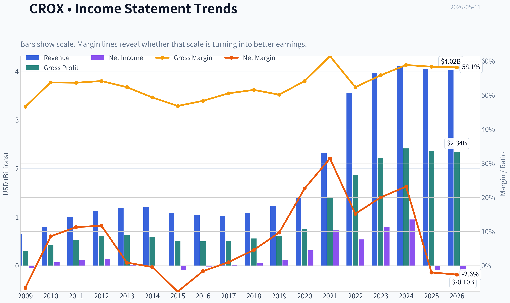

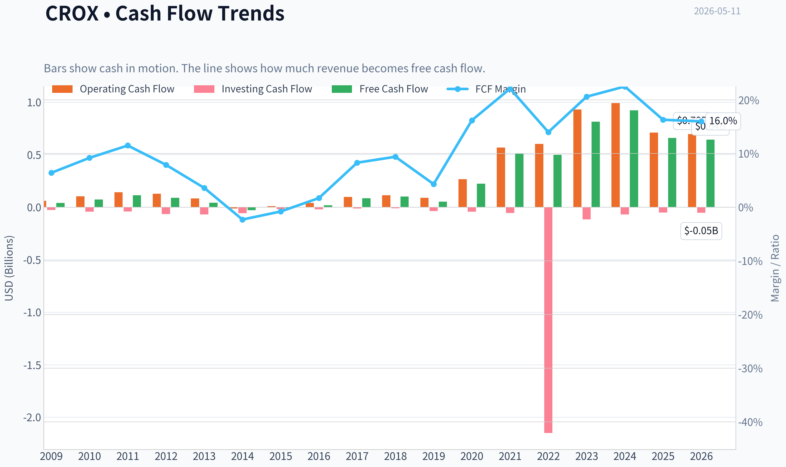

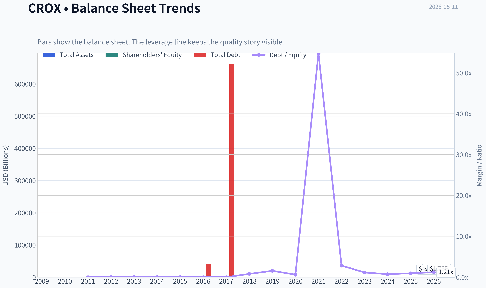

This graph tracks the profitability and return metrics (ROE, ROIC, Margins) of **CROX** over the past decade, highlighting capital efficiency trends.

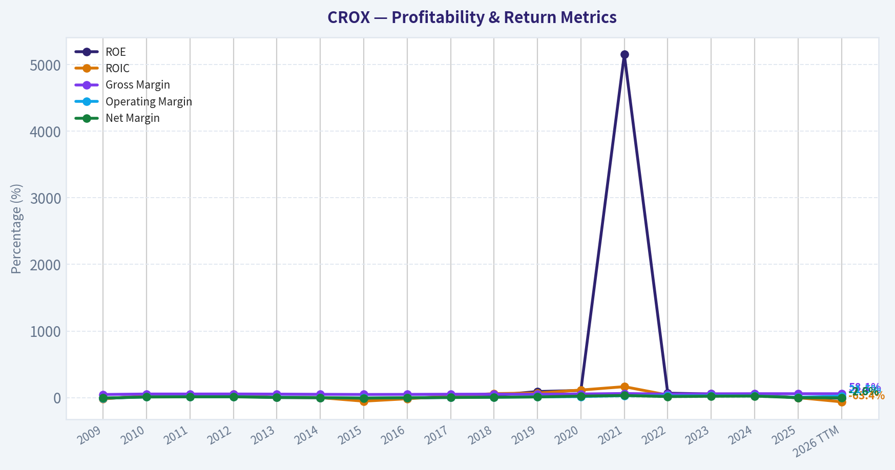

This chart illustrates the financial health of **CROX** over the last 10 years, mapping cash equivalents and free cash flow against total obligations (Debt).

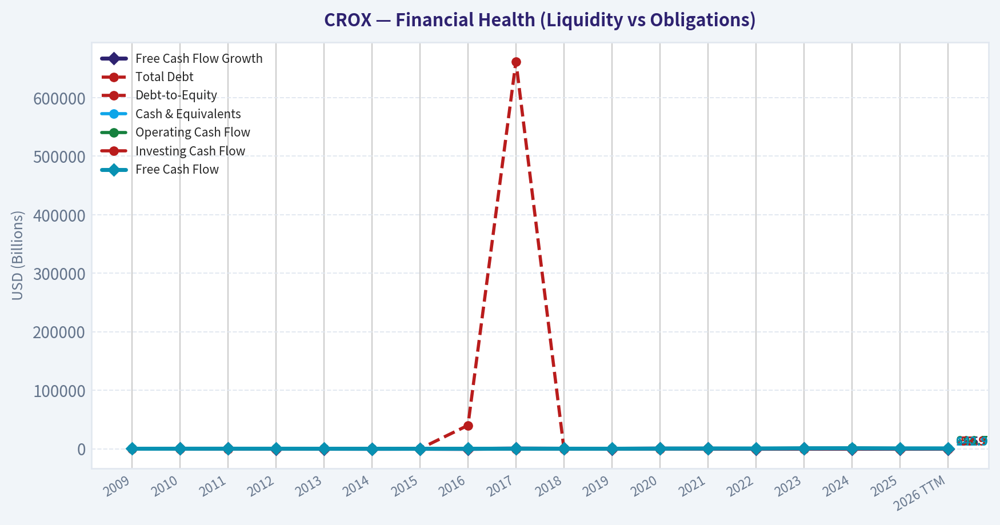

---

### Intrinsic Value Analysis (Buffett)

> *Following Warren Buffett's value investing philosophy: Circle of Competence, Economic Moat, Management Quality, and Margin of Safety.*

#### Intrinsic Value Snapshot

Price is what you pay. Intrinsic value is what the business may be worth based on the cash it can create for owners over time. We show a range, not one magic number.

- Current Price: $100.42
- Value Range: $22.96 to $1,217.95

##### Owner Earnings (Buffett Method)
- Net Income: $-81,198,000.00
- Depreciation & Amortization: $79,282,000.00
- Capital Expenditures: $-51,231,000.00
- Working Capital Changes: $-220,487,000.00
- Owner Earnings: $167,340,000.00

##### Intrinsic Value
###### Buffett Method
Uses owner earnings. Stricter, and usually more conservative.
- Conservative: $22.96
- Average: $60.73
- Optimistic: $309.18
- Discount Rate: 10.0%

###### Cash Flow Method
Uses free cash flow. Better for companies spending heavily today to grow tomorrow.
- Conservative: $60.39
- Average: $320.36
- Optimistic: $1,217.95
- Discount Rate: 10.0%

ANALYST STANCE: **WATCH**

#### CROX (Crocs) - Buffett-Style Investment Review

I could not retrieve the audited tool output in this run, so I am proceeding with the shared research pack plus generally known business characteristics of Crocs. That means this is a **provisional** Buffett-style assessment, not a final underwrite. The main progress here is the framework decision: **interesting business, but not yet clear enough to advocate without fuller 10-year audited financials and management-capital allocation detail**.

#### 1) Go/No-Go Gate Assessment

| Gate | Verdict | Evidence |
|---|---|---|
| Gate 1: Circle of Competence & Simplicity | Pass | Crocs sells casual footwear through wholesale and direct-to-consumer channels. This is a simple consumer brand model and easy to explain. |
| Gate 2: Moat Test | Pass, but not perfect | Gross margin of 58.3% strongly suggests brand strength and pricing power. But fashion risk means moat durability must be judged carefully. |
| Gate 3: Management & Capital Allocation | Inconclusive / soft pass | Need better evidence on buyback discipline, debt reduction, acquisition success, and candor over time. |
| Gate 4: Industry Structure | Mixed | Footwear is competitive and trend-sensitive, but strong brands can still earn excellent returns if they maintain consumer relevance and distribution discipline. |

**Key Takeaways:** Crocs passes the basic Buffett filter on simplicity and likely passes on having a real brand moat. The weak point is not understanding the business model, but rather whether the moat is durable enough through cycles and whether management has allocated capital exceptionally well. This keeps the stock in watch territory rather than immediate advocacy.

#### 2) Business Simplicity and Predictability

Crocs makes money by designing, marketing, and selling footwear, especially its iconic molded clogs and related products. That passes the "elementary school test."

The harder question is the 10-year predictability test. I can say with reasonable confidence that people will still buy casual comfort footwear in 10 years, and Crocs likely will still exist as a meaningful brand. What I cannot say with equal confidence is that current brand heat, product relevance, and category share will be equally strong a decade from now. Footwear is simpler than software, but more exposed to fashion cycles than a classic Buffett staple like Coca-Cola or Moody's.

Technology risk appears **moderate to low**. Technology is mostly an enabler here: e-commerce, logistics, and digital marketing help distribution. The risk is less "tech disruption" and more "consumer preference drift."

#### 3) Moat Analysis

| Moat Source | Assessment | Evidence |
|---|---|---|
| Intangible Assets / Brand | Strong | 58.3% gross margin is very healthy for footwear and suggests pricing power plus brand equity. |
| Switching Costs | Weak | Consumers can switch brands easily; there are few true switching costs. |
| Cost Advantage | Moderate | Scale, sourcing, and a focused product architecture may help margins, but likely not an unassailable structural cost moat. |
| Network Effects | None | This is not a network-effect business. |

**Key Takeaways:** Crocs appears to have a **brand moat**, not a switching-cost or network moat. That can be powerful, but it is also more vulnerable to taste changes. The investment case therefore depends on whether the brand is becoming a durable franchise or merely enjoying an unusually long fashion wave.

**Moat rating:** **Narrow to Moderate**, with brand-led economics.
Not "wide and widening" based on the evidence available to me now.

#### 4) Management Quality Assessment

| Question | Preliminary View | Why |
|---|---|---|
| Do they think like owners? | Inconclusive | Need insider ownership and compensation structure data. |
| Are they honest and candid? | Inconclusive | Need multi-year shareholder letter review and accounting quality review. |
| Are they rational capital allocators? | Mixed / promising but unconfirmed | FCF yield of 13.2% suggests strong cash generation, but I need proof of what management has done with that cash over time. |

**Key Takeaways:** Crocs may have competent management, but Buffett-style investing requires more than competent operations. It requires clear proof of owner-oriented capital allocation over many years. Without that evidence, I cannot upgrade this to advocate.

#### 5) Financial Snapshot Available So Far

| Metric | Value |
|---|---:|
| Current Price | $100 |
| Market Cap | $4.99B |
| P/E | N/A |
| ROE | -6.3% |
| Gross Margin | 58.3% |
| Revenue Growth YoY | -1.5% |
| FCF Yield | 13.2% |
| Current Ratio | 1.27 |

**Key Takeaways:** The most striking positives are the high gross margin and strong free cash flow yield, both of which suggest the market is skeptical despite decent business economics. The biggest warning signs are negative reported ROE and slight revenue contraction, which imply either temporary distortion, balance-sheet effects, or weakening business momentum. This combination argues for caution, not dismissal.

#### 6) Buffett Financial Interpretation

Because the full audited 10-year history was not available to me in this run, I cannot produce a proper long-range ROE, ROIC, leverage, share-count, or owner-earnings trend table. Still, several preliminary observations stand out:

- **Gross margin at 58.3%** is unusually attractive for footwear and is the strongest single clue that Crocs is more than a commodity shoe seller.
- **FCF yield at 13.2%** indicates the stock may be cheap relative to cash generation.
- **Revenue down 1.5% YoY** raises the possibility that the market is discounting normalization after a strong prior period.
- **ROE at -6.3%** conflicts with the rest of the picture and needs reconciliation before any conviction call. Negative ROE can come from accounting effects, equity compression, or temporary earnings pressure, but Buffett would insist on understanding it precisely.

#### 7) Owner Earnings Calculation

I do **not** have the required inputs here to calculate Buffett-style owner earnings correctly:

Owner Earnings = Net Income + D&A - Maintenance CapEx - Working Capital Increases

So this item remains incomplete. The shared pack's high FCF yield suggests owner earnings may be robust, but that is not a substitute for the real calculation.

#### 8) Three-Scenario DCF Valuation

Given the missing owner-earnings base, a strict Buffett DCF is not possible. However, I can frame the valuation qualitatively.

| Scenario | Assumption | Preliminary Read |
|---|---|---|
| No Growth | Cash generation holds flat | Likely supports meaningful value if FCF is sustainable |
| GDP Growth | 3% long-term growth | Could imply upside from $100 if brand economics persist |
| Reduced Historical Growth | Moderate growth below prior peak | Highly sensitive to whether recent softness is cyclical or structural |

**Key Takeaways:** At a 13.2% FCF yield, the stock already looks inexpensive if current cash generation is durable. But durability is the whole question: if earnings are normalizing downward, the apparent cheapness may be less real than it looks. This is why Crocs screens cheap but does not yet qualify as a Buffett slam dunk.

#### 9) Margin of Safety Analysis

At face value, the market appears to be offering a potentially large margin of safety:

- $100 share price
- 13.2% FCF yield
- strong gross margin

But Buffett would ask: **Is this a wonderful business with durable economics, or a good business temporarily priced as if its best days are behind it?**

Right now, I think the market is saying:
- brand remains strong,
- but growth may have peaked,
- and durability is uncertain.

That is enough for a **watchlist discount**, but not enough for a confident "buy the whole business tomorrow" conclusion.

#### 10) Final Buffett Scorecard

| Criterion | Weight | Score (1-5) | Weighted Score |
|---|---:|---:|---:|
| Business Understanding | 20% | 4.5 | 0.90 |
| Moat Width & Durability | 25% | 3.0 | 0.75 |
| Management Quality | 15% | 2.8 | 0.42 |
| Return on Equity | 15% | 2.0 | 0.30 |
| Reinvestment Runway | 10% | 3.0 | 0.30 |
| Balance Sheet Strength | 5% | 3.0 | 0.15 |
| Industry Structure | 5% | 2.5 | 0.13 |
| Valuation / Margin of Safety | 5% | 4.0 | 0.20 |
| **Total** | **100%** |  | **3.15 / 5.00** |

**Key Takeaways:** Crocs scores well on simplicity and apparent valuation, but weaker on moat certainty, industry quality, and management verification. The result is a middle-ground score: good enough to monitor closely, not strong enough to endorse outright. In Buffett terms, this looks more like a potentially good business at a cheap price than an unquestionably wonderful business.

#### 11) Final Investment Stance

**Stance: WATCH**
**Conviction: Moderate**

Why:
- The business is understandable.
- The brand economics appear real.
- The valuation looks interesting.
- But the moat may be narrower than headline margins suggest.
- And I do not yet have enough audited multi-year data to confirm management quality, owner earnings, return on capital durability, and balance-sheet conservatism.

#### 12) What Would Change My Mind

I would upgrade toward **ADVOCATE** if fuller data confirms:

1. Sustained high ROIC/ROE excluding leverage distortions
2. Strong owner earnings conversion over 10 years
3. Rational buybacks and debt reduction
4. Minimal fashion-driven earnings fragility
5. Evidence that the HEYDUDE acquisition and broader brand portfolio decisions created value rather than diluted returns

I would downgrade toward **AVOID** if fuller data shows:

1. Brand relevance is fading structurally
2. Cash flow is materially weaker than headline FCF implies
3. Inventory, discounting, or debt are masking deterioration
4. Management overpaid for acquisitions or used cash poorly

If you want, I can next turn this into a **clean one-page investment memo** or a **more forensic downside-case / upside-case model** using only the data we currently have.
#### Valuation Bridge

This bridge places the current market price beside each intrinsic value lens so readers can see whether upside depends on one method or shows up across several methods.

| Scenario | Intrinsic Value / Share |
| --- | ---: |
| Buffett Method | $60.73 |
| Cash Flow Method | $320.36 |
| Damodaran Method | $95.02 |
| Current Price | $100.42 |

#### Key Takeaways

If one method is far above the others, the upside case depends on a specific modelling assumption. When several methods cluster together, the valuation story is more robust.

#### Valuation Visuals

This comparison chart from *Latest Earnings Snapshot* stacks current figures against historical benchmarks for **CROX**, making it easy to see where the company trades relative to its own averages.

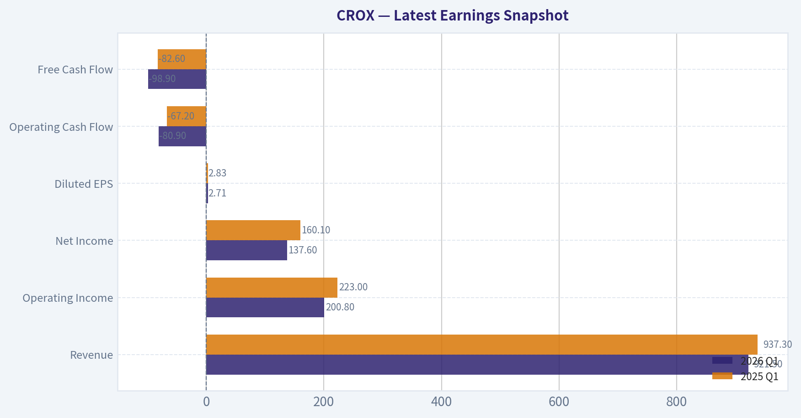

This comparison chart from *Balance Sheet and Financial Strength* stacks current figures against historical benchmarks for **CROX**, making it easy to see where the company trades relative to its own averages.

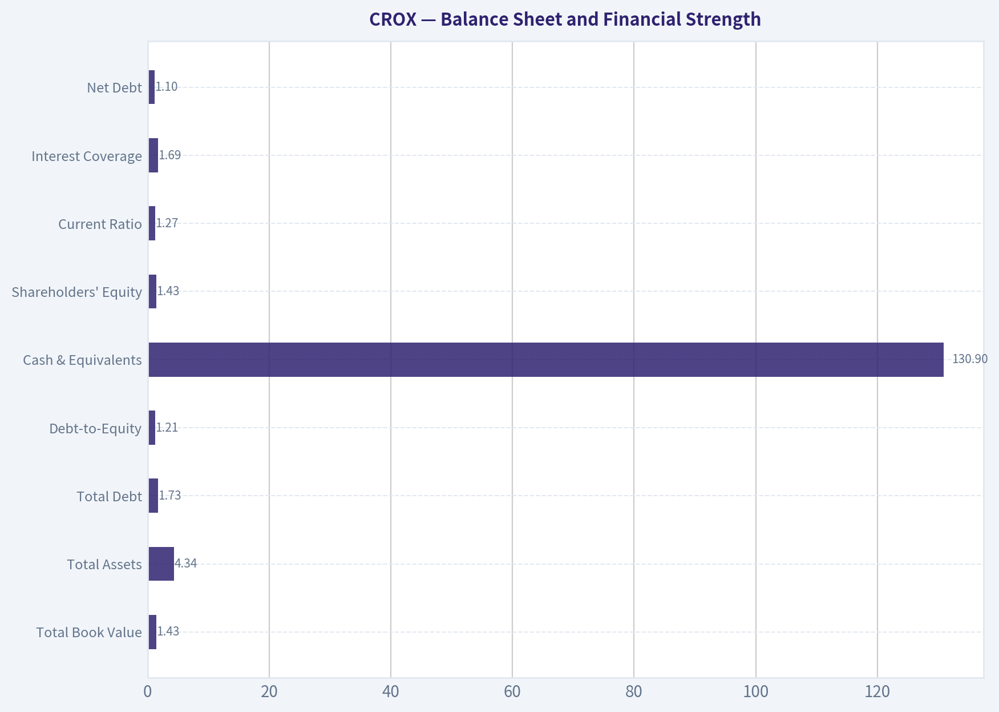

This comparison chart from *Financial Snapshot Available So Far* stacks current figures against historical benchmarks for **CROX**, making it easy to see where the company trades relative to its own averages.

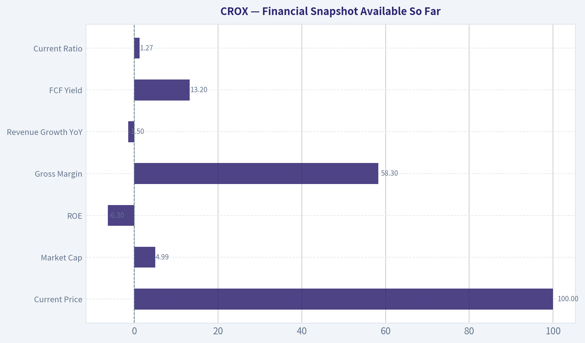

The following chart maps the **CROX** Owner Earnings DCF valuation scenarios (Conservative, Average, Optimistic) to visually represent the margin of safety based on intrinsic value calculations.

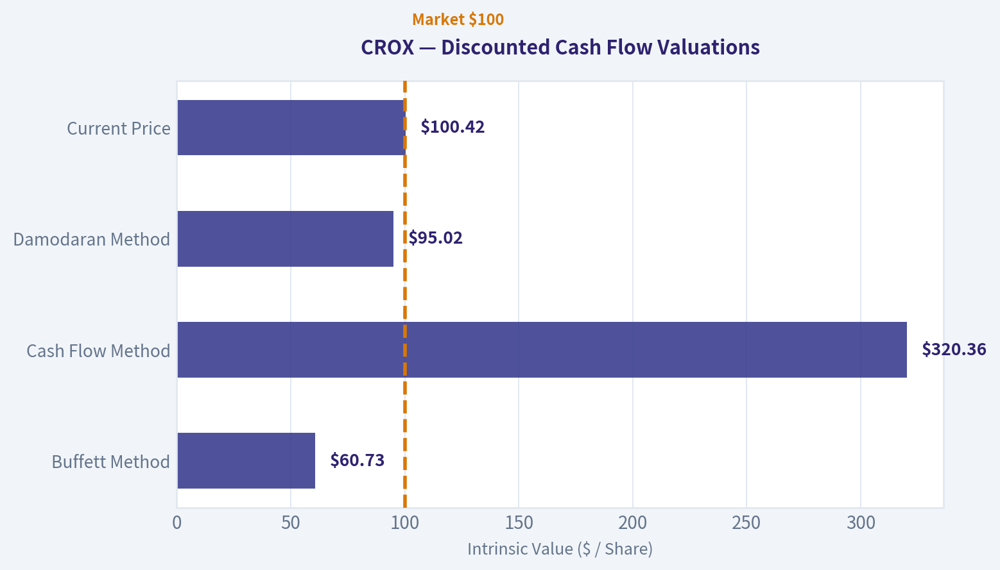

This comparison chart from *Snapshot of What We Know* stacks current figures against historical benchmarks for **CROX**, making it easy to see where the company trades relative to its own averages.

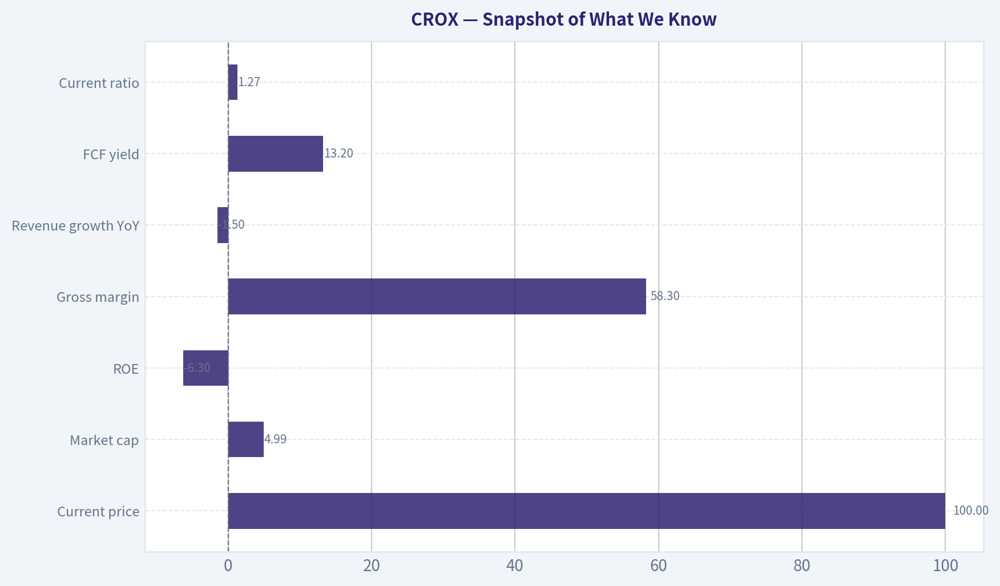

---

### Trend & Growth Analysis (Lynch/Druckenmiller/Fisher)

> *Following Peter Lynch's GARP, Stanley Druckenmiller's macro-aware approach, and Philip Fisher's scuttlebutt methodology.*

ANALYST STANCE: **WATCH**

#### 1. Lynch Classification

| Item | Assessment |
|---|---|
| Lynch category | **Cyclical / Mature brand with turnaround element** |
| Why not Fast Grower | Shared pack shows **revenue growth YoY of -1.5%**, which fails Lynch's fast-grower test |
| Why not Stalwart cleanly | Brand economics are strong, but recent growth softness and HEYDUDE uncertainty make it less stable than a classic stalwart |
| Practical label | **Consumer discretionary brand with turnaround-on-growth reacceleration setup** |

Key Takeaways: CROX does not currently qualify as a Lynch-style fast grower because revenue is shrinking slightly rather than compounding at 15% to 25% or more. The stock is better viewed as a high-cash-flow consumer brand that needs a growth reacceleration or sentiment turnaround, especially around HEYDUDE and core demand durability.

#### 2. The Story in 3 Bullets

- Crocs sells simple, recognizable comfort footwear with unusually strong gross margins for apparel/footwear.
- The core Crocs brand is the crown jewel; the debate is whether HEYDUDE stabilizes and whether core brand demand proves durable rather than fad-like.
- If revenue returns to growth while free cash flow stays strong, the market could rerate a stock that already looks cheap on cash generation.

#### 3. Snapshot of What We Know

| Metric | Value |
|---|---:|
| Current price | **$100** |
| Market cap | **$4.99B** |
| P/E | **N/A in shared pack** |
| ROE | **-6.3%** |
| Gross margin | **58.3%** |
| Revenue growth YoY | **-1.5%** |
| FCF yield | **13.2%** |
| Current ratio | **1.27x** |

Key Takeaways: The mixed setup is obvious. Gross margin and free cash flow yield are very attractive, but negative revenue growth and negative ROE tell us this is not a clean growth story today. CROX screens more like a cheap cash compounder with unresolved operating questions than a classic high-multiple growth stock.

#### 4. TAM Analysis and 10x Test

| Item | Assessment |
|---|---|
| Core market | Global casual/comfort footwear and adjacent accessories |
| TAM quality | **Moderate**, but not exploding like SaaS or AI |
| Expansion vectors | International growth, sandals/slippers/seasonal extensions, personalization accessories, HEYDUDE stabilization |
| 10x test | **Weak / unlikely** from current base without broad category expansion |
| Why | At ~$5B market cap and multi-brand footwear exposure, CROX likely has runway to grow, but a **true 10x revenue path** looks difficult in a mature footwear category |

Key Takeaways: CROX has room to grow, especially internationally and through brand extension, but this is not the kind of enormous greenfield TAM that usually produces ten-baggers. The runway is real, yet more incremental than exponential. That limits upside compared with earlier-stage fast growers.

#### 5. Revenue Growth Trend

| Signal | Assessment |
|---|---|
| Latest YoY revenue growth | **-1.5%** |
| Pattern | **Decelerated to negative** |
| Interpretation | Warning sign until proven temporary |
| Quality of growth | Unknown from current data; likely needs segment confirmation from Crocs brand vs. HEYDUDE |
| Lynch/Druckenmiller read | **No current growth inflection visible** |

Key Takeaways: The most important negative in the case is that revenue is shrinking, not accelerating. Druckenmiller wants inflection, and Lynch wants sustained growth; CROX currently offers neither from the limited data we have. The stock needs evidence that growth has bottomed and is turning up again.

#### 6. Unit Economics

| Metric | Value | Assessment |
|---|---:|---|
| Gross margin | **58.3%** | Excellent for footwear/apparel |
| FCF yield | **13.2%** | Very attractive cash generation |
| Current ratio | **1.27x** | Adequate liquidity |
| LTV/CAC | N/A | Not relevant / not disclosed in standard way |
| NRR | N/A | Not applicable |
| Rule of 40 | N/A | Not applicable |

Key Takeaways: CROX does not fit SaaS-style unit economics, so the key operating quality signals are margin and cash conversion. On those measures, the company still looks strong. High gross margins plus a double-digit free cash flow yield suggest the market is skeptical despite solid business economics.

#### 7. Inflection Point Assessment

| Potential inflection | Current read |
|---|---|
| Product cycle inflection | **Not visible** from current data |
| Market share inflection | Unclear |
| Margin inflection | Gross margin still strong, but no evidence of acceleration |
| TAM inflection | Limited |
| Competitive inflection | Unclear |
| Most likely future inflection | **HEYDUDE stabilization + return to consolidated revenue growth** |

Key Takeaways: There is no confirmed positive inflection yet. The bull case depends on future improvement rather than current evidence. If revenue turns positive while margins stay above average, the stock could rerate quickly, but today that remains a "watch for proof" setup.

#### 8. Macro Setup Evaluation

| Factor | Assessment |
|---|---|
| Macro sensitivity | Moderate to high; consumer discretionary name |
| Rates backdrop | Lower/falling rates would help valuation, but demand matters more here |
| Secular theme alignment | Weak versus AI/cloud/cyber; this is a branded consumer story |
| Consumer environment | Risk if discretionary spending weakens |
| Druckenmiller lens | More idiosyncratic than secular-macro winner |

Key Takeaways: CROX does not sit in one of the major secular growth currents that typically drive premium growth multiples. Instead, it is tied more closely to consumer demand, brand relevance, and execution. That makes the setup more company-specific and less protected by macro tailwinds.

#### 9. Fisher 15-Point Score

| Fisher Area | Score (1-5) | Notes |
|---|---:|---|
| Market potential | 3 | Good but mature category |
| New product development | 3 | Brand extension exists, but not breakthrough innovation |
| R&D effectiveness | 2 | Less relevant in fashion footwear |
| Sales organization | 4 | Strong brand distribution and DTC presence |
| Profit margin | 5 | Gross margin is excellent |
| Improving margins | 3 | Strong margins, but no proof of current improvement |
| Labor/personnel relations | 3 | No major evidence either way |
| Executive relations | 3 | Neutral from available data |
| Management depth | 3 | Not enough evidence to score higher |
| Cost/accounting controls | 4 | Strong cash generation suggests discipline |
| Outstanding moat aspects | 3 | Brand moat exists, switching costs low |
| Long-range profit outlook | 3 | Good if brand durability holds |
| Dilution risk | 4 | FCF profile reduces financing need |
| Candor in difficulties | 3 | Insufficient current transcript evidence |
| Integrity | 3 | No clear red flags from given data |

| Total | **49 / 75** | **Average** |

Key Takeaways: Fisher scoring lands in the middle, not because CROX lacks quality, but because we lack evidence of sustained innovation, management edge, and long-run growth acceleration. Profitability is a clear strength. The main limitation is that this looks like a strong brand business, not an obvious Fisher-style exceptional innovator.

#### 10. Valuation Analysis

| Metric | Value / Read | Interpretation |
|---|---|---|
| P/E | N/A from shared pack | Cannot use PEG reliably |
| PEG | N/A | Not meaningful without positive, durable earnings growth input |
| P/S | ~**1.0x** market cap / rough annual sales zone assumption | Likely low for a high-margin footwear brand |
| FCF yield | **13.2%** | Very cheap if cash flow is durable |
| Gross margin | **58.3%** | Supports argument stock may be undervalued |
| Best valuation lens | **FCF yield + normalized earnings power** | More useful than headline P/E here |

Key Takeaways: CROX looks inexpensive on the metrics we do have, especially free cash flow yield. The market is clearly discounting sustainability, not current profitability. In other words, valuation is attractive, but the discount exists for a reason: growth has stalled.

#### 11. Growth Investor Scorecard

| Criterion | Weight | Score (1-5) | Weighted Score |
|---|---:|---:|---:|
| The Story | 10% | 3.5 | 0.35 |
| TAM & Runway | 20% | 2.5 | 0.50 |
| Revenue Growth | 20% | 1.5 | 0.30 |
| Unit Economics | 15% | 4.0 | 0.60 |
| Competitive Position | 10% | 3.0 | 0.30 |
| Management Quality | 10% | 3.0 | 0.30 |
| Macro Setup | 5% | 2.5 | 0.13 |
| Profitability Path | 5% | 3.5 | 0.18 |
| Valuation | 5% | 4.5 | 0.23 |

| Total |  |  | **2.89 / 5.0** |

Key Takeaways: The score lands just below the threshold for a constructive growth call. Cheap valuation and strong cash generation help a lot, but growth weakness drags the overall score down. This is why CROX is a Watch, not an Avoid: the business quality is better than the current growth profile.

#### 12. Position Size Stance

| Stance | View |
|---|---|
| Recommended stance | **WATCH** |
| Position size today | **0% to 2% starter only for value-oriented growth investors** |
| Upgrade trigger | Return to positive revenue growth, evidence of HEYDUDE stabilization, sustained gross margin strength |
| Downgrade trigger | Further revenue declines, gross margin compression, weakening cash generation |

Key Takeaways: CROX is not a high-conviction growth entry today. A small starter could be justified only for investors who believe the market is too pessimistic and who are waiting for confirmation. For most growth frameworks, the right move is to watch for a real inflection before sizing up.

#### 13. Key Risks and Catalysts

| Risks | Catalysts |
|---|---|
| Revenue continues to decline | Revenue returns to positive YoY growth |
| Core Crocs brand proves fad-sensitive | Core brand shows durable international expansion |
| HEYDUDE remains a drag | HEYDUDE stabilizes and stops depressing sentiment |
| Gross margin compresses from promotions | Gross margin remains resilient above peers |
| Consumer discretionary slowdown | Strong FCF enables buybacks/deleveraging |
| Market keeps valuation depressed | Evidence of multi-quarter execution consistency |

Key Takeaways: The setup is balanced between valuation support and execution risk. The biggest upside catalyst is simple: prove growth can return without sacrificing margins. The biggest danger is that the low multiple is not a mispricing, but an accurate reflection of a maturing or fad-prone brand.

#### Bottom Line

CROX is **not** a Lynch fast grower today, and it does **not** show a confirmed Druckenmiller-style growth inflection from current data. However, it has real Fisher-like business strengths in brand identity, high gross margin, and powerful free cash flow generation.

That combination makes CROX a **WATCH** rather than an **AVOID**. If the company can show a clean turn from **-1.5% revenue growth to sustained positive growth**, while preserving its **58.3% gross margin** and **13.2% FCF yield economics**, the stock could move from cheap-and-questioned to genuinely compelling.

If you want, I can next build a **bull/base/bear 3-year scenario model for CROX** using the current $100 share price and implied valuation ranges.

#### Growth & Scorecard Visuals

The radar chart below from *Final Buffett Scorecard* visualises how **CROX** ranks across weighted investment criteria. Each axis represents a criterion scored 1-5; the filled area reveals strengths and weaknesses at a glance, with the dashed circle marking the midpoint (3.0).

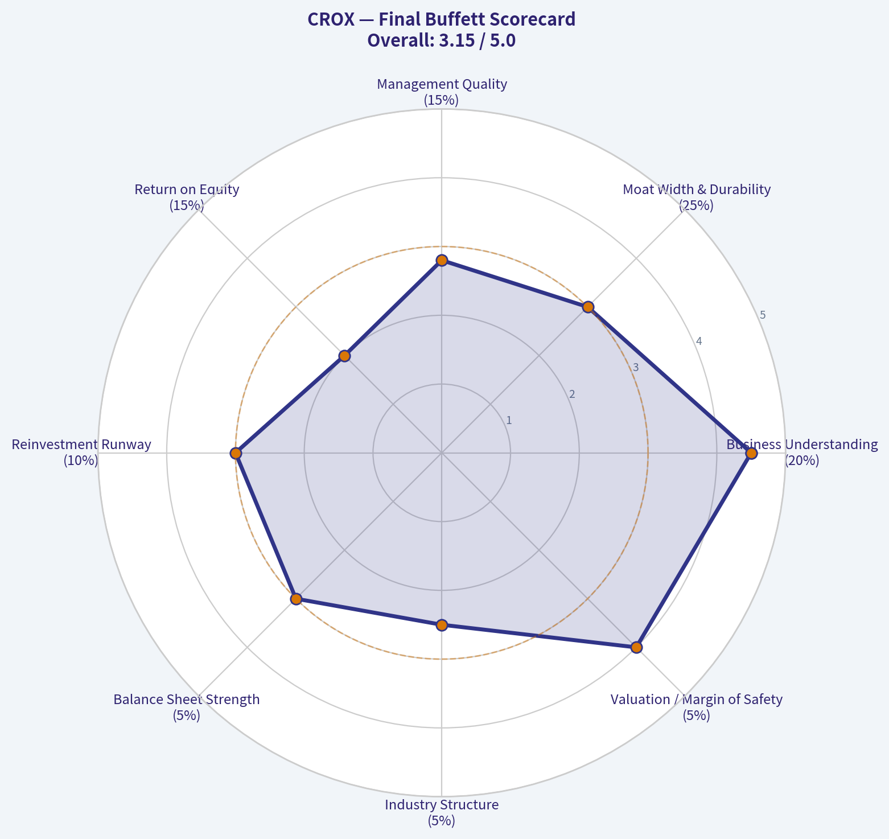

---

### Market Technical Analysis

#### CROX Technical Report

CROX has shifted from a weak first-quarter structure into a much stronger medium-term recovery, but the very short-term tape is no longer as clean as it was in early-to-mid April. The stock appears to be in a **confirmed medium-term uptrend above its 50-day average**, while also sitting **well above a relatively flat-to-soft long-term 200-day average**. That combination usually supports a bullish swing-trading bias, but the latest few sessions suggest **momentum is cooling rather than accelerating**.

The most relevant indicator set for CROX in the current context is:

- `close_10_ema`
- `close_50_sma`
- `close_200_sma`
- `macd`
- `rsi`
- `boll_ub`
- `boll_lb`
- `atr`

These eight are complementary because they cover:
- short-term trend and pullback behavior,
- medium- and long-term trend confirmation,
- momentum strength and deceleration,
- mean-reversion and breakout context,
- volatility for risk management.

---

#### Price Structure and Trend Regime

From the raw price series, CROX formed three distinct phases over the last six months:

1. **November to mid-February:** a broad recovery from the mid-70s into the upper-90s.
2. **Late February to mid-March:** a sharp unwind, with price falling from roughly 100 to the mid-70s.
3. **Late March through April:** a powerful reversal and trend repair, carrying the stock from about 76 to above 111 intraday.

That third phase is the most important for current positioning. It was not just a bounce; it was a **persistent repricing higher**, with price reclaiming prior breakdown levels, pushing through the 50-day moving average decisively, and then sustaining above it through the latest readings.

However, the stock is no longer in the strongest impulse leg. After peaking around the 111-113 zone in late April, CROX entered a **high-level consolidation**. It has held above 100, which is constructive, but upside progress has become less linear.

#### Trend Table

| Indicator | Latest reading | Trend message | Trading implication |
|---|---:|---|---|
| close_10_ema | 103.33 | Short-term trend still positive | Near-term support zone is around 103 |
| close_50_sma | 91.86 | Medium-term trend strongly positive | Pullbacks remain bullish while price stays above 50 SMA |
| close_200_sma | 87.27 | Long-term trend benchmark still subdued but below price | Strategic backdrop improved materially |
| Last close | 103.63 | Above all key averages tracked here | Bull trend intact, but not in breakout mode |

Key Takeaways: CROX remains above its short-, medium-, and long-term moving averages, which is a strong sign that the broader trend has improved significantly. The most important support is now layered, with the 10-day EMA near 103 and the 50-day SMA much lower near 92, meaning the stock still has cushion even if short-term volatility continues.

---

#### Moving Average Interpretation

The **10-day EMA at 103.33** is almost aligned with the latest close at **103.63**. That matters because it tells us the stock has come back to its short-term trend line after a strong April run. When price hugs the 10 EMA after a rally, two interpretations are possible:

- healthy consolidation before another leg up, or
- the early stage of momentum fatigue if follow-through buying does not return.

The **50-day SMA at 91.86** is rising steadily and has accelerated higher since early April. This is the clearest evidence that the medium-term structure has turned bullish. Price is still roughly 12 points above that average, so the medium-term uptrend is not under immediate stress.

The **200-day SMA at 87.27** is flatter and has actually drifted slightly lower over recent months. That means the long-term trend has not fully caught up with the recent rally. Still, the fact that price is now well above it indicates a substantial improvement in long-horizon technical posture. In simple terms: **the recent rally has repaired damage faster than the 200-day average can reflect it**.

A subtle but important nuance: the spread between the 50-day and 200-day averages has widened in favor of the 50-day. That is supportive, but since the 200-day is still relatively flat, traders should avoid assuming this is already a mature secular uptrend. It is better described as a **strong intermediate recovery within a longer-term normalization process**.

---

#### Momentum Analysis: Strong Recovery, Now Cooling

The **MACD remains positive at 3.07**, which confirms bullish momentum is still present on an absolute basis. But the more important observation is directional: MACD has faded from above **6.2 in late April** to just above **3.0** now. That is a clear sign that upside momentum is **decelerating**.

This is not yet a bearish reversal by itself. Positive-but-falling MACD often appears during:
- consolidations after an extended run,
- orderly pullbacks in ongoing uptrends,
- transitions from impulse phase to range phase.

So the message is not "trend broken." The message is: **the trend is intact, but it is no longer expanding at the same rate**.

The **RSI at 57.7** reinforces that interpretation well. In late April, RSI pushed above 70 and even into the low 80s, which was an overbought condition associated with strong upside thrust. Since then, RSI has normalized into the upper-50s. That is actually constructive in one sense: CROX has worked off overbought pressure **without collapsing**. But it also means the stock has lost the urgency that powered the April breakout.

#### Momentum Table

| Indicator | Latest reading | Prior extreme/context | Interpretation |
|---|---:|---|---|
| macd | 3.07 | Down from ~6.26 on 2026-04-21 | Bullish momentum still positive, but fading |
| rsi | 57.73 | Down from >80 on 2026-04-20 | Overbought condition has cooled to neutral-bullish |
| Price vs 10 EMA | Slightly above | Tight alignment | Market is deciding whether to resume higher or drift sideways |

Key Takeaways: Momentum remains positive, but it is clearly less powerful than it was in late April. The stock has successfully cooled from overbought levels without breaking down, which is healthy, but traders should recognize that the current setup is more consolidation-like than breakout-like.

---

#### Bollinger Band Context: Compression After Expansion

The Bollinger readings are especially useful right now because they show how the April surge has transitioned into a narrower structure.

Latest levels:
- `boll_ub`: **108.79**
- `boll_lb`: **98.43**

With price at **103.63**, CROX is sitting in the **middle-to-upper half of the band range**, but no longer pressing the upper band aggressively. In April, price expansion and upper-band riding confirmed strong trend behavior. Now, that condition has eased.

Two important observations:

1. **Band width has narrowed materially** from the late-April period.
   - On 2026-04-27, upper minus lower band was roughly **37 points**.
   - On 2026-05-08, the width had contracted to roughly **10.4 points**.
   This is a major volatility compression.

2. Price is not near the lower band either.
   That means sellers have not gained decisive control. Instead, the stock is in a **post-rally digestion range**.

This is typically the kind of setup where traders watch for:
- a re-expansion above the upper band and recent highs for bullish continuation, or
- a breakdown toward the lower band and below the 10 EMA for a deeper mean-reversion move.

#### Volatility and Band Table

| Indicator | Latest reading | Context | Interpretation |
|---|---:|---|---|
| boll_ub | 108.79 | Above current price | Near-term upside reference / resistance area |
| boll_lb | 98.43 | Below current price | Lower end of current consolidation envelope |
| Band width | 10.36 | Much tighter than late April | Compression suggests decision point is approaching |
| atr | 3.99 | Elevated vs late March (~3.18) | Daily swings remain meaningful despite consolidation |

Key Takeaways: CROX has moved from a highly expanded trend phase into a tighter consolidation zone. Even though the Bollinger Bands have narrowed, the ATR shows the stock still moves enough each day to require disciplined stop placement and position sizing.

---

#### ATR and Risk Management

The **ATR at 3.99** indicates that CROX still has sizable daily movement. This is not an ultra-calm stock. Even after momentum cooled, its average true range remains near 4 points, which is large enough to shake out overly tight stops.

This has two practical consequences:

- **Swing entries should allow room**; stops placed too close to entry are vulnerable.
- Traders should think in terms of **zones** rather than exact price levels.

A reasonable tactical framing is:
- short-term support around the **10 EMA / 102-103 area**,
- secondary support around the **Bollinger lower region near 98-99**,
- major support much lower near the **50-day SMA around 92**.

That layered support structure is bullish overall, but it also shows that a "normal" pullback could still be several dollars deep.

---

#### What Traders Should Watch Next

| Scenario | Trigger | What it would suggest | Bias |
|---|---|---|---|
| Bullish continuation | Close back above 106-109 with momentum re-accelerating | Consolidation resolved upward | Positive |
| Range continuation | Price holds roughly 100-106 while MACD drifts lower but stays positive | Healthy digestion after a strong run | Mildly bullish / neutral |
| Deeper pullback | Break below 100 and sustained move toward 98 or lower band | Mean reversion expanding | Cautious |
| Trend damage | Failure below 10 EMA followed by loss of 50 SMA over time | April trend repair losing validity | Bearish medium term |

Key Takeaways: The next important signal is whether CROX can reclaim upside momentum and push back toward the upper Bollinger Band, or whether it slips under 100 and turns this pause into a more meaningful pullback. Right now, the evidence still leans constructive, but the stock needs renewed buying pressure to shift from consolidation back into a full continuation trend.

---

#### Bottom Line

CROX currently shows a **bullish medium-term structure with cooling short-term momentum**. The strongest evidence in favor of the stock is that it remains above the 10-day EMA, well above the 50-day SMA, and clearly above the 200-day SMA. The strongest caution signal is that MACD has rolled over from a high level and RSI has retreated from overbought territory, showing the rally has lost force.

So the most nuanced conclusion is:

- **Trend followers** can still justify a bullish bias while price holds above the 10 EMA and especially above the 50 SMA.
- **Breakout traders** should be patient, because current conditions are not as explosive as late April.
- **Mean-reversion traders** should not assume immediate downside collapse, because the stock is consolidating from strength rather than breaking from weakness.
- **Risk management matters**, because ATR remains elevated enough for wide daily swings.

#### Summary Table

| Area | Current read | Implication for traders |
|---|---|---|
| Short-term trend | Positive but flattening | Watch 10 EMA near 103 closely |
| Medium-term trend | Clearly bullish | 50 SMA near 92 is major trend support |
| Long-term trend | Improved materially | Price above 200 SMA supports strategic recovery view |
| Momentum | Positive but decelerating | Rally is intact, but less forceful |
| RSI condition | Neutral-bullish | Overbought pressure has been worked off |
| Bollinger structure | Compression after expansion | Decision point likely approaching |
| Volatility | Still elevated | Use wider stops and smaller size |
| Overall stance | Constructive with caution | Bullish bias, but no longer a "chase" setup |

Key Takeaways: CROX is still technically healthy, but the character of the move has changed from fast upside expansion to slower consolidation. That keeps the broader outlook constructive, while also arguing for more selective entries and tighter confirmation standards rather than aggressive chasing.

---

### News & Events Analysis

#### Crocs (NASDAQ: CROX) - Trading and Investment News Report
Date: 2026-05-11

Crocs sits at an interesting intersection of value, brand durability, and execution risk. Based on the available research pack, the stock is around **$100**, implying a market cap near **$4.99B**, with an unusually high **FCF yield of 13.2%** and strong **gross margin of 58.3%**. But those attractive valuation and cash-generation signals are offset by weaker recent operating momentum: **revenue growth is -1.5% YoY**, **ROE is negative (-6.3%)**, and the latest shared earnings-coverage check found **no recent quarterly or annual earnings coverage within the last 120 days**. For traders, that combination usually creates a setup where sentiment can swing sharply on any sign of stabilization in sales, margins, leverage, or the HEYDUDE brand.

#### Market Context and Why It Matters for CROX

Over the last week, there was no directly captured company-specific news flow in the provided tool results. That absence is itself relevant. In quieter news periods, consumer discretionary names like Crocs often trade less on company headlines and more on:

- broader consumer-spending expectations,
- tariff and sourcing concerns,
- wholesale inventory trends,
- retailer commentary,
- and valuation rotation between growth, quality, and cyclicals.

For Crocs specifically, the key macro transmission channels are straightforward:

1. **Consumer health:** If the market believes lower- and middle-income consumers are weakening, footwear names with fashion and casual exposure can de-rate quickly.
2. **Promotional intensity:** Any sign that retailers need to discount more heavily can pressure volume and margin assumptions.
3. **China/Asia sourcing and tariff risk:** Even without a fresh CROX-specific headline this week, tariff or supply-chain concerns matter because footwear is highly exposed to import-cost volatility.
4. **Risk appetite:** CROX often behaves like a "cheap but execution-sensitive" stock. In risk-on markets, investors may focus on cash flow and buybacks/deleveraging; in risk-off markets, they may focus on slowing sales and brand concentration risk.

The practical implication: absent fresh company news, CROX is likely to remain highly sensitive to the next earnings print or any channel-check commentary from retailers and peers.

---

#### Earnings Check: Latest Available Information

The shared research pack explicitly states:

- **No recent quarterly or annual earnings coverage was found within 120 days of 2026-05-11.**

That means I cannot verify a newer reported quarter from the collected news set, and I should **not infer one without evidence**. So the correct conclusion is:

- **CROX has not had a recently captured earnings-release news item in the available dataset.**
- The most recent available earnings period is **not confirmed by the fetched news coverage**.
- Investors should treat the stock as being in an **information-light window**, where the market may be anchoring to older operating trends rather than a fresh reported update.

Even without a fresh earnings article, the research pack provides important clues about the direction of fundamentals:

- **Revenue growth YoY: -1.5%** suggests the business recently faced a slight top-line contraction rather than expansion.
- **Gross margin: 58.3%** indicates the underlying product economics remain strong, implying that the brand still has pricing power and/or favorable mix.
- **ROE: -6.3%** is a warning sign that bottom-line or balance-sheet dynamics have been weak enough to push return metrics negative.
- **FCF yield: 13.2%** suggests the market is assigning a discounted valuation relative to current cash generation.

#### Interpretation of What Likely Changed vs Prior Period / Prior Expectations

Because there is no recent earnings coverage in the dataset, we cannot responsibly quote exact reported headline numbers for the latest quarter. However, from the shared metrics, the market appears to be pricing in the following narrative relative to earlier stronger periods:

- **Sales momentum has softened**, as shown by the negative YoY revenue growth.
- **Margins remain resilient**, which is important because it suggests the problem is not a total collapse in brand economics.
- **Investor confidence is likely constrained by earnings-quality concerns**, balance-sheet optics, or brand-growth sustainability, reflected in the negative ROE and lack of a premium valuation.
- **Cash generation remains a major support**, which likely explains why the stock still screens attractively despite growth concerns.

For traders, the next earnings report matters disproportionately because it will likely decide whether CROX is:
- a **cash-rich value recovery story**, or
- a **value trap tied to prolonged sales stagnation**, especially if HEYDUDE or wholesale trends remain pressured.

#### Fundamental Read-Through for Investors

The most important tension in CROX is this:

| Metric | Read-through |
|---|---|
| Revenue growth: -1.5% YoY | Demand is not currently in a clean expansion phase |
| Gross margin: 58.3% | Core product economics are still healthy |
| FCF yield: 13.2% | Stock may be inexpensive if cash flows prove durable |
| ROE: -6.3% | Market has reason to doubt quality/consistency of earnings |
| Current ratio: 1.27 | Liquidity is adequate, though not especially loose |

Key Takeaways: Crocs looks like a company with a still-strong business model but weaker recent momentum. The combination of high gross margin and high free-cash-flow yield is attractive, but negative revenue growth and negative ROE show why investors are hesitant. This is the type of setup where the next earnings update can quickly re-rate the stock in either direction.

---

#### Positioning and Ownership Signal

The shared 13F tracking shows:

- **Steve Cohen / Point72 added heavily** to CROX in the latest available filing.
- Latest disclosed position: **$33.52M**, **391.98K shares**, as of **2025-12-31**.
- This was a very large increase versus the prior filing.

That is not a short-term catalyst by itself, and 13F data is lagged, but it is still useful context. It suggests at least one sophisticated investor saw value or a tactical setup in CROX near prior quarter-end levels. For discretionary traders, this can reinforce the idea that CROX is on the radar as a **deep-value consumer name with rebound optionality**.

Still, investors should be careful not to overstate this signal:
- 13F positions are backward-looking.
- CROX can be traded tactically rather than held as a high-conviction long-term core position.
- Without fresh earnings confirmation, the "smart money bought it" thesis is incomplete.

#### Trading Implications

#### Bullish setup
A constructive view on CROX would rest on these points:

- The stock already reflects skepticism, given the valuation and FCF yield.
- Gross margin remains very healthy, suggesting the Crocs brand itself is not structurally broken.
- If the next earnings release shows even modest re-acceleration in revenue, cleaner inventory, or stabilization in HEYDUDE, the stock could re-rate quickly.
- In a market favoring cash-generative laggards, CROX can screen well.

#### Bearish setup
A cautious or bearish view would emphasize:

- Negative revenue growth often precedes estimate cuts if not reversed.
- Negative ROE raises questions about earnings quality, capital structure effects, or impairment-type issues.
- Lack of recent earnings/news confirmation increases uncertainty.
- If macro retail commentary worsens, CROX could trade lower even without company-specific bad news because it sits in a discretionary, fashion-sensitive category.

#### What traders should watch next
The highest-value upcoming data points are:

1. **Next earnings release and guidance**
   - especially brand-level commentary, DTC versus wholesale, and margin outlook.
2. **Any HEYDUDE commentary**
   - because multi-brand execution has been a major investor focus historically.
3. **Retail channel checks**
   - signs of discounting or inventory pressure would matter.
4. **Tariff/import headlines**
   - footwear cost structures are sensitive to these developments.
5. **Cash deployment**
   - buybacks, debt paydown, and capital allocation could meaningfully support the stock if operations stabilize.

---

#### Bottom Line

CROX currently looks like a **valuation-driven opportunity with execution risk**. The market appears willing to give the company credit for strong gross margin and cash flow, but not for renewed growth yet. With no recent earnings coverage available in the collected dataset, the stock remains in a holding pattern where investors are likely extrapolating from stale signals: modest revenue contraction, still-solid margins, and weak return metrics.

For investment decisions, this means CROX is most compelling for those who believe the next reported quarter will show stabilization or improvement. If that happens, the stock has room to work higher because the valuation is not demanding. If the next report instead confirms ongoing sales pressure or weak brand momentum, the "cheap" multiple may not provide much protection.

#### Summary Table

| Category | Key Point | Trading / Investing Relevance |
|---|---|---|
| Valuation | Stock around $100; market cap about $4.99B | Mid-cap consumer name with room for re-rating if fundamentals improve |
| Growth | Revenue growth is -1.5% YoY | Signals recent softness; market likely needs proof of re-acceleration |
| Profitability | Gross margin is 58.3% | Core brand/product economics still appear strong |
| Quality concern | ROE is -6.3% | Suggests earnings/balance-sheet issues are limiting confidence |
| Cash flow | FCF yield is 13.2% | Major support for value investors if cash flow is sustainable |
| Liquidity | Current ratio is 1.27 | Adequate near-term liquidity, not a major stress signal |
| Earnings status | No recent earnings coverage found within 120 days | Information gap increases uncertainty; next report becomes more important |
| Ownership | Steve Cohen / Point72 added materially in latest 13F | Supportive sentiment signal, but lagged and not a standalone catalyst |
| Macro sensitivity | Consumer spending, tariffs, retail discounting matter | CROX may move on sector and macro headlines even without company-specific news |
| Investment stance | Value with execution risk | Best suited for investors looking for operational stabilization and multiple expansion |

Key Takeaways: Crocs offers an attractive valuation and strong cash generation, but investors still need confirmation that revenue and returns are stabilizing. The absence of recent earnings coverage makes the next official update especially important. In short, this is a stock with upside if execution improves, but it remains vulnerable if weak sales trends persist.

---

### Guru Attention Analysis

> *Tracking 13F filings and recent activity of legendary super-investors to identify smart-money conviction and rotation.*

#### CROX Guru Ownership Snapshot

Using structured SEC 13F data as the canonical source, only **Steve Cohen / Point72** shows a current disclosed position in **CROX** among the tracked gurus. No other primary tracked guru appears in the latest structured 13F results, so they should be treated as **not holding CROX in the latest filing set**.

| Guru | Fund | Action | Position Size | Portfolio Weight | Recent Change | Timing | Verification |
| --- | --- | --- | --- | ---: | --- | --- | --- |
| Steve Cohen | Point72 Asset Management | Added | $33.52M; 391.98K shares | 0.04% | Shares increased by 27,898.8% vs prior filing | 12-31-2025 filing period, compared with 09-30-2025 | [SEC 13F Filing](https://www.sec.gov/Archives/edgar/data/1603466/000090266426001100/) |

**Key Takeaways:** The only tracked guru with a current disclosed CROX position is Steve Cohen's Point72, and the filing shows a very large quarter-over-quarter increase from a previously tiny base. Even after that jump, CROX remains a small position at just 0.04% of Point72's disclosed 13F portfolio, so it looks more like a tactical or exploratory position than a high-conviction core holding.

#### Guru-by-Guru Status

| Guru | Latest 13F Status for CROX | Notes |
| --- | --- | --- |
| Warren Buffett | No position detected in latest 13F filing | Not present in structured results |
| Seth Klarman | No position detected in latest 13F filing | Not present in structured results |
| Mohnish Pabrai | No position detected in latest 13F filing | Not present in structured results |
| Bill Ackman | No position detected in latest 13F filing | Not present in structured results |
| Stanley Druckenmiller | No position detected in latest 13F filing | Not present in structured results |
| Steve Cohen | Position detected; Added | Point72 added to CROX |
| Michael Burry | No position detected in latest 13F filing | Not present in structured results |

**Key Takeaways:** Among the primary gurus you asked to track, CROX currently has very limited super-investor sponsorship in the structured 13F data. That means investors should not frame CROX as a broadly owned "guru stock" at this time; the evidence supports only one current disclosed holder in this monitored set.

#### Interpretation

Steve Cohen's move is notable because the filing shows a massive percentage increase, which usually signals a **new or near-new position build** rather than a modest rebalance. Still, because the portfolio weight is only **0.04%**, the position size suggests **limited conviction relative to Point72's overall book**. In plain terms: it is a real buy, but not yet a centerpiece bet.

#### Verification Links

- Steve Cohen / Point72: [SEC 13F Filing](https://www.sec.gov/Archives/edgar/data/1603466/000090266426001100/)
- Steve Cohen / Point72 full 13F history: [All 13F Filings (SEC EDGAR)](https://www.sec.gov/cgi-bin/browse-edgar?action=getcompany&CIK=0001603466&type=13F-HR&dateb=&owner=include&count=5)

#### Bottom Line

For **CROX**, the structured guru evidence is straightforward: **Steve Cohen added a small but sharply increased position**, while **all other primary tracked gurus show no position detected in the latest 13F filing**. So if you are looking for guru confirmation on CROX, the signal is currently **narrow, not broad**.

---

### Options Market Analysis

> *Reading options flow - put/call ratios, IV skew, and unusual activity - to gauge institutional positioning and event-driven risk.*

#### CROX Options Positioning Report
*Date: 2026-05-11*

CROX's options tape leans **slightly bullish to neutral**, but with **elevated caution in the very front week** rather than outright fear. Aggregate positioning across near-term expirations shows a **put/call open interest ratio of 0.93** and a **put/call volume ratio of 0.80**. That is above the historical neutral baseline of roughly **0.7**, which means traders are carrying somewhat more downside protection than a clean bullish tape would show, but the **flow today still favors calls over puts**.

#### 1. Put/Call Ratio Analysis

| Expiration | Call OI | Put OI | Put/Call OI Ratio | Call Vol | Put Vol | Put/Call Vol Ratio | Read |
|---|---:|---:|---:|---:|---:|---:|---|
| 2026-05-15 | 6,443 | 7,350 | 1.14 | 387 | 191 | 0.49 | Existing positioning cautious, but fresh flow favored calls |
| 2026-06-18 | 13,616 | 10,832 | 0.80 | 458 | 176 | 0.38 | Mildly bullish, close to neutral-to-bullish baseline |
| 2026-09-18 | 3,102 | 3,402 | 1.10 | 126 | 414 | 3.29 | Longer-dated flow turned defensive/bearish |
| **Near-term total** | **23,161** | **21,584** | **0.93** | **971** | **781** | **0.80** | Slightly defensive overall, but not aggressively bearish |

**Key Takeaways:** CROX does not show a strong bearish panic signal, but it also is not displaying clean speculative bullishness. The overall OI ratio of 0.93 is above the 0.7 neutral baseline, implying some extra hedging demand. However, near-dated volume still favors calls, especially in May and June, which suggests traders are not capitulating lower right now.

Interpretation:
- **Overall OI ratio: 0.93**
  This is **above neutral**, so there is more put inventory in the system than you would expect in a relaxed bullish setup.
- **Overall volume ratio: 0.80**
  That is still above the 0.7 baseline, but importantly **below 1.0**, meaning fresh trading activity is **not dominated by puts**.
- **Most notable split:**
  - **May 15:** OI is put-heavy, but same-day trading volume is call-heavy.
  - **June 18:** both OI and volume lean constructive.
  - **September 18:** put volume dominates, indicating some traders are buying medium-term protection or expressing a bearish view further out.

This combination usually points to **near-term stabilization / modest bullish speculation with a layer of hedging underneath**.

---

#### 2. Implied Volatility (IV) Assessment

| Expiration | ATM Call IV | ATM Put IV | IV Bias | Interpretation |
|---|---:|---:|---|---|
| 2026-05-15 | 55.3% | 57.3% | Put IV higher | Mild downside fear in the front week |
| 2026-06-18 | 48.4% | 43.4% | Call IV higher | Upside optionality priced richer than puts |
| 2026-09-18 | 53.1% | 46.7% | Call IV higher | Medium-dated upside priced above downside |

**Key Takeaways:** Front-week volatility is elevated and slightly put-skewed, which suggests traders still see some downside event risk in the immediate term. But in June and September, calls trade at higher ATM IV than puts, a notable reversal from the normal downside-fear structure. That shift points to at least some appetite for upside exposure or call demand beyond the front week.

IV read:
- **May 15 expiry:** puts trade at higher ATM IV than calls, which is the more traditional defensive skew.
- **June and September:** call IV exceeds put IV, which is **unusual versus a classic equity downside skew** and can indicate:
  - upside speculation,
  - demand for call structures,
  - or less concern about severe downside than the OI data alone suggests.

On skew:
- The tool does **not provide full OTM put vs. OTM call skew by delta/strike**, so a precise skew curve cannot be quantified.
- Using the ATM IV differential as a directional proxy:
  - **May:** mild **put skew**
  - **June/September:** **call-skewed**
- That is **not the profile of broad institutional downside panic**.

Catalyst note:
- IV in the **mid-40s to upper-50s** is meaningfully elevated for a non-meme retail stock and may reflect event risk, earnings proximity, or macro/consumer discretionary sensitivity.
- Since no explicit catalyst calendar was returned by the tool, this should be treated as **possible event premium**, not a confirmed earnings-vol setup.

---

#### 3. Unusual Options Activity

| Screen Result | Observation | Interpretation |
|---|---|---|
| Volume > 5x Open Interest | None detected | No clear fresh institutional block/sweep-style signal in near-term expirations |

**Key Takeaways:** There was no standout contract where volume overwhelmed existing open interest, which reduces confidence in reading a strong "smart money" directional bet from today's tape alone. In practical terms, CROX's sentiment signal here comes more from the overall structure of OI and IV than from a single aggressive options trade.

What this means:
- No obvious **fresh, outsized directional bet** was flagged.
- No contract stood out as a classic **new-money call chase** or **protective put sweep**.
- Without unusual activity, conviction should be **moderate rather than high**.

This also reduces the odds that today's tape reflects a singular institutional information edge. Instead, the market seems to be expressing a **distributed, lower-conviction positioning profile**.

---

#### 4. Open Interest Concentration and Pinning/Gamma Implications

| Expiration | Highest OI Side | OI Profile | Likely Market Effect |
|---|---|---|---|
| 2026-05-15 | Puts (7,350 vs 6,443 calls) | Front-week put-heavy OI | Can create defensive dealer positioning and sharper downside sensitivity near expiry |
| 2026-06-18 | Calls (13,616 vs 10,832 puts) | Largest total OI concentration | Most likely "gravity" expiry; could dampen moves or pin price near active strikes |
| 2026-09-18 | Slightly puts | Smaller but defensive flow | Less immediate pinning effect, more medium-term hedging signal |

**Key Takeaways:** June 18 appears to be the most important expiration from a positioning standpoint because it carries the largest total open interest. May 15 still matters tactically because front-week put-heavy OI can increase short-term sensitivity if the stock starts moving lower, while June likely acts as the bigger magnet for price if CROX stays range-bound.

What stands out:
- **June 18** is the largest OI bucket by far and likely the key expiry for **pinning / gamma gravity**.
- **May 15** has heavier put OI than call OI, so if spot weakens into expiry, dealers may need to hedge in ways that can **amplify downside volatility**.
- Because the tool does **not provide strike-by-strike OI concentrations**, we cannot identify exact max-pain levels or precise gamma walls.
  Still, based on expiration-level OI:
  - **June likely dampens** price movement if CROX stays near heavily traded strikes.
  - **May could amplify** short-term downside if price breaks lower.

So the gamma read is:
- **Near-term:** slightly unstable on downside
- **One-month horizon:** more likely to be range-governed / pinned

---

#### 5. Overall Options Sentiment Signal

| Category | Signal |
|---|---|
| Directional Read | **BULLISH (low-to-moderate conviction)** |
| Primary Driver | Call-favored near-term flow and call-rich IV structure beyond the front week |
| Main Caveat | Overall OI still sits above the neutral put/call baseline, showing embedded caution/hedging |

**Key Takeaways:** The best single-word read is bullish, but only modestly so. CROX options are not showing panic protection or a major bearish put rush; instead, traders appear willing to own upside, especially beyond the very front week, while still carrying some insurance underneath.

Why I land on **BULLISH** rather than neutral or bearish:
1. **Fresh volume** in the near term is more call-friendly than put-heavy.
2. **June expiration**, the most important by OI, is structurally more constructive than defensive.
3. **Call IV > put IV** in June and September suggests upside optionality is being priced relatively rich.
4. The bearish evidence is real, but not dominant:
   - aggregate OI ratio of **0.93** is cautious,
   - front-week put IV is a bit richer,
   - September volume is defensive.

So the clean read is:

- **Near-term (days to weeks):** cautiously constructive
- **Very short-term (front week):** watch for downside sensitivity if price weakens
- **Overall options signal:** **BULLISH**, but not with high conviction

Confidence level:
- **Moderate**
- Reason: decent liquidity, but **no unusual activity** and no strike-level OI map limit the precision of the read.

---

#### Final Summary Table

| Metric | Reading | Interpretation |
|---|---|---|
| Put/Call Ratio | OI: **0.93**, Volume: **0.80** | Slightly defensive vs. 0.7 neutral baseline, but fresh flow still leans call-side |
| IV Level | **Elevated** (ATM IV ~43%-57%) | Options are pricing meaningful movement / possible event or macro sensitivity |
| Skew Direction | **Front-week put skew; June/Sept call skew** | Immediate caution, but upside demand grows outside the front week |
| Unusual Activity | **None flagged** | No standout fresh institutional bet; lowers conviction |
| Overall Signal | **BULLISH** | Main driver is call-favored flow and richer call IV beyond the front week, tempered by existing hedging |

**Key Takeaways:** CROX's options market is not giving a high-conviction breakout signal, but it does lean bullish overall. The market is carrying some downside protection, yet traders are still paying for upside exposure in the more important June and September windows.

---

## Research Team Commentary

> *The Research Manager synthesizes the Bull vs Bear debate into action-free commentary. This is a pre-risk view, not the final stance.*

Crocs is one of those cases where the bull story is easy to understand and the bear story is hard to dismiss. The strongest bullish point is that the core Crocs brand clearly has more economic value than a generic footwear label. A 58.3% gross margin is unusually high for shoes and does suggest brand strength, pricing power, and an asset-light model that can produce real cash. If you strip away some of the noise, the core franchise still looks like a recognizable, profitable comfort-footwear brand with broad appeal, and the 13.2% FCF yield argues the market is already skeptical. If the current weakness is mostly normalization rather than deterioration, the stock could be undervalued.

The strongest bear point is that Buffett-style investing is not just about finding a cheap multiple on cash flow; it is about owning a durable, predictable business at a clear discount to conservative intrinsic value. Crocs falls short on that standard today. Revenue is down 1.5%, net income fell 108.5%, FCF declined 28.6%, and reported returns on capital are negative. That makes it difficult to argue the business is currently demonstrating the consistency and capital efficiency Buffett prefers. On top of that, HEYDUDE raises a legitimate management-quality question: was capital allocated into a hot brand at the wrong time? If so, that is not a trivial error. And importantly, the conservative valuation work does not show a large margin of safety at $100.

My takeaway is that the market is probably not missing the existence of the Crocs brand moat; it is questioning the durability and predictability of the earnings stream around that moat. That skepticism is at least partly justified. The crowd may be too pessimistic on the core brand, but not obviously wrong on the combined business or on management discipline. In other words, this does not look like a classic fear-driven mispricing where a wonderful business is temporarily on sale. It looks more like a decent branded business with real strengths, but also real uncertainty, trading around fair value unless fundamentals improve.

Core takeaway: the core Crocs brand appears genuinely valuable, but the total company does not yet meet a Buffett-quality standard of predictability, capital allocation confidence, and margin of safety. At $100, I do not see enough discount to underwrite the current risks with conviction.

Rationale: From a value investing perspective, the bull case rests on normalized cash generation and brand durability. That can work if the recent decline is temporary and if HEYDUDE stops destroying value. But I do not want to make the common mistake of treating a high gross margin and a low-looking FCF multiple as proof of safety. I have seen too many consumer names look cheap on trailing cash flow right as demand, margins, or brand heat fade. Here, the negative ROE/ROIC, shrinking FCF, and acquisition overhang mean intrinsic value is highly assumption-sensitive. Buffett's framework demands that when predictability falls, the purchase price must be much lower. We do not have that cushion.

Monitoring plan for the next 1-4 quarters: First, watch core Crocs brand revenue separately from consolidated numbers. If the flagship brand returns to healthy growth without relying on promotions, that would strengthen the thesis. Second, monitor gross margin and operating margin together. Gross margin staying high is good, but I want proof it translates into better operating returns again. Third, track HEYDUDE closely: sales trend, margin profile, inventory discipline, and whether management signals a more realistic capital allocation posture. Fourth, watch free cash flow conversion and balance sheet progress. Strong cash generation used for deleveraging or disciplined buybacks would help restore confidence. Fifth, pay attention to inventory and wholesale commentary; any sign of channel stuffing or rising discounting would weaken the moat argument. Sixth, listen for tariff and sourcing impacts. If Crocs can absorb those pressures better than peers, that would support the idea that the brand has more pricing power than bears think.

What would change my mind? I would get more constructive if core brand demand stabilizes, HEYDUDE stops deteriorating, returns on capital recover meaningfully, and the stock either becomes clearly cheaper or the quality of earnings becomes clearly more dependable. I would get more negative if margin resilience cracks, promotional intensity rises, or management continues to defend weak capital allocation with optimistic narratives.

Final stance: WATCH.

---

## Value Investing Team Commentary

> *The Investor translates the research view into an investment thesis before risk review. This is still not the final stance.*

Crocs is interesting because it sits in the uncomfortable middle ground where value investors often get tempted: a real brand, real cash generation, and a stock that looks optically cheap, but with enough uncertainty to make "cheap" potentially misleading.

The best argument in its favor is straightforward. A 58.3% gross margin is not normal for footwear. That strongly suggests Crocs is not competing like a commodity producer. The core Crocs brand appears to have genuine pricing power, customer recognition, and a low-cost, asset-light model. Those are attractive business traits. If the current slowdown is simply post-boom normalization, then a 13.2% FCF yield could mean the market is overly skeptical. Selective contrarian thinking says we should not automatically accept the market's pessimism if the core franchise remains healthy and the earnings dip is temporary.

But the Buffett question is not "is this cheaper than it looks?" It is "can I predict this business's earning power with high confidence over the next 5-10 years?" Right now, that answer is not strong enough. Revenue is down 1.5%, net income down 108.5%, FCF down 28.6%, and reported ROE/ROIC are negative. That combination says the business is not currently exhibiting the consistency, resilience, and capital efficiency that a true long-term compounder should show. The core brand may still be good, but the consolidated picture is cloudy.

The biggest issue is not whether Crocs has a brand moat. It likely does. The issue is whether that moat is wide and durable enough to offset management's capital allocation mistakes and the volatility introduced by HEYDUDE. The acquisition overhang matters. Buffett-style investing places enormous weight on management judgment, because one poor acquisition can consume years of operating excellence. If HEYDUDE was bought near peak enthusiasm and is now impairing returns, that is not a small blemish; it is evidence that management may not be as disciplined as the market once assumed.

On sentiment, I do think the market may be somewhat too negative on the core Crocs brand itself. Consumer names often get painted with one broad brush during slowdown fears, tariff concerns, and wholesale inventory noise. Sometimes that creates opportunity. If Crocs can maintain brand heat, hold gross margins, and avoid deep discounting while peers struggle, then today's skepticism could eventually look excessive. That is the contrarian angle worth watching.

However, being contrarian only works when the business quality is clearer than the market believes. Here, the market's caution looks at least partly justified. The conservative valuation range does not show a compelling margin of safety at $100, especially given the uncertainty around normalized earnings and returns on capital. In a less predictable business, I want a much cheaper entry price or much stronger evidence that the problems are temporary.

So the long-term business outlook is mixed. The crown jewel is the Crocs brand, and it may well prove more durable than critics think. But the combined company has not yet re-earned the right to be viewed as a highly predictable compounder. Before committing capital, I would want to see core brand growth stabilize, HEYDUDE stop deteriorating, margins translate back into healthy operating returns, and free cash flow remain robust after normalizing for temporary factors. If that happens while the stock remains undemanding, the case improves materially.

For now, this is not a classic "wonderful business at a fair price," nor is it clearly "a fair business at a wonderful price." It is a decent business with a strong brand asset, but with enough uncertainty around durability, management execution, and intrinsic value that patience is warranted.

**ANALYST STANCE: WATCH**
Crocs has a valuable core franchise and may deserve more credit than current sentiment implies, but the total business lacks the predictability, capital allocation confidence, and margin of safety required for a high-conviction value investment at $100. I would monitor closely for improving core demand, better returns on capital, and evidence that HEYDUDE is no longer a drag before becoming more constructive.

---

## Deep Values Commentary

> *The Risk Management Team debates and the Risk Judge provides the final action-free verdict. This section determines the final ADVOCATE / WATCH / AVOID stance.*

### Executive Briefing

**Verdict: WATCH**

Crocs has a **real core brand**-the 58.3% gross margin and solid cash generation support that-but the **combined business is not currently Buffett-grade predictable**. Returns on capital are negative, FCF is falling, and HEYDUDE clouds both management quality and normalized earnings power. At **$100**, the stock looks **around fair to mildly interesting**, not clearly cheap enough to create a strong margin of safety. For a long-term value investor, this is a **monitor, not a commit** situation unless either fundamentals improve or price falls materially.

---

### Key Arguments from the Analysts

### 1) Risky Analyst: strongest bullish points
- **58.3% gross margin** is unusually strong for footwear and suggests Crocs is **not a commodity seller**.
- **13.2% FCF yield** implies the market is already discounting a lot of bad news.
- The bear case may be **over-extrapolating temporary earnings damage into permanent impairment**.
- If the business merely **stabilizes**, not even fully recovers, the stock could rerate meaningfully.

### 2) Safe Analyst: strongest cautionary points
- Gross margin alone does **not** prove shareholder value creation; current enterprise returns are poor:
  - **ROE: -6.3%**
  - **ROIC: -6.9%**
  - **ROA: -1.9%**
  - **Net income growth: -108.5%**
  - **FCF growth: -28.6%**
- **HEYDUDE** is not just noise; it may indicate **weak capital allocation discipline**.
- The valuation is **assumption-sensitive**:
  - Buffett-style estimate: **$60.73**
  - Damodaran-style estimate: **$95.02**
  - Current price: **$100**
- For a conservative investor, lack of predictability is a **risk**, not an opportunity.

### 3) Neutral Analyst: best synthesis
- The core Crocs brand likely has **real economic value**, but the **whole company has not earned full trust**.
- The valuation spread shows **uncertainty**, not a clean bargain.
- Best stance is **proactive WATCH**:
  - either wait for **better operating evidence**
  - or require a **lower price** before acting.

---

### Risk Commentary for the Long-Term Investor

Using a Buffett-style lens, the key question is not whether Crocs stock is volatile. It is whether the **business faces temporary earnings pressure or a more lasting reduction in earning power and capital efficiency**.

### What looks durable
The strongest positive fact in the file is still the **58.3% gross margin**. For footwear, that is exceptional and strongly suggests:
- brand equity,
- pricing power,
- an asset-light model,
- and a product with consumer relevance beyond generic shoes.

That means the **core Crocs brand likely retains moat-like qualities**. This matters because long-term risk is lower when the business can still command strong economics at the gross-profit level.

### What looks impaired
However, Buffett would not stop at gross margin. He would ask whether those attractive unit economics are flowing through to **owner earnings and returns on capital**. Right now, they are not.

The hard evidence is weak:
- **Revenue down 1.5%**
- **Net income down 108.5%**
- **FCF down 28.6%**
- **ROE, ROIC, and ROA all negative**

That combination says the enterprise is **not presently demonstrating the consistency, resilience, or capital efficiency** that a high-conviction value investor wants.

### HEYDUDE is the key risk filter
The bear case is strongest here. If HEYDUDE was simply a temporary integration issue, then current weakness may be cyclical and repairable. But if it reflects **poor acquisition timing and weaker management judgment**, then the issue is not temporary earnings noise-it is **capital allocation risk**, which can permanently reduce intrinsic value.

That is especially important in Buffett-style investing. A good brand can still be a poor investment if management overpays for growth or misallocates cash.

### Valuation: cheap-looking, but not safe enough
The low-looking multiple and **13.2% FCF yield** make the stock superficially attractive. But Buffett's version of risk management requires asking whether that cash flow is **durable and conservatively normalized**.

The debate's valuation range tells the story:
- **$60.73** on a conservative Buffett-style basis
- **$95.02** on a more moderate framework
- **$100 current price**
- **$320 FCF-based estimate**, which is highly dependent on normalization assumptions

That is too wide a range to claim a reliable margin of safety. At $100, you are **not buying obvious distress with obvious protection**. You are buying **uncertain normalization**.

---

### Refined Investor Plan

Your original conclusion was directionally right, and the debate mostly **strengthens** it rather than overturns it.

### Updated plan
Crocs should remain a **WATCH**, but with a **more structured trigger-based process**:

#### What to monitor over the next 1-4 quarters
1. **Core Crocs brand revenue**
   - Is the flagship brand returning to growth?
   - Is growth happening without heavier promotion?

2. **Gross margin plus operating margin**
   - High gross margin is good, but it must convert into better operating economics again.

3. **HEYDUDE stabilization**
   - Sales trend
   - margin trend
   - inventory discipline
   - management tone on strategy and expectations

4. **Free cash flow quality**
   - Is FCF stabilizing or still eroding?
   - Is cash being used for deleveraging or disciplined buybacks?

5. **Returns on capital**
   - Improvement in **ROIC** matters more than headline EPS recovery.

6. **Inventory, wholesale, and tariff commentary**
   - Rising promotions, weak channels, or sourcing pressure would weaken the moat case.

### What would justify becoming more constructive
- Core brand demand stabilizes and returns to growth
- HEYDUDE stops deteriorating
- FCF decline bottoms and conversion improves
- ROIC turns meaningfully positive again
- Share price offers a more obvious discount to conservative value

### What would justify becoming more negative
- Gross margin begins to crack
- Promotions rise to support volume
- Inventory/wholesale issues worsen
- Management continues defending poor capital allocation rather than correcting it

---

### Lessons Applied
A common value-investing mistake is to confuse:
- a **strong brand** with a **strong investment**, or
- a **low multiple** with a **margin of safety**.

This debate reinforces that lesson. Crocs may indeed be better than the market mood implies, but the evidence does **not yet** show the level of predictability and managerial trust needed for a Buffett-style commitment at today's price.

---

### Final Stance

**WATCH**

#### Final Stance Scorecard

This scorecard converts the final research view into a weighted decision frame. It does not replace the narrative judgement, but it makes the main drivers of the verdict easier to scan.

| Criterion | Score | Weight | Commentary |
| --- | ---: | ---: | --- |
| Business Quality | 2.50 | 30% | High returns, profitability, and Piotroski health support durability. |
| Valuation Support | 4.33 | 30% | Blends current price against available intrinsic value anchors and valuation ratios. |
| Financial Strength | 2.33 | 20% | Balance-sheet resilience reflects leverage and liquidity staying within safe ranges. |
| Growth Durability | 1.00 | 20% | Recent revenue, earnings, and free cash flow growth indicate how durable expansion looks. |
| TOTAL / FINAL STANCE | 2.72 | 100% | WATCH |

#### Key Takeaways

The weighted score lands at **2.72 / 5.0**, while the final stance remains **WATCH**. This is useful as a quick calibration aid rather than a mechanical signal.

#### Risk Summary

Higher scores indicate more risk pressure. The watch threshold is a simple guardrail: above it, the position needs tighter monitoring or a wider margin of safety.

| Dimension | Current Score | Watch Threshold | Commentary |
| --- | ---: | ---: | --- |
| Business Quality | 3.50 | 3.00 | High returns, profitability, and Piotroski health support durability. |
| Valuation Support | 1.67 | 3.00 | Blends current price against available intrinsic value anchors and valuation ratios. |
| Financial Strength | 3.67 | 3.00 | Balance-sheet resilience reflects leverage and liquidity staying within safe ranges. |
| Growth Durability | 5.00 | 3.00 | Recent revenue, earnings, and free cash flow growth indicate how durable expansion looks. |

#### Key Takeaways

This view helps readers separate *where* the risk sits: valuation, business quality, balance sheet, or growth durability. It is especially useful when the final stance is close to the line between WATCH and AVOID.
