# CRSP Deep Value Intelligence

**Analysis Date:** 2026-09-23

## Critical Disclaimer

*This analysis is generated by Deep Value Intelligence, an AI-powered multi-agent investing framework. Education & research only - not financial advice, not a financial advisor.*

---

## Table of Contents

1. Intelligence Summary
2. Analyst Team Reports
   - Fundamentals Analysis
   - Intrinsic Value Analysis (Buffett)
   - Trend & Growth Analysis (Lynch/Druckenmiller/Fisher)
   - Market Technical Analysis
   - Options Market Analysis
3. Research Team Commentary
4. Value Investing Team Commentary
5. Deep Values Commentary

---

## Intelligence Summary

### Thesis + Conditions

**Core Thesis:** # Executive Briefing

**Key Risks:**
- ## Risky Analyst: strongest contributions
- The analyst nevertheless overreaches by treating plausible commercialization acceleration as an emerging fact. No data were supplied on referrals, collections, infusions, reimbursement, treatment times, or CRISPR's retained cash contribution. CASGEVY also only partially de-risks oncology, autoimmune, and in-vivo programs. Shared scientific, regulatory, intellectual-property, and financing dependencies make the pipeline less diversified than the number of programs suggests.
- The Vertex partnership reduces execution risk but also limits CRISPR's economics and product-level transparency.

**Confidence:** Low

---

## Analyst Team Reports

### Fundamentals Analysis

#### Latest Earnings Snapshot

*Most recent reported quarter anchored on 2026 Q2, with prior-year comparison when available.*

| Metric | 2026 Q2 | 2025 Q2 | YoY Change |
| --- | ---: | ---: | ---: |
| Revenue | $10.0M | $0 | N/A |
| Operating Income | $-117.3M | $-229.3M | +48.9% |
| Net Income | $-91.2M | $-208.5M | +56.3% |
| Diluted EPS | $-0.94 | $-2.40 | +60.8% |
| Operating Cash Flow | $-83.5M | $-113.9M | +26.7% |
| Free Cash Flow | $-86.6M | $-139.0M | +37.7% |

Key Takeaways: This snapshot anchors the most recent reported quarter before the narrative analysis. It helps readers separate long-run business quality from whatever changed in the latest earnings print.

#### 12-Year Financial Metrics for CRSP

*All values below are computed deterministically from raw data - not estimated by AI.*

*Issuer profile: operating company (Healthcare / Biotechnology).*

#### 12-Year Financial Metrics
*Annual rows come from reported financial statements. The final TTM row is computed from the latest four quarters.*

| Metric | 2014 | 2015 | 2016 | 2017 | 2018 | 2019 | 2020 | 2021 | 2022 | 2023 | 2024 | 2025 | 2026 TTM |
| --- | --- | --- | --- | --- | --- | --- | --- | --- | --- | --- | --- | --- | --- |
| Market Price | N/A | N/A | $20 | $23 | $29 | $61 | $153 | $76 | $41 | $63 | $39 | $52 | $56 |
| Market Cap | N/A | N/A | $806.6M | $940.6M | $1.37B | $3.47B | $10.10B | $6.09B | $3.16B | $4.96B | $3.32B | $4.72B | $5.38B |
| P/E Ratio | N/A | N/A | -34.80 | -13.73 | -8.31 | 52.06 | -28.94 | 16.12 | -4.86 | -32.27 | -9.07 | -8.11 | -11.71 |
| P/B Ratio | N/A | N/A | 3.46 | 5.01 | 3.49 | 3.69 | 6.07 | 2.54 | 1.69 | 2.63 | 1.72 | 2.45 | 3.08 |
| ROE | 100.5% | 87.6% | -10.0% | -36.4% | -42.1% | 7.1% | -21.0% | 15.7% | -34.7% | -8.2% | -19.0% | -30.3% | -25.8% |
| ROIC | N/A | N/A | N/A | N/A | N/A | N/A | -56.5% | 20.0% | -40.4% | -15.2% | -28.8% | -42.5% | -24.0% |
| EPS | N/A | $-4.61 | $-0.58 | $-1.71 | $-3.44 | $1.17 | $-5.29 | $4.70 | $-8.36 | $-1.94 | $-4.34 | $-6.47 | $-4.76 |
| Revenue | N/A | $247,000 | $5.2M | $41.0M | $3.1M | $289.6M | $719,000 | $915.0M | $1.2M | $371.2M | $37.3M | $3.5M | $11.0M |
| Gross Profit | N/A | N/A | N/A | N/A | N/A | N/A | N/A | N/A | N/A | N/A | N/A | N/A | $-186.0M |
| Gross Margin | N/A | N/A | N/A | N/A | N/A | N/A | N/A | N/A | N/A | N/A | N/A | N/A | -1691.3% |
| Operating Margin | N/A | -10416.6% | -1319.3% | -157.7% | -5087.8% | 16.1% | -49295.5% | 40.8% | -56190.4% | -60.0% | -1250.4% | -18933.6% | -4857.6% |
| Net Income | $-7.0M | $-25.5M | $-23.2M | $-68.4M | $-165.0M | $66.9M | $-348.9M | $377.7M | $-650.2M | $-153.6M | $-366.3M | $-581.6M | $-451.1M |
| Net Margin | N/A | -10325.1% | -448.8% | -166.7% | -5281.1% | 23.1% | -48520.9% | 41.3% | -54271.7% | -41.4% | -981.5% | -16569.8% | -4101.3% |
| Revenue Growth | N/A | N/A | 1990.7% | 693.9% | -92.4% | 9169.8% | -99.8% | 127154.9% | -99.9% | 30885.5% | -89.9% | -90.6% | 213.4% |
| Net Income Growth | N/A | 263.9% | -9.1% | 194.9% | 141.4% | -140.5% | -621.8% | -208.3% | -272.2% | -76.4% | 138.4% | 58.8% | -22.4% |
| Free Cash Flow Growth | N/A | N/A | -195.9% | 39.4% | 27.1% | -150.5% | -613.5% | -278.1% | -216.5% | -49.4% | -46.4% | 139.1% | 8.1% |
| Total Book Value | $-7.0M | $-29.1M | $232.8M | $187.8M | $392.2M | $939.4M | $1.66B | $2.40B | $1.88B | $1.88B | $1.93B | $1.92B | $1.75B |
| Total Assets | N/A | $159.4M | $345.0M | $271.3M | $489.0M | $1.07B | $1.83B | $2.75B | $2.24B | $2.23B | $2.24B | $2.27B | $2.65B |
| Total Debt | N/A | N/A | N/A | N/A | N/A | N/A | N/A | N/A | N/A | N/A | N/A | $0 | $783.7M |
| Debt-to-Equity | N/A | N/A | N/A | N/A | N/A | N/A | N/A | N/A | N/A | N/A | N/A | 0.00 | 0.45 |
| Cash & Equivalents | $945,000 | $156.0M | $315.5M | $239.8M | $456.6M | $943.8M | $1.17B | $923.0M | $211.9M | $389.5M | $298.3M | $347.6M | $291.3M |
| Shareholders' Equity | $-7.0M | $-29.1M | $232.8M | $187.8M | $392.2M | $939.4M | $1.66B | $2.40B | $1.88B | $1.88B | $1.93B | $1.92B | $1.75B |
| Operating Cash Flow | $-4.8M | $59.4M | $-52.9M | $-70.1M | $-96.2M | $56.7M | $-238.4M | $539.0M | $-495.7M | $-260.4M | $-142.8M | $-345.0M | $-369.6M |
| Investing Cash Flow | N/A | $-1.2M | $31.9M | $-8.3M | $-2.8M | $1.3M | $-541.2M | $-1.04B | $-258.7M | $374.6M | $-280.5M | $-31.8M | $-548.4M |
| Free Cash Flow | N/A | $58.3M | $-55.9M | $-77.9M | $-99.0M | $50.0M | $-256.7M | $457.3M | $-532.9M | $-269.8M | $-144.7M | $-345.9M | $-373.8M |
| FCF Margin | N/A | 23592.7% | -1082.0% | -190.0% | -3169.4% | 17.3% | -35705.7% | 50.0% | -44484.9% | -72.7% | -387.7% | -9855.5% | -3398.2% |
| Dividends / Share | N/A | $0.00 | $0.00 | $0.00 | $0.00 | $0.00 | $0.00 | $0.00 | $0.00 | $0.00 | $0.00 | $0.00 | $0.00 |

#### Profitability Metrics
- Return on Equity (ROE): -30.3%
- Return on Invested Capital (ROIC): N/A
- Return on Assets (ROA): -25.7%
- Gross Margin: N/A
- Operating Margin: -18933.6%
- Net Profit Margin: -16569.8%

#### Liquidity Metrics
- Current Ratio: 13.32
- Quick Ratio: 13.25

#### Leverage Metrics
- Debt-to-Equity Ratio: 0.00
- Interest Coverage Ratio: N/A
- Net Debt: $-1.98B

#### Growth Metrics (Year-over-Year)
- Revenue Growth: -90.6%
- Net Income Growth: -58.8%
- Free Cash Flow Growth: -139.1%
- Revenue CAGR (3-Year): 43.1%
- Revenue CAGR (5-Year): 37.3%

#### Valuation Metrics
- P/E Ratio (TTM): N/A
- Forward P/E: -15.94
- Price-to-Book: 3.09
- Price-to-Sales: 402.60
- PEG Ratio: N/A
- EV/EBITDA: -7.43
- Free Cash Flow Yield: -6.4%
- Earnings Yield: N/A

#### Owner Earnings (Buffett Method, Code-Computed)
- Net Income: $-581.6M
- + Depreciation & Amortization: $19.5M
- - Capital Expenditures: $-914,000
- - Working Capital Changes: $71.9M
- = **Owner Earnings: $-634.9M**

#### Intrinsic Value (Code-Computed)
- Current Price: $56
- Damodaran FCFF (WACC + margins + reinvestment):
  Conservative: $-65
  Average: $-52
  Optimistic: $-24
  Monte Carlo band (P10-P90): $-244 - $-34 (median $-93)
  P(intrinsic value > price): 0.0%

#### Piotroski F-Score: 2/9
- Positive Net Income: FAIL
- Positive Operating Cash Flow: FAIL
- ROA Improvement: FAIL
- Cash Flow > Net Income: PASS
- Decreasing Debt: PASS
- Improving Current Ratio: FAIL
- No Dilution: FAIL
- Improving Gross Margin: FAIL
- Improving Asset Turnover: FAIL

ANALYST STANCE: **AVOID**

#### Executive Summary

CRISPR Therapeutics AG, ticker CRSP, is a high-risk biotechnology company with substantial scientific and commercial upside but currently lacks the financial characteristics required for a Buffett-style investment. The company has negative earnings, negative operating cash flow, negative free cash flow, sharply deteriorating recent revenue, negative ROE and ROIC, and a low Piotroski F-Score of 2 out of 9.

CRSP's balance sheet remains comparatively strong for a development-stage biotechnology company, with approximately $291 million of cash and equivalents, a high current ratio of 13.32, and manageable reported debt relative to equity. However, liquidity is being consumed rapidly: TTM operating cash flow was negative $369.6 million and free cash flow was negative $373.8 million.

The deterministic valuation models produce negative intrinsic values, ranging from approximately negative $24 to negative $65 per share. That result should not be interpreted as a literal prediction that the stock must trade below zero. Rather, it indicates that current cash flows do not support the present $56 share price without a major, successful commercial turnaround.

#### Market Metrics

| Metric | 2026 TTM / Current | 10-Year Average* | Interpretation |
|---|---:|---:|---|
| Market Price | $56 | $55.70 | Essentially in line with the historical average |
| Market Capitalization | $5.38B | $3.89B | Approximately 38% above the historical average |
| P/E Ratio | -11.71 | -7.19 | Not economically meaningful because earnings are negative |
| P/B Ratio | 3.08 | 3.23 | Slightly below average, but weak valuation signal for an IP-heavy biotech |

\*The comparison average uses the available 2016-2025 annual observations. Negative and highly volatile valuation ratios are not inherently meaningful averages.

**Key Takeaways:** CRSP's share price is close to its decade average, but its market capitalization is substantially higher because the company's share count and valuation profile have changed. P/E is unusable while earnings remain negative. P/B is also a weak signal for a biotechnology company whose value depends primarily on intellectual property, clinical outcomes, regulatory approvals, and future product economics rather than tangible book value.

#### Profitability and Operating Performance

| Metric | 2026 TTM / Current | 10-Year Average or Reference | Interpretation |
|---|---:|---:|---|
| ROE | -25.8% | -17.9% | Worse than the historical average |
| ROIC | -24.0% | -27.2% available-period average | Still deeply negative; modestly better than the available average |
| EPS | -$4.76 | -$2.63 | Current loss per share is materially worse |
| Revenue | $11.0M | $166.8M | Approximately 93% below the 2016-2025 average |
| Gross Profit | -$186.0M | Not consistently available | Negative gross profit is a severe warning sign |
| Gross Margin | -1,691.3% | Not consistently available | Distorted by very low revenue and high cost structure |
| Operating Margin | -4,857.6% | Highly volatile | Large operating losses relative to revenue |
| Net Income | -$451.1M | -$191.3M | Current loss is more than twice the historical average loss |
| Net Margin | -4,101.3% | Highly volatile | Not sustainable at current revenue levels |

The TTM figures show a company still operating far below the revenue scale necessary to support its research, development, manufacturing, and commercialization infrastructure. TTM revenue of $11 million is especially concerning because revenue was $371.2 million in 2023 and $37.3 million in 2024. The recent decline is not a normal mature-company fluctuation; it reflects the irregular nature of collaboration income, milestone payments, licensing revenue, and early-stage product commercialization.

The latest gross profit of negative $186 million and operating margin of negative 4,857.6% are not representative of a stable commercial business. They show that current revenue is insufficient to absorb the cost base.

**Key Takeaways:** CRSP's profitability is materially weaker than its historical norm, with negative ROE, negative ROIC, a $4.76 TTM loss per share, and a $451.1 million net loss. The most important deterioration is the collapse in revenue relative to the cost structure. Until revenue becomes recurring and substantially larger, standard profitability ratios will remain negative and valuation will depend almost entirely on the success of future therapies.

#### Growth Metrics

| Metric | 2026 TTM | Recent Historical Pattern | Interpretation |
|---|---:|---|---|
| Revenue Growth | 213.4% | Prior year was -90.6% | Positive percentage growth is off an extremely depressed base |
| Net Income Growth | -22.4% | Historically extremely volatile | Losses remain substantial |
| Free Cash Flow Growth | 8.1% | Prior year was 139.1% | FCF remains deeply negative despite percentage improvement |
| Three-Year Revenue CAGR | 43.1% | Strong but distorted | Does not establish durable revenue growth |
| Five-Year Revenue CAGR | 37.3% | Strong but distorted | Includes irregular collaboration and milestone revenue |

The apparent 213.4% revenue growth rate is misleading because it compares TTM revenue of $11 million with an even smaller prior-year base of $3.5 million. Revenue remains far below the $371.2 million reported in 2023 and the $289.6 million reported in 2019.

Free cash flow growth of 8.1% is also not a positive investment signal when the starting point is negative $345.9 million and the current result is negative $373.8 million. A reduction in the size of losses would be more relevant than percentage growth, but the latest TTM figure does not yet show a meaningful recovery.

**Key Takeaways:** CRSP has strong-looking multi-year revenue CAGR figures, but those figures are dominated by a small and irregular revenue base. The current growth data does not demonstrate predictable expansion. For a Buffett-style investor, the critical missing evidence is several years of recurring revenue, positive operating cash flow, and steadily improving margins.

#### Balance Sheet and Financial Strength

| Metric | 2026 TTM / Current | Historical Reference | Interpretation |
|---|---:|---:|---|
| Total Book Value | $1.75B | $1.34B average, 2016-2025 | Above average but declining from the 2021 peak |
| Total Assets | $2.65B | $1.57B average, 2016-2025 | Larger asset base than historical average |
| Total Debt | $783.7M | $0 reported in 2025 | Debt has increased materially |
| Debt-to-Equity | 0.45 | 0.00 in 2025 | Leverage has risen from a debt-free position |
| Cash and Equivalents | $291.3M | $529.6M average, 2016-2025 | Below historical average |
| Shareholders' Equity | $1.75B | $1.34B average, 2016-2025 | Still substantial, but below the 2021 peak |
| Current Ratio | 13.32 | Not consistently available | Strong reported liquidity |
| Net Debt | Negative $1.98B in summary metrics | - | Dataset summary appears inconsistent with TTM debt and cash figures |

The balance sheet is a relative strength, but it should not be overstated. The reported current ratio of 13.32 suggests significant short-term liquidity. At the same time, cash of $291.3 million is well below the 2016-2025 average of approximately $529.6 million.

The dataset reports TTM debt of $783.7 million and a debt-to-equity ratio of 0.45, compared with zero reported debt in 2025. This represents a meaningful change in financial structure. The summary also reports negative net debt of $1.98 billion, which does not reconcile with the separately reported TTM debt and cash figures. The detailed TTM debt, cash, and equity values should therefore be treated as the more relevant figures, while the net-debt summary should be viewed cautiously.

At the current TTM free-cash-flow burn rate of approximately $374 million, the reported cash balance alone would provide less than one year of coverage before considering financing, restricted cash, investments, cash inflows, or changes in spending. This is a rough liquidity observation, not a formal runway calculation, but it highlights the importance of future financing and commercial progress.

**Key Takeaways:** CRSP has more assets and equity than its historical average and retains a strong current ratio. However, cash is below its historical norm, debt has appeared on the balance sheet, and ongoing cash burn is substantial. The financial position is adequate for continued development but not strong enough to remove dilution, financing, and execution risk.

#### Cash Flow and Capital Allocation

| Metric | 2026 TTM | Historical Reference | Interpretation |
|---|---:|---:|---|
| Operating Cash Flow | -$369.6M | -$127.6M average, 2016-2025 | Current cash burn is almost three times the average loss |
| Free Cash Flow | -$373.8M | -$127.6M average, 2016-2025 | Material deterioration versus historical average |
| FCF Margin | -3,398.2% | Highly volatile | Revenue is far too small to support spending |
| Owner Earnings | -$634.9M code-computed | Not consistently available | No current distributable owner earnings |
| Dividends per Share | $0.00 | $0.00 throughout available history | Appropriate for a development-stage biotech |

The Buffett owner-earnings calculation is:

| Owner Earnings Calculation | Amount |
|---|---:|
| Net income | -$581.6M |
| Add: depreciation and amortization | +$19.5M |
| Less: capital expenditures | -$0.9M |
| Less: working-capital changes | -$71.9M |
| Estimated owner earnings | **-$634.9M** |

**Key Takeaways:** CRSP is not currently generating owner earnings; it is consuming capital. The absence of dividends is not itself a problem because retaining cash for research and commercialization can be rational, but the retained capital must eventually produce recurring economic returns. So far, the negative ROIC and negative free cash flow do not demonstrate that outcome.

#### Revenue Breakdown

The deterministic research pack does not provide a precise segment or product-level revenue breakdown for CRSP. It reports only total TTM revenue. Therefore, no unsupported allocation among product sales, collaboration revenue, royalties, milestones, or licensing income is presented.

| Revenue Source | Amount ($M) | % of Total |
|---|---:|---:|
| Total reported TTM revenue; product and collaboration mix not disclosed in dataset | $11.0M | 100.0% |

**Key Takeaways:** The available data does not establish how much of CRSP's revenue is recurring product revenue versus collaboration, milestone, royalty, or other income. That distinction is critical because one-time partnership revenue is less predictable and less valuable than a growing stream of recurring commercial sales. Investors should require detailed revenue composition before assigning a mature-business valuation.

#### Buffett-Style Business Quality Assessment

| Buffett Criterion | Assessment | Evidence |
|---|---|---|
| Economic moat | Potentially strong, not yet proven economically | Proprietary gene-editing technology, intellectual property, clinical know-how, and regulatory experience |
| Earnings predictability | Very weak | Repeated losses and highly irregular revenue |
| Financial strength | Moderate but deteriorating | Strong liquidity ratio, but cash below historical average and new reported debt |
| Return on capital | Poor | TTM ROIC of -24.0% and ROE of -25.8% |
| Pricing power | Unproven | Product economics depend on regulatory approval, reimbursement, and clinical outcomes |
| Reinvestment runway | Potentially large | Gene-editing applications could address major unmet medical needs |
| Management capital allocation | High risk/high uncertainty | Large R&D commitments have not yet produced consistent positive cash returns |
| Dividend policy | No dividend | Capital is being retained for development, appropriately for the company's stage |

CRSP may possess a technological moat, but a Buffett moat is not merely a patent or scientific lead. It must translate into durable pricing power, recurring revenue, high returns on capital, and resistance to competition. The current financial record does not yet prove those characteristics.

The company's potential moat includes proprietary gene-editing technology, intellectual property, clinical development capabilities, manufacturing expertise, and partnerships. However, biotechnology moats are vulnerable to clinical failures, competing modalities, patent challenges, manufacturing constraints, reimbursement limitations, and regulatory delays.

#### DCF Valuation

The research pack's strongest available model is the Damodaran FCFF model, which produces negative intrinsic values:

| Scenario | Model-Based Intrinsic Value per Share | Interpretation |
|---|---:|---|
| Conservative | -$65 | Current economics do not support positive equity value under conservative assumptions |
| Average | -$52 | Requires a substantial turnaround to justify the stock price |
| Optimistic | -$24 | Even the optimistic model remains below zero |
| Monte Carlo P10-P90 | -$244 to -$34 | Broad downside distribution |
| Current market price | $56 | Far above all model outputs |

**Key Takeaways:** The model does not indicate a conventional margin of safety. The reported headline "margin of safety" is mathematically distorted because the intrinsic value is negative; it should not be read as an attractive discount. The practical conclusion is that the current market price capitalizes a successful future commercialization scenario rather than current financial performance.

A hand Buffett-style owner-earnings DCF provides a similar warning. Using the code-computed owner earnings of negative $634.9 million and an estimated share count of approximately 96.1 million shares, inferred from the $5.38 billion market capitalization divided by the $56 share price:

- Starting owner earnings: **-$634.9 million**
- Discount rate: **10%**
- Terminal growth rate: **2.5%**
- Forecast period: **10 years**

For a conservative 3% owner-earnings growth assumption:

- Year 10 owner earnings = -$634.9M x 1.03^10 ~ **-$853M**
- Terminal value = -$853M ÷ (10% - 2.5%) ~ **-$11.38B**
- Present value of explicit forecast cash flows ~ **-$4.37B**
- Present value of terminal value ~ **-$4.39B**
- Implied equity value ~ **-$8.76B**
- Implied value per share ~ **-$91**

For an average 8% growth assumption:

- Year 10 owner earnings = -$634.9M x 1.08^10 ~ **-$1.37B**
- Terminal value ~ -$1.37B ÷ 7.5% ~ **-$18.28B**
- Present value of explicit forecast cash flows ~ **-$5.30B**
- Present value of terminal value ~ **-$7.05B**
- Implied equity value ~ **-$12.35B**
- Implied value per share ~ **-$129**

An optimistic case using 15% initial growth, fading toward 2.5% terminal growth, still produces mathematically negative cash flows if the starting owner-earnings base remains negative. This illustrates a limitation of applying a standard DCF to a development-stage biotech: percentage growth applied to a negative base does not represent economic recovery. A valid recovery DCF would need to assume a transition from large losses to positive owner earnings, but that transition cannot be established from the current deterministic financial history.

Accordingly, the hand DCF is used only as a sanity check. The model-based intrinsic-value range of approximately **negative $65 to negative $24 per share** is the more useful anchor supplied by the research pack, although it remains highly dependent on assumptions about commercialization, margins, reinvestment, and risk.

#### Key Risks

| Risk | Why It Matters |
|---|---|
| Clinical and regulatory risk | A single trial failure or regulatory setback could eliminate much of the company's expected value |
| Commercial launch risk | Approval does not guarantee reimbursement, physician adoption, manufacturing scalability, or profitable pricing |
| Cash-burn risk | TTM operating cash flow and FCF are both approximately negative $370M |
| Dilution risk | Continued development spending may require equity issuance |
| Revenue concentration and volatility | The available revenue history suggests substantial dependence on irregular income |
| Competition | Other gene-editing technologies, cell therapies, and conventional treatments may reduce market opportunity |
| Manufacturing risk | Complex individualized therapies can be expensive and difficult to scale |
| Valuation risk | The $5.38B market capitalization assumes substantial future success despite current losses |
| Accounting-data inconsistency | Debt and net-debt summary figures do not fully reconcile, requiring additional diligence |

#### Opportunities

CRSP has meaningful upside if it can convert scientific capability into repeatable commercial economics. Successful commercialization of gene-editing therapies could produce a large addressable market, and strategic partnerships may reduce development and manufacturing burdens.

Potential catalysts include:

- Expansion of approved indications.
- Higher treatment volumes and improved manufacturing efficiency.
- Additional regulatory approvals.
- Milestone payments or royalties from partnerships.
- Evidence that revenue is becoming recurring rather than milestone-driven.
- A sustained reduction in operating cash burn.
- Transition to positive operating cash flow and eventually positive owner earnings.

These opportunities are real, but they are option-like rather than demonstrated business fundamentals. The stock may be attractive to specialized biotechnology investors who can underwrite clinical probabilities, but it does not currently meet the standards of a predictable, cash-generative Buffett investment.

#### Investment Conclusion

CRSP combines potentially valuable intellectual property with highly uncertain financial economics. The balance sheet offers some protection, but the company is consuming cash, reporting negative returns on capital, and generating insufficient revenue to cover its operating structure.

The key distinction is between **scientific potential** and **investment value**. Scientific potential may justify a speculative position, but investment value requires credible evidence that future cash flows will exceed the cost of capital. The deterministic data does not yet provide that evidence.

At $56 per share, the market is valuing a successful future commercialization pathway. The available DCF models, negative owner earnings, negative free cash flow, low Piotroski score, and deteriorating recent revenue do not provide a margin of safety.

#### Final Stance

**AVOID for Buffett-style value investors.**

CRSP should be reconsidered only after several of the following are demonstrated:

1. Recurring and materially increasing product revenue.
2. Positive operating cash flow.
3. Positive free cash flow or a clearly funded path to it.
4. Improving gross and operating margins.
5. ROIC approaching or exceeding the cost of capital.
6. Stable or declining cash burn without excessive dilution.
7. Reconciled balance-sheet and debt disclosures.
8. A valuation based on demonstrated cash flows rather than anticipated clinical success.

The stock may remain appropriate for a highly risk-tolerant biotechnology portfolio, but the current evidence supports capital preservation rather than purchase.

| Key Point | Current Assessment | Investment Implication |
|---|---|---|
| Price and market cap | $56 and $5.38B | Valuation assumes substantial future success |
| Earnings | EPS -$4.76; net income -$451.1M | P/E is not meaningful |
| Cash flow | FCF -$373.8M | Business is consuming capital |
| Owner earnings | -$634.9M | No current distributable earnings |
| ROE and ROIC | -25.8% and -24.0% | Capital is not yet earning attractive returns |
| Revenue | $11.0M TTM | Commercial scale remains inadequate |
| Liquidity | Current ratio 13.32; cash $291.3M | Near-term liquidity is a strength but cash burn is high |
| Debt | $783.7M; debt-to-equity 0.45 | Leverage has increased |
| Moat | Scientifically promising but unproven economically | Technology does not yet equal durable investment moat |
| DCF | Negative model outputs | No demonstrated margin of safety |
| Final stance | **AVOID** | Wait for recurring revenue, positive cash flow, and validated returns on capital |

#### Fundamental Visuals

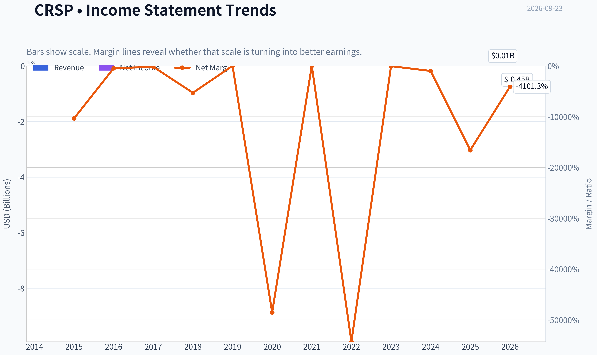

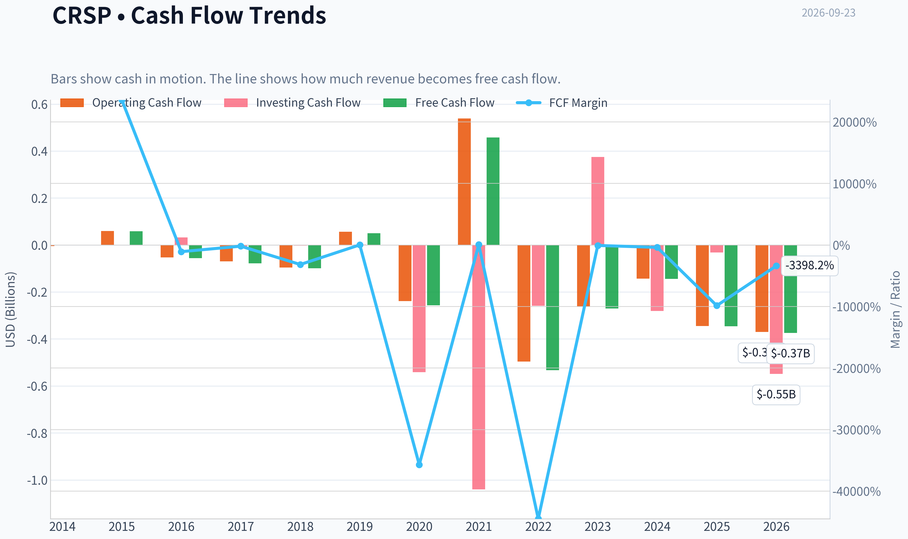

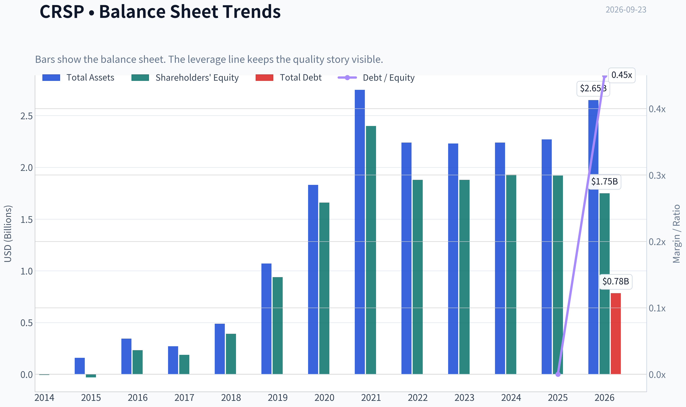

This graph tracks the profitability and return metrics (ROE, ROIC, Margins) of **CRSP** over the past decade, highlighting capital efficiency trends.

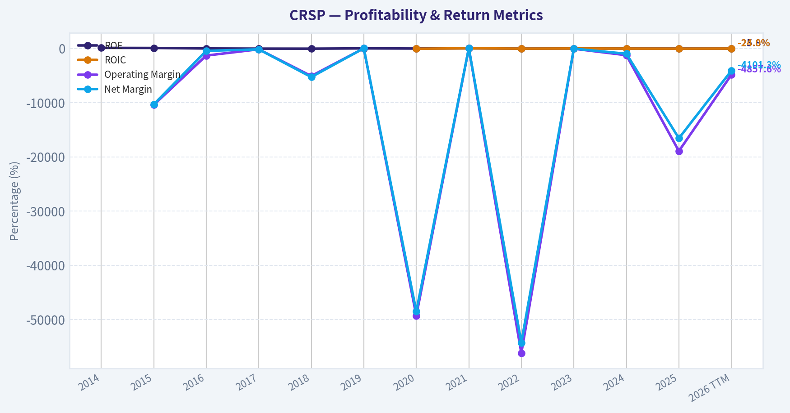

This chart illustrates the financial health of **CRSP** over the last 10 years, mapping cash equivalents and free cash flow against total obligations (Debt).

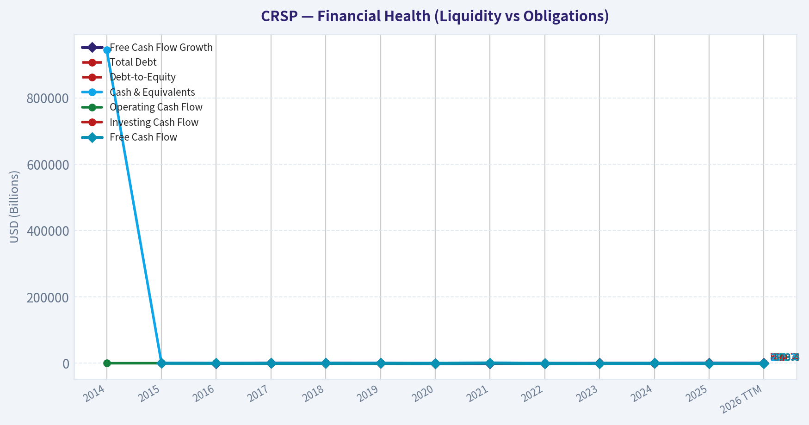

This comparison chart from *Profitability and Operating Performance* stacks current figures against historical benchmarks for **CRSP**, making it easy to see where the company trades relative to its own averages.

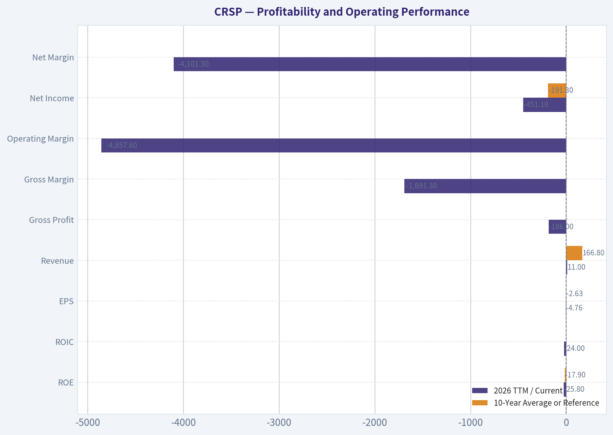

---

### Intrinsic Value Analysis (Buffett)

> *Following Warren Buffett's value investing philosophy: Circle of Competence, Economic Moat, Management Quality, and Margin of Safety.*

#### Intrinsic Value Snapshot

Price is what you pay. Intrinsic value is what the business may be worth based on the cash it can create for owners over time. We show a range, not one magic number.

- Current Price: $55.76
- Value Range (conservative to optimistic across both DCF methods): N/A to N/A

##### Owner Earnings (Buffett Method)
- Net Income: $-581,599,000.00
- Depreciation & Amortization: $19,479,000.00
- Capital Expenditures: $-914,000.00
- Working Capital Changes: $71,882,000.00
- Owner Earnings: $-634,916,000.00

##### Intrinsic Value

ANALYST STANCE: **AVOID**

#### Executive Conclusion

CRISPR Therapeutics has a potentially valuable gene-editing platform and an important commercial asset in Casgevy, but the investment case currently depends on uncertain future approvals, adoption, and royalty economics rather than demonstrated recurring cash earnings. At approximately **$56 per share** and a **$5.39 billion market capitalization**, the company has negative earnings, negative free cash flow, sharply declining revenue, and a headline intrinsic value estimate below zero.

The balance sheet appears strong enough to avoid a solvency-based rejection, but the valuation does not provide a sufficient margin of safety for a highly speculative biotechnology business.

#### 1. Factor Scorecard

| Factor | Score | Assessment |
|---|---:|---|
| Circle of competence and simplicity | 2/5 | The model is understandable at a high level-develop and commercialize gene-editing therapies-but clinical, regulatory, manufacturing, and reimbursement outcomes are difficult to predict. |
| Moat | 3/5 | CRISPR gene-editing expertise, intellectual property, partnerships, and Casgevy approval provide meaningful advantages. The moat is not yet proven through durable profitability or broad commercial scale. |
| Management and capital allocation | 3/5 | Strategic partnerships and continued investment in the platform are rational, but the long-term return on R&D spending remains unproven. |
| Industry structure | 2/5 | Biotechnology can produce extraordinary returns, but competition, regulatory risk, high R&D intensity, and binary clinical outcomes create an unfavorable structure for conservative investors. |

**Gate 5 hard floor:** **Not tripped.** Revenue and cash flow are worsening, but the very high current ratio of approximately **13.3** indicates substantial short-term liquidity. There is no evidence provided of interest coverage below 1x or an imminent solvency crisis.

**Key Takeaways:** CRSP has genuine scientific and intellectual-property advantages, but its economics remain unproven. The company passes the solvency floor while scoring poorly on predictability, industry structure, and current financial performance.

#### 2. Moat Analysis

| Potential moat source | Evidence | Durability assessment |
|---|---|---|
| Intangible assets | CRISPR gene-editing technology, patents, clinical expertise, and regulatory approvals | Meaningful, but patent disputes, competing platforms, and scientific advances remain risks |
| Switching costs | Limited for patients and physicians; treatment decisions depend on clinical outcomes, safety, price, and availability | Weak to moderate |
| Cost advantage | No demonstrated manufacturing or operating-cost advantage | Unproven |
| Network effects | No traditional network effect; partnerships may improve development and commercialization capabilities | Limited |
| First-mover/regulatory position | Casgevy is a major commercial validation of the technology and was developed with Vertex | Important but not necessarily permanent |

Casgevy gives CRSP a scarce asset: an approved gene-editing treatment with potential applications in severe blood disorders. However, approval does not guarantee rapid sales. Treatment complexity, high cost, specialized treatment centers, patient eligibility, reimbursement, and long-term safety monitoring can all constrain adoption.

The moat is best classified as **narrow to potentially wide**, but not yet wide and widening on financial evidence.

#### 3. Management Quality Assessment

Management deserves credit for building a leading gene-editing platform, advancing Casgevy through approval, and using a major partnership with Vertex to share development and commercialization burdens. Those actions reduce execution risk relative to a fully independent biotechnology company.

The principal concern is capital allocation under uncertainty. CRSP continues to consume cash while investing heavily in a pipeline whose ultimate commercial value is unknown. A biotechnology management team can create enormous value through successful R&D, but investors cannot yet verify that retained capital is earning attractive returns on a per-share basis.

**Management score: 3/5.**

#### 4. Financial Summary

| Metric | Latest available figure |
|---|---:|
| Share price | $56 |
| Market capitalization | $5.39 billion |
| Revenue growth, year over year | -90.6% |
| ROE | -30.3% |
| P/E | N/A |
| FCF yield | -6.4% |
| Gross margin | N/A |
| Current ratio | 13.3 |
| Headline intrinsic value | -$52.41 |
| Margin of safety versus price | 206.4% |

**Key Takeaways:** CRSP's financial profile is that of a development-stage biotechnology company rather than an established compounder. Revenue has fallen sharply, ROE is negative, and free cash flow is negative, although liquidity appears strong. Traditional earnings multiples are not useful because the company is not currently profitable.

#### 5. Owner Earnings Calculation

The research data does not provide a reliable positive owner-earnings figure. Using the reported **-6.4% free-cash-flow yield** as a cash-flow proxy:

| Calculation | Approximate amount |
|---|---:|
| Market capitalization | $5.39 billion |
| Implied free cash flow | Approximately -$345 million |
| Depreciation and amortization adjustment | Not provided |
| Maintenance capital expenditure | Not separately disclosed |
| Working-capital adjustment | Not separately disclosed |
| Indicative owner earnings | Negative; approximately -$345 million proxy |

**Key Takeaways:** CRSP currently consumes cash rather than producing owner earnings. Because maintenance capital expenditures and working-capital changes are not separately available, the negative free-cash-flow figure is the most practical proxy, and it does not support a conventional earnings-based valuation.

#### 6. Three-Scenario DCF Valuation

Because current owner earnings are negative, a standard Buffett-style DCF produces negative or economically unusable values. The following figures use the negative free-cash-flow proxy and approximately **96 million shares**, implied by the market capitalization and share price.

| Scenario | Assumption | Indicative equity value | Indicative value per share |
|---|---|---:|---:|
| A: No growth | Negative owner earnings capitalized at 10% | Approximately -$3.45 billion | Approximately -$36 |
| B: GDP growth | Negative cash flow growing at 3% | Approximately -$4.93 billion | Approximately -$51 |
| C: Historical growth | Not meaningful because revenue and cash flow are volatile and currently negative | Not calculable | Not calculable |
| Research-pack headline estimate | Business-model-routed intrinsic value | Not meaningful as a positive equity value | **-$52.41** |

**Key Takeaways:** A DCF based on present cash generation cannot justify the current share price. Investors are effectively paying for future successful commercialization and pipeline breakthroughs, not for today's earnings power. That may eventually prove correct, but it is not a conservative intrinsic-value investment at the current price.

#### 7. Margin of Safety Analysis

The headline intrinsic value is **-$52.41 per share** versus a market price of **$56**, producing a reported margin-of-safety calculation of **206.4%**. Economically, however, this should not be interpreted as a conventional margin of safety; it means the company's current cash flows are negative and the valuation depends on future success.

For a business with negative earnings, negative free cash flow, binary clinical risks, and uncertain commercialization, the required margin of safety should be substantially greater than for a proven wide-moat compounder. CRSP does not meet that standard.

**Valuation score: 1/5.**

#### 8. Final Buffett Scorecard

| Criterion | Weight | Score | Weighted contribution |
|---|---:|---:|---:|
| Moat width and durability | 25% | 3 | 0.75 |
| Valuation and margin of safety | 20% | 1 | 0.20 |
| Capital returns: ROIC versus WACC | 15% | 1 | 0.15 |
| Business understanding and predictability | 12% | 2 | 0.24 |
| Management quality and capital allocation | 12% | 3 | 0.36 |
| Reinvestment runway | 8% | 4 | 0.32 |
| Balance-sheet strength | 4% | 4 | 0.16 |
| Industry structure | 4% | 2 | 0.08 |
| **Total** | **100%** |  | **2.26/5** |

**Key Takeaways:** CRSP's strongest attributes are its scientific platform, potential reinvestment runway, and apparent liquidity. Those positives are outweighed by negative current cash generation, weak capital returns, limited predictability, and a valuation that requires substantial future execution.

#### 9. Investment Stance

**AVOID - Moderate conviction.**

CRSP is a scientifically important company with meaningful upside if Casgevy adoption accelerates and its pipeline produces additional commercial therapies. Nevertheless, under a Buffett-style framework, the present price does not offer a reliable margin of safety because intrinsic value cannot be anchored to existing owner earnings.

A more attractive entry point would require either:

- clear evidence of sustained Casgevy revenue growth;
- a credible path to positive free cash flow; or
- a substantially lower valuation that compensates for clinical and commercialization risk.

The company should remain on a speculative watchlist rather than in a long-term value portfolio.
#### Valuation Bridge

This bridge places the current market price beside each intrinsic value lens so readers can see whether upside depends on one method or shows up across several methods.

| Scenario | Intrinsic Value / Share |
| --- | ---: |
| Damodaran Method | $-52.41 |
| Current Price | $55.76 |

#### Key Takeaways

If one method is far above the others, the upside case depends on a specific modelling assumption. When several methods cluster together, the valuation story is more robust.

#### Valuation Visuals

This comparison chart from *Latest Earnings Snapshot* stacks current figures against historical benchmarks for **CRSP**, making it easy to see where the company trades relative to its own averages.

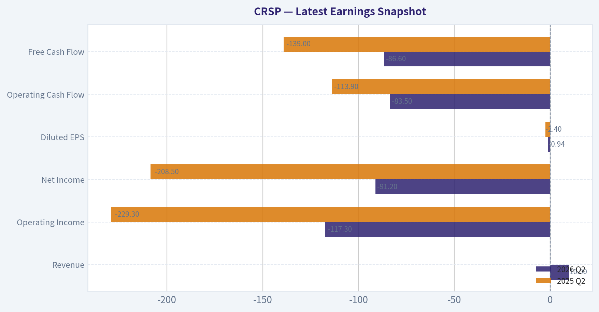

This comparison chart from *Balance Sheet and Financial Strength* stacks current figures against historical benchmarks for **CRSP**, making it easy to see where the company trades relative to its own averages.

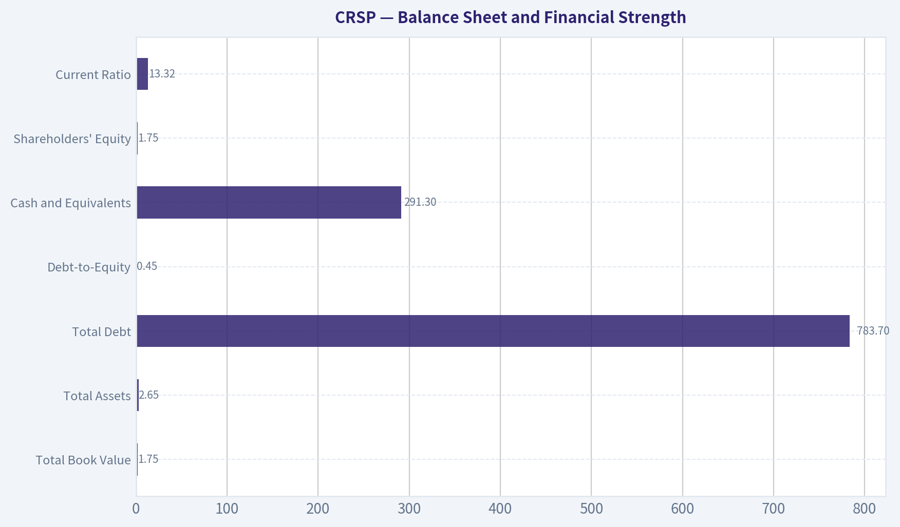

This comparison chart from *Cash Flow and Capital Allocation* stacks current figures against historical benchmarks for **CRSP**, making it easy to see where the company trades relative to its own averages.

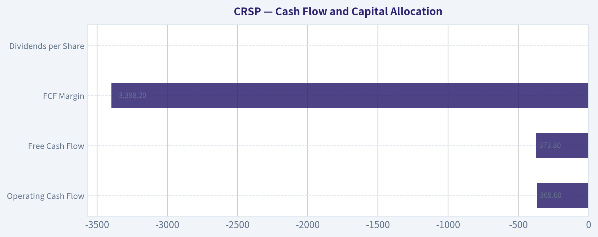

---

### Trend & Growth Analysis (Lynch/Druckenmiller/Fisher)

> *Following Peter Lynch's GARP, Stanley Druckenmiller's macro-aware approach, and Philip Fisher's scuttlebutt methodology.*

ANALYST STANCE: **WATCH**

#### 1. Lynch Classification

**Speculative turnaround / emerging biotech platform**, not currently a Lynch "fast grower."

CRISPR Therapeutics has a potentially transformative commercial product, but reported revenue is milestone-driven and highly volatile. The investment case depends on adoption of CASGEVY, additional approvals, royalties, and pipeline success-not on steady historical earnings growth.

#### 2. The Story in Three Bullets

- CRISPR Therapeutics helped develop **CASGEVY**, a landmark CRISPR-based therapy and one of the first approved gene-editing treatments.
- The company owns substantial optionality across sickle-cell disease, beta thalassemia, oncology, autoimmune disease, and in-vivo gene editing.
- If commercial adoption accelerates and the pipeline produces multiple approvals, today's roughly **$5.4 billion market capitalization** could eventually look small; however, the company remains loss-making and cash-burning.

#### 3. Fundamental Snapshot

| Metric | CRSP |
|---|---:|
| Current price | $55.76 |
| Market capitalization | $5.39B |
| TTM revenue | $11.0M |
| Latest reported revenue growth | -90.6% |
| Three-year revenue CAGR | 43.1% |
| TTM net income | -$451.1M |
| TTM free cash flow | -$373.8M |
| ROE | -30.3% |
| Price-to-sales | 402.6x |
| Current ratio | 13.3 |
| Piotroski F-Score | 2/9 |

**Key Takeaways:** CRSP is not yet an earnings or revenue compounder. The very high price-to-sales ratio reflects extremely low current revenue, while the negative free cash flow shows that investors are paying for future products and approvals. Liquidity appears strong on the current-ratio measure, but the reported balance-sheet figures contain inconsistencies that should be checked against the latest filing.

#### 4. TAM Analysis and the 10x Test

The supplied market research estimates the **autologous hematopoietic stem-cell gene-therapy market at approximately $13.4 billion by 2030**. That is a meaningful market, but CASGEVY's initial addressable population is narrower because treatment is complex, expensive, and requires specialized cell collection and conditioning.

| TAM Test | Assessment |
|---|---|
| Current reported revenue | $11M, distorted by milestone timing |
| 10x current revenue | $110M |
| Referenced 2030 market | $13.4B |
| Can revenue increase 10x while remaining below 20% share? | Yes, easily |
| Can market capitalization increase 10x? | Possible, but requires several successful products |
| TAM growth | Positive, but commercialization capacity is a constraint |

**Key Takeaways:** CRSP passes the basic 10x revenue runway test, although the starting revenue base is unusually depressed and not economically representative. The larger opportunity is not just the initial blood-disorder market; it is the ability to expand gene editing into multiple diseases. The central risk is that a large theoretical TAM does not automatically translate into treatment volume, manufacturing capacity, or durable economics.

#### 5. Revenue Growth Trend

| Period | Revenue | Growth |
|---|---:|---:|
| 2023 | $371.2M | - |
| 2024 | $37.3M | -89.9% |
| 2025 | $3.5M | -90.6% |
| 2026 TTM | $11.0M | +213.4% versus 2025 |

**Key Takeaways:** The headline series is highly erratic because CRSP recognizes collaboration and milestone revenue unevenly. The latest TTM growth rate looks strong only because it follows an exceptionally low base. This is not yet evidence of a durable commercial acceleration; investors should focus on CASGEVY treatment numbers, royalty receipts, reimbursement, and recurring product revenue.

#### 6. Unit Economics and Operating Efficiency

| Metric | Status | Interpretation |
|---|---:|---|
| LTV/CAC | Not available | Not a conventional subscription or consumer model |
| Net revenue retention | Not applicable | Revenue comes from therapies, royalties, and partnerships |
| Rule of 40 | Not meaningful | Revenue is milestone-driven and FCF margin is deeply negative |
| TTM FCF margin | -3,398% | Distorted by very low revenue and heavy R&D investment |
| TTM operating cash flow | -$369.6M | Substantial ongoing cash requirement |
| Current ratio | 13.3 | Strong reported short-term liquidity |

**Key Takeaways:** Standard SaaS unit-economics metrics do not apply. The relevant economics are treatment cost, gross royalty per patient, manufacturing expense, reimbursement, sales ramp, and R&D spending per successful program. Current cash burn is a major consideration even though the current ratio appears high.

#### 7. Inflection-Point Assessment

| Potential Inflection | Current View | Evidence Needed |
|---|---|---|
| Product cycle | Positive but early | CASGEVY launches and treatment volumes |
| Revenue acceleration | Unproven | Several quarters of recurring commercial revenue |
| Market-share inflection | Possible | Adoption versus competing sickle-cell treatments |
| Margin inflection | Not visible | Royalty scale and lower cost per treatment |
| TAM expansion | Strong optionality | Approvals in autoimmune, oncology, and in-vivo editing |
| Competitive position | Differentiated | Clinical efficacy, safety, manufacturing reliability |

**Key Takeaways:** The most important possible inflection is the conversion of CASGEVY from a regulatory achievement into a repeatable commercial business. A second inflection would come from positive clinical data in broader, more scalable indications. Until those milestones appear in reported results, the stock remains a high-volatility option on the pipeline.

#### 8. Macro Setup

The secular macro backdrop is favorable: healthcare innovation, gene editing, personalized medicine, and biotechnology remain long-duration growth themes. However, CRSP is sensitive to interest rates, risk appetite, regulatory sentiment, reimbursement policy, and biotech funding conditions.

Falling rates and a risk-on market would support valuation. Conversely, high rates or weak biotech financing could pressure the shares even if clinical progress remains intact.

#### 9. Fisher's 15-Point Assessment

| Fisher Criterion | Score / 5 | Comment |
|---|---:|---|
| Market potential | 5 | Large unmet needs and multiple indications |
| New-product determination | 5 | Broad and active pipeline |
| R&D effectiveness | 4 | Strong science, but clinical risk remains |
| Sales organization | 3 | Commercial execution still being proven |
| Profit margins | 1 | Deeply negative currently |
| Margin improvement | 2 | Potential, not yet demonstrated |
| Labor relations | 3 | Limited public evidence |
| Executive relations | 3 | Limited public evidence |
| Management depth | 4 | Experienced scientific and commercial partners |
| Cost analysis/accounting | 3 | Difficult to assess from milestone-heavy results |
| Outstanding moat | 4 | IP, know-how, partnerships, and clinical lead |
| Long-range profit outlook | 4 | Attractive if multiple programs succeed |
| Dilution risk | 3 | Cash burn creates future financing risk |
| Management candor | 3 | Requires ongoing filing and trial review |
| Management integrity | 4 | No major issue identified in supplied data |
| **Total** | **51 / 75** | **Average/speculative** |

**Key Takeaways:** CRSP scores well on science, product potential, and long-term market opportunity. It scores poorly on current profitability, commercial execution, and demonstrated operating efficiency. The overall score is below the threshold for a high-conviction Fisher compounder because too much of the investment case remains dependent on future clinical and commercial outcomes.

#### 10. Valuation Analysis

| Method | Result | Usefulness |
|---|---:|---|
| P/E | N/A | Company is loss-making |
| PEG | N/A | No reliable earnings-growth denominator |
| Price-to-sales | 402.6x | Not useful while revenue is milestone-distorted |
| FCF yield | -6.4% | Indicates ongoing cash consumption |
| Reported intrinsic-value model | Negative | Not reliable for a pre-scale biotech |
| Market-cap hurdle for 10x return | Approximately $54B | Requires several successful products |

**Key Takeaways:** Conventional valuation metrics provide little precision because current revenue and earnings do not represent the company's potential commercial base. The negative DCF output should not be interpreted as a literal value of zero; it mainly reflects high current losses and the absence of modeled future product economics. Nonetheless, the market already assigns meaningful value to the pipeline, so clinical success is partly priced in.

#### 11. Scenario Framework

| Scenario | Operating Outcome | Valuation Implication |
|---|---|---|
| Bear | CASGEVY adoption remains slow; pipeline setbacks; continued heavy burn | Significant downside and possible dilution |
| Base | CASGEVY gains moderate traction; one or more pipeline programs advance | Shares remain highly volatile with moderate upside potential |
| Bull | CASGEVY becomes a meaningful commercial product and multiple therapies succeed | Multi-bagger potential over several years |
| Ten-bagger case | Several large indications reach approval, manufacturing scales, and cash flow turns positive | Requires roughly $54B market cap; possible but low probability today |

**Key Takeaways:** The upside distribution is unusually wide. A bull case can justify substantial appreciation because successful gene-editing platforms can create very large royalty and product markets. The ten-bagger scenario requires platform validation across several indications, not merely success of one therapy.

#### 12. Growth Investor Scorecard

| Criterion | Weight | Score / 5 | Weighted Score |
|---|---:|---:|---:|
| Lynch story | 10% | 4.0 | 0.40 |
| TAM and runway | 20% | 4.5 | 0.90 |
| Revenue growth | 20% | 2.0 | 0.40 |
| Unit economics | 15% | 1.5 | 0.23 |
| Competitive position | 10% | 4.0 | 0.40 |
| Management quality | 10% | 3.5 | 0.35 |
| Macro setup | 5% | 3.5 | 0.18 |
| Profitability path | 5% | 2.5 | 0.13 |
| Valuation | 5% | 2.0 | 0.10 |
| **Total** | **100%** | - | **3.09 / 5.00** |

**Key Takeaways:** CRSP lands in the WATCH range. Its scientific platform and long-term TAM are compelling, but current financial performance, valuation visibility, and cash generation are not strong enough for an Advocate rating. The score could improve materially if commercial revenue becomes recurring and cash burn begins to decline.

#### 13. Position Size Stance

For a diversified growth portfolio:

- **Current stance:** Watch position only, approximately **0% to 1%**.
- **Speculative biotech sleeve:** Up to **2%**, only for investors able to tolerate substantial volatility and binary clinical risk.
- **Increase position after confirmation:** Consider adding only after evidence of sustained CASGEVY adoption, improving cash trends, and positive pipeline data.
- **Avoid concentrated sizing:** The company remains exposed to clinical failures, regulatory delays, manufacturing bottlenecks, and dilution.

#### 14. Key Catalysts and Risks

| Catalysts | Risks |
|---|---|
| CASGEVY treatment-volume acceleration | Slow physician or patient adoption |
| Higher recurring royalty revenue | Reimbursement and affordability barriers |
| Positive clinical data in autoimmune or oncology programs | Trial failures or safety signals |
| Additional regulatory approvals | Manufacturing complexity and capacity limits |
| Reduced R&D cash burn | Continued losses and equity dilution |
| Partner milestones or licensing deals | Competition from alternative gene therapies |

**Key Takeaways:** The strongest catalyst is proof that CASGEVY can generate repeatable commercial economics rather than one-time milestone revenue. The greatest risk is that the science succeeds but the treatment model remains too complex or expensive to scale. Cash-burn reduction would also materially improve the investment case.

#### Bottom Line

CRSP is a **high-upside, high-risk gene-editing platform**, not a proven growth compounder. The company has genuine ten-bagger optionality if CASGEVY commercializes successfully and the broader pipeline produces multiple approvals, but the current data do not establish that inflection yet. I would **WATCH rather than initiate aggressively**, seeking confirmation from treatment volumes, recurring revenue, clinical readouts, and cash-burn trends.

#### Growth & Scorecard Visuals

This comparison chart from *Growth Metrics* stacks current figures against historical benchmarks for **CRSP**, making it easy to see where the company trades relative to its own averages.

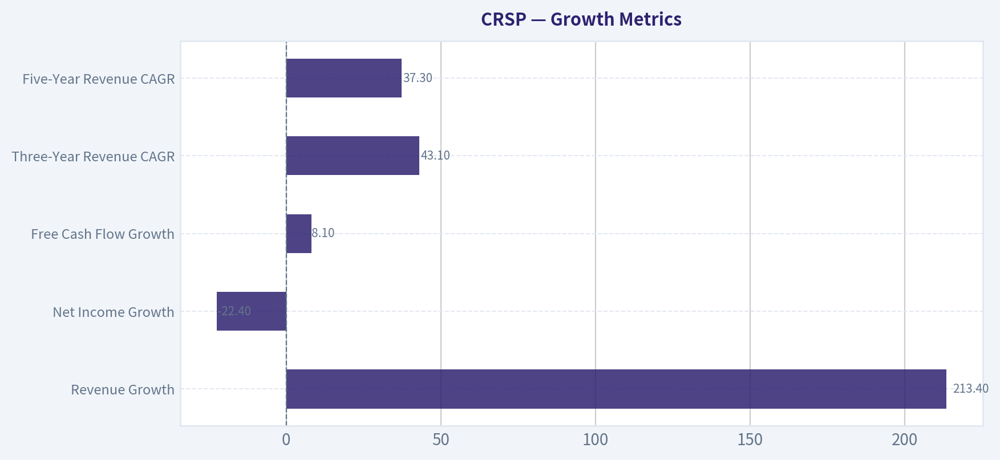

---

### Market Technical Analysis

ANALYST STANCE: **WATCH**

#### CRSP technical overview

CRSP's latest valid OHLC observation in the retrieved data is **September 21, 2026, at $58.33**. The data contains no valid open, high, low, or close for September 22, and the indicator service appears to repeat September 21 values for September 23. Therefore, the analysis should be treated as current through September 21 rather than as a confirmed September 23 close.

The technical picture is improving on a short-term basis, but it has not yet developed into a fully confirmed bullish trend. Price rebounded sharply from the September 11 low of $51.72 and closed at $58.33 on September 21, a gain of approximately 12.8%. The rebound included unusually strong volume on September 17 and September 18, suggesting that the move attracted meaningful participation rather than being driven solely by thin trading.

#### Trend structure

CRSP is trading above its key moving averages:

- **10 EMA:** $55.34
- **50 SMA:** $53.18
- **200 SMA:** $53.34
- **Latest valid close:** $58.33

Price is approximately **5.4% above the 10 EMA**, **9.7% above the 50 SMA**, and **9.4% above the 200 SMA**. This alignment is constructive: the short-term price trend is positive, and the medium- and long-term averages are clustered near $53, creating an important underlying support zone.

However, the moving averages themselves do not yet show a powerful long-term trend. The 50 SMA is almost flat to slightly rising, while the 200 SMA is also only gradually increasing. This suggests that the stock has recovered above its trend benchmarks, but the broader trend remains more consistent with a developing recovery or range breakout attempt than with an established sustained advance.

The 10 EMA has turned upward from approximately $52.97 on August 18 to $55.34 currently, confirming a short-term improvement. A sustained close above the recent resistance area around **$59.20 to $60.90** would strengthen the bullish interpretation. Conversely, a close back below the 10 EMA would indicate that the recent rebound is losing momentum.

#### Momentum and MACD

The MACD reading has improved considerably:

- August 28: approximately **2.06**
- September 10: approximately **0.28**
- September 16: approximately **-0.53**
- September 21 and the service's September 23 reading: approximately **+0.26**

This sequence indicates that the earlier downtrend in momentum bottomed around mid-September and then reversed. The move back above zero is a favorable signal because it suggests that short-term upside momentum has regained control.

The MACD reversal should still be interpreted cautiously. The indicator remains relatively close to zero, and the rebound is recent. A stronger bullish confirmation would come from MACD moving decisively higher while price breaks above $60.90. If MACD turns down again near zero while price fails around the $59 to $61 resistance band, that would increase the risk of a failed recovery.

#### RSI interpretation

RSI is approximately **59.4**, up from readings near **39 to 43** between September 8 and September 16. This is a meaningful recovery in momentum, but it is not yet overbought. RSI is therefore supportive of additional upside while leaving room for the stock to advance without immediately entering an overheated condition.

The move from below 40 to near 60 also shows that the September rebound has repaired much of the prior bearish momentum damage. Nevertheless, RSI has not exceeded 70, so there is no technical evidence of an extreme upside surge. A move above 60 or 65, especially alongside a price breakout, would improve the bullish case. A drop back below 50 would suggest that the rebound is weakening.

#### Volume and VWMA

The volume-weighted moving average is reported at approximately **$49.63 for September 23**, but this figure is inconsistent with the surrounding values, which were near **$55.0** to **$55.1** on September 18 and September 21. The abrupt change likely reflects the missing or malformed September 22 data rather than a genuine collapse in the volume-weighted trend measure.

Because of that data irregularity, the VWMA should not be used as a precise current level. The reliable portion of the series shows that CRSP traded near or above its volume-weighted average during the September 17-21 rebound. The volume surge accompanying the move-particularly the approximately 3.0 to 3.4 million shares traded on September 17-18-supports the credibility of the recovery. Still, follow-through volume is needed; a breakout above $60.90 on declining volume would be less convincing.

#### Volatility and risk management

ATR is approximately **$2.51**, compared with readings around **$2.7 to $2.8** in late August. Volatility has therefore moderated somewhat, but it remains substantial. The current ATR represents roughly **4.3% of the latest valid close**, which is high enough that tight stops could be triggered by ordinary daily fluctuations.

A practical risk framework would account for a typical daily range of approximately $2.50. For a bullish position, stops placed immediately below the entry price may be vulnerable to noise; traders may instead consider a stop beneath a technically meaningful support level, adjusted for position size. The main support areas are approximately **$55.30**, corresponding to the 10 EMA, and then the **$53.15-$53.35** zone, where the 50 SMA and 200 SMA are concentrated.

#### Bollinger position and nearby levels

The Bollinger middle line is approximately **$55.88**, placing the latest valid close about **$2.45, or 4.4%, above the middle band**. This confirms that price has shifted from below the recent short-term mean to the upper side of it. However, the upper and lower Bollinger bands were not provided, so it is not possible to determine whether price is close to an upper-band breakout or merely modestly above the centerline.

The Bollinger middle line has declined from approximately $56.62 on September 8 to $55.88 currently, despite the recent price rebound. This lagging behavior reflects the weakness earlier in the month. A continued move above $58-$60 would be important because it could cause the middle line to flatten and then turn upward, confirming that the broader short-term distribution is improving.

#### Trading interpretation

The evidence favors a **constructive but unconfirmed recovery**:

- The price is above the 10 EMA, 50 SMA, and 200 SMA.
- MACD has crossed back into positive territory.
- RSI has recovered to a neutral-bullish level near 60.
- Recent upside movement was accompanied by elevated volume.
- Volatility remains high enough to require disciplined position sizing.

The principal obstacle is the resistance zone around **$59.20 to $60.90**, which contains recent highs from September 17 and September 21. A decisive close above that zone, ideally with volume above the recent average, would signal that the rebound is becoming a more durable breakout. Potential upside reference areas would then be around **$62.50 to $63.50**, based on prior July and August trading levels.

Failure at resistance would leave CRSP vulnerable to a pullback toward **$55.30**, with deeper support around **$53.15-$53.35**. A close below the 50 SMA and 200 SMA cluster would materially weaken the current bullish setup and indicate that the September rebound may have been only a countertrend rally.

This is a technical market assessment, not individualized investment advice.

#### Selected indicators

The selected indicators are complementary rather than redundant: moving averages define trend structure, MACD measures momentum direction, RSI measures momentum intensity, ATR quantifies risk, VWMA incorporates volume, and the Bollinger middle line provides a mean-reversion and price-location reference.

| Indicator | Latest reported value | Interpretation | Key level or implication |
|---|---:|---|---|
| close_10_ema | $55.34 | Short-term trend has turned upward; price is above it | First dynamic support near $55.30 |
| close_50_sma | $53.18 | Medium-term trend is broadly stable to slightly improving | Support within the $53 area |
| close_200_sma | $53.34 | Long-term benchmark is modestly rising; broader trend not yet strongly directional | Important structural support |
| macd | +0.26 | Momentum recovered from negative territory and moved positive | Stronger confirmation requires follow-through above resistance |
| rsi | 59.4 | Neutral-to-bullish momentum; not overbought | Sustained readings above 60 would improve the setup |
| atr | $2.51 | Volatility remains elevated | Stops and position sizes should allow for large daily swings |
| vwma | Data anomaly near $49.63; reliable recent readings near $55 | Recent volume-backed trend was constructive, but latest figure is unreliable | Verify future volume and VWMA data before relying on it |
| boll | $55.88 | Price is above the recent 20-day mean | A sustained move above $59-$61 would strengthen breakout potential |

Key Takeaways: CRSP has regained its major moving averages, and MACD and RSI both confirm a meaningful improvement in short-term momentum. The stock is not yet in a fully confirmed uptrend because the 50- and 200-day averages remain relatively flat and price still faces resistance near $59 to $61. The most important bullish signal would be a high-volume close above $60.90, while a decline below the $53.15 to $53.35 moving-average cluster would significantly damage the recovery thesis.

#### Market Visuals

This comparison chart from *Market Metrics* stacks current figures against historical benchmarks for **CRSP**, making it easy to see where the company trades relative to its own averages.

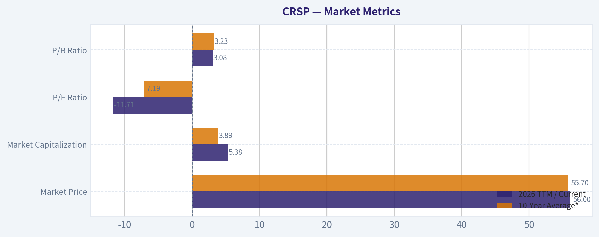

---

### Options Market Analysis

> *Reading options flow - put/call ratios, IV skew, and unusual activity - to gauge institutional positioning and event-driven risk.*

#### CRSP Options Market Report

*Data as of September 23, 2026. Near-term expirations analyzed: September 25, October 2, and October 9, 2026.*

#### Put/Call Ratio Analysis

| Expiration | Days to Expiry | Call OI | Put OI | Put/Call OI Ratio | Call Volume | Put Volume |
|---|---:|---:|---:|---:|---:|---:|
| Sep. 25, 2026 | 2 | 3,614 | 1,092 | 0.30 | 1,139 | 960 |
| Oct. 2, 2026 | 9 | 2,005 | 541 | 0.27 | 217 | 121 |
| Oct. 9, 2026 | 16 | 305 | 112 | 0.37 | 49 | 41 |
| **Total** | - | **5,924** | **1,745** | **0.29** | **1,405** | **1,122** |

**Key Takeaways:** CRSP's near-term put/call open-interest ratio of 0.29 is substantially below the approximately 0.70 neutral baseline, indicating strongly call-heavy positioning. The volume ratio of 0.80 is less bullish than the OI ratio but still does not show aggressive put dominance. The call-heavy OI may represent bullish positioning, existing call exposure, or covered-call supply; without trade-direction data, it should not be treated as pure call buying.

#### Implied Volatility Assessment

| Expiration | Call ATM IV | Put ATM IV | IV Difference, Put Minus Call | Assessment |
|---|---:|---:|---:|---|
| Sep. 25 | 80.3% | 82.8% | +2.5 percentage points | Slight put premium |
| Oct. 2 | 75.1% | 59.9% | -15.2 percentage points | Call IV premium |
| Oct. 9 | 59.8% | 63.9% | +4.1 percentage points | Slight put premium |

**Key Takeaways:** Near-term implied volatility is elevated, particularly for the September 25 expiry, with ATM IV around 80%. The available ATM data does not provide a consistently steep downside skew: puts are modestly richer in the two-week windows, while calls carry a large IV premium for October 2. This suggests meaningful event or single-stock volatility risk, but not a uniform market fear of downside.

The tool output does not include specific out-of-the-money put and call IVs, so a precise OTM skew calculation is unavailable. It also does not identify an upcoming CRSP catalyst such as earnings, a clinical readout, regulatory decision, or product-related event; elevated IV could nevertheless reflect expected biotech-specific event risk.

#### Unusual Options Activity

| Finding | Result |
|---|---|
| Contracts meeting unusual-activity threshold | None |
| Screening rule | Volume greater than 5 times open interest |
| Fresh directional contracts identified | None |
| Smart-money versus retail inference | Not possible from the supplied data |

**Key Takeaways:** No near-term CRSP contract had volume exceeding five times its open interest, so there is no clearly identifiable fresh block or sweep activity. The absence of unusual activity lowers conviction in the directional interpretation of the call-heavy OI. It also means there is no contract-specific basis for labeling institutional traders as aggressively bullish or bearish.

#### Open Interest Concentration and Gamma Levels

| Expiration | Total Call OI | Total Put OI | Combined OI | Concentration Assessment |
|---|---:|---:|---:|---|
| Sep. 25 | 3,614 | 1,092 | 4,706 | Dominant near-term concentration |
| Oct. 2 | 2,005 | 541 | 2,546 | Secondary concentration |
| Oct. 9 | 305 | 112 | 417 | Limited concentration |
| **Total** | **5,924** | **1,745** | **7,669** | - |

**Key Takeaways:** The September 25 expiration contains approximately 61% of total near-term open interest, making it the most important expiry for short-dated positioning and potential pinning. However, strike-level open interest was not provided, so exact gravitational strikes, max-pain levels, and gamma walls cannot be identified. The large near-term concentration may dampen price movement around heavily held strikes, but it can also increase sensitivity to dealer hedging if CRSP moves sharply.

#### Overall Options Sentiment

**Signal: BULLISH, with low-to-moderate confidence.**

The primary bullish factor is the exceptionally low near-term put/call OI ratio of 0.29, well below the 0.70 neutral reference point. Call open interest exceeds put open interest by more than three to one, especially in the September 25 and October 2 expirations.

The signal is tempered by three limitations:

- Put/call volume is only moderately call-favorable at 0.80, rather than showing overwhelming current call demand.
- No contracts qualified as unusual activity, so there is no confirmation of fresh institutional call buying.
- Strike-level data and current share price were not supplied, preventing analysis of ITM, ATM, or OTM positioning, max pain, and exact gamma walls.

Implied volatility is high, indicating that the market expects substantial near-term movement. The lack of a consistently steep put skew is modestly supportive of the bullish read, but elevated IV means directional risk and potential post-event volatility contraction remain significant.

#### Summary

| Category | Assessment |
|---|---|
| Put/Call Ratio | **Bullish:** OI ratio 0.29 versus approximately 0.70 neutral; volume ratio 0.80 is moderately call-favorable |
| IV Level | **Elevated:** Near-term ATM IV ranges from approximately 60% to 83% |
| Skew Direction | **Mixed but not strongly bearish:** slight put premium in two expiries, substantial call premium in October 2 |
| Unusual Activity | **None detected:** no contract exceeded 5 times its open interest |
| Overall Signal | **BULLISH, low-to-moderate confidence** |

**Key Takeaways:** CRSP's options positioning is directionally bullish mainly because of its strongly call-heavy open interest. High implied volatility signals substantial event or single-stock risk, while the absence of unusual contracts and strike-level data argues for caution. The best overall interpretation is bullish positioning without strong evidence of fresh institutional conviction.

---

## Research Team Commentary

> *The Research Manager synthesizes the Bull vs Bear debate into action-free commentary. This is a pre-risk view, not the final stance.*

Core takeaway: CRISPR Therapeutics has achieved genuine scientific validation through CASGEVY, but it has not yet demonstrated the repeatable commercial economics required for a Buffett-style investment. At roughly $56-$58 and a market capitalization near $5.4 billion, the stock is neither an obvious bargain nor an obvious financial-distress case. The prudent stance is to wait for evidence that CASGEVY can generate meaningful economics and that the platform can produce a second valuable franchise.

The strongest bull argument is that CASGEVY materially reduces scientific and regulatory uncertainty. CRISPR Therapeutics is no longer merely a collection of laboratory-stage concepts; it helped bring one of the first approved gene-editing therapies to market. The company has accumulated specialized knowledge in editing, manufacturing, regulatory approval, safety monitoring, and clinical execution. Its partnership with Vertex adds commercial expertise and validates the asset while allowing CRISPR to focus capital on further development. If CASGEVY scales and even one additional oncology, autoimmune, or in-vivo program succeeds, the current valuation could prove modest relative to a multi-product gene-editing platform.

The bull is also right not to interpret the reported 90.6% revenue decline as a comparable collapse in end-market demand. Collaboration and milestone revenue can be extremely uneven. Patient throughput, treatment-center productivity, reimbursement, recognized product economics, and cash burn are more informative than a headline year-over-year comparison. Likewise, negative historical ROE and ROA reflect real losses but do not, by themselves, determine the value of an emerging biotechnology platform.

The strongest bear argument is that CASGEVY validates one therapy, not yet a repeatable or highly profitable franchise. Treatment requires specialized centers, cell collection, manufacturing, conditioning, hospitalization, reimbursement approval, and long-term monitoring. Those complications may be temporary launch constraints, but they could also create a permanently limited commercial ceiling. Moreover, part of the commercial infrastructure and bargaining power belongs to Vertex and treatment centers rather than exclusively to CRISPR shareholders.

Valuation is the decisive issue. The bull's probability-weighted value of approximately $7 billion is highly sensitive to an assumed 25% probability of a $14 billion platform outcome. Reducing that probability to 10% brings expected value close to the current market capitalization. That is not a robust margin of safety. For a company with negative free cash flow, correlated pipeline risks, uncertain dilution, and binary clinical outcomes, I would require a much wider discount than the approximately 30% upside produced by an optimistic probability model.

The reverse-DCF is similarly demanding. If the current price requires roughly $800-$850 million of year-ten free cash flow, CRISPR probably needs more than modest CASGEVY adoption. It likely needs strong product economics, controlled research spending, limited dilution, and at least one additional commercially valuable program. That outcome is plausible, but it is not yet predictable. Missing information on net cash, future burn, diluted shares, collaboration economics, and product-level margins prevents a confident intrinsic-value estimate.

From a business-quality perspective, CRISPR has an important scientific asset and potentially valuable organizational know-how, but its moat remains provisional. Patents are contested, competing editing technologies are advancing, and success in an ex-vivo blood disorder does not automatically transfer to oncology, autoimmune disease, or in-vivo delivery. Management's Vertex partnership appears sensible, but sustained capital-allocation quality will only be demonstrated through controlled burn, selective program termination, limited dilution, and clinical progress per dollar invested.

I would therefore not classify CRISPR as an ADVOCATE. It lacks predictable owner earnings and does not offer the quality-adjusted margin of safety necessary for a concentrated holding. I also would not yet issue a categorical AVOID: CASGEVY is a real approved asset, the platform has meaningful optionality, and the supplied information does not indicate imminent solvency distress or conclusively prove overvaluation. A small venture-style allocation may suit investors explicitly willing to absorb major permanent-loss risk, but it does not belong in the core value portfolio today.

Over the next one to four quarters, the first priority is CASGEVY commercialization. I would track patients referred, collected, infused, and reimbursed; treatment-center throughput; referral-to-infusion time; recognized economics accruing to CRISPR; and whether increased center capacity translates into completed treatments rather than merely infrastructure announcements. Several quarters of sequential improvement would support the argument that launch complexity is delaying demand rather than permanently constraining it.

The second priority is financial endurance. Watch operating cash burn, remaining cash runway, stock-based compensation, changes in diluted shares, manufacturing commitments, and the relationship between R&D spending and identifiable clinical milestones. A credible path toward lower burn or eventual positive free cash flow would strengthen the thesis. Accelerating burn without corresponding commercial or clinical progress would weaken it materially.

Third, monitor whether a second franchise generates persuasive clinical evidence. Strong efficacy, acceptable safety, and a credible development pathway in oncology, autoimmune disease, or in-vivo editing would make the platform claim substantially more credible. Repeated failures, safety concerns, or development delays across programs sharing the same technological dependencies would reveal that the apparent pipeline diversification is less real than it looks.

Finally, the valuation should be updated using product-level assumptions rather than broad scenario labels. That analysis needs current net cash, CRISPR's actual share of CASGEVY economics, expected patient volumes, sustainable margins, development costs, approval probabilities, and future dilution. I would consider upgrading if sustained CASGEVY economics and second-franchise evidence make the market-implied year-ten cash flow plausibly beatable. I would move to AVOID if adoption remains weak after infrastructure is established, safety or pipeline setbacks reduce platform value, or dilution rises while the valuation continues to assume multi-product success.

The main lesson from prior mistakes is to avoid false precision. The 90.6% revenue decline should not be treated as proof that demand collapsed, but CASGEVY's historic approval should not be converted into an assumed platform moat either. Options positioning is neutral and incomplete, so it adds little to the long-term decision. This is a case where disciplined patience is preferable to either extrapolating poor trailing accounts or paying in advance for an unproven platform.

Final stance: WATCH.

---

## Value Investing Team Commentary

> *The Investor translates the research view into an investment thesis before risk review. This is still not the final stance.*

### CRISPR Therapeutics: Scientific Validation Is Not Yet Economic Validation

CRISPR Therapeutics has crossed an important threshold: CASGEVY proves that the company can help move a gene-editing therapy from scientific concept through clinical development and regulatory approval. That achievement gives the platform more credibility than a conventional pre-commercial biotechnology pipeline.

However, a landmark product does not automatically create a predictable, high-return business. At the supplied share-price range of approximately **$56-$58** and market capitalization near **$5.4 billion**, investors are already paying for meaningful commercial adoption and some probability of additional pipeline success. The central question is no longer whether CRISPR technology can work. It is whether CRISPR Therapeutics can convert that technology into durable, repeatable, and adequately profitable shareholder economics.

### What the market may be missing

The reported **90.6% year-over-year revenue decline** could create excessive pessimism if it primarily reflects irregular collaboration and milestone accounting. For this business, reported quarterly revenue can be disconnected from underlying patient demand and long-term product value. The more useful indicators are:

- Patients referred, collected, infused, and reimbursed;
- Growth in productive treatment-center capacity;
- Referral-to-infusion times;
- CRISPR's recognized share of CASGEVY economics;
- Commercial contribution relative to operating cash burn.

There is a credible contrarian opportunity if launch complexity is delaying-not limiting-demand. Specialized centers, conditioning, manufacturing, reimbursement approval, and hospitalization create a slow commercial ramp. Once centers become experienced and reimbursement procedures mature, patient throughput could improve nonlinearly.

The negative **ROE of 30.3%** and **ROA of 25.7%** also require context. Those ratios confirm that the company is consuming capital, but they do not measure the value of a newly approved biotechnology platform particularly well. The more relevant financial questions are cash runway, dilution, incremental product economics, and clinical value created per research dollar.

### What optimistic sentiment may be overlooking

CASGEVY's approval validates one treatment, not yet a broad economic moat. Its delivery model is demanding: patients require cell collection, individualized manufacturing, conditioning, hospitalization, and long-term monitoring. These are not ordinary launch frictions. They may impose a lasting ceiling on eligible-patient conversion and commercial margins.

The platform's apparent diversification also deserves a discount. Oncology, autoimmune disease, and in-vivo editing programs are not fully independent lottery tickets. They may share risks involving editing accuracy, safety, durability, manufacturing, delivery, regulatory scrutiny, and intellectual property. A common technological problem could reduce the value of several programs simultaneously.

CRISPR also does not capture all of CASGEVY's economics. Vertex provides valuable commercial capabilities, but that partnership means part of the product's bargaining power and economics rests outside CRISPR Therapeutics. Before valuing CASGEVY as a franchise, investors need verified information about CRISPR's economic share, product-level expenses, required development spending, and resulting cash contribution.

### Moat and management assessment

CRISPR Therapeutics possesses potentially valuable capabilities in gene editing, manufacturing, regulatory execution, and clinical development. Its experience bringing CASGEVY to approval should be difficult for a new entrant to reproduce quickly. The Vertex partnership also appears strategically rational because it reduces the need for CRISPR to build a complete global commercial organization.

Nevertheless, the moat remains **provisional rather than established**:

- Gene-editing intellectual property remains contested;
- Alternative editing technologies continue to develop;
- Clinical success in ex-vivo blood disorders may not transfer to other categories;
- Treatment complexity can limit scale;
- A durable ecosystem or switching-cost advantage has not yet emerged;
- The company has not demonstrated that it can repeatedly produce approved products at attractive returns on capital.

Management should therefore be judged by capital allocation over the next several years. The key tests are whether it terminates weak programs promptly, concentrates resources behind differentiated assets, controls stock-based compensation and dilution, and produces measurable clinical progress per dollar spent.

### Valuation and reverse-DCF implications

The valuation does not provide an obvious margin of safety. A probability-weighted estimate near **$7 billion** depends heavily on assigning a material probability to a much larger multi-product platform outcome. Reducing that probability can bring estimated value close to the current capitalization. That makes the apparent upside fragile rather than robust.

The reverse-DCF indication that the current price may require approximately **$800-$850 million of year-ten free cash flow** is demanding. Achieving that level likely requires some combination of:

1. Significant and profitable CASGEVY adoption;
2. Favorable economics accruing to CRISPR;
3. At least one additional commercially meaningful product;
4. Controlled research and administrative spending;
5. Limited shareholder dilution.

That outcome is possible, but it is not currently predictable enough for a concentrated value investment. The absence of verified net cash, cash-burn projections, fully diluted share counts, collaboration economics, and product-level margins also prevents a dependable enterprise-value or intrinsic-value calculation.

Because this remains a binary, capital-consuming biotechnology company, it should require a much wider margin of safety than a mature, wide-moat compounder-closer to **40%-50%** than 10%-15%. The supplied evidence does not demonstrate such a discount at $56-$58. At the same time, the information does not establish clear overvaluation or imminent financial distress, so a categorical avoidance judgment would be premature.

### Sentiment and market signals

Options activity is not a meaningful positive signal. A **0.80 put/call volume ratio** is only moderately call-favorable, and the absence of qualifying unusual activity provides no evidence of aggressive institutional positioning. Missing strike-level data makes gamma walls, max pain, and directional positioning impossible to assess.

The unexplained market readings of approximately **2.06 on August 28** and **0.28 on September 10** should not influence the decision without definitions and historical context. Undocumented indicators create false precision.

The broader sentiment risk cuts both ways:

- Investors focused on weak accounting results may underestimate a slow but improving launch.
- Investors captivated by the historic approval may overestimate the probability that CRISPR becomes a multi-product platform.
- Neutral options positioning suggests neither fear nor enthusiasm currently offers an obvious contrarian edge.

The most attractive opportunity would arise if commercial metrics improve while the share price remains restrained by backward-looking revenue declines. Conversely, a rising share price based primarily on pipeline narratives-without improved patient throughput or cash economics-would increase risk.

### Evidence required for an upgrade

I would consider upgrading CRSP if several of the following occur:

- Multiple quarters of sequential CASGEVY patient and economic growth;
- Treatment-center expansion translates into completed infusions;
- CRISPR's share of CASGEVY economics becomes meaningful relative to cash burn;
- Cash runway stabilizes without substantial dilution;
- A second program produces strong efficacy, acceptable safety, and a credible regulatory path;
- Updated product-level valuation shows that the market-implied year-ten cash flow is plausibly beatable;
- The stock trades at a substantial discount to a conservatively probability-weighted intrinsic value.

Evidence supporting a downgrade to AVOID would include persistently weak adoption after treatment infrastructure is established, worsening safety findings, correlated pipeline failures, accelerating cash burn, or material dilution while the valuation continues to assume multi-product success.

CRISPR Therapeutics is therefore best viewed as a scientifically credible but economically unproven business. It may eventually become a valuable gene-editing franchise, but the current evidence does not provide the predictable owner earnings, established moat, or valuation discount required for a Buffett-style core holding. A small venture allocation may be defensible for investors prepared to lose a substantial portion of their capital, but that is different from a high-conviction value investment.

**ANALYST STANCE: WATCH** - CASGEVY provides genuine validation and substantial long-term optionality, but CRISPR Therapeutics has not yet demonstrated repeatable commercial economics or a durable multi-product moat. At approximately $56-$58, the prospective return depends too heavily on uncertain adoption and pipeline outcomes to provide a sufficient margin of safety. Monitor commercialization, cash burn, dilution, and second-franchise evidence rather than paying today for platform success that has not yet been established.

---

## Deep Values Commentary

> *The Risk Management Team debates and the Risk Judge provides the final action-free verdict. This section determines the final ADVOCATE / WATCH / AVOID stance.*

#### Final Stance Scorecard

This scorecard converts the final research view into a weighted decision frame. It does not replace the narrative judgement, but it makes the main drivers of the verdict easier to scan.

| Criterion | Score | Weight | Commentary |
| --- | ---: | ---: | --- |
| Business Quality | 2.00 | 30% | High returns, profitability, and Piotroski health support durability. |
| Valuation Support | 1.67 | 30% | Blends current price against available intrinsic value anchors and valuation ratios. |
| Financial Strength | 5.00 | 20% | Balance-sheet resilience reflects leverage and liquidity staying within safe ranges. |
| Growth Durability | 1.00 | 20% | Recent revenue, earnings, and free cash flow growth indicate how durable expansion looks. |
| TOTAL / FINAL STANCE | 2.30 | 100% | WATCH |

#### Key Takeaways

The weighted score lands at **2.30 / 5.0**, while the final stance remains **WATCH**. This is useful as a quick calibration aid rather than a mechanical signal.

#### Risk Summary

Higher scores indicate more risk pressure. The watch threshold is a simple guardrail: above it, the position needs tighter monitoring or a wider margin of safety.

| Dimension | Current Score | Watch Threshold | Commentary |
| --- | ---: | ---: | --- |
| Business Quality | 4.00 | 3.00 | High returns, profitability, and Piotroski health support durability. |
| Valuation Support | 4.33 | 3.00 | Blends current price against available intrinsic value anchors and valuation ratios. |
| Financial Strength | 1.00 | 3.00 | Balance-sheet resilience reflects leverage and liquidity staying within safe ranges. |
| Growth Durability | 5.00 | 3.00 | Recent revenue, earnings, and free cash flow growth indicate how durable expansion looks. |

#### Key Takeaways

This view helps readers separate *where* the risk sits: valuation, business quality, balance sheet, or growth durability. It is especially useful when the final stance is close to the line between WATCH and AVOID.
