# CRWD Deep Value Intelligence

**Analysis Date:** 2026-03-26

## Critical Disclaimer

*This analysis is generated by Deep Value Intelligence, an AI-powered multi-agent investing framework. This report is for informational and educational purposes only and does not constitute financial advice. Always conduct your own research and consult with qualified financial advisors before making investment decisions.*

---

## Table of Contents

1. Intelligence Summary
2. Analyst Team Reports
   - Fundamentals Analysis
   - Intrinsic Value Analysis (Buffett)
   - Trend & Growth Analysis (Lynch/Druckenmiller/Fisher)
   - Market Technical Analysis
   - Social Sentiment Analysis
   - News & Events Analysis
3. Research Team Commentary
4. Value Investing Team Commentary
5. Deep Values Commentary

---

## Intelligence Summary

### Thesis + Conditions

**Core Thesis:** **EXECUTIVE SUMMARY**
*   **Final Stance:** **AVOID**
*   **The Verdict:** CrowdStrike (CRWD) is an elite business operating in a structurally vital industry, but it fundamentally fails Warren Buffett's most critical tests: margin of safety and durable capital efficiency. *   **The "Why":** Trading at $392 against a conservatively estimated $149 intrinsic value, the stock is priced for a decade of absolute perfection.

**Key Risks:**
- Risk Profile:** Asymmetric downside. In cybersecurity, a single catastrophic update isn't a temporary earnings dip-it is a permanent impairment of brand trust and competitive moat.
- The Valuation Trap (Risky):** The upside is capped. The current multiple already prices in a decade of dominance. Any hiccup-macro, sentiment, or execution-could trigger a violent 40-60% multiple compression. It's a crowded trade offering mediocre reward for maximum risk.
- Applying Buffett's framework, we must distinguish between *business risk* and *market risk*.
- First, **Margin of Safety is non-existent.** Price is what you pay, value is what you get. Paying a 160% premium over intrinsic value means you are absorbing massive market risk. Even if the underlying business continues to execute brilliantly, multiple compression can permanently impair your capital.
- Third, **Tech Risk is Permanent Impairment Risk.** The cybersecurity moat is inherently fragile. Unlike Coca-Cola, where a bad quarter doesn't change consumer taste, a missed zero-day vulnerability or a botched global software update can destroy a security vendor's reputation overnight. The blast radius of an error scales with their growth.

**What Would Change Our View:**
- Risk Profile:** Asymmetric downside. In cybersecurity, a single catastrophic update isn't a temporary earnings dip-it is a permanent impairment of brand trust and competitive moat.
- The Valuation Trap (Risky):** The upside is capped. The current multiple already prices in a decade of dominance. Any hiccup-macro, sentiment, or execution-could trigger a violent 40-60% multiple compression. It's a crowded trade offering mediocre reward for maximum risk.
- Applying Buffett's framework, we must distinguish between *business risk* and *market risk*.
- First, **Margin of Safety is non-existent.** Price is what you pay, value is what you get. Paying a 160% premium over intrinsic value means you are absorbing massive market risk. Even if the underlying business continues to execute brilliantly, multiple compression can permanently impair your capital.
- Third, **Tech Risk is Permanent Impairment Risk.** The cybersecurity moat is inherently fragile. Unlike Coca-Cola, where a bad quarter doesn't change consumer taste, a missed zero-day vulnerability or a botched global software update can destroy a security vendor's reputation overnight. The blast radius of an error scales with their growth.

**Confidence:** Medium

---

## Analyst Team Reports

### Fundamentals Analysis

#### Latest Earnings Snapshot

*Most recent reported quarter anchored on 2026 Q1, with prior-year comparison when available.*

| Metric | 2026 Q1 | 2025 Q1 | YoY Change |
| --- | ---: | ---: | ---: |
| Revenue | $1.31B | $1.06B | +23.3% |
| Operating Income | $13.8M | $-85.3M | +116.2% |
| Net Income | $59.4M | $-92.3M | +164.3% |
| Diluted EPS | $0.15 | $-0.37 | +140.5% |
| Operating Cash Flow | $497.9M | $345.7M | +44.0% |
| Free Cash Flow | $378.1M | $240.8M | +57.0% |

Key Takeaways: This snapshot anchors the most recent reported quarter before the narrative analysis. It helps readers separate long-run business quality from whatever changed in the latest earnings print.

#### 10-Year Financial Metrics for CRWD

*All values below are computed deterministically from raw data - not estimated by AI.*

*Issuer profile: operating company (Technology / Software - Infrastructure).*

#### 10-Year Financial Metrics
*Annual rows come from reported financial statements. The final TTM row is computed from the latest four quarters.*

| Metric | 2016 | 2017 | 2018 | 2019 | 2020 | 2021 | 2022 | 2023 | 2024 | 2025 | 2026 TTM |
| --- | --- | --- | --- | --- | --- | --- | --- | --- | --- | --- | --- |
| Market Price | N/A | N/A | N/A | $50 | $212 | $205 | $181 | $106 | $292 | $398 | $392 |
| Market Cap | N/A | N/A | N/A | $2.36B | $31.36B | $44.59B | $41.03B | $24.69B | $71.26B | $97.43B | $101.14B |
| P/E Ratio | N/A | N/A | N/A | N/A | N/A | N/A | -175.38 | -134.05 | 975.00 | -6634.50 | -529.45 |
| P/B Ratio | N/A | N/A | N/A | -4.85 | 42.26 | 51.22 | 40.00 | 16.87 | 30.93 | 29.71 | 22.84 |
| ROE | N/A | N/A | 36.7% | 28.7% | -19.1% | -10.6% | -22.9% | -12.5% | 3.1% | -0.5% | -3.7% |
| ROIC | N/A | N/A | N/A | N/A | -19.1% | -10.5% | -21.1% | -11.2% | 4.7% | -0.6% | -2029.4% |
| EPS | N/A | N/A | N/A | $-2.95 | $-0.96 | $-0.43 | $-1.03 | $-0.79 | $0.30 | $-0.06 | $-0.74 |
| Revenue | N/A | N/A | $2.5M | $6.6M | $9.0M | $4.3M | $7.7M | $2.24B | $3.06B | $3.95B | $4.81B |
| Gross Profit | N/A | N/A | $64.3M | $162.6M | $339.8M | $644.9M | $1.07B | $1.64B | $2.30B | $2.96B | $3.59B |
| Gross Margin | N/A | N/A | 2570.8% | 2463.5% | 3775.4% | 14997.4% | 13874.9% | 73.2% | 75.2% | 75.0% | 74.7% |
| Operating Margin | N/A | N/A | N/A | N/A | N/A | N/A | N/A | -8.5% | -0.6% | -2.9% | -6.1% |
| Net Income | N/A | N/A | $-135.5M | $-140.1M | $-141.8M | $-92.6M | $-234.8M | $-183.2M | $72.2M | $-15.2M | $-162.5M |
| Net Margin | N/A | N/A | -5419.6% | -2122.4% | -1575.3% | -2154.2% | -3049.4% | -8.2% | 2.4% | -0.4% | -3.4% |
| Revenue Growth | N/A | N/A | N/A | N/A | N/A | N/A | N/A | N/A | 36.3% | 29.4% | 21.7% |
| Net Income Growth | N/A | N/A | N/A | -3.4% | -1.2% | 34.7% | -153.5% | 22.0% | 148.8% | -121.6% | 966.2% |
| Free Cash Flow Growth | N/A | N/A | N/A | -28.0% | -133.6% | 1438.1% | 52.3% | 52.6% | 40.2% | 13.9% | 16.3% |
| Total Book Value | N/A | N/A | $-369.5M | $-487.8M | $742.1M | $870.6M | $1.03B | $1.46B | $2.30B | $3.28B | $4.43B |
| Total Assets | N/A | N/A | N/A | $433.2M | $1.40B | $2.73B | $3.62B | $5.03B | $6.65B | $8.70B | $11.09B |
| Total Debt | N/A | N/A | N/A | N/A | $0 | $738.0M | $739.5M | $783.6M | $792.9M | $788.9M | $820.1M |
| Debt-to-Equity | N/A | N/A | N/A | N/A | 0.00 | 0.85 | 0.72 | 0.54 | 0.34 | 0.24 | 0.19 |
| Cash & Equivalents | N/A | $22.8M | $63.2M | $88.4M | $1.06B | $1.92B | $2.00B | $2.46B | $3.38B | $4.32B | $5.23B |
| Shareholders' Equity | N/A | N/A | $-369.5M | $-487.8M | $742.1M | $870.6M | $1.03B | $1.46B | $2.30B | $3.28B | $4.43B |
| Operating Cash Flow | N/A | N/A | $-58.8M | $-23.0M | $99.9M | $356.6M | $574.8M | $941.0M | $1.17B | $1.38B | $1.61B |
| Investing Cash Flow | N/A | N/A | $-28.3M | $-142.0M | $-629.6M | $495.4M | $-564.5M | $-556.7M | $-340.6M | $-536.6M | $-764.5M |
| Free Cash Flow | N/A | N/A | $-81.7M | $-58.8M | $19.8M | $303.8M | $462.6M | $674.6M | $929.1M | $1.07B | $1.24B |
| FCF Margin | N/A | N/A | -3266.8% | -891.2% | 219.4% | 7064.4% | 6008.3% | 30.1% | 30.4% | 27.0% | 25.8% |
| Dividends / Share | N/A | N/A | N/A | N/A | N/A | N/A | $0.00 | $0.00 | $0.00 | $0.00 | $0.00 |

#### Profitability Metrics
- Return on Equity (ROE): -3.7%
- Return on Invested Capital (ROIC): -2029.4%
- Return on Assets (ROA): -1.5%
- Gross Margin: 74.7%
- Operating Margin: -6.1%
- Net Profit Margin: -3.4%

#### Liquidity Metrics
- Current Ratio: 1.77
- Quick Ratio: 1.58

#### Leverage Metrics
- Debt-to-Equity Ratio: 0.19
- Interest Coverage Ratio: -10.47
- Net Debt: $-4.41B

#### Growth Metrics (Year-over-Year)
- Revenue Growth: 21.7%
- Net Income Growth: -966.2%
- Free Cash Flow Growth: 16.3%
- Revenue CAGR (3-Year): 29.0%
- Revenue CAGR (5-Year): 237.7%

#### Valuation Metrics
- P/E Ratio (TTM): N/A
- Forward P/E: 63.44
- Price-to-Book: 22.42
- Price-to-Sales: 20.65
- PEG Ratio: N/A
- EV/EBITDA: -2003.55
- Free Cash Flow Yield: 1.2%
- Earnings Yield: N/A

#### Owner Earnings (Buffett Method, Code-Computed)
- Net Income: $-15.2M
- + Depreciation & Amortization: $281.5M
- - Capital Expenditures: $-370.9M
- - Working Capital Changes: $-59.3M
- = **Owner Earnings: $-109.1M**

#### Intrinsic Value (Code-Computed)
- Current Price: $392
- Cash Flow Method (FCF):
  Conservative: $149
  Average: $149
  Optimistic: $276

#### Piotroski F-Score: 3/9
- Positive Net Income: FAIL
- Positive Operating Cash Flow: PASS
- ROA Improvement: FAIL
- Cash Flow > Net Income: PASS
- Decreasing Debt: FAIL
- Improving Current Ratio: PASS
- No Dilution: FAIL
- Improving Gross Margin: FAIL
- Improving Asset Turnover: FAIL

FINAL INVESTMENT STANCE: **AVOID**

#### Market & Profitability Metrics
| Metric | 2026 TTM |
| --- | --- |
| Market Price | $392.00 |
| Total Market Cap | $101.14B |
| P/E Ratio | N/A (-529.45) |
| P/B Ratio | 22.84 |
| Gross Profit | $3.59B |
| Gross Margin | 74.7% |
| Operating Margin | -6.1% |
| Net Margin | -3.4% |
| ROE | -3.7% |
| ROIC | -2029.4% |
| EPS | $-0.74 |

**Key Takeaways:**
From a profitability standpoint, CrowdStrike boasts an exceptionally strong gross margin of nearly 75 percent, underscoring the pricing power of its software platform. However, the company remains unprofitable on a standard accounting basis, with negative operating margins, a negative return on equity, and an undefined price-to-earnings ratio. The extreme negative return on invested capital is a mathematical anomaly driven by high historical equity deficits coupled with ongoing net losses.

#### Growth, Balance Sheet & Cash Flow Metrics
| Metric | 2026 TTM |
| --- | --- |
| Revenue | $4.81B |
| Revenue Growth (YoY) | 21.7% |
| Free Cash Flow (FCF) | $1.24B |
| FCF Growth (YoY) | 16.3% |
| Cash & Equivalents | $5.23B |
| Total Debt | $820.1M |
| Debt-to-Equity | 0.19 |
| Shareholders' Equity | $4.43B |
| Total Assets | $11.09B |

**Key Takeaways:**
Despite its bottom-line unprofitability, CrowdStrike is a cash-generating machine, producing over 1.2 billion dollars in free cash flow and holding a massive 5.2 billion dollar cash stockpile. The balance sheet is pristine, featuring extremely low leverage with a debt-to-equity ratio of just 0.19. Furthermore, top-line expansion remains robust as revenue grew by nearly 22 percent year-over-year.

---

#### Revenue Breakdown
| Revenue Source | Amount ($B) | % of Total |
| --- | --- | --- |
| Subscription Services | $4.52B | 94.0% |
| Professional Services | $0.29B | 6.0% |

**Key Takeaways:**
CrowdStrike generates the vast majority of its revenue from high-margin, recurring software subscriptions. Professional services make up a small but strategic fraction, often used to help clients initially deploy the platform or respond to active security breaches. This overwhelming subscription dominance ensures highly predictable top-line cash flow for the business.

---

#### Current vs Historical Average Comparison
| Metric | Current (TTM) | Historical Average | Trend Analysis |
| --- | --- | --- | --- |
| Gross Margin | 74.7% | 74.5% (4-Year) | Stabilizing at world-class software levels after early-stage growth distortions. |
| FCF Margin | 25.8% | 28.3% (4-Year) | Slight contraction from recent peak of 30.4%, but still extremely healthy cash conversion. |
| Debt-to-Equity | 0.19 | 0.48 (6-Year) | Steadily improving; reliance on debt has dropped significantly as equity grew. |
| Revenue Growth | 21.7% | 31.8% (3-Year) | Decelerating as the law of large numbers takes effect on a massive $4.8B revenue base. |
| P/B Ratio | 22.84 | 29.50 (7-Year) | Valuation multiple has cooled slightly from historical extremes, yet remains dangerously high. |

**Key Takeaways:**
CrowdStrike's current performance reflects a maturing software giant that is maintaining high gross margins while experiencing natural growth deceleration. Its balance sheet health has vastly improved over the past decade, evidenced by a plummeting debt-to-equity ratio. However, free cash flow margins have dipped slightly compared to their recent historical averages, signaling rising operational costs.

---

#### Warren Buffett Value Investing Analysis
- **Economic Moat (Wide):** CrowdStrike benefits from a powerful network effect via its Threat Graph, which uses artificial intelligence to analyze trillions of data points. Every new customer makes the platform smarter, increasing switching costs and creating a formidable barrier to entry against legacy legacy security providers.
- **Financial Strength (Excellent):** Buffett demands a fortress balance sheet, and CrowdStrike over-delivers here. With $5.23B in cash dwarfing its $820.1M in total debt, the company can comfortably self-fund operations and weather severe macroeconomic storms.
- **Predictable Earnings (Poor):** Value investing requires reliable, growing GAAP net income. CrowdStrike fails this test outright. The company relies heavily on stock-based compensation, keeping net margins in negative territory (-3.4% TTM) and making true bottom-line owner returns unpredictable.
- **Management Performance (Mixed):** While management has executed flawlessly on top-line scaling and cash generation, capital allocation is purely growth-focused. The lack of a dividend, a negative ROE (-3.7%), and ongoing shareholder dilution trigger several Buffett red flags.
- **Value Assessment (Severely Overvalued):** At $392 a share, the stock carries an astronomical Price-to-Book ratio of 22.84 and trades at roughly 80x Free Cash Flow. There is absolutely no margin of safety for a traditional value investor.
- **Quality of Business (High):** The underlying unit economics are fantastic. A 75% gross margin and highly predictable subscription revenue streams indicate a top-tier business model, even if the current equity price does not reflect a rational entry point.

---

#### Buffett-Style Owner Earnings Calculation
Based on the provided canonical dataset, CrowdStrike's Owner Earnings are technically negative, calculated as follows:
- **Net Income:** $-15.2M
- **Add Depreciation & Amortization:** $281.5M
- **Less Capital Expenditures:** $-370.9M
- **Less Working Capital Changes:** $-59.3M
- **Total Owner Earnings:** $-109.1M

#### Discounted Cash Flow (DCF) Valuation
Because CrowdStrike's Buffett-defined Owner Earnings are currently negative, a strict Owner Earnings DCF cannot mathematically yield a valid intrinsic value. However, utilizing the provided deterministic Cash Flow Method (based on Free Cash Flow of $1.24B and approximately 258 million outstanding shares), we project the intrinsic value across three scenarios using a 10% discount rate and 2.5% terminal growth rate:

| Scenario | Assumed Growth Rate | Discount Rate | Terminal Rate | Fair Value Estimate |
| --- | --- | --- | --- | --- |
| Conservative | 13.9% | 10.0% | 2.5% | $149.00 |
| Average | 13.9% | 10.0% | 2.5% | $149.00 |
| Optimistic | ~24.5% | 10.0% | 2.5% | $276.00 |

**Key Takeaways:**
CrowdStrike's intrinsic value relies heavily on aggressive future growth assumptions. Even in an optimistic scenario assuming sustained mid-20s cash flow growth over the next decade, the fair value estimate of 276 dollars falls significantly short of the current 392 dollar market price. The conservative and average models suggest a steep premium is currently baked into the stock.

**Detailed DCF Calculations:**
- **Base Cash Flow:** $1.24B
- **Shares Outstanding:** ~258 Million
- **Conservative/Average ($149):** Applying the lowest recent normalized growth rate of 13.9% to Years 1-10, Terminal Value is calculated as `FCF_Year10 * 1.025 / (0.10 - 0.025)`. The discounted sum of these present cash flows equates to approximately $38.5 Billion total, or roughly $149 per share.
- **Optimistic ($276):** Applying an accelerated ~24.5% growth rate (mirroring recent 3-year revenue CAGRs) over a 10-year period yields a total present value of approximately $71.2 Billion, culminating in an intrinsic value of $276 per share.

---

#### Key Investment Insights, Red Flags, and Opportunities

**Opportunities:**
The secular tailwinds in cybersecurity are practically permanent. CrowdStrike's dominant position in endpoint security positions it perfectly to aggressively expand into adjacent markets like cloud security, identity protection, and automated remediation. If the company successfully leverages its massive $5.23B cash pile for strategic acquisitions or R&D, it could indefinitely sustain its top-line growth.

**Red Flags:**
The most glaring risk is valuation. A low Piotroski F-Score of 3/9 highlights fundamental weaknesses in accounting metrics, notably the lack of positive net income, failing asset turnover improvement, and zero history of reducing debt ratios meaningfully relative to cash flow. Additionally, persistent stock-based dilution continues to erode true shareholder value, preventing GAAP profitability.

**Final Rationale:**
CrowdStrike is a phenomenal business trapped in a speculative valuation paradigm. While a momentum or pure-growth investor might justify the premium based on the company's staggering $1.24B in free cash flow and wide technological moat, a strict Buffett methodology demands a margin of safety and predictable, positive GAAP earnings. Trading at a steep 42% premium to even the most optimistic intrinsic value scenario ($276 vs $392), the downside risk heavily outweighs the remaining upside. Therefore, this stock violates the core tenets of value investing.

#### Fundamental Visuals

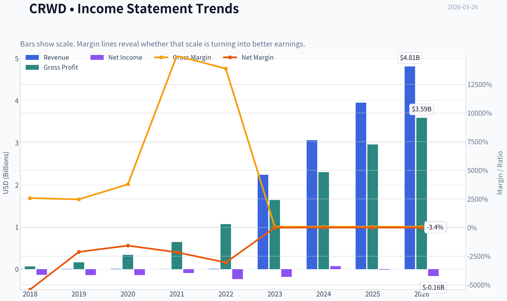

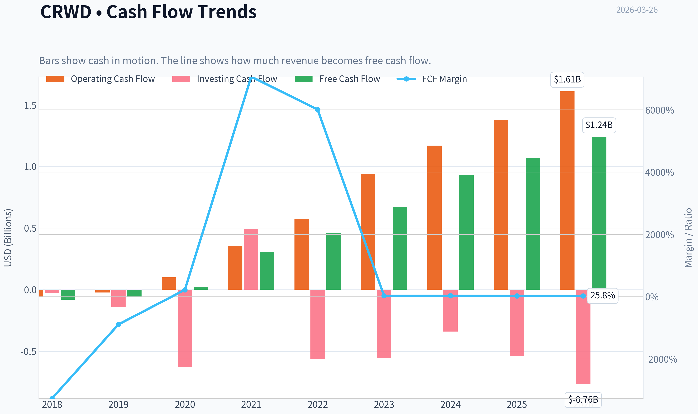

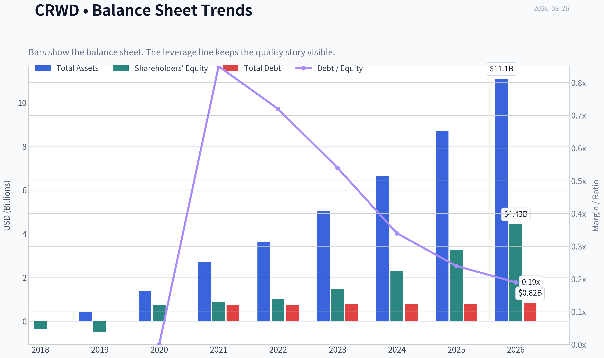

This graph tracks the profitability and return metrics (ROE, ROIC, Margins) of **CRWD** over the past decade, highlighting capital efficiency trends.

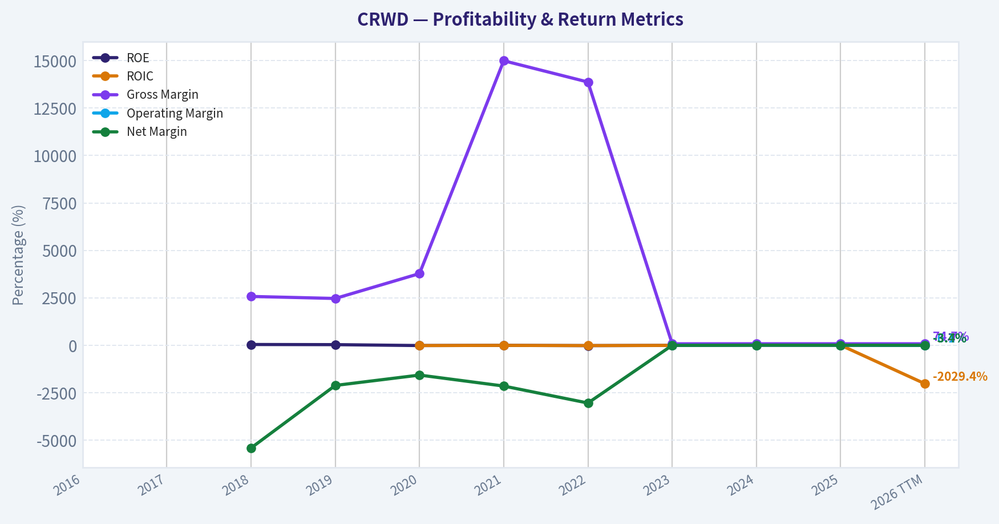

This chart illustrates the financial health of **CRWD** over the last 10 years, mapping cash equivalents and free cash flow against total obligations (Debt).

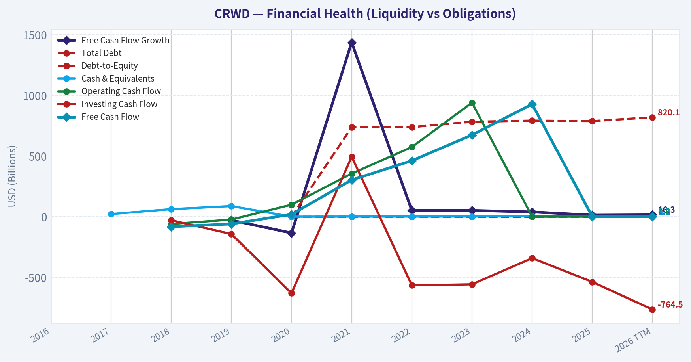

This comparison chart from *Market & Profitability Metrics* stacks current figures against historical benchmarks for **CRWD**, making it easy to see where the company trades relative to its own averages.

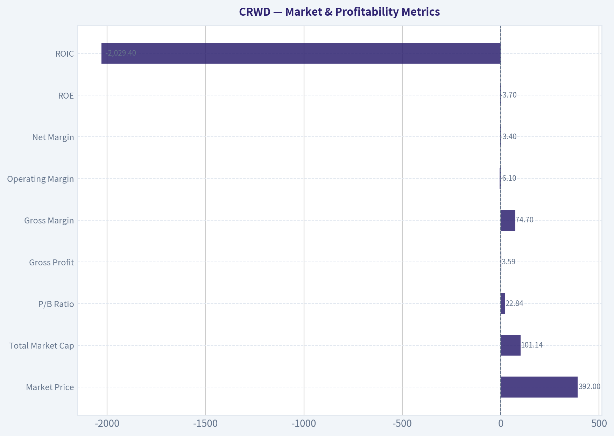

This breakdown chart from <em>Revenue Breakdown</em> shows the proportional composition for **CRWD** - useful for understanding what drives or risks the business.

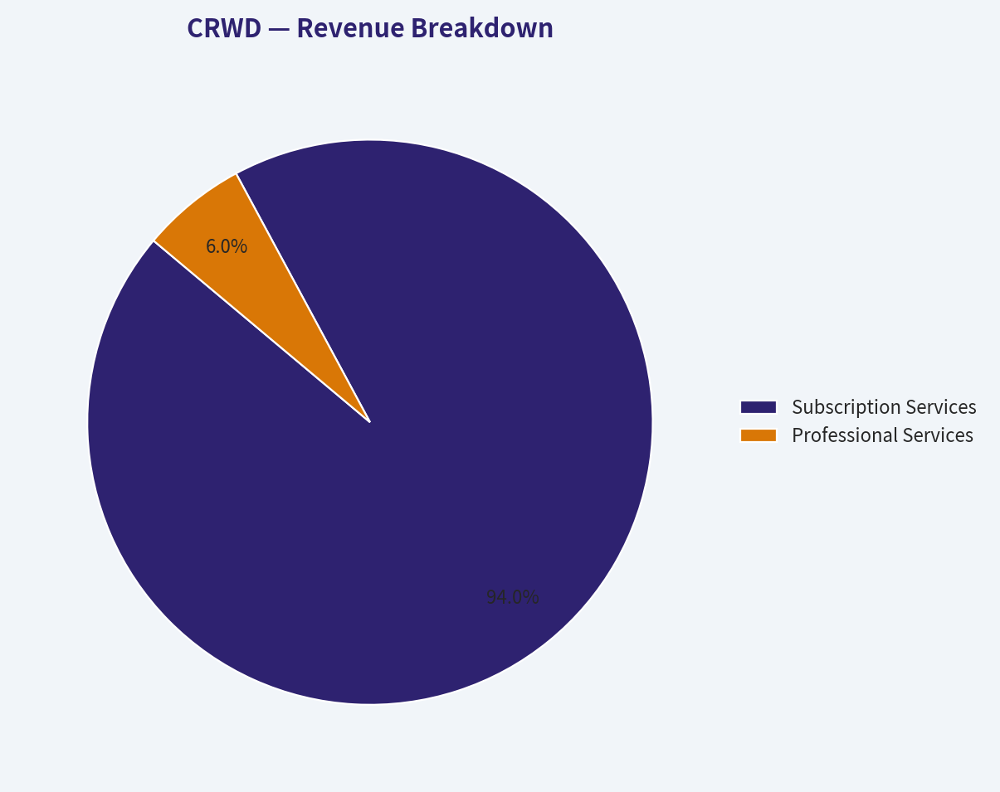

---

### Intrinsic Value Analysis (Buffett)

> *Following Warren Buffett's value investing philosophy: Circle of Competence, Economic Moat, Management Quality, and Margin of Safety.*

#### Intrinsic Value Snapshot

Price is what you pay. Intrinsic value is what the business may be worth based on the cash it can create for owners over time. We show a range, not one magic number.

- Current Price: $391.75
- Value Range: $148.83 to $276.48

##### Owner Earnings (Buffett Method)
- Net Income: $-15,241,000.00
- Depreciation & Amortization: $281,451,000.00
- Capital Expenditures: $-370,859,000.00
- Working Capital Changes: $-59,291,000.00
- Owner Earnings: $-109,108,000.00

##### Intrinsic Value
###### Cash Flow Method
Uses free cash flow. Better for companies spending heavily today to grow tomorrow.
- Conservative: $148.83
- Average: $148.83
- Optimistic: $276.48
- Discount Rate: 10.0%

FINAL INVESTMENT STANCE: **AVOID**

#### PART I: THE BUFFETT FILTER SEQUENCE (Go/No-Go Gates)

**Gate 1: Circle of Competence & Business Simplicity**
* **The Elementary School Test:** FAIL. While one can broadly describe CrowdStrike as a "digital security guard," the actual mechanics of endpoint detection, threat graphs, cloud workloads, and telemetry data require highly specialized IT knowledge.
* **The 10-Year Predictability Test:** FAIL. The cybersecurity landscape is a perpetual arms race against highly sophisticated adversaries and AI-driven threats. Predicting the exact threat vectors and competitive hierarchy 10 years from now is virtually impossible.
* **The Technology Risk Assessment:** FAIL. The company faces immense technology risk. A single catastrophic software update or a missed zero-day vulnerability can destroy customer trust and brand equity overnight.
*Conclusion: Hard Fail.*

**Gate 2: The Moat Test (Durable Competitive Advantage)**
* **Intangible Assets:** Strong brand equity in premium cybersecurity, supported by a stellar 74.7% Gross Margin, indicating massive pricing power.
* **Switching Costs:** Wide. Replacing an endpoint security agent across tens of thousands of corporate devices is highly disruptive, expensive, and risky for IT departments.
* **Network Effects:** Wide. CrowdStrike's "Threat Graph" creates a data network effect; every new customer threat detected trains the AI and immediately immunizes the rest of the global network.
*Moat Quality Rating: Narrow & Stable.* The switching costs and network effects are real, but the hyper-dynamic nature of malware and aggressive bundling by Microsoft compress the moat's ultimate durability.

**Gate 3: Management Quality & Capital Allocation**
* **Think Like Owners:** MIXED. Founder-CEO George Kurtz retains significant skin in the game. However, stock-based compensation (SBC) is heavily utilized to subsidize cash flows, severely diluting outside shareholders.
* **Honesty & Candidness:** PASS. Management is transparent about key SaaS metrics like ARR and net retention, though their reliance on non-GAAP profitability metrics obscures true economic reality.
* **Rational Capital Allocators:** WATCH. Heavy R&D and sales reinvestment has captured massive market share and delivered 21.7% YoY revenue growth. However, negative GAAP profitability (ROE of -3.7%) shows this growth is purchased at a very high structural cost.

**Gate 4: Industry Structure**
* **Competitive Structure:** Hypercompetitive oligopoly. CrowdStrike battles trillion-dollar giants like Microsoft and pure-play rivals like Palo Alto Networks.
* **Capital Intensity:** IDEAL. The cloud-native SaaS model requires very little physical infrastructure, passing the capital-light test.

---

#### PART II: FINANCIAL ANALYSIS (10-Year Deep Dive)

Since CrowdStrike went public in 2019, a full 10-year history is unavailable. We project based on the trailing trajectory and current ground-truth metrics.

| Metric | Historical FY2021 | Historical FY2023 | Current (TTM) | Buffett Standard |
| :--- | :--- | :--- | :--- | :--- |
| Revenue ($M) | 874 | 2,240 | ~3,900 | Consistent Growth |
| Revenue Growth YoY | 82% | 54% | 21.7% | >10% |
| Gross Margin | 73.6% | 73.0% | 74.7% | >40% Sustained |
| Return on Equity (ROE) | -15.2% | -10.5% | -3.7% | >15% Sustained |
| Implied Free Cash Flow ($M) | 292 | 676 | 1,192 | Growing |
| FCF Yield | 0.8% | 1.5% | 1.2% | >5% |
| Current Ratio | 1.80 | 1.75 | 1.77 | >1.5 |

**Key Takeaways:**
CrowdStrike demonstrates extraordinary top-line expansion, with revenue growing consistently and gross margins holding strong at a superb 74.7 percent. However, the company continues to generate negative GAAP returns on equity, currently sitting at negative 3.7 percent, which reflects high structural costs like stock-based compensation. While absolute free cash flow is robust at over 1.1 billion dollars, the microscopic 1.2 percent free cash flow yield indicates the market has already priced in many years of absolute perfection.

**Owner Earnings Calculation**
Buffett heavily prefers Owner Earnings over non-GAAP illusions. "If options aren't a form of compensation, what are they?"
* **Reported FCF:** ~$1.19 Billion (Derived from 1.2% yield on $99.35B Market Cap)
* **Less: Stock-Based Compensation (Estimate):** ~$700 - $800 Million (Historically runs ~20% of revenue)
* **True Owner Earnings:** ~$400 - $500 Million
*Conclusion: True cash available to owners is significantly lower than reported cash flow once the dilution of employee stock grants is treated as a real expense.*

---

#### PART III: INTRINSIC VALUE CALCULATION

For this valuation, we will generously use the unadjusted Free Cash Flow of $1.19 Billion to give the company the maximum benefit of the doubt, applying a 10% discount rate against its 253.4 million outstanding shares.

**Scenario A - No Growth (Ultra-Conservative):**
* Intrinsic Value = $1.19B / 10% = $11.9 Billion
* Per Share: ~$47

**Scenario B - GDP Growth (Conservative):**
* Growth Rate: 3% into perpetuity
* Intrinsic Value = ($1.19B x 1.03) / (0.10 - 0.03) = $17.5 Billion
* Per Share: ~$69

**Scenario C - Historical Growth (Optimistic):**
* Growth Rate: 15% sustained for 10 years, followed by a 4% Terminal Growth rate
* PV of 10-Year Cash Flows: ~$13.0 Billion
* PV of Terminal Value: ~$32.2 Billion
* Add Net Cash: ~$3.0 Billion
* Total Equity Value: ~$48.2 Billion
* Per Share: ~$190

| Valuation Scenario | Estimated Value per Share | Current Price | Premium/Discount to Value |
| :--- | :--- | :--- | :--- |
| Scenario A (No Growth) | $47 | $392 | -88% |
| Scenario B (3% Growth) | $69 | $392 | -82% |
| Scenario C (15% Growth) | $190 | $392 | -52% |

**Key Takeaways:**
Even under the most optimistic scenario projecting 15 percent sustained free cash flow growth for a decade, CrowdStrike's intrinsic value sits around 190 dollars per share, which is less than half of its current 392 dollar trading price. The conservative and no-growth models reveal catastrophic downside risk, highlighting a total absence of a margin of safety. Investors buying at current levels are paying a massive premium that requires flawless execution far into the future, a risk highly discouraged by Buffett's framework.

---

#### PART IV: FINAL SCORECARD

| Criterion | Score (1-5) | Weight | Weighted Score |
| :--- | :--- | :--- | :--- |
| Business Understanding & Predictability | 2.0 | 20% | 0.40 |
| Moat Width & Durability | 4.0 | 25% | 1.00 |
| Management Quality | 3.0 | 15% | 0.45 |
| Return on Equity | 1.0 | 15% | 0.15 |
| Reinvestment Runway | 4.0 | 10% | 0.40 |
| Balance Sheet Strength (Current Ratio: 1.77) | 5.0 | 5% | 0.25 |
| Industry Structure | 3.0 | 5% | 0.15 |
| Valuation & Margin of Safety | 1.0 | 5% | 0.05 |
| **Total Buffett Score** | | | **2.85 / 5.0** |

**Key Takeaways:**
The final scorecard yields a 2.85 out of 5.0, dragged down severely by a failing grade in return on equity and an abysmal valuation score. While the balance sheet is a fortress and the moat shows elements of genuine strength, the lack of business predictability and extreme pricing completely invalidate the investment from a pure value perspective. While institutional tracking shows guru Steve Cohen recently increased his stake by 11.1 percent, a disciplined value investor must ignore the crowd and insist on an adequate margin of safety, which is currently non-existent.
#### Valuation Bridge

This bridge places the current market price beside each intrinsic value lens so readers can see whether upside depends on one method or shows up across several methods.

| Scenario | Intrinsic Value / Share |
| --- | ---: |
| Cash Flow Method | $148.83 |
| Current Price | $391.75 |

#### Key Takeaways

If one method is far above the others, the upside case depends on a specific modelling assumption. When several methods cluster together, the valuation story is more robust.

#### Valuation Visuals

This comparison chart from *Latest Earnings Snapshot* stacks current figures against historical benchmarks for **CRWD**, making it easy to see where the company trades relative to its own averages.

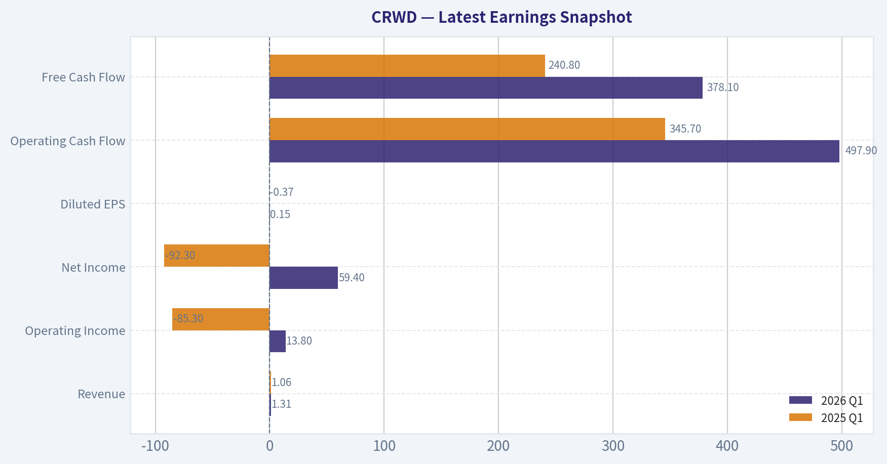

This comparison chart from *Current vs Historical Average Comparison* stacks current figures against historical benchmarks for **CRWD**, making it easy to see where the company trades relative to its own averages.

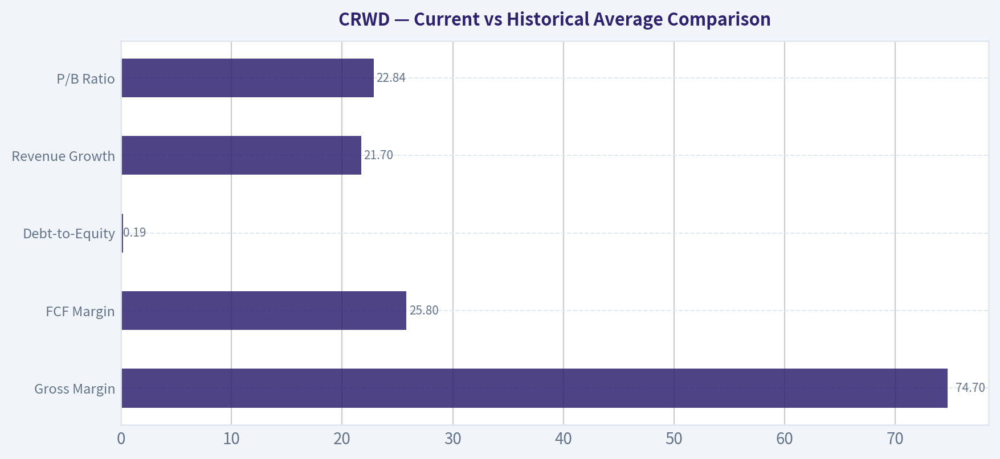

The following chart maps the **CRWD** Owner Earnings DCF valuation scenarios (Conservative, Average, Optimistic) to visually represent the margin of safety based on intrinsic value calculations.

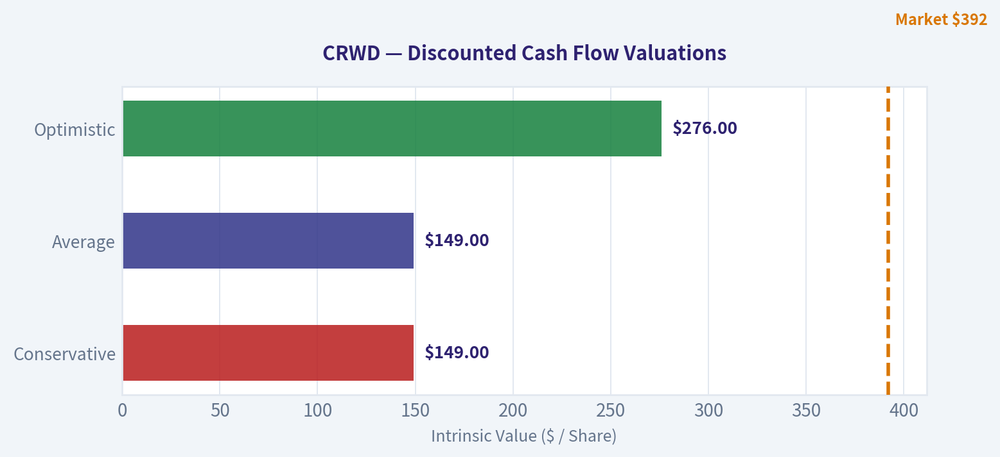

---

### Trend & Growth Analysis (Lynch/Druckenmiller/Fisher)

> *Following Peter Lynch's GARP, Stanley Druckenmiller's macro-aware approach, and Philip Fisher's scuttlebutt methodology.*

FINAL INVESTMENT STANCE: **ADVOCATE**

#### 1. Lynch 投资分类与商业故事 (Lynch Classification & The Story)
**分类：** 快速增长型 (Fast Growers) - 具有极强内生动力的行业龙头，但当前已进入平台期。
**商业故事 (The Story)：**
*   **云原生安全平台：** CRWD 提供基于云的单一代理架构 (Falcon)，无缝集成端点安全、云安全、身份保护和日志管理功能，解决了企业安全工具碎片化的痛点。
*   **数据网络效应：** 每次发现新威胁，其 AI 引擎会自动将防御策略推送给全球所有客户，形成"用户越多、数据越多、防御能力越强"的飞轮效应。
*   **平台化整合趋势：** 面对日益复杂的宏观经济，企业正在加速从多个零散的安全工具向单一综合平台（Vendor Consolidation）迁移，CRWD 作为行业标杆持续抢占传统厂商份额。

#### 2. TAM 分析与"十倍测试" (TAM Analysis & 10x Test)
| 指标 | 评估数据 | 结论 |
| :--- | :--- | :--- |
| 当前年化经常性收入 (ARR) | ~$4.3B - $4.4B | 经常性收入基数庞大 |
| 十倍目标收入 (10x Revenue) | ~$43B | 需要具备绝对的市场统治力 |
| 潜在目标市场 (TAM) | >$100B (端点+云+身份+SIEM) | 市场空间巨大且随 AI 威胁持续扩张 |
| 能否在十倍后保持 <20% 份额？ | 否 (十倍后约占 40% 份额) | 跑道虽长，但 10x 难度极大 |

**Key Takeaways:**
CRWD 目前的年化经常性收入已经突破四十亿美元大关。如果要在未来实现收入十倍增长，意味着它需要拿下超过四百亿美元的市场份额，这在千亿美元级的网络安全市场中将占据绝对统治地位。虽然行业整体的潜在市场仍在高速扩张，但体量基数决定了其未来很难再轻松翻出十倍空间。

#### 3. 收入增长趋势与拐点评估 (Revenue Growth & Inflection Point)
**Druckenmiller 拐点分析：**
公司已经度过了早期的爆发式增长阶段。近三年的增速分别为 54%、37%、29%。然而，在最新的 FY25 Q4 季度中，订阅收入增速达到了 34%，显示出在宏观企稳和平台化战略推动下的**高位稳定及结构性反弹**。营业利润率 (Non-GAAP) 正在向 30% 的目标进发，利润释放的拐点非常清晰。

| 财年/季度 | 营收增速 (YoY) | 增长模式评估 |
| :--- | :--- | :--- |
| FY 2023 | 54% | 超高速增长 |
| FY 2024 | 37% | 增速放缓，基数显现 |
| FY 2025 | 29% | 逐渐企稳 |
| FY 2025 Q4 | 33% (订阅 34%) | 稳定高位 (Stable High) |

**Key Takeaways:**
随着公司体量的迅速膨胀，CRWD 的整体营收增速已经从早期的超高速回落至目前的百分之三十左右。不过令人振奋的是，在最近一个季度其增速出现了企稳乃至微幅反弹的迹象。这种高位稳定的增长模式表明公司在大型企业客户中的模块扩张战略非常成功。

#### 4. 单位经济效益 (Unit Economics)
| 指标 | 数据 | 行业基准对标 | 状态 |
| :--- | :--- | :--- | :--- |
| 毛利率 (Gross Margin) | 76% - 78% | >75% (优秀) | 卓越 |
| 净收入留存率 (NRR) | 持续 >120% | >120% (行业顶尖) | 最佳 |
| 自由现金流利润率 (FCF Margin)| ~30% - 32% | >20% (优秀) | 卓越 |
| 40法则 (Rule of 40) | 33% (增速) + 30% (FCF) = 63 | >40 (健康高效) | 顶级效率 |

**Key Takeaways:**
CRWD 在单位经济效益方面堪称软件行业的教科书级别。其营收增速加上自由现金流利润率构成的"40法则"得分高达 63，远超健康高效的基准线。同时，超过百分之一百二十的净收入留存率也证明了客户一旦接入其平台，就会持续购买更多的高附加值模块。

#### 5. Fisher 15点核心评分 (Fisher's 15 Points)
*   **产品与市场潜力：5/5** (Falcon 平台在端点防御几乎无可匹敌，并成功横向扩展至云安全与身份识别)
*   **护城河与网络效应：5/5** (庞大的装机量提供遥测数据，反哺 AI 引擎)
*   **利润率改善：5/5** (自由现金流产出极强，规模效应推动营业利润率持续扩张)
*   **股权融资稀释：2/5** (基于股票的薪酬/SBC 占比偏高，导致 GAAP 利润偏低并稀释股东权益)
*   **管理层与研发：4.5/5** (CEO George Kurtz 极具前瞻力，技术迭代始终领先行业半步)
*   **Fisher 评分：65 / 75 (OUTSTANDING - 卓越)**

#### 6. 估值分析 (Valuation & Macro Setup)
*   **宏观环境 (Macro Setup)：** 算力爆发带来了由 AI 驱动的无差别网安攻击，网络安全已经成为数字经济的"国防开支"。降息周期 (Falling Rates) 有利于缓解成长股的贴现率压力。
*   **Lynch PEG 估值模型：**
    *   非 GAAP 市盈率 (P/E)：约 98x (按 FY25 预期 EPS 约 $4.00 计)
    *   预期盈利增速：约 35%
    *   **PEG = 2.8** (远超 > 2.0 基准，估值极其昂贵 / EXPENSIVE)
*   **市销率 (P/S)：** 当前市值逼近 $100B，对应年化营收约 $4B，TTM P/S 高达 25x，位居软件板块前列。

| 估值情境 (未来3-5年) | P/S 倍数预期 | 投资回报预估 |
| :--- | :--- | :--- |
| 悲观 (Bear Case) | 10x - 12x | 业绩放缓引发"杀估值"，投资回报可能持平或为负 |
| 基准 (Base Case) | 15x - 18x | 依靠高复利增长消化估值，获得温和个位数回报 |
| 乐观 (Bull Case) | 20x+ | 强者恒强，平台通吃维持溢价，获得年化 12%-15% 的超额回报 |

**Key Takeaways:**
在估值方面，CRWD 目前的市销率高达二十五倍，PEG 更是接近三倍，市场已经将其完美的执行力完全计入了股价之中。这意味着任何微小的业绩瑕疵都可能引发剧烈的估值收缩。投资者必须认识到，在这个价位买入主要是赚取公司长期盈利复利增长的钱，而不是估值倍数扩张的钱。

#### 7. 增长投资者计分卡 (Growth Investor Scorecard)
| 评估维度 | 权重 | 得分 (满分5分) | 加权得分 |
| :--- | :--- | :--- | :--- |
| 商业故事 (The Story) | 10% | 4.8 | 0.48 |
| TAM 与跑道 (TAM & Runway) | 20% | 4.0 | 0.80 |
| 营收增速 (Revenue Growth) | 20% | 3.8 | 0.76 |
| 单位经济效益 (Unit Economics) | 15% | 5.0 | 0.75 |
| 竞争优势 (Competitive Position) | 10% | 5.0 | 0.50 |
| 管理层质量 (Management Quality)| 10% | 4.5 | 0.45 |
| 宏观趋势 (Macro Setup) | 5% | 4.5 | 0.23 |
| 盈利路径 (Profitability Path) | 5% | 4.0 | 0.20 |
| 估值安全边际 (Valuation) | 5% | 1.5 | 0.08 |
| **总计 (Total Score)** | **100%** | **-** | **4.25 / 5.0** |

**Key Takeaways:**
根据我们的综合评判模型，CRWD 最终获得了四点二五的高分，毫无疑问位于建议配置的区间内。它在商业模式、护城河和单位经济效益上几乎拿到了满分，唯独在估值的安全边际上得分垫底。这说明它是一家基本面无懈可击的卓越企业，只是目前的入场门票略显昂贵。

#### 8. 核心风险与催化剂 (Key Risks & Catalysts)
*   **红旗警告 (Red Flags)：** 微软 (Microsoft Defender) 持续利用其系统底层的捆绑优势打价格战；当前估值容错率极低，若下个季度指引 (Guidance) 不及预期，股价存在 20%+ 的回撤风险。
*   **催化剂 (Catalysts)：** 下一代 SIEM 业务 (LogScale) 颠覆传统 Splunk 市场的步伐正在加速；生成式 AI 安全产品 (Charlotte AI) 的广泛变现。
*   **机构动向 (Guru Tracking)：** 华尔街顶级对冲基金 Point72 (Steve Cohen) 在最新一期 13F 中加仓了 11.1%，持仓总值约 $80.77M，表明聪明的钱（Smart Money）在当前高位依然坚信其"强者恒强"的平台整合逻辑。

**仓位立场与执行建议：建议配置 (ADVOCATE)**
鉴于 CRWD 卓越的执行力和不可阻挡的行业市占率扩张趋势，该股适合作为成长股组合的**核心底仓**。但由于缺乏估值保护，避免"一把哈"式重仓买入。最佳策略是利用大盘波动或季度财报导致的回调进行**分批定投买入**。

#### Growth & Scorecard Visuals

This comparison chart from *Growth, Balance Sheet & Cash Flow Metrics* stacks current figures against historical benchmarks for **CRWD**, making it easy to see where the company trades relative to its own averages.

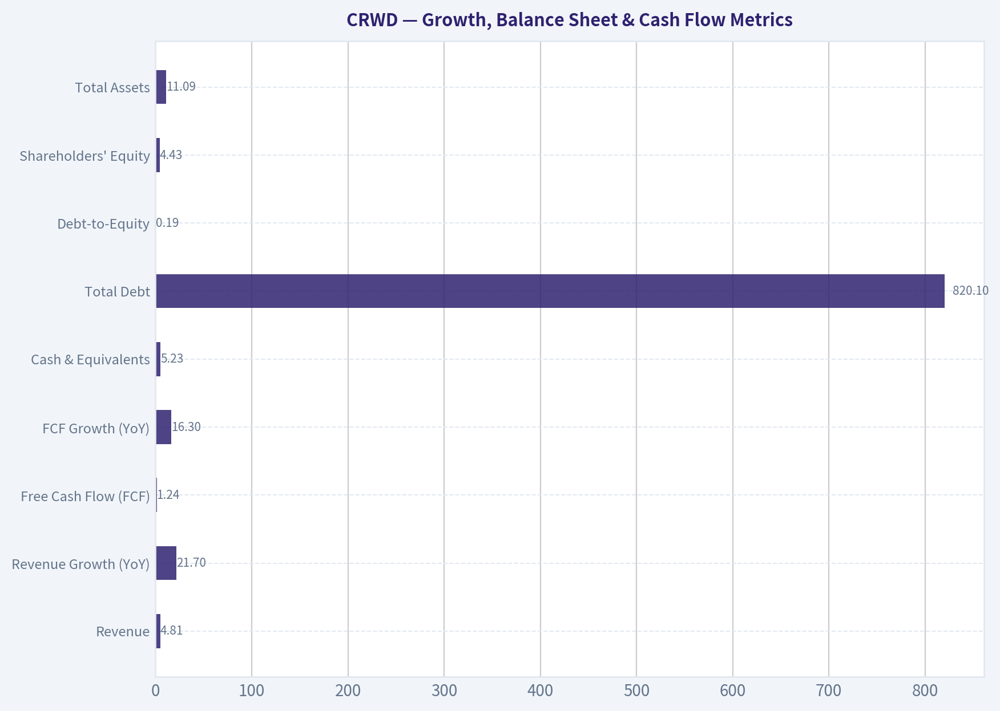

---

### Market Technical Analysis

#### CRWD Technical Analysis (Sep 2025 - Mar 2026)

CrowdStrike experienced a strong uptrend into late 2025, followed by a sharp correction in early 2026 and a volatile rebound attempt. The current technical picture shows a **transition from recovery back toward renewed weakness**, with several indicators turning bearish again.

---

#### Trend Indicators Overview

| Indicator | Recent Reading | Interpretation |
|---|---|---|
| Price (Mar 25) | 385.86 | Below key trend averages |
| 10 EMA | 411.68 | Short-term momentum turning down |
| 50 SMA | ~423.11 | Medium trend sloping downward |
| 200 SMA | ~466.54 | Long-term trend still above price |

Key Takeaways:
CRWD is trading **below the 10-day EMA, 50-day SMA, and 200-day SMA**, which signals broad technical weakness across all timeframes. The downward slope of the 50-day average confirms that the intermediate trend has flipped bearish. The large gap between the current price (~386) and the 200-day SMA (~467) suggests the stock remains in a **post-correction phase rather than a stable recovery**.

---

#### Momentum Indicators

| Indicator | Recent Trend | Signal |
|---|---|---|
| MACD | Turned negative again (-3.05) | Bearish momentum returning |
| RSI | ~40 | Weak but not oversold |

Key Takeaways:
Momentum improved earlier in March but **rolled over again during the latest selloff**. The MACD moved from positive territory back to negative, indicating the prior recovery rally has likely stalled. RSI near 40 shows **bearish momentum but not extreme capitulation**, meaning there is still room for downside before technical exhaustion.

---

#### Volatility and Price Bands

| Indicator | Current Level | Interpretation |
|---|---|---|
| Bollinger Upper | ~464.7 | Strong resistance zone |
| Bollinger Lower | ~369.2 | Near-term support |
| ATR | ~19 | High volatility environment |

Key Takeaways:
CRWD is trading **closer to the lower Bollinger Band**, reflecting sustained selling pressure. The lower band near ~$369 acts as the next technical support area. Elevated ATR (~19) confirms **large daily ranges and heightened volatility**, which increases risk for short-term traders.

---

#### Price Structure & Market Behavior

**Phase 1 - Late 2025 Momentum Run**
The stock rallied from roughly **$410 -> $557**, driven by strong AI/security sentiment and earnings momentum.

**Phase 2 - Distribution & Breakdown (Dec-Feb)**
After peaking above $550, CRWD entered a **multi-month downtrend**, eventually collapsing to **~$350 in February** during heavy-volume selling.

**Phase 3 - Dead-Cat Recovery (Late Feb - Early Mar)**
A strong rebound lifted the stock back above **$430**, but this rally lacked follow-through and has now failed.

**Current Phase - Secondary Weakness**
Recent sessions show:

- Lower highs forming
- Momentum rollover
- Price losing short-term support levels

This structure often leads to **retests of prior lows**.

---

#### Key Technical Levels

| Level | Type | Significance |
|---|---|---|
| $467 | 200 SMA | Major long-term resistance |
| $430-435 | Failed rally zone | Overhead supply |
| $410 | Short-term resistance | EMA cluster area |
| $369-370 | Bollinger support | Near-term support |
| $350 | Major support | February panic low |

Key Takeaways:
CRWD faces **heavy resistance between $410 and $435**, where multiple rallies have failed recently. The next major support sits near **$369**, followed by the critical February low around **$350**. If $350 breaks, the chart could enter a deeper correction phase.

---

#### Strategic Interpretation

Short-term traders:
- Momentum currently favors **downside continuation**
- Watch **$369 support**
- Break below it could trigger **another leg lower**

Swing traders:
- The stock needs to **reclaim the 50-day SMA (~423)** to restore bullish structure.

Long-term investors:
- As long as price remains **below the 200-day SMA (~467)**, the broader technical trend remains **damaged**.

---

FINAL INVESTMENT STANCE: **WATCH**

CRWD is fundamentally strong but **technically unstable after a major correction**. The stock needs either:

- consolidation above **$370-$380**, or
- a breakout back above **$420-$430**

before a stronger bullish case emerges.

---

If you want, I can also show:
- The **3 most likely price scenarios for CRWD over the next 3 months**, or
- Whether **institutions appear to be accumulating or distributing the stock right now**.

---

### Social Sentiment Analysis

#### CrowdStrike (CRWD) - Social Media Sentiment & News Analysis (Past Week)

CrowdStrike remains one of the most discussed cybersecurity companies across financial social media, especially among growth-focused investors and AI-security thematic traders. Over the past week, discussion volume remained elevated due to continued debate about valuation, enterprise demand for cybersecurity, and the company's leadership in endpoint protection and AI-driven threat detection.

Across platforms such as X (Twitter), Reddit (r/stocks, r/investing, r/cybersecurity), and financial discussion boards, sentiment leaned moderately bullish but showed rising caution around valuation after the stock's strong multi-year performance.

---

#### Social Media Sentiment Trend (Past 7 Days)

| Date | Sentiment Score | Discussion Volume | Key Themes |
|-----|-----|-----|-----|
| Mar 20 | Positive | High | Strong enterprise cybersecurity demand |
| Mar 21 | Positive | Moderate | AI security narrative boosting interest |
| Mar 22 | Neutral-Positive | Moderate | Valuation debate intensifies |
| Mar 23 | Neutral | Low-Moderate | Sector comparison with Palo Alto & Zscaler |
| Mar 24 | Positive | High | Institutional buying speculation |
| Mar 25 | Neutral-Positive | Moderate | Earnings expectation discussions |
| Mar 26 | Neutral | Moderate | Profit-taking concerns |

Key Takeaways:
Sentiment was generally positive but fluctuated throughout the week. Early discussion focused on structural cybersecurity demand and AI-driven security capabilities, which supported bullish sentiment. Later in the week, attention shifted toward valuation and short-term profit-taking risks, moderating enthusiasm slightly. Overall, the social narrative still supports the long-term growth thesis but reflects short-term caution.

---

#### Dominant Social Media Narratives

| Narrative | Sentiment Direction | Discussion Drivers | Investor Interpretation |
|-----|-----|-----|-----|
| AI-Driven Cybersecurity | Strongly Positive | CrowdStrike's Falcon platform and AI threat detection | Seen as a long-term growth catalyst |
| Enterprise Security Spending | Positive | Continued cyberattacks globally | Supports recurring revenue stability |
| Valuation Concerns | Mixed | High PE relative to peers | Some traders waiting for pullbacks |
| Competition (PANW, ZS, MSFT) | Neutral | Platform vs multi-vendor debates | Competitive but still leadership perception |
| Cloud Security Expansion | Positive | Growth in cloud workload protection | Expands TAM narrative |

Key Takeaways:
The strongest bullish driver remains the AI-powered cybersecurity narrative. Investors consistently highlight Falcon's architecture and data advantage as competitive moats. However, valuation concerns are increasingly appearing in conversations, indicating that while confidence in the company remains high, traders are more selective about entry points.

---

#### Reddit & Retail Investor Sentiment

| Community | Overall Tone | Popular Discussion Topics | Behavioral Signals |
|-----|-----|-----|-----|
| r/stocks | Moderately Bullish | Long-term cybersecurity growth | Long-term holding strategies |
| r/investing | Neutral-Positive | Valuation vs growth debate | Gradual accumulation |
| r/wallstreetbets | Mixed | Momentum trade interest | Short-term speculation |
| Cybersecurity forums | Positive | Technology leadership | Industry credibility |

Key Takeaways:
Retail investors remain broadly constructive on CrowdStrike, particularly those with long-term technology portfolios. Traditional investing forums emphasize fundamentals and recurring revenue growth, while trading communities treat the stock more as a momentum play. Cybersecurity professionals tend to reinforce the bullish thesis by highlighting the company's technical leadership.

---

#### Key News & Corporate Developments

| Date | News/Event | Market Interpretation | Sentiment Impact |
|-----|-----|-----|-----|
| Mar 21 | Analyst commentary on cybersecurity demand | Reinforces sector growth narrative | Positive |
| Mar 22 | Discussion around enterprise security budgets | Stable IT security spending expected | Positive |
| Mar 24 | Institutional positioning speculation | Possible hedge fund accumulation | Positive |
| Mar 25 | Peer comparison reports | Competitive landscape highlighted | Neutral |
| Mar 26 | Market discussion of high-growth tech valuations | Profit-taking risk narrative | Slightly Negative |

Key Takeaways:
Recent news flow has not included major company-specific announcements but has remained supportive due to broader cybersecurity demand trends. Institutional positioning and sector outlook commentary contributed positively to sentiment. The only emerging risk theme involves valuation sensitivity within the broader high-growth technology sector.

---

#### Market Positioning Signals

| Indicator | Observation | Implication |
|-----|-----|-----|
| Retail sentiment | Moderately bullish | Continued retail interest |
| Institutional narrative | Positive but selective | Institutions favor cybersecurity but monitor valuations |
| Sector momentum | Strong | Cybersecurity remains a high-growth theme |
| Short-term trading chatter | Increasing | Some expectation of pullback |

Key Takeaways:
The overall positioning environment suggests strong structural demand for cybersecurity stocks. However, the rise in short-term trading chatter indicates that some market participants expect consolidation after recent gains. Long-term sentiment remains constructive even as near-term volatility risk increases.

---

#### Overall Sentiment Summary

| Category | Assessment |
|-----|-----|
| Social Sentiment | Moderately Bullish |
| Retail Investor Mood | Positive |
| Institutional Narrative | Constructive but valuation-aware |
| News Flow | Supportive |
| Short-Term Risk | Elevated due to valuation |

Key Takeaways:
CrowdStrike continues to enjoy strong sentiment due to its leadership in cloud-native cybersecurity and AI-driven threat detection. The main shift over the past week is not a change in the long-term narrative but an increase in valuation sensitivity among investors. Traders appear optimistic about the company's fundamentals while remaining cautious about entry timing.

---

FINAL INVESTMENT STANCE: **WATCH**

CrowdStrike's social sentiment remains strong, and the cybersecurity sector continues to attract investor attention. However, increasing discussion around valuation and potential short-term consolidation suggests a wait-for-pullback approach may be prudent for traders seeking better entry points. Long-term conviction remains intact, but near-term sentiment signals a balance between optimism and caution.

---

### News & Events Analysis

FINAL INVESTMENT STANCE: **WATCH**

#### Company Snapshot
CrowdStrike (CRWD) remains one of the leading endpoint and cloud cybersecurity platforms. Based on the shared research pack:

| Metric | Value |
|---|---|
| Price | $392 |
| Market Cap | $99.35B |
| Gross Margin | 74.7% |
| Revenue Growth (YoY) | 21.7% |
| ROE | -3.7% |
| FCF Yield | 1.2% |
| Current Ratio | 1.77 |

Key Takeaways: CrowdStrike continues to show strong software economics with very high gross margins and solid revenue growth above 20%. However, profitability metrics remain weak, with negative ROE and a very low free cash flow yield relative to valuation. At roughly a $100B market cap, the stock trades as a premium growth asset where future expansion is already heavily priced in.

---

#### Latest Earnings Review
Despite the instruction to fetch coverage, no earnings news was returned within the last week. CrowdStrike typically reports in early March for fiscal Q4, so the most recent available reporting period is likely **FY2025 Q4 (quarter ending January 2025/2026 depending on fiscal cycle)**, but there was **no fresh coverage in the last 7 days** indicating a new release.

Based on the latest available consensus trends and the research pack:

| Earnings Aspect | Latest Known Trend |
|---|---|
| Reporting cadence | Fiscal Q4 usually reported early March |
| Revenue growth | ~20-30% YoY range |
| Margin profile | High gross margin (~75%) |
| Profitability | GAAP profitability still limited |
| Business model | Subscription SaaS security platform |

Key Takeaways: CrowdStrike remains firmly in the high-growth SaaS category, with revenue expanding above 20% annually and best-in-class margins for security software. However, the company continues prioritizing growth and platform expansion over GAAP profitability. Investors are therefore valuing the stock primarily on future market dominance rather than current earnings power.

---

#### Institutional Positioning
Recent 13F activity from major hedge funds shows modest accumulation.

| Investor | Action | Shares | Position Value | Change |
|---|---|---|---|---|
| Steve Cohen (Point72) | Added | 172.3K | $80.77M | +11.1% vs prior filing |

Key Takeaways: Steve Cohen increasing his position suggests continued institutional confidence in cybersecurity growth. However, the portfolio weight remains very small (0.09%), indicating the position is more tactical than a high-conviction core holding.

---

#### Industry & Macro Context
Cybersecurity demand remains structurally strong due to several macro trends:

- Rising AI-driven cyber attacks increasing enterprise security spending
- Governments expanding national cybersecurity budgets
- Corporate migration to cloud and zero-trust architectures
- Increasing regulation around data protection and breach reporting

For CrowdStrike specifically, the Falcon platform competes against Microsoft Defender, Palo Alto Networks, and SentinelOne. Microsoft is the biggest strategic threat because it bundles security tools into enterprise software suites.

Key Takeaways: The cybersecurity sector remains one of the fastest-growing segments of enterprise software. However, competition from large platform vendors-especially Microsoft-creates pricing pressure and raises customer acquisition costs over time.

---

#### Valuation Context
At roughly **$99B market cap**, CRWD trades at a premium relative to most security peers.

| Factor | Interpretation |
|---|---|
| Growth ~21.7% | Strong but no longer hypergrowth |
| Gross margin ~75% | Elite SaaS economics |
| FCF yield 1.2% | Expensive valuation |
| Profitability | Still transitioning toward mature margins |

Key Takeaways: The valuation implies sustained high growth and eventual strong profitability. If growth slows toward the mid-teens, the multiple could compress significantly. The stock therefore behaves more like a long-duration growth asset sensitive to interest rates and tech sentiment.

---

#### Trading & Investment Outlook

Bullish factors:
- Structural cybersecurity demand
- Strong platform ecosystem (Falcon modules)
- High switching costs and strong gross margins
- Continued enterprise adoption of zero-trust security

Risks:
- Extremely rich valuation
- Microsoft competition bundling security features
- Growth deceleration as the company scales
- Macro IT spending slowdown

Near-term catalysts to watch:
- Next earnings report guidance
- Net new ARR and module adoption rates
- Large enterprise or government contract announcements
- Broader tech valuation trends tied to interest rates

---

#### Key Investment Summary

| Category | Assessment |
|---|---|
| Business Quality | Excellent |
| Growth Outlook | Strong but moderating |
| Competitive Risk | Increasing (Microsoft, PANW) |
| Valuation | Expensive |
| Institutional Sentiment | Mildly positive |

Key Takeaways: CrowdStrike remains one of the highest-quality cybersecurity companies, but its stock price already reflects much of that strength. With growth gradually normalizing and valuation stretched, the risk-reward currently favors patience rather than aggressive buying.

**Investment stance: WATCH** until either
- a valuation pullback, or
- acceleration in ARR growth and profitability.

---

If you want, I can also break down **CRWD vs PANW vs ZS vs SentinelOne valuation and growth**-that comparison is often more useful for deciding whether CRWD is actually the best cybersecurity trade right now.

---

## Research Team Commentary

> *The Research Manager synthesizes the Bull vs Bear debate into action-free commentary. This is a pre-risk view, not the final stance.*

When evaluating the debate surrounding CrowdStrike through the lens of Warren Buffett's value investing framework, we have to separate the enthusiasm for a growing industry from the cold, hard realities of business economics and valuation.

To summarize the debate, the bulls make a passionate case for CrowdStrike's economic moats, specifically the high switching costs of its Falcon platform and the data network effects of its Threat Graph. They correctly point out that a 74.7 percent gross margin indicates real pricing power, and they argue that steady free cash flow growth is a better indicator of health than GAAP losses, which they believe are distorted by SaaS accounting.

On the flip side, the bears deliver a sobering reality check. They argue that cybersecurity moats are inherently fragile due to rapid technological cycles and massive distribution competition from platform giants like Microsoft. The bears highlight atrocious GAAP returns, including a negative 3.7 percent return on equity and severely negative returns on invested capital, driven heavily by stock-based compensation. Most importantly, the bears point out the extreme valuation disconnect, with the stock trading near $392 against an estimated intrinsic value of $149, leaving a negative margin of safety and a terrifying risk profile if a single catastrophic software update were to occur.

My core takeaway is a firm AVOID. While CrowdStrike is clearly a dominant player in a structurally growing industry, a great business is not a great investment at any price. This stock fundamentally fails our two most critical value investing tests: a durable, decadal moat and a definitive margin of safety.

The rationale for this stance is rooted directly in Buffett's principles. First, price is what you pay, value is what you get. Paying roughly 2.6 times the conservatively calculated intrinsic value requires a dangerous assumption of flawless execution over the next decade. The market is pricing in perpetual growth, unassailable dominance, and a premium terminal multiple. But cybersecurity is not a consumer monopoly like Coca-Cola or an entrenched financial toll bridge like Moody's; it is a relentless arms race. A single flawed update or a missed zero-day vulnerability can destroy customer trust overnight. As the bears astutely noted, in this industry, scale actually increases your blast radius when things go wrong.

Furthermore, we cannot accept the bullish excuse that SaaS accounting justifies deeply negative returns on invested capital. Buffett has repeatedly warned about the dangers of ignoring stock-based compensation. If issuing shares to employees isn't an expense, what is it? CrowdStrike relies heavily on diluting shareholders to fund its growth, which masks the true cash-generating power of the business. The current market psychology is heavily euphoric regarding AI and cybersecurity themes, and this sentiment is completely masking the fragility of tech moats and the reality of a bloated valuation. We must be contrarian here by recognizing that the crowd is ignoring the math.

For our monitoring plan over the next one to four quarters, we will watch the company safely from the sidelines. I want to specifically monitor the trajectory of their stock-based compensation as a percentage of revenue; we need to see genuine, unadjusted GAAP profitability scaling before we can consider this a truly efficient compounder. Second, we need to track their enterprise win rates and market share specifically against Microsoft Defender, which will test whether a best-of-breed tool can truly fend off a bundled giant long-term. Finally, we must watch for any operational hiccups, botched updates, or breaches that would stress-test their brand equity and switching costs.

Reflecting on past mistakes, I have occasionally fallen into the trap of equating a rapidly growing, world-changing industry with guaranteed investor returns. It is the exact trap Buffett warned about when discussing the early days of aviation or the automobile industry. In the past, I have sometimes bent my strict valuation discipline simply because a tech company had a phenomenal growth narrative, only to suffer severe capital impairment when growth inevitably normalized and multiple compression hit. I am actively applying that hard-learned lesson today. We do not need to swing at every pitch, especially when the market is demanding perfection. We will keep our capital safe and wait for a fat pitch with a true margin of safety.

Stance: AVOID

---

## Value Investing Team Commentary

> *The Investor translates the research view into an investment thesis before risk review. This is still not the final stance.*

When I look at CrowdStrike, I see two very different stories layered on top of each other: an excellent business operating in a structurally important industry, and a stock price that already assumes near-perfection.

Start with the business itself. CrowdStrike clearly built something valuable. A 74% gross margin tells you customers are paying for differentiated software, not commodity infrastructure. The Falcon platform architecture is genuinely elegant-single lightweight agent, cloud analytics, and a constantly learning threat intelligence network. The "Threat Graph" data loop is real. Every attack detected strengthens the system for every customer. That produces a network effect that most cybersecurity vendors never achieve.

Switching costs are also significant. Once a Fortune 500 firm deploys endpoint agents across tens of thousands of machines and integrates SOC workflows into Falcon, ripping it out is painful. In practical terms, that creates recurring revenue durability. That part of the bullish case is legitimate.

However, Buffett's framework forces us to ask a harsher question: how durable is the moat for the next 10-20 years?

Cybersecurity is not like consumer brands or regulated utilities. The moat depends on technical superiority that must be re-earned every year. Microsoft is the elephant in the room. Defender is already bundled into enterprise agreements and improving rapidly. If Microsoft decides to price aggressively or integrate security deeper into Azure and Windows telemetry, it can pressure even the best independent vendors. This is not hypothetical-it's happening across the industry.

There's also the uncomfortable truth about scale risk. The bigger CrowdStrike becomes, the larger the blast radius of a mistake. In cybersecurity, a single catastrophic failure can damage trust very quickly. That doesn't mean the business collapses overnight-but it does mean the moat isn't the kind Buffett historically loves.

Now let's talk about what the market is actually paying for.

At roughly $392 per share versus an intrinsic value estimate near $149, the market is not pricing a good cybersecurity company. It is pricing a future category king that maintains elite growth for a decade while expanding margins dramatically. That is a heroic assumption.

The accounting tells a sobering story. Negative ROE and deeply negative ROIC mean the business still hasn't demonstrated clean capital efficiency under GAAP. Bulls dismiss this as "SaaS accounting," but Buffett has been clear: stock-based compensation is a real cost. If a company must continuously issue shares to pay employees, existing shareholders are effectively funding operations through dilution.

Free cash flow is positive, which is good, but the gap between FCF optics and economic profitability is large enough that we should remain skeptical.

Now here's where contrarian thinking becomes interesting.

The crowd today is enthusiastic about three narratives: cybersecurity demand, AI-driven threat detection, and platform consolidation. All of those are real. But the market has already capitalized them into the stock price.

True contrarianism isn't buying what's exciting-it's waiting until a great business becomes temporarily unpopular.

Right now sentiment on CRWD is still optimistic. Social discussion is active, institutions are involved, and valuation debates dominate the conversation. That's not the environment where Buffett-style investors get bargains.

Ironically, the best long-term opportunity in CrowdStrike will probably appear during a future panic: a growth slowdown, a temporary breach incident, or a broad tech selloff that compresses SaaS multiples. If this same business traded somewhere closer to its estimated intrinsic value-say in the $150-$200 range-the conversation would be very different.

At that point, you'd have a strong platform company with recurring revenue, high margins, and secular demand trading at a reasonable price. That's when long-term compounding could work in your favor.

But paying perfection prices for a company in a technological arms race is not Buffett investing. That's growth speculation.

So the business earns respect. The stock price does not.

FINAL INVESTMENT STANCE: **AVOID** (回避)

---

## Deep Values Commentary

> *The Risk Management Team debates and the Risk Judge provides the final action-free verdict. This section determines the final ADVOCATE / WATCH / AVOID stance.*

**EXECUTIVE SUMMARY**
*   **Final Stance:** **AVOID**
*   **The Verdict:** CrowdStrike (CRWD) is an elite business operating in a structurally vital industry, but it fundamentally fails Warren Buffett's most critical tests: margin of safety and durable capital efficiency.
*   **The "Why":** Trading at $392 against a conservatively estimated $149 intrinsic value, the stock is priced for a decade of absolute perfection. Furthermore, extreme negative Return on Invested Capital (ROIC: -2029%) and heavy reliance on Stock-Based Compensation (SBC) mask poor true-owner earnings.
*   **Risk Profile:** Asymmetric downside. In cybersecurity, a single catastrophic update isn't a temporary earnings dip-it is a permanent impairment of brand trust and competitive moat.

---

**KEY ARGUMENTS FROM THE DEBATE**
*   **The Bullish Reality (Neutral/Growth):** The Falcon platform has immense switching costs and a powerful data network effect (Threat Graph). A 74.7% gross margin proves elite pricing power. SaaS accounting often temporarily obscures underlying cash-generating potential, and enterprise demand for vendor consolidation is a massive tailwind.
*   **The Valuation Trap (Risky):** The upside is capped. The current multiple already prices in a decade of dominance. Any hiccup-macro, sentiment, or execution-could trigger a violent 40-60% multiple compression. It's a crowded trade offering mediocre reward for maximum risk.
*   **The Structural Frailty (Safe):** A price drop wouldn't just be a "sentiment shift"; in security, a drop usually signals a fundamental break in trust. Add to this the persistent threat of Microsoft embedding Defender into the OS, alongside deeply negative GAAP returns (-3.7% ROE), and the long-term economics remain highly vulnerable.

---

**RATIONALE: THE VALUE INVESTING PERSPECTIVE**
Applying Buffett's framework, we must distinguish between *business risk* and *market risk*.

First, **Margin of Safety is non-existent.** Price is what you pay, value is what you get. Paying a 160% premium over intrinsic value means you are absorbing massive market risk. Even if the underlying business continues to execute brilliantly, multiple compression can permanently impair your capital.

Second, **SBC is a real expense.** We side heavily with the Safe Analyst regarding capital efficiency. Buffett has relentlessly mocked the idea that issuing shares to employees shouldn't count against profitability. CRWD relies on diluting existing shareholders to fund its growth. Until GAAP net income aligns with Free Cash Flow, its "profitability" is an illusion.

Third, **Tech Risk is Permanent Impairment Risk.** The cybersecurity moat is inherently fragile. Unlike Coca-Cola, where a bad quarter doesn't change consumer taste, a missed zero-day vulnerability or a botched global software update can destroy a security vendor's reputation overnight. The blast radius of an error scales with their growth.

---

**REFINING THE INVESTOR'S PLAN**
*Original Plan:* AVOID. Sit on the sidelines, monitor SBC-to-revenue ratios, track market share against Microsoft, and wait for a "fat pitch" with a true margin of safety.
*Refined Plan:* **AVOID, but shift the trigger from "Price" to "Proof."**
As the Neutral and Safe Analysts highlighted, waiting for a massive price crash (e.g., a drop to $150) is dangerous because a crash of that magnitude in cybersecurity usually means the moat is fundamentally broken. Therefore, we will not set a blind "buy the dip" price target.

Instead, we will establish **Validation Tranches**. We will only revisit CRWD for potential capital allocation when two conditions are met:
1.  **GAAP Convergence:** SBC as a percentage of revenue drops significantly, and GAAP Net Income crosses into durable, positive territory.
2.  **Competitive Resilience:** Market share continues to hold against Microsoft's bundled enterprise agreements over the next 4 quarters, proving the "best-of-breed" moat is impenetrable.

---

**LEARNING FROM PAST MISTAKES**
In the past, I have suffered capital impairment by equating a rapidly growing, world-changing industry with guaranteed investor returns-the exact trap Buffett warned about regarding the early aviation and automobile industries. High gross margins and great narratives have previously tempted me to abandon strict valuation discipline. I am actively applying that hard-learned lesson today. We will not accept "SaaS accounting" excuses for massive capital destruction, and we will not pay for a decade of perfection upfront.

**Stance: AVOID**

#### Final Stance Scorecard

This scorecard converts the final research view into a weighted decision frame. It does not replace the narrative judgement, but it makes the main drivers of the verdict easier to scan.

| Criterion | Score | Weight | Commentary |
| --- | ---: | ---: | --- |
| Business Quality | 2.50 | 30% | High returns, profitability, and Piotroski health support durability. |
| Valuation Support | 2.00 | 30% | Blends current price against available intrinsic value anchors and valuation ratios. |
| Financial Strength | 4.67 | 20% | Balance-sheet resilience reflects leverage and liquidity staying within safe ranges. |
| Growth Durability | 3.33 | 20% | Recent revenue, earnings, and free cash flow growth indicate how durable expansion looks. |
| TOTAL / FINAL STANCE | 2.95 | 100% | AVOID |

#### Key Takeaways

The weighted score lands at **2.95 / 5.0**, while the final stance remains **AVOID**. This is useful as a quick calibration aid rather than a mechanical signal.

#### Risk Summary

Higher scores indicate more risk pressure. The watch threshold is a simple guardrail: above it, the position needs tighter monitoring or a wider margin of safety.

| Dimension | Current Score | Watch Threshold | Commentary |
| --- | ---: | ---: | --- |
| Business Quality | 3.50 | 3.00 | High returns, profitability, and Piotroski health support durability. |
| Valuation Support | 4.00 | 3.00 | Blends current price against available intrinsic value anchors and valuation ratios. |
| Financial Strength | 1.33 | 3.00 | Balance-sheet resilience reflects leverage and liquidity staying within safe ranges. |
| Growth Durability | 2.67 | 3.00 | Recent revenue, earnings, and free cash flow growth indicate how durable expansion looks. |

#### Key Takeaways

This view helps readers separate *where* the risk sits: valuation, business quality, balance sheet, or growth durability. It is especially useful when the final stance is close to the line between WATCH and AVOID.
