# CRWD Deep Value Intelligence

**Analysis Date:** 2026-11-19

## Critical Disclaimer

*This analysis is generated by Deep Value Intelligence, an AI-powered multi-agent investing framework. Education & research only - not financial advice, not a financial advisor.*

---

## Table of Contents

1. Intelligence Summary
2. Analyst Team Reports
   - Fundamentals Analysis
   - Intrinsic Value Analysis (Buffett)
   - Trend & Growth Analysis (Lynch/Druckenmiller/Fisher)
   - Market Technical Analysis
   - Options Market Analysis
3. Research Team Commentary
4. Value Investing Team Commentary
5. Deep Values Commentary

---

## Intelligence Summary

### Thesis + Conditions

**Core Thesis:** CrowdStrike may be an excellent cybersecurity franchise, but the evidence supplied does not establish that **$237 is below intrinsic value** or provides an adequate margin of safety. Its recurring revenue, 74.7% gross margin, platform expansion, and potential switching costs support a durable-compounder thesis.

**Key Risks:**
- The 4,740.6 P/E is distorted by near-break-even earnings and should not drive the decision. The real risk is **overpaying for operating leverage that may arrive later, or not accrue to shareholders because of competition and dilution**. There is no evidence of financial distress, so Bearish is too harsh; there is also insufficient valuation support for Bullish.
- **Action:** Keep CrowdStrike on the watchlist. Require either a meaningfully lower price or verified improvement in free cash flow per diluted share, margins, dilution, retention, and module adoption before initiating a meaningful position.
- The Risky Analyst correctly argues that current accounting metrics may understate CrowdStrike's long-term economics:

**Confidence:** Medium

---

## Analyst Team Reports

### Fundamentals Analysis

#### Latest Earnings Snapshot

*Most recent reported quarter anchored on 2026 Q3, with prior-year comparison when available.*

| Metric | 2026 Q3 | 2025 Q3 | YoY Change |
| --- | ---: | ---: | ---: |
| Revenue | $1.47B | $1.17B | +25.8% |
| Operating Income | $-33.2M | $-105.5M | +68.5% |
| Net Income | $5.3M | $-70.2M | +107.6% |
| Diluted EPS | $0.01 | $-0.08 | +112.9% |
| Operating Cash Flow | $530.3M | $332.8M | +59.3% |
| Free Cash Flow | $376.3M | $285.0M | +32.0% |

Key Takeaways: This snapshot anchors the most recent reported quarter before the narrative analysis. It helps readers separate long-run business quality from whatever changed in the latest earnings print.

#### 8-Year Financial Metrics for CRWD

*All values below are computed deterministically from raw data - not estimated by AI.*

*Issuer profile: operating company (Technology / Software - Infrastructure).*

#### 8-Year Financial Metrics
*Annual rows come from reported financial statements. The final TTM row is computed from the latest four quarters.*

| Metric | 2018 | 2019 | 2020 | 2021 | 2022 | 2023 | 2024 | 2025 | 2026 TTM |
| --- | --- | --- | --- | --- | --- | --- | --- | --- | --- |
| Market Price | N/A | N/A | $15 | $54 | $45 | $26 | $73 | $100 | $237 |
| Market Cap | N/A | N/A | $12.56B | $46.99B | $41.03B | $24.69B | $71.26B | $97.43B | $247.57B |
| P/E Ratio | N/A | N/A | -63.64 | -501.86 | -175.38 | -134.05 | 975.00 | -6634.50 | 5925.75 |
| P/B Ratio | N/A | N/A | 16.92 | 53.98 | 40.00 | 16.87 | 30.93 | 29.71 | 48.53 |
| ROE | 36.7% | 28.7% | -19.1% | -10.6% | -22.9% | -12.5% | 3.1% | -0.5% | 1.1% |
| ROIC | 37.9% | 27.4% | 299.4% | -116.3% | 79.4% | 88.2% | 17.7% | 59.7% | -13.4% |
| EPS | N/A | $-0.74 | $-0.24 | $-0.11 | $-0.26 | $-0.20 | $0.07 | $-0.01 | $0.04 |
| Revenue | $118.8M | $249.8M | $481.4M | $874.4M | $1.45B | $2.24B | $3.06B | $3.95B | $5.40B |
| Gross Profit | $64.3M | $162.6M | $339.8M | $644.9M | $1.07B | $1.64B | $2.30B | $2.96B | $4.06B |
| Gross Margin | 54.1% | 65.1% | 70.6% | 73.7% | 73.6% | 73.2% | 75.2% | 75.0% | 75.2% |
| Operating Margin | -110.7% | -54.8% | -30.3% | -10.6% | -9.8% | -8.5% | -0.6% | -2.9% | -2.2% |
| Net Income | $-135.5M | $-140.1M | $-141.8M | $-92.6M | $-234.8M | $-183.2M | $72.2M | $-15.2M | $58.5M |
| Net Margin | -114.1% | -56.1% | -29.5% | -10.6% | -16.2% | -8.2% | 2.4% | -0.4% | 1.1% |
| Revenue Growth | N/A | 110.4% | 92.7% | 81.6% | 66.0% | 54.4% | 36.3% | 29.4% | 36.5% |
| Net Income Growth | N/A | 3.4% | 1.2% | -34.7% | 153.5% | -22.0% | -139.4% | -121.1% | -483.6% |
| Free Cash Flow Growth | N/A | -28.0% | -133.6% | 1438.5% | 52.3% | 52.6% | 40.2% | 13.9% | 35.1% |
| Total Book Value | $-369.5M | $-487.8M | $742.1M | $870.6M | $1.03B | $1.46B | $2.30B | $3.28B | $5.10B |
| Total Assets | N/A | $433.2M | $1.40B | $2.73B | $3.62B | $5.03B | $6.65B | $8.70B | $12.03B |
| Total Debt | $0 | $0 | $0 | $738.0M | $739.5M | $741.0M | $742.5M | $744.0M | $820.2M |
| Debt-to-Equity | -0.00 | -0.00 | 0.00 | 0.85 | 0.72 | 0.51 | 0.32 | 0.23 | 0.16 |
| Cash & Equivalents | $63.2M | $88.4M | $264.8M | $1.92B | $2.00B | $2.46B | $3.38B | $4.32B | $5.01B |
| Shareholders' Equity | $-369.5M | $-487.8M | $742.1M | $870.6M | $1.03B | $1.46B | $2.30B | $3.28B | $5.10B |
| Operating Cash Flow | $-58.8M | $-23.0M | $99.9M | $356.6M | $574.8M | $941.0M | $1.17B | $1.38B | $2.02B |
| Investing Cash Flow | $-28.3M | $-142.0M | $-629.6M | $495.4M | $-564.5M | $-556.7M | $-340.6M | $-536.6M | $-1.76B |
| Free Cash Flow | $-81.7M | $-58.8M | $19.7M | $303.8M | $462.6M | $706.0M | $989.7M | $1.13B | $1.52B |
| FCF Margin | -68.8% | -23.5% | 4.1% | 34.7% | 31.9% | 31.5% | 32.4% | 28.5% | 28.2% |
| Dividends / Share | N/A | $0.00 | $0.00 | $0.00 | $0.00 | $0.00 | $0.00 | $0.00 | $0.00 |

#### Profitability Metrics
- Return on Equity (ROE): -3.7%
- Return on Invested Capital (ROIC): N/A
- Return on Assets (ROA): -1.5%
- Gross Margin: 74.7%
- Operating Margin: -6.1%
- Net Profit Margin: -3.4%

#### Liquidity Metrics
- Current Ratio: 1.77
- Quick Ratio: 1.58

#### Leverage Metrics
- Debt-to-Equity Ratio: 0.17
- Interest Coverage Ratio: -10.47
- Net Debt: $-4.48B

#### Growth Metrics (Year-over-Year)
- Revenue Growth: 21.7%
- Net Income Growth: -966.2%
- Free Cash Flow Growth: 16.3%
- Revenue CAGR (3-Year): 29.0%
- Revenue CAGR (5-Year): 40.6%

#### Valuation Metrics
- P/E Ratio (TTM): 4740.60
- Forward P/E: 147.11
- Price-to-Book: 47.57
- Price-to-Sales: 44.98
- PEG Ratio: 6.12
- EV/EBITDA: 2232.31
- Free Cash Flow Yield: 0.5%
- Earnings Yield: 0.0%

#### Owner Earnings (Buffett Method, Code-Computed)
- Net Income: $-15.2M
- + Depreciation & Amortization: $281.5M
- - Capital Expenditures: $-302.1M
- - Working Capital Changes: $-59.3M
- = **Owner Earnings: $-9.2M**

#### Intrinsic Value (Code-Computed)
- Current Price: $237
- Cash Flow Method (FCF):
  Conservative: $56
  Average: $56
  Optimistic: $112
- Damodaran FCFF (WACC + margins + reinvestment):
  Conservative: $-66
  Average: $-28
  Optimistic: $-44
  Monte Carlo band (P10-P90): $-71 - $-31 (median $-47)
  P(intrinsic value > price): 0.0%
- Reverse-DCF: price implies ~194.5%/yr owner-earnings growth for 10y; trailing 3y was N/A, 5y N/A.

#### Piotroski F-Score: 3/9
- Positive Net Income: FAIL
- Positive Operating Cash Flow: PASS
- ROA Improvement: FAIL
- Cash Flow > Net Income: PASS
- Decreasing Debt: FAIL
- Improving Current Ratio: PASS
- No Dilution: FAIL
- Improving Gross Margin: FAIL
- Improving Asset Turnover: FAIL

ANALYST STANCE: **Bearish**

#### Executive Summary

CrowdStrike has an attractive cybersecurity franchise, strong recurring revenue characteristics, high gross margins, rapid historical growth, substantial net cash, and improving free cash flow. However, the current valuation is exceptionally demanding relative to the company's still-unproven GAAP profitability.

The deterministic dataset reports a 2026 TTM price of **$237**, market capitalization of **$247.57 billion**, P/E of **5,925.75**, and price-to-book of **48.53**. The broader current snapshot reports a similar price of $237, market capitalization of $242.70 billion, and P/E of 4,740.6. The small market-cap discrepancy reflects different data timestamps; the deterministic table remains the canonical source.

CrowdStrike's revenue has compounded rapidly, but earnings have been inconsistent, ROE remains weak, owner earnings are negative under the supplied calculation, and valuation requires extraordinary future execution. Even the more favorable FCF-based DCF scenarios produce values substantially below the market price.

#### Market Metrics

| Metric | Current / 2026 TTM | Historical comparison | Interpretation |
|---|---:|---:|---|
| Market Price | $237 | 2020-2025 average: approximately $52 | Price has increased roughly 4.6 times from the 2020-2025 average |
| Market Capitalization | $247.57B | 2020-2025 average: approximately $48.8B | Valuation expansion has substantially outpaced the already strong operating growth |
| P/E Ratio | 5,925.75 | Historical ratios largely negative or distorted by losses | Not economically useful because earnings are near break-even |
| P/B Ratio | 48.53 | Historical positive-book average: approximately 34.9 | Not a reliable value signal for an asset-light software company |

**Key Takeaways:** CrowdStrike's market value has expanded much faster than its reported earnings base. P/E is effectively meaningless because net income is close to zero. P/B is also a weak valuation tool here because software companies have limited tangible assets, substantial intangible economic value, share-based compensation effects, and potentially understated book equity. Valuation should instead be anchored to sustainable free cash flow and owner earnings.

#### Profitability and Operating Performance

| Metric | Current / 2026 TTM | Historical average | Interpretation |
|---|---:|---:|---|
| Revenue | $5.40B | $1.98B | Revenue is 2.7 times the nine-period average |
| Gross Profit | $4.06B | $1.47B | Strong scale benefits and recurring software economics |
| Gross Margin | 75.2% | Approximately 71.7% | Current margin is above the historical average |
| Operating Margin | -2.2% | Approximately -25.6% | Major improvement, but still not sustainably profitable on an operating basis |
| Net Income | $58.5M | Approximately -$96.7M | Improvement versus the loss-making history, but still modest relative to market value |
| Net Margin | 1.1% | Approximately -25.7% | Near break-even rather than mature high-margin profitability |
| ROE | 1.1% | Approximately 0.4% | Current ROE is slightly above the long-term average but weak |
| ROIC | -13.4% | Highly volatile and distorted | Current ROIC is negative and does not yet demonstrate durable capital efficiency |
| EPS | $0.04 | Generally negative or near zero | GAAP earnings do not support the current valuation |

**Key Takeaways:** Gross margin is the strongest profitability indicator, remaining near 75% and above the historical average. The company has made substantial progress from very large operating losses, but operating margin, net margin, ROE, ROIC, and EPS still do not demonstrate the mature profitability normally required for a valuation above $240 billion. The gap between gross profitability and GAAP profitability remains a central issue.

#### Growth Metrics

| Metric | Current / 2026 TTM | Historical context | Interpretation |
|---|---:|---:|---|
| Revenue Growth | 21.7% in the latest current snapshot; 36.5% in the deterministic TTM series | Historical annual growth ranged from 29.4% to 110.4% in reported positive years | Growth remains strong but is decelerating from earlier hypergrowth |
| Net Income Growth | -966.2% in the latest current snapshot; -483.6% in the deterministic TTM series | Highly volatile because the base is near zero | Not meaningful for valuation |
| FCF Growth | 16.3% in the latest current snapshot; 35.1% in the deterministic TTM series | Strong positive growth after 2020 | Cash generation is improving, but growth is slowing from earlier periods |
| Revenue CAGR, 3-year | 29.0% | - | Indicates durable commercial momentum |
| Revenue CAGR, 5-year | 40.6% | - | Demonstrates an exceptional historical expansion period |

**Key Takeaways:** Revenue growth remains attractive, but deceleration is visible. Net-income growth is unusable because tiny positive and negative earnings produce extreme percentages. Free cash flow has grown substantially, although the market price appears to assume continued very high growth for many years rather than merely a continuation of the recent trend.

#### Balance Sheet and Financial Strength

| Metric | Current / 2026 TTM | Historical average or trend | Interpretation |
|---|---:|---:|---|
| Total Book Value | $5.10B | Rose from negative book value in 2018-2019 | Equity has strengthened significantly |
| Total Assets | $12.03B | Approximately $4.83B average across available periods | Asset base has expanded with the business |
| Total Debt | $820.2M | Approximately $503M average | Debt is moderate and largely stable |
| Debt-to-Equity | 0.16 | Approximately 0.31 across reported periods | Leverage has declined materially |
| Cash and Equivalents | $5.01B | Approximately $2.17B average | Strong liquidity and net cash position |
| Shareholders' Equity | $5.10B | Rose from negative equity to positive equity | Balance-sheet quality has improved |
| Net Debt | -$4.48B | - | Cash exceeds debt by approximately $4.5B |
| Current Ratio | 1.77 | - | Adequate liquidity, though not central to software valuation |
| Quick Ratio | 1.58 | - | Satisfactory short-term coverage |

**Key Takeaways:** CrowdStrike has a strong balance sheet, with approximately $5.0 billion of cash against $820 million of debt. Declining debt-to-equity and rising equity are positive indicators. The principal financial risk is not balance-sheet solvency; it is whether cash generation can ultimately justify the enormous equity valuation.

#### Cash Flow and Capital Allocation

| Metric | Current / 2026 TTM | Historical average | Interpretation |
|---|---:|---:|---|
| Operating Cash Flow | $2.02B | Approximately $808M | Strong improvement as the customer base and deferred revenue scale |
| Free Cash Flow | $1.52B | Approximately $555M | Current FCF is well above the historical average |
| FCF Margin | 28.2% | Approximately 18.1% | Excellent cash conversion relative to revenue |
| Owner Earnings | -$9.2M | Not consistently available | Buffett-style owner earnings are negative under the supplied calculation |
| Dividends per Share | $0.00 | $0.00 throughout available history | All shareholder return depends on reinvestment or future buybacks |

**Key Takeaways:** Free cash flow is a major strength, with a 28.2% margin and $1.52 billion of TTM FCF. However, the supplied Buffett-method owner earnings calculation is negative because it starts with net income, adds depreciation and amortization, subtracts capital expenditures, and adjusts for working capital. This difference highlights the importance of scrutinizing the quality and sustainability of cash flow, including stock-based compensation and working-capital benefits.

#### Current Versus Historical Position

| Metric | Current | Historical average | Current versus average |
|---|---:|---:|---|
| Market Price | $237 | Approximately $78.60 across 2020-2026 observations | Approximately 3.0 times higher |
| Market Cap | $247.57B | Approximately $77.36B across 2020-2026 observations | Approximately 3.2 times higher |
| Revenue | $5.40B | $1.98B | 2.7 times higher |
| Gross Margin | 75.2% | 71.7% | 3.5 percentage points higher |
| Operating Margin | -2.2% | -25.6% | Material improvement, but still negative |
| Net Margin | 1.1% | -25.7% | Improved from losses to near break-even |
| ROE | 1.1% | 0.4% | Slightly better, but still weak |
| Free Cash Flow | $1.52B | $555M | 2.7 times higher |
| FCF Margin | 28.2% | 18.1% | 10.1 percentage points higher |
| Cash | $5.01B | $2.17B | 2.3 times higher |
| Debt-to-Equity | 0.16 | 0.31 | Approximately half the historical average |
| Revenue Growth | 36.5% deterministic TTM | Earlier positive years generally much higher | Growth is strong but decelerating |
| P/E | 5,925.75 | Generally not meaningful | Current earnings base remains inadequate |

**Key Takeaways:** Operating quality has improved considerably: revenue, cash flow, gross margin, liquidity, and leverage are all better than historical norms. Nevertheless, the share price has risen faster than the underlying improvements in profitability. The valuation therefore depends on a long period of continued high growth and a substantial conversion of gross margin into operating and owner earnings.

#### Revenue Breakdown

CrowdStrike primarily reports as a unified cloud cybersecurity platform rather than publishing a fully separated revenue table by product line in the supplied dataset. The best-supported breakdown is therefore the consolidated subscription platform.

| Revenue Source | Amount ($B) | % of Total |
|---|---:|---:|
| Falcon cloud cybersecurity platform subscriptions, including endpoint, cloud, identity, security operations, and related modules | $5.40B | 100% |
| Separately disclosed material non-platform revenue | Not separately disclosed | Not separately disclosed |
| **Total reported revenue** | **$5.40B** | **100%** |

**Key Takeaways:** CrowdStrike's revenue is overwhelmingly tied to its recurring cloud cybersecurity platform. This creates attractive retention and cross-selling economics, but it also means investors are paying a platform valuation for the company to maintain both high subscription growth and strong expansion across multiple security modules. Precise product-level revenue percentages are not available in the deterministic dataset.

#### Economic Moat and Business Quality

CrowdStrike appears to possess several potentially durable competitive advantages:

- **Cloud-native architecture:** A unified cloud platform can simplify deployment, data aggregation, threat detection, and product expansion.
- **Network and data effects:** A larger installed base can generate more threat intelligence and improve detection capabilities.
- **Switching costs:** Security tools are deeply embedded in enterprise workflows, compliance processes, incident response, and risk management.
- **Platform cross-selling:** Endpoint, identity, cloud workload, SIEM, and security operations products can increase revenue per customer.
- **Mission-critical demand:** Cybersecurity is not a discretionary category for many enterprises, particularly as AI-driven threats increase.

The moat is plausible but not invulnerable. Competition from Palo Alto Networks, Microsoft, SentinelOne, Okta, Zscaler, and other specialized or integrated vendors remains significant. Microsoft's bundling power is especially important because it can pressure pricing and customer acquisition economics.

#### Predictability of Earnings

Revenue predictability is substantially better than earnings predictability. Revenue increased every year shown, from $118.8 million in 2018 to $5.40 billion in 2026 TTM. By contrast, net income was negative in most periods, and margins fluctuated sharply.

The company's FCF profile is much stronger than its GAAP earnings profile, but investors should investigate:

- The role of deferred revenue and working-capital movements.
- Stock-based compensation and dilution.
- Whether capital expenditures and infrastructure investment are understated relative to economic reinvestment needs.
- Whether FCF margins remain near 28% as growth matures.
- Whether operating leverage can produce consistent GAAP profitability.

The Piotroski F-score of **3 out of 9** reinforces that the fundamental picture is not yet uniformly strong. Positive operating cash flow and improving liquidity are positives, but weak profitability, dilution concerns, and inconsistent operating metrics are negatives.

#### Management and Capital Allocation

Management has demonstrated strong commercial execution, reflected in high revenue growth, rising gross margins, increasing operating cash flow, and declining leverage. The absence of dividends is reasonable for a company with a large reinvestment opportunity.

However, Buffett-style analysis requires looking beyond growth. Management must prove that:

1. Revenue growth can convert into durable operating profit.
2. Cash flow remains strong without excessive reliance on working capital or stock compensation.
3. Share dilution is controlled.
4. Acquisitions and product expansion generate returns above the cost of capital.
5. Reinvestment eventually produces materially higher owner earnings.

The historical ROE and ROIC record does not yet establish that capital allocation is highly efficient. ROIC has been unusually volatile, and current ROIC is negative in the supplied current metrics.

#### Buffett-Style Owner Earnings DCF

The supplied owner earnings calculation is:

| Owner Earnings Component | Amount |
|---|---:|
| Net income | -$15.2M |
| Depreciation and amortization | +$281.5M |
| Capital expenditures | -$302.1M |
| Working-capital changes | -$59.3M |
| **Calculated owner earnings** | **-$9.2M** |

**Key Takeaways:** On the supplied owner-earnings definition, CrowdStrike generated slightly negative owner earnings. A literal DCF using -$9.2 million as the starting cash flow would not produce a meaningful positive equity value. Because reported FCF is substantially positive, the following DCF uses FCF as a normalized owner-earnings proxy, while treating the result as a sanity check rather than a definitive intrinsic-value estimate.

For the hand DCF:

- Starting normalized FCF: **$1.52 billion**
- Estimated diluted shares: approximately **1.044 billion**, based on $247.57 billion market capitalization divided by $237 per share
- Discount rate: **10%**
- Terminal growth: **2.5%**
- Forecast period: **10 years**
- Growth is applied during the explicit period and fades into the terminal growth rate.
- Values below are equity values before any additional dilution adjustment.

| Scenario | Explicit-period growth assumption | Present value of 10-year FCF | Present value of terminal value | Estimated equity value | Estimated value per share |
|---|---:|---:|---:|---:|---:|
| Conservative | 3% | Approximately $10.2B | Approximately $10.6B | Approximately $20.8B | Approximately $20 |
| Average | 12% | Approximately $15.0B | Approximately $24.2B | Approximately $39.2B | Approximately $38 |
| Optimistic | 20% initially, fading toward 2.5% terminal growth | Approximately $21.0B | Approximately $48.4B | Approximately $69.4B | Approximately $67 |

**Key Takeaways:** Even an optimistic FCF case produces an estimated value of roughly $67 per share, far below the current $237 price. The conservative and average cases imply values near $20 and $38 per share, respectively. These results are consistent with the supplied model-based values of approximately $56 per share in the FCF scenarios, while the Damodaran FCFF model produces negative values because current margins, reinvestment, and profitability assumptions do not support the market capitalization.

#### Model-Based Intrinsic Value and Reverse DCF

The supplied valuation models report:

| Valuation reference | Value per share |
|---|---:|
| FCF conservative | $56 |
| FCF average | $56 |
| FCF optimistic | $112 |
| Damodaran FCFF conservative | -$66 |
| Damodaran FCFF average | -$28 |
| Damodaran FCFF optimistic | -$44 |
| Damodaran FCFF Monte Carlo P10-P90 | -$71 to -$31 |
| Current market price | $237 |
| Reverse-DCF implied owner-earnings growth | Approximately 194.5% annually for 10 years |

**Key Takeaways:** The model range is exceptionally wide because the company has high FCF but weak GAAP profitability and negative calculated owner earnings. Even the $112 optimistic FCF estimate is less than half the current share price. The reverse DCF's implied growth requirement of approximately 194.5% annually for ten years signals that the current market price embeds extremely aggressive assumptions rather than ordinary high-quality growth.

#### Key Investment Insights, Risks, and Opportunities

| Category | Assessment |
|---|---|
| Major opportunity | Cybersecurity demand is structurally supported by cloud adoption, regulatory requirements, ransomware, and AI-enabled attacks |
| Major opportunity | High gross margins, recurring subscriptions, platform cross-selling, and strong FCF can support long-term compounding |
| Major opportunity | $4.48B of net cash provides strategic flexibility and reduces balance-sheet risk |
| Primary risk | Valuation requires extraordinary growth and profitability improvement |
| Primary risk | GAAP earnings are near break-even and calculated owner earnings are negative |
| Primary risk | Microsoft and large security platforms may pressure pricing and customer acquisition |
| Primary risk | Revenue growth is decelerating from earlier hypergrowth levels |
| Primary risk | Stock-based compensation and dilution may reduce per-share value |
| Primary risk | FCF may benefit from working capital and deferred revenue dynamics that are not fully permanent |
| Warning signal | Piotroski F-score of 3/9 |
| Warning signal | Current ROIC is negative in the supplied current metrics |
| Warning signal | P/E, EV/EBITDA, and P/S are extreme relative to current profitability |
| Valuation opportunity | A materially lower entry price, combined with sustained 25% or greater growth and clear operating leverage, would improve the risk-reward profile |

**Key Takeaways:** The business itself may be high quality, but the stock is not priced with a margin of safety. The largest opportunities are structural cybersecurity growth and platform expansion. The largest risks are valuation compression, competition, dilution, and failure to convert strong gross margins into durable owner earnings.

#### Final Investment Stance

**Bearish at $237.**

CrowdStrike is a potentially excellent company but currently a poor Buffett-style purchase because the price leaves little room for execution mistakes. The company has a credible moat, strong revenue growth, excellent gross margins, rising FCF, and a fortified balance sheet. Those strengths justify a premium valuation, but not necessarily a valuation requiring extraordinary multi-year growth while GAAP profitability and owner earnings remain weak.

A more attractive entry point would require either:

- A substantial decline in the share price;
- Clear evidence of sustained operating margins and positive owner earnings;
- Continued revenue growth above approximately 20% with stable or expanding FCF margins; and
- Reduced dilution and stronger ROIC.

Until those conditions improve, the appropriate action is to monitor the business rather than buy the shares.

#### Key Points Summary

| Key point | Conclusion |
|---|---|
| Business quality | Strong cybersecurity platform with credible switching costs and recurring demand |
| Revenue trend | Excellent long-term growth, but current growth is decelerating |
| Profitability | Gross margin is strong; operating and net profitability remain immature |
| Cash flow | FCF is impressive, but calculated owner earnings are negative |
| Balance sheet | Strong net cash position and declining leverage |
| Valuation | Extremely demanding; P/E and EV/EBITDA are not economically supported |
| DCF indication | Approximately $20-$67 per share in the hand DCF; supplied FCF models range from $56 to $112 |
| Margin of safety | None at the current price |
| Main catalyst | Sustained growth with substantial operating-margin expansion |
| Main risk | Multiple compression if growth slows or profitability disappoints |
| Final stance | **Bearish**

#### Fundamental Visuals

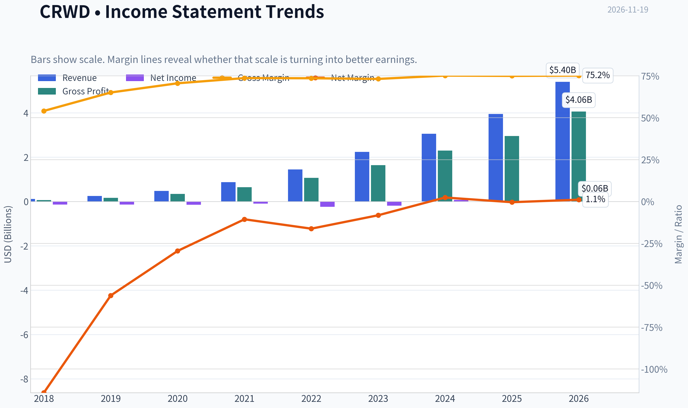

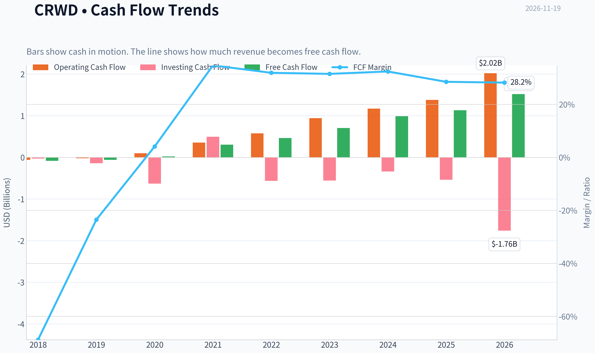

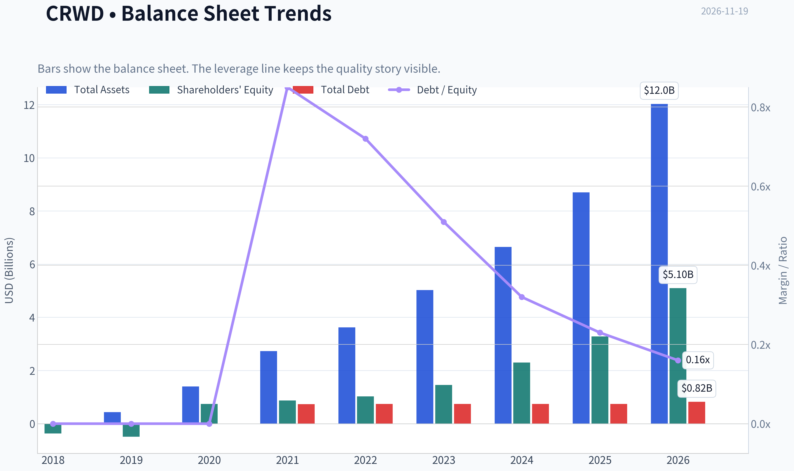

This graph tracks the profitability and return metrics (ROE, ROIC, Margins) of **CRWD** over the past decade, highlighting capital efficiency trends.

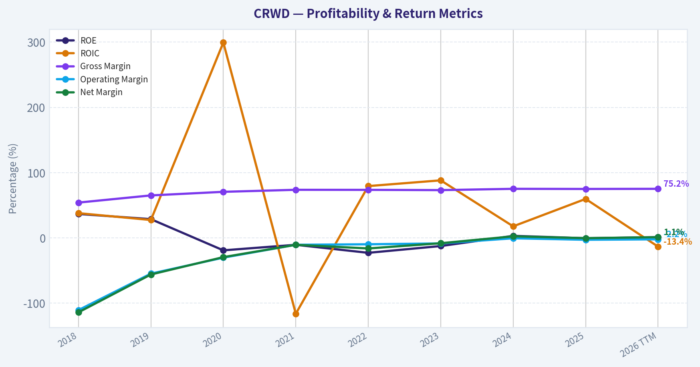

This chart illustrates the financial health of **CRWD** over the last 10 years, mapping cash equivalents and free cash flow against total obligations (Debt).

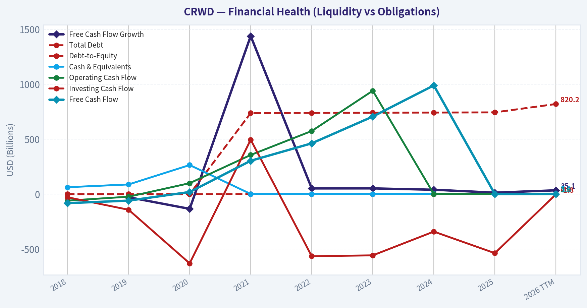

This comparison chart from *Profitability and Operating Performance* stacks current figures against historical benchmarks for **CRWD**, making it easy to see where the company trades relative to its own averages.

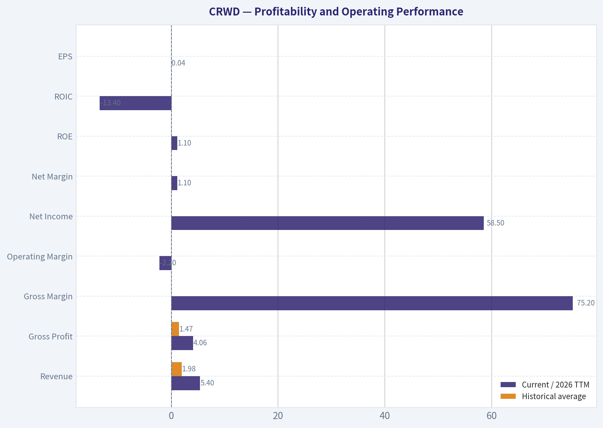

---

### Intrinsic Value Analysis (Buffett)

> *Following Warren Buffett's value investing philosophy: Circle of Competence, Economic Moat, Management Quality, and Margin of Safety.*

#### Intrinsic Value Snapshot

Price is what you pay. Intrinsic value is what the business may be worth based on the cash it can create for owners over time. We show a range, not one magic number.

- Current Price: $237.03
- Value Range (conservative to optimistic across both DCF methods): $56.46 to $112.35

##### Owner Earnings (Buffett Method)
- Net Income: $-15,241,000.00
- Depreciation & Amortization: $281,451,000.00
- Capital Expenditures: $-302,108,000.00
- Working Capital Changes: $-59,291,000.00
- Owner Earnings: $-9,243,000.00

##### Intrinsic Value
###### Cash Flow Method
Uses free cash flow. Better for companies spending heavily today to grow tomorrow.
- Conservative: $56.46
- Average: $56.46
- Optimistic: $112.35
- Discount Rate: 10.0%

ANALYST STANCE: **Neutral**

#### Executive Summary

CrowdStrike is an excellent cybersecurity business trading at an exceptionally demanding valuation. Its cloud-native Falcon platform benefits from threat-intelligence data, ecosystem breadth, high switching costs, and secular cybersecurity growth. However, at $237 per share and a $242.7 billion market capitalization, the valuation appears disconnected from currently demonstrated cash earnings.

The reverse DCF indicates that the market price implies approximately **194.5% annual growth for ten years**, which is not a credible long-term expectation. CrowdStrike may become a wonderful compounder, but the present price offers no meaningful margin of safety.

#### 1. Factor Scorecard

| Factor | Score | Assessment |
|---|---:|---|
| Circle of competence and simplicity | 4/5 | The company sells cloud-based cybersecurity software that detects and responds to threats. The model is understandable, though technology and threat environments evolve rapidly. |
| Durable competitive advantage | 4/5 | Falcon benefits from platform breadth, embedded workflows, threat data, brand, and switching costs. The moat is strong but competition from Microsoft, Palo Alto Networks, and other vendors remains intense. |
| Management and capital allocation | 3/5 | Founder influence and long-term platform development are positives. The score is moderated by limited evidence that current earnings and per-share economics justify the valuation. |
| Industry structure | 4/5 | Cybersecurity is strategically important, recurring, and growing. Competition is heavy, but scale, data, and consolidation favor leading platforms. |

**Gate 5 status: Not tripped.** Available evidence does not show both deteriorating earnings or cash flow and a solvency red line. The current ratio is approximately 1.77, and there is no indication that interest coverage is below 1x or that the company is in financial distress.

**Key Takeaways:** CrowdStrike scores well on business quality, moat, and industry attractiveness. The principal weakness is not solvency or business viability; it is the price paid for the expected growth.

#### 2. Moat Analysis

| Moat source | Evidence | Assessment |
|---|---|---|
| Intangible assets | Strong cybersecurity brand, proprietary threat intelligence, and accumulated endpoint and workload data | Meaningful advantage |
| Switching costs | Security tools become embedded in IT operations, incident response, compliance, and security workflows | High, though not absolute |
| Cost advantages | Cloud-native architecture can support efficient deployment and centralized updates at scale | Potentially strong, but must be confirmed through sustained operating margins |
| Network effects | More telemetry can improve detection and response capabilities; broader platform adoption increases ecosystem value | Data-driven network effects, not a pure consumer network |

CrowdStrike's strongest moat is the combination of **mission-critical software, accumulated security data, platform integration, and customer workflow embedding**. Cybersecurity customers are reluctant to change vendors when a system is responsible for protecting endpoints, identities, cloud workloads, and sensitive data.

The 74.7% gross margin supports the presence of valuable intellectual property and software economics. Revenue growth of 21.7% indicates that the company continues to expand despite its scale. The key question is whether these advantages can translate into much higher free cash flow per share without excessive stock-based compensation or rising competition.

#### 3. Management Quality Assessment

Management appears strategically focused on building a broad cybersecurity platform rather than a narrow point product. Expanding Falcon across endpoint security, identity, cloud, log management, and security operations can increase customer lifetime value and reduce vendor fragmentation.

Positive indicators include:

- Continued investment in a unified cybersecurity platform.
- Strong revenue growth at substantial scale.
- A business model built around recurring software revenue.
- Founder-associated leadership and a long-term product orientation.

Areas requiring scrutiny include:

- Whether revenue growth translates into durable GAAP profitability.
- Stock-based compensation and dilution.
- Acquisition discipline.
- Whether incremental spending produces attractive per-share returns.
- Whether management can maintain pricing power as Microsoft and Palo Alto Networks expand.

Management receives a **3/5** because the strategic direction is strong, but valuation requires unusually high confidence in future capital allocation and per-share cash generation.

#### 4. Financial Summary

| Metric | Current reported snapshot |
|---|---:|
| Share price | $237 |
| Market capitalization | $242.70 billion |
| Revenue growth, year over year | 21.7% |
| Gross margin | 74.7% |
| Return on equity | -3.7% |
| Free-cash-flow yield | 0.5% |
| Implied annual free cash flow | Approximately $1.21 billion |
| Current ratio | 1.77 |
| P/E ratio | 4,740.6x |
| Headline intrinsic value | Negative $27.63 |
| FCF-based intrinsic value | $56.46 |
| Reverse-DCF implied growth | Approximately 194.5% annually for ten years |

**Key Takeaways:** CrowdStrike has strong growth and gross margins, but current returns on equity and earnings-based valuation metrics are weak. A 0.5% free-cash-flow yield means investors are paying roughly 200 times current free cash flow, leaving little room for execution mistakes.

#### 5. Owner Earnings Calculation

The available valuation data do not support a reliable Buffett-style owner earnings calculation using separately identified net income, depreciation, maintenance capital expenditure, and working-capital investment. Free cash flow is therefore used as a conservative operating proxy.

| Owner earnings component | Amount |
|---|---:|
| Net income | Not used as a dependable positive owner-earnings base |
| Depreciation and amortization | Not separately available in the research snapshot |
| Maintenance capital expenditure | Not separately identifiable |
| Working-capital investment | Not separately identifiable |
| Free-cash-flow proxy | Approximately $1.21 billion |
| Approximate FCF per share | $1.18 |

**Key Takeaways:** Current free cash flow is positive, but it is very small relative to the market value of the company. At the present price, the investment thesis depends primarily on substantial future expansion in owner earnings rather than on current cash returns.

#### 6. Three-Scenario DCF Valuation

Using approximately $1.21 billion of current free cash flow as a proxy for owner earnings and a 10% discount rate:

| Scenario | Assumption | Estimated value |
|---|---|---:|
| A. No growth | Current cash generation capitalized at 10% | Approximately $12 per share |
| B. GDP growth | 3% perpetual growth | Approximately $17 per share |
| C. Historical-growth framework | Not dependable because a multi-year owner-earnings growth series is unavailable; using the available FCFF model instead | $56.46 per share |

The research pack's headline routed intrinsic value is negative $27.63, reflecting an unfavorable FCFF model output. That result should not be treated as a literal liquidation value, but it reinforces that standard cash-flow valuation does not support the current price.

**Key Takeaways:** Even the more favorable available cash-flow estimate of $56.46 per share is far below the $237 market price. The valuation requires extraordinary future growth in cash generation, not merely continuation of the current 21.7% revenue growth rate.

#### 7. Margin of Safety Analysis

| Measure | Result |
|---|---:|
| Current price | $237 |
| FCF-based intrinsic value | $56.46 |
| Premium to FCF-based value | Approximately 320% |
| GDP-growth DCF value | Approximately $17 |
| Price premium to GDP-growth value | Approximately 1,300% |
| Reverse-DCF implied growth | Approximately 194.5% annually for ten years |
| Quality-adjusted conclusion | No margin of safety |

CrowdStrike's quality could justify a premium valuation. A wide-moat, high-growth compounder need not trade at a low multiple. However, even a high-quality software company should not require nearly 200% annual growth for a decade to validate its price.

The market may be pricing in a combination of sustained high revenue growth, major margin expansion, successful platform expansion, minimal dilution, and continued strategic dominance. That is a heroic collection of assumptions.

#### 8. Final Buffett Scorecard

| Criterion | Weight | Score | Weighted score |
|---|---:|---:|---:|
| Moat width and durability | 25% | 4.5/5 | 1.13 |
| Valuation and margin of safety | 20% | 1.0/5 | 0.20 |
| Capital returns versus WACC | 15% | 2.0/5 | 0.30 |
| Business understanding and predictability | 12% | 4.0/5 | 0.48 |
| Management quality and capital allocation | 12% | 3.5/5 | 0.42 |
| Reinvestment runway | 8% | 5.0/5 | 0.40 |
| Balance-sheet strength | 4% | 4.0/5 | 0.16 |
| Industry structure | 4% | 4.0/5 | 0.16 |
| **Total** | **100%** |  | **3.25/5** |

#### 9. Investment Stance

**Neutral - Moderate conviction.**

CrowdStrike is a high-quality, strategically important cybersecurity platform with a credible long-term moat and substantial reinvestment runway. It deserves to remain on a quality watchlist, particularly if future results show sustained revenue growth, expanding operating margins, lower dilution, and rapid growth in free cash flow per share.

At $237, however, the valuation overwhelms the business quality. A more attractive entry point would require either a substantial price decline or several years of rapid cash-flow growth that materially closes the gap between market value and intrinsic value.
#### Valuation Bridge

This bridge places the current market price beside each intrinsic value lens so readers can see whether upside depends on one method or shows up across several methods.

| Scenario | Intrinsic Value / Share |
| --- | ---: |
| Cash Flow Method | $56.46 |
| Damodaran Method | $-27.63 |
| Current Price | $237.03 |

#### Key Takeaways

If one method is far above the others, the upside case depends on a specific modelling assumption. When several methods cluster together, the valuation story is more robust.

#### Valuation Visuals

This comparison chart from *Latest Earnings Snapshot* stacks current figures against historical benchmarks for **CRWD**, making it easy to see where the company trades relative to its own averages.

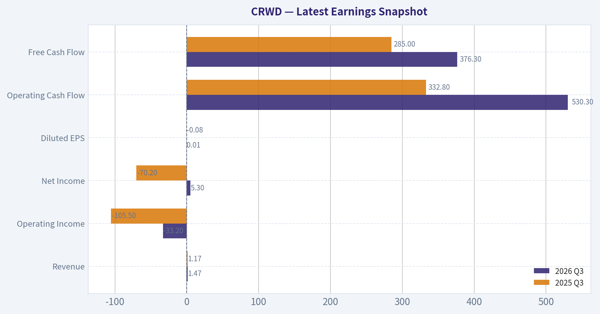

This comparison chart from *Balance Sheet and Financial Strength* stacks current figures against historical benchmarks for **CRWD**, making it easy to see where the company trades relative to its own averages.

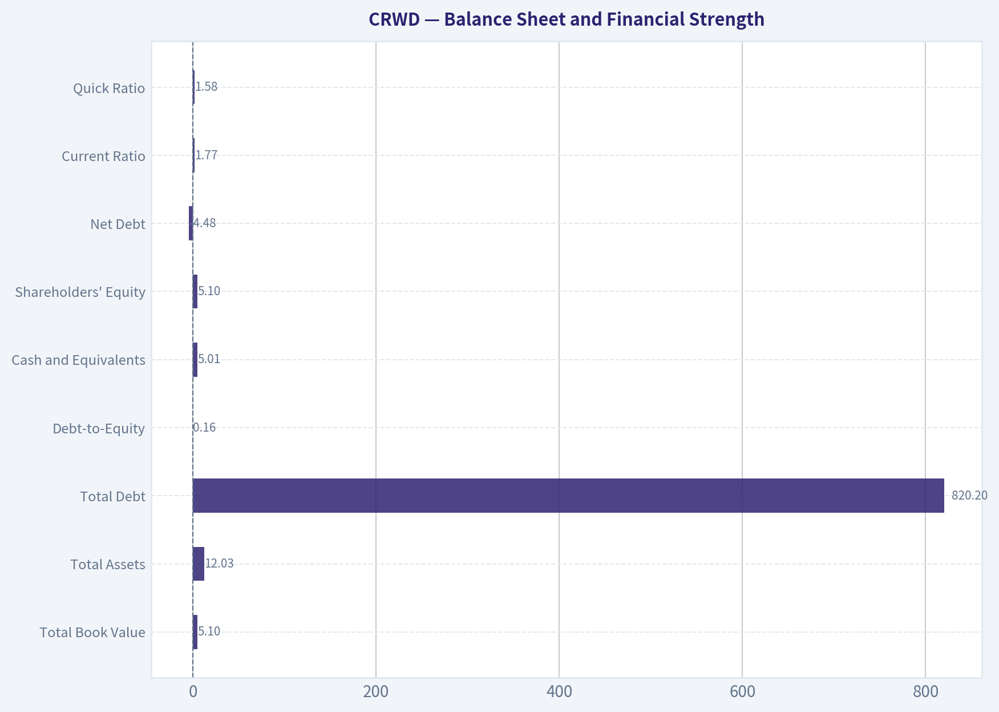

This comparison chart from *Cash Flow and Capital Allocation* stacks current figures against historical benchmarks for **CRWD**, making it easy to see where the company trades relative to its own averages.

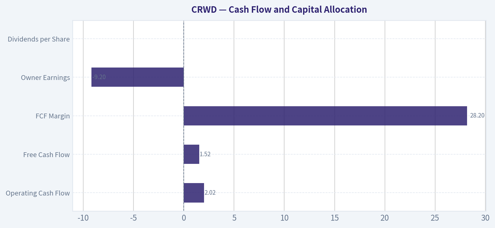

This comparison chart from *Current Versus Historical Position* stacks current figures against historical benchmarks for **CRWD**, making it easy to see where the company trades relative to its own averages.

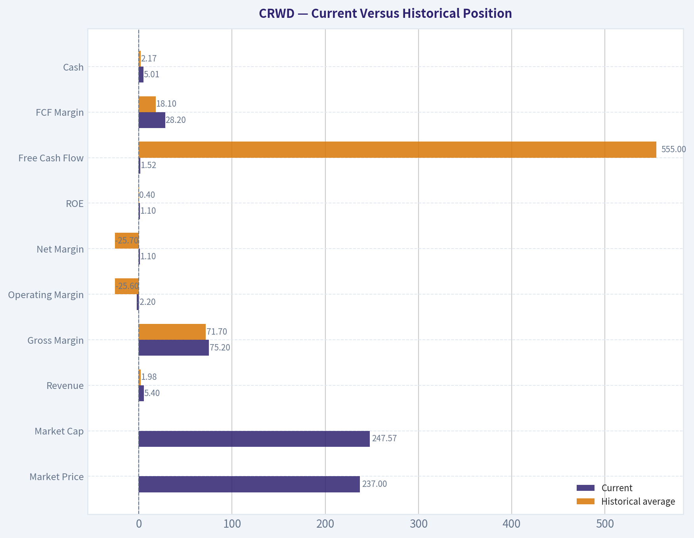

---

### Trend & Growth Analysis (Lynch/Druckenmiller/Fisher)

> *Following Peter Lynch's GARP, Stanley Druckenmiller's macro-aware approach, and Philip Fisher's scuttlebutt methodology.*

ANALYST STANCE: **Neutral**

#### Executive view

CrowdStrike is a high-quality cybersecurity growth company with strong secular tailwinds, approximately 75% gross margins, substantial free cash flow, and a long-term platform expansion opportunity. However, at roughly **$237 per share, $243 billion market capitalization, and 45x sales**, the valuation already discounts an exceptionally strong outcome. The stock is a compelling business but not presently a compelling risk-adjusted entry point.

#### 1. Lynch classification

**Fast Grower, with a major valuation risk.**

Revenue has grown at approximately **29% over three years and 41% over five years**, while free cash flow has reached approximately **$1.5 billion**. The latest reported growth rate of **21.7% year over year**, however, indicates meaningful deceleration from the company's earlier hypergrowth phase.

| Lynch criterion | Assessment |
|---|---|
| Category | Fast grower |
| Revenue growth | Strong, but decelerating |
| Profitability | Positive free cash flow; GAAP profitability remains weak |
| Balance sheet | Strong liquidity and net cash |
| Business quality | High |
| Valuation | Extreme |
| Primary classification risk | Fast grower becoming an expensive growth compounder |

**Key Takeaways:** CrowdStrike clearly qualifies as a fast grower based on its multiyear revenue and free-cash-flow record. The key question is not whether the company can grow, but whether it can sustain enough growth and margin expansion to justify its exceptionally high valuation.

#### 2. The story in three bullets

- **Cybersecurity is becoming mission-critical infrastructure:** Cloud adoption, artificial intelligence, ransomware, and identity threats increase the need for continuous endpoint and workload protection.
- **CrowdStrike is building a broad security platform:** Its cloud-native architecture can expand from endpoint security into identity, cloud security, threat intelligence, and other adjacent modules.
- **Land-and-expand economics can support durable growth:** A large installed base, recurring subscriptions, and cross-selling create the potential for rising customer lifetime value and operating leverage.

#### 3. TAM and runway analysis

CrowdStrike's reported trailing revenue is approximately **$5.4 billion**. A simple 10x test requires roughly **$54 billion of annual revenue**.

| TAM question | Assessment |
|---|---|
| Current revenue | Approximately $5.4B |
| 10x revenue target | Approximately $54B |
| Relevant market | Endpoint, cloud, identity, workload, security operations, and threat intelligence |
| Can the company reach $54B while remaining below 20% share? | Plausibly yes, if adjacent markets and platform spending expand |
| TAM growth | Favorable, supported by cloud, AI, and cyber-threat growth |
| Main constraint | Competition from Microsoft, Palo Alto Networks, SentinelOne, Okta, and bundled platforms |

**Key Takeaways:** The 10x test is directionally positive because CrowdStrike operates across several expanding cybersecurity categories rather than a single narrow product. Reaching $54 billion of revenue is plausible in a broad platform scenario, but it would require sustained product expansion, strong cross-selling, and continued share gains against very well-capitalized competitors.

#### 4. Revenue growth trend

| Period | Revenue | Growth |
|---|---:|---:|
| 2021 | $874M | 81.6% |
| 2022 | $1.45B | 66.0% |
| 2023 | $2.24B | 54.4% |
| 2024 | $3.06B | 36.3% |
| 2025 | $3.95B | 29.4% |
| 2026 TTM | $5.40B | 36.5% |
| Latest current growth metric | - | 21.7% |
| Three-year revenue CAGR | - | 29.0% |
| Five-year revenue CAGR | - | 40.6% |

**Key Takeaways:** The long-term record is excellent, but the trend is not a clean acceleration pattern. Historical annual growth has generally decelerated from extreme levels, and the latest 21.7% figure suggests that CrowdStrike is maturing into a large-cap compounder unless a new product cycle reaccelerates growth.

#### 5. Unit economics and operating quality

| Metric | Available result | Interpretation |
|---|---:|---|
| Gross margin | 74.7%-75.2% | Strong software economics |
| Free cash flow | Approximately $1.52B | Strong cash generation |
| FCF margin | Approximately 28.2% | Excellent |
| Rule of 40 | Approximately 49.9% using 21.7% growth | Healthy |
| Net revenue retention | Not provided | Important missing datapoint |
| LTV/CAC | Not provided | Cannot verify |
| Current ratio | 1.77 | Adequate liquidity |
| Net cash | Approximately $4.48B | Balance-sheet strength |
| Debt-to-equity | Approximately 0.16-0.17 | Low leverage |

**Key Takeaways:** CrowdStrike's gross margin, free-cash-flow margin, liquidity, and net-cash position are substantial strengths. The principal analytical gap is the absence of verified net revenue retention and customer-acquisition metrics; without them, the durability of expansion revenue and sales efficiency cannot be fully assessed.

#### 6. Inflection-point assessment

| Potential inflection | Current assessment | Evidence |
|---|---|---|
| Product cycle | Possible, not yet proven | AI-related security demand and platform expansion |
| Market share | Positive but unverified | Strong category position, intense competition |
| Margin | Positive over the long term | FCF margin near 28%; GAAP operating margin still negative |
| TAM | Positive | Expansion into cloud, identity, and security operations |
| Competitive | Mixed | Strong brand and platform, but Microsoft and Palo Alto are formidable |

**Key Takeaways:** The strongest potential inflection is TAM expansion through platform breadth and AI-driven security demand. The margin inflection is partially visible in free cash flow, but GAAP operating profitability has not yet demonstrated a decisive, sustained breakout.

#### 7. Macro setup

The macro backdrop is mixed.

- **Structural tailwinds:** Cybersecurity spending is relatively nondiscretionary, and AI increases both attack sophistication and the need for automated defense.
- **Interest-rate sensitivity:** A long-duration growth stock remains vulnerable to higher rates and valuation compression.
- **Market sentiment:** Recent cyber and AI enthusiasm is supportive, but the stock's valuation makes it highly sensitive to any growth disappointment.
- **Druckenmiller assessment:** The secular trend is favorable, but the tactical setup is not obviously favorable while rates and valuation expectations remain uncertain.

#### 8. Fisher 15-point assessment

The score below is provisional because customer retention, employee relations, sales productivity, and management disclosures were not fully available in the supplied data.

| Fisher factor | Score / 5 |
|---|---:|
| Market potential | 5 |
| New-product determination | 4 |
| R&D effectiveness | 4 |
| Sales organization | 4 |
| Profit margin quality | 4 |
| Margin improvement | 3 |
| Labor relations | 3 |
| Executive relations | 3 |
| Management depth | 4 |
| Cost analysis and accounting | 3 |
| Outstanding moat characteristics | 4 |
| Long-range profit outlook | 5 |
| Dilution discipline | 2 |
| Management candor | 3 |
| Management integrity | 4 |
| **Total** | **55 / 75** |

**Key Takeaways:** CrowdStrike scores as a good, but not outstanding, Fisher company based on the available evidence. Its market opportunity, innovation potential, and platform characteristics are strong, while dilution, incomplete GAAP profitability, and missing scuttlebutt data reduce confidence.

#### 9. Valuation analysis

| Valuation measure | Result | Interpretation |
|---|---:|---|
| Price | $237 | Very high absolute price |
| Market capitalization | Approximately $243B | Large-cap valuation |
| Price-to-sales | 44.98x | Extreme for a $5.4B-revenue company |
| Trailing P/E | 4,740.6x | Not meaningful |
| Forward P/E | 147.1x | Very expensive |
| PEG | 6.12 | Far above Lynch's acceptable range |
| FCF yield | 0.5% | Low |
| Conservative FCF value estimate | Approximately $56 | Well below market price |
| Optimistic FCF value estimate | Approximately $112 | Still below market price |
| Reverse DCF implication | Approximately 194.5% annual owner-earnings growth for 10 years | Unrealistically demanding |

**Key Takeaways:** Every supplied valuation method indicates that the stock is priced for extraordinary execution. Even the optimistic cash-flow estimate is materially below the current price, while the reverse-DCF result implies an exceptionally aggressive earnings trajectory. This is the decisive reason for a Watch rather than an Advocate stance.

#### 10. Growth investor scorecard

| Criterion | Weight | Score / 5 | Weighted contribution |
|---|---:|---:|---:|
| The story | 10% | 4.5 | 0.45 |
| TAM and runway | 20% | 4.5 | 0.90 |
| Revenue growth | 20% | 3.5 | 0.70 |
| Unit economics | 15% | 4.0 | 0.60 |
| Competitive position | 10% | 4.0 | 0.40 |
| Management quality | 10% | 3.8 | 0.38 |
| Macro setup | 5% | 3.0 | 0.15 |
| Profitability path | 5% | 3.5 | 0.18 |
| Valuation | 5% | 1.0 | 0.05 |
| **Total** | **100%** | - | **3.81 / 5.00** |

**Key Takeaways:** Operationally, CrowdStrike scores well enough for an Advocate-quality business. The score is held back primarily by valuation and the deceleration in reported growth, producing a Watch stance rather than a high-conviction buy recommendation.

#### 11. Position-size stance

**Recommended stance: Watch / no aggressive new position.**

- **Existing holders:** Continue holding if the position is sized appropriately and the original thesis remains intact.
- **New investors:** Prefer waiting for either a substantial valuation reset or evidence that growth has reaccelerated toward the 30% range while GAAP margins improve.
- **Hypothetical sizing:** A speculative starter position should generally remain small, approximately **1%-2% of a diversified portfolio**, until valuation and growth-risk concerns improve.
- **Do not chase:** A 0.5% FCF yield provides very little valuation cushion.

#### 12. Key catalysts and risks

| Catalysts | Risks |
|---|---|
| Revenue reacceleration above 30% | Further growth deceleration |
| Strong net revenue retention | Microsoft bundling and platform competition |
| Successful cloud, identity, and AI-security expansion | Higher interest rates compressing multiples |
| Sustained GAAP operating profitability | Elevated stock-based compensation and dilution |
| Operating margin expansion | Security incident, outage, or reputational damage |
| Strategic acquisitions that broaden the platform | Valuation multiple contraction |

**Key Takeaways:** The most important upside catalyst is a credible reacceleration from a maturing endpoint-security company into a broader security platform. The most important downside risk is that growth settles near 20% while the market continues valuing CrowdStrike as a hypergrowth company.

#### Final judgment

CrowdStrike is an excellent secular-growth business with a credible long-term path to substantially higher revenue. But at approximately **45x sales, 147x forward earnings, and a 0.5% FCF yield**, the current price leaves little room for execution mistakes. I would **hold existing shares selectively, monitor the company closely, and wait for either a valuation reset or clear evidence of renewed growth acceleration before upgrading to Advocate**.

---

### Market Technical Analysis

ANALYST STANCE: **Neutral**

#### CRWD Technical Market Report

**Data note:** November 19, 2026 is not listed as a trading day in the retrieved data. The latest available session is November 18, when CRWD closed at **$237.03**.

CRWD's technical picture is **long-term bullish but short-term corrective and unsettled**. The stock remains substantially above its 200-day SMA, confirming that the broader trend is still constructive. However, price is below the 50-day SMA, the MACD remains negative, and the stock has not yet reclaimed important intermediate-term resistance.

#### Trend Structure

The 200-day SMA stood at approximately **$174.82** on November 18, while the 50-day SMA was near **$245.90**. CRWD's closing price of $237.03 is therefore about **35.6% above its 200-day average**, but roughly **3.6% below its 50-day average**.

This separation indicates that the major uptrend has not been invalidated, but the stock is experiencing a meaningful intermediate-term pullback. The 50-day SMA has continued to rise, from approximately $233.49 on October 20 to $245.90 on November 18, so the medium-term trend has not yet fully rolled over. Nevertheless, price remaining beneath that moving average suggests that sellers still control the immediate trend.

The most important technical transition would be a sustained recovery above the **$245-$246 area**, where the 50-day SMA and recent trading congestion overlap. A move above that region would improve the intermediate-term structure. Failure to reclaim it would leave the stock vulnerable to another test of the recent **$216-$220 support zone**.

#### Momentum and MACD

The MACD deteriorated sharply during late October and early November, falling from positive readings above 4 to approximately **-6.84 on November 17**. It improved to **-5.77 on November 18**, helped by the rebound from the November 6 low near $216.90.

That improvement is encouraging, but it is not yet a confirmed bullish reversal. A negative MACD means the shorter-term exponential averages remain below the longer-term averages. The recent increase in MACD primarily indicates that downside momentum has eased; it does not yet demonstrate that upside momentum has taken control.

Traders should distinguish between a **relief rally** and a durable trend reversal. A bullish MACD crossover, particularly if accompanied by a move above the 50-day SMA and stronger volume, would provide more convincing confirmation.

#### RSI and Price Momentum

The RSI recovered from approximately **35.3 on November 6** to **50.0 on November 18**. This is a substantial improvement from near-oversold conditions, but RSI is now close to neutral rather than strongly bullish.

The recovery suggests that the selling pressure seen in early November has moderated. However, RSI has not reached the 55-60 region that would typically indicate stronger upside momentum, nor has it shown an overbought reading that would warn of immediate exhaustion. In practical terms, the RSI supports the view that CRWD is attempting to stabilize, but it does not yet confirm a powerful new advance.

A move above 55-60 while price reclaims the 50-day SMA would strengthen the bullish case. Conversely, a failure near $245-$246 followed by RSI slipping back below 40 would suggest that the rebound is losing traction.

#### Bollinger Bands and Volatility

On November 18, the approximate Bollinger Band levels were:

- Upper band: **$272.81**
- Middle band: approximately **$239.24**
- Lower band: **$205.68**

CRWD closed at $237.03, slightly below the middle band. This places the stock in the lower half of its recent volatility range, but not near the lower band. The position is therefore neither an extreme oversold signal nor a confirmed upside breakout.

The Bollinger Bands remain very wide, reflecting the stock's elevated volatility. The approximate band width of $67.13 is nearly **28% of the middle band**, which means normal daily price movements can be substantial. A move above the middle band would improve short-term momentum, while a decisive break below the $218-$220 area could open a path toward the lower-band region near $206.

#### Volume-Weighted Trend

The VWMA was approximately **$231.50**, below the latest close of $237.03. This is a modestly positive signal: the latest price is above the volume-weighted average of recent trading, implying that the November rebound has lifted price above the level where much of the recent volume changed hands.

However, the VWMA has declined steadily from approximately $255.05 on October 20 to $231.50 on November 18. That decline shows that the volume-weighted trend remains damaged despite the latest bounce. The price being above VWMA is constructive for the very short term, but the falling slope argues against treating it as confirmation of a fully restored uptrend.

A sustained move above both the VWMA and the 50-day SMA would represent a stronger improvement. If price falls back beneath the VWMA, the recent rebound would look increasingly fragile.

#### Volatility and Risk Management

ATR increased from roughly **$11.93 on October 20** to **$14.19 on November 18**. At the latest close, this represents approximately **6.0% of the share price per trading day**, a high level of volatility.

The elevated ATR is consistent with CRWD's recent wide daily ranges and sharp reversals. It means that tight stops may be vulnerable to ordinary price fluctuations, while position sizing should account for the possibility of $14 or more in average daily movement. The November 18 intraday range alone was approximately $21.67, illustrating that realized movements can exceed the current ATR.

The ATR does not indicate direction, but it materially increases the importance of confirmation. Breakouts should ideally be supported by expanding volume and follow-through rather than judged from a single intraday move.

#### Key Scenarios

The **constructive scenario** would involve CRWD holding above approximately $231-$232, maintaining RSI above 50, and closing decisively above the $245-$246 resistance area. Such a move would reclaim the 50-day SMA and could bring the stock back toward the $260-$263 region, where prior October and November trading created additional overhead supply.

The **neutral scenario** is continued consolidation between approximately $218 and $246. This would allow MACD and RSI to recover without requiring an immediate breakout. Given the current wide Bollinger Bands and elevated ATR, range-bound volatility is a realistic possibility.

The **bearish scenario** would be a loss of the $218-$220 support area, especially if accompanied by renewed negative MACD momentum and RSI falling below 40. In that case, the $205-$208 region near the lower Bollinger Band becomes the next important downside reference. A break toward that zone would not automatically end the long-term uptrend, but it would signal a deeper intermediate-term correction.

#### Indicator Selection

The selected indicators are **close_50_sma, close_200_sma, macd, rsi, boll_ub, boll_lb, atr, and vwma**. Together they cover long- and medium-term trend, momentum, relative price position, volatility, and volume-weighted confirmation without relying on multiple redundant oscillators.

| Indicator | Latest available reading | Interpretation for CRWD |
|---|---:|---|
| Close | $237.03 on Nov. 18 | Rebounded from $216.90 but remains below the 50-day SMA |
| 50-day SMA | $245.90 | Intermediate resistance; price is about 3.6% below it |
| 200-day SMA | $174.82 | Long-term trend remains bullish; price is about 35.6% above it |
| MACD | -5.77 | Negative momentum persists, although it improved from -6.84 |
| RSI | 50.03 | Neutral momentum; recovery from near-oversold levels is incomplete |
| Bollinger upper band | $272.81 | Major volatility-range ceiling and potential resistance |
| Bollinger lower band | $205.68 | Downside volatility reference below the $218-$220 support area |
| ATR | $14.19 | High volatility; approximately 6% of the latest share price |
| VWMA | $231.50 | Price is modestly above recent volume-weighted value, but VWMA is declining |
| Key support | $218-$220; then $205-$208 | Levels to monitor if the rebound fails |
| Key resistance | $245-$246; then $260-$263 | Reclaiming the first zone would improve the technical setup |

**Key Takeaways:** CRWD remains in a structurally bullish long-term trend because it is well above its rising 200-day SMA, but the short-term setup is not yet confirmed bullish. The recent rebound has improved RSI, MACD, and price relative to VWMA, yet the stock remains below its 50-day SMA and just under the Bollinger middle band. The most important near-term test is $245-$246 on the upside and $218-$220 on the downside; elevated ATR means both breakouts and breakdowns may be unusually volatile.

#### Market Visuals

This comparison chart from *Market Metrics* stacks current figures against historical benchmarks for **CRWD**, making it easy to see where the company trades relative to its own averages.

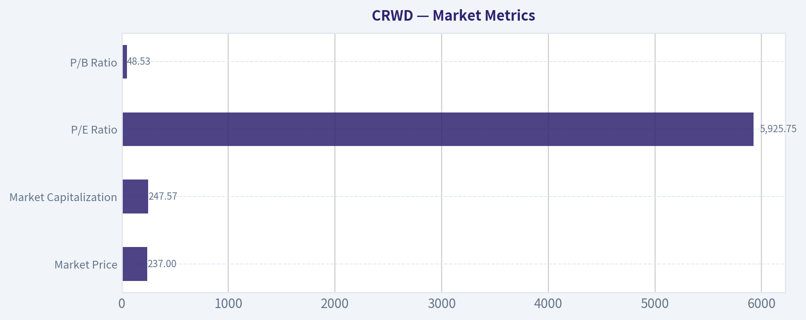

---

### Options Market Analysis

> *Reading options flow - put/call ratios, IV skew, and unusual activity - to gauge institutional positioning and event-driven risk.*

ANALYST STANCE: **Neutral**

#### CRWD Options Market Overview

Options data as of **November 19, 2026** covers expirations from November 20 through December 4. The aggregate positioning is call-heavy, with substantially more call open interest and volume than put open interest and volume.

| Expiration | Days to Expiry | Call OI | Put OI | Put/Call OI | Call Volume | Put Volume | Put/Call Volume |
|---|---:|---:|---:|---:|---:|---:|---:|
| Nov. 20, 2026 | 1 | 79,685 | 46,020 | 0.58 | 47,220 | 24,780 | 0.52 |
| Nov. 27, 2026 | 8 | 21,247 | 5,773 | 0.27 | 20,911 | 6,014 | 0.29 |
| Dec. 4, 2026 | 15 | 8,384 | 3,171 | 0.38 | 3,731 | 2,281 | 0.61 |
| **Total** | - | **109,316** | **54,964** | **0.50** | **71,862** | **33,075** | **0.46** |

**Key Takeaways:** CRWD's aggregate put/call open-interest ratio of 0.50 is meaningfully below the approximately 0.70 neutral baseline, indicating call-heavy positioning. The signal is most pronounced in the November 27 expiration, where the ratio is only 0.27. This points to bullish speculation or possible covered-call activity, rather than heavy downside hedging.

#### Implied Volatility Assessment

| Expiration | Call ATM IV | Put ATM IV | Call-Put IV Difference |
|---|---:|---:|---:|
| Nov. 20, 2026 | 3.9% | 3.8% | +0.1 percentage points |
| Nov. 27, 2026 | 2.0% | 1.9% | +0.1 percentage points |
| Dec. 4, 2026 | 1.2% | 1.0% | +0.2 percentage points |

**Key Takeaways:** ATM implied volatility is slightly higher for calls than puts across all reported expirations, producing a mild call skew rather than a downside put skew. Overall IV declines sharply with expiration, suggesting limited near-term volatility pricing or potentially a data-scaling issue, since the reported percentages are unusually low for individual equity options. No specific catalyst, such as earnings or a product event, was provided in the data, so a catalyst-driven IV interpretation is not possible.

#### IV Skew and Catalyst Risk

The available data provides ATM call and put IV but does not include explicit out-of-the-money strike-level IV. Therefore, a full OTM put-versus-OTM call skew cannot be calculated.

Based on the ATM figures alone:

- **Directional skew:** Mildly call-favorable.
- **Downside fear:** Not evident from the reported ATM IV.
- **Upside chase:** Suggested modestly, but not strongly.
- **Catalyst premium:** Not identifiable from the supplied data.
- **Data caveat:** The very low IV readings should be verified against the source's unit conventions and the actual option chain.

#### Unusual Options Activity

No contracts met the supplied unusual-activity threshold of **volume greater than five times open interest**.

| Finding | Interpretation |
|---|---|
| No volume/OI outliers | No clearly identifiable fresh, aggressive directional bets |
| Call-heavy aggregate flow | Bullish bias, but could include covered-call writing or rolling activity |
| No unusual puts | No notable evidence of urgent downside hedging |

**Key Takeaways:** The absence of contracts with volume above five times open interest reduces evidence of fresh institutional conviction. The bullish read comes primarily from the overall call-heavy structure, not from identifiable call sweeps or large opening trades. As a result, the data supports a bullish bias but not a high-confidence smart-money signal.

#### Open Interest Concentration and Gamma Levels

The data does not include strike-by-strike open interest, current CRWD price, or gamma exposure. Consequently, specific max-pain levels, gamma walls, and ITM/ATM/OTM contract classifications cannot be determined.

At the expiration level, open interest is concentrated in the nearest weekly expiration:

| Expiration | Total OI | Share of Reported Total OI |
|---|---:|---:|
| Nov. 20, 2026 | 125,705 | 76.5% |
| Nov. 27, 2026 | 27,020 | 16.4% |
| Dec. 4, 2026 | 11,555 | 7.0% |
| **Total** | **164,280** | **100.0%** |

**Key Takeaways:** Approximately three-quarters of the reported open interest expires on November 20, creating the greatest potential for short-dated pinning or rapid gamma-related price movement. However, without strike-level open interest and gamma data, the direction and location of any price "wall" cannot be identified. The concentration makes the near-term expiry especially important, but not necessarily bullish or bearish by itself.

#### Overall Options Sentiment

**Overall signal: BULLISH, with moderate-to-low confidence.**

Primary bullish factors:

- Aggregate put/call OI ratio of **0.50**, below the 0.70 neutral baseline.
- Aggregate put/call volume ratio of **0.46**.
- Mild call-over-put ATM IV skew.
- Strongest call dominance occurs in the November 27 expiration.

Important caveats:

- No unusual contracts were identified, so there is no clear evidence of aggressive fresh institutional buying.
- Call-heavy positioning may include covered-call writing, spreads, or existing positions being rolled.
- Strike-level OI, current share price, OTM IV skew, and gamma exposure were unavailable.
- The reported IV levels appear unusually low and should be checked for data-unit accuracy.
- The very short-dated concentration means positioning can change rapidly after the November 20 expiration.

The best interpretation is **bullish positioning without a strong conviction signal**. CRWD's options market favors upside exposure, but the lack of unusual activity and incomplete strike-level information argues for monitoring rather than aggressively chasing the signal.

#### Summary

| Category | Assessment |
|---|---|
| Put/Call Ratio | Bullish: 0.50 OI ratio and 0.46 volume ratio, both below the 0.70 neutral baseline |
| IV Level | Reported ATM IV is very low and declines from 3.9% near-term to 1.2% by December 4; verify data scaling |
| Skew Direction | Mild call skew based on ATM IV; full OTM skew unavailable |
| Unusual Activity | None detected; no contract exceeded five times its open interest |
| Overall Signal | **BULLISH**, but with moderate-to-low confidence; stance remains **Neutral** |

**Key Takeaways:** CRWD's options positioning is directionally bullish because calls substantially outweigh puts in both open interest and volume. Still, the lack of unusual opening activity, missing strike-level data, and unusually low reported IV prevent this from being a high-conviction signal. The appropriate stance is to watch for confirmation from fresh call activity, rising volume, or identifiable strike-level gamma support.

---

## Research Team Commentary

> *The Research Manager synthesizes the Bull vs Bear debate into action-free commentary. This is a pre-risk view, not the final stance.*

Core takeaway: CrowdStrike appears to be a potentially excellent cybersecurity franchise, but the supplied evidence does not establish that $237 offers a sufficient margin of safety. The business deserves continued attention because its recurring revenue, high gross margin, switching costs, and platform expansion could support long-term compounding. However, the valuation depends on profitability and per-share cash-flow growth that have not been demonstrated in this debate. My stance is Neutral, not Bullish and not a categorical long-term rejection.

The strongest bull argument is that CrowdStrike operates in a mission-critical, structurally growing market and has more than a narrow endpoint product. Its cloud-native platform, threat data, customer integrations, and expanding security modules can create switching costs and support a land-and-expand model. A 74.7% gross margin provides real operating-leverage potential, while recurring subscriptions should make revenue more predictable than that of a transactional technology vendor. Founder-led strategic consistency and the ability to distribute new modules through an established customer base are also meaningful advantages. If CrowdStrike sustains high-teens growth, converts that growth into substantially better margins, and limits dilution, it could become the kind of asset-light compounder Buffett's modern framework should recognize.

The strongest bear argument is not the superficially enormous P/E by itself. Near break-even earnings make that multiple largely unusable. The more important issue is that the debate does not provide the current revenue, free cash flow, diluted share count, stock-based compensation, net cash, retention, or forward growth needed to establish intrinsic value. Negative ROE of 3.7%, negative ROA of 1.5%, and the absence of a demonstrated ROIC show that attractive gross margins have not yet translated into proven shareholder economics.

The bull's illustrative DCF is also too conditional to support a purchase. Assuming $5 of normalized free cash flow per share and then compounding it at 15%-20% for ten years is a scenario, not evidence. Small changes in growth, dilution, terminal margins, or the discount rate materially alter value. Before paying a premium, I would want to verify that the starting free cash flow is economically real after treating stock-based compensation as a cost and that growth is occurring on a diluted per-share basis.

Competition reinforces the need for a margin of safety. CrowdStrike may offer superior specialized technology, but Microsoft and other broad vendors possess distribution, bundling, telemetry, and procurement advantages. CrowdStrike does not need to lose technological leadership for returns to disappoint; slower module adoption, modest pricing pressure, or persistently high sales and research spending could be enough to prevent the margin expansion embedded in the valuation. Cybersecurity spending can remain healthy while CrowdStrike's shareholder returns fall short.

Conversely, the bear goes too far in treating current negative accounting returns as proof that the business is unsuitable. For an expanding subscription platform, present earnings can understate long-run economics because customer acquisition and product development are expensed upfront. High gross margins, recurring revenue, and switching costs make future operating leverage plausible. There is also no supplied evidence of financial distress. This is therefore not an obvious low-quality business deserving automatic avoidance.

The market's technical range of roughly $206 to $273 and mildly call-favorable options positioning add little to the investment conclusion. A price near the middle of a trading band is neither cheap nor expensive in intrinsic-value terms. If anything, the absence of pronounced downside fear suggests that the shares are not being offered amid obvious capitulation.

Rationale: The correct Buffett-style response is patience. CrowdStrike may be a wonderful business in development, but the current record does not yet demonstrate wonderful per-share economics, and the supplied valuation work does not show even the roughly 10%-15% discount that could be sufficient for a proven wide-moat compounder. At the same time, the evidence is insufficient to declare clear overvaluation because the essential current cash-flow and balance-sheet inputs are missing. That makes Neutral more disciplined than either buying on the platform narrative or issuing a permanent Bearish based mainly on an uninformative P/E.

This also incorporates the prior lesson to focus on current fundamentals and market data. The quoted price and accounting ratios should be timestamped and reconciled with the latest filing before capital is committed. I would not rely on stale ratios, technical bands, or hypothetical free cash flow.

Monitoring plan: Over the next one to four quarters, I would focus on subscription revenue and annual recurring revenue growth, retention and customer expansion, adoption of additional modules, and competitive win rates against bundled alternatives. I would require evidence that operating and free-cash-flow margins are expanding without weakening growth or relying on unusually favorable working-capital movements.

Most importantly, I would track free cash flow per diluted share, stock-based compensation as a percentage of revenue, diluted share growth, and whether repurchases create value or merely offset employee issuance. I would also monitor GAAP operating profitability, incremental margins, and a credible calculation of return on incremental invested capital.

The thesis would strengthen if CrowdStrike sustains high-teens growth, shows durable multi-module adoption, expands margins, and compounds dilution-adjusted free cash flow while maintaining pricing power. It would weaken if growth drops toward the low teens before margins normalize, dilution remains substantial, retention deteriorates, sales efficiency worsens, or bundled competitors pressure pricing. A meaningful price decline without corresponding deterioration-or several quarters of stronger per-share economics-could create an investable margin of safety.

Final stance: Neutral.

---

## Value Investing Team Commentary

> *The Investor translates the research view into an investment thesis before risk review. This is still not the final stance.*

CrowdStrike is a potentially excellent business, but the supplied evidence does not yet justify paying a premium for it. The correct conclusion is not that the company is poor; rather, the investment case remains incomplete at approximately $237.

### Business Quality and Moat

CrowdStrike operates in an attractive and increasingly essential market. Cybersecurity spending is supported by structural forces-cloud migration, ransomware, identity attacks, regulatory requirements, and the growing complexity of artificial intelligence infrastructure. This is not a discretionary software category that customers can easily eliminate during a weak economy.

Its strongest potential advantages are:

- A cloud-native architecture
- Large-scale threat telemetry and data
- Deep integration into customer security workflows
- High switching costs once the platform becomes operationally important
- Recurring subscription revenue
- Opportunities to expand from endpoint security into identity, cloud, exposure management, threat intelligence, and other modules

The platform opportunity is important. If CrowdStrike can sell several products to the same customer, customer lifetime value can rise substantially without customer-acquisition costs increasing proportionally. That could create attractive long-term operating leverage.

However, the moat should not be treated as unquestionable. Microsoft has enormous distribution, existing enterprise relationships, security telemetry, and the ability to bundle products into broader software contracts. Other specialized cybersecurity vendors also compete aggressively. CrowdStrike can remain technologically strong and still produce disappointing shareholder returns if pricing, sales efficiency, or module adoption weaken.

The key question is therefore not whether cybersecurity grows. It is whether CrowdStrike can convert that industry growth into durable, dilution-adjusted free-cash-flow growth per share.

### Profitability and Per-Share Economics

The 74.7% gross margin is encouraging, but gross margin is only the beginning of the analysis. It indicates that the product can potentially support strong economics; it does not prove that shareholders are currently receiving strong economics.

The negative ROE and ROA, along with the absence of a demonstrated ROIC, show that operating expenses remain substantial relative to reported profitability. That is not automatically disqualifying for a rapidly expanding subscription business. Customer acquisition, research, and product development are expensed before their full lifetime benefits are realized.

But this argument has limits. A company cannot indefinitely ask investors to value future operating leverage without demonstrating that such leverage is arriving. The most important metrics are:

- Free cash flow after treating stock-based compensation as a genuine economic cost
- Free cash flow per diluted share
- Diluted share-count growth
- GAAP operating margin
- Incremental operating margins
- Customer retention and expansion
- Sales efficiency and customer-acquisition payback
- Return on incremental invested capital

Stock-based compensation deserves particular scrutiny. Reported free cash flow can look attractive while shareholders experience ongoing dilution. Repurchases that merely offset employee issuance should not be treated as genuine value creation.

The stated P/E of 4,740.60 is not useful for valuation. When earnings are near break-even, tiny changes in net income produce an enormous and unstable multiple. It should not be used either as proof that CrowdStrike is absurdly overvalued or as a meaningful basis for estimating intrinsic value.

### Valuation and Margin of Safety

At $237, the available information does not establish a sufficient margin of safety. The proposed valuation depends on assumptions such as approximately $5 of normalized free cash flow per share followed by many years of 15%-20% growth. That may become achievable, but it is not yet evidence.

A reverse-DCF framework would ask what the current price requires. Without reliable current revenue, free cash flow, net cash, diluted shares, stock-based compensation, and forward growth estimates, that calculation cannot be completed responsibly. Still, the burden of proof is clear: a price near $237 appears to require a combination of:

1. Sustained high-teens revenue growth
2. Continued success in adding security modules
3. Material margin expansion
4. Controlled share dilution
5. Strong conversion of revenue into per-share free cash flow
6. Limited competitive pricing pressure

That is a demanding collection of assumptions. For a wide-moat business with proven and durable per-share economics, a 10%-15% discount to intrinsic value might be adequate. CrowdStrike's long-term quality may eventually merit that treatment, but the supplied data do not yet demonstrate that it has crossed from "promising compounder" to "proven compounder."

The absence of a clear valuation discount is particularly important because cybersecurity is a competitive industry. Even if the company grows successfully, returns can be mediocre if the market price already discounts much of the future success.

### Selective Contrarian View

The contrarian bullish observation is that current negative accounting returns may obscure the economics of a rapidly expanding platform. Investors who focus only on present GAAP profitability could underestimate the value of customer relationships, recurring revenue, and future module expansion. A high-quality cybersecurity platform can be worth substantially more than its current earnings suggest if retention, pricing power, and incremental margins are genuinely improving.

The contrarian bearish observation is that the market may be overestimating the ease with which gross-margin strength becomes shareholder value. High gross margins are common in software; durable excess returns require disciplined sales spending, low dilution, strong retention, and an ability to resist bundling pressure. A business can have excellent technology and still be a mediocre investment when purchased at an aggressive valuation.

The technical price range of approximately $206-$273 and mildly call-favorable options positioning add little to the long-term thesis. They describe trading sentiment, not intrinsic value. The lack of pronounced downside fear may actually suggest that the shares are not being offered amid the kind of pessimism that often creates a compelling contrarian entry point.

### What Would Change the Decision?

The investment case would improve materially if CrowdStrike demonstrates:

- Sustained high-teens growth at increasing scale
- Consistent multi-module adoption
- Stable or improving retention
- Expanding GAAP and free-cash-flow margins
- Declining stock-based compensation as a percentage of revenue
- Low or manageable diluted share growth
- Strong free-cash-flow growth per diluted share
- Evidence that Microsoft's bundling has not impaired pricing or win rates

The thesis would weaken if growth falls toward the low teens before margins normalize, customer expansion slows, sales efficiency deteriorates, dilution remains high, or competitive bundling creates pricing pressure.

A substantial price decline without a corresponding deterioration in business fundamentals could eventually create an attractive opportunity. Alternatively, several quarters of improving dilution-adjusted economics could justify a higher valuation even without a major share-price decline.

CrowdStrike deserves a place on a high-quality technology watchlist. Its market, recurring revenue model, gross margins, and platform ambition are all attractive. But a Buffett-style investor should own the economics, not merely the narrative. Until the company demonstrates durable per-share cash-flow compounding and the price provides an appropriate quality-adjusted discount, patience is preferable to enthusiasm.

**ANALYST STANCE: Neutral**

---

## Deep Values Commentary

> *The Risk Management Team debates and the Risk Judge provides the final action-free verdict. This section determines the final Bullish / Neutral / Bearish stance.*

#### Final Stance Scorecard

This scorecard converts the final research view into a weighted decision frame. It does not replace the narrative judgement, but it makes the main drivers of the verdict easier to scan.

| Criterion | Score | Weight | Commentary |
| --- | ---: | ---: | --- |
| Business Quality | 2.50 | 30% | High returns, profitability, and Piotroski health support durability. |
| Valuation Support | 1.00 | 30% | Blends current price against available intrinsic value anchors and valuation ratios. |
| Financial Strength | 4.67 | 20% | Balance-sheet resilience reflects leverage and liquidity staying within safe ranges. |
| Growth Durability | 3.33 | 20% | Recent revenue, earnings, and free cash flow growth indicate how durable expansion looks. |
| TOTAL / FINAL STANCE | 2.65 | 100% | Neutral |

#### Key Takeaways

The weighted score lands at **2.65 / 5.0**, while the final stance remains **Neutral**. This is useful as a quick calibration aid rather than a mechanical signal.

#### Risk Summary

Higher scores indicate more risk pressure. The watch threshold is a simple guardrail: above it, the position needs tighter monitoring or a wider margin of safety.

| Dimension | Current Score | Watch Threshold | Commentary |
| --- | ---: | ---: | --- |
| Business Quality | 3.50 | 3.00 | High returns, profitability, and Piotroski health support durability. |
| Valuation Support | 5.00 | 3.00 | Blends current price against available intrinsic value anchors and valuation ratios. |
| Financial Strength | 1.33 | 3.00 | Balance-sheet resilience reflects leverage and liquidity staying within safe ranges. |
| Growth Durability | 2.67 | 3.00 | Recent revenue, earnings, and free cash flow growth indicate how durable expansion looks. |

#### Key Takeaways

This view helps readers separate *where* the risk sits: valuation, business quality, balance sheet, or growth durability. It is especially useful when the final stance is close to the line between Neutral and Bearish.
