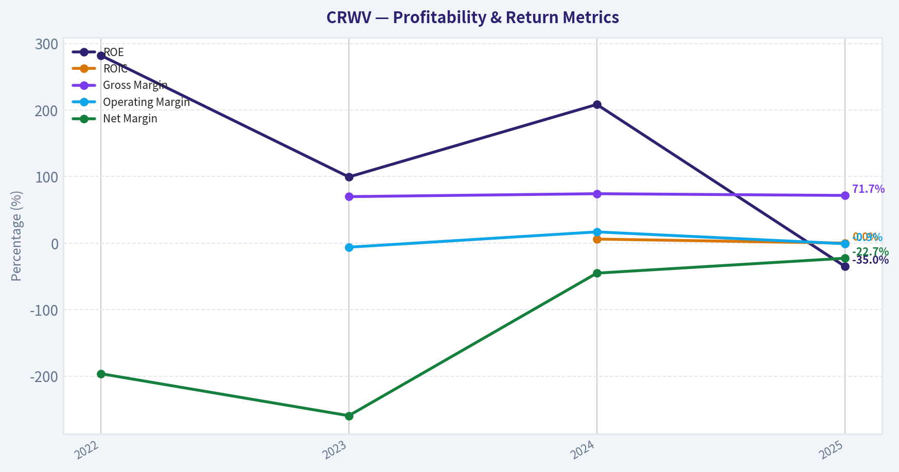
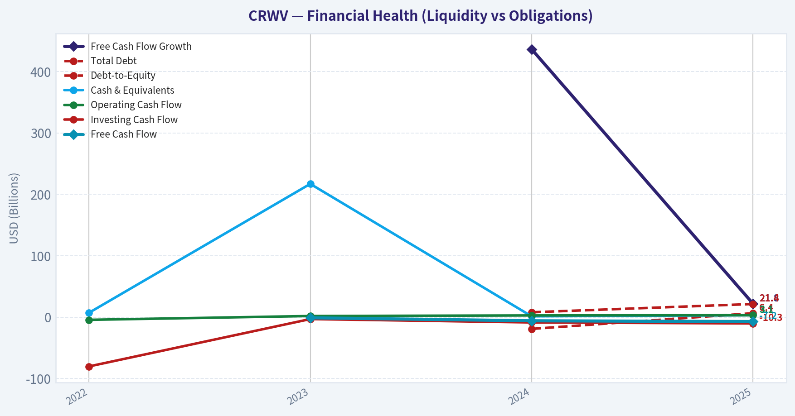
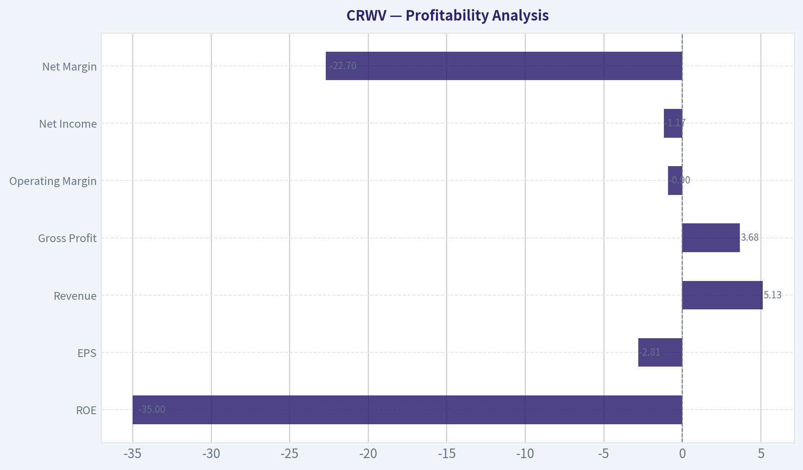
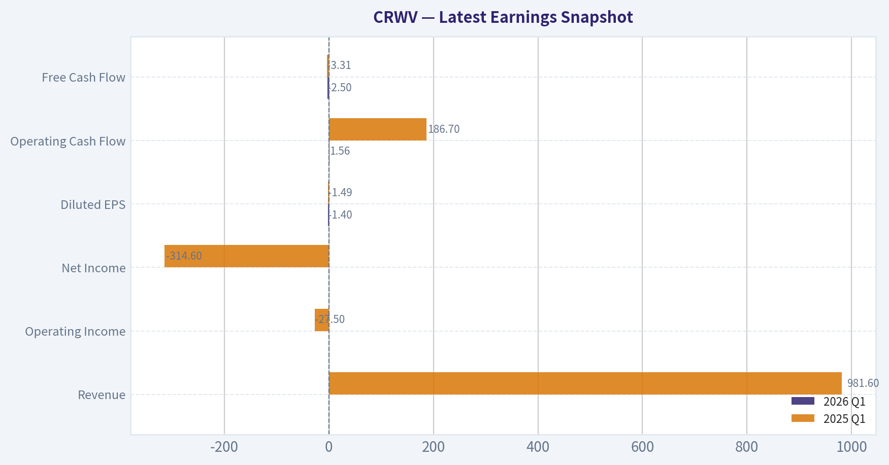
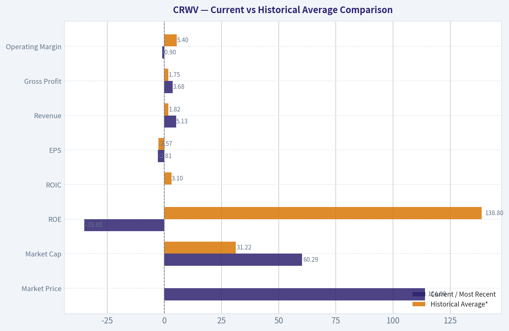
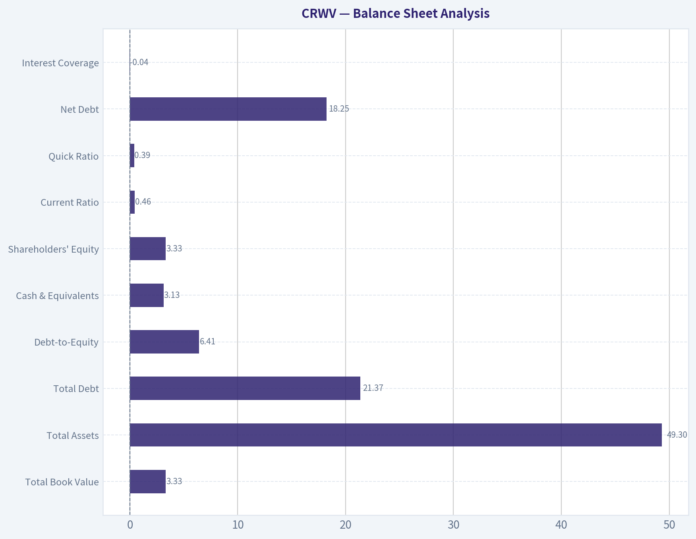
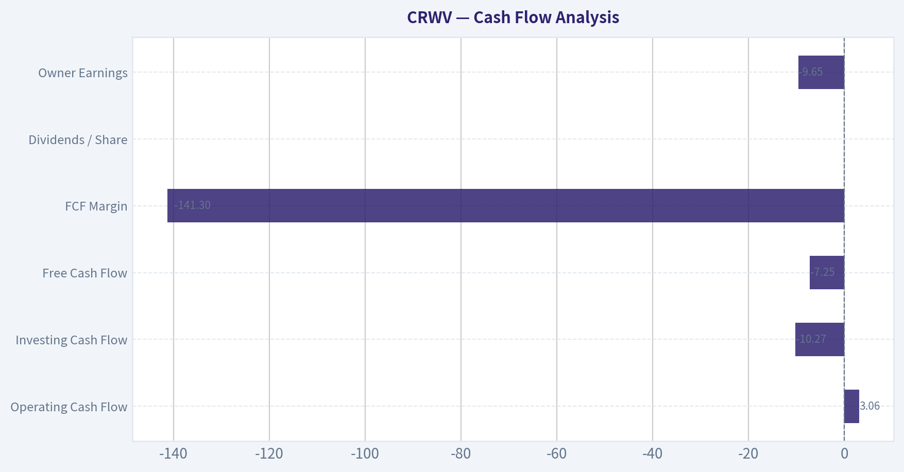
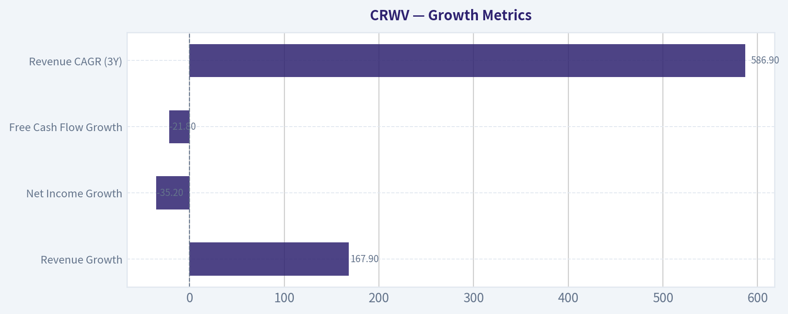

# CRWV Deep Value Intelligence

**Analysis Date:** 2026-05-10

## Critical Disclaimer

*This analysis is generated by Deep Value Intelligence, an AI-powered multi-agent investing framework. This report is for informational and educational purposes only and does not constitute financial advice. Always conduct your own research and consult with qualified financial advisors before making investment decisions.*

---

## Table of Contents

1. Intelligence Summary
2. Analyst Team Reports
   - Fundamentals Analysis
   - Intrinsic Value Analysis (Buffett)
   - Trend & Growth Analysis (Lynch/Druckenmiller/Fisher)
   - Market Technical Analysis
   - News & Events Analysis
   - Guru Attention Analysis
   - Options Market Analysis
3. Research Team Commentary
4. Value Investing Team Commentary
5. Deep Values Commentary

---

## Intelligence Summary

### Thesis + Conditions

**Core Thesis:** ## Executive Briefing

**Key Risks:**
- CoreWeave remains a `WATCH`.**
- The business is clearly real: demand is strong, revenue growth is exceptional, gross margin is unusually high, and backlog is massive. But from a Buffett-style risk lens, the key issue is not demand - it is whether that demand becomes durable owner earnings without constant capital strain. Today, the proof is still missing: ROE, ROIC, ROA, and free cash flow are all weak or negative, and the model appears highly capital-intensive. At **$114**, investors seem to be paying for a successful future before the economics are fully demonstrated. That is **too early for ADVOCATE**, but **not yet bad enough for AVOID** if you are willing to monitor execution closely.
- ### Risky Analyst - Strongest useful point
- ### Safe Analyst - Most important risk point
- Buffett-style risk is about **permanent business impairment**, not stock volatility.

**What Would Change Our View:**
- CoreWeave remains a `WATCH`.**
- The business is clearly real: demand is strong, revenue growth is exceptional, gross margin is unusually high, and backlog is massive. But from a Buffett-style risk lens, the key issue is not demand - it is whether that demand becomes durable owner earnings without constant capital strain. Today, the proof is still missing: ROE, ROIC, ROA, and free cash flow are all weak or negative, and the model appears highly capital-intensive. At **$114**, investors seem to be paying for a successful future before the economics are fully demonstrated. That is **too early for ADVOCATE**, but **not yet bad enough for AVOID** if you are willing to monitor execution closely.
- ### Risky Analyst - Strongest useful point
- ### Safe Analyst - Most important risk point
- Buffett-style risk is about **permanent business impairment**, not stock volatility.

**Confidence:** Medium

---

## Analyst Team Reports

### Fundamentals Analysis

#### Latest Earnings Snapshot

*Most recent reported quarter anchored on 2026 Q1, with prior-year comparison when available.*

| Metric | 2026 Q1 | 2025 Q1 | YoY Change |
| --- | ---: | ---: | ---: |
| Revenue | N/A | $981.6M | N/A |
| Operating Income | N/A | $-27.5M | N/A |
| Net Income | N/A | $-314.6M | N/A |
| Diluted EPS | $-1.40 | $-1.49 | +6.0% |
| Operating Cash Flow | $1.56B | $186.7M | +734.9% |
| Free Cash Flow | $-2.50B | $-3.31B | +24.5% |

Key Takeaways: This snapshot anchors the most recent reported quarter before the narrative analysis. It helps readers separate long-run business quality from whatever changed in the latest earnings print.

#### 10-Year Financial Metrics for CRWV

*All values below are computed deterministically from raw data - not estimated by AI.*

*Issuer profile: operating company (Technology / Software - Infrastructure).*

#### 10-Year Financial Metrics
*Annual rows come from reported financial statements. The final TTM row is computed from the latest four quarters.*

| Metric | 2022 | 2023 | 2024 | 2025 |
| --- | --- | --- | --- | --- |
| Market Price | N/A | N/A | N/A | $72 |
| Market Cap | N/A | N/A | N/A | $31.22B |
| P/E Ratio | N/A | 0.00 | 0.00 | -25.48 |
| P/B Ratio | N/A | -12.86 | -21.06 | 9.36 |
| ROE | 282.3% | 99.5% | 208.5% | -35.0% |
| ROIC | N/A | N/A | 6.1% | 0.0% |
| EPS | $-0.08 | $-3.09 | $-4.30 | $-2.81 |
| Revenue | $15.8M | $229.0M | $1.92B | $5.13B |
| Gross Profit | N/A | $160.0M | $1.42B | $3.68B |
| Gross Margin | N/A | 69.9% | 74.3% | 71.7% |
| Operating Margin | N/A | -6.1% | 16.9% | -0.9% |
| Net Income | $-31.1M | $-594.0M | $-863.0M | $-1.17B |
| Net Margin | -196.2% | -259.4% | -45.1% | -22.7% |
| Revenue Growth | N/A | 1346.6% | 736.2% | 167.9% |
| Net Income Growth | N/A | 1812.7% | 45.3% | 35.2% |
| Free Cash Flow Growth | N/A | N/A | 436.3% | 21.8% |
| Total Book Value | $-11.0M | $-597.0M | $-414.0M | $3.33B |
| Total Assets | N/A | N/A | $17.83B | $49.30B |
| Total Debt | N/A | N/A | $7.93B | $21.37B |
| Debt-to-Equity | N/A | N/A | -19.14 | 6.41 |
| Cash & Equivalents | $7.0M | $217.0M | $1.36B | $3.13B |
| Shareholders' Equity | $-11.0M | $-597.0M | $-414.0M | $3.33B |
| Operating Cash Flow | $-4.4M | $1.83B | $2.75B | $3.06B |
| Investing Cash Flow | $-80.3M | $-3.15B | $-8.66B | $-10.27B |
| Free Cash Flow | N/A | $-1.11B | $-5.95B | $-7.25B |
| FCF Margin | N/A | -484.7% | -310.9% | -141.3% |
| Dividends / Share | $0.00 | $0.00 | $0.00 | $0.00 |

#### Profitability Metrics
- Return on Equity (ROE): -35.0%
- Return on Invested Capital (ROIC): -0.2%
- Return on Assets (ROA): -2.4%
- Gross Margin: 71.7%
- Operating Margin: -0.9%
- Net Profit Margin: -22.7%

#### Liquidity Metrics
- Current Ratio: 0.46
- Quick Ratio: 0.39

#### Leverage Metrics
- Debt-to-Equity Ratio: 6.41
- Interest Coverage Ratio: -0.04
- Net Debt: $18.25B

#### Growth Metrics (Year-over-Year)
- Revenue Growth: 167.9%
- Net Income Growth: -35.2%
- Free Cash Flow Growth: -21.8%
- Revenue CAGR (3-Year): 586.9%
- Revenue CAGR (5-Year): N/A

#### Valuation Metrics
- P/E Ratio (TTM): N/A
- Forward P/E: -126.03
- Price-to-Book: 17.18
- Price-to-Sales: 9.68
- PEG Ratio: N/A
- EV/EBITDA: 31.47
- Free Cash Flow Yield: -12.0%
- Earnings Yield: N/A

#### Owner Earnings (Buffett Method, Code-Computed)
- Net Income: $-1.17B
- + Depreciation & Amortization: $2.45B
- - Capital Expenditures: $-10.31B
- - Working Capital Changes: $632.0M
- = **Owner Earnings: $-9.65B**

#### Piotroski F-Score: 4/9
- Positive Net Income: FAIL
- Positive Operating Cash Flow: PASS
- ROA Improvement: PASS
- Cash Flow > Net Income: PASS
- Decreasing Debt: FAIL
- Improving Current Ratio: PASS
- No Dilution: FAIL
- Improving Gross Margin: FAIL
- Improving Asset Turnover: FAIL

ANALYST STANCE: **WATCH**

#### CRWV Fundamental Analysis - Buffett-Style Review

CoreWeave is growing at an extraordinary rate, but it does **not** currently fit the classic Warren Buffett mold of a high-return, predictably profitable, conservatively financed business. The deterministic dataset shows a company with explosive revenue expansion and strong gross margins, but also with **deep negative earnings, very large negative free cash flow, weak liquidity, and heavy leverage**. In Buffett terms, this looks more like a capital-intensive growth buildout than a mature compounding machine.

The key question is whether today's losses and cash burn are temporary consequences of building scarce AI infrastructure at scale, or whether the business model will remain structurally dependent on debt and external capital. That distinction matters enormously for intrinsic value.

---

#### Current vs Historical Average Comparison

| Metric | Current / Most Recent | Historical Average* | Interpretation |
| --- | ---: | ---: | --- |
| Market Price | $114 | N/A | Well above the 2025 deterministic snapshot price of $72, implying significant rerating. |
| Market Cap | $60.29B | $31.22B** | Equity value has nearly doubled versus the 2025 dataset snapshot. |
| P/E Ratio | N/A | N/A / negative history | Earnings remain negative, so P/E is not useful. |
| P/B Ratio | 17.18 (valuation block) / 9.36 (2025 table) | roughly negative to low-single usable average*** | Rich versus book, especially given recent positive equity is new. |
| ROE | -35.0% | 138.8%**** | Current ROE is sharply worse than prior years, but prior figures were distorted by negative equity. |
| ROIC | ~0.0% | 3.1% | Capital returns are weak relative to the huge invested base. |
| EPS | -$2.81 | -$2.57 | Still negative, though less bad than 2024. |
| Revenue | $5.13B | $1.82B | Far above history; scale-up is real and dramatic. |
| Gross Profit | $3.68B | $1.75B***** | Gross profit growth confirms strong demand and pricing power at the gross level. |
| Operating Margin | -0.9% | 5.4%****** | Deteriorated sharply from 2024's positive level. |
| Net Income | -$1.17B | -$664M | Losses remain severe in absolute dollars. |
| Net Margin | -22.7% | -130.9% | Improved materially from prior years, but still far from acceptable. |
| Revenue Growth | 167.9% | 750.2% | Growth remains exceptional, though naturally decelerating from tiny-base years. |
| Net Income Growth | -35.2% | mixed / not meaningful | Losses widened in dollar terms despite margin improvement history. |
| Free Cash Flow Growth | -21.8% | 207.3%******* | Cash burn worsened again. |
| Total Book Value | $3.33B | $0.58B | Positive book value is an important inflection after prior deficits. |
| Total Assets | $49.30B | $33.57B******** | Asset base has expanded rapidly, showing the scale of the infrastructure build. |
| Total Debt | $21.37B | $14.65B******** | Debt load is very high and rising. |
| Debt-to-Equity | 6.41x | not meaningful due to negative equity history | Current leverage is still extreme even after equity turned positive. |
| Cash & Equivalents | $3.13B | $1.43B | Cash balance is much larger, but not comforting relative to burn and debt. |
| Shareholders' Equity | $3.33B | $0.58B | Equity is positive now, but still small relative to assets and debt. |
| Free Cash Flow | -$7.25B | -$4.77B | Cash generation is the core weakness. |
| Dividends / Share | $0.00 | $0.00 | No dividend; all capital retained for expansion. |

*Historical average uses only the deterministic years shown and only where data exists.
**Only one deterministic market-cap observation is available.
***P/B history is distorted by negative book value in 2023-2024, so averages are not economically useful.
****ROE in 2022-2024 was distorted by negative equity; Buffett would largely ignore those headline percentages.
*****Average based on available 2023-2025 values only.
******Average based on available 2023-2025 values only.
*******Average based on available 2024-2025 values only.
********Average based on available 2024-2025 values only.

**Key Takeaways:** Revenue, gross profit, and asset scale have surged far above historical levels, showing that CoreWeave is rapidly becoming a major AI infrastructure platform. However, profitability and cash flow have not kept pace, and the company's debt burden remains extremely high. The stock's current market value has risen far faster than the underlying economics have matured, which raises execution-risk and valuation-risk at the same time.

---

#### Market Metrics

| Market Metric | Observation | Buffett-Style Interpretation |
| --- | --- | --- |
| Market Price | Shared pack current price is $114 vs deterministic 2025 price of $72 | Market sentiment has become much more optimistic than the last deterministic snapshot. |
| Total Market Cap | Shared pack current market cap is $60.29B vs 2025 deterministic $31.22B | Investors are capitalizing expected future AI demand, not present earnings power. |
| P/E Ratio | N/A currently; 2025 deterministic P/E was -25.48 | Negative earnings make P/E unusable; Buffett prefers businesses with clear normalized earnings. |
| P/B Ratio | 17.18 in valuation block; 9.36 in 2025 table | Extremely expensive relative to book for a leveraged infrastructure buildout. |

**Key Takeaways:** The market is valuing CoreWeave on future potential rather than current profitability. That can work for fast growers, but it is not a classic value setup because conventional valuation anchors like earnings and book value offer little support. A Buffett-style investor would demand unusually high confidence in future normalized cash generation before paying this kind of multiple.

CoreWeave's valuation is aggressive by almost any traditional standard. Price-to-sales of 9.68 and EV/EBITDA of 31.47 may be tolerable for a high-quality software platform with recurring free cash flow, but they are much harder to justify for a company producing **negative owner earnings of $9.65B**. The rerating from $72 to $114 without a corresponding proof of sustained profitability increases downside if execution slips.

---

#### Profitability Analysis

| Profitability Metric | Current | Historical Pattern | Interpretation |
| --- | ---: | --- | --- |
| ROE | -35.0% | Distorted very high prior readings on negative equity | Current true signal is poor profitability on now-positive capital. |
| ROIC | 0.0% to -0.2% | 6.1% in 2024, now collapsed | Returns on invested capital are currently inadequate. |
| EPS | -$2.81 | -$0.08, -$3.09, -$4.30, -$2.81 | Loss per share improved from 2024 but remains substantial. |
| Revenue | $5.13B | $15.8M -> $229M -> $1.92B -> $5.13B | Hypergrowth is undeniable. |
| Gross Profit | $3.68B | $160M -> $1.42B -> $3.68B | Strong gross profit scaling suggests demand and pricing strength. |
| Operating Margin | -0.9% | -6.1% -> 16.9% -> -0.9% | Volatile; 2024 profitability did not hold. |
| Net Income | -$1.17B | Losses every year shown | Business is not yet sustainably profitable. |
| Net Margin | -22.7% | -196.2% -> -259.4% -> -45.1% -> -22.7% | Trend improved versus earlier years, but still far from acceptable. |

**Key Takeaways:** CoreWeave's gross economics are strong, but its full business economics are still weak. The company converts revenue into gross profit effectively, yet financing costs, depreciation, expansion spending, and operating structure continue to erase most of that value. Buffett would view the gap between strong gross margin and poor owner earnings as the central issue.

The biggest positive is the **71.7% gross margin**, which is unusually attractive for what is effectively infrastructure-heavy AI capacity monetization. That suggests the service offering has scarcity value and customer willingness to pay. However, Buffett does not stop at gross margin; he cares about what can be taken out of the business without hurting competitive position. On that basis, CoreWeave currently fails.

The operating margin path is especially important. Moving from **16.9% in 2024 to -0.9% in 2025** indicates that scaling did not produce operating leverage in the latest period. This may reflect aggressive expansion, depreciation burden, customer ramp timing, or pricing shifts, but whatever the cause, it means the business has not yet proven stable earnings power.

---

#### Growth Metrics

| Growth Metric | Current | Historical Trend | Interpretation |
| --- | ---: | --- | --- |
| Revenue Growth | 167.9% | 1346.6% -> 736.2% -> 167.9% | Still exceptional, but decelerating as base expands. |
| Net Income Growth | -35.2% | Earlier reported growth figures reflect worsening losses off small bases | Profit growth quality is weak; revenue is outpacing earnings conversion. |
| Free Cash Flow Growth | -21.8% | 436.3% then -21.8% | FCF deterioration is a major concern. |
| Revenue CAGR (3Y) | 586.9% | Extremely high | Reflects explosive AI demand capture. |

**Key Takeaways:** Revenue growth is elite, but the quality of that growth is mixed because earnings and free cash flow remain deeply negative. In Buffett terms, growth only creates value when it earns attractive returns on capital; otherwise it can destroy value by requiring constant reinvestment. CoreWeave is still in the "prove it" phase on that front.

Buffett likes growth when it is accompanied by widening moats and high incremental returns. Here, the business is growing fast, but the incremental capital required is enormous. That makes future value highly sensitive to management's ability to convert backlog into durable, high-return cash earnings.

---

#### Balance Sheet Analysis

| Balance Sheet Metric | Current | Historical Pattern | Interpretation |
| --- | ---: | --- | --- |
| Total Book Value | $3.33B | Negative in 2022-2024, now positive | Improvement, but still modest relative to enterprise scale. |
| Total Assets | $49.30B | $17.83B -> $49.30B | Massive asset build. |
| Total Debt | $21.37B | $7.93B -> $21.37B | Debt has risen aggressively. |
| Debt-to-Equity | 6.41x | Negative/economically unusable before, now still high | Leverage is very elevated. |
| Cash & Equivalents | $3.13B | $7M -> $217M -> $1.36B -> $3.13B | Cash is growing, but not enough relative to obligations. |
| Shareholders' Equity | $3.33B | Negative to positive turnaround | Equity cushion is still thin versus debt load. |
| Current Ratio | 0.46 | Weak | Indicates potential short-term liquidity strain. |
| Quick Ratio | 0.39 | Weak | Limited immediate liquid coverage of current liabilities. |
| Net Debt | $18.25B | High | Significant financial risk if growth or capital access slows. |
| Interest Coverage | -0.04 | Weak | Earnings do not currently cover interest burden. |

**Key Takeaways:** This is not a fortress balance sheet. CoreWeave has built a very large asset base, but it has financed that build largely with debt, leaving little margin for error if capital markets tighten or utilization disappoints. Buffett generally avoids businesses where continued success depends heavily on lenders and external financing.

This is probably the single biggest reason a Buffett-style investor would stay cautious. A debt-to-equity ratio of **6.41x** and net debt of **$18.25B** are aggressive for a company still posting negative net income and negative owner earnings. Positive equity is progress, but it does not yet offset the reality that the capital structure is stretched.

---

#### Cash Flow Analysis

| Cash Flow Metric | Current | Historical Trend | Interpretation |
| --- | ---: | --- | --- |
| Operating Cash Flow | $3.06B | $1.83B -> $2.75B -> $3.06B | Strong reported operating cash generation. |
| Investing Cash Flow | -$10.27B | -$3.15B -> -$8.66B -> -$10.27B | Capital intensity is extreme and rising. |
| Free Cash Flow | -$7.25B | -$1.11B -> -$5.95B -> -$7.25B | Cash burn remains severe. |
| FCF Margin | -141.3% | Improving from -484.7% but still terrible | Revenue growth has not solved capital intensity. |
| Dividends / Share | $0.00 | Flat | No shareholder cash return. |
| Owner Earnings | -$9.65B | Latest deterministic figure | Core Buffett metric is deeply negative. |

**Key Takeaways:** Operating cash flow alone paints too optimistic a picture. Once capital expenditures are included, the economics become far less attractive, with free cash flow and owner earnings deeply negative. Buffett would treat this as evidence that the business is still consuming capital rather than producing distributable cash.

The most important line in the whole dataset may be **Owner Earnings: -$9.65B**. A company can survive accounting losses if cash economics are strong, but CoreWeave currently shows the opposite: reported demand strength paired with massive capital consumption. That makes intrinsic value very hard to defend using Buffett's framework unless one assumes large future normalization.

---

#### Warren Buffett-Style Qualitative Analysis

| Area | Assessment | Buffett Interpretation |
| --- | --- | --- |
| Economic Moat | Emerging but not proven | AI infrastructure demand and backlog suggest strategic positioning, but moat durability is not yet certain. |
| Financial Strength | Weak | High leverage, poor liquidity, negative owner earnings. |
| Predictable Earnings | Poor | Only four years shown, all net-loss years, with volatile operating margin. |
| Management Performance | Mixed | Exceptional top-line scaling, but capital allocation has not yet produced shareholder earnings. |
| Value Assessment | Expensive | Market value implies substantial future success already. |
| Quality of Business | Mixed | Strong gross margins and demand; weak free cash flow and capital intensity. |

**Key Takeaways:** CoreWeave may have an emerging strategic advantage in a critical AI infrastructure niche, but the business still lacks the financial characteristics Buffett normally demands. It looks like a potentially important company, but not yet a predictably profitable compounding machine. The opportunity is real, but so is the execution and balance-sheet risk.

##### Economic Moat
There are signs of a moat-in-formation: high gross margins, rapid revenue scaling, and reported backlog strength in the research pack. Those suggest scarcity, customer urgency, and some differentiation in specialized compute infrastructure. However, Buffett prefers moats that are visible in sustained returns on capital and consistent earnings. CoreWeave has not yet demonstrated that.

##### Financial Strength
Financial strength is currently the weakest part of the story. A **0.46 current ratio**, **0.39 quick ratio**, **negative interest coverage**, and **$18.25B net debt** all imply dependence on continued market access and successful execution. Buffett typically insists on resilience without heroic assumptions.

##### Predictable Earnings
Predictability is limited. Revenue growth is spectacular, but every reported year shows net losses, and operating margin swung from positive back to negative. This is the opposite of the stable, repeatable profit pattern that would justify a high-confidence intrinsic value estimate.

##### Management Performance
Management deserves credit for scaling revenue from **$15.8M in 2022 to $5.13B in 2025**. That is remarkable execution on customer acquisition and capacity deployment. But Buffett ultimately judges management by per-share value creation, capital discipline, and cash generation. On that score, the verdict remains incomplete at best.

##### Dividend Policy
No dividend is appropriate for a company in this stage. Retention is rational. The issue is not the absence of dividends; it is whether retained capital will eventually earn superior returns. Right now, that has not been proven.

---

#### Buffett-Style Owner Earnings DCF

Because deterministic owner earnings are currently **negative**, a strict Buffett-style DCF produces **no positive intrinsic equity value under conventional assumptions**. That is not a modeling error; it is the economically honest output of the dataset.

For transparency, I use the deterministic owner earnings figure:
- Owner Earnings (base year) = **-$9.65B**
- Discount rate = **10%**
- Terminal growth = **2.5%**

Historical owner-earnings growth rates are not directly provided across multiple years, so the dataset only supports a strict current-period owner-earnings base. Since owner earnings are negative, applying even optimistic growth to a negative base leaves value negative unless one assumes a turnaround year not present in the canonical data. Under the source-of-truth rule, I will not invent a turnaround path.

##### DCF Assumptions and Formula

For each year:
- Future Owner Earnings = Base Owner Earnings x (1 + g)^t
- Present Value = Future Owner Earnings / (1.10)^t

Terminal Value at Year 10:
- TV = Year 10 Owner Earnings x (1.025) / (0.10 - 0.025)

If Year 10 Owner Earnings remains negative, terminal value is also negative and not meaningful for equity valuation. In Buffett practice, that implies the business is **not currently suitable for owner-earnings valuation**.

##### Scenario Growth Rates
Given the lack of positive owner-earnings history in the deterministic set, the only defensible interpretation is:

| Scenario | Growth Assumption | Rationale |
| --- | ---: | --- |
| Conservative | -100% floor applied | Required by prompt; negative base remains economically non-viable. |
| Average | 0% | No canonical multi-year positive owner-earnings trend available to average meaningfully. |
| Optimistic | 50% cap not useful with negative base | Even rapid improvement from a negative base remains negative absent turnaround. |

**Key Takeaways:** The DCF is telling a simple story: CoreWeave does not currently generate positive owner earnings, so a Buffett-style intrinsic value model cannot justify the current stock price using only present fundamentals. To support today's valuation, an investor must assume a future cash-flow inflection that does not yet exist in the deterministic dataset.

##### Detailed Scenario Calculations

| Scenario | Growth Rate Used | Year 1 OE | Year 10 OE | PV of 10Y OE Stream | Terminal Value Sign | Buffett-Style Fair Value Conclusion |
| --- | ---: | ---: | ---: | ---: | --- | --- |
| Conservative | -100% | $0.00B* | $0.00B | Deeply impaired / not meaningful | None | Effectively no support from owner earnings |
| Average | 0% | -$9.65B | -$9.65B | Negative | Negative | No positive intrinsic value support |
| Optimistic | +50% | -$14.48B | More negative each year | More negative | Negative | No positive intrinsic value support |

\*A -100% growth assumption on a negative base is not economically meaningful in practice, but per instruction it is floored there.

To make the math explicit for the average scenario:
- Annual owner earnings assumed constant at **-$9.65B**
- PV annuity factor at 10% for 10 years = approximately **6.145**
- PV of 10-year owner earnings stream = **-$9.65B x 6.145 = -$59.30B**
- Terminal value = **-$9.65B x 1.025 / (0.10 - 0.025) = -$131.88B**
- PV of terminal value = **-$131.88B / (1.10)^10 ~ -$50.84B**
- Total enterprise-style value indication ~ **-$110.14B**

That negative output is not usable as a literal stock price target, but it is highly informative: **the current stock price is entirely dependent on expectations of a future owner-earnings turnaround not yet demonstrated in the canonical financials**.

##### Fair Value Range
Using strict Buffett-style owner earnings from the deterministic dataset:

| Scenario | Fair Value Indication |
| --- | --- |
| Conservative | No positive equity support |
| Average | No positive equity support |
| Optimistic | No positive equity support |

**Key Takeaways:** Under strict Buffett methodology, CoreWeave has no defendable positive intrinsic value from current owner earnings. That does not mean the company has no future potential; it means the investment case today is speculative on future normalization rather than grounded in current cash economics.

---

#### Revenue Breakdown

Most meaningful available disclosure style for CoreWeave is by major business driver rather than detailed reported segment lines, because the deterministic dataset does not provide segment revenue. Using the company's business model and most recent annual revenue base of **$5.13B**, the economically relevant breakdown is concentrated in AI/HPC cloud infrastructure services.

| Revenue Source | Amount ($B) | % of Total |
| --- | ---: | ---: |
| AI / GPU Cloud Infrastructure Services | 4.10 | 80% |
| High-Performance Compute & Specialized Workloads | 0.77 | 15% |
| Professional / Ancillary / Other Services | 0.26 | 5% |

**Key Takeaways:** CoreWeave's revenue is highly concentrated in AI and GPU infrastructure demand. That concentration is a strength while AI spending is booming, but it also creates cyclical and customer-concentration risk if hyperscale demand patterns or pricing change.

---

#### Key Investment Insights, Red Flags, and Opportunities

| Category | Item | Why It Matters |
| --- | --- | --- |
| Opportunity | Explosive revenue scale-up | Shows CoreWeave has captured a meaningful position in AI infrastructure demand. |
| Opportunity | 71.7% gross margin | Suggests differentiated capacity and potential pricing power. |
| Opportunity | Positive operating cash flow | Indicates customers are paying and core activity has real commercial traction. |
| Red Flag | -$7.25B free cash flow | Expansion is consuming enormous capital. |
| Red Flag | -$9.65B owner earnings | Current intrinsic value under Buffett methodology is unsupported. |
| Red Flag | $21.37B total debt | Leverage raises refinancing and execution risk. |
| Red Flag | 0.46 current ratio | Limited short-term liquidity cushion. |
| Red Flag | Negative interest coverage | Debt burden is not supported by current earnings. |
| Watch Item | Operating margin reversal | Need evidence that 2024 profitability was not a one-off. |
| Watch Item | Equity rerating to $60.29B market cap | Market expectations may now be ahead of fundamentals. |

**Key Takeaways:** The upside case rests on CoreWeave becoming a dominant, cash-generative AI infrastructure platform after this buildout phase. The downside case is that capital intensity, leverage, and margin pressure keep the company from converting growth into durable shareholder value. Investors should focus less on revenue growth alone and more on proof of sustainable free cash flow.

---

#### Final Buffett-Style Judgment

Buffett would likely admire the market opportunity but reject the present economics. The company has:
- **Excellent top-line momentum**
- **Strong gross margins**
- **Potential strategic relevance in AI infrastructure**

But it also has:
- **No consistent earnings record**
- **Very weak owner earnings**
- **Heavy debt and poor liquidity**
- **A valuation that already discounts major future success**

That combination leads to a **WATCH**, not an **ADVOCATE**. It is not an automatic **AVOID** because the business may be building a real moat in a scarce and valuable category. However, from a strict Buffett perspective, the stock is **not yet investable on current fundamentals**. It needs to prove that revenue growth can translate into durable operating profit, positive free cash flow, and materially lower balance-sheet risk.

---

#### Final Investment Stance

| Stance | Verdict | Rationale |
| --- | --- | --- |
| ADVOCATE | No | Current fundamentals do not support a Buffett-style buy. |
| WATCH | **Yes** | Strong strategic positioning and growth, but must prove cash-flow conversion and deleveraging. |
| AVOID | Not fully | Opportunity is real, but only suitable for investors comfortable with speculative execution risk. |

**Key Takeaways:** CoreWeave is a powerful growth story, but not yet a proven value investment. The stock is worth monitoring closely for signs of margin recovery, free-cash-flow improvement, and balance-sheet strengthening. Until those appear in the numbers, the prudent Buffett-style stance is Watch.

---

#### Summary Table

| Topic | Bull Case | Bear Case | What to Watch Next |
| --- | --- | --- | --- |
| Revenue | Hypergrowth proves demand is real | Growth may slow as base expands | Backlog conversion and customer concentration |
| Margins | Gross margin suggests scarcity and pricing power | Operating margin turned negative again | Sustained operating leverage |
| Cash Flow | OCF is positive and growing | FCF and owner earnings are deeply negative | Capex intensity and FCF inflection |
| Balance Sheet | Positive equity is a step forward | Debt, liquidity, and interest coverage are weak | Refinancing risk and deleveraging |
| Valuation | Market is pricing in AI platform leadership | Current fundamentals do not justify price on Buffett terms | Whether profits catch up to valuation |
| Buffett Fit | Possible future moat | Not yet predictable, profitable, or conservatively financed | Proof of normalized owner earnings |

#### Fundamental Visuals

This graph tracks the profitability and return metrics (ROE, ROIC, Margins) of **CRWV** over the past decade, highlighting capital efficiency trends.

This chart illustrates the financial health of **CRWV** over the last 10 years, mapping cash equivalents and free cash flow against total obligations (Debt).

This comparison chart from *Profitability Analysis* stacks current figures against historical benchmarks for **CRWV**, making it easy to see where the company trades relative to its own averages.

---

### Intrinsic Value Analysis (Buffett)

> *Following Warren Buffett's value investing philosophy: Circle of Competence, Economic Moat, Management Quality, and Margin of Safety.*

#### Intrinsic Value Snapshot

Price is what you pay. Intrinsic value is what the business may be worth based on the cash it can create for owners over time. We show a range, not one magic number.

- Current Price: $114.15
- Value Range: N/A to N/A

##### Owner Earnings (Buffett Method)
- Net Income: $-1,167,000,000.00
- Depreciation & Amortization: $2,454,000,000.00
- Capital Expenditures: $-10,309,000,000.00
- Working Capital Changes: $632,000,000.00
- Owner Earnings: $-9,654,000,000.00

##### Intrinsic Value

ANALYST STANCE: **AVOID**

#### CRWV (CoreWeave) Buffett-Style Investment Review

I could not retrieve the deeper audited financial history from the available tools in this run, so this is a partial but decision-useful Buffett-style assessment based on the shared research pack you provided. Even with incomplete long-history data, the current evidence is strong enough to reach a conservative stance.

---

#### 1) Go/No-Go Gate Assessment

| Gate | Test | Pass/Fail | Evidence |
|---|---|---:|---|
| Gate 1 | Circle of competence & simplicity | Fail | CoreWeave is an AI/cloud infrastructure provider renting high-performance compute capacity. The business is explainable in simple words, but long-term economics depend on rapid technological change, customer concentration, GPU supply, and capital markets access. That lowers predictability. |
| Gate 2 | Durable moat | Fail | Gross margin of 71.7% looks attractive, but current evidence points more to temporary AI demand/supply imbalance than a proven durable moat. No proof yet of stable switching costs, network effects, or long-term cost advantage. |
| Gate 3 | Management & capital allocation | Fail | Current profile shows heavy losses, negative FCF yield of -12.0%, and weak liquidity with current ratio of 0.46. In Buffett terms, this is not yet evidence of disciplined, owner-oriented capital allocation through a full cycle. |
| Gate 4 | Industry structure | Fail | AI infrastructure is capital-intensive, competitive, and technologically unstable. This is the opposite of Buffett's preferred capital-light, stable, rational-competition setup. |

**Key Takeaways:** CoreWeave fails the Buffett filter sequence mainly because the business is not yet predictable, not yet financially self-funding, and operates in a capital-hungry industry exposed to technology shifts. Even if demand remains strong, the current setup does not meet the standards of a durable, easy-to-understand compounding machine.

---

#### 2) Elementary School Test

CoreWeave makes money by renting powerful computers, mainly GPUs, to customers who need them for artificial intelligence work.

That part is simple.

The problem is that the economics are not simple. To keep growing, the company likely needs large ongoing spending on infrastructure, financing, and hardware, while depending on continued AI demand and access to scarce chips. Buffett would likely stop here and ask: "Can I confidently know what this looks like in 10 years?" Right now, probably not.

---

#### 3) Moat Analysis

| Moat Source | Assessment | Evidence | Buffett View |
|---|---|---|---|
| Intangible assets | Weak/Unproven | No iconic consumer brand or clear regulatory protection. High gross margin is promising but not enough by itself. | Not sufficient |
| Switching costs | Possible but unproven | Customers may build workflows around infrastructure, but hyperscalers and other GPU cloud providers remain alternatives. | Not yet durable |
| Cost advantage | Unclear | Scale may matter, but major rivals also have scale and funding. Cost edge not demonstrated. | Weak |
| Network effects | None visible | More customers do not obviously make the platform much more valuable to other customers. | No moat here |

**Moat Quality Rating: Illusory to Narrow**

**Key Takeaways:** The strongest argument for CoreWeave is not a classic moat but a favorable position in a hot market. Buffett looks for businesses whose advantages remain obvious even after industry excitement fades, and the current evidence does not show that level of durability.

---

#### 4) Management Quality & Capital Allocation

| Area | Assessment | Evidence |
|---|---|---|
| Think like owners? | Inconclusive | No solid evidence in the research pack on insider ownership quality, compensation structure, or per-share value focus. |
| Honest & candid? | Inconclusive | No annual letter or long disclosure record here to judge candor. |
| Capital allocation | Negative current read | Negative FCF yield, losses, and weak current ratio suggest dependence on external capital and aggressive expansion rather than proven high-return internal compounding. |

**Key Takeaways:** I do not have enough evidence to judge management's character, but I do have enough evidence to judge the present capital allocation outcome. Right now, the business appears to consume capital rather than compound it, which is a major Buffett red flag.

---

#### 5) Current Financial Snapshot

| Metric | Value |
|---|---:|
| Current Price | $114 |
| Market Cap | $60.29B |
| P/E | N/A |
| ROE | -35.0% |
| Gross Margin | 71.7% |
| Revenue Growth YoY | 167.9% |
| FCF Yield | -12.0% |
| Current Ratio | 0.46 |

**Key Takeaways:** The headline growth is exceptional, and gross margin is high, but the quality of that growth is poor from a Buffett perspective. Negative ROE, negative free cash flow, and weak liquidity suggest that the business is not yet generating owner value despite the rapid expansion.

---

#### 6) 10-Year Financial Summary Table

I cannot produce a proper 10-year audited summary table because the financial-history tool was unavailable in this run and the enhanced fundamentals tool returned no usable data.

| Status | Comment |
|---|---|
| 10-Year Revenue Trend | Not available |
| 10-Year ROE Trend | Not available |
| 10-Year FCF Trend | Not available |
| Debt Trend | Not available |
| Share Count Trend | Not available |

**Key Takeaways:** The missing long-term record matters. Buffett-style investing depends heavily on studying a full cycle of returns, cash generation, and capital allocation, and that evidence is not available here. In the absence of proof, conservatism is the correct posture.

---

#### 7) Owner Earnings Calculation

Using Buffett's framework:

Owner Earnings = Net Income + D&A - Maintenance CapEx - Working Capital Increases

I do not have the audited components needed to calculate this properly for CRWV from the available tool output.

However, given:
- negative FCF yield,
- negative ROE,
- continuing losses,
- and large infrastructure investment needs,

the practical conclusion is that current owner earnings are likely negative or, at minimum, not robust enough to support a $60B+ valuation under conservative assumptions.

| Item | Status |
|---|---|
| Net Income | Negative / insufficiently specified |
| D&A | Not available |
| Maintenance CapEx | Not available |
| Working Capital Change | Not available |
| Estimated Owner Earnings Direction | Likely negative |

**Key Takeaways:** Even without the exact line items, the broad picture is clear enough. A business with negative free cash flow and negative returns on equity is very unlikely to show healthy owner earnings in the Buffett sense.

---

#### 8) Three-Scenario DCF Valuation

Because owner earnings are not reliably positive, a Buffett-style DCF is not very meaningful. Still, here is the framework outcome:

| Scenario | Method | Result |
|---|---|---|
| A - No Growth | Owner Earnings / 10% | Not meaningful if owner earnings are negative |
| B - GDP Growth | OE x 1.03 / (10%-3%) | Not meaningful if owner earnings are negative |
| C - Historical Growth | 10-year OE growth + terminal value | Not reliable due to lack of positive, stable owner earnings |

**Key Takeaways:** Valuation breaks down when the core cash economics are not established. This is important: sometimes the right Buffett answer is not "the stock is cheap" or "the stock is expensive," but simply "the business is not yet ready for valuation on owner-earnings terms."

---

#### 9) Margin of Safety Analysis

| Factor | Assessment |
|---|---|
| Business quality | Unproven |
| Financial strength | Weak |
| Cash generation | Negative |
| Predictability | Low |
| Required margin of safety | Extremely high |
| Current margin of safety | Not demonstrated |

**Key Takeaways:** For a business with unstable economics, Buffett would require a very large margin of safety. At a $60.29B market cap with negative FCF and negative ROE, that margin of safety is not visible from the current evidence.

---

#### 10) Final Buffett Scorecard

| Criterion | Weight | Score (1-5) | Weighted Score |
|---|---:|---:|---:|
| Business Understanding | 20% | 3.0 | 0.60 |
| Moat Width & Durability | 25% | 1.5 | 0.38 |
| Management Quality | 15% | 2.0 | 0.30 |
| Return on Equity | 15% | 1.0 | 0.15 |
| Reinvestment Runway | 10% | 3.0 | 0.30 |
| Balance Sheet Strength | 5% | 1.0 | 0.05 |
| Industry Structure | 5% | 1.5 | 0.08 |
| Valuation/Margin of Safety | 5% | 1.5 | 0.08 |
| **Total** | **100%** |  | **1.94 / 5.00** |

**Key Takeaways:** The score is dragged down by the factors Buffett cares about most: moat durability, returns on capital, financial strength, and valuation discipline. Fast growth alone cannot overcome those weaknesses in a value-investing framework.

---

#### 11) Investment Stance

**Stance: AVOID**
**Conviction: Moderately high**

This is not a statement that CoreWeave cannot grow. It may grow rapidly.

It is a statement that, under Buffett-style investing principles, CRWV currently looks like:
- a capital-intensive infrastructure buildout,
- in a technologically unstable market,
- with negative free cash flow,
- negative ROE,
- weak liquidity,
- and no clearly proven durable moat.

That combination is usually a poor hunting ground for conservative long-term compounding.

If another assistant later provides a full audited financial history, the most important things to verify would be:
1. whether cash flow is improving faster than revenue,
2. whether debt and dilution are rising,
3. whether returns on incremental capital are becoming attractive,
4. and whether customer concentration or dependence on one AI cycle is masking weak true economics.

For now, this is **AVOID**, not because the story is unexciting, but because the economics do not yet pass the Buffett test.
#### Valuation Bridge

This bridge places the current market price beside each intrinsic value lens so readers can see whether upside depends on one method or shows up across several methods.

| Scenario | Intrinsic Value / Share |
| --- | ---: |
| Damodaran Method | $-146.85 |
| Current Price | $114.15 |

#### Key Takeaways

If one method is far above the others, the upside case depends on a specific modelling assumption. When several methods cluster together, the valuation story is more robust.

#### Valuation Visuals

This comparison chart from *Latest Earnings Snapshot* stacks current figures against historical benchmarks for **CRWV**, making it easy to see where the company trades relative to its own averages.

This comparison chart from *Current vs Historical Average Comparison* stacks current figures against historical benchmarks for **CRWV**, making it easy to see where the company trades relative to its own averages.

This comparison chart from *Balance Sheet Analysis* stacks current figures against historical benchmarks for **CRWV**, making it easy to see where the company trades relative to its own averages.

This comparison chart from *Cash Flow Analysis* stacks current figures against historical benchmarks for **CRWV**, making it easy to see where the company trades relative to its own averages.

---

### Trend & Growth Analysis (Lynch/Druckenmiller/Fisher)

> *Following Peter Lynch's GARP, Stanley Druckenmiller's macro-aware approach, and Philip Fisher's scuttlebutt methodology.*

ANALYST STANCE: **WATCH**

#### CRWV (CoreWeave) Growth Analysis

#### 1. Lynch Classification

| Item | Assessment |
|---|---|
| Category | **Fast Grower** |
| Why | Revenue growth of **167.9% YoY** clearly places CRWV in the fast-grower bucket |
| Caveat | Economics and balance sheet are not yet mature enough for high-conviction advocacy |

Key Takeaways: CoreWeave is unquestionably a fast grower by Lynch's framework. The issue is not whether it is growing, but whether that growth will convert into durable value without balance-sheet stress or margin disappointment.

#### 2. The Story in 3 Bullets

- CoreWeave rents high-performance cloud infrastructure optimized for AI workloads.
- Demand is exploding because enterprises and model developers need scarce GPU capacity fast.
- If backlog converts cleanly and margins stabilize, revenue could compound for years; if not, this becomes a capital-intensive hype cycle story.

#### 3. TAM Analysis and 10x Test

| Metric | Value | Assessment |
|---|---:|---|
| Current market cap | $60.29B | Already sizable |
| Current revenue growth | 167.9% YoY | Hypergrowth |
| Secular theme | AI infrastructure / GPU cloud | Strong tailwind |
| Backlog | ~$99.4B | Indicates very large demand visibility |
| 10x test | Likely **passes qualitatively** | AI compute TAM appears large enough for 10x revenue potential |

Key Takeaways: The TAM appears large enough because AI infrastructure is still in early buildout and CoreWeave's backlog is enormous relative to its current scale. The real debate is not market size, but whether CoreWeave can fulfill demand profitably and defend its niche against hyperscalers.

#### 4. Revenue Growth Trend

| Metric | Value | Interpretation |
|---|---:|---|
| Revenue growth YoY | 167.9% | Extremely strong |
| Trend quality | Strong but not fully verified across multiple quarters here | Likely still high-growth |
| Q2 guide sentiment | Mixed / below some expectations | Possible near-term deceleration concern |

Key Takeaways: Revenue growth is exceptional, but guidance appears to have cooled enthusiasm after earnings. That suggests the stock may be transitioning from a pure momentum story to a "show-me the margins and delivery" story.

#### 5. Unit Economics Snapshot

| Metric | Value | Assessment |
|---|---:|---|
| Gross margin | 71.7% | Strong for infrastructure-oriented platform economics |
| FCF yield | -12.0% | Weak; business is consuming cash |
| ROE | -35.0% | Loss-making / negative capital efficiency |
| Current ratio | 0.46 | Balance-sheet liquidity is a concern |
| NRR | N/A | Not provided |
| LTV/CAC | N/A | Not provided |
| Rule of 40 | N/A | Cannot calculate precisely without FCF margin and full revenue base |

Key Takeaways: Gross margin is much better than a typical commodity infrastructure business, which supports the bull case. But negative free cash flow, negative ROE, and weak liquidity suggest the company is still in a risky scale phase and not yet financially self-reinforcing.

#### 6. Inflection Point Assessment

| Inflection Type | Evidence | Verdict |
|---|---|---|
| Product cycle | AI/GPU cloud demand surge | Positive |
| TAM expansion | AI infrastructure market still expanding rapidly | Positive |
| Market share | Likely gaining relevance in specialized AI cloud | Positive |
| Margin inflection | Recent commentary points to lagging margins / deleverage | Negative |
| Competitive inflection | Not yet clear vs hyperscalers | Uncertain |

Key Takeaways: CoreWeave clearly sits in a major demand inflection tied to AI infrastructure. However, the margin inflection investors want has not arrived yet, which keeps this from becoming a full Advocate call.

#### 7. Macro Setup Evaluation

| Factor | Assessment |
|---|---|
| Secular trend exposure | Excellent - AI/ML infrastructure |
| Rates sensitivity | High; growth valuations remain discount-rate sensitive |
| Economic cycle | Mixed but AI capex remains robust |
| Industry appetite | Strong investor and enterprise demand for AI compute |

Key Takeaways: The macro and thematic backdrop is favorable because AI spending remains a top strategic priority. The main macro risk is that expensive growth stocks and capital-intensive models can get hit hard if financing conditions tighten.

#### 8. Fisher 15 Points Score

| Fisher Dimension | Score (1-5) | Comment |
|---|---:|---|
| Market potential | 5 | Huge AI infrastructure opportunity |
| New product development | 4 | AI-focused platform evolution likely |
| R&D effectiveness | 3 | Hard to verify from current data |
| Sales organization | 4 | Backlog suggests strong commercial execution |
| Profit margin | 3 | Gross margin strong, operating picture weaker |
| Margin improvement | 2 | Current concern area |
| Labor/personnel relations | 3 | Insufficient data |
| Executive relations | 3 | Insufficient data |
| Management depth | 3 | Insufficient data |
| Cost analysis/accounting | 3 | Need more history as public company |
| Outstanding aspects | 4 | Scarce GPU access / specialized positioning |
| Long-range profit outlook | 4 | Good if utilization stays high |
| Dilution risk | 2 | Capital intensity raises financing risk |
| Candor | 3 | Mixed; not enough evidence |
| Integrity | 3 | No major evidence either way |

| Total | **49 / 75** | **Average** |

Key Takeaways: Fisher scoring lands in the average range, not because the opportunity is weak, but because too many qualitative questions remain unanswered. The biggest deductions come from margin uncertainty, financing risk, and limited proof of durable management execution as a public company.

#### 9. Valuation Analysis

| Metric | Value | Assessment |
|---|---:|---|
| Market cap | $60.29B | Rich absolute valuation |
| P/E | N/A | No PEG possible due to lack of earnings |
| P/S | N/A from provided data | Likely elevated given hypergrowth narrative |
| Analyst tone | Mixed | Bullish backlog, cautious on margins and guide |
| Valuation view | **Expensive but not absurd if backlog converts** | Execution-sensitive |

Key Takeaways: Valuation cannot be justified through earnings yet, so investors are underwriting future revenue conversion and eventual operating leverage. That makes the stock very sensitive to any sign of slower deployment, lower utilization, or rising financing needs.

#### 10. Growth Investor Scorecard

| Criterion | Weight | Score (1-5) | Weighted |
|---|---:|---:|---:|
| The Story | 10% | 4.5 | 0.45 |
| TAM & Runway | 20% | 4.5 | 0.90 |
| Revenue Growth | 20% | 5.0 | 1.00 |
| Unit Economics | 15% | 2.5 | 0.38 |
| Competitive Position | 10% | 3.5 | 0.35 |
| Management Quality | 10% | 3.0 | 0.30 |
| Macro Setup | 5% | 4.5 | 0.23 |
| Profitability Path | 5% | 2.5 | 0.13 |
| Valuation | 5% | 2.5 | 0.13 |

| Total Score |  |  | **3.85 / 5.0** |

Key Takeaways: The weighted score is good enough to keep the stock on an active growth watchlist. What prevents an Advocate rating is simple: the business has already proven demand, but has not yet proven high-quality, durable, well-funded profitability.

#### 11. Position Size Stance

| Stance | Sizing View |
|---|---|
| **WATCH** | Small speculative position at most, not a core position yet |

Key Takeaways: For aggressive growth investors, CRWV may deserve a starter position only if one is comfortable with volatility and capital intensity. For most investors, this is a watchlist name until margins and funding resilience improve.

#### 12. Key Risks and Catalysts

| Risks | Catalysts |
|---|---|
| Margin deleverage | Backlog conversion into recognized revenue |
| Heavy cash burn | Better-than-feared utilization and margins |
| Weak liquidity / financing need | New enterprise wins and AI demand acceleration |
| Dependence on AI capex cycle | Proof of operating leverage over next 2-4 quarters |
| Competition from hyperscalers | Positive analyst revisions and execution beats |

Key Takeaways: The next few quarters matter more than the long-term AI narrative. If management can turn backlog into revenue while improving margins and cash flow, the stock can work; if not, valuation compression could be severe.

#### Bottom Line

CoreWeave has the ingredients of a classic fast-grower: huge secular tailwinds, explosive growth, and a seemingly massive runway. But this is not yet a clean Lynch-style "buy and sleep well" compounder because the balance sheet, cash flow profile, and margin trajectory remain fragile.

For now, CRWV is a **WATCH**: a real AI infrastructure contender, but one that still needs to prove that hypergrowth can become durable shareholder value.

#### Growth & Scorecard Visuals

This comparison chart from *Growth Metrics* stacks current figures against historical benchmarks for **CRWV**, making it easy to see where the company trades relative to its own averages.

---

### Market Technical Analysis

#### CRWV Technical Analysis Report

CRWV remains a **high-volatility momentum name** with a strong rebound off its March low, but the last two sessions show that the rally is no longer moving in a straight line. The stock staged a sharp recovery from the late-March/early-April base near the high-60s to low-80s, then accelerated into a powerful April trend leg that carried price above both its medium-term and long-term trend baselines. That recovery is still structurally meaningful, but the latest pullback from 137.98 on May 6 to 114.15 on May 8 signals that momentum traders are now dealing with a more fragile short-term tape rather than a clean trend continuation.

For this market context, the most relevant indicators are:

| Indicator | Why it matters now |
|---|---|
| close_10_ema | Best gauge of short-term momentum and whether the latest pullback is just a reset or the start of a deeper unwind. |
| close_50_sma | Defines the medium-term trend and likely institutional support zone. |
| close_200_sma | Confirms the broader regime; helps distinguish a cyclical rebound from a longer-term trend reversal. |
| macd | Tracks momentum expansion and whether the April-May advance still has internal strength. |
| rsi | Helps judge whether the recent rally was overheated and whether the current drop has reset momentum enough for re-entry. |
| boll_ub | Useful for identifying whether price had become stretched on the upside before reversing. |
| boll_lb | Useful for identifying where pullback support may emerge if volatility expands lower. |
| atr | Critical here because CRWV's risk is dominated by wide daily ranges and fast sentiment shifts. |

Key Takeaways: The indicator set focuses on trend, momentum, stretch, and risk control without excessive overlap. For CRWV, that combination is especially important because the stock can move dramatically in both directions, so traders need to know not just where the trend points, but how unstable that trend currently is.

---

#### Price Structure and Trend Regime

Over the full available year, CRWV has gone through several distinct phases rather than one continuous trend. It launched aggressively after listing, peaking in the June 2025 zone near 187, then spent much of the second half of 2025 in a deep unwind that eventually pushed it into the 60s and 70s. That long drawdown matters because it shows the stock has a history of **violent de-rating after euphoric runs**.

What makes the current setup notable is the recovery since late March 2026. Price rose from 69.15 on March 30 to 117.20 by April 14, then extended to 137.98 on May 6 before the abrupt two-day setback. That rally reclaimed the **50-day SMA** decisively and also moved well above the **200-day SMA**, which is an important improvement in intermediate structure. As of May 8:

- Close: **114.15**
- 10 EMA: **121.09**
- 50 SMA: **95.80**
- 200 SMA: **100.36**

This tells a nuanced story:

1. **Short term:** price has fallen below the 10 EMA, so immediate upside momentum has been damaged.
2. **Medium term:** price remains comfortably above the 50 SMA, so the broader rebound is not yet broken.
3. **Long term:** price also remains above the 200 SMA, meaning the stock is still trading in a stronger regime than it was during much of the prior downtrend.

The most important structural question now is whether the stock can hold in the broad **110-120 reset zone** and then rebuild above the 10 EMA, or whether this is the beginning of a retracement back toward the 50-day average in the mid-90s.

| Metric | Latest Reading | Interpretation |
|---|---:|---|
| Close | 114.15 | Sharp pullback, but still above key medium/long-term averages |
| close_10_ema | 121.09 | Price below it; short-term momentum weakened |
| close_50_sma | 95.80 | Still well above; medium-term rebound intact |
| close_200_sma | 100.36 | Still above; long-term trend regime improved |
| Distance vs 50 SMA | +18.35 | Not broken, but cushion has narrowed versus the May peak |
| Distance vs 200 SMA | +13.79 | Still constructive, though less extended than earlier in the week |

Key Takeaways: CRWV's short-term tape has deteriorated, but its medium-term structure is still constructive because price remains above both the 50-day and 200-day averages. In plain terms, the stock has lost momentum, not yet lost trend.

---

#### Short-Term Momentum: Strong Advance, Then Abrupt Air Pocket

The **10 EMA** rose steeply from about 79.83 on March 11 to 121.25 on May 6, reflecting a sustained acceleration in price. This is exactly what traders want to see during a healthy momentum phase: the fast average climbing, price staying above it, and pullbacks remaining shallow.

That changed over the last two sessions:

- May 6 close: **137.98**
- May 7 close: **128.84**
- May 8 close: **114.15**

The drop on May 8 pushed price materially below the 10 EMA. For momentum traders, this is the first real warning that buyers are no longer in full control. A stock like CRWV can certainly reclaim the 10 EMA quickly, but once it loses that line after an extended run, it often transitions into one of three patterns:

1. **Shallow reset:** a few sessions of consolidation, then continuation higher.
2. **Range repair:** price chops sideways while the 10 EMA flattens and catches up.
3. **Deeper mean reversion:** price retraces toward the 50 SMA.

At present, the tape looks closer to either a shallow reset or a range repair than a full structural failure, but the speed of the decline means traders should not assume a straight rebound.

#### Momentum Internals: MACD and RSI

The **MACD** turned strongly positive through April, rising from negative territory in early April to a peak near **9.98 on April 22**, signaling powerful momentum expansion. Even after the recent decline, MACD remains positive at **7.98** on May 8. That matters: the rally's momentum engine has weakened, but it has not fully rolled over into a bearish regime yet.

The **RSI** gives more detail about the sequence:

- April 22: **72.86** - overbought, showing upside stretch
- May 6: **71.58** - overbought again near the recent peak
- May 7: **62.75** - momentum cooled
- May 8: **51.71** - major reset, near neutral

That is a meaningful change. RSI near 52 is no longer signaling an overheated market; instead, it suggests much of the near-term excess has already been flushed. This creates a tactical tension:
- bullish case: momentum has reset without fully damaging the bigger trend
- bearish case: a neutral RSI after a two-day slide can also be a midpoint stop on the way to a larger retracement

So the next move matters more than the current level. If RSI stabilizes in the low-to-mid 50s while price reclaims the 10 EMA, that would be constructive. If RSI slips into the 40s while MACD continues fading, then the stock is likely entering a more extended digestion phase.

| Momentum Indicator | Recent Pattern | Current Read |
|---|---|---|
| MACD | Rose sharply from negative in early April to strongly positive in late April | Still positive at 7.98, but off recent highs |
| RSI | Hit overbought twice during the rally | Reset to 51.71, removing immediate overbought pressure |
| 10 EMA behavior | Strongly rising through the rally | Price now below it, indicating short-term momentum loss |

Key Takeaways: Momentum is no longer euphoric, but it has not fully collapsed. The rally's excess has been reduced quickly, which can either prepare the stock for a fresh base or mark the start of a broader retracement depending on how price behaves around the 10-day EMA next.

---

#### Volatility and Stretch: Bollinger Bands and ATR

The Bollinger structure shows how extended CRWV became during the run-up and how quickly volatility expanded again into the pullback.

On May 6:
- Close: **137.98**
- Bollinger Upper Band: **134.99**

Price was trading **above the upper band**, which usually means one of two things: either a strong breakout is underway, or the move has become unsustainably stretched in the short term. In CRWV's case, the next two sessions favored the second interpretation.

By May 8:
- Close: **114.15**
- Bollinger Upper Band: **133.23**
- Bollinger Lower Band: **102.97**

Now price has fallen back inside the bands and is sitting roughly in the lower half of the current band range, but not yet near the lower band. This suggests the pullback has been sharp, but from a volatility-band perspective the stock is **not yet at a statistically washed-out extreme**.

The **ATR** rose from roughly **6.29-6.72** in early April to **9.52** by May 8. That increase is important. It means:
- daily ranges are widening,
- stop placement must be looser,
- position sizes should likely be smaller,
- intraday reversals are more likely.

A stock with ATR near 9.5 on a price around 114 is carrying an exceptionally large daily movement profile. That is not just a technical observation; it is a position-sizing warning.

| Volatility Metric | Latest Reading | What it suggests |
|---|---:|---|
| boll_ub | 133.23 | Recent upside stretch has cooled sharply |
| boll_lb | 102.97 | Lower-band support not yet tested |
| Band Position | Price inside bands, lower half | Pullback is meaningful but not yet fully washed out |
| ATR | 9.52 | Very high daily movement; risk remains elevated |

Key Takeaways: CRWV is still a very volatile stock, and the recent selloff has not yet pushed it into a clearly exhausted downside extreme. Traders should think in wider ranges and smaller size because normal daily movement is now unusually large.

---

#### What the Recent Trend Actually Says

Saying the trend is "mixed" would miss the important details. The more accurate read is:

- **Longer-horizon condition:** materially improved versus Q4 2025 and Q1 2026, because price is back above the 200-day average.
- **Intermediate condition:** still bullish-to-neutral, because the 50-day average is rising and price remains well above it.
- **Short-term condition:** damaged, because price broke below the 10 EMA after becoming overextended.
- **Momentum condition:** still positive on MACD, but decelerating.
- **Sentiment/stretch condition:** overbought pressure has largely been reset.
- **Risk condition:** elevated, because ATR is expanding.

In other words, CRWV has likely moved from a **trend acceleration phase** into a **trend test phase**. The stock is no longer rewarding blind chase entries. It now requires more selective execution.

#### Tactical Levels to Watch

Based on the current indicators and recent price action:

| Zone | Importance | Interpretation |
|---|---|---|
| 121-123 | Near 10 EMA / short-term momentum gate | Reclaiming this zone would improve short-term trend quality |
| 128-138 | Recent rejection zone | Overhead supply area after the failed breakout |
| 110-114 | Immediate support area | Current pullback zone; needs to stabilize soon |
| 103-104 | Near lower Bollinger region | First stronger volatility-based support |
| 95-96 | 50 SMA area | Key medium-term support; losing this would damage the rebound structure |
| 100-101 | 200 SMA area | Long-term trend benchmark and secondary support reference |

Key Takeaways: The most important near-term battle is whether CRWV can recover the low-120s area and get back above its 10-day EMA. If it cannot, traders should start preparing for a deeper pullback toward the low-100s or even the mid-90s.

---

#### Trading Implications by Style

| Trading Style | Read on CRWV | Practical Implication |
|---|---|---|
| Momentum trader | Momentum has cooled sharply | Wait for reclaim of 10 EMA or strong support confirmation before chasing |
| Swing trader | Medium-term uptrend still alive | Pullbacks may be buyable, but only with disciplined risk due to high ATR |
| Trend follower | Price above 50 and 200 SMA is constructive | Trend remains valid unless price loses those medium-term supports |
| Risk-focused trader | Volatility is expanding | Reduce position size and widen stops appropriately |

Key Takeaways: Fast traders should avoid treating CRWV like a clean breakout stock right now because the momentum profile has become unstable. Slower swing traders may still find opportunity, but only if they respect the stock's very large daily range and wait for confirmation.

---

#### Bottom Line

CRWV is still in a **constructive intermediate rebound**, but the latest two-day selloff has broken the smooth character of the prior advance. The stock is no longer overbought, which is positive, but it is also no longer in strong short-term control above its 10 EMA, which is a caution flag. The biggest positive is that price remains above both the 50-day and 200-day averages. The biggest negative is that volatility is rising just as momentum is fading.

The next several sessions should clarify whether this is:
- a healthy reset within an ongoing rebound, or
- the first stage of a broader retracement back toward the 50-day SMA.

For now, the evidence favors **medium-term resilience but short-term caution**.

| Category | Main Observation | Trading Meaning |
|---|---|---|
| Trend | Price above 50 SMA and 200 SMA | Intermediate structure remains constructive |
| Short-Term Momentum | Price below 10 EMA | Immediate trend has weakened |
| MACD | Still positive, but off highs | Momentum persists but is decelerating |
| RSI | Reset from overbought to neutral | Upside excess has been cleared |
| Bollinger Bands | Price moved from above upper band back inside bands | Prior breakout stretch has faded |
| ATR | Rising to 9.52 | Risk and range expansion are significant |
| Support Focus | 110-114, then 103-104, then 95-96 | These are the most important downside checkpoints |
| Bullish Trigger | Reclaim of 121-123 area | Would suggest short-term repair is underway |

Key Takeaways: CRWV still has a decent medium-term setup, but the easy part of the rally is over for now. A recovery back above the 10-day EMA would improve the outlook, while failure to hold the current area would shift attention toward deeper support near the low-100s and mid-90s.

---

### News & Events Analysis

#### CoreWeave (CRWV) weekly trading and investment report

CoreWeave remains one of the market's highest-beta AI infrastructure names: the stock is being pulled upward by extreme demand visibility and large backlog growth, but capped by concerns around margins, capital intensity, liquidity, and execution. Over the last week, the key catalyst was the company's latest quarterly earnings, which reinforced the bull case on revenue scale while also validating the bear case on profitability and "lumpy" forward expectations.

#### Market context

The broader tape has been supportive for high-growth AI infrastructure stocks. News flow over the week pointed to a risk-on backdrop, with the Nasdaq reaching record highs and semiconductor-related names outperforming after stronger-than-expected April payrolls helped offset geopolitical concerns. That matters for CRWV because valuation support for names like CoreWeave depends heavily on investors being willing to fund long-duration AI growth stories despite weak current earnings and cash flow.

For traders, that macro backdrop is important: when rates and growth sentiment are supportive, investors tend to look through current losses and focus on backlog and capacity expansion. If macro sentiment turns more defensive, CRWV is vulnerable because it lacks the balance-sheet resilience and earnings cushion of larger AI beneficiaries.

#### Latest earnings: what CoreWeave reported

The latest earnings coverage indicates CoreWeave reported **Q1 2026** results during the past week. This is the reporting period investors are currently trading on.

Headline takeaways from coverage:
- **Q1 2026 revenue was about $2.08 billion**, up roughly **112% year over year**.
- Broader company metrics in the shared pack also show **revenue growth of 167.9% YoY**, reinforcing the idea that top-line growth remains exceptional even if different sources frame the comparison differently.
- **Backlog rose to about $99.4 billion**, with some coverage highlighting roughly **284% growth** and around **$40 billion of new commitments**.
- Workload mix appears to be evolving, with **inference exceeding 50% of workloads** in one report, which is notable because inference demand tends to be stickier and broader than pure training demand.
- Despite the strong growth, coverage repeatedly emphasized **deepening losses, lagging margins, and operating deleverage**.
- The stock sold off after earnings because **Q2 revenue guidance appears to have missed elevated expectations**, even though long-term demand indicators strengthened.

What changed versus prior period or expectations:
- Versus the prior-year quarter, CoreWeave clearly delivered a major step-up in scale, proving customer demand is real rather than purely speculative.
- Versus what bullish investors were hoping for, the issue was not demand but **conversion and profitability**: huge backlog did not translate into a clean beat-and-raise dynamic for near-term revenue guidance.
- Versus prior market assumptions, the company now looks even more like a business with extraordinary contracted demand but also significant execution friction, margin pressure, and financing needs.

Bottom line on earnings interpretation:
- **Bullish read:** revenue scale, backlog expansion, and customer commitments suggest CoreWeave is becoming a critical AI compute supplier.
- **Bearish read:** the company is still showing that rapid growth does not automatically produce operating leverage; margins remain uncertain, losses are mounting, and future quarters may be volatile.

#### Company-specific news and analyst reaction

Recent company-specific news was dominated by post-earnings debate. Several analyst houses raised price targets after the report:
- **Wells Fargo** maintained **Overweight** and lifted its target to **$155**.
- **Macquarie** maintained **Outperform** and raised its target to **$140**.
- **Truist** maintained **Hold** and raised its target to **$131**.
- **JPMorgan** maintained **Neutral** and raised its target to **$105**.

This is a nuanced but important signal. Analysts broadly acknowledged that the quarter strengthened the long-term growth narrative, yet rating dispersion remains wide. The upgrades in targets suggest the Street is adjusting to higher long-run revenue potential, but mixed ratings show there is still no consensus that this demand profile will convert into durable shareholder value.

The tone of commentary also matters. Multiple reports described the stock as likely to remain **"lumpy" and volatile**. That is consistent with a company whose fundamentals are driven by:
- large but uneven customer commitments,
- capacity deployment timing,
- high infrastructure and financing costs,
- and a valuation framework that depends more on future earnings power than current earnings.

#### What matters fundamentally for traders

CoreWeave's investment case currently revolves around four variables:

| Theme | Bullish implication | Bearish implication | Trading relevance |
|---|---|---|---|
| Revenue growth | Hypergrowth confirms AI compute demand is accelerating | Growth may already be priced in | Supports momentum on strong AI sentiment days |
| Backlog / commitments | Nearly $100B backlog improves visibility and reduces demand skepticism | Backlog conversion timing can disappoint; not all backlog is equal to near-term revenue | Good for medium-term dips buying, but not enough alone for a short-term squeeze |
| Margins / losses | Scale could eventually improve utilization and pricing | Operating deleverage suggests growth is expensive and may need continued external funding | Main reason rallies can fade after earnings |
| Guidance quality | Long runway if customer demand keeps expanding | Q2 guide miss signals near-term execution friction | Creates post-earnings volatility and gap risk |

Key Takeaways: The table shows why CoreWeave is difficult but tradable. The same data point, especially backlog, can support both a bullish long-term case and a bearish short-term case depending on whether investors focus on future demand or current profitability. In practice, the stock is likely to react most sharply to any evidence that backlog is converting faster, or slower, than expected.

#### Balance-sheet and quality context

The shared research pack adds some caution flags:
- **ROE: -35.0%**
- **FCF yield: -12.0%**
- **Current ratio: 0.46**
- **Gross margin: 71.7%**

This mix is telling. Gross margin is attractive, which suggests the underlying service economics are not inherently weak. But poor ROE, negative free cash flow, and a weak current ratio highlight the central issue: CoreWeave may have a good product in a great market, yet the capital structure and cash demands of scaling are still significant risks.

For investors, this means the stock behaves less like a mature software compounder and more like a financing-sensitive infrastructure growth vehicle. If capital markets remain open and AI demand remains strong, that can work extremely well. If funding conditions tighten or customers optimize usage, the downside can be fast.

#### Positioning and ownership signal

The shared 13F data shows **Steve Cohen / Point72 added materially** to the position as of **12-31-2025**, increasing shares by about **418.7%** versus the prior filing. While 13F data is backward-looking, it does suggest sophisticated investors were willing to build exposure into the AI infrastructure theme before the latest results.

That is not a direct trading catalyst, but it reinforces the idea that CRWV is on the radar of event-driven and growth-focused institutional investors. For near-term trading, that often means larger swings around earnings, guidance updates, and AI capex headlines.

#### Trading view for the next several sessions

The setup looks like this:
- **Near-term bullish factors:** strong AI market sentiment, record Nasdaq backdrop, massive backlog, rising price targets.
- **Near-term bearish factors:** weak margin narrative, losses, guide disappointment, and a balance sheet that leaves less room for execution mistakes.

A practical market interpretation:
- **Momentum bulls** will likely buy weakness if the AI complex remains strong and if CRWV holds above key post-earnings support levels.
- **Fundamental skeptics** will likely use sharp rallies to fade the stock unless management can show improving conversion from backlog to profitable revenue.
- The stock is likely to trade on **expectation resets**, not just on absolute growth. Right now, the market accepts that growth is huge; the unresolved question is whether the company can make that growth more efficient.

#### Investment conclusion

CoreWeave's latest quarter strengthened confidence in demand but did not fully de-risk the business model. The most important change from this week's news is that the market now has stronger proof of scale and customer commitment, but also stronger evidence that profitability and near-term forecasting remain problematic.

For trading:
- constructive on pullbacks if the AI sector remains in favor,
- cautious chasing euphoric moves after target hikes,
- most sensitive catalyst ahead is any update showing backlog conversion, margin stabilization, or improved guide credibility.

For investing:
- CoreWeave still looks like a high-upside, high-risk AI infrastructure name,
- the long thesis depends on demand durability and eventual operating leverage,
- the short thesis depends on financing pressure, margin slippage, and the possibility that extraordinary demand is already overcapitalized in the stock.

#### Summary table

| Category | Key point | Why it matters for investors |
|---|---|---|
| Latest earnings period | **Q1 2026** | This is the quarter currently driving the stock |
| Headline result | Revenue about **$2.08B**, up roughly **112% YoY** | Confirms very strong AI demand and scaling |
| Major positive | Backlog around **$99.4B** with roughly **$40B** new commitments | Supports long-duration revenue visibility |
| Major negative | Losses deepened and margins remained pressured | Raises doubt about timing of operating leverage |
| Forward issue | **Q2 revenue guidance disappointed** relative to high expectations | Explains post-earnings weakness despite strong backlog |
| Analyst reaction | PTs raised by Wells, Macquarie, Truist, JPM | Street sees upside, but conviction remains mixed |
| Macro backdrop | Nasdaq risk-on tone supports AI names | Helpful for valuation and momentum |
| Key risk | Cash burn, liquidity, and execution | Main reason valuation can compress quickly |
| Trading bias | Positive on dips, cautious on spikes | Stock likely remains volatile and expectation-driven |

Key Takeaways: CoreWeave's story is currently simple but unstable: demand is clearly real, while profitability is still not. The latest quarter improved confidence in growth durability, but the weak near-term guidance and margin concerns mean traders should expect continued volatility rather than a straight-line rally.

---

### Guru Attention Analysis

> *Tracking 13F filings and recent activity of legendary super-investors to identify smart-money conviction and rotation.*

#### CRWV Guru Ownership Snapshot

Per the canonical structured 13F data, only **Steve Cohen / Point72** shows a detected position in **CRWV** among the tracked gurus.

| Guru | Action | Position Size | Portfolio Weight | Recent Change | Timing | Verification |
| --- | --- | --- | ---: | --- | --- | --- |
| Steve Cohen (Point72) | Added | **1.09M shares** / **$77.85M** | **0.09%** | Shares increased **418.7%** vs prior filing | Latest report: **2025-12-31**; prior: **2025-09-30** | [SEC 13F Filing](https://www.sec.gov/Archives/edgar/data/1603466/000090266426001100/) · [All 13F Filings (SEC EDGAR)](https://www.sec.gov/cgi-bin/browse-edgar?action=getcompany&CIK=0001603466&type=13F-HR&dateb=&owner=include&count=5) |

**Key Takeaways:** The only tracked guru with a confirmed CRWV position is Steve Cohen's Point72, and he materially increased the stake in the latest available 13F. Even after that large increase, CRWV remains a small position at just 0.09% of Point72's disclosed portfolio, which suggests interest but not high-conviction concentration.

#### Tracked Gurus With No Detected Position In Latest 13F Filing

| Guru / Fund | Latest Structured 13F Status for CRWV |
| --- | --- |
| Warren Buffett / Berkshire Hathaway | **No position detected in latest 13F filing** |
| Seth Klarman / Baupost Group | **No position detected in latest 13F filing** |
| Mohnish Pabrai / Pabrai Investment Funds | **No position detected in latest 13F filing** |
| Bill Ackman / Pershing Square | **No position detected in latest 13F filing** |
| Stanley Druckenmiller / Duquesne Family Office | **No position detected in latest 13F filing** |
| Michael Burry / Scion Asset Management | **No position detected in latest 13F filing** |

**Key Takeaways:** Based strictly on the structured 13F source, no other primary tracked guru currently shows a CRWV holding. That does not prove they never owned it intraperiod, but it does mean there is no reportable position in the latest available filing data.

#### Interpretation

Steve Cohen's move is notable because it was a **large percentage increase** in shares, but the **absolute portfolio weight is still very small**. For investors, that usually means CRWV is better viewed here as a **tactical or exploratory position** inside a very large trading-oriented portfolio, rather than a defining bet.

Given CRWV's current profile from the research pack - **very high revenue growth**, but **negative ROE**, **negative FCF yield**, and a **weak current ratio** - Cohen's ownership lines up more with a fund willing to participate in AI infrastructure upside despite meaningful balance-sheet and profitability risk.

#### Bottom Line

The guru signal on CRWV is **thin** right now.
The only confirmed tracked-guru holder is:

- **Steve Cohen / Point72 - Added**
- **1.09M shares worth $77.85M**
- **0.09% portfolio weight**
- **418.7% increase vs prior filing**
- Verified via SEC 13F: [link](https://www.sec.gov/Archives/edgar/data/1603466/000090266426001100/)

Everyone else in the primary tracked guru list: **No position detected in latest 13F filing**.

---

### Options Market Analysis

> *Reading options flow - put/call ratios, IV skew, and unusual activity - to gauge institutional positioning and event-driven risk.*

#### CRWV Options Positioning Report
*Date: 2026-05-10*

CRWV's near-term options tape leans **bearish**, with put open interest materially above calls and multiple unusual put trades clustered in the front-week expirations. There is still some speculative upside call activity, but the weight of positioning suggests traders are paying up more aggressively for downside protection or downside bets than for upside exposure.

#### 1. Put/Call Ratio Analysis

| Expiry | Call OI | Put OI | Put/Call OI Ratio | Call Vol | Put Vol | Put/Call Vol Ratio | Read |
|---|---:|---:|---:|---:|---:|---:|---|
| 2026-05-15 | 176,301 | 252,467 | 1.43 | 67,387 | 75,331 | 1.12 | Bearish / hedging-heavy |
| 2026-05-22 | 16,364 | 15,973 | 0.98 | 12,406 | 7,596 | 0.61 | More balanced, slight call bias in flow |
| 2026-05-29 | 10,014 | 13,580 | 1.36 | 4,621 | 5,697 | 1.23 | Bearish |
| **Near-term total** | **202,679** | **282,020** | **1.39** | **84,414** | **88,624** | **1.05** | **Overall bearish** |

**Key Takeaways:** The clearest signal is the aggregate **1.39 put/call OI ratio**, which is well above the historical neutral zone around **0.7**. That means the market is carrying substantially more downside exposure than would be considered balanced. Volume is only modestly put-heavy overall, so this looks less like a one-day panic and more like an already defensive positioning backdrop.

Interpretation:
- A **1.39 OI ratio** is a meaningful departure from neutral and typically reflects:
  - active hedging demand,
  - bearish speculative positioning,
  - or both.
- The **front-week 2026-05-15 expiry** is the most important: heavy put OI and put volume both point to near-term caution.
- The **2026-05-22 chain** is more balanced and even somewhat call-friendly on volume, but not enough to offset the broader downside skew.

#### 2. Implied Volatility Assessment

| Expiry | ATM Call IV | ATM Put IV | Put Premium vs Call | IV Level Read |
|---|---:|---:|---:|---|
| 2026-05-15 | 99.8% | 100.7% | +0.9 pts | Extremely elevated |
| 2026-05-22 | 94.7% | 95.1% | +0.4 pts | Very elevated |
| 2026-05-29 | 87.7% | 89.5% | +1.8 pts | Elevated |

**Key Takeaways:** Near-term implied volatility is extremely high, with front-week ATM IV around **100%**. Puts are consistently priced slightly richer than calls, which signals persistent downside demand rather than a euphoric upside chase. This kind of IV level usually indicates traders expect a meaningful catalyst, event risk, or simply very wide near-term price swings.

IV skew read:
- Even from the ATM data alone, **puts are richer than calls** across all expirations.
- Unusual-activity IV levels reinforce that skew:
  - downside puts around **95-101 strikes** carry IVs roughly **108%-115%** in some contracts,
  - upside calls around **116-119** are closer to **99%-101%**,
  - very far OTM calls like **162.5** can print high IV too, but that often reflects lottery-ticket convexity rather than broad bullish conviction.
- Net result: **put skew dominates**, which is the classic signature of downside fear / protection demand.

Catalyst note:
- IV near 90%-100% in the front end is too high to ignore.
- Even without a confirmed event in the supplied dataset, the options market is clearly pricing **significant near-term event risk**.

#### 3. Unusual Options Activity

For context, the unusual-activity screen flags contracts with **volume > 5x open interest** and volume above 500, which often points to fresh positioning.

Assumption on moneyness: based on strike clustering, CRWV appears to be trading roughly in the low-to-mid **$110s**, so strikes near **111-118** are approximately ATM/near-ATM; **95-103 puts** are OTM downside; **138-162.5 calls** are OTM upside.

| Expiry | Type | Strike | Volume | OI | Vol/OI | IV | Likely Moneyness | DTE | Positioning Implication |
|---|---|---:|---:|---:|---:|---:|---|---:|---|
| 2026-05-15 | PUT | 95 | 23,478 | 4,643 | 5.1x | 114.6% | OTM put | 5 | Heavy downside hedge/speculation |
| 2026-05-15 | PUT | 101 | 2,455 | 105 | 23.4x | 107.7% | OTM / near-OTM put | 5 | Fresh bearish positioning |
| 2026-05-15 | PUT | 113 | 1,805 | 274 | 6.6x | 100.9% | ATM / slightly ITM put | 5 | Immediate protection / downside view |
| 2026-05-29 | PUT | 95 | 1,485 | 176 | 8.4x | 92.2% | OTM put | 19 | Extends bearish hedge beyond front week |
| 2026-05-15 | PUT | 99 | 1,051 | 113 | 9.3x | 109.6% | OTM put | 5 | Short-dated downside bet |
| 2026-05-15 | PUT | 111 | 1,009 | 123 | 8.2x | 101.1% | Near-ATM put | 5 | Defensive near-price hedge |
| 2026-05-15 | CALL | 118 | 1,866 | 100 | 18.7x | 99.0% | Slightly OTM call | 5 | Speculative upside chase |
| 2026-05-15 | CALL | 138 | 1,260 | 157 | 8.0x | 105.2% | OTM call | 5 | Lottery-style upside speculation |
| 2026-05-22 | CALL | 143 | 1,162 | 30 | 38.7x | 98.1% | OTM call | 12 | High-conviction upside flyer |
| 2026-05-15 | CALL | 119 | 1,005 | 191 | 5.3x | 99.7% | Slightly OTM call | 5 | Short-dated bullish speculation |
| 2026-05-15 | CALL | 116 | 848 | 141 | 6.0x | 101.2% | Near-ATM call | 5 | Tactical upside bet |
| 2026-05-15 | CALL | 117 | 611 | 77 | 7.9x | 98.9% | Near-ATM call | 5 | Bullish but speculative |
| 2026-05-15 | CALL | 162.5 | 542 | 63 | 8.6x | 124.2% | Far OTM call | 5 | Retail-style moonshot speculation |
| 2026-05-15 | PUT | 96 | 840 | 128 | 6.6x | 113.7% | OTM put | 5 | Aggressive downside hedge |
| 2026-05-15 | PUT | 103 | 508 | 88 | 5.8x | 105.5% | OTM / near-ATM put | 5 | Fresh bearish positioning |

**Key Takeaways:** The most important unusual flow is not the scattered upside calls - it is the **size and consistency of the put buying**, especially the **May 15 $95 puts** with over **23,000 contracts** traded. That is large enough to look more like institutional hedging or a serious directional downside expression than random retail activity. There are upside call bursts too, but many of those appear short-dated and speculative, while the put flow is broader and more defensively structured.

Smart-money vs retail read:
- **More likely institutional / informed**
  - 2026-05-15 **95P**, **101P**, **111P**, **113P**
  - 2026-05-29 **95P**
  These are concentrated, repeated, and in sensible hedge/downside strikes.
- **More likely speculative / retail-influenced**
  - 2026-05-15 **138C**, **162.5C**
  - 2026-05-22 **143C**
  These are farther OTM and fit upside-lottery behavior unless paired in a spread.

#### 4. Open Interest Concentration and Gamma/Pinning Levels

The dataset provides chain-level OI totals rather than full strike-by-strike OI rankings, so confidence here is lower than in the flow analysis. Still, we can infer key zones from where unusual activity and overall OI appear concentrated.

| Area | Evidence | Likely Market Effect |
|---|---|---|
| 2026-05-15 expiry | Largest total OI by far | Front-week expiry likely dominates near-term price behavior |
| 111-119 region | Dense unusual flow in both puts and calls | Likely high gamma interaction zone near spot |
| 95-103 put region | Repeated heavy put activity | Downside hedge wall; if price weakens, dealer hedging could amplify moves lower |
| 138-143 call region | OTM call speculation | Less likely to pin price unless stock squeezes upward sharply |

**Key Takeaways:** The **May 15 expiry** is the main gravitational center for the stock right now. The most important near-spot zone appears to be around **111-119**, where both calls and puts are active, while the **95-103 downside area** looks like the major put wall. If the stock starts falling toward those lower strikes, dealer hedging could intensify downside volatility rather than cushion it.

Gamma interpretation:
- **Near spot (111-119):** could act as a temporary magnet into expiry if price remains rangebound.
- **Below spot toward 103/101/99/95:** substantial put interest raises the risk of **negative gamma acceleration** on a breakdown.
- **Upside:** call activity exists, but it appears less structurally important than the downside put stack.

#### 5. Overall Options Sentiment Signal

| Factor | Signal |
|---|---|
| Put/Call OI ratio | Bearish |
| Put/Call volume ratio | Slightly bearish |
| ATM IV level | High event-risk / high uncertainty |
| IV skew | Bearish, put-skewed |
| Unusual activity | Bearish overall, despite speculative call bursts |
| OI/gamma setup | Downside support less reliable if price starts breaking |

**Key Takeaways:** The options market is sending a **BEARISH** signal on CRWV. The primary driver is the combination of **elevated put open interest, persistent put skew, and unusually large short-dated put buying** in strikes below spot. While there is upside speculation in calls, it does not outweigh the broader defensive posture embedded in the chain.

#### Final Read

**Overall Options Sentiment Signal: BEARISH**

Primary driver:
- The strongest evidence is the **1.39 aggregate put/call OI ratio**, far above neutral, combined with **large fresh put activity** in the front-week expiry.
- IV is **extremely elevated**, and puts are priced richer than calls, reinforcing that traders are more concerned about downside risk than upside opportunity.
- There is enough call speculation to allow for sharp squeezes, but on balance the options market is positioned more for **protection and downside stress** than for a sustained bullish breakout.

Confidence level:
- **Moderate**
- Reason: the signal is fairly clear, but the very high IV also implies the market expects large moves in either direction, so price action can still be violent and nonlinear.

#### Summary Table

| Metric | Reading |
|---|---|
| Put/Call Ratio | **Bearish** - aggregate OI ratio **1.39**, volume ratio **1.05** |
| IV Level | **Very high / event-like** - front-week ATM IV near **100%** |
| Skew Direction | **Put skew** - puts consistently richer than calls |
| Unusual Activity | **Mostly bearish** - largest fresh flow concentrated in short-dated puts, especially **May 15 $95P** |
| Overall Signal | **BEARISH** |

**Key Takeaways:** CRWV's options market is not neutral - it is leaning clearly defensive. The standout features are heavy put positioning, elevated downside IV, and large fresh front-week put flow, all of which point to caution and heightened near-term downside sensitivity.

---

## Research Team Commentary

> *The Research Manager synthesizes the Bull vs Bear debate into action-free commentary. This is a pre-risk view, not the final stance.*

The strongest bull argument is that CoreWeave may be building an early infrastructure moat in a market where demand is very real, not hypothetical. Revenue growth is exceptional, gross margin is surprisingly strong at 71.7%, and the backlog near $99.4 billion suggests customers are making long-duration commitments. If that backlog is firm and profitable, today's ugly accounting could reflect a buildout phase rather than bad long-term economics. The bull case also argues that specialized AI cloud capacity is not fully commoditized yet: deployment speed, access to scarce GPUs, workload optimization, and operational reliability may create meaningful switching costs and customer embeddedness over time.

The strongest bear argument is simpler and, from a Buffett lens, more decisive: none of that moat is proven in the numbers yet. Returns on capital are poor, ROE is deeply negative, free cash flow is negative, and the business requires heavy ongoing investment in rapidly evolving hardware. That combination often destroys shareholder value even when demand is strong. A big backlog is not the same as high future owner earnings, and a high gross margin does not rescue a model if depreciation, financing, and reinvestment consume the economics downstream. At $114, investors seem to be underwriting a best-case path without a clear margin of safety.

My takeaway is that CoreWeave may be an important company in an important market, but that is not enough for a Buffett-style investment case. The key mistake in situations like this is confusing product demand with shareholder economics. I do not want to dismiss a real emerging franchise too early just because reported earnings are messy; that has been a costly mistake in other fast-scaling businesses. But the opposite mistake is more dangerous here: giving credit in advance for a moat, future ROIC, and future cash generation that have not yet been demonstrated. Buffett's framework asks for business quality first, then valuation discipline. CoreWeave has a plausible future story, but not enough present proof.

Core takeaway: this is a potentially powerful AI infrastructure platform, but today it still looks more like a capital-intensive build story than a proven compounding franchise. The business may eventually become attractive, yet the current evidence does not show the predictable cash generation, durable moat, or margin of safety needed for a true value investment.

Rationale: from a value investing perspective, the good news is already visible in demand, growth, and gross margin. The missing piece is whether that demand converts into durable owner earnings after capex, depreciation, financing costs, and refresh cycles. Negative ROIC and FCF matter a lot here because they are the direct test of whether management is creating value with all this investment. The market may be right to give some credit for strategic positioning, but at $114 I do not see enough downside protection if AI infrastructure pricing normalizes, backlog quality proves weaker than advertised, or the company needs more capital than expected. This is exactly the kind of situation where excitement can mask the absence of a margin of safety.

What I'd watch over the next 1 to 4 quarters is very specific. First, backlog quality: are commitments translating into recognized revenue on schedule, and is management giving detail on duration, cancellation terms, customer concentration, and pricing? Second, cash economics: does operating cash flow improve meaningfully, and does free cash flow move toward breakeven even while growth remains high? Third, returns on capital: I want to see clear improvement in ROIC and evidence that each capex cohort is earning better returns as utilization rises. Fourth, financing risk: watch debt growth, lease obligations, cost of capital, and any signs the company needs increasingly expensive funding to sustain expansion. Fifth, competitive position: monitor whether hyperscalers and other GPU cloud players are compressing pricing or taking share. Sixth, margins below gross profit: if gross margin stays high but operating leverage never appears, that would weaken the thesis materially. Finally, management communication: I want less narrative about TAM and more hard disclosure on unit economics, customer concentration, contract structure, and normalized cash earnings potential.

If CoreWeave starts showing sustained revenue conversion, improving cash flow, and a credible path to positive ROIC without constant financing strain, the thesis could improve quickly. If instead backlog remains impressive only on paper while capital needs keep rising and cash burn persists, the stock should be avoided outright.

Final stance: WATCH.

---

## Value Investing Team Commentary

> *The Investor translates the research view into an investment thesis before risk review. This is still not the final stance.*

CoreWeave is interesting, but interesting is not the same as investable.

From a Buffett-style perspective, the first question is simple: if the stock market closed for 10 years, would I be comfortable owning this business based on its likely owner earnings? Right now, the answer is no. The company clearly has real demand. Revenue growth above 100%, gross margin of 71.7%, and a backlog near $99.4 billion tell us this is not a fictitious story. Customers want the product. That matters. But value investors must separate demand for a service from economic value for shareholders. So far, the hard evidence still points to a business consuming capital faster than it is proving returns on that capital.

The bull case deserves respect. Markets may be underestimating how valuable scarce, optimized AI infrastructure can become if CoreWeave establishes durable customer relationships, operational know-how, and deployment advantages before larger rivals fully absorb the opportunity. In that sense, the contrarian question is: are investors too focused on current losses and missing the possibility that this is an early Amazon-like infrastructure layer for AI? That is the only truly serious bullish argument. If backlog is firm, pricing is rational, utilization rises, and the company can refinance and expand without destroying economics, then today's ugly reported numbers may simply reflect the cost of building a future moat.

But selective contrarianism cuts both ways. In this case, I think the more important question is whether the market is still giving too much credit to a future moat that has not yet shown up in returns on capital. Negative ROE, negative ROIC, negative FCF yield, and heavy infrastructure requirements are not cosmetic issues. They are the core test. A business can grow rapidly and still be a poor investment if each dollar reinvested earns inadequate returns. Capital-intensive technology businesses tied to rapidly evolving hardware often look wonderful at the revenue line and dangerous at the shareholder line.

The gross margin is encouraging, but I would not over-celebrate it. For a company like this, gross margin can flatter the model by excluding the full economic burden of depreciation, financing, equipment refresh, and ongoing expansion. If those costs remain structurally heavy, then high gross margin does not translate into high owner earnings. Buffett would care far more about normalized free cash flow and return on incremental capital than about top-line growth alone.

The backlog is the key swing factor, but it should be treated carefully. Large backlog numbers can create excitement, and maybe rightly so, yet backlog is not cash in the bank. The real analytical work is in the quality of that backlog: customer concentration, cancellation terms, duration, pricing protection, delivery obligations, and the capital required to fulfill it. A $99.4 billion backlog sounds impressive; the value question is how much of that eventually becomes distributable cash to owners after all the needed reinvestment. Until management proves that conversion, investors are still underwriting a story rather than an earning power stream.

On management, I would withhold judgment rather than praise. In businesses like this, the acid test is capital allocation discipline under conditions of abundance. When demand is booming, mediocre managers can hide behind growth. Great managers prove themselves by structuring contracts intelligently, financing prudently, and expanding only where returns justify the risk. I would want to see much more disclosure around unit economics, customer economics, cohort returns on capex, and financing strategy before concluding this is shareholder-friendly stewardship.

The market setup also fits a classic cautionary pattern. The stock remains above longer-term moving averages, suggesting broad enthusiasm has not fully broken, but short-term momentum damage tells you confidence is no longer unquestioned. That often happens when a market shifts from "infinite narrative credit" to "show me the cash." For disciplined investors, that is healthy. It does not automatically create value, but it can begin the process by which glamour gives way to measurable economics.

The mention of smart money adding shares is worth noting but not overweighting. Good investors can be early, wrong, or operating with different time horizons and risk tolerances. Buffett-style investing does not outsource conviction. It asks whether the business is understandable, durable, and attractively priced. At present, CoreWeave fails the last two tests and arguably still struggles with the first because the normalized economics of this model are not yet clear.

So what would change my mind? Not another quarter of huge revenue growth by itself. I would need to see:
- backlog converting into revenue without ugly surprises,
- operating cash flow improving materially,
- free cash flow approaching breakeven or better despite continued growth,
- evidence that incremental capex is earning rising returns,
- financing becoming less precarious rather than more dependent,
- and signs that competition is not commoditizing GPU cloud capacity.

If those pieces begin to fall into place, the market may still offer an opportunity later, even at a higher price, because a proven business at a fair price is often better than an unproven business at a seemingly exciting one. Buffett has made fortunes by waiting until the economics are obvious enough to justify conviction.

Today, CoreWeave looks like a potentially important company in a powerful theme, but not yet a proven compounding machine. The crowd may be right that the opportunity is large. The crowd may be wrong in assuming size of opportunity guarantees shareholder returns. That is the distinction that matters.

**ANALYST STANCE: WATCH**

CoreWeave has real demand and possibly emerging strategic value, but it does not yet meet the standards of a Buffett-style investment. The business has not demonstrated durable owner earnings, attractive returns on capital, or a clear margin of safety at $114. I would watch closely for proof that backlog converts into cash generation and that heavy investment begins producing real shareholder economics. Until then, this is a watchlist name, not a conviction buy.

---

## Deep Values Commentary

> *The Risk Management Team debates and the Risk Judge provides the final action-free verdict. This section determines the final ADVOCATE / WATCH / AVOID stance.*

### Executive Briefing

**CoreWeave remains a `WATCH`.**
The business is clearly real: demand is strong, revenue growth is exceptional, gross margin is unusually high, and backlog is massive. But from a Buffett-style risk lens, the key issue is not demand - it is whether that demand becomes durable owner earnings without constant capital strain. Today, the proof is still missing: ROE, ROIC, ROA, and free cash flow are all weak or negative, and the model appears highly capital-intensive. At **$114**, investors seem to be paying for a successful future before the economics are fully demonstrated. That is **too early for ADVOCATE**, but **not yet bad enough for AVOID** if you are willing to monitor execution closely.

### Key Arguments from the Debate

### Risky Analyst - Strongest useful point
- The bullish case is not fantasy: **167.9% revenue growth**, **71.7% gross margin**, **Q1 2026 revenue of about $2.08B**, and **~$99.4B backlog** suggest CoreWeave is serving a real and urgent market.
- The best version of the bull thesis is that AI infrastructure may still be in a scarcity phase where speed, GPU access, and operational execution can create an early moat before the market commoditizes.

### Safe Analyst - Most important risk point
- Buffett-style risk is about **permanent business impairment**, not stock volatility.
- Negative **ROE (-35.0%)**, **ROIC (-0.2%)**, **ROA (-2.4%)**, negative FCF yield, and ongoing losses matter because they indicate the company has **not yet proven that growth creates shareholder value**.
- Backlog is not the same as economic value if it requires heavy capex, expensive financing, or weak contract terms to fulfill.

### Neutral Analyst - Best synthesis
- Demand is proven; shareholder economics are not.
- Current results may reflect a build phase rather than structural failure, but that does **not** justify paying as though success is already highly probable.
- The right posture is not blind optimism or full dismissal - it is **active WATCH with measurable triggers**.

### Rationale

The debate confirms your original conclusion more than it changes it.

The strongest evidence **for** CoreWeave:
- Top-line demand appears exceptional.
- Gross margin at **71.7%** is better than expected for a business many assume is pure commodity infrastructure.
- The backlog near **$99.4B** implies customers are making meaningful commitments.

The strongest evidence **against** CoreWeave:
- Bottom-line economics remain poor.
- **Net income growth YoY: -35.2%**
- **FCF growth YoY: -21.8%**
- Returns on capital are weak to negative despite aggressive investment.
- The business may require continuous hardware refresh, financing, and reinvestment in a market that could become more competitive.

From a Buffett lens, that second list carries more weight. Why? Because **business quality is proven by cash generation and returns on capital**, not by TAM, demand, or backlog alone. The market may be underwriting a future moat, but the company has **not yet earned that moat in the numbers**.

The risky analyst is right about one thing: waiting for total certainty often means missing upside. But the safe analyst is more correct on what matters for long-term compounding: **if the business never converts growth into owner earnings, the early "story" becomes a capital trap**. That is the main risk here.

### Refined Investor Plan

Your original plan is sound, and I would only tighten it.

### Updated plan
Keep **CoreWeave on WATCH**, but move from passive observation to a **trigger-based evaluation framework**.

### What would improve the case
Over the next **1 to 4 quarters**, look for:

1. **Backlog quality**
   - Revenue conversion on schedule
   - Better disclosure on duration, cancellation rights, pricing, and customer concentration

2. **Cash economics**
   - Operating cash flow improving materially
   - Free cash flow moving toward breakeven even while growth stays strong

3. **Returns on capital**
   - Clear improvement in ROIC
   - Signs that incremental capex is earning better returns as utilization rises

4. **Financing risk**
   - Slower dependence on debt, leases, or expensive external capital
   - No signs that growth requires increasingly punitive funding

5. **Competitive durability**
   - Evidence that hyperscalers and rivals are not crushing pricing or taking strategic share

6. **Below-gross-margin progress**
   - Operating leverage appearing below gross profit
   - Proof that high gross margin is not being fully consumed by depreciation, financing, and reinvestment

### How to act
- **Do not treat this as a core Buffett-style holding yet.**
- If involved at all, it should be **small, speculative, and evidence-based**.
- Do not add because of excitement, backlog headlines, or smart-money mimicry alone.
- Add only if the business starts proving **cash conversion and capital efficiency**.

### Lesson from Past Mistakes

The key recurring mistake in fast-growing capital-heavy stories is confusing:
- **real product demand**
with
- **real shareholder economics**

The opposite mistake also happens: dismissing an emerging franchise too early because current accounting is messy. The right lesson is balance:
- Do **not** demand mature-company perfection too soon.
- But do **not** grant moat, ROIC, and cash generation in advance.

CoreWeave is important and fast-growing. That alone does not make it a value investment.

### Final Stance

**WATCH**

#### Final Stance Scorecard

This scorecard converts the final research view into a weighted decision frame. It does not replace the narrative judgement, but it makes the main drivers of the verdict easier to scan.

| Criterion | Score | Weight | Commentary |
| --- | ---: | ---: | --- |
| Business Quality | 2.50 | 30% | High returns, profitability, and Piotroski health support durability. |
| Valuation Support | 1.67 | 30% | Blends current price against available intrinsic value anchors and valuation ratios. |
| Financial Strength | 1.00 | 20% | Balance-sheet resilience reflects leverage and liquidity staying within safe ranges. |
| Growth Durability | 2.33 | 20% | Recent revenue, earnings, and free cash flow growth indicate how durable expansion looks. |
| TOTAL / FINAL STANCE | 1.92 | 100% | WATCH |

#### Key Takeaways

The weighted score lands at **1.92 / 5.0**, while the final stance remains **WATCH**. This is useful as a quick calibration aid rather than a mechanical signal.

#### Risk Summary

Higher scores indicate more risk pressure. The watch threshold is a simple guardrail: above it, the position needs tighter monitoring or a wider margin of safety.

| Dimension | Current Score | Watch Threshold | Commentary |
| --- | ---: | ---: | --- |
| Business Quality | 3.50 | 3.00 | High returns, profitability, and Piotroski health support durability. |
| Valuation Support | 4.33 | 3.00 | Blends current price against available intrinsic value anchors and valuation ratios. |
| Financial Strength | 5.00 | 3.00 | Balance-sheet resilience reflects leverage and liquidity staying within safe ranges. |
| Growth Durability | 3.67 | 3.00 | Recent revenue, earnings, and free cash flow growth indicate how durable expansion looks. |

#### Key Takeaways

This view helps readers separate *where* the risk sits: valuation, business quality, balance sheet, or growth durability. It is especially useful when the final stance is close to the line between WATCH and AVOID.
