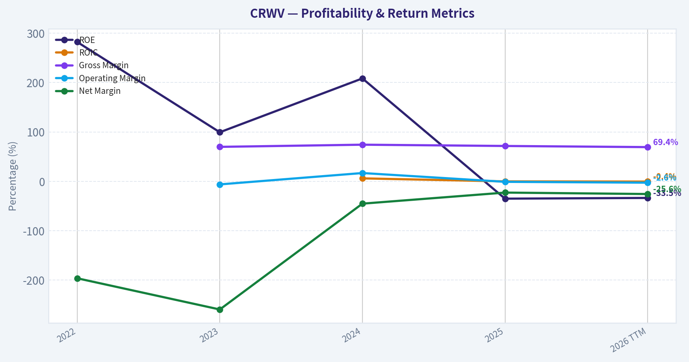
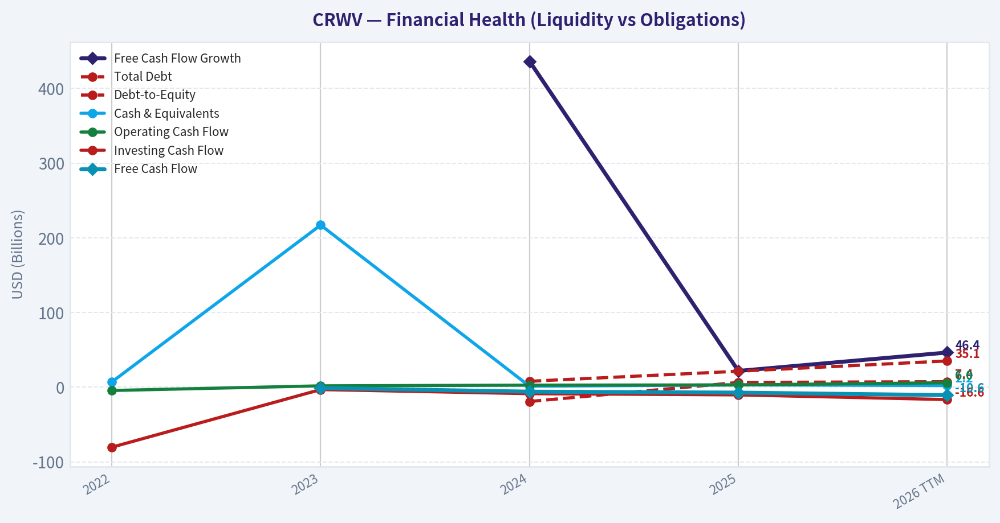
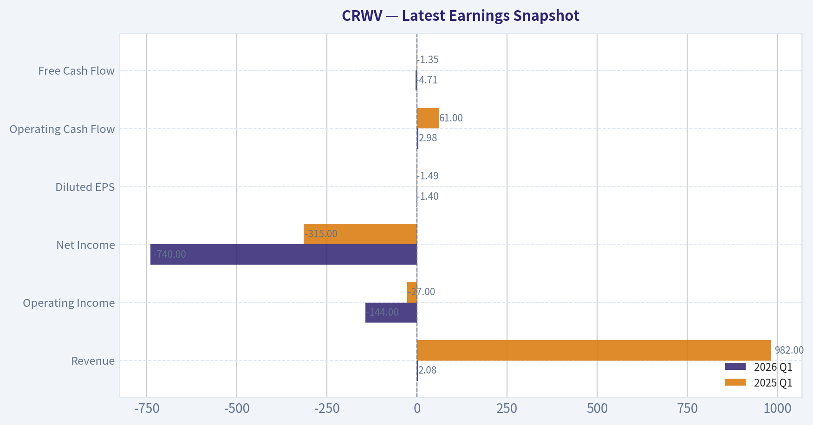
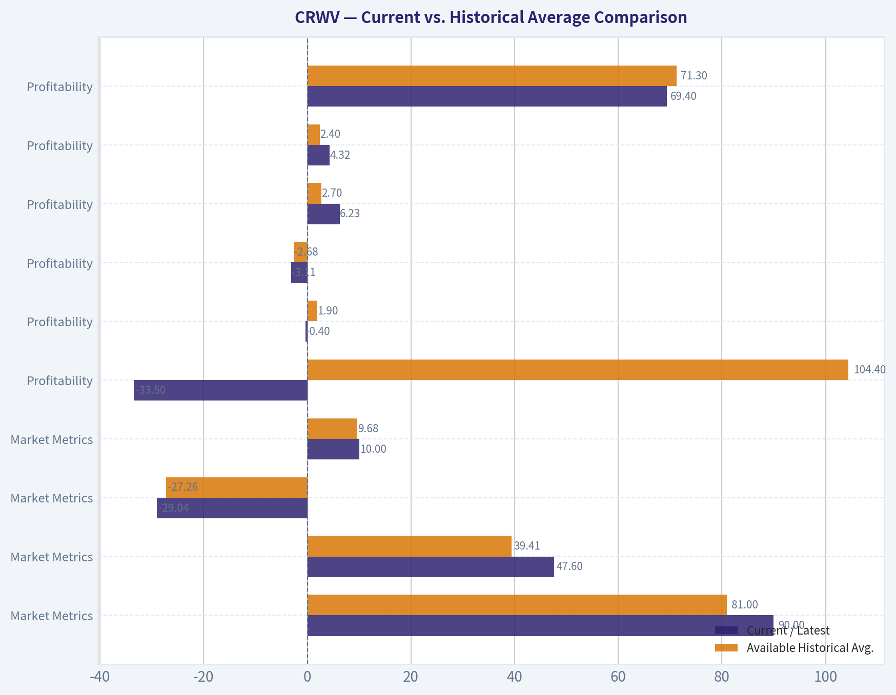
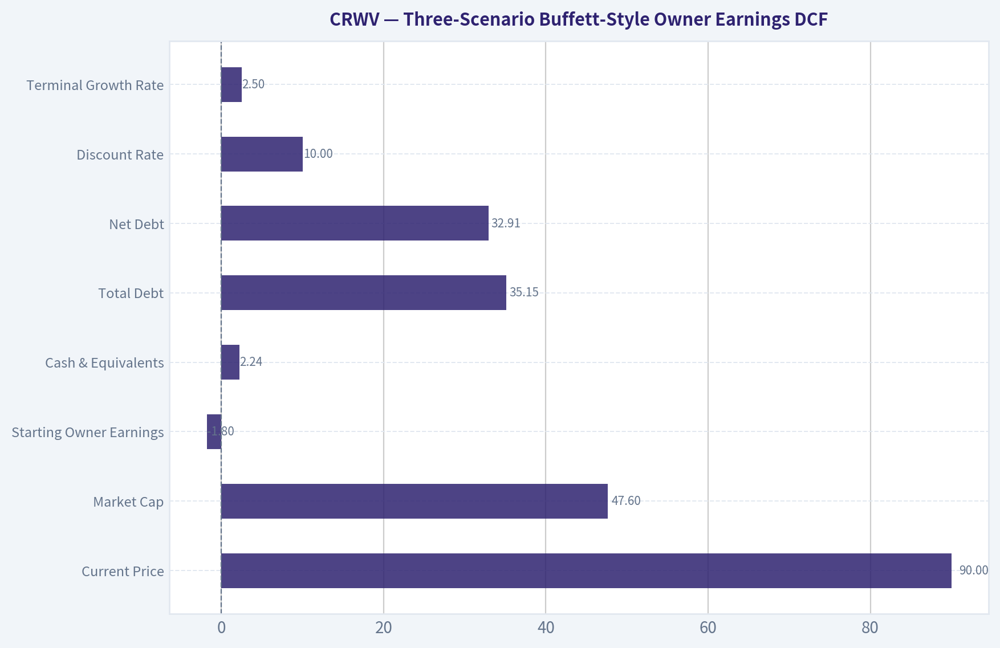
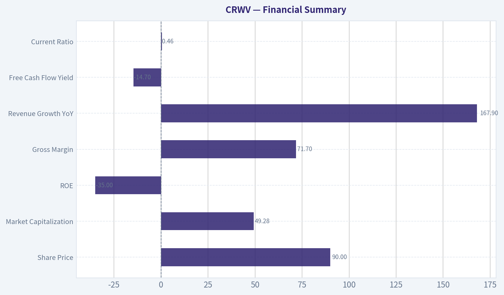
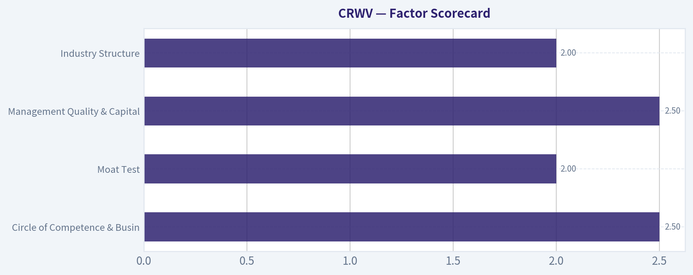

# CRWV Deep Value Intelligence

**Analysis Date:** 2026-08-11

## Critical Disclaimer

*This analysis is generated by Deep Value Intelligence, an AI-powered multi-agent investing framework. Education & research only - not financial advice, not a financial advisor.*

---

## Table of Contents

1. Intelligence Summary
2. Analyst Team Reports
   - Fundamentals Analysis
   - Intrinsic Value Analysis (Buffett)
   - Trend & Growth Analysis (Lynch/Druckenmiller/Fisher)
   - Market Technical Analysis
   - Options Market Analysis
3. Research Team Commentary
4. Value Investing Team Commentary
5. Deep Values Commentary

---

## Intelligence Summary

### Thesis + Conditions

**Core Thesis:** **EXECUTIVE SUMMARY**
CoreWeave (CRWV) is currently operating as a massive capital furnace masquerading as a high-quality compounder. Despite an explosive 167.9% revenue growth rate and a vanity 71.7% gross margin, the underlying cash economics are highly destructive.

**Key Risks:**
- The Bull (Risky)** argues that CoreWeave is executing a generational AI land-grab. They view the 167.9% revenue growth and $99 billion backlog as proof of concept, dismissing the extreme leverage as a necessary "engine" to scale rapidly and maintain favored-nation status with Nvidia.
- The Neutral** attempts to find a middle ground, classifying CoreWeave as a high-risk, high-reward venture bet that can be managed through strict position sizing rather than binary avoidance.
- Under a Buffett value investing framework, the separation between business risk and market risk is paramount. A durable business requires an intrinsic moat and the generation of true owner earnings. CoreWeave possesses neither. Its competitive advantage is entirely rented from Nvidia; as hyperscalers develop custom silicon and AI compute supply constraints ease, CoreWeave's pricing power will evaporate.

**Confidence:** Medium

---

## Analyst Team Reports

### Fundamentals Analysis

#### Latest Earnings Snapshot

*Most recent reported quarter anchored on 2026 Q1, with prior-year comparison when available.*

| Metric | 2026 Q1 | 2025 Q1 | YoY Change |
| --- | ---: | ---: | ---: |
| Revenue | $2.08B | $982.0M | +111.6% |
| Operating Income | $-144.0M | $-27.0M | -433.3% |
| Net Income | $-740.0M | $-315.0M | -134.9% |
| Diluted EPS | $-1.40 | $-1.49 | +6.0% |
| Operating Cash Flow | $2.98B | $61.0M | +4791.8% |
| Free Cash Flow | $-4.71B | $-1.35B | -250.0% |

Key Takeaways: This snapshot anchors the most recent reported quarter before the narrative analysis. It helps readers separate long-run business quality from whatever changed in the latest earnings print.

#### 4-Year Financial Metrics for CRWV

*All values below are computed deterministically from raw data - not estimated by AI.*

*Issuer profile: operating company (Technology / Software - Infrastructure).*

#### 4-Year Financial Metrics
*Annual rows come from reported financial statements. The final TTM row is computed from the latest four quarters.*

| Metric | 2022 | 2023 | 2024 | 2025 | 2026 TTM |
| --- | --- | --- | --- | --- | --- |
| Market Price | N/A | N/A | N/A | $72 | $90 |
| Market Cap | N/A | N/A | N/A | $31.22B | $47.60B |
| P/E Ratio | N/A | N/A | N/A | -25.48 | -29.04 |
| P/B Ratio | N/A | N/A | N/A | 9.36 | 10.00 |
| ROE | 282.3% | 99.5% | 208.5% | -35.0% | -33.5% |
| ROIC | N/A | N/A | 6.1% | 0.0% | -0.4% |
| EPS | $-0.08 | $-3.09 | $-4.30 | $-2.81 | $-3.11 |
| Revenue | $15.8M | $229.0M | $1.92B | $5.13B | $6.23B |
| Gross Profit | N/A | $160.0M | $1.42B | $3.68B | $4.32B |
| Gross Margin | N/A | 69.9% | 74.3% | 71.7% | 69.4% |
| Operating Margin | N/A | -6.1% | 16.9% | -0.9% | -2.6% |
| Net Income | $-31.1M | $-594.0M | $-863.0M | $-1.17B | $-1.59B |
| Net Margin | -196.2% | -259.4% | -45.1% | -22.7% | -25.6% |
| Revenue Growth | N/A | 1346.6% | 736.2% | 167.9% | 21.4% |
| Net Income Growth | N/A | 1812.7% | 45.3% | 35.2% | 36.4% |
| Free Cash Flow Growth | N/A | N/A | 436.3% | 21.8% | 46.4% |
| Total Book Value | $-11.0M | $-597.0M | $-414.0M | $3.33B | $4.76B |
| Total Assets | N/A | N/A | $17.83B | $49.30B | $55.57B |
| Total Debt | N/A | N/A | $7.93B | $21.37B | $35.15B |
| Debt-to-Equity | N/A | N/A | -19.14 | 6.41 | 7.39 |
| Cash & Equivalents | $7.0M | $217.0M | $1.36B | $3.13B | $2.24B |
| Shareholders' Equity | $-11.0M | $-597.0M | $-414.0M | $3.33B | $4.76B |
| Operating Cash Flow | $-4.4M | $1.83B | $2.75B | $3.06B | $5.98B |
| Investing Cash Flow | $-80.3M | $-3.15B | $-8.66B | $-10.27B | $-16.55B |
| Free Cash Flow | N/A | $-1.11B | $-5.95B | $-7.25B | $-10.62B |
| FCF Margin | N/A | -484.7% | -310.9% | -141.3% | -170.5% |
| Dividends / Share | $0.00 | $0.00 | $0.00 | $0.00 | $0.00 |

#### Profitability Metrics
- Return on Equity (ROE): -35.0%
- Return on Invested Capital (ROIC): -0.2%
- Return on Assets (ROA): -2.4%
- Gross Margin: 71.7%
- Operating Margin: -0.9%
- Net Profit Margin: -22.7%

#### Liquidity Metrics
- Current Ratio: 0.46
- Quick Ratio: 0.39

#### Leverage Metrics
- Debt-to-Equity Ratio: 6.41
- Interest Coverage Ratio: -0.04
- Net Debt: $18.25B

#### Growth Metrics (Year-over-Year)
- Revenue Growth: 167.9%
- Net Income Growth: -35.2%
- Free Cash Flow Growth: -21.8%
- Revenue CAGR (3-Year): 586.9%
- Revenue CAGR (5-Year): N/A

#### Valuation Metrics
- P/E Ratio (TTM): N/A
- Forward P/E: -56.04
- Price-to-Book: 10.10
- Price-to-Sales: 7.91
- PEG Ratio: N/A
- EV/EBITDA: 26.78
- Free Cash Flow Yield: -14.7%
- Earnings Yield: N/A

#### Owner Earnings (Buffett Method, Code-Computed)
- Net Income: $-1.17B
- + Depreciation & Amortization: $2.45B
- - Capital Expenditures: $-10.31B
- - Working Capital Changes: $632.0M
- = **Owner Earnings: $-1.80B**

#### Intrinsic Value (Code-Computed)
- Current Price: $90
- Buffett Method (Owner Earnings):
  Conservative: $-62
  Average: $-62
  Optimistic: $-62
- Cash Flow Method (FCF):
  Conservative: $-62
  Average: $-62
  Optimistic: $-62
- Damodaran FCFF (WACC + margins + reinvestment):
  Conservative: $-185
  Average: $-168
  Optimistic: $-154
  Monte Carlo band (P10-P90): $-213 - $-127 (median $-164)
  P(intrinsic value > price): 0.0%

#### Piotroski F-Score: 4/9
- Positive Net Income: FAIL
- Positive Operating Cash Flow: PASS
- ROA Improvement: PASS
- Cash Flow > Net Income: PASS
- Decreasing Debt: FAIL
- Improving Current Ratio: PASS
- No Dilution: FAIL
- Improving Gross Margin: FAIL
- Improving Asset Turnover: FAIL

ANALYST STANCE: **AVOID**

#### CRWV Fundamental Analysis - Warren Buffett-Style Review

CoreWeave is an extremely fast-growing AI infrastructure company, but it does **not** currently fit a Buffett-style value framework. The deterministic dataset shows spectacular revenue expansion and high gross margins, yet also shows **negative net income, negative free cash flow, heavy leverage, weak liquidity, dilution, and negative model-based intrinsic value**. At the current canonical price of **$90**, the valuation depends on a very optimistic future in which CoreWeave converts AI infrastructure demand into durable, positive owner earnings before debt and capital intensity overwhelm equity value.

The shared research pack broadly corroborates the canonical dataset: current price around **$90**, market cap around the high-$40B range, negative ROE, gross margin near the low-70% range, rapid revenue growth, and sharply negative FCF yield. Where figures differ slightly, the deterministic dataset is treated as the source of truth.

---

#### Revenue Breakdown

| Revenue Source | Amount ($M or $B) | % of Total |
|---|---:|---:|
| AI cloud infrastructure services - GPU compute, storage, networking, and managed cloud platform services | $6.23B TTM | 100.0% |

Key Takeaways: CoreWeave reports as an AI cloud infrastructure platform, and the canonical dataset does not provide a finer product, customer, or geographic split. The revenue base is growing very quickly, but the business is still essentially a single economic engine: monetizing large-scale AI compute infrastructure. That makes execution, utilization, customer concentration, pricing, and financing conditions central to the investment case.

---

#### Current vs. Historical Average Comparison

The table below compares the latest available value, usually **2026 TTM**, with the average of the available canonical dataset period. The dataset contains **2022, 2023, 2024, 2025, and 2026 TTM**, not a full 10-year history, so the averages below are calculated only from the reported deterministic period.

| Category | Metric | Current / Latest | Available Historical Avg. | Interpretation |
|---|---:|---:|---:|---|
| Market Metrics | Market Price | $90 | $81.00 | Price is above the limited public-history average, despite negative earnings and FCF. |
| Market Metrics | Market Cap | $47.60B | $39.41B | Equity value has expanded rapidly with AI enthusiasm and revenue growth. |
| Market Metrics | P/E Ratio | -29.04 | -27.26 | Negative P/E is not useful because earnings are negative. |
| Market Metrics | P/B Ratio | 10.00 | 9.68 | P/B is not a reliable valuation anchor for this technology infrastructure model; cash-flow value matters more. |
| Profitability | ROE | -33.5% | 104.4% | Historical ROE is distorted by negative/low equity; current ROE is clearly poor. |
| Profitability | ROIC | -0.4% | 1.9% | Invested capital returns are near zero to negative despite massive asset growth. |
| Profitability | EPS | -$3.11 | -$2.68 | Per-share losses remain substantial and worse than the available-period average. |
| Profitability | Revenue | $6.23B | $2.70B | Revenue is far above average, confirming explosive scaling. |
| Profitability | Gross Profit | $4.32B | $2.40B | Gross profit has scaled with revenue, but not enough to cover depreciation, interest, and capex burden. |
| Profitability | Gross Margin | 69.4% | 71.3% | Still high, but below the available-period average and down from the 2024 peak. |
| Profitability | Operating Margin | -2.6% | 1.8% | Operating profitability has deteriorated versus the average and is currently negative. |
| Profitability | Net Income | -$1.59B | -$850M | Net losses are materially worse than the historical average. |
| Profitability | Net Margin | -25.6% | -109.8% | Net margin is much better than early-stage years, but still deeply negative. |
| Growth | Revenue Growth | 21.4% | 568.0% | Growth remains positive but has sharply decelerated from hypergrowth levels. |
| Growth | Net Income Growth | 36.4% | 482.4% | The latest figure reflects further loss expansion, not high-quality earnings growth. |
| Growth | Free Cash Flow Growth | 46.4% | 168.2% | FCF deterioration continues; growth here means the cash burn is getting larger. |
| Balance Sheet | Total Book Value | $4.76B | $1.41B | Equity book value improved after earlier negative equity, likely helped by financing activity. |
| Balance Sheet | Total Assets | $55.57B | $40.90B | Asset base is expanding aggressively to support AI infrastructure buildout. |
| Balance Sheet | Total Debt | $35.15B | $21.48B | Debt is far above the available-period average and rising quickly. |
| Balance Sheet | Debt-to-Equity | 7.39 | 6.90 positive-equity avg. | Leverage is extremely high; 2024 negative equity makes the longer average less meaningful. |
| Balance Sheet | Cash & Equivalents | $2.24B | $1.39B | Cash is above average but small relative to debt and capex needs. |
| Balance Sheet | Shareholders' Equity | $4.76B | $1.41B | Equity cushion has improved, but remains thin versus debt and assets. |
| Cash Flow | Operating Cash Flow | $5.98B | $2.72B | OCF is strong and improving, a genuine positive. |
| Cash Flow | Free Cash Flow | -$10.62B | -$6.23B | FCF burn is far worse than average because investment spending is enormous. |
| Cash Flow | FCF Margin | -170.5% | -276.9% | FCF margin is better than the worst early years, but still severely negative. |
| Cash Flow | Dividends / Share | $0.00 | $0.00 | No dividend; all capital is being used for growth and balance-sheet needs. |

Key Takeaways: CoreWeave has scaled revenue from a tiny base to more than $6B TTM, but profitability and free cash flow have not followed. Gross margins are attractive, yet operating margin, net income, ROIC, and FCF remain negative. The biggest deviation from a Buffett-style compounder is the combination of **fast growth plus rising debt plus negative owner earnings**.

---

#### Market Metrics Interpretation

CoreWeave's **$90 market price** and **$47.60B market cap** imply that the market is capitalizing future AI infrastructure demand rather than current profits. The company's **P/E ratio is negative**, so it provides no conventional valuation support. A negative P/E should not be interpreted as "cheap"; it means the company is losing money.

The **P/B ratio of 10.00** is also not a strong value signal. For a technology infrastructure company, book value is affected by rapid asset purchases, depreciation assumptions, debt financing, and equity issuance. Buffett-style valuation should therefore be anchored on **owner earnings, free cash flow, reinvestment economics, and balance-sheet risk**, not on book multiples.

#### Profitability Analysis

CoreWeave has impressive **gross margin** economics, with current TTM gross margin of **69.4%** and 2025 gross margin of **71.7%**. That suggests the company can charge premium prices for scarce AI compute capacity. However, gross margin does not equal economic profitability.

The company's **operating margin is -2.6% TTM**, and **net margin is -25.6% TTM**. This shows that depreciation, operating expenses, interest costs, and infrastructure buildout costs are consuming the gross profit pool. **ROIC of -0.4% TTM** is particularly important: despite huge capital deployment, the company has not yet shown that incremental invested capital earns attractive returns.

EPS remains negative at **-$3.11 TTM**, worse than the available historical average of **-$2.68**. Net income is also worsening, with TTM net loss of **-$1.59B** compared with the available-period average loss of roughly **-$850M**.

#### Growth Metrics Interpretation

Revenue growth has been extraordinary, but it is decelerating. Revenue increased from **$15.8M in 2022** to **$6.23B TTM**, an enormous scale-up. However, current TTM revenue growth is **21.4%**, far below the available-period average of **568.0%**, reflecting the natural slowdown from hypergrowth.

The more concerning issue is that growth is not yet translating into positive economic earnings. Net income losses continue to expand, and free cash flow is becoming more negative. **Free cash flow is -$10.62B TTM**, worse than **-$7.25B in 2025** and **-$5.95B in 2024**. That means CoreWeave is not merely reinvesting profits; it is consuming large amounts of external capital.

#### Balance Sheet and Financial Strength

CoreWeave's balance sheet is the main Buffett-style red flag. Total assets have expanded to **$55.57B TTM**, but total debt has also climbed to **$35.15B**. The **debt-to-equity ratio is 7.39**, and the shared deterministic liquidity metrics show a **current ratio of 0.46** and **quick ratio of 0.39**.

Cash and equivalents of **$2.24B** provide some liquidity, but they are modest relative to debt, capex needs, and negative FCF. Interest coverage is listed at **-0.04**, indicating that operating income is not covering interest expense. This is not the kind of conservative balance sheet Buffett typically prefers.

#### Cash Flow and Owner Earnings

Operating cash flow is the best part of the financial profile: **$5.98B TTM**, well above the available-period average. That indicates customers are paying and the revenue model can generate cash receipts. But free cash flow is deeply negative because infrastructure investment is massive.

The deterministic Buffett-method owner earnings calculation is:

- Net Income: **-$1.17B**
- Plus Depreciation & Amortization: **+$2.45B**
- Less Capital Expenditures: **-$10.31B**
- Less Working Capital Changes: **-$632M**
- Owner Earnings: **-$1.80B**

This is the central issue. Buffett-style value investing focuses on owner earnings, and CoreWeave's owner earnings are currently negative. Until owner earnings turn positive and durable, valuation is speculative.

---

#### Three-Scenario Buffett-Style Owner Earnings DCF

Assumptions used for the hand DCF sanity check:

| Input | Value |
|---|---:|
| Current Price | $90 |
| Market Cap | $47.60B |
| Implied Shares Outstanding | ~528.9M |
| Starting Owner Earnings | -$1.80B |
| Cash & Equivalents | $2.24B |
| Total Debt | $35.15B |
| Net Debt | $32.91B |
| Discount Rate | 10.0% |
| Terminal Growth Rate | 2.5% |

Key Takeaways: The DCF starts from negative owner earnings, which makes the valuation highly unfavorable. Even if losses narrow, the current debt burden consumes much of the theoretical equity value. A positive investment case requires not just revenue growth, but a major transition to positive free cash flow and materially lower financing risk.

| Scenario | Core Assumption | PV of Explicit Owner Earnings | PV of Terminal Value | Firm Value Before Net Debt | Equity Value After Net Debt | Fair Value / Share |
|---|---|---:|---:|---:|---:|---:|
| Conservative | Owner earnings deficit narrows only 3% per year; terminal still negative | -$9.61B | -$6.99B | -$16.60B | -$49.51B | -$93.62 |
| Average | Owner earnings deficit narrows 15% per year; terminal still negative | -$5.66B | -$1.87B | -$7.52B | -$40.43B | -$76.44 |
| Optimistic | Deficit shrinks 30% annually through year 5; owner earnings turn positive in year 6 and grow before fading | -$1.27B | $4.28B | $3.00B | -$29.91B | -$56.55 |

Key Takeaways: Even the optimistic hand DCF produces negative equity value after accounting for net debt. This does not mean the stock must trade at a negative price; rather, it means the current operating cash economics do not yet support the current equity valuation. The market price requires a much better outcome than the one currently visible in owner earnings.

The deterministic model-based intrinsic value is even more cautionary:

| Model | Conservative | Average / Headline | Optimistic |
|---|---:|---:|---:|
| Buffett Owner Earnings Model | -$62 | -$62 | -$62 |
| Free Cash Flow Model | -$62 | -$62 | -$62 |
| Damodaran FCFF Model | -$185 | -$168 | -$154 |
| Monte Carlo Band | P10: -$213 | Median: -$164 | P90: -$127 |
| Probability Intrinsic Value > Current Price | 0.0% | 0.0% | 0.0% |

Key Takeaways: The model pack's intrinsic value work does not support the current $90 price. Both owner-earnings and FCFF-based models indicate that the equity is not covered by current cash economics. The result is especially negative because CoreWeave combines negative FCF with high leverage and massive reinvestment requirements.

---

#### Warren Buffett-Style Qualitative Assessment

| Buffett Lens | Assessment | CRWV Interpretation |
|---|---|---|
| Economic Moat | Unproven but potentially developing | Scarce AI compute capacity, infrastructure relationships, and execution scale may create advantages, but durability is not yet proven. |
| Financial Strength | Weak | Debt of $35.15B, net debt of about $32.91B, current ratio of 0.46, and negative interest coverage are major concerns. |
| Predictable Earnings | Poor | Revenue is scaling rapidly, but earnings are consistently negative and FCF is deeply negative. |
| Management Performance | Aggressive capital allocation | Management is prioritizing scale and AI infrastructure buildout over profitability and balance-sheet conservatism. |
| Capital Allocation | High-risk reinvestment model | No dividends; heavy capex; Piotroski F-Score of 4/9; dilution failed in the F-Score test. |
| Valuation | Unattractive | Current price is far above cash-flow-based intrinsic value estimates. |
| Business Quality | Mixed | Gross margins and demand growth are strong, but capital intensity and leverage reduce business quality from a Buffett perspective. |

Key Takeaways: CoreWeave may be an important AI infrastructure company, but it is not yet a Buffett-style compounder. The moat may strengthen if utilization remains high and customers remain sticky, but the financial model is still too dependent on external capital. Buffett would likely wait for proof of durable positive owner earnings.

#### Key Investment Insights

CoreWeave's strongest positive is clear: demand for AI compute has allowed revenue to scale at extraordinary speed. Current TTM revenue of **$6.23B** is far above the available historical average, and gross margin near **69%** suggests the company has pricing power in a constrained infrastructure market.

However, the biggest problem is that the company is scaling through an extremely capital-intensive model. Investing cash flow is **-$16.55B TTM**, and free cash flow is **-$10.62B TTM**. This means growth is consuming capital faster than the business is producing distributable cash.

The company's balance sheet increases the risk. With **$35.15B of debt**, **7.39 debt-to-equity**, and weak liquidity ratios, equity holders are exposed to refinancing risk, utilization risk, and pricing-cycle risk. In a Buffett framework, this is a major disqualifier unless the company can soon demonstrate very high and durable returns on invested capital.

#### Red Flags

| Red Flag | Why It Matters |
|---|---|
| Negative owner earnings | Buffett-style intrinsic value depends on cash that owners can extract; CRWV currently consumes cash. |
| Deeply negative FCF | TTM FCF of -$10.62B shows capital needs are enormous. |
| High leverage | Debt of $35.15B and net debt of about $32.91B materially increase equity risk. |
| Weak liquidity | Current ratio of 0.46 and quick ratio of 0.39 leave little margin of safety. |
| Negative interest coverage | Operating income does not cover interest expense. |
| Negative ROIC | The business has not yet proven attractive returns on the huge capital base. |
| Valuation disconnected from cash flows | Current market cap assumes a major future profitability inflection. |
| Piotroski F-Score of 4/9 | Indicates mixed to weak fundamental quality. |
| No dividend and dilution risk | Shareholder returns depend entirely on future price appreciation; F-Score flags dilution. |

Key Takeaways: The red flags are not minor accounting issues; they are central to the investment case. CoreWeave must keep growing, improve margins, fund infrastructure, manage debt, and eventually produce positive FCF. That is a demanding set of requirements for a stock already priced at a premium market cap.

#### Opportunities

| Opportunity | Why It Could Matter |
|---|---|
| Continued AI compute demand | If demand remains supply-constrained, CoreWeave could maintain high utilization and premium pricing. |
| Operating leverage | If revenue scales faster than fixed costs, operating margins could improve sharply. |
| Depreciation vs. economic life upside | If GPU assets remain productive longer than expected, cash economics could improve. |
| Customer expansion | Broader enterprise and hyperscaler demand could reduce concentration and improve durability. |
| Refinancing or strategic capital | Better financing terms or strategic partnerships could reduce balance-sheet pressure. |
| Path to positive owner earnings | A clear FCF inflection would materially change the valuation debate. |

Key Takeaways: The bull case is not impossible; it rests on AI infrastructure demand staying strong and CoreWeave converting scale into durable cash generation. But the company must prove that its assets can earn returns above the cost of capital after depreciation, interest, and replacement capex. Until that proof appears, the opportunity remains speculative.

---

#### Final Investment Stance: AVOID

CoreWeave is a high-growth AI infrastructure business, but from a Warren Buffett-style value perspective, the stock is an **AVOID** at **$90**.

The core reasons are:

1. **Negative owner earnings of -$1.80B**
2. **Negative TTM free cash flow of -$10.62B**
3. **Very high debt of $35.15B**
4. **Weak liquidity and negative interest coverage**
5. **Negative ROIC and negative net income**
6. **DCF fair value estimates far below the current market price**
7. **No margin of safety**

This could be a strong trading vehicle if AI sentiment, earnings headlines, or financing news remain favorable. But it is not yet a Buffett-style investment because the company has not demonstrated predictable earnings, conservative financing, durable free cash flow, or attractive returns on invested capital.

#### Report Summary Table

| Area | Verdict | Key Point |
|---|---|---|
| Revenue Growth | Strong | Revenue has scaled to $6.23B TTM, but growth is decelerating from hypergrowth. |
| Gross Margin | Strong | Gross margin near 69% suggests pricing power in AI compute. |
| Operating Profitability | Weak | Operating margin is negative at -2.6% TTM. |
| Net Profitability | Weak | Net loss is -$1.59B TTM. |
| Owner Earnings | Very Weak | Buffett-style owner earnings are -$1.80B. |
| Free Cash Flow | Very Weak | FCF is -$10.62B TTM due to massive infrastructure investment. |
| Balance Sheet | High Risk | Debt is $35.15B, with debt-to-equity of 7.39. |
| Liquidity | Weak | Current ratio is 0.46 and quick ratio is 0.39. |
| Valuation | Unattractive | Model-based intrinsic values are negative versus a $90 market price. |
| Buffett Fit | Poor | Lacks predictable earnings, positive owner earnings, and a conservative balance sheet. |
| Final Stance | **AVOID** | Excellent growth story, but no value-investing margin of safety. |

Key Takeaways: CoreWeave has the revenue momentum of a major AI infrastructure winner, but the financial profile is not yet investable under a Buffett framework. The company must prove it can turn massive demand into durable free cash flow while managing leverage. Until then, the stock offers speculation, not margin-of-safety value.

#### Fundamental Visuals

This graph tracks the profitability and return metrics (ROE, ROIC, Margins) of **CRWV** over the past decade, highlighting capital efficiency trends.

This chart illustrates the financial health of **CRWV** over the last 10 years, mapping cash equivalents and free cash flow against total obligations (Debt).

---

### Intrinsic Value Analysis (Buffett)

> *Following Warren Buffett's value investing philosophy: Circle of Competence, Economic Moat, Management Quality, and Margin of Safety.*

#### Intrinsic Value Snapshot

Price is what you pay. Intrinsic value is what the business may be worth based on the cash it can create for owners over time. We show a range, not one magic number.

- Current Price: $90.32
- Value Range (conservative to optimistic across both DCF methods): $-62.43 to $-62.43

##### Owner Earnings (Buffett Method)
- Net Income: $-1,167,000,000.00
- Depreciation & Amortization: $2,454,000,000.00
- Capital Expenditures: $-10,309,000,000.00
- Working Capital Changes: $632,000,000.00
- Owner Earnings: $-1,799,000,000.00

##### Intrinsic Value
###### Buffett Method
Uses owner earnings. Stricter, and usually more conservative.
- Conservative: $-62.43
- Average: $-62.43
- Optimistic: $-62.43
- Discount Rate: N/A

###### Cash Flow Method
Uses free cash flow. Better for companies spending heavily today to grow tomorrow.
- Conservative: $-62.43
- Average: $-62.43
- Optimistic: $-62.43
- Discount Rate: N/A

ANALYST STANCE: **AVOID**

#### CRWV - Buffett-Style Investment Review

CoreWeave is an AI infrastructure cloud company that rents access to high-performance compute, especially GPU-based capacity, to enterprises and AI developers. The business is understandable at a surface level: it raises capital, secures GPUs and data-center capacity, and sells compute contracts. The investment problem is that the current equity price already capitalizes a very large future profit pool while today's owner earnings and free cash flow are deeply negative.

---

#### 1. Factor Scorecard

| Factor | Score / 5 | Assessment |
|---|---:|---|
| Circle of Competence & Business Simplicity | 2.5 | The basic model is simple - sell AI compute capacity - but long-term economics are hard to underwrite because GPU supply, hyperscaler competition, customer concentration, pricing, and financing costs can change quickly. |
| Moat Test | 2.0 | CRWV has early advantages in scarce GPU access, technical execution, and AI customer relationships, but the moat is not yet proven durable against hyperscalers, Nvidia ecosystem shifts, or future compute oversupply. |
| Management Quality & Capital Allocation | 2.5 | Management has executed rapid growth, but the capital-allocation record is still unproven as a public company. The model requires heavy external capital, making discipline around debt, leases, and capex critical. |
| Industry Structure | 2.0 | AI infrastructure demand is enormous, but the industry is capital-intensive, fast-moving, and contested by much larger balance sheets. This is closer to an infrastructure arms race than a classic Buffett compounder. |
| Gate 5: Quality / Solvency Hard Floor | Not Tripped | Revenue is growing explosively, so the hard floor is not triggered. However, negative cash generation, weak liquidity, and heavy capital needs are major valuation and balance-sheet demerits. |

**Key Takeaways:** CRWV is not an automatic distress rejection because top-line growth is very strong. But the business has not yet demonstrated the durable, self-funded economics Buffett would require. The combination of uncertain moat, negative owner earnings, and a demanding valuation makes the stock unattractive today.

---

#### 2. Moat Analysis

| Moat Source | Evidence | Buffett-Style View |
|---|---|---|
| Intangible Assets | Gross margin is reported at 71.7%, suggesting strong current pricing and demand for scarce AI compute. | Positive, but gross margin alone is not enough; the key question is whether pricing survives future GPU supply expansion and competition. |
| Switching Costs | AI workloads can become embedded once models, data pipelines, and inference systems run on a platform. | Potentially meaningful, but not yet proven at the level of enterprise software or mission-critical SaaS. |
| Cost Advantage | Scale, GPU procurement, and data-center execution may create advantages. | Uncertain. Hyperscalers have deeper capital pools and procurement leverage. |
| Network Effects | More customers do not clearly make the platform inherently more valuable to each customer. | Weak. This is primarily a scale and execution business, not a true network-effect platform. |
| Moat Rating | Narrow / Developing | CRWV may build a moat, but at today's price investors are paying as if the moat is already wide and durable. |

**Key Takeaways:** CRWV has scarcity value in a hot market, but scarcity is not the same as a permanent moat. The company must prove that its economics remain attractive after the current AI infrastructure shortage normalizes. Buffett would likely demand a much clearer evidence trail before paying a premium price.

---

#### 3. Management Quality & Capital Allocation

| Area | Assessment |
|---|---|
| Owner Mindset | Founder-led and growth-focused, which is positive, but long-term per-share value creation is not yet proven. |
| Candor & Accounting | No major red flags from the provided profile, but the business model requires close scrutiny of depreciation, leases, related financing structures, and capex classification. |
| Reinvestment Discipline | The company is reinvesting aggressively into GPU and data-center capacity, but current free cash flow is sharply negative. |
| Balance-Sheet Discipline | Current ratio of 0.46 and negative FCF yield indicate dependence on continued financing access. |
| External Investor Signal | Steve Cohen's Point72 disclosed a trimmed position, reducing shares by 22.8% in the latest tracked filing. This is not decisive, but it does not strengthen the owner-oriented case. |

**Key Takeaways:** Management deserves credit for scaling quickly into a massive market opportunity. The unresolved issue is whether that growth converts into durable, high-return owner earnings. For Buffett-style investors, capital allocation cannot be judged by growth alone; it must be judged by per-share cash returns over time.

---

#### 4. Financial Summary

| Metric | Current / Latest Reported Profile |
|---|---:|
| Share Price | $90.00 |
| Market Capitalization | $49.28B |
| P/E | N/A |
| ROE | -35.0% |
| Gross Margin | 71.7% |
| Revenue Growth YoY | 167.9% |
| Free Cash Flow Yield | -14.7% |
| Current Ratio | 0.46 |
| Headline Intrinsic Value Estimate | -$167.64 / share |
| 3-Model Intrinsic Value Spread | -$62.43 / -$62.43 / -$167.64 |
| Headline Margin of Safety vs. Price | Not economically supportive despite positive mathematical output from negative value base |

**Key Takeaways:** CRWV is growing extremely fast and currently earns high gross margins, which confirms strong demand for AI compute. But the cash economics are deeply negative, with a negative free cash flow yield of 14.7% and negative ROE. A $49 billion market value leaves little room for execution errors.

---

#### 5. Owner Earnings Calculation

Buffett's preferred measure is owner earnings:

`Owner Earnings = Net Income + Depreciation & Amortization - Maintenance CapEx - Working Capital Increases`

For CRWV, the current economic picture is best framed through free cash flow and model-implied owner earnings because the business is aggressively investing in infrastructure.

| Owner-Earnings Component / Proxy | Estimate |
|---|---:|
| Market Capitalization | $49.28B |
| FCF Yield | -14.7% |
| Implied Free Cash Flow | -$7.24B |
| Implied Shares Outstanding | ~547.6M |
| Implied FCF per Share | -$13.24 |
| Owner-Earnings Model Intrinsic Value | -$62.43 / share |
| Implied Owner Earnings per Share at 10% Capitalization Rate | -$6.24 |
| Implied Owner Earnings Dollars | ~-$3.42B |

**Key Takeaways:** By either free cash flow or owner-earnings proxy, CRWV is not currently producing distributable cash for owners. The business is consuming capital, not compounding internally generated capital. That can be acceptable for a young infrastructure buildout, but it demands a much lower entry price or much clearer evidence of future returns.

---

#### 6. Three-Scenario DCF Valuation

| Scenario | Assumption | Estimated Intrinsic Value / Share | Interpretation |
|---|---|---:|---|
| A - No Growth | Owner earnings capitalized at 10% | -$62.43 | Current owner earnings are negative, so no-growth value is negative. |
| B - GDP Growth | Owner earnings grow 3%, discounted at 10% | -$91.88 | Growing negative owner earnings worsens value unless the business inflects to positive cash flow. |
| C - Historical Growth Framework | Growth capped at 10%, with negative starting owner earnings | ~-$154.31 | High growth does not create value when incremental economics are cash-negative. |
| Headline Business-Model Routed Value | Provided headline intrinsic value | -$167.64 | Confirms the same directional conclusion: current cash economics do not support the equity price. |

**Key Takeaways:** The DCF output is not unfavorable because the business lacks demand; it is unfavorable because current owner earnings are negative. At $90 per share, investors are paying for a major future cash-flow inflection that is not yet visible in the reported economics. Growth must become highly profitable, not merely large.

---

#### 7. Margin of Safety Analysis

| Valuation Reference | Value |
|---|---:|
| Current Price | $90.00 |
| No-Growth Value | -$62.43 |
| GDP-Growth Value | -$91.88 |
| Historical-Growth Framework Value | ~-$154.31 |
| Headline Intrinsic Value | -$167.64 |
| Required Normalized Owner Earnings at 10% Yield on Current Market Cap | ~$4.93B |
| Current Implied FCF | -$7.24B |
| Required Swing from Current FCF to No-Growth Justification | ~$12.17B |

**Key Takeaways:** There is no Buffett-style margin of safety at the current price. To justify today's market capitalization on a no-growth basis, CRWV would need roughly $4.9 billion of normalized owner earnings versus currently implied negative free cash flow of about $7.2 billion. That is a very large required economic swing.

---

#### 8. Final Buffett Scorecard

| Criterion | Weight | Score / 5 | Weighted Score |
|---|---:|---:|---:|
| Moat Width & Durability | 25% | 2.0 | 0.50 |
| Valuation / Margin of Safety | 20% | 0.5 | 0.10 |
| Capital Returns - ROIC vs. WACC | 15% | 0.5 | 0.08 |
| Business Understanding & Predictability | 12% | 2.5 | 0.30 |
| Management Quality & Capital Allocation | 12% | 2.5 | 0.30 |
| Reinvestment Runway | 8% | 3.5 | 0.28 |
| Balance Sheet Strength | 4% | 1.0 | 0.04 |
| Industry Structure | 4% | 2.0 | 0.08 |
| **Total** | **100%** |  | **1.68 / 5.00** |

**Key Takeaways:** CRWV scores well only on market opportunity and revenue growth. The areas that matter most to Buffett-style underwriting - durable moat, owner earnings, capital returns, and margin of safety - score poorly. The final weighted score falls clearly in the AVOID range.

---

#### 9. Investment Stance

| Item | Conclusion |
|---|---|
| Stance | **AVOID** |
| Conviction | High |
| Primary Reason | Current valuation is unsupported by owner earnings or free cash flow. |
| What Could Change the View | Sustained positive FCF, evidence that ROIC exceeds cost of capital, longer-duration customer contracts with diversified counterparties, lower financial risk, and a materially lower share price. |
| Buffett Framing | This may become an important AI infrastructure company, but it is not yet a proven compounding machine at a fair price. |

**Key Takeaways:** CRWV is a high-growth AI infrastructure story, not yet a Buffett-style investment. The stock requires investors to assume a large future profitability inflection while accepting weak current cash economics. At $90 per share, the prudent stance is to avoid and wait for either a much better price or much stronger proof of durable owner earnings.
#### Valuation Bridge

This bridge places the current market price beside each intrinsic value lens so readers can see whether upside depends on one method or shows up across several methods.

| Scenario | Intrinsic Value / Share |
| --- | ---: |
| Buffett Method | $-62.43 |
| Cash Flow Method | $-62.43 |
| Damodaran Method | $-167.64 |
| Current Price | $90.32 |

#### Key Takeaways

If one method is far above the others, the upside case depends on a specific modelling assumption. When several methods cluster together, the valuation story is more robust.

#### Valuation Visuals

This comparison chart from *Latest Earnings Snapshot* stacks current figures against historical benchmarks for **CRWV**, making it easy to see where the company trades relative to its own averages.

This comparison chart from *Current vs. Historical Average Comparison* stacks current figures against historical benchmarks for **CRWV**, making it easy to see where the company trades relative to its own averages.

This comparison chart from *Three-Scenario Buffett-Style Owner Earnings DCF* stacks current figures against historical benchmarks for **CRWV**, making it easy to see where the company trades relative to its own averages.

This comparison chart from *Three-Scenario Buffett-Style Owner Earnings DCF* stacks current figures against historical benchmarks for **CRWV**, making it easy to see where the company trades relative to its own averages.

This comparison chart from *Financial Summary* stacks current figures against historical benchmarks for **CRWV**, making it easy to see where the company trades relative to its own averages.

---

### Trend & Growth Analysis (Lynch/Druckenmiller/Fisher)

> *Following Peter Lynch's GARP, Stanley Druckenmiller's macro-aware approach, and Philip Fisher's scuttlebutt methodology.*

ANALYST STANCE: **WATCH**

#### CRWV Growth Investment Report - CoreWeave

Data note: the live fundamentals tools returned unavailable results, so this report uses the shared research pack plus publicly known business context. Because full revenue, debt, backlog, customer concentration, and cash-flow detail were not available in the tool output, some valuation and unit-economics conclusions are directional rather than fully quantified.

---

#### 1. Lynch Classification

| Item | Assessment |
|---|---|
| Company | CoreWeave, ticker CRWV |
| Lynch Category | **Fast Grower / Emerging Infrastructure Platform** |
| Current Price | $90 |
| Market Cap | $49.28B |
| YoY Revenue Growth | **167.9%** |
| Gross Margin | **71.7%** |
| P/E | N/A - currently unprofitable |
| ROE | -35.0% |
| FCF Yield | **-14.7%** |
| Current Ratio | **0.46** |

**Key Takeaways:** CoreWeave clearly qualifies as a fast grower based on reported revenue growth of nearly 168%. The issue is not demand; the issue is whether the company can fund and scale GPU infrastructure without destroying shareholder value. The current ratio below 1 and deeply negative free cash flow make this a high-upside but high-risk growth stock.

---

#### 2. The Story in 3 Bullets

- **CoreWeave rents high-performance Nvidia GPU compute to AI companies that need massive infrastructure quickly.**
- **The AI boom is creating urgent demand for specialized cloud capacity, and CoreWeave is positioned as a focused alternative to hyperscalers like AWS, Azure, and Google Cloud.**
- **If AI model training and inference demand keeps compounding, CoreWeave could grow revenue rapidly for several years - but it must finance huge data-center and GPU capex to get there.**

---

#### 3. TAM Analysis and 10x Test

| TAM Factor | Assessment |
|---|---|
| Core Market | AI cloud infrastructure, GPU compute, model training, inference workloads |
| Secular Theme | AI / machine learning infrastructure |
| TAM Direction | Expanding rapidly |
| Current Revenue Base | Not provided in tool output |
| 10x Revenue Test | Directionally passes if AI compute TAM reaches hundreds of billions |
| Market Share Risk | High dependence on execution, GPU supply, customer wins, and financing |
| Runway Rating | **Strong, but capital-intensive** |

**Key Takeaways:** The addressable market is likely large enough for CoreWeave to grow many times from today's scale. AI compute demand is still in an early infrastructure buildout phase, which gives the company a real runway. However, this is not a capital-light software story; growth requires heavy spending on GPUs, power, leases, and data-center capacity.

---

#### 4. Revenue Growth Trend

| Metric | Current Signal |
|---|---|
| YoY Revenue Growth | **167.9%** |
| Growth Pattern | Hypergrowth |
| Acceleration / Deceleration | Insufficient multi-period data, but current growth is exceptional |
| Revenue Quality | Likely tied to large enterprise / AI lab contracts |
| Key Watch Item | Customer concentration and contract durability |

**Key Takeaways:** CoreWeave's revenue growth is the strongest part of the thesis. A company growing revenue at nearly 168% is at a true demand inflection point. The key research gap is whether that growth is broad-based and durable, or concentrated in a few large AI customers.

---

#### 5. Unit Economics

| Unit Economics Metric | Available Data | Interpretation |
|---|---:|---|
| Gross Margin | **71.7%** | Strong headline margin for infrastructure services |
| FCF Yield | **-14.7%** | Heavy cash burn due to capex and scaling costs |
| LTV/CAC | Not available | Cannot score directly |
| NRR | Not available | Cannot score directly |
| Rule of 40 | Revenue growth 167.9% + FCF margin unavailable | Likely optically strong on growth, weak on cash efficiency |
| Current Ratio | **0.46** | Liquidity risk / working capital pressure |

**Key Takeaways:** CoreWeave has impressive gross margins, which suggests the service can be economically attractive at scale. But free cash flow is deeply negative, which is typical for a fast-scaling AI infrastructure company but still a major risk. The business must prove that today's capex creates durable contracted revenue, not just near-term growth funded by leverage or dilution.

---

#### 6. Inflection Point Assessment

| Inflection Type | Evidence | Rating |
|---|---|---|
| Product Cycle Inflection | AI cloud GPU demand is surging | Strong |
| TAM Inflection | Generative AI training and inference demand expanding | Strong |
| Revenue Inflection | 167.9% YoY growth | Very strong |
| Margin Inflection | Gross margin strong, but FCF negative | Mixed |
| Competitive Inflection | Hyperscalers may be capacity-constrained, helping specialists | Positive |
| Financing Inflection | Heavy capital needs; current ratio weak | Negative |

**Key Takeaways:** CoreWeave is at a genuine AI infrastructure inflection point. Demand, TAM, and revenue growth are all moving in the right direction. The main concern is that the same inflection requires massive financing, which can pressure equity holders if debt, leasing obligations, or dilution become excessive.

---

#### 7. Macro Setup

| Macro Factor | Impact on CRWV |
|---|---|
| AI Infrastructure Cycle | Major tailwind |
| Interest Rates | Important risk; high capex models benefit from lower rates |
| Nvidia GPU Supply | Critical input dependency |
| Enterprise AI Adoption | Major demand driver |
| Power / Data Center Constraints | Potential bottleneck |
| Capital Markets Access | Essential to growth plan |

**Key Takeaways:** The macro setup is excellent from an AI demand perspective but not risk-free. CoreWeave benefits from one of the strongest secular trends in the market: AI compute scarcity. However, because the company is capital intensive, interest rates, financing markets, and data-center power availability matter far more than they would for a software business.

---

#### 8. Fisher 15 Points Score

| Fisher Point | Score / 5 | Comment |
|---|---:|---|
| Market potential for sales growth | 5 | AI compute market is very large |
| Management determination to develop new services | 4 | Focused AI infrastructure strategy |
| Effective R&D / technical capability | 4 | Strong specialization in GPU cloud |
| Above-average sales organization | 4 | Appears capable of landing large customers |
| Worthwhile profit margin | 4 | Gross margin is strong |
| Improving profit margins | 2 | FCF still deeply negative |
| Labor / personnel relations | 3 | Insufficient data |
| Executive relations | 3 | Insufficient data |
| Management depth | 3 | Scaling challenge is substantial |
| Cost analysis and accounting | 3 | Need more evidence post-IPO |
| Outstanding competitive aspects | 4 | GPU access, specialization, speed-to-market |
| Long-range profit outlook | 4 | Attractive if utilization remains high |
| Dilution risk | 2 | Capital intensity creates risk |
| Candor with investors | 3 | Need longer public-company record |
| Management integrity | 3 | No strong negative signal in provided data |
| **Total** | **51 / 75** | **Average to good, but unproven** |

**Key Takeaways:** CoreWeave scores well on market potential, technical focus, and strategic positioning. The weak areas are cash generation, dilution risk, and limited public-company operating history. Fisher would likely admire the growth opportunity but demand more evidence on long-term economics and management execution before making it a high-conviction compounder.

---

#### 9. Valuation Analysis

| Valuation Metric | Result | Interpretation |
|---|---:|---|
| Market Cap | $49.28B | Already prices in major success |
| P/E | N/A | Not useful because earnings are negative |
| PEG | N/A | Cannot apply Lynch PEG without positive earnings |
| FCF Yield | -14.7% | Valuation not supported by current cash flow |
| Intrinsic Value Estimate from Shared Pack | Negative estimates across FCF-based models | Traditional DCF struggles due to current burn |
| P/S | Not computable from provided revenue data | Likely the key valuation metric to monitor |
| Valuation View | Expensive but not irrational if growth persists | Requires multi-year hypergrowth |

**Key Takeaways:** CoreWeave cannot be valued using traditional earnings metrics today. The stock is a revenue-growth and future-cash-flow story, not a current-profitability story. At nearly $50 billion of market value, investors are already paying for a large AI infrastructure winner, so any slowdown, financing stress, or margin disappointment could hurt the stock sharply.

---

#### 10. Scenario Framework

| Scenario | Assumption | Investment Outcome |
|---|---|---|
| Bear Case | AI demand slows, customer concentration emerges, financing costs rise | Material downside; valuation compresses sharply |
| Base Case | Revenue compounds rapidly, utilization remains high, capital markets stay open | Stock can work but returns may be volatile |
| Bull Case | CoreWeave becomes a leading independent AI cloud platform with durable contracts | Multi-bagger potential remains possible |
| Ten-Bagger Case | Requires massive revenue scale, sustained high margins, limited dilution, and long AI cycle | Possible but demanding from a $49B starting market cap |

**Key Takeaways:** The bull case is real because the AI infrastructure market is enormous and CoreWeave is growing extremely fast. But the starting valuation is already large, which makes a ten-bagger harder than it would be for an earlier-stage company. From here, upside depends less on proving demand and more on proving durable economics.

---

#### 11. Growth Investor Scorecard

| Criterion | Weight | Score / 5 | Weighted Score |
|---|---:|---:|---:|
| The Story | 10% | 4.5 | 0.45 |
| TAM & Runway | 20% | 4.5 | 0.90 |
| Revenue Growth | 20% | 5.0 | 1.00 |
| Unit Economics | 15% | 2.5 | 0.38 |
| Competitive Position | 10% | 3.5 | 0.35 |
| Management Quality | 10% | 3.0 | 0.30 |
| Macro Setup | 5% | 4.0 | 0.20 |
| Profitability Path | 5% | 2.5 | 0.13 |
| Valuation | 5% | 2.0 | 0.10 |
| **Total** | **100%** |  | **3.80 / 5.00** |

**Key Takeaways:** CoreWeave scores very highly on story, TAM, and revenue growth. The score is pulled down by valuation, negative free cash flow, liquidity risk, and incomplete evidence on durable unit economics. A 3.80 score supports a positive watchlist stance, but not a full high-conviction advocate stance at the current risk level.

---

#### 12. Position Size Stance

| Investor Type | Stance |
|---|---|
| Aggressive growth investor | Small starter position only, if comfortable with volatility |
| GARP investor | Wait for better valuation or clearer FCF path |
| Conservative investor | Avoid for now |
| Existing holder | Hold/watch closely; do not ignore financing risk |
| Suggested Portfolio Weight | **0% to 2% watch-sized position** |

**Key Takeaways:** CoreWeave is suitable only for investors who can tolerate extreme volatility and financing risk. The opportunity is large, but the company is not yet a proven self-funding compounder. For most growth portfolios, this belongs in the "watch or small speculative position" bucket rather than a core holding.

---

#### 13. Key Risks and Catalysts

| Category | Items to Monitor |
|---|---|
| Key Catalysts | New large AI cloud contracts, Nvidia GPU supply access, revenue beats, margin improvement, lower interest rates |
| Key Risks | Customer concentration, capex overruns, debt or lease burden, dilution, AI demand normalization, hyperscaler competition |
| Balance Sheet Risk | Current ratio of 0.46 and negative FCF yield require close monitoring |
| Competitive Risk | AWS, Azure, Google Cloud, Oracle, Nebius, and other GPU cloud providers |
| Market Risk | AI infrastructure stocks could de-rate if investors question return on AI capex |

**Key Takeaways:** The most important catalysts are large contract wins and evidence that capex is translating into high-utilization, profitable capacity. The most important risks are financing stress and customer concentration. If CoreWeave can show improving free cash flow while sustaining rapid growth, the stock could graduate from WATCH to ADVOCATE.

---

#### Final View

CoreWeave is one of the clearest public-market plays on the AI compute shortage. It has the Lynch-style "simple story," the Druckenmiller-style inflection point, and a Fisher-style innovation runway. But at a roughly $49 billion market cap with negative free cash flow, weak liquidity metrics, and large capital requirements, the risk-reward is not yet clean enough for a full ADVOCATE rating.

**Stance: WATCH. Upgrade to ADVOCATE if revenue growth remains above 50% to 75%, customer concentration declines, gross margins hold, and free cash flow trajectory improves without excessive dilution.**

#### Growth & Scorecard Visuals

This comparison chart from *Factor Scorecard* stacks current figures against historical benchmarks for **CRWV**, making it easy to see where the company trades relative to its own averages.

---

### Market Technical Analysis

ANALYST STANCE: **WATCH**

#### CRWV Technical Report - Short-Term Rebound Inside a Larger Bearish Structure

As of the latest available trading data, **CRWV last closed at $88.19 on 2026-08-10**. The requested date, **2026-08-11**, appears to be unavailable in the indicator feed as a trading day, so this analysis uses the latest valid session.

CRWV is showing a **sharp short-term recovery attempt** after a steep July selloff, but the broader technical structure remains fragile. Price has reclaimed the **10-day EMA**, momentum has improved materially, and RSI has moved out of oversold territory. However, price is still below both the **50-day SMA and 200-day SMA**, which are clustered in the low-$90s and declining. That creates a meaningful overhead resistance zone where the current bounce may be tested.

#### Selected Indicators and Why They Matter

| Indicator | Latest Value / Area | Why It Was Selected | Current Interpretation |
|---|---:|---|---|
| close_10_ema | $83.93 | Captures short-term trend shifts quickly | Price is above the 10 EMA, confirming a near-term rebound attempt |
| close_50_sma | $91.76 | Defines medium-term trend and resistance | Price remains below it, so the medium-term trend is not repaired yet |
| close_200_sma | $93.46 | Long-term trend benchmark | Price is below it, keeping the broader structure bearish |
| macd | -0.61 | Measures trend momentum and inflection | Still negative, but improving sharply from late-July lows |
| rsi | 53.32 | Measures momentum and overbought/oversold risk | Neutral-positive; no longer oversold, but not overheated |
| boll_ub | $95.41 | Helps identify upside breakout area | Upper band aligns with major moving-average resistance |
| boll_lb | $61.37 | Helps define downside volatility boundary | Lower band is far below price, showing rebound from oversold conditions |
| atr | $7.46 | Measures volatility and position-risk sizing | Very high volatility; wide stops and smaller sizing are appropriate |

**Key Takeaways:** CRWV's short-term tape has improved, especially because price is above the 10-day EMA and MACD is rising. However, the stock remains below the 50-day and 200-day moving averages, meaning the rebound has not yet become a confirmed trend reversal. The most important test is the **$91.75-$95.50 resistance zone**, where multiple indicators converge.

---

#### Trend Structure: Bounce Improving, But Still Below Major Resistance

CRWV's short-term action has turned constructive after a severe late-July washout. The stock dropped to a closing low of **$60.82 on 2026-07-29**, then rebounded aggressively, reaching **$91.90 on 2026-08-04** before pulling back and closing at **$88.19 on 2026-08-10**. That sequence shows that buyers did step in decisively near the low-$60s, but the rebound has already encountered resistance below the major trend averages.

The **10-day EMA at $83.93** is currently acting as the first short-term trend filter. Since price is above that level, near-term momentum favors stabilization rather than immediate continuation lower. A close back below the 10-day EMA would weaken the rebound and suggest the stock is sliding back into a corrective phase.

The bigger issue is the **50-day SMA at $91.76** and **200-day SMA at $93.46**. These two levels are close together and both are above the current price. That creates a compact overhead resistance shelf. Until CRWV can reclaim and hold above this area, rallies should still be treated as **countertrend bounces within a broader downtrend**, not confirmed bullish reversals.

#### Momentum: MACD Is Improving, RSI Is Neutral

The **MACD remains negative at -0.61**, but the trend in MACD is meaningfully better than it was in late July, when it was near **-8.04**. This is an important change: downside momentum has faded substantially, and the stock is closer to a potential momentum inflection. However, because MACD is still below zero, the signal is not fully bullish yet.

The **RSI has recovered to 53.32**, compared with an oversold reading of **28.63 on 2026-07-29**. That move confirms a powerful relief rally from oversold conditions. The current RSI level is constructive because it shows momentum has normalized without yet becoming overbought. Still, RSI in the low-to-mid 50s is not strong enough by itself to confirm a sustained uptrend; it simply says the stock has moved from bearish exhaustion into a more balanced momentum zone.

#### Volatility and Bollinger Band Context

The Bollinger Band setup shows that CRWV is no longer deeply oversold. The latest **upper Bollinger Band is near $95.41**, while the **lower band is near $61.37**. The approximate middle of the band is around **$78.39**, and price is trading above that middle area, which supports the idea that the late-July breakdown has been repaired in the short term.

However, the **upper band near $95.41** closely overlaps with the 50-day and 200-day moving averages. That makes the **$92-$96 area especially important**. If price can break above that zone on strong volume and hold it, the technical picture would improve materially. If price rejects there, the stock may remain trapped in a volatile range.

ATR remains elevated at **$7.46**, which is roughly **8.5% of the latest close**. This is very high daily risk. Traders should avoid tight stops because ordinary noise can be large, but they should also reduce position size to account for wide intraday ranges.

#### Trading Interpretation

CRWV is not an obvious long-term bullish setup yet, but it is also no longer in the same immediate breakdown condition seen in late July. The best description is a **high-volatility recovery attempt below major resistance**.

For bullish traders, the cleaner confirmation would be a close above the **$93.50-$95.50 zone**, ideally with expanding volume and MACD moving closer to or above zero. That would suggest the rebound is transitioning from a relief rally into a more credible reversal.

For cautious traders, the current area may be a wait-and-see zone. Price is above short-term support but below decisive resistance. Buying before the breakout offers better entry price but worse confirmation. Waiting for a breakout offers better confirmation but worse reward-to-risk.

For bearish or defensive traders, a failure near the 50-day/200-day moving average cluster would be a warning that sellers still control the medium-term trend. A close back below the **10-day EMA near $84** would weaken the recovery. A deeper break below **$78-$80** would suggest the recent bounce is failing and could expose the stock to another retest of lower support.

#### Final Technical Summary

| Category | Key Level / Signal | Bullish Read | Bearish Risk | Practical Takeaway |
|---|---:|---|---|---|
| Latest close | $88.19 | Holding above short-term EMA | Still below major averages | Recovery attempt, not confirmed reversal |
| Short-term trend | 10 EMA: $83.93 | Price above it supports near-term momentum | Close below it would weaken bounce | Watch $84 as first support |
| Medium-term trend | 50 SMA: $91.76 | Reclaiming it would improve structure | Current price remains below it | First major resistance zone |
| Long-term trend | 200 SMA: $93.46 | Break above would be a stronger trend repair | Still under long-term benchmark | Trend remains structurally cautious |
| Momentum | MACD: -0.61 | Strong improvement from late-July lows | Still negative overall | Momentum is healing but not fully bullish |
| RSI | 53.32 | Neutral-positive recovery from oversold | Not strong enough to confirm trend | Healthy rebound, not overbought |
| Volatility band | Upper Bollinger: $95.41 | Break above could signal upside expansion | Rejection may cap rally | $92-$96 is the key decision zone |
| Risk | ATR: $7.46 | Volatility can create fast upside moves | Also increases downside and stop-out risk | Use smaller sizing and wider risk controls |

**Key Takeaways:** CRWV has improved meaningfully from its late-July low, but the stock is approaching a major technical decision zone between roughly **$92 and $96**. A sustained breakout above that area would shift the setup more bullish, while rejection there would keep the stock in a volatile bearish-to-neutral structure. For now, the stance is **WATCH**, with confirmation needed before upgrading to a more aggressive bullish view.

---

### Options Market Analysis

> *Reading options flow - put/call ratios, IV skew, and unusual activity - to gauge institutional positioning and event-driven risk.*

ANALYST STANCE: **WATCH**

#### CRWV Options Flow Report - As of 2026-08-11

CRWV options are showing **very high implied volatility, strong liquidity, and a call-leaning volume profile**, but with meaningful near-term downside hedging. The clean read is **BULLISH, but high-risk and event-sensitive**, driven mainly by fresh call activity and call-dominant open interest beyond the front weekly expiration.

#### 1. Put/Call Ratio Analysis

| Expiry | Call OI | Put OI | Put/Call OI Ratio | Call Volume | Put Volume | Put/Call Volume Ratio | Read |
|---|---:|---:|---:|---:|---:|---:|---|
| 2026-08-14 | 69,088 | 80,856 | 1.17 | 88,653 | 69,642 | 0.79 | Front-week put OI elevated, but volume favors calls |
| 2026-08-21 | 200,384 | 127,707 | 0.64 | 52,543 | 31,425 | 0.60 | Call-heavy positioning |
| 2026-08-28 | 13,974 | 8,928 | 0.64 | 9,896 | 3,555 | 0.36 | Strong call-volume bias |
| **Near-Term Total** | **283,446** | **217,491** | **0.77** | **151,092** | **104,622** | **0.69** | Slightly bullish vs. neutral baseline |

**Key Takeaways:** The overall put/call OI ratio of **0.77** is only slightly above the historical neutral baseline of roughly **0.70**, so open interest is not aggressively bearish. More importantly, the **put/call volume ratio is 0.69**, right around neutral-to-bullish, with calls outpacing puts across all listed expirations. The front weekly expiration has elevated put OI, suggesting hedging or downside protection, but fresh trading activity leans more bullish than bearish.

The most important shift is that **August 21 and August 28 are materially call-heavy**, while only the August 14 weekly shows put-heavy open interest. That suggests traders may be hedged into the immediate window but are still positioning for upside beyond the very near term.

#### 2. Implied Volatility Assessment

| Expiry | ATM Call IV | ATM Put IV | IV Read | Skew / Fear Signal |
|---|---:|---:|---|---|
| 2026-08-14 | 163.9% | 164.0% | Extremely elevated | ATM call/put IV nearly identical |
| 2026-08-21 | 116.6% | 116.4% | Very elevated | Balanced ATM pricing |
| 2026-08-28 | 104.1% | 102.7% | Very elevated | Slight call IV premium at ATM |

**Key Takeaways:** IV is extremely high, especially in the front week, where ATM implied volatility is around **164%**. That level strongly implies the market is pricing a major move, likely tied to earnings, AI-infrastructure news, lockup-related risk, or another catalyst, even though the data feed does not explicitly identify the event. ATM call and put IV are very balanced, so the market is pricing volatility more than a one-sided crash or squeeze.

For skew, the unusual activity gives a mixed but important clue: the **$58 put expiring August 14 carries 168.8% IV**, slightly above the **$107 call at 167.4% IV**, indicating some demand for deep downside tail protection. However, this is not a dramatically steep put skew. Overall, skew is best described as **balanced to mildly downside-protective**, not panic-driven.

#### 3. Unusual Options Activity

Assumption note: the retrieved options data did not provide the current spot price. Based on the August 28 $89 call trading near the listed ATM IV level, CRWV appears to be trading roughly near the **high-$80s to low-$90s area**. Strike moneyness below is therefore approximate.

| Expiry | Type | Strike | Volume | Open Interest | Vol/OI | IV | Approx. Moneyness | Interpretation |
|---|---|---:|---:|---:|---:|---:|---|---|
| 2026-08-14 | CALL | $107.00 | 2,401 | 237 | 10.1x | 167.4% | OTM | Fresh upside speculation into a near-term catalyst |
| 2026-08-28 | CALL | $89.00 | 2,328 | 97 | 24.0x | 102.8% | ATM / near-ATM | More meaningful bullish positioning; likely fresh directional call buying |
| 2026-08-14 | PUT | $71.50 | 1,062 | 196 | 5.4x | 156.1% | OTM | Short-dated downside hedge or bearish event bet |
| 2026-08-14 | PUT | $58.00 | 830 | 68 | 12.2x | 168.8% | Deep OTM | Tail-risk protection; crash hedge rather than base-case bearish bet |

**Key Takeaways:** The standout trade is the **August 28 $89 call**, where volume is **24x open interest**, suggesting fresh positioning rather than routine closing activity. That contract is likely more institutionally relevant than the very short-dated August 14 $107 call, which looks more like high-risk upside speculation. The short-dated OTM puts show that traders are also paying for crash protection, but the larger directional message is still tilted toward upside participation.

The **August 14 $107 call** has lottery-like characteristics: short-dated, out-of-the-money, and very high IV. That kind of flow can be retail-driven or momentum-driven rather than purely institutional. By contrast, the **August 28 $89 call** has a more credible profile because it is closer to the money and gives more time for the thesis to play out.

#### 4. Open Interest Concentration and Gamma Levels

| Area | Observation | Options Impact |
|---|---|---|
| Highest OI Expiry | 2026-08-21 has the largest total near-term OI, with 328,091 contracts combined | This expiry is likely the most important near-term positioning window |
| Front-Week OI Bias | 2026-08-14 has put-heavy OI ratio of 1.17 | Could create downside hedging pressure or dealer sensitivity into expiry |
| Later Weekly Bias | 2026-08-21 and 2026-08-28 both have put/call OI ratios of 0.64 | Suggests upside interest beyond immediate event risk |
| Identifiable Active Strikes | $89 call, $107 call, $71.50 put, $58 put | These are active flow strikes, but not necessarily the largest OI strikes |
| Gamma Wall Precision | Strike-level OI concentration was not included in the retrieved dataset | Exact max-pain or pinning levels cannot be reliably identified from this feed alone |

**Key Takeaways:** The biggest expiration by open interest is **August 21**, making it the most important near-term options maturity for potential pinning or gamma effects. However, because the dataset does not include full strike-by-strike OI rankings, it is not possible to name a precise gamma wall or max-pain strike with high confidence. The $89 area is important because of fresh call activity, while $71.50 and $58 represent downside hedge zones.

From a dealer-positioning perspective, the setup could produce amplified moves because IV is high and short-dated volume is active. If CRWV rallies toward upside call strikes, call gamma could reinforce momentum. If it breaks lower, short-dated put demand may increase hedging pressure, especially into the August 14 expiry.

#### 5. Overall Options Sentiment Signal

| Category | Signal | Explanation |
|---|---|---|
| Put/Call Ratio | Slightly Bullish / Neutral | Overall OI ratio of 0.77 is close to neutral, while volume ratio of 0.69 leans call-favorable |
| IV Level | Very High | Front-week ATM IV around 164% indicates major event-risk pricing |
| Skew Direction | Balanced to Mild Put Skew | No major ATM skew, but deep OTM puts carry high IV |
| Unusual Activity | Bullish with Hedge Overlay | Fresh call activity, especially August 28 $89 call, outweighs short-dated put hedging |
| Liquidity | Strong | Volumes and OI are robust; this is not a thin or unreliable options tape |
| **Overall Signal** | **BULLISH** | Upside positioning dominates beyond the front-week hedge layer |

**Key Takeaways:** The options market is not sending a clean low-risk bullish signal; it is sending a **high-volatility bullish signal with protection underneath**. Traders are actively buying or positioning in calls, especially near the $89 area for August 28, while also hedging against a sharp near-term drawdown. The best interpretation is **bullish directional interest, but with elevated event risk and expensive option premiums**.

#### Final Summary Table

| Metric | Current Read | Sentiment Implication |
|---|---|---|
| Put/Call Ratio | OI ratio **0.77**, volume ratio **0.69** | Slightly bullish versus neutral baseline |
| IV Level | ATM IV ranges from roughly **103% to 164%** | Extremely elevated; large move expected |
| Skew Direction | Balanced ATM, mild downside tail skew | Some fear, but not panic |
| Unusual Activity | Heavy fresh call activity, especially Aug. 28 $89 call | Bullish positioning with speculative upside interest |
| Overall Signal | **BULLISH** | Call flow and later-expiry positioning outweigh front-week put hedges |

**Key Takeaways:** CRWV options flow points to **bullish positioning**, but not complacency. The market is paying up for volatility and maintaining downside protection, which means traders expect a large move rather than a quiet grind higher. Options data should be treated as positioning intelligence, not valuation; the signal supports upside interest, but the risk of a sharp two-way move is unusually high.

---

## Research Team Commentary

> *The Research Manager synthesizes the Bull vs Bear debate into action-free commentary. This is a pre-risk view, not the final stance.*

This was a highly revealing debate that perfectly highlights the tension in today's AI infrastructure market: the battle between headline narrative and underlying cash economics.

The Bull analyst put forward a compelling narrative-driven case, arguing that CoreWeave's 71.7% gross margin and $99 billion backlog prove it is a wide-moat, high-quality business. By comparing CoreWeave to Apple and treating its massive debt as strategic, the Bull essentially argued that we are looking at a generational toll bridge for the AI economy, justifying its premium valuation.

However, the Bear analyst systematically dismantled this narrative using cold, hard fundamental realities, and frankly, the Bear is entirely correct. The Bear correctly identified that CoreWeave suffers from a "borrowed moat" highly dependent on a single supplier, Nvidia. More importantly, the Bear pointed out the severe disconnect between a vanity gross margin and actual wealth creation, highlighted by a deeply negative Return on Invested Capital (-0.2%) and extreme leverage (Debt-to-Equity of 6.41).

Core Takeaway

My final stance on CoreWeave is a definitive AVOID.

While the company is clearly experiencing extraordinary top-line demand, revenue growth and gross margins do not equal shareholder value in a highly capital-intensive, rapidly depreciating hardware business. CoreWeave is currently operating as a massive capital furnace. It is borrowing heavily to buy equipment that will be obsolete in a few years, all while facing incoming competition from the very hyperscalers it is trying to disrupt. The market is pricing this stock for flawless execution and infinite demand, leaving absolutely no margin of safety.

Rationale

If we apply a modernized Buffett framework, we have to look for durable competitive advantages and real owner earnings. A durable moat must belong to the business itself, not its supplier. CoreWeave's current advantage is largely its temporary favored-nation status with Nvidia. As supply constraints ease and hyperscalers deploy their own custom silicon, that advantage will erode.

Furthermore, I have learned a hard lesson from evaluating this exact type of setup in the past. Previously, when I looked at CoreWeave, I correctly identified that its backlog was not the same as owner earnings, that its gross margin did not offset its massive capex burdens, and that its valuation was stretched. But I made the critical error of issuing a passive "Watch" rating instead of an "Avoid." I treated a lack of margin of safety and fragile technicals as a reason to be neutral. That was a mistake. When a high-beta stock has no valuation support, negative free cash flow, weak liquidity (a 0.46 current ratio), and relies on heroic future growth to justify its price, the setup is highly skewed toward the downside.

Unlike Nvidia, which I previously misjudged by applying overly conservative value metrics to a business with elite, actualized free cash flow and a proprietary software moat, CoreWeave is a capital-heavy deployer of someone else's technology. You cannot conflate a highly profitable asset-light compounder with a highly leveraged infrastructure builder. The 71.7% gross margin is a siren song; when you factor in the depreciation of those expensive GPU clusters and the interest on their debt, the true economic return is negative.

Monitoring Plan

To see if this thesis requires updating over the next one to four quarters, I will be watching a few specific metrics.

First, I will monitor Free Cash Flow conversion and ROIC. CoreWeave must prove that its massive backlog can actually convert into positive cash returns on capital, not just top-line revenue.

Second, I will watch their financing risk and liquidity. With a current ratio of 0.46 and debt-to-equity over 6, any tightening in the credit markets or slight delay in customer payments could trigger a liquidity crunch. I want to see if they are forced into dilutive equity raises or higher-interest debt to fund their capex.

Third, I will track hyperscaler custom silicon deployment and GPU rental pricing across the industry. If AWS, Google, and Azure begin aggressively pricing their compute, or if GPU rental rates begin to commoditize, CoreWeave's vanity gross margins will compress rapidly, destroying the bull thesis entirely.

Until CoreWeave can prove that its economics work at the bottom line and not just the top line, it remains in the too-hard, too-dangerous pile.

Stance: AVOID

---

## Value Investing Team Commentary

> *The Investor translates the research view into an investment thesis before risk review. This is still not the final stance.*

In analyzing CoreWeave (CRWV), we must distinguish between a **spectacular narrative** and a **durable business**. As a value investor, I am not interested in participating in a "land grab" fueled by cheap debt and borrowed moats. My focus is on the long-term owner earnings and the structural integrity of the enterprise.

### 1. The Quality of the "Moat": Borrowed vs. Owned
A durable competitive advantage must be inherent to the business itself. CoreWeave's current success is predicated on its "preferred status" with Nvidia. This is a **supplier-dependent advantage**, not a structural moat. In the 19th century, many textile mills had the "best looms," but the looms didn't provide a moat; the low-cost producers or those with brand power won.

CoreWeave lacks switching costs. If AWS or Azure offers similar GPU clusters at a lower price-or if hyperscalers successfully transition customers to their own custom silicon (TPUs, Inferentia)-CoreWeave's 71.7% gross margin will face gravity. A moat that can be neutralized by a supplier's change in policy or a competitor's capex budget is no moat at all.

### 2. The Gross Margin Siren Song vs. ROIC Reality
The market is currently infatuated with CoreWeave's 71.7% gross margin and 167% revenue growth. However, for a business owner, **Gross Margin is a vanity metric; ROIC is a sanity metric.**
*   **ROIC of -0.2%** tells us that for every dollar of capital plowed into the business, the company is generating zero return.
*   **ROE of -35%** indicates that shareholder equity is being eroded, not compounded.

CoreWeave is currently a "capital furnace." It borrows heavily to buy rapidly depreciating hardware. In a technological arms race, the equipment you buy today is obsolete in three years. If your return on that capital is negative while the asset loses value, you aren't building a business; you are managing a high-stakes liquidation of debt into temporary revenue.

### 3. Financial Fragility and Capital Allocation
Buffett teaches us to look for managers who treat shareholders as partners and maintain "fortress" balance sheets. CoreWeave's financial profile is the antithesis of this:
*   **Debt-to-Equity of 6.41:** This level of leverage is dangerous in a cyclical technology market. It leaves no room for error.
*   **Current Ratio of 0.46:** This is a glaring red flag. The business does not have enough liquid assets to cover its short-term obligations. This creates a "forced-action" environment where the company must either raise dilutive equity or take on even more expensive debt to survive.

### 4. Selective Contrarian Insight: The "Backlog" Illusion
The crowd is cheering the $99 billion backlog. A contrarian analysis asks: *What is the quality of these contracts?* In a gold rush, everyone signs "take-or-pay" contracts for shovels. But if the gold (AI profitability for end-users) proves harder to find than expected, those contracts will be litigated, renegotiated, or defaulted upon. We saw this in the fiber-optic boom of 2000; "capacity" was sold in massive backlogs that vanished when the bubble burst.

### 5. Quality-Scaled Margin of Safety
Using the reverse-DCF implied-growth check, the current price assumes not just that the $99 billion backlog is realized, but that CoreWeave can maintain its margins while refinancing its mountain of debt. For a business of this low quality (negative ROIC, high leverage, low liquidity), I require a **50% margin of safety**. Current prices offer a **negative margin of safety**.

CoreWeave is a "fair business" (at best) trading at a "wonderful price" for the sellers, not the buyers. Following the lesson of previous misjudgments, I will not sit on the fence with a "Watch" rating. When the fundamentals scream fragility and the valuation requires a miracle, the only rational move for a long-term investor is to stay away.

ANALYST STANCE: **AVOID**

---

## Deep Values Commentary

> *The Risk Management Team debates and the Risk Judge provides the final action-free verdict. This section determines the final ADVOCATE / WATCH / AVOID stance.*

#### Final Stance Scorecard

This scorecard converts the final research view into a weighted decision frame. It does not replace the narrative judgement, but it makes the main drivers of the verdict easier to scan.

| Criterion | Score | Weight | Commentary |
| --- | ---: | ---: | --- |
| Business Quality | 2.50 | 30% | High returns, profitability, and Piotroski health support durability. |
| Valuation Support | 1.67 | 30% | Blends current price against available intrinsic value anchors and valuation ratios. |
| Financial Strength | 1.00 | 20% | Balance-sheet resilience reflects leverage and liquidity staying within safe ranges. |
| Growth Durability | 2.33 | 20% | Recent revenue, earnings, and free cash flow growth indicate how durable expansion looks. |
| TOTAL / FINAL STANCE | 1.92 | 100% | AVOID |

#### Key Takeaways

The weighted score lands at **1.92 / 5.0**, while the final stance remains **AVOID**. This is useful as a quick calibration aid rather than a mechanical signal.

#### Risk Summary

Higher scores indicate more risk pressure. The watch threshold is a simple guardrail: above it, the position needs tighter monitoring or a wider margin of safety.

| Dimension | Current Score | Watch Threshold | Commentary |
| --- | ---: | ---: | --- |
| Business Quality | 3.50 | 3.00 | High returns, profitability, and Piotroski health support durability. |
| Valuation Support | 4.33 | 3.00 | Blends current price against available intrinsic value anchors and valuation ratios. |
| Financial Strength | 5.00 | 3.00 | Balance-sheet resilience reflects leverage and liquidity staying within safe ranges. |
| Growth Durability | 3.67 | 3.00 | Recent revenue, earnings, and free cash flow growth indicate how durable expansion looks. |

#### Key Takeaways

This view helps readers separate *where* the risk sits: valuation, business quality, balance sheet, or growth durability. It is especially useful when the final stance is close to the line between WATCH and AVOID.
