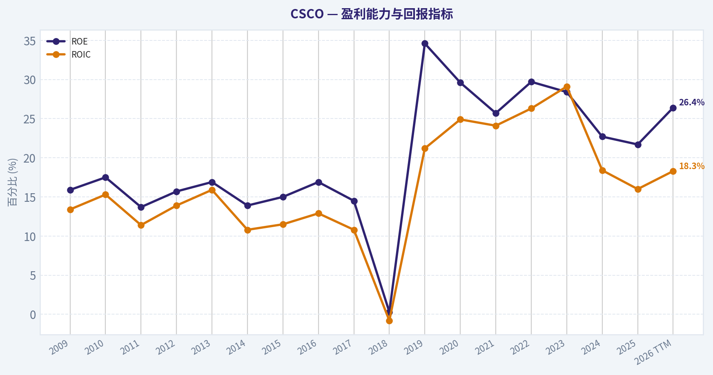
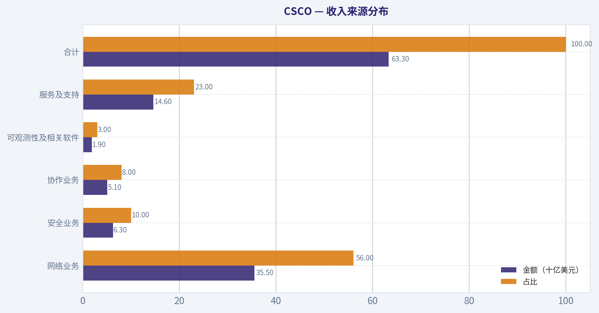
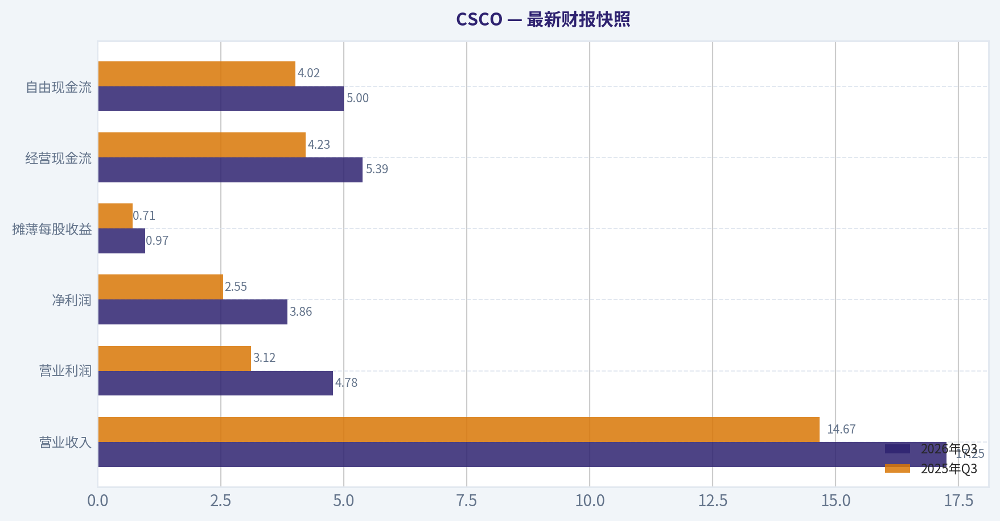
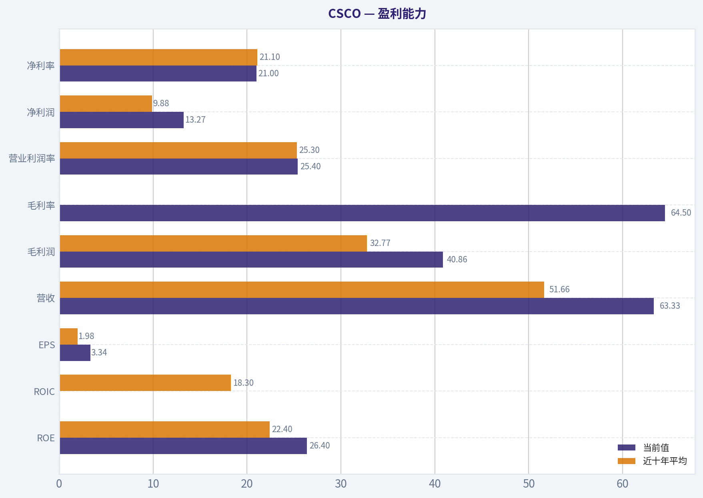
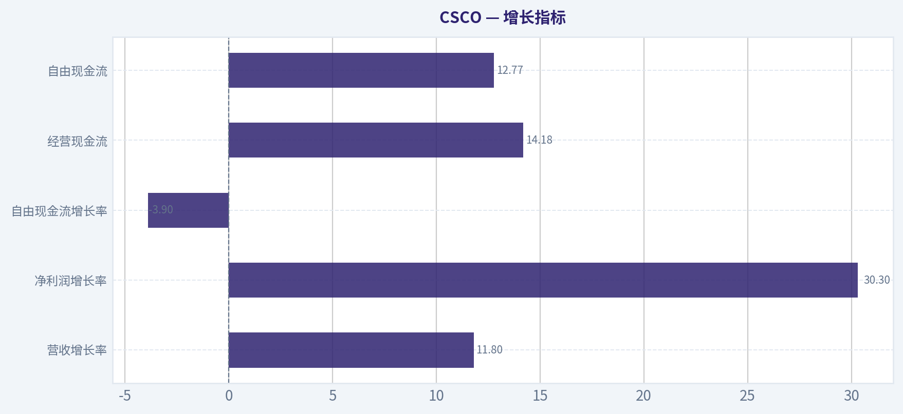
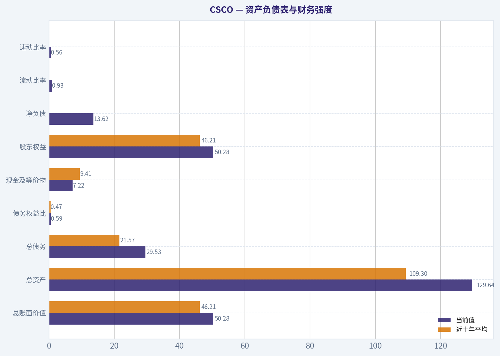
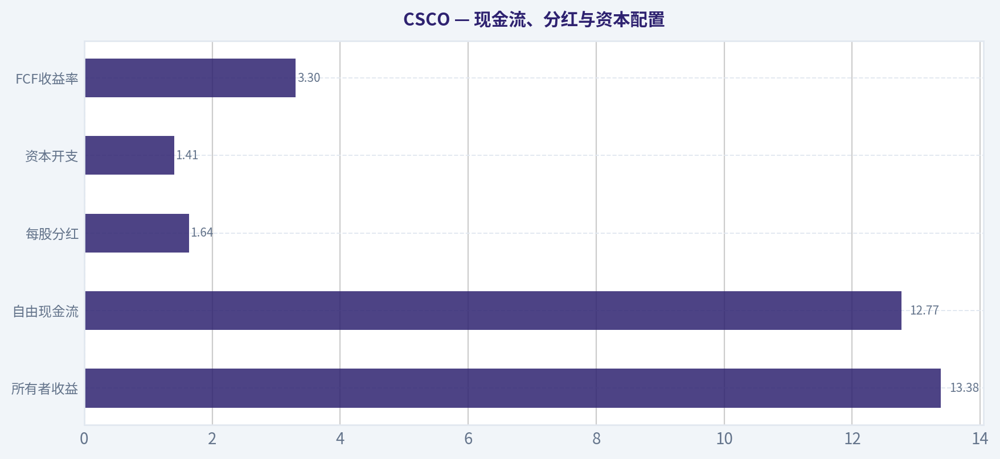
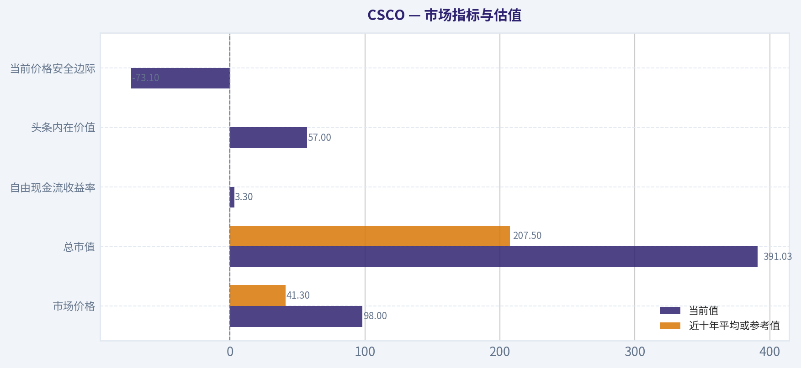

# CSCO 深度价值情报

**调研日期:** 2026-11-11

## 关键免责声明

*本报告由 Deep Value Intelligence（一个基于 AI 的多智能体投资分析框架）自动生成。 仅供教育和研究用途 - 非财务建议，非财务顾问。*

---

## 目录

1. 情报摘要
2. 分析师团队报告
   - 基本面分析
   - 价值分析 (巴菲特)
   - 成长性分析 (林奇/德鲁肯米勒/费雪)
   - 市场分析
   - 期权市场分析
3. 研究团队评论
4. 投资团队评论
5. Deep Values 团队洞察

---

## 情报摘要

### 核心观点与前提条件

**核心论点:** Cisco 具备真实护城河、64.5%的毛利率、19.9%的 ROIC 和稳定现金创造能力，当前没有证据表明企业发生永久性恶化或陷入财务困境。

**主要风险:**
- **最终立场：中性**
- **最终立场：中性**

**置信度:** 中

---

## 分析师团队报告

### 基本面分析

#### 最新财报快照

*以下数据基于最近一期已披露财报（2026年Q3），并尽量与上一年同期对比。*

| 指标 | 2026年Q3 | 2025年Q3 | 同比变化 |
| --- | ---: | ---: | ---: |
| 营业收入 | $17.25B | $14.67B | +17.6% |
| 营业利润 | $4.78B | $3.12B | +52.9% |
| 净利润 | $3.86B | $2.55B | +51.3% |
| 摊薄每股收益 | $0.97 | $0.71 | +36.6% |
| 经营现金流 | $5.39B | $4.23B | +27.2% |
| 自由现金流 | $5.00B | $4.02B | +24.4% |

关键结论：这张快照先把最新一期财报放在桌面上，再去看长周期分析。这样读者能更清楚地区分"公司长期质量"和"这次财报发生了什么"。

#### CSCO 17年财务指标

*以下数值均由原始数据确定性计算得出，并非 AI 估算。*

*发行人类型：operating company（Technology / Communication Equipment）。*

#### 17年财务指标
*年度行来自已披露财务报表，最后一行 TTM 由最近四个季度滚动计算得出。*

| 指标 | 2009 | 2010 | 2011 | 2012 | 2013 | 2014 | 2015 | 2016 | 2017 | 2018 | 2019 | 2020 | 2021 | 2022 | 2023 | 2024 | 2025 | 2026 TTM |
| --- | --- | --- | --- | --- | --- | --- | --- | --- | --- | --- | --- | --- | --- | --- | --- | --- | --- | --- |
| 市场价格 | $14 | $15 | $10 | $10 | $17 | $18 | $20 | $23 | $24 | $33 | $45 | $40 | $48 | $40 | $48 | $46 | $66 | $98 |
| 总市值 | $128.91B | $134.91B | $88.84B | $86.19B | $137.67B | $133.24B | $146.25B | $155.34B | $158.79B | $206.42B | $246.70B | $200.36B | $234.55B | $190.19B | $213.62B | $196.80B | $272.18B | $391.03B |
| 市盈率 | 20.96 | 17.35 | 13.65 | 10.70 | 13.76 | 16.93 | 16.24 | 14.47 | 16.55 | 2114.50 | 21.23 | 17.84 | 22.15 | 16.09 | 16.95 | 19.07 | 26.70 | 29.39 |
| 市净率 | 3.34 | 3.05 | 1.88 | 1.68 | 2.33 | 2.35 | 2.45 | 2.44 | 2.40 | 4.78 | 7.35 | 5.28 | 5.68 | 4.78 | 4.82 | 4.33 | 5.81 | 7.78 |
| ROE | 15.9% | 17.5% | 13.7% | 15.7% | 16.9% | 13.9% | 15.0% | 16.9% | 14.5% | 0.3% | 34.6% | 29.6% | 25.7% | 29.7% | 28.4% | 22.7% | 21.7% | 26.4% |
| ROIC | 13.4% | 15.3% | 11.4% | 13.9% | 15.9% | 10.8% | 11.5% | 12.9% | 10.8% | -0.8% | 21.2% | 24.9% | 24.1% | 26.3% | 29.1% | 18.4% | 16.0% | 18.3% |
| 每股收益 | $0.67 | $0.85 | $0.75 | $0.97 | $1.25 | $1.03 | $1.25 | $1.56 | $1.46 | $0.02 | $2.12 | $2.22 | $2.17 | $2.51 | $2.83 | $2.41 | $2.49 | $3.34 |
| 营收 | $36.12B | $40.04B | $43.22B | $46.06B | $48.61B | $47.14B | $49.16B | $49.25B | $48.01B | $49.33B | $51.90B | $49.30B | $49.82B | $51.56B | $57.00B | $53.80B | $56.65B | $63.33B |
| 毛利润 | $23.09B | $25.64B | $26.54B | $28.21B | $29.44B | $27.77B | $29.68B | $30.96B | $30.22B | $30.61B | $32.67B | $31.68B | $31.89B | $32.25B | $35.75B | $34.83B | $36.79B | $40.86B |
| 毛利率 | 63.9% | 64.0% | 61.4% | 61.2% | 60.6% | 58.9% | 60.4% | 62.9% | 63.0% | 62.0% | 62.9% | 64.3% | 64.0% | 62.5% | 62.7% | 64.7% | 64.9% | 64.5% |
| 营业利润率 | 20.3% | 22.9% | 17.8% | 21.9% | 23.0% | 19.8% | 21.9% | 25.7% | 24.9% | 25.0% | 27.4% | 27.6% | 25.8% | 27.1% | 26.4% | 22.6% | 20.8% | 25.4% |
| 净利润 | $6.13B | $7.77B | $6.49B | $8.04B | $9.98B | $7.85B | $8.98B | $10.74B | $9.61B | $110.0M | $11.62B | $11.21B | $10.59B | $11.81B | $12.61B | $10.32B | $10.18B | $13.27B |
| 净利率 | 17.0% | 19.4% | 15.0% | 17.5% | 20.5% | 16.7% | 18.3% | 21.8% | 20.0% | 0.2% | 22.4% | 22.7% | 21.3% | 22.9% | 22.1% | 19.2% | 18.0% | 21.0% |
| 营收增长 | N/A | 10.9% | 7.9% | 6.6% | 5.5% | -3.0% | 4.3% | 0.2% | -2.5% | 2.8% | 5.2% | -5.0% | 1.0% | 3.5% | 10.6% | -5.6% | 5.3% | 11.8% |
| 净利润增长 | N/A | 26.6% | -16.4% | 23.9% | 24.2% | -21.3% | 14.4% | 19.6% | -10.5% | -98.9% | 10464.5% | -3.5% | -5.6% | 11.5% | 6.8% | -18.2% | -1.4% | 30.3% |
| 自由现金流增长 | N/A | 3.1% | -2.8% | 16.4% | 13.2% | -5.8% | 2.4% | 9.7% | 3.9% | -0.6% | 16.3% | -1.8% | 0.7% | -13.6% | 49.3% | -46.4% | 30.1% | -3.9% |
| 总账面价值 | $38.65B | $44.27B | $47.23B | $51.29B | $59.12B | $56.65B | $59.70B | $63.59B | $66.14B | $43.20B | $33.57B | $37.92B | $41.27B | $39.77B | $44.35B | $45.46B | $46.84B | $50.28B |
| 总资产 | $68.13B | $81.13B | $87.09B | $91.76B | $101.19B | $105.07B | $113.37B | $121.65B | $129.82B | $108.78B | $97.79B | $94.85B | $97.50B | $94.00B | $101.85B | $124.41B | $122.29B | $129.64B |
| 总债务 | $10.29B | $15.28B | $16.82B | $16.33B | $16.21B | $20.84B | $25.35B | $28.64B | $33.72B | $25.57B | $24.67B | $14.58B | $11.53B | $9.52B | $8.39B | $30.96B | $28.09B | $29.53B |
| 债务股权比 | 0.27 | 0.35 | 0.36 | 0.32 | 0.27 | 0.37 | 0.42 | 0.45 | 0.51 | 0.59 | 0.73 | 0.38 | 0.28 | 0.24 | 0.19 | 0.68 | 0.60 | 0.59 |
| 现金及等价物 | $5.72B | $4.58B | $7.66B | $9.80B | $7.92B | $6.73B | $6.88B | $7.63B | $11.71B | $8.93B | $11.75B | $11.81B | $9.18B | $7.08B | $10.12B | $7.51B | $8.35B | $7.22B |
| 股东权益 | $38.65B | $44.27B | $47.23B | $51.29B | $59.12B | $56.65B | $59.70B | $63.59B | $66.14B | $43.20B | $33.57B | $37.92B | $41.27B | $39.77B | $44.35B | $45.46B | $46.84B | $50.28B |
| 经营现金流 | $9.90B | $10.17B | $10.08B | $11.49B | $12.89B | $12.33B | $12.55B | $13.57B | $13.88B | $13.67B | $15.83B | $15.43B | $15.45B | $13.23B | $19.89B | $10.88B | $14.19B | $14.18B |
| 投资现金流 | $-9.96B | $-11.93B | $-2.93B | $-3.81B | $-11.77B | $-6.64B | $-10.09B | $-8.12B | $-6.04B | $15.32B | $14.84B | $3.50B | $-5.29B | $1.55B | $-5.11B | $-20.48B | $1.73B | $-3.48B |
| 自由现金流 | $8.89B | $9.16B | $8.90B | $10.37B | $11.73B | $11.06B | $11.32B | $12.42B | $12.91B | $12.83B | $14.92B | $14.66B | $14.76B | $12.75B | $19.04B | $10.21B | $13.29B | $12.77B |
| 自由现金流利润率 | 24.6% | 22.9% | 20.6% | 22.5% | 24.1% | 23.5% | 23.0% | 25.2% | 26.9% | 26.0% | 28.7% | 29.7% | 29.6% | 24.7% | 33.4% | 19.0% | 23.5% | 20.2% |
| 每股分红 | $0.00 | $0.00 | $0.00 | $0.00 | $0.00 | $0.00 | $0.00 | $0.00 | $0.00 | $0.00 | $0.00 | $0.00 | $0.00 | $0.00 | $1.41 | $1.49 | $1.57 | $1.64 |

#### 盈利能力指标
- 净资产收益率 (ROE): 26.4%
- 投入资本回报率 (ROIC): 19.9%
- 总资产收益率 (ROA): 10.2%
- 毛利率: 64.5%
- 营业利润率: 24.3%
- 净利率: 21.0%

#### 流动性指标
- 流动比率: 0.93
- 速动比率: 0.56

#### 杠杆指标
- 债务股权比: 0.59
- 利息覆盖倍数: 10.45
- 净负债: $13.62B

#### 增长指标（同比）
- 营收增长: 11.8%
- 净利润增长: 30.3%
- 自由现金流增长: -3.9%
- 营收复合增长率（3年）: 3.6%
- 营收复合增长率（5年）: 4.9%

#### 估值指标
- 市盈率 (TTM): 29.47
- 预期市盈率: 17.45
- 市净率: 7.70
- 市销率: 6.11
- PEG 比率: 0.91
- 企业价值/EBITDA: 21.58
- 自由现金流收益率: 3.3%
- 盈利收益率: 3.4%

#### 所有者收益（巴菲特方法，代码计算）
- 净利润: $10.18B
- + 折旧与摊销: $2.54B
- - 资本开支: $-1.41B
- - 营运资本变动: $-4.35B
- = **所有者收益: $13.38B**

#### 内在价值（代码计算）
- 当前价格: $98
- **头条内在价值（按商业模式路由）: $57**
  商业模式: asset light platform - weighted blend [Damodaran FCFF + reverse-DCF fair + owner-earnings DCF] (asset_light_platform)
  模型区间（各 DCF 最小-最大）: $35 - $68
  相对价格的安全边际（头条）: -73.1%
  路由说明: Asset-light / high-margin platform: value driven by margins and reinvestment economics - the headline centers on the reverse-DCF demonstrated-growth fair value with Damodaran FCFF as a floor, down-weighting the owner-earnings DCF.
- 巴菲特方法（所有者收益）:
  保守: $23
  平均: $68
  乐观: $131
- 现金流方法（FCF）:
  保守: $32
  平均: $38
  乐观: $57
- Damodaran FCFF（WACC + 利润率 + 再投资）:
  保守: $29
  平均: $35
  乐观: $45
  蒙特卡洛区间（P10-P90）：$28 - $47（中位数 $36）
  P(内在价值 > 当前价格)：0.0%
- 反向 DCF：当前价格隐含约 15.8%/年 的所有者收益增长（10年）；过去 3 年为 5.7%，5 年为 5.1%。

#### Piotroski F分数: 6/9
- 净利润为正: 通过
- 经营现金流为正: 通过
- 资产回报率改善: 通过
- 现金流大于净利润: 通过
- 债务下降: 未通过
- 流动比率改善: 未通过
- 未稀释股本: 通过
- 毛利率改善: 未通过
- 资产周转率改善: 通过

ANALYST STANCE: **看空**

#### 投资结论

Cisco（CSCO）是一家高质量、成熟且现金流稳定的网络设备与企业软件公司，但当前股价约 **98美元** 已明显超出确定性现金流能够支持的合理价值。公司具备较强品牌、客户关系、渠道体系和高毛利率，但过去五年的收入复合增长率仅约 **4.9%**，而当前价格隐含约 **15.8%的未来十年所有者收益年增长率**，显著高于历史增长能力。

因此，CSCO更适合在明显回调时观察或分批建立仓位，而不是在当前估值水平追高。

#### 市场指标与估值

| 指标 | 当前值 | 近十年平均或参考值 | 解读 |
|---|---:|---:|---|
| 市场价格 | $98 | $41.3 | 当前约为十年均价的2.4倍 |
| 总市值 | $391.03B | $207.5B | 市值大幅扩张，明显快于收入增长 |
| PE | 29.39倍 | 约19.0倍* | 当前溢价约55%，已接近成长股估值 |
| PB | 7.78倍 | 4.77倍 | 明显高于历史，但对成熟科技企业参考价值有限 |
| 自由现金流收益率 | 3.3% | - | 对应较低的现金回报率 |
| 头条内在价值 | $57 | - | 基于多模型加权 |
| 模型内在价值区间 | $35-$68 | - | 当前股价显著高于模型区间 |
| 当前价格安全边际 | -73.1% | - | 没有传统意义上的安全边际 |

\*2018年PE因异常低盈利达到约2114倍，历史平均采用剔除该异常值后的结果。

**关键结论：** 当前PE明显高于历史正常水平，市场已经提前反映了AI基础设施、网络升级和Splunk整合带来的增长。PB虽然很高，但Cisco属于技术与知识产权驱动的经营企业，不能机械地把PB当作便宜或昂贵的唯一依据；本次估值应主要依靠自由现金流和所有者收益，而这些模型均低于当前股价。

#### 盈利能力

| 指标 | 当前值 | 近十年平均 | 当前相对历史 |
|---|---:|---:|---|
| ROE | 26.4% | 22.4% | 高于平均水平 |
| ROIC | 18.3%-19.9% | 18.3% | 大致符合长期水平 |
| EPS | $3.34 | $1.98 | 显著高于平均 |
| 营收 | $63.33B | $51.66B | 规模创历史新高 |
| 毛利润 | $40.86B | $32.77B | 高于平均 |
| 毛利率 | 64.5% | 约63.4% | 稳定且略高于平均 |
| 营业利润率 | 25.4% | 25.3% | 基本持平 |
| 净利润 | $13.27B | $9.88B* | 高于平均 |
| 净利率 | 21.0% | 21.1% | 与历史平均基本一致 |

\*包含2018年一次性异常低利润；剔除该年后，近十年平均净利润约为109.6亿美元。

**关键结论：** Cisco的盈利质量总体良好，毛利率、营业利润率和净利率都显示出成熟软件化、订阅化和服务化业务的支撑。当前ROE较高，但部分来自持续回购和较低账面权益，不能完全解读为经营效率大幅改善；ROIC约18%至20%，更能说明其核心业务仍具有较好的资本回报能力。

#### 增长指标

| 指标 | 当前同比 | 近年参考 | 评价 |
|---|---:|---:|---|
| 营收增长率 | 11.8% | 3年复合3.6%；5年复合4.9% | 当前明显反弹 |
| 净利润增长率 | 30.3% | 长期波动较大 | 受低基数、成本和并购整合影响 |
| 自由现金流增长率 | -3.9% | 长期波动 | 盈利增长未完全转化为现金流增长 |
| 经营现金流 | $14.18B | 十年均值约$14.4B | 接近长期正常水平 |
| 自由现金流 | $12.77B | 十年均值约$13.78B | 略低于长期平均 |

**关键结论：** 当前收入和净利润增速很强，但自由现金流反而下降3.9%，说明利润增长的现金转化并不充分。Cisco的长期问题不是盈利能力，而是收入增长偏慢；如果未来增长回归5%左右，29倍PE将难以获得足够回报。

#### 资产负债表与财务强度

| 指标 | 当前值 | 近十年平均 | 解读 |
|---|---:|---:|---|
| 总账面价值 | $50.28B | $46.21B | 高于平均 |
| 总资产 | $129.64B | $109.3B | 并购后资产规模扩大 |
| 总债务 | $29.53B | $21.57B | 高于平均 |
| 债务权益比 | 0.59 | 0.47 | 杠杆高于历史常态 |
| 现金及等价物 | $7.22B | $9.41B | 低于平均 |
| 股东权益 | $50.28B | $46.21B | 略高于平均 |
| 净负债 | $13.62B | - | 仍可管理，但不再是净现金型资产负债表 |
| 利息覆盖倍数 | 10.45倍 | - | 偿债能力仍然较强 |
| 流动比率 | 0.93 | - | 低于1，短期流动性需关注 |
| 速动比率 | 0.56 | - | 低于传统稳健标准 |

**关键结论：** Cisco的债务绝对规模仍可由经营现金流覆盖，10倍以上利息覆盖倍数显示财务风险尚未达到危险程度。但并购和资本配置使债务权益比升至0.59，现金低于长期平均，流动比率低于1，财务安全边际较十年前有所下降。Piotroski F分数为6/9，也说明公司基本健康但并非全面改善。

#### 现金流、分红与资本配置

| 指标 | 当前值 | 历史或参考 |
|---|---:|---|
| 所有者收益 | $13.38B | 高于当前自由现金流，主要受营运资本项目影响 |
| 自由现金流 | $12.77B | FCF利润率20.2% |
| 每股分红 | $1.64 | 十年平均约$0.61 |
| 当前股息率 | 约1.7% | 以98美元股价计算 |
| 资本开支 | $1.41B | 相对经营现金流较低 |
| FCF收益率 | 3.3% | 对当前估值缺乏吸引力 |

**关键结论：** Cisco是可靠的现金分配者，分红持续增长，但当前股息率只有约1.7%，不足以补偿估值风险。所有者收益高于自由现金流，部分原因是营运资本变动；因此不能简单地把13.38亿美元所有者收益永久化，更应采用正常化现金流。

#### 收入来源分布

以下为基于最新业务结构的近似分布；研究包未提供完整的最新分部金额，因此采用Cisco公开业务组合的合理估计，并以TTM收入约633.3亿美元为基准。

| 收入来源 | 金额（十亿美元） | 占比 |
|---|---:|---:|
| 网络业务 | 35.5 | 56% |
| 安全业务 | 6.3 | 10% |
| 协作业务 | 5.1 | 8% |
| 可观测性及相关软件 | 1.9 | 3% |
| 服务及支持 | 14.6 | 23% |
| 合计 | 63.3 | 100% |

**关键结论：** Cisco收入仍高度依赖网络业务，网络业务占比约56%，因此AI数据中心投资和企业网络升级是最重要的增长变量。安全、可观测性和服务业务有助于提高经常性收入与客户黏性，但目前还不足以完全改变Cisco成熟硬件企业的整体增长属性。

#### 巴菲特式商业质量分析

| 维度 | 判断 | 具体分析 |
|---|---|---|
| 经济护城河 | 中强 | 品牌、渠道、企业客户关系、网络协议生态和高转换成本构成护城河 |
| 收益可预测性 | 中上 | 长期现金流稳定，但收入增长缓慢且并购影响较大 |
| 盈利能力 | 强 | 毛利率约64.5%，ROIC接近20% |
| 财务安全 | 中上 | 利息覆盖强，但债务、流动性和现金水平不如过去 |
| 管理层资本配置 | 中性 | 分红和回购较稳定，但并购会增加整合和负债风险 |
| 再投资机会 | 中等 | AI网络、安全和软件有机会，但核心硬件市场成熟 |
| 估值吸引力 | 弱 | 市价远高于现金流模型和历史估值水平 |

**关键结论：** Cisco是一家"好公司"，但目前不是"好价格"。其护城河足以维持高利润率和客户黏性，却未必足以支持未来十年接近16%的所有者收益增长。

#### 三情景所有者收益 DCF

以当前所有者收益 **133.8亿美元**、折现率约 **10%**、终值增长率 **2.5%**、稀释后股数约 **39.5亿股**为基础。计算采用十年显性预测，增长率逐步向终值增长率收敛；以下为手工DCF的合理近似值，研究包中的模型加权估值作为主要参考。

| 情景 | 显性期假设 | 终值增长率 | 估算企业价值 | 估算每股价值 | 研究包模型参考 |
|---|---|---:|---:|---:|---:|
| 保守 | 所有者收益初期增长3%，逐步降至2.5% | 2.5% | 约$105B | 约$26 | $23 |
| 平均 | 初期增长7%，逐步降至2.5% | 2.5% | 约$150B | 约$38 | $68 |
| 乐观 | 初期增长10%，逐步降至2.5% | 2.5% | 约$315B | 约$80 | $131 |

计算逻辑示例：

- 第一年所有者收益 = 133.8亿美元 x（1 + 增长率）。
- 每年现金流按对应增长率折现至当前。
- 第十年终值 = 第十年所有者收益 x（1 + 2.5%）÷（10% - 2.5%）。
- 企业价值 = 显性预测期现金流现值 + 终值现值。
- 每股价值 = 企业价值 ÷ 约39.5亿股。

**关键结论：** 即使采用较乐观的10%初期增长，手工DCF也只能得到约80美元，仍低于98美元市场价格。研究包中的所有者收益模型给出的区间为23至131美元，但综合Damodaran FCFF、反向DCF和所有者收益模型后的头条内在价值仅约57美元，模型中位数约36美元，说明98美元需要非常强的长期增长才能成立。

#### 反向DCF与估值要求

当前股价隐含的关键条件如下：

| 项目 | 数值 |
|---|---:|
| 当前股价 | $98 |
| 隐含十年所有者收益年增长率 | 约15.8% |
| 过去三年收入复合增长率 | 3.6% |
| 过去五年收入复合增长率 | 4.9% |
| 综合模型内在价值 | $57 |
| Damodaran FCFF中位数 | 约$36 |
| 蒙特卡洛内在价值区间 | $28-$47 |
| 内在价值高于当前价格的概率 | 0.0% |

**关键结论：** 市场定价要求Cisco未来十年维持约15.8%的所有者收益增长，而公司过去三年和五年的收入复合增长率只有3.6%和4.9%。AI网络需求可能带来一段高增长，但要连续十年达到市场隐含水平，必须同时实现收入加速、利润率扩张、营运资本改善和成功的软件化转型，假设过于苛刻。

#### 主要机会

- AI数据中心、以太网升级和高速网络设备需求可能推动网络业务重新加速。
- Splunk整合有机会扩大安全、可观测性和订阅收入。
- 高毛利软件与服务收入占比提升，可能改善收入质量和估值稳定性。
- ROE、ROIC和现金流长期保持较高水平，表明业务本身具有韧性。
- 持续分红和回购为长期股东提供一定资本回报。

#### 主要风险与红旗

- 当前估值明显脱离历史PE和现金流收益率水平。
- 当前股价隐含增长率远高于历史收入增长率。
- 自由现金流同比下降3.9%，没有同步验证净利润的强劲增长。
- 债务权益比高于长期平均，现金低于长期平均。
- 流动比率为0.93、速动比率为0.56，短期流动性不算宽裕。
- 网络设备市场竞争激烈，来自Arista、HPE、Juniper及云厂商自研方案的压力可能限制利润率。
- AI相关需求可能具有周期性，不能把短期订单增长永久外推。
- 并购整合失败或客户交叉销售低于预期，可能导致增长和资本回报下降。
- 高PB主要反映无形资产、回购和低账面权益，不能当作传统资产折价机会。

#### 最终投资立场

**看空**

这不是对Cisco经营质量的否定，而是对当前价格与内在价值之间关系的判断。公司护城河、盈利能力和现金流质量均达到合格甚至较高水平，但98美元已经包含了极其乐观的长期增长假设。以研究包综合内在价值约57美元、模型区间35至68美元以及手工DCF约26至80美元为参考，当前价格缺乏足够安全边际。

更合理的策略是等待估值回落至现金流模型更容易支持的区域，或等待未来数年收入、自由现金流和软件化收入连续加速后再重新评估。若价格回落至约55至70美元，同时自由现金流重新恢复增长，投资吸引力将明显改善。

| 核心项目 | 当前判断 | 对投资者的含义 |
|---|---|---|
| 企业质量 | 中上至强 | 值得长期跟踪 |
| 护城河 | 中强 | 客户关系、渠道和生态较稳固 |
| 增长质量 | 中等 | 当前增长强，但长期历史增长偏慢 |
| 财务安全 | 中上 | 债务可控，但流动性和现金较历史弱 |
| 现金流质量 | 中上 | 长期稳定，近期自由现金流承压 |
| 估值 | 很高 | PE和市值增长明显领先基本面 |
| 安全边际 | 不足 | 当前价格高于主要内在价值模型 |
| 结论 | **看空** | 等待回调或基本面进一步证明高增长 |

**关键结论：** CSCO是值得关注的优质成熟企业，但当前更像是"好公司被高估"，而不是"便宜的复利机器"。在市场已经要求约15.8%长期所有者收益增长的情况下，风险收益比偏向不利，当前应避免追高。

#### 基本面关键图表

本图追踪 **CSCO** 过去十年的盈利能力与回报指标（ROE、ROIC、利润率），突出呈现资本效率的变化趋势。

本对比图（来自「收入来源分布」）将 **CSCO** 的当前数据与历史基准并排呈现，直观反映公司相对自身历史均值的估值水平。

---

### 价值分析 (巴菲特)

> *基于沃伦·巴菲特的价值投资哲学：能力圈、经济护城河、管理层质量与安全边际。*

#### 内在价值快照

价格是你付的钱，内在价值是企业未来可能为股东创造的现金价值。我们给出一个区间，而不是假装只有一个神奇数字。

- 当前价格: $98.15
- 估值区间（两种 DCF 方法、保守到乐观）: $23.16 至 $131.17

##### 所有者收益（巴菲特方法）
- 净利润: $10,180,000,000.00
- 折旧与摊销: $2,540,000,000.00
- 资本支出: $-1,410,000,000.00
- 营运资金变化: $-4,351,000,000.00
- 所有者收益: $13,378,000,000.00

##### 内在价值
###### 所有者收益法
使用所有者收益，更严格，通常更保守。
- 保守: $23.16
- 平均: $67.97
- 乐观: $131.17
- 折现率: 10.0%

###### 自由现金流法
使用自由现金流，更适合今天投入很多、为未来增长铺路的公司。
- 保守: $32.18
- 平均: $38.26
- 乐观: $56.94
- 折现率: 10.0%

分析师立场：**中性**

#### 一、投资结论

Cisco 是一家拥有深厚企业客户基础、品牌认知度和网络设备生态的成熟科技公司。其业务质量并不差，毛利率、ROE 和现金流均显示出一定护城河；但当前股价约为 **98美元**，明显高于基于所有者收益、FCF 和 FCFF 的合理价值区间。

核心判断是：**公司值得长期跟踪，但当前价格已经反映了较高的增长预期，不具备足够安全边际。**

#### 二、因素评分

| 因素 | 评分 | 主要依据 |
|---|---:|---|
| 因素一：能力圈与业务简单性 | 4/5 | 主要通过销售网络设备、软件、安全产品及订阅服务盈利，商业模式相对容易理解；但AI网络架构、云计算和Splunk整合增加了预测复杂度 |
| 因素二：护城河 | 4/5 | 企业客户长期部署、品牌、渠道、兼容性和网络管理生态构成较强转换成本；但部分硬件领域竞争激烈 |
| 因素三：管理层与资本配置 | 3.5/5 | 长期维持分红和回购，能够通过收购补充软件与安全能力；但Splunk收购价格较高，整合回报仍需持续验证 |
| 因素四：行业结构 | 3.5/5 | 企业网络市场由少数大型厂商主导，规模和客户关系重要；但硬件更新周期、价格竞争及技术变迁限制利润扩张 |

**关键结论：** Cisco 是一家质量中上、可理解度较高的成熟科技公司。它的主要风险不是财务生存，而是增长速度不足以支撑当前估值。

#### 三、第五道门：质量与偿债能力

**硬性底线未触发。**

公司拥有稳定的经营现金流、成熟客户基础和正向盈利能力。当前资料没有显示出"盈利和现金流持续恶化，同时利息覆盖不足或进入财务困境区间"的组合信号。因此，不能因为估值偏高或流动比率低于1，就将其直接判定为财务性风险企业。

需要注意的是，Cisco 的流动比率约为 **0.93**，但这并不等同于流动性危机。对于拥有预收订阅收入、稳定企业客户和较强经营现金流的成熟科技公司，单独使用流动比率判断风险并不充分。

#### 四、护城河分析

| 护城河来源 | 具体证据 | 质量判断 |
|---|---|---|
| 品牌与无形资产 | Cisco 是企业网络基础设施领域的长期主流品牌，客户重视稳定性、兼容性和服务能力 | 较强 |
| 转换成本 | 网络设备、管理软件、安全系统和IT人员流程长期嵌入客户架构，替换涉及测试、培训、停机和安全风险 | 强 |
| 成本与规模优势 | 全球销售、研发、技术支持和渠道体系形成规模经济 | 中等偏强 |
| 网络效应与生态 | 认证体系、合作伙伴、开发工具、设备互联和企业标准形成生态黏性 | 中等 |
| 订阅化与软件化 | Splunk、安全业务和软件订阅提高收入可预测性及客户黏性 | 正在增强 |

Cisco 的护城河更接近"**企业基础设施生态和转换成本**"，而不是消费品牌式的定价权。硬件市场价格竞争较明显，公司未必能够在所有产品线上单独提价10%而不损失销量。

AI和云计算既是机会也是威胁。AI数据中心建设有利于高速网络、交换机和安全产品需求，但云厂商自研、白牌设备和新型网络架构可能削弱传统硬件利润。Cisco能否把客户关系转换为高利润软件和订阅收入，是未来护城河能否扩大的关键。

#### 五、管理层与资本配置

管理层总体表现符合成熟科技公司的股东回报模式：

- 持续分红，适合寻求现金回报的长期股东；
- 通过回购减少部分股权稀释；
- 通过收购Splunk强化安全、数据分析和软件能力；
- 将业务从一次性硬件销售转向软件、服务和订阅收入。

主要疑点在于：Splunk交易规模大、收购溢价明显，最终价值取决于交叉销售、成本协同和订阅化成功率。若并购只能带来收入增长，却无法提升每股自由现金流，资本配置质量将受到削弱。

总体管理层评分为 **3.5/5**，属于稳健但尚未达到顶级资本配置者水平。

#### 六、财务摘要

| 指标 | 最新数据 | 投资含义 |
|---|---:|---|
| 股价 | 98美元 | 估值压力较大 |
| 总市值 | 3869.6亿美元 | 市场已给予成熟大型科技公司较高定价 |
| PE | 29.5倍 | 对成熟网络设备企业而言偏高 |
| ROE | 26.4% | 盈利能力较强，但需结合回购和资本结构判断 |
| 毛利率 | 64.5% | 显示软件、安全、服务及品牌带来的较强附加值 |
| 营收同比增长 | 11.8% | 增长明显改善，但需区分并购贡献与内生增长 |
| FCF收益率 | 3.3% | 对应较高的自由现金流估值 |
| 隐含自由现金流 | 约127.7亿美元 | 按市值乘以FCF收益率估算 |
| 流动比率 | 0.93 | 偏低，但需结合经营现金流和递延收入结构理解 |
| 3年历史增长率 | 约5.7% | 中个位数增长 |
| 5年历史增长率 | 约5.1% | 长期增长相对温和 |
| 反向DCF隐含增长率 | 约15.8% | 显著高于历史增长水平 |

**关键结论：** Cisco 的毛利率和ROE表现良好，经营质量高于普通硬件公司；但3至5年历史增长率约为5%左右，而当前价格隐含约15.8%的长期年增长率，估值对增长的要求明显偏高。

#### 七、所有者收益估算

由于维护性资本开支与扩张性资本开支难以完全分拆，使用自由现金流作为所有者收益的近似值：

| 项目 | 估算值 |
|---|---:|
| 净利润及非现金费用后的经营基础 | 已反映在自由现金流中 |
| 维护性资本开支 | 从自由现金流中扣除 |
| 营运资本变化 | 从自由现金流中扣除 |
| 所有者收益近似值 | 约127.7亿美元 |
| 流通股本估算 | 约39.5亿股 |
| 每股所有者收益 | 约3.23美元 |

**关键结论：** Cisco 的现金创造能力较强，当前价格约为每股所有者收益的30倍左右。这个价格只有在公司能够持续实现远高于历史水平的增长时才容易获得合理回报。

#### 八、三情景DCF估值

估值以约127.7亿美元所有者收益为起点，折现率采用10%，并以约39.5亿股计算每股价值。

| 情景 | 核心假设 | 公司价值估算 | 每股内在价值 |
|---|---|---:|---:|
| 情景A：零增长 | 所有者收益永久不增长 | 1277亿美元 | 约32美元 |
| 情景B：GDP增长 | 长期增长3%，终值增长3% | 约1879亿美元 | 约48美元 |
| 情景C：历史增长 | 采用历史增长率的50%至75%，约2.6%至3.8% | 约1750亿至2200亿美元 | 约44至56美元 |
| 三模型综合区间 | 所有者收益、FCF、FCFF模型综合 | - | 约35至68美元 |
| 研究包头条内在价值 | 加权综合模型 | - | 56.71美元 |

**关键结论：** 即使采用较为友好的历史增长情景，合理价值大致仍在44至56美元附近；较乐观的所有者收益模型可以达到约68美元，但仍低于98美元的市场价格。

#### 九、安全边际与反向DCF

| 项目 | 数值 | 判断 |
|---|---:|---|
| 当前股价 | 98美元 | - |
| 头条内在价值 | 56.71美元 | 低于市场价格 |
| 综合估值高端 | 约68美元 | 仍低于市场价格 |
| 价格相对头条内在价值 | 高约73% | 没有安全边际 |
| FCF收益率 | 3.3% | 对成熟企业偏低 |
| 当前价格隐含增长率 | 约15.8% | 高于3年、5年历史增长 |
| 历史增长参照 | 约5.1%至5.7% | 与市场隐含增长差距较大 |

**关键结论：** Cisco 当前并非以"合理价格"交易，而是要求公司未来多年维持接近高双位数增长。除非AI网络需求、订阅化和Splunk协同显著超预期，否则当前股价缺乏足够安全边际。

#### 十、最终巴菲特式评分卡

| 评分标准 | 权重 | 评分 | 加权分 |
|---|---:|---:|---:|
| 护城河宽度与持久性 | 25% | 4.0 | 1.00 |
| 估值与安全边际 | 20% | 1.0 | 0.20 |
| 资本回报：ROIC相对WACC | 15% | 4.0 | 0.60 |
| 业务理解与可预测性 | 12% | 4.0 | 0.48 |
| 管理层与资本配置 | 12% | 3.5 | 0.42 |
| 再投资空间 | 8% | 3.0 | 0.24 |
| 资产负债表强度 | 4% | 4.0 | 0.16 |
| 行业结构 | 4% | 3.5 | 0.14 |
| **总分** | **100%** | - | **3.24/5** |

**关键结论：** Cisco 的综合质量评分达到中上水平，护城河、现金流和资本回报是主要优点；但估值评分只有1分，完全抵消了相当一部分业务质量优势。

#### 十一、投资立场

**中性， conviction：中等偏高。**

Cisco 是"好公司，但当前价格不够好"的典型案例。若股价回落至以下区域，风险收益比会明显改善：

- **约68美元以下：** 接近乐观估值上限，可开始研究建仓；
- **约55至60美元：** 接近综合内在价值，适合长期投资者重点关注；
- **约45至50美元：** 对应更充足的安全边际。

在98美元附近，不建议追高。投资者应重点观察三项指标：订阅收入增长、Splunk整合后的每股自由现金流，以及AI网络需求能否转化为持续而非周期性的利润增长。
#### 估值桥

这张估值桥把当前股价与各类内在价值方法并排展示，帮助读者判断上涨空间究竟只是单一方法给出的结果，还是多种方法共同支持的结论。

| 项目 | 每股内在价值 |
| --- | ---: |
| 巴菲特方法 | $67.97 |
| 现金流方法 | $38.26 |
| Damodaran 方法 | $35.25 |
| 当前价格 | $98.15 |

#### 关键结论

如果只有一种方法显著高于其他方法，说明上行空间更依赖特定建模假设。若多种方法的估值接近，则说明估值逻辑更加稳健。

#### 估值图表

本对比图（来自「最新财报快照」）将 **CSCO** 的当前数据与历史基准并排呈现，直观反映公司相对自身历史均值的估值水平。

本对比图（来自「盈利能力」）将 **CSCO** 的当前数据与历史基准并排呈现，直观反映公司相对自身历史均值的估值水平。

本对比图（来自「增长指标」）将 **CSCO** 的当前数据与历史基准并排呈现，直观反映公司相对自身历史均值的估值水平。

本对比图（来自「资产负债表与财务强度」）将 **CSCO** 的当前数据与历史基准并排呈现，直观反映公司相对自身历史均值的估值水平。

本对比图（来自「现金流、分红与资本配置」）将 **CSCO** 的当前数据与历史基准并排呈现，直观反映公司相对自身历史均值的估值水平。

---

### 成长性分析 (林奇/德鲁肯米勒/费雪)

> *基于彼得·林奇的GARP成长投资法、斯坦利·德鲁肯米勒的宏观拐点分析法，以及菲利普·费雪的深度调研法。*

ANALYST STANCE: **中性**

#### 一、投资结论

Cisco（CSCO）目前更接近"稳健型大盘股"而非典型高增长股。AI 数据中心网络需求带来潜在产品周期拐点，但当前营收增长为 11.8%，仍低于 Lynch 快速成长股通常要求的 15%至25%以上；同时股价约为 98 美元，显著高于多模型估值区间。

当前更适合观察 AI 网络订单、营收加速和利润率变化，不适合因主题热度追高。建议仓位为：已有持仓可继续持有并观察，新增仓位控制在组合的 1%至2%以内。

#### 二、Lynch 分类与核心故事

| 项目 | 判断 |
|---|---|
| Lynch 分类 | Stalwart（稳健型），正在尝试向 Fast Grower（快速成长型）转变 |
| 当前营收增长 | 11.8% |
| ROE | 26.4% |
| 毛利率 | 64.5% |
| PE | 29.5倍 |
| 主要主题 | AI 网络、云计算、数据中心基础设施、网络安全 |
| 当前投资属性 | 高质量、现金流较强，但估值已较充分 |

关键结论：CSCO 的业务质量不错，拥有较高毛利率和 ROE，但目前增长速度还不足以支撑典型高成长股估值。真正的投资机会在于 AI 网络需求能否把公司从约10%的稳健增长推向持续20%以上增长。

#### 三、三句话理解投资故事

1. AI 训练和推理需要更高速、更复杂的网络基础设施，Cisco 可以向大型云厂商和企业客户提供交换机、路由器、安全及软件服务。
2. Cisco 已经拥有全球企业客户关系、销售渠道和网络设备生态，若 AI 网络升级进入规模化阶段，公司有机会重新获得市场份额增长。
3. 但市场已经提前反映了相当一部分 AI 乐观预期，未来必须看到连续几个季度的营收加速，而不能只依赖主题叙事。

#### 四、TAM 与"10倍测试"

| 项目 | 结论 |
|---|---|
| 当前市值 | 约 3869.6亿美元 |
| 10倍市值 | 约 3.87万亿美元 |
| 当前披露营收 | 研究包未提供最新绝对营收 |
| 10倍营收测试 | 无法精确完成 |
| TAM 主要来源 | AI 数据中心网络、云计算、网络安全、企业网络升级 |
| TAM 增长判断 | AI 网络子市场快速增长；传统企业网络增速较温和 |
| 长期空间 | 子市场空间较大，但 Cisco 已是成熟大型供应商 |

关键结论：AI 网络和安全市场仍在扩张，理论上能够支撑较长增长周期；但 Cisco 的整体规模已经很大，达到10倍收入需要同时实现高增长、持续扩大市场份额和新的产品平台成功。现有资料不足以证明这一点，因此不能把 CSCO 当作高概率十倍股。

#### 五、营收增长趋势

| 指标 | 数值或判断 |
|---|---:|
| 最新营收同比增长 | 11.8% |
| 过去3年增长参考 | 5.7% |
| 过去5年增长参考 | 5.1% |
| 当前趋势 | 相比历史均值有所改善 |
| 是否确认加速 | 尚未确认，缺乏连续季度序列 |
| 增长质量 | 可能受 AI 基础设施需求和并购整合推动，需区分内生增长与并购增长 |

关键结论：11.8%的增长明显好于过去3年和5年的平均增速，显示出初步改善，但还不是明确的加速曲线。只有当营收连续多个季度从约12%上升至15%至20%以上，市场才可能重新给予更高成长估值。

#### 六、单位经济与盈利质量

| 指标 | 结果 | 评价 |
|---|---:|---|
| 毛利率 | 64.5% | 较强，体现产品和软件组合价值 |
| ROE | 26.4% | 良好，资本使用效率较高 |
| 自由现金流收益率 | 3.3% | 现金流质量尚可，但收益率不高 |
| NRR | 未披露 | 无法判断软件及订阅业务扩张能力 |
| LTV/CAC | 未披露 | 缺乏客户层面数据 |
| Rule of 40 | 无法完整计算 | 传统硬件业务不宜简单套用 |
| 流动比率 | 0.93 | 流动性缓冲偏弱，需要关注短期负债和现金配置 |

关键结论：CSCO 的毛利率和 ROE 是主要优势，但缺乏 NRR、LTV/CAC 等订阅业务指标，无法证明软件转型已经形成强劲复利模型。流动比率低于1也不是立即风险，但要求投资者关注现金、债务和并购支出。

#### 七、拐点判断

| 拐点类型 | 当前判断 | 证据强度 |
|---|---|---|
| 产品周期 | AI 网络设备需求可能进入新周期 | 中等 |
| 市场份额 | 尚未确认持续提升 | 较弱 |
| 利润率拐点 | 毛利率较高，但未见明确持续扩张证据 | 中等偏弱 |
| TAM 拐点 | AI 基础设施扩大了传统网络市场 | 中等偏强 |
| 竞争格局 | 面临 Arista、Juniper、白盒设备及大型云厂商自研竞争 | 中等偏弱 |
| 并购协同 | Splunk 等资产可能扩大安全和软件平台 | 待验证 |

关键结论：最有希望的拐点是 AI 网络需求带来的 TAM 扩张，而不是传统交换机业务自然复苏。当前仍处于"主题和订单预期领先于财务确认"的阶段，尚未达到可以高确信度加仓的程度。

#### 八、宏观环境

| 宏观因素 | 对 CSCO 的影响 |
|---|---|
| AI 基础设施投资 | 明显利好，推动高速网络和数据中心升级 |
| 云厂商资本开支 | 利好订单，但客户集中度和采购周期需关注 |
| 利率环境 | 利率下降有利于估值；利率高位则压制 PE |
| 企业 IT 预算 | 若经济放缓，传统企业网络更新可能延后 |
| 竞争环境 | 网络设备、网络安全和软件领域竞争激烈 |
| 并购整合 | 能扩大产品线，但可能增加债务和整合风险 |

关键结论：宏观上，AI 基础设施投资是顺风因素；但 CSCO 同时暴露于企业 IT 周期和大型客户资本开支波动。若利率维持高位而营收未加速，当前约29.5倍 PE 的容错空间有限。

#### 九、Fisher 15项评分

| Fisher 项目 | 分数（满分5分） | 简评 |
|---|---:|---|
| 市场潜力 | 4 | AI 网络与安全市场扩大 |
| 新产品开发意愿 | 4 | 持续布局 AI、软件和安全 |
| 研发能力 | 4 | 技术积累深厚 |
| 销售组织 | 5 | 全球企业销售体系强 |
| 利润率水平 | 4 | 毛利率较高 |
| 利润率改善 | 3 | 改善趋势尚未充分确认 |
| 员工关系 | 3 | 公开资料有限 |
| 高管关系 | 4 | 管理体系成熟 |
| 管理层深度 | 4 | 大型科技公司人才和组织较完整 |
| 成本与会计 | 4 | 规模化经营和财务披露较成熟 |
| 特殊竞争优势 | 4 | 客户关系、生态和切换成本 |
| 长期利润前景 | 4 | AI、安全和软件提供支撑 |
| 股权稀释 | 3 | 并购及股权激励需持续关注 |
| 坦诚度 | 3 | 公开资料不足以高分 |
| 管理层诚信 | 4 | 尚无重大诚信问题证据 |
| 总分 | **57/75** | **良好，但非卓越级** |

关键结论：Cisco 在销售网络、客户基础、研发和生态方面符合 Fisher 的优质公司特征，总分处于"良好"区间。主要扣分来自增长速度不够高、并购整合和利润率扩张尚未完全验证。

#### 十、估值分析

| 方法 | 结果 | 含义 |
|---|---:|---|
| PE | 29.5倍 | 对成熟型网络设备公司偏高 |
| PEG | 约2.5倍 | 以11.8%增长计算，明显高于 Lynch 的合理区间 |
| 自由现金流收益率 | 3.3% | 现金流回报对当前价格吸引力有限 |
| 研究包内在价值 | 56.71美元 | 明显低于当前98美元 |
| 所有者收益模型 | 67.97美元 | 低于当前价格 |
| FCF 模型 | 38.26美元 | 显著低于当前价格 |
| Damodaran FCFF | 35.25美元 | 显著低于当前价格 |
| 反向DCF隐含增长 | 约15.8%，持续10年 | 市场要求较高增长兑现 |

关键结论：PEG 约2.5倍，说明投资者支付的价格明显超过当前增长速度。多模型估值集中在约35至68美元，远低于98美元；即使模型存在保守偏差，当前价格仍要求 AI 网络业务长期保持较高增长。

#### 十一、情景估值

| 情景 | 核心假设 | 3至5年结果判断 |
|---|---|---|
| 悲观 | 营收回落至中个位数增长，AI 需求主要被竞争对手获得 | 估值中枢向成熟硬件公司回归，存在明显下行风险 |
| 基准 | 营收维持约10%至13%，软件和安全业务部分抵消硬件周期 | 股价主要依赖股息和盈利增长，回报可能有限 |
| 乐观 | AI 网络推动营收持续15%至20%以上，利润率保持或改善 | 有机会支撑当前估值，但上行空间取决于增长持续时间 |
| 极乐观 | Cisco 成为 AI 网络和安全平台的主要受益者 | 才可能重新进入快速成长股估值区间 |

关键结论：基准情景下，CSCO 更像收益型和防御型持仓，而不是高确定性高增长标的。要证明当前价格合理，公司必须接近乐观情景，持续实现15%以上营收增长，并同步保持现金流和利润率。

#### 十二、增长投资评分卡

| 维度 | 权重 | 得分（5分制） | 加权结果 |
|---|---:|---:|---:|
| Lynch 故事 | 10% | 3.5 | 0.35 |
| TAM 与增长跑道 | 20% | 3.5 | 0.70 |
| 营收增长 | 20% | 3.0 | 0.60 |
| 单位经济 | 15% | 3.0 | 0.45 |
| 竞争地位 | 10% | 4.0 | 0.40 |
| 管理层质量 | 10% | 4.0 | 0.40 |
| 宏观环境 | 5% | 3.5 | 0.18 |
| 盈利路径 | 5% | 4.0 | 0.20 |
| 估值 | 5% | 2.0 | 0.10 |
| **总分** | **100%** | - | **3.38/5.00** |

关键结论：3.38分落在 中性 区间，核心原因是公司质量较好，但营收加速和估值之间不匹配。若未来营收增速提升至15%至20%，评分可能上调；若增长重新跌回个位数，估值风险会显著放大。

#### 十三、关键风险与催化剂

| 类型 | 内容 |
|---|---|
| 主要催化剂 | AI 数据中心订单超预期 |
| 主要催化剂 | 高速交换机、路由器和安全产品收入加速 |
| 主要催化剂 | Splunk 等软件资产实现交叉销售和利润协同 |
| 主要催化剂 | 连续季度营收增长达到15%以上 |
| 主要风险 | AI 网络需求被 Arista、云厂商自研或白盒设备分流 |
| 主要风险 | 企业 IT 预算放缓，传统网络更新延期 |
| 主要风险 | 并购整合不及预期或债务增加 |
| 主要风险 | PE 约29.5倍在增长放缓时发生估值压缩 |
| 主要风险 | 流动比率低于1，短期财务缓冲有限 |

关键结论：最重要的观察指标不是单季利润，而是 AI 相关订单、产品收入增速、软件订阅扩张和毛利率趋势。若连续两个至三个季度出现营收加速且估值没有进一步大幅扩张，投资吸引力才会明显改善。

#### 十四、最终立场与仓位

**立场：中性**

- **已有持仓：** 可继续持有，但应设定增长验证条件，不宜仅因 AI 叙事持续加仓。
- **新建仓位：** 建议等待估值回落，或等待连续财报确认15%以上营收增长。
- **建议仓位：** 观察仓不超过组合的1%至2%；高确信度增长投资组合暂不建议作为核心重仓。
- **重新转为看多的条件：** 营收增速持续加速、AI 网络收入占比提升、自由现金流增长超过估值要求，并且 PEG 降至约1.5倍或以下。

---

### 市场分析

ANALYST STANCE: **看空**

#### CSCO 技术面综合判断

截至 2026 年 11 月 10 日，CSCO 收于 98.15 美元；11 月 11 日并非交易日，因此以下分析使用最近一个有效收盘价。当前股价已经跌破短期、中期及长期关键均线，且动量指标仍偏弱。虽然 RSI 从超卖区回升，短线存在技术性反弹可能，但目前尚不足以确认趋势反转，整体更适合观望或等待更明确的止跌信号。

本次选择 8 个互补指标：10 日指数移动平均线、50 日简单移动平均线、200 日简单移动平均线用于多周期趋势判断；MACD 与 MACD 柱用于动量和趋势转折；RSI 用于超买超卖及反弹强度判断；ATR 用于风险和波动管理；VWMA 用于观察成交量加权后的价格接受程度。没有重复纳入布林带指标，以避免与均线、波动率和动量信号过度重叠。

#### 趋势结构：短期与中期均明显转弱

CSCO 最新收盘价为 98.15 美元，低于 10 日 EMA 的 100.93 美元、50 日 SMA 的 108.16 美元，以及 200 日 SMA 的 101.41 美元。

10 日 EMA 从 10 月 12 日的 113.89 美元持续下降至 100.93 美元，说明最近一个月的下跌并非单日噪声，而是连续的短期趋势恶化。股价目前也低于 10 日 EMA，说明最近两日的反弹尝试尚未重新夺回短线控制权。

50 日 SMA 从 111.93 美元下降至 108.16 美元，反映中期趋势已经转为下行。股价与 50 日均线相差约 10 美元，跌幅约为 9.3%，这意味着中期卖压仍然显著。除非股价重新站上 50 日均线，否则任何反弹都更可能被视为下降趋势中的修复，而不是新一轮上升趋势的确认。

200 日 SMA 目前约为 101.41 美元，并且仍略微上升，但股价已经跌破这一长期趋势基准。由于 200 日均线反应较慢，其上升方向主要反映此前较长时间的上涨惯性，不能掩盖当前价格已经处于长期均线下方这一事实。若股价持续低于 101 至 102 美元区域，长期趋势将从"上升趋势中的回调"逐渐转化为更具风险的趋势破坏。

#### 动量分析：MACD 显示下跌动能仍占主导

MACD 从 10 月 12 日的正值 1.63，快速降至 11 月 10 日的负值 -3.40。与此同时，MACD 柱由正值 1.13 降至 -1.09，期间大部分时间维持负值。

这一变化说明下跌不仅是价格层面的回撤，也伴随着趋势动量的系统性转弱。11 月 9 日至 11 月 10 日，MACD 柱由 -1.27改善至 -1.09，代表下跌动能边际上有所收敛；但 MACD 主线仍继续恶化，尚未出现有效的金叉或正值回升。因此，目前更准确的描述是"下跌速度略有放缓"，而不是"反转已经开始"。

如果未来 MACD 柱继续收窄，并且 MACD 主线重新向上穿越信号线，同时股价站稳 101 至 102 美元，才可视为较有质量的短线反弹确认。在此之前，动量信号仍倾向于逢反弹减仓，而不是追涨买入。

#### RSI：接近超卖，但尚未形成强势背离

RSI 在 11 月 5 日降至 30.30，11 月 6 日进一步跌至 28.49，进入传统超卖区域。随后 RSI 回升至 11 月 10 日的 38.01，显示 11 月初的快速下跌后出现了一定程度的买盘承接。

不过，RSI 目前仍低于中性水平 50，也没有形成持续的高点抬升结构。换言之，市场已经从"短线极度疲弱"转为"弱势但有所修复"，而不是进入强势状态。RSI 超卖本身只能说明下跌可能过度，并不能保证价格马上反转；在强势下跌趋势中，RSI 可能长时间处于 30至50之间。

短线若 RSI 能回到 45至50以上，同时价格收复 101至102美元，反弹可信度会有所提高。若 RSI 再次跌破 30，则意味着卖压重新加速，95美元附近的近期低点将面临再次测试。

#### VWMA：成交量加权价格明显高于现价

VWMA 从 10 月中旬的约 110.52 美元下降至 11 月 10 日的 102.98 美元，而股价只有 98.15 美元，低于 VWMA 约 4.83 美元，幅度约为 4.7%。

股价低于 VWMA，说明近期较大成交量对应的平均持仓成本仍高于当前价格，部分近期买入者处于浮亏状态。这类结构往往会在价格反弹至 VWMA附近时产生套牢盘卖压，因此 102至103美元不仅是均线压力区，也是成交量加权成本压力区。

从交易角度看，若反弹无法突破 103美元附近，通常只能被视为弱势反抽；若伴随放量突破并连续收盘站稳，则市场供给压力才可能明显缓解。当前 VWMA 方向仍向下，尚未提供积极的趋势确认。

#### 波动率与风险管理：ATR 上升，止损空间需要扩大

ATR 从 10 月下旬约 2.88至3.00美元，升至 11 月 10 日的 3.61美元，表明近期日内波动明显扩大。以最新收盘价 98.15美元计算，ATR约占股价的 3.7%，对于一只通常波动相对温和的大型科技股而言，这已经属于较高的短线风险水平。

较高 ATR 意味着固定使用狭窄止损容易被正常波动触发。若进行短线交易，止损距离应结合 ATR 设置，而不宜仅以 1至2美元作为机械止损。不过，扩大止损必须同时降低仓位，否则单笔交易风险仍会失控。

当前下跌伴随波动率上升，通常代表市场仍处于重新定价阶段。除非 ATR 开始持续回落、价格形成较高低点，并且成交量结构改善，否则不宜将单次反弹解读为低风险买入机会。

#### 关键价格区域与交易情景

98美元附近是当前价格区域，但尚未形成明确底部。下方首先关注 95至96美元区域，这是 11 月 5日至6 日快速下跌后形成的近期低位区。如果该区域失守，价格可能向 92至93美元寻找新的短线支撑。

上方第一重压力位在 100至101.5美元，分别对应整数关口、10 日 EMA和200 日 SMA附近。只有重新站上该区域，短期跌势才会有所缓和。更重要的压力位位于 103至104美元附近，对应 VWMA及前期破位区域；若无法有效突破，反弹仍属于下降趋势中的修复。

中期压力集中在 108至110美元，这里接近 50 日 SMA及此前多次交易密集区。即使股价能够反弹至该区域，也可能面临较强套牢盘抛售，因此不应在未见趋势确认前预设快速回到前高。

#### 综合结论

CSCO 的长期均线仍受到此前上涨惯性的支撑，但最新价格已经跌破 200 日 SMA，并且明显低于 50 日 SMA和 VWMA。短期 RSI 从超卖区反弹，MACD 柱也出现轻微收敛，这些因素支持存在技术性反弹，而不是支持趋势已经反转。

当前最重要的确认条件是：股价重新站稳 101至103美元、MACD 形成有效向上交叉、RSI 回到 50附近以上，并且成交量不再集中于下跌日。在这些条件出现之前，策略上应避免追逐反弹；已有持仓者可重点观察 95至96美元支撑，激进交易者则应严格控制仓位并使用基于 ATR 的风险管理。

| 指标 | 最新读数 | 近期方向 | 技术含义 | 交易关注点 |
|---|---:|---|---|---|
| 收盘价 | 98.15 美元 | 明显走弱 | 低于所有主要均线 | 95至96美元为近期支撑 |
| 10 日 EMA | 100.93 美元 | 下行 | 短期趋势偏空 | 重新站上可缓解短线压力 |
| 50 日 SMA | 108.16 美元 | 下行 | 中期趋势明显转弱 | 108至110美元为强压力区 |
| 200 日 SMA | 101.41 美元 | 仍略上升 | 股价已跌破长期趋势基准 | 101至102美元是多空分界区 |
| MACD | -3.40 | 负值扩大 | 下跌动量占主导 | 需等待金叉及回到零轴附近 |
| MACD 柱 | -1.09 | 仍为负，但略收窄 | 下跌速度有所放缓，未确认反转 | 持续收窄才有反弹可信度 |
| RSI | 38.01 | 从超卖反弹 | 弱势修复，仍低于中性 | 跌破30代表卖压再度加速 |
| ATR | 3.61 美元 | 上升 | 波动风险扩大 | 降低仓位，避免过窄止损 |
| VWMA | 102.98 美元 | 下行 | 成交量加权成本高于现价 | 102至103美元存在套牢盘压力 |

关键结论：CSCO 当前处于短期、中期和长期趋势同时承压的状态，股价低于主要均线和成交量加权均价。RSI 超卖后的反弹只能说明跌势暂时缓和，尚未证明底部成立；在重新站稳 101至103美元之前，风险收益比仍偏向观望或谨慎看空。

#### 市场图表

本对比图（来自「市场指标与估值」）将 **CSCO** 的当前数据与历史基准并排呈现，直观反映公司相对自身历史均值的估值水平。

---

### 期权市场分析

> *解读期权流向--认沽/认购比、隐含波动率偏斜与异常活跃合约--以判断机构定位与事件驱动风险。*

ANALYST STANCE: **看多**

#### 数据范围与流动性说明

本报告基于截至 **2026年11月11日** 的 CSCO 近期期权链，覆盖 2026年11月13日、11月20日和11月27日到期合约。数据中的未平仓量极低，且部分到期日几乎没有 OI，因此信号可靠性明显低于大型、活跃期权标的。工具未提供现货价格及具体执行价分布，所以无法准确判定单个合约的 ITM、ATM 或 OTM 状态，也无法识别明确的最大痛点价格。

#### 看涨看跌比分析

| 到期日 | 看涨 OI | 看跌 OI | 看涨成交量 | 看跌成交量 | 成交量看跌/看涨比 |
|---|---:|---:|---:|---:|---:|
| 2026-11-13 | 0 | 0 | 15,522 | 2,914 | 0.19 |
| 2026-11-20 | 6 | 5 | 10,791 | 1,798 | 0.17 |
| 2026-11-27 | 0 | 15 | 630 | 164 | 0.26 |
| **合计** | **6** | **20** | **26,943** | **4,876** | **0.18** |

| 指标 | 当前数值 | 解读 |
|---|---:|---|
| 看跌/看涨 OI 比率 | 3.33 | 明显高于约 0.7 的中性基线 |
| 看跌/看涨成交量比率 | 0.18 | 明显低于中性水平，成交主要集中在看涨期权 |
| OI 数据可靠性 | 很低 | 总 OI 仅 26 张，比例容易被少量仓位扭曲 |

关键结论：成交量结构明显偏向看涨期权，显示短线投机或交易需求偏多。但看跌/看涨 OI 比率达到 3.33，主要是由极低的绝对 OI 和11月27日仅15张看跌 OI造成，不能将其直接解释为强烈看空。综合来看，成交量信号偏多，OI 信号失真，方向性判断偏看涨但置信度较低。

#### 隐含波动率评估

| 到期日 | 看涨 ATM IV | 看跌 ATM IV | 看涨相对看跌 IV |
|---|---:|---:|---:|
| 2026-11-13 | 4.1% | 3.5% | 看涨 IV 高 0.6个百分点 |
| 2026-11-20 | 2.6% | 1.3% | 看涨 IV 高 1.3个百分点 |
| 2026-11-27 | 2.1% | 1.4% | 看涨 IV 高 0.7个百分点 |

关键结论：近期期权 IV 整体极低，且各到期日看涨 ATM IV 都高于看跌 ATM IV，呈现轻微的看涨偏斜，而不是典型的下行保护型看跌偏斜。由于缺乏 OTM 执行价数据，无法计算严格的 OTM 看跌与 OTM 看涨偏斜；当前低 IV 也没有显示市场正在为重大事件支付明显的波动率溢价。

#### 事件风险与 IV 状态

| 项目 | 观察结果 | 判断 |
|---|---|---|
| 近端 IV 水平 | 约 2.1%至4.1% | 极低 |
| 看涨/看跌 IV 关系 | 看涨 IV 全部高于看跌 IV | 轻微上行偏斜 |
| 重大催化剂定价 | 未见明显 IV 抬升 | 暂无强烈事件风险信号 |
| 财报或产品事件 | 数据未提供事件日 | 无法确认是否临近财报 |

关键结论：IV 没有显示出市场对财报或其他重大催化剂的强烈担忧。若近期确实存在未被数据标明的财报、指引或宏观事件，则如此低的 IV 可能低估实际事件风险，不能单独作为安全信号。

#### 异常期权活动

工具定义的异常活动标准为：成交量超过未平仓量五倍。此次近期期权链没有发现符合该标准的具体合约。

| 项目 | 结果 | 含义 |
|---|---|---|
| 成交量远高于 OI 的合约 | 未发现 | 没有明确的新建异常仓位 |
| 大额看涨扫单 | 未提供 | 无法确认机构主动追涨 |
| 大额看跌扫单 | 未提供 | 无法确认机构集中避险 |
| 智慧资金判断 | 不充分 | 缺乏逐笔成交、买卖方向和执行价信息 |

关键结论：虽然整体看涨成交量占优，但没有单一合约达到异常活动标准，因此不能把全部看涨成交量都认定为机构主动看多。更可能是短期限、低 OI 环境下的分散交易，机构方向性信号并不强。

#### 未平仓量集中与关键价位

| 到期日 | OI 集中情况 | 可能影响 |
|---|---|---|
| 2026-11-13 | 看涨和看跌 OI 均为0 | 无法形成有效钉住效应 |
| 2026-11-20 | 看涨 OI 6、看跌 OI 5 | OI 过低，价格引力有限 |
| 2026-11-27 | 看涨 OI 0、看跌 OI 15 | 仅有少量看跌仓位，不能构成可靠 gamma 墙 |
| 总体 | 总 OI 仅26张 | 没有可信的最大痛点或大型 gamma 墙 |

关键结论：CSCO 近端期权的 OI 极其稀薄，没有足够规模形成可靠的最大痛点、阻力墙或支撑墙。短线价格更可能由现货成交、市场整体方向和新闻驱动，而不是由期权做市商的 gamma 对冲明显控制。

#### 综合判断

| 维度 | 判断 | 权重与说明 |
|---|---|---|
| 成交量方向 | 看涨 | 看涨成交量约为看跌成交量的5.5倍 |
| OI 方向 | 偏看跌 | 看跌 OI 多于看涨 OI，但绝对值极低 |
| IV 方向 | 轻微看涨 | 看涨 ATM IV 高于看跌 ATM IV |
| 异常活动 | 中性 | 没有合约达到成交量/OI异常标准 |
| 流动性 | 很弱 | 降低所有指标的可信度 |
| **总体信号** | **BULLISH（看涨）** | 低置信度，主要由成交量和 IV 偏斜驱动 |

关键结论：综合信号为 **BULLISH（看涨）**，核心依据是近端看涨成交量显著占优，以及看涨 IV 持续高于看跌 IV。需要强调的是，CSCO 的期权 OI 极低，成交量可能包含短线投机、滚动仓位或做市交易，因此这是"轻度看涨、低置信度"的信号，而不是强烈的机构看多确认。

#### 最终摘要

| 项目 | 结论 |
|---|---|
| 看跌/看涨比率 | OI 比率3.33，表面偏看跌；成交量比率0.18，明显偏看涨 |
| IV 水平 | 约2.1%至4.1%，整体极低 |
| 偏斜方向 | 看涨 ATM IV 高于看跌 ATM IV，呈轻微看涨偏斜 |
| 异常活动 | 未发现成交量超过 OI 五倍的异常合约 |
| 未平仓量与 gamma | OI 极低，没有可信的最大痛点或大型 gamma 墙 |
| **总体信号** | **BULLISH（看涨），低置信度** |

关键结论：CSCO 当前期权市场最明确的信号是看涨成交量集中，但市场深度不足，无法确认这是机构建立的大规模方向性仓位。操作上可将其视为偏多而非强多信号，并结合现货趋势、成交量及即将公布的公司事件进一步验证。

---

## 研究团队评论

> *研究经理将多空辩论综合为中性评论。此为风险评审前的初步观点，并非最终立场。*

核心结论

Cisco 是一家有真实护城河、较高资本回报和稳定现金创造能力的优质企业，但在股价约98.15美元、PE约29.5倍时，投资者已经为 Splunk 整合、软件订阅化和 AI 网络增长支付了相当高的预期。现价并非明显泡沫，却也没有足够的 Buffett 式安全边际。

因此，我不会把 Cisco 定义为需要彻底回避的低质量企业，也不赞成仅凭 AI 叙事分批买入。更合理的做法是等待经营数据证明增长，或者等待价格下降到更有吸引力的区间。

最强多头论据

Cisco 的企业网络安装基础、全球渠道、认证工程师体系、技术支持和客户转换成本共同构成了持久护城河。大型企业和政府客户更换核心网络供应商需要承担停机、培训、合规和系统兼容风险，因此竞争并不只是设备价格比较。

财务质量同样不弱。64.5%的毛利率、19.9%的 ROIC、26.4%的 ROE 和10.2%的 ROA，说明 Cisco 仍拥有定价能力和较高的资本效率。持续分红也体现了稳定的现金回报能力。

Splunk 的战略方向具有合理性。若 Cisco 能把网络、安全、日志分析和可观测性整合为统一平台，交叉销售与数据协同可能提高客户生命周期价值，并使收入结构从一次性硬件销售转向更可预测的软件和订阅收入。

AI 网络需求也不是纯粹概念。训练和推理集群确实需要更高带宽、更低延迟和更强的安全及可观测能力。Cisco 不需要垄断这一市场，只要在企业客户升级中取得合理份额，就可能把历史低个位数增长提高到中个位数以上。

最强空头论据

真正的问题是价格，而不是公司是否优秀。

按98.15美元和29.47倍 PE 推算，每股收益约为3.33美元，对应盈利收益率仅约3.4%。以这一盈利基数进行反向 DCF，现价大约需要未来十年每股收益增长接近10%，才能达到合理价值附近。这明显高于过去三年3.6%的营收 CAGR。

即使把规范化所有者收益提高到4美元，现价仍要求长期增长约7%至8%。这个目标并非不可能，但需要多项条件同时兑现：有机收入加速、AI 网络贡献增长、Splunk 协同实现、利润率维持、回购有效且收购后 ROIC 不下降。

多头估值还存在一个关键风险：不能把收购带来的收入和协同全部计入价值，同时把相关摊销和经济成本几乎全部剔除。Cisco 若必须持续依靠收购维持产品竞争力，那么部分"非现金费用"对应的经济成本是真实存在的。

此外，Cisco 在传统企业市场的护城河并不等于其在超大规模 AI 数据中心拥有同样优势。Arista、白盒设备、开放网络架构以及云厂商自研方案，都可能限制其市场份额和利润率。AI 行业支出增长不能自动转化为 Cisco 的自由现金流增长。

估值回归风险也不可忽视。即使经营表现尚可，PE 从29.5倍回落到20至22倍，也可能吞噬数年的盈利增长。分红能够缓冲，但不能消除高起始估值带来的回报压力。

价值投资判断

我认为 Cisco 属于"好公司、价格偏满"，而不是"坏公司、应永久回避"。

多头提出的101至114美元合理价值区间建立在4美元规范化所有者收益和7%至8%增长之上，条件性较强。以3.33美元为起点、8%增长得到约84美元的估值，则更接近保守情景。综合考虑护城河、资本回报和转型可选性，我会把当前可辩护的基础价值大致看作90至105美元，而不是直接采用最乐观情景。

98.15美元处于这一范围的中上部，没有明显低估。对 Cisco 这种高质量但增长可预测性低于顶级复利企业的公司，我至少希望获得约15%的折价，或者看到足够强的经营证据，使内在价值本身向上修正。以目前资料看，这两个条件都尚未满足。

这也是我不选择 看空 的原因：7%至8%的规范化每股现金流增长虽然有挑战，但并非"英雄式"到明显不可能；Cisco 的高 ROIC、安装基础和订阅转型确实提供了兑现路径。与此同时，我也不选择 看多，因为当前价格已经把这些路径从免费可选性变成了估值成立的必要条件。

短期市场信号方面，股价低于10日、50日和200日均线，说明市场对近期兑现节奏有所怀疑，但技术走势不能决定内在价值。期权成交偏多同样不应成为买入依据，因为未平仓量过低，信号可靠性有限。当前疲弱趋势只说明没有必要急于追价，而不是企业价值已经永久受损。

对过去错误的修正

这类投资最容易犯两个相反的错误：一是因为 AI、软件化和大型收购具有想象空间，就提前把全部潜在协同计入基础估值；二是机械外推历史低增长，完全忽略业务结构改善的可能性。

这次应坚持用数据而不是主题作判断。不能仅因为 Cisco 是好公司就接受近30倍 PE，也不能因为过去收入增长只有3.6%就断言未来无法改善。正确方法是把市场隐含的7%至10%增长要求明确列出，再用未来几个季度的订单、自由现金流和增量 ROIC 检验它。

监控计划

未来1至2个季度，我会重点观察以下项目：

第一，有机订单和收入是否连续加速，而不是仅由 Splunk 并表或订单积压释放推动。若核心业务重新达到中个位数以上增长，多头逻辑会明显加强。

第二，管理层是否披露可验证的 AI 网络订单、收入或客户采用数据。笼统描述市场规模不够，必须看到收入转化及合理利润率。

第三，Splunk 的客户留存、续约、交叉销售和销售协同是否改善。若整合只增加报表收入，却没有提高每客户收入或降低获客成本，收购价值需要下调。

第四，规范化自由现金流是否支持4美元或更高的每股所有者收益假设。应特别区分一次性整合调整与长期反复出现的"调整项目"。

未来2至4个季度，我会进一步关注：

第五，收购后 ROIC 是否继续接近当前19.9%的水平。若完整投入资本口径下 ROIC 持续下降，说明新增资本配置质量不及原有核心业务。

第六，毛利率和营业利润率是否稳定。AI 网络收入若增长但竞争导致利润率下滑，其经济价值可能低于收入表面增幅。

第七，净债务、利息覆盖和去杠杆进度。需要确认 Splunk 收购没有长期削弱分红、回购和内部研发能力。

第八，股份回购是否创造价值。接近30倍 PE 时大规模回购未必是最佳资本配置，应比较回购收益率与内部投资及偿债回报。

如果有机增长连续加速、每股自由现金流达到或超过4美元并保持中高个位数增长、Splunk 协同得到验证且 ROIC 稳定，我会考虑上调至 看多。相反，如果增长仍停留在低个位数、自由现金流弱于调整后盈利、ROIC 下滑或 AI 收入缺乏实质兑现，则当前价格可能明显高于内在价值，应下调至 看空。

最终立场：中性

---

## 投资团队评论

> *投资经理将研究观点转化为投资论点，等待风险评审。此仍非最终立场。*

### 核心判断

Cisco 仍是一家具有真实护城河、较强现金创造能力和较高资本回报率的企业，但现价约98.15美元已经要求公司从历史上的低增长成熟企业，转变为能够持续实现中高个位数每股现金流增长的复利企业。这个转变具有可行路径，却尚未被经营数据充分证明。

因此，当前的关键矛盾不是"Cisco 是否优质"，而是"投资者是否为尚待验证的增长提前支付了过高价格"。我的判断是：公司质量足以避免直接看空，但估值和执行风险使现价缺乏明确安全边际。

### 企业质量与护城河

Cisco 的核心优势并不只是交换机和路由器本身，而是由以下因素共同构成的企业生态：

- 庞大的企业及政府客户安装基础；
- 网络设备、安全产品、技术支持和认证体系之间的协同；
- 客户迁移涉及停机、培训、兼容性、合规和网络安全风险；
- 全球销售渠道及合作伙伴网络；
- 长期客户关系带来的交叉销售能力。

64.5%的毛利率和19.9%的 ROIC 表明，公司仍具有较好的定价能力和资本效率。26.4%的 ROE 也较高，但需要结合收购形成的商誉、杠杆和回购影响判断，不能单独视为经营质量的完整证明。

Cisco 的护城河在传统企业网络领域较强，但不能简单外推到超大规模 AI 数据中心。Arista、白盒设备、开放网络架构以及云厂商自研技术，使这一市场的竞争格局与传统企业网络明显不同。AI 基础设施总支出增长，并不必然意味着 Cisco 能以相同速度增加自由现金流。

### Splunk：战略合理，经济回报尚待验证

收购 Splunk 的战略逻辑成立。网络、安全、日志分析和可观测性如果能够整合为统一平台，可能带来：

- 更高的软件及订阅收入占比；
- 更强的客户黏性和收入可预测性；
- 更高的每客户收入；
- 安全、网络与可观测性产品之间的交叉销售；
- 从设备供应商向企业基础设施平台转型。

但战略合理不等于收购价格合理。真正需要观察的不是 Splunk 并表后增加了多少收入，而是：

1. 客户留存率和续约率是否改善；
2. 交叉销售是否带来有机增长；
3. 销售协同是否降低获客成本；
4. 收购后完整口径 ROIC 是否保持稳定；
5. 自由现金流增长能否覆盖收购投入及整合成本。

不能一方面把全部协同计入估值，另一方面又把反复出现的摊销、股权激励和整合费用全部视为没有经济意义。若 Cisco 必须持续依赖大型收购维持竞争力，部分所谓"非现金费用"实质上是维持业务能力所付出的长期成本。

### AI 机会：真实，但市场可能混淆了受益顺序

AI 网络需求并非纯粹题材。更大规模的训练和推理集群确实需要高速交换、低延迟网络、安全、数据治理及可观测性能力。Cisco 在企业客户升级和混合云部署中具有受益机会。

不过，市场可能高估了 Cisco 作为 AI 直接受益者的程度。公司更可能是企业网络升级、推理部署、安全和可观测性需求的间接受益者，而非训练基础设施投资的最大受益者。后者的增长通常更集中于超大规模云厂商，而这些客户的议价能力更强，也更愿意采用开放架构或自研方案。

因此，需要看到可核实的 AI 订单、收入确认和利润率，而不是只看潜在市场规模。若管理层只能披露笼统的订单意向，却无法证明收入转化和自由现金流贡献，AI 叙事就不应获得高估值溢价。

### 估值与安全边际

以98.15美元和29.47倍 P/E 计算，每股收益约为3.33美元，对应盈利收益率约3.4%。这对于过去三年营收 CAGR 仅3.6%的公司并不便宜。

如果规范化每股所有者收益确实达到4美元，现价对应收益率约4.1%，估值压力有所缓解，但仍要求公司长期实现较稳定的中高个位数增长。分红不能被视为额外创造的价值，因为分红本身来自自由现金流；真正重要的是分红之后，公司能否继续以较高 ROIC 再投资。

材料中所称反向 DCF 隐含约7%至10%增长，方向上具有参考意义，但精确数字取决于折现率、终值增长率、现金转换率和净债务等假设。更可靠的结论是：现价已不允许增长长期停留在低个位数，投资回报需要依赖盈利加速，而不能仅依靠估值不变。

若基础内在价值区间为90至105美元，则98.15美元：

- 相对区间下限已存在溢价；
- 相对区间上限只有约6.5%的折价；
- 明显低于此类业务应有的约15%至25%安全边际。

按照该内在价值区间，较合理的关注价格大致为80至90美元；若增长、自由现金流和 Splunk 协同得到验证，内在价值可以上调，届时即使股价没有大幅下跌，也可能出现基本面驱动的买入机会。

### 选择性逆向判断

当前股价跌破多条均线，说明市场对短期兑现节奏缺乏信心，但这本身既不是卖出理由，也不是买入理由。对于长期投资者，技术面疲弱的价值在于提供观察窗口，避免在乐观叙事最强时追价。

真正可能被市场忽略的机会是：Cisco 不必在超大规模 AI 数据中心击败所有竞争者，只要利用企业客户基础，把网络、安全和可观测性打包销售，就可能把长期增长从低个位数提高到中个位数。若这一变化伴随稳定利润率和较高 ROIC，当前估值并非不可接受。

市场可能低估的风险则是：Splunk 并表增长被误认为有机增长，AI 订单被误认为已实现的高利润收入，以及调整后盈利对真实所有者收益的高估。近30倍 P/E 下，小幅低于预期的增长也可能引发估值压缩。

期权信号的参考意义很弱。未平仓量过低时，看涨成交和看跌/看涨比率容易被少量交易扭曲，不足以支持长期投资判断。

此外，材料称2026年11月11日并非交易日，这一点需要核实。该日期通常并非美国股票市场常规休市日，因此技术指标所用的"最近有效收盘价"可能存在时点或数据口径问题。它不改变长期估值结论，但进一步降低了短期技术信号的可靠性。

### 应重点验证的经营指标

未来几个季度应优先观察：

- 剔除 Splunk 并表影响后的有机订单和收入增长；
- AI 相关订单向收入及自由现金流的转化；
- 每股规范化自由现金流能否达到并维持4美元以上；
- 毛利率和营业利润率是否因竞争而下降；
- Splunk 留存、续约和交叉销售数据；
- 收购后完整投入资本口径的 ROIC；
- 净债务下降和利息负担变化；
- 高估值下回购是否真正创造每股价值。

若有机收入连续达到中个位数以上增长、每股自由现金流稳定增长、Splunk 协同得到验证且 ROIC 未明显下降，可以将 Cisco 视为正在形成更优质的复利模式。反之，如果增长仍主要来自并表、自由现金流弱于调整后盈利，或者 AI 收入缺乏实质兑现，现价就具有明显的估值回归风险。

**ANALYST STANCE: 中性**--Cisco 是值得长期跟踪的优质企业，但98.15美元附近没有足够安全边际。现有股东可在基本面未恶化的前提下继续持有并监控经营兑现，新资金则更适合等待80至90美元附近的价格，或等待有机增长、自由现金流和收购后 ROIC 明确改善后再重新评估。

---

## Deep Values 团队洞察

> *风险管理团队进行辩论，由风险裁判给出最终不含操作建议的裁定。本章节决定最终的「看多 / 中性 / 看空」立场。*

#### 最终立场评分卡

这张评分卡把最终研究结论转成加权决策框架。它不替代文字判断，但能让读者更快看清楚这次结论的核心驱动因素。

| 维度 | 评分 | 权重 | 说明 |
| --- | ---: | ---: | --- |
| 业务质量 | 4.25 | 30% | 高回报率、盈利能力与 Piotroski 评分共同支撑业务韧性。 |
| 估值支撑 | 2.00 | 30% | 综合当前股价相对内在价值锚点以及常用估值比率。 |
| 财务强度 | 2.33 | 20% | 资产负债表韧性主要取决于杠杆与流动性是否处于安全区间。 |
| 成长持续性 | 3.33 | 20% | 近期营收、利润与自由现金流增长共同反映增长是否可持续。 |
| 总分 / 最终立场 | 3.01 | 100% | 中性 |

#### 关键结论

加权总分为 **3.01 / 5.0**，最终立场为 **中性**。它更适合作为快速校准工具，而不是机械买卖信号。

#### 风险摘要

分数越高代表风险压力越大。观察阈值是一个简单的护栏：一旦高于该阈值，就意味着需要更严格跟踪，或者需要更大的安全边际。

| 维度 | 当前分数 | 观察阈值 | 说明 |
| --- | ---: | ---: | --- |
| 业务质量 | 1.75 | 3.00 | 高回报率、盈利能力与 Piotroski 评分共同支撑业务韧性。 |
| 估值支撑 | 4.00 | 3.00 | 综合当前股价相对内在价值锚点以及常用估值比率。 |
| 财务强度 | 3.67 | 3.00 | 资产负债表韧性主要取决于杠杆与流动性是否处于安全区间。 |
| 成长持续性 | 2.67 | 3.00 | 近期营收、利润与自由现金流增长共同反映增长是否可持续。 |

#### 关键结论

这张图帮助读者区分风险究竟来自哪里：估值、业务质量、资产负债表，还是增长持续性。尤其当最终结论处在「观望」与「回避」边缘时，这种拆解非常有帮助。
