# CSCO Deep Value Intelligence

**Analysis Date:** 2026-11-11

## Critical Disclaimer

*This analysis is generated by Deep Value Intelligence, an AI-powered multi-agent investing framework. Education & research only - not financial advice, not a financial advisor.*

---

## Table of Contents

1. Intelligence Summary
2. Analyst Team Reports
   - Fundamentals Analysis
   - Intrinsic Value Analysis (Buffett)
   - Trend & Growth Analysis (Lynch/Druckenmiller/Fisher)
   - Market Technical Analysis
   - Options Market Analysis
3. Research Team Commentary
4. Value Investing Team Commentary
5. Deep Values Commentary

---

## Intelligence Summary

### Thesis + Conditions

**Core Thesis:** **Cisco passes the business-quality test but fails the price test.** Its installed base, switching costs, 64.5% gross margin, and approximately 19.9% ROIC indicate a durable, differentiated franchise. **AI networking and Splunk create credible upside**, but Cisco must still prove that these opportunities produce sustained organic growth, free cash flow per share, and attractive post-acquisition returns.

**Key Risks:**
- **Decision:** Do not initiate at the current price. Keep Cisco on the watchlist and reassess using normalized free cash flow and acquisition-adjusted ROIC.
- These characteristics reduce the probability of permanent business impairment. Cisco's risks center more on execution and capital allocation than on solvency or franchise collapse. No evidence presented indicates genuine financial distress.
- These are scenarios rather than price targets, but they show that the current price offers limited protection if growth remains ordinary. The upside case requires both stronger execution and continued premium valuation support.

**Confidence:** Low

---

## Analyst Team Reports

### Fundamentals Analysis

#### Latest Earnings Snapshot

*Most recent reported quarter anchored on 2026 Q3, with prior-year comparison when available.*

| Metric | 2026 Q3 | 2025 Q3 | YoY Change |
| --- | ---: | ---: | ---: |
| Revenue | $17.25B | $14.67B | +17.6% |
| Operating Income | $4.78B | $3.12B | +52.9% |
| Net Income | $3.86B | $2.55B | +51.3% |
| Diluted EPS | $0.97 | $0.71 | +36.6% |
| Operating Cash Flow | $5.39B | $4.23B | +27.2% |
| Free Cash Flow | $5.00B | $4.02B | +24.4% |

Key Takeaways: This snapshot anchors the most recent reported quarter before the narrative analysis. It helps readers separate long-run business quality from whatever changed in the latest earnings print.

#### 17-Year Financial Metrics for CSCO

*All values below are computed deterministically from raw data - not estimated by AI.*

*Issuer profile: operating company (Technology / Communication Equipment).*

#### 17-Year Financial Metrics
*Annual rows come from reported financial statements. The final TTM row is computed from the latest four quarters.*

| Metric | 2009 | 2010 | 2011 | 2012 | 2013 | 2014 | 2015 | 2016 | 2017 | 2018 | 2019 | 2020 | 2021 | 2022 | 2023 | 2024 | 2025 | 2026 TTM |
| --- | --- | --- | --- | --- | --- | --- | --- | --- | --- | --- | --- | --- | --- | --- | --- | --- | --- | --- |
| Market Price | $14 | $15 | $10 | $10 | $17 | $18 | $20 | $23 | $24 | $33 | $45 | $40 | $48 | $40 | $48 | $46 | $66 | $98 |
| Market Cap | $128.91B | $134.91B | $88.84B | $86.19B | $137.67B | $133.24B | $146.25B | $155.34B | $158.79B | $206.42B | $246.70B | $200.36B | $234.55B | $190.19B | $213.62B | $196.80B | $272.18B | $391.03B |
| P/E Ratio | 20.96 | 17.35 | 13.65 | 10.70 | 13.76 | 16.93 | 16.24 | 14.47 | 16.55 | 2114.50 | 21.23 | 17.84 | 22.15 | 16.09 | 16.95 | 19.07 | 26.70 | 29.39 |
| P/B Ratio | 3.34 | 3.05 | 1.88 | 1.68 | 2.33 | 2.35 | 2.45 | 2.44 | 2.40 | 4.78 | 7.35 | 5.28 | 5.68 | 4.78 | 4.82 | 4.33 | 5.81 | 7.78 |
| ROE | 15.9% | 17.5% | 13.7% | 15.7% | 16.9% | 13.9% | 15.0% | 16.9% | 14.5% | 0.3% | 34.6% | 29.6% | 25.7% | 29.7% | 28.4% | 22.7% | 21.7% | 26.4% |
| ROIC | 13.4% | 15.3% | 11.4% | 13.9% | 15.9% | 10.8% | 11.5% | 12.9% | 10.8% | -0.8% | 21.2% | 24.9% | 24.1% | 26.3% | 29.1% | 18.4% | 16.0% | 18.3% |
| EPS | $0.67 | $0.85 | $0.75 | $0.97 | $1.25 | $1.03 | $1.25 | $1.56 | $1.46 | $0.02 | $2.12 | $2.22 | $2.17 | $2.51 | $2.83 | $2.41 | $2.49 | $3.34 |
| Revenue | $36.12B | $40.04B | $43.22B | $46.06B | $48.61B | $47.14B | $49.16B | $49.25B | $48.01B | $49.33B | $51.90B | $49.30B | $49.82B | $51.56B | $57.00B | $53.80B | $56.65B | $63.33B |
| Gross Profit | $23.09B | $25.64B | $26.54B | $28.21B | $29.44B | $27.77B | $29.68B | $30.96B | $30.22B | $30.61B | $32.67B | $31.68B | $31.89B | $32.25B | $35.75B | $34.83B | $36.79B | $40.86B |
| Gross Margin | 63.9% | 64.0% | 61.4% | 61.2% | 60.6% | 58.9% | 60.4% | 62.9% | 63.0% | 62.0% | 62.9% | 64.3% | 64.0% | 62.5% | 62.7% | 64.7% | 64.9% | 64.5% |
| Operating Margin | 20.3% | 22.9% | 17.8% | 21.9% | 23.0% | 19.8% | 21.9% | 25.7% | 24.9% | 25.0% | 27.4% | 27.6% | 25.8% | 27.1% | 26.4% | 22.6% | 20.8% | 25.4% |
| Net Income | $6.13B | $7.77B | $6.49B | $8.04B | $9.98B | $7.85B | $8.98B | $10.74B | $9.61B | $110.0M | $11.62B | $11.21B | $10.59B | $11.81B | $12.61B | $10.32B | $10.18B | $13.27B |
| Net Margin | 17.0% | 19.4% | 15.0% | 17.5% | 20.5% | 16.7% | 18.3% | 21.8% | 20.0% | 0.2% | 22.4% | 22.7% | 21.3% | 22.9% | 22.1% | 19.2% | 18.0% | 21.0% |
| Revenue Growth | N/A | 10.9% | 7.9% | 6.6% | 5.5% | -3.0% | 4.3% | 0.2% | -2.5% | 2.8% | 5.2% | -5.0% | 1.0% | 3.5% | 10.6% | -5.6% | 5.3% | 11.8% |
| Net Income Growth | N/A | 26.6% | -16.4% | 23.9% | 24.2% | -21.3% | 14.4% | 19.6% | -10.5% | -98.9% | 10464.5% | -3.5% | -5.6% | 11.5% | 6.8% | -18.2% | -1.4% | 30.3% |
| Free Cash Flow Growth | N/A | 3.1% | -2.8% | 16.4% | 13.2% | -5.8% | 2.4% | 9.7% | 3.9% | -0.6% | 16.3% | -1.8% | 0.7% | -13.6% | 49.3% | -46.4% | 30.1% | -3.9% |
| Total Book Value | $38.65B | $44.27B | $47.23B | $51.29B | $59.12B | $56.65B | $59.70B | $63.59B | $66.14B | $43.20B | $33.57B | $37.92B | $41.27B | $39.77B | $44.35B | $45.46B | $46.84B | $50.28B |
| Total Assets | $68.13B | $81.13B | $87.09B | $91.76B | $101.19B | $105.07B | $113.37B | $121.65B | $129.82B | $108.78B | $97.79B | $94.85B | $97.50B | $94.00B | $101.85B | $124.41B | $122.29B | $129.64B |
| Total Debt | $10.29B | $15.28B | $16.82B | $16.33B | $16.21B | $20.84B | $25.35B | $28.64B | $33.72B | $25.57B | $24.67B | $14.58B | $11.53B | $9.52B | $8.39B | $30.96B | $28.09B | $29.53B |
| Debt-to-Equity | 0.27 | 0.35 | 0.36 | 0.32 | 0.27 | 0.37 | 0.42 | 0.45 | 0.51 | 0.59 | 0.73 | 0.38 | 0.28 | 0.24 | 0.19 | 0.68 | 0.60 | 0.59 |
| Cash & Equivalents | $5.72B | $4.58B | $7.66B | $9.80B | $7.92B | $6.73B | $6.88B | $7.63B | $11.71B | $8.93B | $11.75B | $11.81B | $9.18B | $7.08B | $10.12B | $7.51B | $8.35B | $7.22B |
| Shareholders' Equity | $38.65B | $44.27B | $47.23B | $51.29B | $59.12B | $56.65B | $59.70B | $63.59B | $66.14B | $43.20B | $33.57B | $37.92B | $41.27B | $39.77B | $44.35B | $45.46B | $46.84B | $50.28B |
| Operating Cash Flow | $9.90B | $10.17B | $10.08B | $11.49B | $12.89B | $12.33B | $12.55B | $13.57B | $13.88B | $13.67B | $15.83B | $15.43B | $15.45B | $13.23B | $19.89B | $10.88B | $14.19B | $14.18B |
| Investing Cash Flow | $-9.96B | $-11.93B | $-2.93B | $-3.81B | $-11.77B | $-6.64B | $-10.09B | $-8.12B | $-6.04B | $15.32B | $14.84B | $3.50B | $-5.29B | $1.55B | $-5.11B | $-20.48B | $1.73B | $-3.48B |
| Free Cash Flow | $8.89B | $9.16B | $8.90B | $10.37B | $11.73B | $11.06B | $11.32B | $12.42B | $12.91B | $12.83B | $14.92B | $14.66B | $14.76B | $12.75B | $19.04B | $10.21B | $13.29B | $12.77B |
| FCF Margin | 24.6% | 22.9% | 20.6% | 22.5% | 24.1% | 23.5% | 23.0% | 25.2% | 26.9% | 26.0% | 28.7% | 29.7% | 29.6% | 24.7% | 33.4% | 19.0% | 23.5% | 20.2% |
| Dividends / Share | $0.00 | $0.00 | $0.00 | $0.00 | $0.00 | $0.00 | $0.00 | $0.00 | $0.00 | $0.00 | $0.00 | $0.00 | $0.00 | $0.00 | $1.41 | $1.49 | $1.57 | $1.64 |

#### Profitability Metrics
- Return on Equity (ROE): 26.4%
- Return on Invested Capital (ROIC): 19.9%
- Return on Assets (ROA): 10.2%
- Gross Margin: 64.5%
- Operating Margin: 24.3%
- Net Profit Margin: 21.0%

#### Liquidity Metrics
- Current Ratio: 0.93
- Quick Ratio: 0.56

#### Leverage Metrics
- Debt-to-Equity Ratio: 0.59
- Interest Coverage Ratio: 10.45
- Net Debt: $13.62B

#### Growth Metrics (Year-over-Year)
- Revenue Growth: 11.8%
- Net Income Growth: 30.3%
- Free Cash Flow Growth: -3.9%
- Revenue CAGR (3-Year): 3.6%
- Revenue CAGR (5-Year): 4.9%

#### Valuation Metrics
- P/E Ratio (TTM): 29.47
- Forward P/E: 17.45
- Price-to-Book: 7.70
- Price-to-Sales: 6.11
- PEG Ratio: 0.91
- EV/EBITDA: 21.58
- Free Cash Flow Yield: 3.3%
- Earnings Yield: 3.4%

#### Owner Earnings (Buffett Method, Code-Computed)
- Net Income: $10.18B
- + Depreciation & Amortization: $2.54B
- - Capital Expenditures: $-1.41B
- - Working Capital Changes: $-4.35B
- = **Owner Earnings: $13.38B**

#### Intrinsic Value (Code-Computed)
- Current Price: $98
- **Headline Intrinsic Value (business-model routed): $57**
  Business model: asset light platform - weighted blend [Damodaran FCFF + reverse-DCF fair + owner-earnings DCF] (asset_light_platform)
  Model spread (min-max across DCFs): $35 - $68
  Margin of safety vs. price (headline): -73.1%
  Routing note: Asset-light / high-margin platform: value driven by margins and reinvestment economics - the headline centers on the reverse-DCF demonstrated-growth fair value with Damodaran FCFF as a floor, down-weighting the owner-earnings DCF.
- Buffett Method (Owner Earnings):
  Conservative: $23
  Average: $68
  Optimistic: $131
- Cash Flow Method (FCF):
  Conservative: $32
  Average: $38
  Optimistic: $57
- Damodaran FCFF (WACC + margins + reinvestment):
  Conservative: $29
  Average: $35
  Optimistic: $45
  Monte Carlo band (P10-P90): $28 - $47 (median $36)
  P(intrinsic value > price): 0.0%
- Reverse-DCF: price implies ~15.8%/yr owner-earnings growth for 10y; trailing 3y was 5.7%, 5y 5.1%.

#### Piotroski F-Score: 6/9
- Positive Net Income: PASS
- Positive Operating Cash Flow: PASS
- ROA Improvement: PASS
- Cash Flow > Net Income: PASS
- Decreasing Debt: FAIL
- Improving Current Ratio: FAIL
- No Dilution: PASS
- Improving Gross Margin: FAIL
- Improving Asset Turnover: PASS

ANALYST STANCE: **Bearish**

#### Executive Summary

Cisco Systems is a high-quality, cash-generative networking and enterprise technology company, but the current price appears to discount an exceptionally strong growth trajectory. The deterministic dataset reports a current price of **$98**, market capitalization near **$391 billion**, TTM P/E of **29.39**, and free-cash-flow yield of only **3.3%**.

Cisco's business quality is supported by high gross margins, strong returns on capital, recurring enterprise relationships, and substantial cash generation. However, revenue has grown at only **3.6% over three years** and **4.9% over five years**, while the current price implies approximately **15.8% annual owner-earnings growth for ten years**. That implied trajectory is substantially above Cisco's recent growth history.

The deterministic valuation models produce a broad intrinsic-value range of **$35 to $68 per share**, with a headline routed value of approximately **$57**. The Owner Earnings model is more favorable, ranging from **$23 to $131**, but its optimistic case requires unusually strong sustained growth. At $98, the risk-reward profile is unfavorable for a Buffett-style value investor.

#### Market Metrics and Valuation

| Metric | Current / TTM | Historical Reference | Interpretation |
|---|---:|---:|---|
| Market Price | $98 | 2009-2025 average approximately $30.40 | More than three times the historical average, reflecting a major valuation rerating |
| Market Capitalization | $391.03B | 2009-2025 average approximately $172.4B | Current capitalization is approximately 2.3 times the historical average |
| P/E Ratio | 29.39 | Normalized historical average approximately 18.2x, excluding the 2018 distortion | Material premium to Cisco's normal valuation range |
| P/B Ratio | 7.78 | Historical average approximately 3.8x | Elevated, but not a reliable valuation anchor for this asset-light technology business |
| Price-to-Sales | 6.11 | Not provided historically in the canonical table | High for a mature networking company |
| Free-Cash-Flow Yield | 3.3% | Implied current valuation measure | Low cash yield for a business with moderate historical growth |
| Forward P/E | 17.45 | Not directly comparable to historical TTM figures | Indicates analysts expect a significant near-term earnings improvement |

**Key Takeaways:** Cisco trades at a substantial premium to its historical P/E and market-capitalization levels. The P/B ratio should not be interpreted mechanically because Cisco is an asset-light technology company whose book value is affected by acquisitions, buybacks, and intangible assets. Cash flow and earnings growth, rather than book value, are the more useful valuation anchors.

Cisco's current valuation is especially demanding relative to its growth profile. The reverse-DCF analysis indicates that the stock price implies roughly **15.8% annual owner-earnings growth for ten years**, compared with trailing three-year revenue growth of **3.6% annually** and five-year revenue growth of **4.9% annually**.

#### Profitability and Operating Performance

| Metric | Current / TTM | Approximate 2009-2025 Average | Assessment |
|---|---:|---:|---|
| ROE | 26.4% | 19.6% | Above historical average, though helped by leverage and a smaller equity base |
| ROIC | 19.9% reported current profitability metric | 16.2% | Strong and above long-term average |
| Revenue | $63.33B | $48.65B | Current revenue is approximately 30% above the historical average |
| Gross Profit | $40.86B | Not separately averaged | Strong absolute profit expansion |
| Gross Margin | 64.5% | Approximately 62.5% | Stable, high-quality margin structure |
| Operating Margin | 25.4% annual-row figure | Approximately 23.0% | Above long-term average |
| Net Income | $13.27B | Approximately $9.1B, heavily distorted by 2018 | Current earnings are strong |
| Net Margin | 21.0% | Approximately 18.7% excluding 2018 distortion | Current profitability is above normal historical levels |
| EPS | $3.34 | Approximately $1.75 | EPS has benefited from earnings growth and share-count management |

**Key Takeaways:** Cisco's profitability is a major strength. Gross margins have remained close to the mid-60% range, while operating and net margins are currently above long-term norms. Returns on equity and invested capital are also strong, but the market price assumes that these attractive economics will translate into much faster future growth than Cisco has historically delivered.

Cisco's earnings record is generally durable but not perfectly smooth. Revenue declined in 2014, 2017, 2020, and 2024, while the 2018 net-income collapse demonstrates that reported earnings can be affected by large one-time items. The latest recovery is encouraging, but it must be distinguished from a proven secular growth acceleration.

#### Growth Metrics

| Growth Metric | Current / Latest | Historical Pattern | Interpretation |
|---|---:|---|---|
| Revenue Growth | 11.8% year over year | Long-term growth has generally been low-to-mid single digit | Strong recent rebound, but well above recent three- and five-year CAGRs |
| Net Income Growth | 30.3% year over year | Highly volatile because of one-time items and cyclical effects | Strong recovery, but not necessarily a sustainable baseline |
| Free Cash Flow Growth | -3.9% year over year | Positive in many years but interrupted by major declines | Current earnings growth is not translating into equivalent FCF growth |
| Revenue CAGR, 3-year | 3.6% | - | Indicates moderate underlying expansion |
| Revenue CAGR, 5-year | 4.9% | - | Better than the three-year figure but still far below the growth implied by the price |

**Key Takeaways:** The latest revenue and net-income growth figures are impressive, but free cash flow declined 3.9% year over year. This divergence is important because Buffett-style valuation depends on durable owner earnings, not simply one period of accounting earnings growth. The market price appears to require Cisco to convert the recent rebound into a sustained high-growth phase.

#### Balance Sheet and Financial Strength

| Metric | Current / TTM | Historical Comparison | Assessment |
|---|---:|---:|---|
| Total Book Value | $50.28B | Above the 2009 level of $38.65B but below the 2017 peak of $66.14B | Book value has been affected by buybacks, acquisitions, and capital returns |
| Total Assets | $129.64B | Above the 2009 level of $68.13B | Larger operating and acquisition platform |
| Total Debt | $29.53B | Higher than $10.29B in 2009, but below the 2015-2017 peak | Manageable, though not minimal |
| Debt-to-Equity | 0.59 | Historical average approximately 0.43 | Leverage is above normal historical levels |
| Cash and Equivalents | $7.22B | Below the 2009-2023 typical range | Cash has declined while debt remains substantial |
| Shareholders' Equity | $50.28B | Improved from the 2018 trough of $33.57B | Positive but not a clear valuation anchor |
| Net Debt | $13.62B | Current leverage measure | Reasonable relative to cash generation |
| Interest Coverage | 10.45x | Current measure | Comfortable debt-servicing capacity |
| Current Ratio | 0.93 | Below 1.0 | Indicates limited accounting liquidity cushion |
| Quick Ratio | 0.56 | Current measure | Weak on a mechanical basis, but less concerning for a highly cash-generative enterprise software and networking model |

**Key Takeaways:** Cisco remains financially stable because operating cash flow and interest coverage are strong. However, debt-to-equity is above its long-term average, cash balances have declined, and the current ratio is below one. These conditions are manageable, but they reduce the margin for error if growth slows or acquisition integration disappoints.

#### Cash Flow and Capital Allocation

| Metric | Current / TTM | Historical Reference | Interpretation |
|---|---:|---:|---|
| Operating Cash Flow | $14.18B | Long-term average approximately $13.1B | Strong and relatively dependable |
| Free Cash Flow | $12.77B | 2009-2025 average approximately $12.31B | Near historical average despite higher current revenue |
| FCF Margin | 20.2% | Historically often 23%-30% | Current conversion is below Cisco's stronger historical periods |
| Owner Earnings | $13.38B | Current model output | Slightly above reported FCF because of the model's adjustments |
| Dividends per Share | $1.64 | $0 before 2023; $1.41 in 2023 | Growing shareholder distribution |
| Dividend payout versus EPS | Approximately 49% | Current approximation | Reasonable payout, but limits reinvestment flexibility |

**Key Takeaways:** Cisco produces substantial cash and has a long history of returning capital to shareholders. Nevertheless, current FCF margin is only 20.2%, below several historical periods, and FCF declined despite strong reported net-income growth. Capital allocation is shareholder-friendly, but the combination of dividends, buybacks, acquisitions, and debt should be monitored carefully.

#### Revenue Breakdown

Cisco's latest reported segment mix is not included in the deterministic dataset. The following table is therefore an approximate FY2025 revenue allocation based on Cisco's publicly reported business categories and rounded estimates. It is provided for business-mix analysis rather than as a replacement for the canonical financial dataset.

| Revenue Source | Amount ($B) | % of Total |
|---|---:|---:|
| Networking | $31.3B | 55% |
| Services | $12.3B | 22% |
| Security | $8.0B | 14% |
| Collaboration | $4.0B | 7% |
| Observability and other | $1.1B | 2% |
| **Total estimated FY2025 revenue** | **$56.7B** | **100%** |

**Key Takeaways:** Networking remains Cisco's economic core, while services provide a sizable and relatively recurring revenue base. Security, collaboration, and observability offer growth opportunities, but the company remains heavily exposed to the mature networking market. For the valuation to be justified, newer businesses and AI-related infrastructure demand would need to materially increase Cisco's long-term growth rate.

#### Buffett-Style Business Assessment

| Buffett Criterion | Assessment | Evidence |
|---|---|---|
| Economic moat | Strong but not unassailable | Installed base, enterprise switching costs, certifications, channel relationships, and integrated networking ecosystem |
| Financial strength | Good, with some deterioration | Strong cash generation and 10.45x interest coverage, offset by higher leverage and lower cash |
| Predictable earnings | Moderately high | High margins and recurring enterprise demand, but periodic revenue declines and one-time earnings volatility |
| Management and capital allocation | Generally shareholder-friendly | Dividends, buybacks, acquisitions, and strong cash conversion; acquisition execution remains important |
| Reinvestment runway | Moderate | Security, AI networking, cloud infrastructure, and observability provide opportunities, but core networking is mature |
| Quality of business | High | Durable customer relationships, strong margins, and high returns on capital |
| Valuation discipline | Poor at current price | Price requires growth substantially above recent operating history |

Cisco has a meaningful economic moat, although it is more mature and competitive than the moat of a dominant consumer platform or mission-critical software subscription provider. The company benefits from enterprise switching costs, a broad installed base, technical certification ecosystems, global distribution, and integration across networking and security products.

The main strategic opportunity is the migration toward AI infrastructure, higher-speed networking, cybersecurity, and recurring software or subscription revenue. These opportunities could improve Cisco's growth profile. However, competition from Arista, cloud providers, specialized security vendors, and lower-cost networking suppliers limits certainty.

#### Owner Earnings DCF Valuation

The deterministic dataset provides current Owner Earnings of **$13.38 billion**. Using approximately **3.98 billion shares**, implied current owner earnings are approximately:

\[
\text{Owner Earnings per Share} =
\frac{\$13.38B}{3.98B}
\approx \$3.36
\]

A Buffett-style DCF discounts forecast owner earnings and a terminal value:

\[
PV =
\sum_{t=1}^{10}
\frac{OE_0(1+g_t)^t}{(1+r)^t}
+
\frac{OE_{10}(1+g_T)}
{(r-g_T)(1+r)^{10}}
\]

Assumptions:

- Base owner earnings: **$13.38B**
- Discount rate: approximately **10%**
- Terminal growth rate: **2.5%**
- Ten-year explicit forecast
- Growth rates fade toward the terminal rate
- Values are expressed per share

| Scenario | Growth Assumption | Model Value | Fair-Value Range | Required Conditions |
|---|---|---:|---:|---|
| Conservative | Low single-digit growth, with normalization and a risk haircut | $23 | $20-$35 | Mature networking growth, weaker FCF conversion, limited benefit from AI demand |
| Average / Base | Approximately high-single-digit owner-earnings growth initially, fading toward 2.5% | $68 | $55-$80 | Successful security and AI-networking expansion, stable margins, moderate operating leverage |
| Optimistic | Double-digit growth initially, fading toward 2.5% | $131 | $100-$135 | Sustained AI infrastructure cycle, strong software mix, successful acquisitions, and durable margin expansion |

**Key Takeaways:** The base Owner Earnings value of approximately $68 is materially below the current $98 price. The optimistic $131 outcome is possible only if Cisco achieves a sustained growth acceleration that is not yet demonstrated by its recent three- and five-year revenue CAGRs. The deterministic routed valuation of approximately $57, which blends Owner Earnings, FCFF, and reverse-DCF methods, is a more conservative and appropriate anchor for a value investor.

The provided Owner Earnings outputs are:

- Conservative: **$23 per share**
- Average: **$68 per share**
- Optimistic: **$131 per share**

The difference between the optimistic Owner Earnings case and the FCFF-based valuation reflects sensitivity to growth, reinvestment, and margin assumptions. The broader deterministic valuation set is:

- Owner Earnings: **$23 / $68 / $131**
- FCF method: **$32 / $38 / $57**
- Damodaran FCFF: **$29 / $35 / $45**
- Headline blended intrinsic value: **approximately $57**
- Damodaran Monte Carlo range: **$28-$47**, with median near **$36**

At $98, the market price is above every central-value estimate and even exceeds most optimistic model outcomes. The principal exception is the optimistic Owner Earnings case, which requires a much stronger growth regime.

#### Current Versus Historical Average

| Metric | Current | Approximate Historical Average | Current Versus Average |
|---|---:|---:|---|
| Market Price | $98 | $30.40 | 222% higher |
| Market Capitalization | $391.03B | $172.4B | 127% higher |
| P/E, normalized | 29.39 | 18.2x | 61% higher |
| P/B | 7.78 | 3.8x | 105% higher, but not a reliable signal |
| ROE | 26.4% | 19.6% | 6.8 percentage points higher |
| ROIC | 19.9% | 16.2% | 3.7 percentage points higher |
| Revenue | $63.33B | $48.65B | 30% higher |
| Gross Margin | 64.5% | Approximately 62.5% | 2 percentage points higher |
| Operating Margin | 25.4% | Approximately 23.0% | 2.4 percentage points higher |
| Net Margin | 21.0% | Approximately 18.7%, excluding 2018 distortion | 2.3 percentage points higher |
| Free Cash Flow | $12.77B | $12.31B | 4% higher |
| Debt-to-Equity | 0.59 | Approximately 0.43 | Higher leverage |
| Cash and Equivalents | $7.22B | Generally above current levels in much of the decade | Reduced liquidity cushion |
| Dividends per Share | $1.64 | $0 before 2023 | Newer and growing capital-return policy |

**Key Takeaways:** Cisco's operating performance is better than its historical average in profitability, revenue, and returns on capital. The problem is that the stock price has improved much more dramatically than the underlying long-term growth rate. Valuation has expanded faster than cash generation, while leverage is higher than its long-term norm.

#### Key Investment Insights

**Opportunities**

- AI infrastructure demand could increase demand for high-speed networking, data-center switching, and security.
- Cisco's enterprise installed base creates cross-selling opportunities across networking, security, collaboration, and observability.
- Gross margin near 65% and ROIC near 20% demonstrate attractive underlying economics.
- Services and recurring software-related revenue can improve revenue visibility.
- Recent earnings growth could represent the beginning of a more durable product-cycle recovery.

**Red Flags**

- The current price implies approximately **15.8% annual owner-earnings growth for ten years**, far above recent operating history.
- Revenue CAGR is only **3.6% over three years** and **4.9% over five years**.
- FCF declined **3.9%** despite 30.3% net-income growth.
- FCF margin has fallen to **20.2%**, below several historical periods.
- Debt-to-equity of **0.59** is above the long-term average.
- Cash of **$7.22B** is modest relative to total debt of **$29.53B**.
- Current and quick ratios are below traditional comfort levels.
- Cisco faces strong competition in networking, cloud infrastructure, cybersecurity, and observability.
- Acquisition-driven growth can create integration, amortization, and execution risks.
- P/E of approximately **29x** and FCF yield of **3.3%** provide little margin of safety.

#### Final Investment Stance

**Bearish at $98 for Buffett-style value investors.**

Cisco is a high-quality company with a durable enterprise franchise, strong margins, substantial cash generation, and credible AI-networking opportunities. However, quality does not automatically equal value. The current valuation requires a sustained growth acceleration that is not supported by Cisco's recent revenue CAGR or free-cash-flow trend.

A more attractive entry range would be closer to the deterministic headline intrinsic value of approximately **$57**, with a broader valuation-sensitive range of roughly **$45-$70**. At that level, investors would have more protection against slower growth, weaker FCF conversion, acquisition risk, and competitive pressure. Existing shareholders may reasonably continue holding if they believe strongly in the AI infrastructure thesis, but new value-oriented purchases should wait for either a materially lower price or clear evidence of durable double-digit owner-earnings growth.

| Category | Conclusion |
|---|---|
| Business quality | High-quality, mature technology franchise |
| Economic moat | Meaningful enterprise ecosystem and switching-cost advantages |
| Profitability | Strong; current ROE, ROIC, and margins exceed historical averages |
| Growth | Recent acceleration, but long-term growth remains moderate |
| Balance sheet | Stable but less conservative than historical norms |
| Cash generation | Strong, though current FCF growth and margin are weaker |
| Valuation | Expensive relative to historical multiples and intrinsic-value models |
| Main catalyst | Sustained AI networking, security, and software growth |
| Main risk | Price assumes a growth rate far above Cisco's demonstrated history |
| Estimated intrinsic value | Approximately $57 headline; model range $35-$68 |
| Investment stance | **Bearish at current price; consider only at a substantial margin of safety** |

**Key Takeaways:** Cisco is an excellent business trading at an unfavorable price. Its moat and financial quality justify continued monitoring, but the current valuation leaves insufficient protection against ordinary execution risk or a return to mid-single-digit growth. A lower entry price or clear proof of sustained high-growth owner earnings would be needed to change the stance.

#### Fundamental Visuals

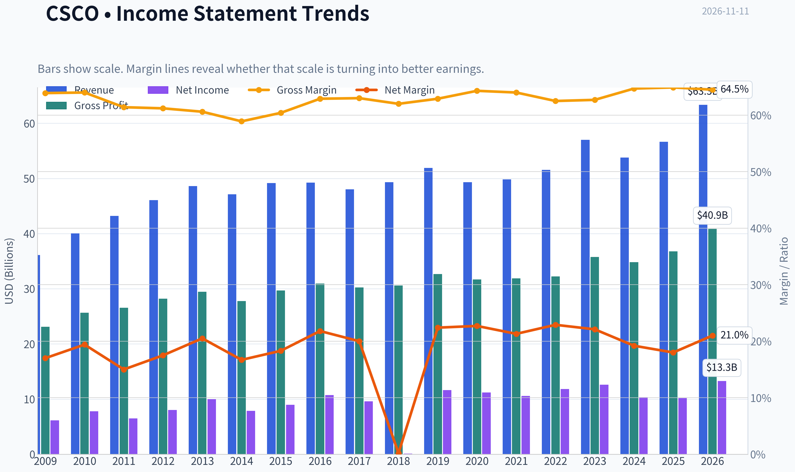

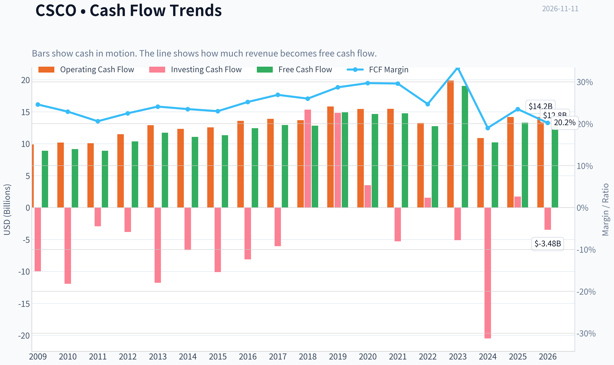

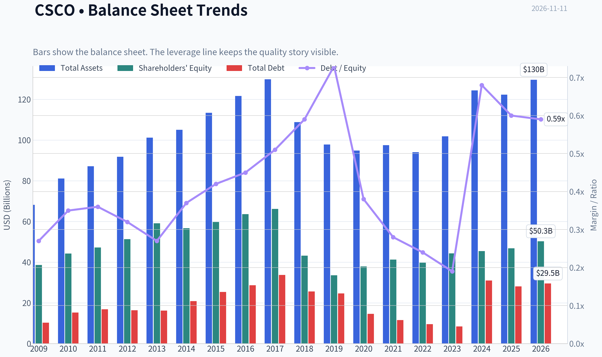

This graph tracks the profitability and return metrics (ROE, ROIC, Margins) of **CSCO** over the past decade, highlighting capital efficiency trends.

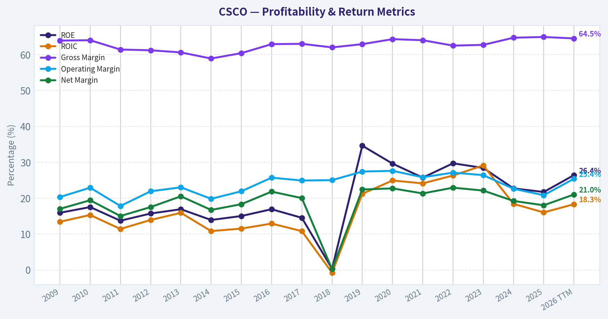

This chart illustrates the financial health of **CSCO** over the last 10 years, mapping cash equivalents and free cash flow against total obligations (Debt).

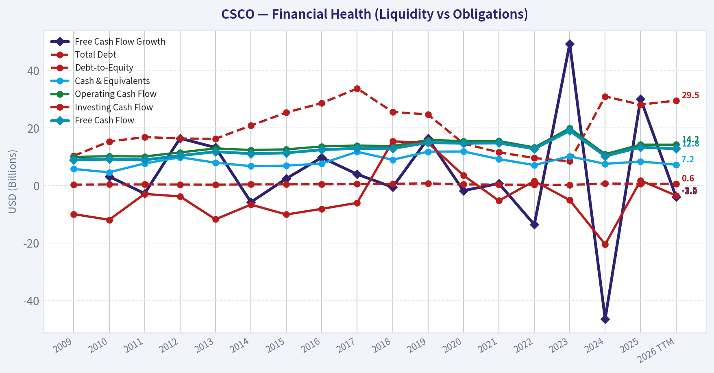

This comparison chart from *Profitability and Operating Performance* stacks current figures against historical benchmarks for **CSCO**, making it easy to see where the company trades relative to its own averages.

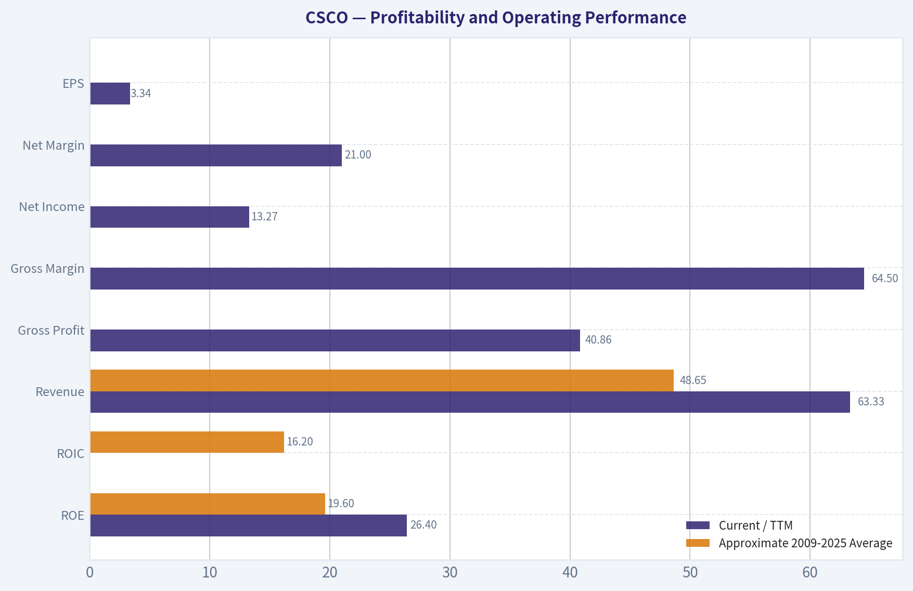

This breakdown chart from <em>Revenue Breakdown</em> shows the proportional composition for **CSCO** - useful for understanding what drives or risks the business.

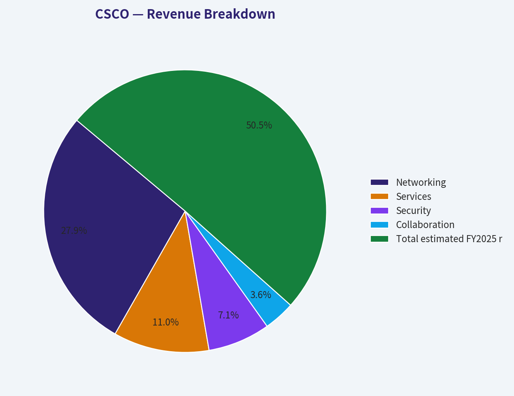

---

### Intrinsic Value Analysis (Buffett)

> *Following Warren Buffett's value investing philosophy: Circle of Competence, Economic Moat, Management Quality, and Margin of Safety.*

#### Intrinsic Value Snapshot

Price is what you pay. Intrinsic value is what the business may be worth based on the cash it can create for owners over time. We show a range, not one magic number.

- Current Price: $98.15
- Value Range (conservative to optimistic across both DCF methods): $23.16 to $131.17

##### Owner Earnings (Buffett Method)
- Net Income: $10,180,000,000.00
- Depreciation & Amortization: $2,540,000,000.00
- Capital Expenditures: $-1,410,000,000.00
- Working Capital Changes: $-4,351,000,000.00
- Owner Earnings: $13,378,000,000.00

##### Intrinsic Value
###### Buffett Method
Uses owner earnings. Stricter, and usually more conservative.
- Conservative: $23.16
- Average: $67.97
- Optimistic: $131.17
- Discount Rate: 10.0%

###### Cash Flow Method
Uses free cash flow. Better for companies spending heavily today to grow tomorrow.
- Conservative: $32.18
- Average: $38.26
- Optimistic: $56.94
- Discount Rate: 10.0%

ANALYST STANCE: **Bearish**

#### Executive Judgment

Cisco is a recognizable, cash-generative networking franchise with meaningful enterprise relationships, strong gross margins, and an improving growth profile supported by AI infrastructure demand and the Splunk acquisition. However, at **$98 per share**, the market is pricing Cisco as though it can sustain approximately **15.8% annual growth for ten years**, versus recent three-year and five-year growth rates of approximately **5.7% and 5.1%**.

The business is respectable, but the valuation does not provide an adequate margin of safety. Cisco is better classified as a **good company at an expensive price** than as a Buffett-style purchase today.

#### 1. Factor Scorecard

| Factor | Score | Assessment |
|---|---:|---|
| Circle of competence and simplicity | 3/5 | Cisco sells networking, security, collaboration, and software products to enterprises. The model is understandable, but product cycles, integration execution, and technology shifts reduce predictability. |
| Durable competitive advantage | 3/5 | Strong installed base, customer relationships, switching friction, brand, and intellectual property. However, competition from hyperscalers, cloud vendors, Arista, HPE, and specialized security providers limits moat width. |
| Management and capital allocation | 3/5 | Long operating history, regular dividends, buybacks, and a strategic Splunk acquisition. The acquisition expands software and security capabilities but increases execution complexity. |
| Industry structure | 3/5 | Networking has scale advantages and several established competitors, but innovation cycles and pricing pressure prevent an exceptionally favorable structure. |

**Gate 5-quality and solvency:** **Not tripped.** The company is profitable and cash-generative, and the available evidence does not indicate simultaneous deteriorating cash flow and a solvency red line.

**Key Takeaways:** Cisco passes the basic quality test but does not score as a wide-moat compounder. Its greatest strengths are scale, installed customers, and cash generation; its greatest weaknesses are moderate growth visibility and meaningful technology competition.

#### 2. Financial Summary

| Metric | Latest reading |
|---|---:|
| Share price | $98 |
| Market capitalization | $386.96 billion |
| P/E ratio | 29.5x |
| Gross margin | 64.5% |
| ROE | 26.4% |
| Revenue growth, year over year | 11.8% |
| FCF yield | 3.3% |
| Implied annual FCF | Approximately $12.8 billion |
| Current ratio | 0.93 |
| Reverse-DCF growth implied by price | Approximately 15.8% annually for 10 years |
| Recent three-year growth rate | 5.7% |
| Recent five-year growth rate | 5.1% |

**Key Takeaways:** Cisco has attractive gross margins, a high reported ROE, and substantial free cash flow. But the 3.3% FCF yield is modest, while the current valuation implies growth far above the company's recent operating history. The current ratio is not decisive for valuation because Cisco's business increasingly includes software, subscriptions, and deferred-revenue characteristics.

#### 3. Moat Analysis

**Installed base and switching friction:** Cisco equipment is deeply embedded in enterprise networks. Replacing core networking infrastructure involves operational risk, employee retraining, compatibility testing, and potential downtime. These factors create real, though not absolute, switching costs.

**Brand and trust:** Cisco has a long-standing reputation in mission-critical networking. Enterprise buyers often value reliability, security, technical support, and certification ecosystems more than the lowest initial price.

**Scale and ecosystem:** Cisco's global sales force, channel network, service organization, and installed base provide cost and distribution advantages. The Splunk acquisition also strengthens the company's position in observability and security analytics.

**Technology risk:** Cisco benefits from rising data-center, cybersecurity, and AI-related infrastructure spending. Nevertheless, technology can also weaken the moat. Arista competes strongly in data-center switching, while cloud providers increasingly develop their own infrastructure and software.

**Moat rating:** **Wide but stable rather than wide and widening - 3/5.**

The moat is genuine, but the evidence does not support assuming that Cisco will compound at double-digit rates for a decade. Cisco must continuously innovate to prevent its installed base from becoming a legacy constraint.

#### 4. Management Quality and Capital Allocation

Cisco's management has generally pursued shareholder distributions through dividends and repurchases while attempting to shift the company toward recurring software, security, and observability revenue.

The Splunk acquisition is strategically understandable: it broadens Cisco's security and data-analytics capabilities and can increase the value of the existing enterprise sales channel. However, large acquisitions also introduce integration risk and make it more difficult to evaluate organic growth separately from acquired growth.

Management earns credit for maintaining a shareholder-return orientation, but the capital-allocation record does not justify a premium reserved for exceptional owner-operators. The central test is whether the company can convert the Splunk investment and AI opportunity into durable per-share earnings growth rather than merely larger revenue and adjusted earnings.

**Management score: 3/5.**

#### 5. Owner Earnings Calculation

Cisco's reported FCF yield implies the following approximate calculation:

| Owner-earnings component | Approximate amount |
|---|---:|
| Market capitalization | $386.96 billion |
| FCF yield | 3.3% |
| Implied free cash flow | $12.8 billion |
| Less: maintenance-capital-expenditure adjustment | Not separately provided |
| Working-capital adjustment | Not separately provided |
| Owner-earnings proxy used for valuation | Approximately $12.8 billion |

**Key Takeaways:** Free cash flow is used as the practical owner-earnings proxy because the available data does not separately identify maintenance capital expenditures and working-capital changes. This is reasonable for a mature technology company, but it may modestly overstate true owner earnings if reported capital expenditures include substantial growth investment.

#### 6. Three-Scenario DCF Valuation

Using approximately **$12.8 billion** of owner-earnings proxy and a 10% discount rate:

| Scenario | Assumption | Estimated value | Approximate value per share |
|---|---|---:|---:|
| A: No growth | 0% perpetual growth | $127.7 billion | $32 |
| B: GDP growth | 3% perpetual growth | $187.8 billion | $48 |
| C: Historical-growth case | Approximately 3.8% growth, based on 75% of the recent five-year rate | $206.8 billion | $52 |
| Research-pack headline intrinsic value | Weighted valuation blend | $224.3 billion | $56.71 |

**Key Takeaways:** Even favorable DCF assumptions produce values materially below the current $98 share price. The headline intrinsic value of $56.71 implies that Cisco would need to decline roughly 42% before reaching that estimate, although a more optimistic owner-earnings model produces a higher value near $68 per share.

#### 7. Margin of Safety Analysis

| Valuation reference | Value per share | Discount or premium versus $98 |
|---|---:|---:|
| No-growth DCF | $32 | 67% premium to intrinsic value |
| 3% GDP-growth DCF | $48 | 105% premium |
| Historical-growth DCF | $52 | 87% premium |
| Headline blended intrinsic value | $56.71 | 73% premium |
| Owner-earnings model in research pack | $67.97 | 44% premium |
| Three-model average | Approximately $47.16 | 108% premium |

**Key Takeaways:** Cisco does not offer a margin of safety at $98 under the supplied cash-flow valuations. For a business with moderate rather than exceptional growth visibility, a more suitable entry range would be approximately **$55 to $70**, depending on confidence in Splunk synergies and AI-related growth.

The reverse-DCF is particularly unfavorable: the current price implies approximately **15.8% annual growth for ten years**, far above Cisco's recent five-year growth rate of about **5.1%**. That is a demanding assumption for a mature networking company.

#### 8. Final Buffett Scorecard

| Criterion | Weight | Score | Weighted contribution |
|---|---:|---:|---:|
| Moat width and durability | 25% | 3/5 | 0.75 |
| Valuation and margin of safety | 20% | 1/5 | 0.20 |
| Capital returns: ROIC versus WACC | 15% | 4/5 | 0.60 |
| Business understanding and predictability | 12% | 3/5 | 0.36 |
| Management quality and capital allocation | 12% | 3/5 | 0.36 |
| Reinvestment runway | 8% | 3/5 | 0.24 |
| Balance-sheet strength | 4% | 3/5 | 0.12 |
| Industry structure | 4% | 3/5 | 0.12 |
| **Total** | **100%** |  | **2.75/5** |

**Key Takeaways:** Cisco scores well on cash generation and capital returns but poorly on valuation. The valuation weakness overwhelms the company's operational strengths and places the overall result below the threshold for a compelling long-term investment.

#### 9. Investment Stance

**Stance: Bearish at $98**
**Conviction: Moderate**

Cisco is not a distressed business, and the recommendation is not based on solvency concerns. It is based on valuation discipline. The company has a credible franchise, but the current price appears to assume heroic growth that is not supported by recent history or conservative DCF analysis.

A patient investor should wait for a substantially lower price-preferably in the **$55 to $70 range**-or for several years of demonstrated double-digit organic growth and strong Splunk integration before reconsidering the stock.
#### Valuation Bridge

This bridge places the current market price beside each intrinsic value lens so readers can see whether upside depends on one method or shows up across several methods.

| Scenario | Intrinsic Value / Share |
| --- | ---: |
| Buffett Method | $67.97 |
| Cash Flow Method | $38.26 |
| Damodaran Method | $35.25 |
| Current Price | $98.15 |

#### Key Takeaways

If one method is far above the others, the upside case depends on a specific modelling assumption. When several methods cluster together, the valuation story is more robust.

#### Valuation Visuals

This comparison chart from *Latest Earnings Snapshot* stacks current figures against historical benchmarks for **CSCO**, making it easy to see where the company trades relative to its own averages.

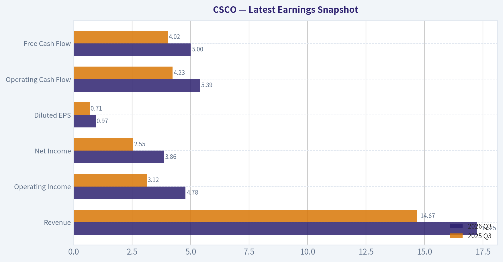

This comparison chart from *Balance Sheet and Financial Strength* stacks current figures against historical benchmarks for **CSCO**, making it easy to see where the company trades relative to its own averages.

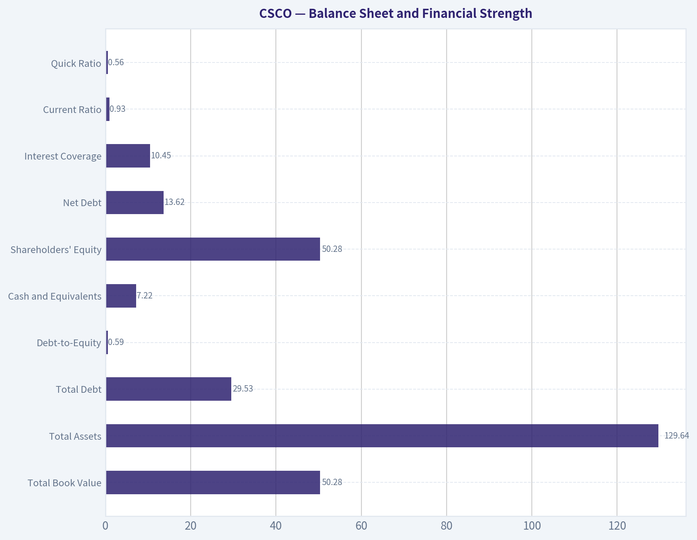

This comparison chart from *Cash Flow and Capital Allocation* stacks current figures against historical benchmarks for **CSCO**, making it easy to see where the company trades relative to its own averages.

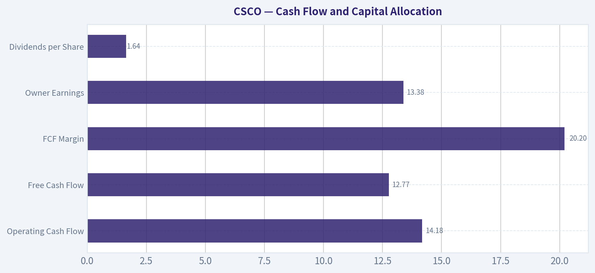

---

### Trend & Growth Analysis (Lynch/Druckenmiller/Fisher)

> *Following Peter Lynch's GARP, Stanley Druckenmiller's macro-aware approach, and Philip Fisher's scuttlebutt methodology.*

ANALYST STANCE: **Neutral**

#### 1. Lynch Classification

**Cisco Systems is a stalwart, not a fast grower.** Revenue growth of approximately 11.8% is above its historical mature-company profile, but below the 15-25% threshold generally required for primary fast-growth investing. Cisco is a high-quality, cash-generative networking incumbent benefiting from AI infrastructure demand, but its current valuation appears to discount a substantial amount of future growth.

#### 2. The Story in Three Bullets

- **AI infrastructure is refreshing Cisco's growth cycle:** Hyperscaler investment, data-center networking, and higher-speed connectivity are supporting demand for switches, routers, security, and observability.
- **Cisco is expanding beyond traditional hardware:** Its security, software, subscriptions, and the Splunk acquisition broaden the platform and could improve recurring revenue quality.
- **The market is already recognizing the story:** The stock has reportedly risen approximately 104% over the past few years, while the current P/E near 29.5 is elevated for a mature networking company.

#### 3. TAM Analysis and the 10x Test

| Metric | Assessment |
|---|---:|
| Current market capitalization | $387.0 billion |
| Approximate current revenue base | Roughly $55-57 billion |
| Ten-times revenue target | Roughly $550-570 billion |
| Relevant markets | Enterprise networking, data-center infrastructure, cybersecurity, observability, collaboration |
| 10x feasibility | Low as a single-company outcome |
| Runway assessment | Good for moderate growth; limited for a ten-bagger |

**Key Takeaways:** Cisco participates in several large and expanding markets, particularly AI networking and cybersecurity. However, a tenfold revenue increase would require Cisco to become an extraordinarily dominant share of a very broad infrastructure market. The TAM supports continued growth, but not an obvious ten-bagger path from the current valuation.

#### 4. Revenue Growth Trend

| Indicator | Latest reading | Interpretation |
|---|---:|---|
| Revenue growth year over year | 11.8% | Healthy for a mature incumbent |
| Trailing three-year growth reference | 5.7% CAGR | Recent acceleration is visible |
| Trailing five-year growth reference | 5.1% CAGR | Current growth is above the long-term trend |
| Trend classification | Accelerating from a low base | Positive, but not yet proven durable |

**Key Takeaways:** Cisco appears to be experiencing a cyclical and product-driven improvement relative to its recent history. The key question is whether AI-related networking demand can keep growth near or above 15%, rather than settling back toward the mid-single digits after the current infrastructure cycle.

#### 5. Unit Economics and Operating Quality

| Metric | Data / assessment |
|---|---:|
| Gross margin | 64.5% |
| ROE | 26.4% |
| Free-cash-flow yield | 3.3% |
| Net revenue retention | Not provided |
| LTV/CAC | Not provided |
| Rule of 40 | Not reliably calculable without FCF margin |
| Current ratio | 0.93 |

**Key Takeaways:** Cisco has strong gross margins, attractive return on equity, and a mature cash-generation profile. The absence of disclosed NRR and LTV/CAC data limits a software-style unit-economics analysis, while the current ratio below 1.0 warrants monitoring even though Cisco has substantial scale and capital-market access.

#### 6. Inflection-Point Assessment

| Potential inflection | Evidence | Assessment |
|---|---|---|
| Product cycle | AI networking and higher-speed infrastructure demand | Positive |
| Market share | No verified accelerating share data provided | Neutral |
| Margin inflection | Strong gross margin, but no clear operating-margin acceleration provided | Neutral-positive |
| TAM expansion | AI, security, and observability broaden the opportunity | Positive |
| Competitive position | Cisco remains a major incumbent, but faces Arista, cloud-native, and security competition | Mixed |
| Acquisition integration | Splunk expands software and security exposure | Important execution test |

**Key Takeaways:** The strongest inflection is Cisco's exposure to AI-related networking and its move toward a broader software and security platform. This is a credible business-cycle improvement, but the evidence does not yet establish a durable, accelerating earnings inflection sufficient to support a high-conviction growth stance.

#### 7. Macro Setup

- **Secular backdrop:** Favorable. AI infrastructure, cloud computing, cybersecurity, and data-center spending are strong long-term themes.
- **Interest rates:** The valuation is more sensitive to rates than Cisco's historical profile because the stock now trades at a relatively high earnings multiple.
- **Cycle:** Cisco may be in an early-to-mid product recovery, but networking spending can be lumpy and tied to hyperscaler and enterprise budgets.
- **Druckenmiller conclusion:** The thematic wind is at Cisco's back, but the stock's rerating means the setup is less asymmetric than it was before the recent advance.

#### 8. Fisher's 15-Point Score

| Fisher criterion | Score, 1-5 | Comment |
|---|---:|---|
| Market potential | 4 | Large networking, AI, and security markets |
| New-product determination | 4 | Continued platform and product expansion |
| R&D effectiveness | 4 | Deep technical capabilities |
| Sales organization | 5 | Global enterprise distribution |
| Profit margins | 5 | Strong gross economics |
| Margin improvement | 3 | Improvement not yet clearly established |
| Labor relations | 3 | Limited information |
| Executive relations | 3 | Limited information |
| Management depth | 4 | Large, experienced organization |
| Cost analysis/accounting | 4 | Mature public-company systems |
| Outstanding competitive aspects | 4 | Installed base, ecosystem, switching costs |
| Long-range profit outlook | 4 | Positive, though mature |
| Dilution | 3 | Acquisition and compensation dilution should be monitored |
| Management candor | 3 | Insufficient evidence in supplied data |
| Management integrity | 4 | No major issue identified |
| **Total** | **57 / 75** | **Good, not outstanding** |

**Key Takeaways:** Cisco scores well on distribution, margins, technical depth, and installed-base advantages. It loses points because growth durability, software unit economics, margin acceleration, and post-acquisition execution are not yet sufficiently demonstrated.

#### 9. Valuation Analysis

| Valuation measure | Result | Interpretation |
|---|---:|---|
| Current P/E | 29.5x | Expensive for a mature incumbent |
| Illustrative PEG using 11.8% growth | 2.5x | Expensive under Lynch's framework |
| Free-cash-flow yield | 3.3% | Limited valuation cushion |
| Headline intrinsic value | $56.71 | Approximately 42% below the $98 price |
| Three-model intrinsic-value range | $35.25-$67.97 | Wide range, all below current price |
| Reverse-DCF implied growth | 15.8% annually for 10 years | Aggressive relative to 5-year history |

**Key Takeaways:** Cisco's valuation requires sustained growth materially above its recent long-term trend. The PEG estimate is above 2.0, and the supplied intrinsic-value models imply meaningful downside from $98. The stock could still perform well if AI networking produces a multi-year earnings acceleration, but the current price offers little margin of safety.

##### Scenario Analysis

| Scenario | Revenue growth assumption | Valuation assumption | General outcome |
|---|---:|---:|---|
| Bear | 5-8% | 18-22x earnings | Significant multiple compression |
| Base | 9-12% | 22-25x earnings | Modest or muted return |
| Bull | 15-18% for several years | 28-32x earnings | Attractive upside, but execution-dependent |

**Key Takeaways:** The bull case requires both sustained high-teens growth and continued premium valuation. The base case is more consistent with Cisco's mature profile and suggests limited upside after the recent rerating. This is a favorable risk-reward only if AI networking causes a genuine multi-year earnings acceleration.

#### 10. Growth Investor Scorecard

| Criterion | Weight | Score, 1-5 | Weighted view |
|---|---:|---:|---:|
| Lynch story | 10% | 3.5 | Clear, but mature |
| TAM and runway | 20% | 3.5 | Large markets, limited 10x feasibility |
| Revenue growth | 20% | 3.0 | Improving, not yet fast-growth |
| Unit economics | 15% | 3.5 | Strong margins; limited SaaS metrics |
| Competitive position | 10% | 4.0 | Strong incumbent and distribution |
| Management quality | 10% | 3.5 | Experienced, execution still important |
| Macro setup | 5% | 4.0 | AI and security tailwinds |
| Profitability path | 5% | 4.5 | Already highly profitable |
| Valuation | 5% | 2.0 | Little margin of safety |
| **Overall score** | **100%** | **3.4 / 5.0** | **Neutral** |

**Key Takeaways:** Cisco is a good company with a favorable thematic backdrop, but it is not currently a classic high-conviction growth investment. The score is held back primarily by valuation and the lack of evidence that current growth can remain in the fast-grower range.

#### 11. Position Size Stance

- **New position:** 0-2% maximum, and preferably only on a material pullback or after evidence of sustained high-teens growth.
- **Existing shareholder:** Hold or trim selectively rather than automatically sell; monitor AI-networking orders, recurring-revenue growth, margins, and Splunk integration.
- **High-conviction growth portfolio:** Underweight relative to faster-growing AI infrastructure or cybersecurity companies with stronger runway and more attractive valuation.

#### 12. Key Risks and Catalysts

| Catalysts | Risks |
|---|---|
| Sustained hyperscaler and AI-networking demand | AI spending proves cyclical or concentrated |
| Cisco gains share in high-speed data-center networking | Arista and cloud-native competitors take share |
| Splunk accelerates recurring revenue and security growth | Integration fails to produce expected synergies |
| Operating leverage expands margins | Valuation contracts toward historical norms |
| Revenue growth remains above 15% for multiple quarters | Growth reverts toward the 5-8% range |
| Interest rates decline | Current ratio and balance-sheet flexibility require monitoring |

**Final Assessment:** Cisco is a high-quality stalwart undergoing a potentially meaningful AI and software-led growth refresh. Nevertheless, at $98, the market appears to be pricing in roughly 15.8% annual growth for a decade, while the company's longer-term growth history is closer to 5-6%. The appropriate stance is **Neutral**: attractive business, promising inflection, insufficient valuation margin of safety.

---

### Market Technical Analysis

ANALYST STANCE: **Neutral**

#### CSCO technical overview

CSCO's latest available close is **$98.15 on November 10, 2026**; November 11 is not yet represented as a completed trading session in the retrieved data. The chart has shifted from a medium-term advance into a sharp corrective phase. After reaching approximately **$118.39 on October 9**, CSCO declined to **$93.85 on November 6**, a fall of roughly 20.7%. The subsequent rebound toward $98-99 has been modest and has not yet repaired the broader technical damage.

The selected indicators are deliberately complementary: short-, medium-, and long-term trend measures; momentum and momentum acceleration; a volume-weighted trend measure; volatility; and a bounded oscillator for potential exhaustion signals.

#### Trend structure

The moving-average configuration is currently bearish on the tactical and intermediate horizons:

- The **10-day EMA is $100.93**, placing the stock about **2.8% below** its short-term trend line.
- The **50-day SMA is $108.16**, approximately **9.3% above** the latest close.
- The **200-day SMA is $101.41**, around **3.3% above** the latest close.
- The **VWMA is $102.98**, about **4.9% above** the latest close.

Price is therefore below all four trend references. This alignment indicates that recent selling pressure is not confined to a single volatile session; it has pulled price beneath the average cost structure of both short-term and longer-term participants.

The 200-day SMA remains gently upward sloping, rising from about $98.14 on October 12 to $101.41 on November 10. That means the long-term trend has not fully rolled over according to the average itself. However, the stock's break below the 200-day SMA is technically important. A sustained move below this level would weaken the long-term bullish regime, while a rapid recovery above roughly $101-102 would reduce the significance of the breakdown.

The 50-day SMA has been declining steadily, from about $111.93 to $108.16 over the same period. This confirms that the intermediate trend has deteriorated materially. The gap between the 50-day SMA and the current price also creates a substantial overhead resistance zone rather than an immediately nearby recovery target.

#### Momentum and reversal evidence

The **MACD is -3.40**, and the **MACD histogram is -1.09**. Both remain negative, confirming that bearish momentum is still dominant. However, the histogram has improved from **-1.47 on November 6 to -1.09 on November 10**, while the MACD has become slightly less negative over the last few sessions. This suggests that downside momentum has eased after the early-November selloff, but it does not yet establish a bullish reversal.

The distinction is important: momentum is weakening on the downside, but it has not turned positive. A stronger reversal signal would require the histogram to move toward zero and eventually positive territory, ideally accompanied by price reclaiming the 10-day EMA and the 200-day SMA. Until then, the current improvement may represent a relief bounce within a broader downtrend.

The **RSI is 38.0**, up from an oversold reading of **28.5 on November 6**. This rebound indicates that the most extreme selling pressure has moderated. Nevertheless, RSI remains below the neutral 50 level, so momentum is still tilted bearish. The move away from oversold territory should not automatically be interpreted as a buy signal; in persistent downtrends, RSI can recover from oversold conditions while price continues to form lower highs.

A constructive development would be RSI reclaiming 50 while price simultaneously holds above the 10-day EMA. Conversely, a failure near the 40-45 RSI area followed by a move back below 30 would indicate that sellers have regained control.

#### Volume and participation

The **VWMA is $102.98**, well above the current price. Because VWMA incorporates traded volume, its position above the market suggests that higher-volume transactions have occurred at materially higher prices than the latest close. This reinforces the interpretation that overhead supply may emerge around $101-103 before any sustained recovery can develop.

The sharp declines on November 5 and November 6 occurred with elevated volume, including approximately **37.5 million shares on November 5**. The rebound on November 9 was accompanied by about **20.4 million shares**, which is constructive but not strong enough by itself to demonstrate broad accumulation. A more convincing reversal would involve advancing sessions with expanding volume and a rising VWMA, rather than merely a low-volume bounce from oversold conditions.

#### Volatility and risk management

ATR has risen to approximately **$3.61**, compared with roughly **$2.89 at the start of the reviewed period**. At the latest price, that represents daily volatility of about **3.7%**. This is significant for a large-cap stock and means that ordinary daily fluctuations can easily invalidate tight stops.

The recent price action also contains several large-range sessions and high-volume gaps, so technical levels should be treated as zones rather than exact points. A stop or position size based on the earlier, lower ATR would likely underestimate current risk. The elevated volatility favors smaller exposure, wider volatility-adjusted risk limits, or waiting for confirmation before entering a directional trade.

#### Key levels and possible scenarios

The first recovery test is the **$100.90-101.40 area**, corresponding approximately to the 10-day EMA and 200-day SMA. A close above this zone would be the first meaningful sign that the rebound is progressing beyond a short-lived bounce. The next resistance region is around **$103**, near the VWMA, followed by the declining **50-day SMA near $108**.

On the downside, the recent low near **$93.35 intraday and $93.85 at the close** is the key reference. A decisive break below that zone would resume the sequence of lower lows and could signal that the oversold bounce has failed. Holding above the low while MACD improves and RSI recovers through 50 would create a more credible stabilization setup.

Overall, the evidence is **bearish but not at maximum downside momentum**. The long-term average is still rising, RSI has recovered from oversold levels, and the MACD histogram is becoming less negative. Yet price remains below every selected trend measure, MACD is negative, VWMA indicates overhead supply, and volatility is elevated. The most disciplined stance is to watch for confirmation rather than treat the current rebound as a confirmed trend reversal.

#### Selected indicators

| Indicator | Latest reading | Interpretation for CSCO |
|---|---:|---|
| 10-day EMA | $100.93 | Price is below short-term trend support; first recovery test |
| 50-day SMA | $108.16 | Intermediate trend is declining; substantial overhead resistance |
| 200-day SMA | $101.41 | Long-term average still rises, but price has slipped below it |
| MACD | -3.40 | Bearish momentum remains established |
| MACD Histogram | -1.09 | Still negative, but improving from the November 6 trough |
| RSI | 38.0 | Bearish-neutral momentum; recovered from oversold but below 50 |
| ATR | $3.61 | Elevated volatility; position sizing and stops require adjustment |
| VWMA | $102.98 | Volume-weighted cost basis above price, implying overhead supply |

**Key Takeaways:** CSCO remains below its short-, medium-, long-term, and volume-weighted trend measures, so the primary technical structure is still bearish. The rebound from the November 6 low has improved RSI and reduced the severity of MACD downside momentum, but neither indicator has confirmed a bullish reversal. The $100.90-$103 area is the key recovery zone, while roughly $93.35-$93.85 is the critical downside support area.

#### Market Visuals

This comparison chart from *Market Metrics and Valuation* stacks current figures against historical benchmarks for **CSCO**, making it easy to see where the company trades relative to its own averages.

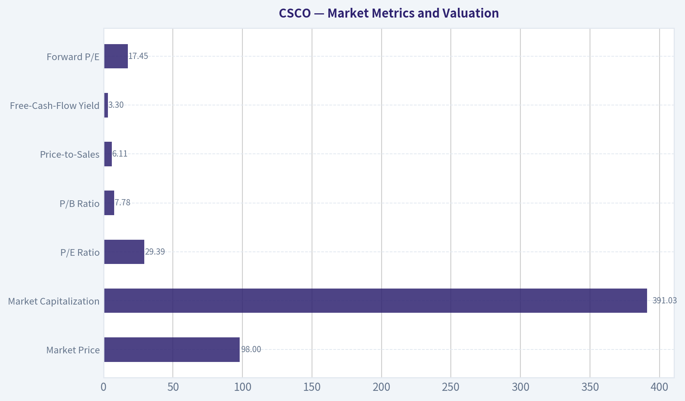

---

### Options Market Analysis

> *Reading options flow - put/call ratios, IV skew, and unusual activity - to gauge institutional positioning and event-driven risk.*

#### CSCO Options Market Report

**As of November 11, 2026.** The available chain shows unusually low open interest but substantial near-term trading volume. This makes volume-based sentiment more informative than open-interest ratios, while also materially reducing confidence in the overall signal.

#### 1. Put/Call Ratio Analysis

| Expiration | Call OI | Put OI | Put/Call OI | Call Volume | Put Volume | Put/Call Volume |
|---|---:|---:|---:|---:|---:|---:|
| Nov. 13, 2026 | 0 | 0 | N/A | 15,522 | 2,914 | 0.19 |
| Nov. 20, 2026 | 6 | 5 | 0.83 | 10,791 | 1,798 | 0.17 |
| Nov. 27, 2026 | 0 | 15 | N/A | 630 | 164 | 0.26 |
| **Total** | **6** | **20** | **3.33** | **26,943** | **4,876** | **0.18** |

**Key Takeaways:** The aggregate put/call OI ratio of 3.33 appears bearish relative to the approximately 0.7 neutral baseline, but it is not reliable because total open interest is only 26 contracts. Trading volume is much more call-heavy, with a put/call volume ratio of 0.18, indicating substantially stronger near-term call activity than put activity. The most defensible interpretation is cautiously bullish trading interest, offset by unreliable open-interest data.

#### 2. Implied Volatility Assessment

| Expiration | Call ATM IV | Put ATM IV | Call-Put IV Difference | Assessment |
|---|---:|---:|---:|---|
| Nov. 13, 2026 | 4.1% | 3.5% | +0.6 percentage points | Slight call premium |
| Nov. 20, 2026 | 2.6% | 1.3% | +1.3 percentage points | Noticeable call premium |
| Nov. 27, 2026 | 2.1% | 1.4% | +0.7 percentage points | Slight call premium |

**Key Takeaways:** Near-term call IV is higher than put IV across all listed expirations, which is consistent with upside demand rather than pronounced downside protection. Absolute IV readings are extremely low, so the chain does not indicate significant event-risk pricing based on the supplied data. A true OTM put-versus-OTM call skew cannot be calculated because strike-level IV data was not provided.

There is no catalyst calendar included in the data. If CSCO has earnings or another corporate event near these expirations, the unusually low reported IV would warrant verification, since event volatility is normally expected to be priced into the front expiration.

#### 3. Unusual Options Activity

| Finding | Result |
|---|---|
| Contracts with volume greater than 5x open interest | None identified |
| Fresh directional contracts | Not confirmed |
| Smart-money versus retail classification | Not possible from supplied data |
| Highest-volume activity | Nov. 13 calls: 15,522 contracts |
| Second-highest-volume activity | Nov. 20 calls: 10,791 contracts |

**Key Takeaways:** No individual contract met the tool's unusual-activity threshold, so there is no confirmed fresh institutional sweep or high-conviction directional trade. Nevertheless, the concentration of volume in calls is directionally bullish. Because the available data does not include strikes, execution side, or bid/ask context, it is not possible to distinguish call buying from covered-call selling or retail speculation.

#### 4. Open Interest Concentration and Gamma Levels

| Expiration | OI Condition | Implication |
|---|---|---|
| Nov. 13, 2026 | Zero call and put OI reported | No reliable pinning or gamma-wall inference |
| Nov. 20, 2026 | Only 6 calls and 5 puts | Minimal gravitational effect |
| Nov. 27, 2026 | 15 puts and zero calls | Small put concentration, but too little OI to establish a meaningful wall |
| Overall | 26 total contracts of OI | Open-interest-based support, resistance, and max-pain analysis is unreliable |

**Key Takeaways:** There are no meaningful gamma walls or high-OI strikes visible in the supplied near-term data. The Nov. 27 put concentration is too small to create a dependable support or pinning level. Price moves are therefore more likely to be driven by underlying-market activity than by options-market hedging flows.

#### 5. Overall Options Sentiment

**Signal: BULLISH, LOW CONFIDENCE**

The primary bullish driver is the very low put/call volume ratio of 0.18, combined with call IV trading above put IV across all three near-term expirations. This suggests active upside participation or demand for call exposure.

However, the signal should be treated cautiously. Aggregate open interest is extremely small, the OI ratio is distorted by only 26 total contracts, no unusual individual contracts were detected, and strike-level information is unavailable. The options data supports a **cautiously bullish** read rather than a strong institutional conviction signal.

#### Summary

| Category | Assessment |
|---|---|
| Put/Call Ratio | Volume ratio strongly call-heavy at 0.18; OI ratio of 3.33 is distorted by tiny OI |
| IV Level | Very low reported near-term IV; no clear event-volatility premium |
| Skew Direction | Mild call skew; call ATM IV exceeds put ATM IV |
| Unusual Activity | No contracts exceeded the 5x volume-to-OI threshold |
| Overall Signal | **BULLISH, LOW CONFIDENCE** |

**Key Takeaways:** CSCO's near-term options flow leans bullish because call volume greatly exceeds put volume and calls carry slightly higher implied volatility. The conclusion is low confidence because open interest is exceptionally thin and no contract-level unusual activity or strike data confirms institutional positioning.

---

## Research Team Commentary

> *The Research Manager synthesizes the Bull vs Bear debate into action-free commentary. This is a pre-risk view, not the final stance.*

Core takeaway: Cisco is a high-quality business, but $98.15 does not offer a defensible margin of safety. Its installed base, switching costs, global distribution, 64.5% gross margin, and roughly 19.9% ROIC support a real moat. AI networking and Splunk could improve its growth and recurring-revenue profile. The problem is that the valuation already assumes much of that transformation will succeed. I would not initiate a position at the current price.

The strongest bull argument is that Cisco should no longer be viewed simply as a mature router and switch vendor. It can combine networking, security, observability, software, and support into a broader infrastructure platform. AI workloads require more bandwidth, higher-speed connectivity, security, and telemetry, giving Cisco several ways to participate. Splunk also expands the company's relevance beyond hardware and could deepen customer relationships. If Cisco sustains high returns on capital and turns mid-to-high-single-digit revenue growth into 10-12% free-cash-flow growth per share, the current price could produce an acceptable long-term return.

The quality evidence is meaningful. A 64.5% gross margin indicates differentiation rather than commodity economics, while approximately 20% ROIC shows that Cisco has historically converted its competitive position into attractive returns. Book value and conventional liquidity ratios are not particularly informative for this asset-light, intellectual-property-driven franchise. The appropriate anchors are normalized free cash flow, organic growth, incremental ROIC, and cash flow per share.

The strongest bear argument, however, is more decisive: investors are being asked to pay 29.5 times earnings for a company whose recent growth has been around 5%. The supplied reverse DCF indicates that the current price may require approximately 15.8% annual growth for ten years. That figure should be audited because the bundle does not specify whether it applies to revenue, earnings, or normalized free cash flow, nor does it provide the model's discount rate and terminal assumptions. Nevertheless, even if the reverse DCF is somewhat too demanding, the ordinary valuation cross-check still looks unfavorable. A roughly 3.4% earnings yield leaves most of the expected return dependent on a substantial growth acceleration and continued premium valuation.

The bull's estimated $105-$120 intrinsic-value range is not sufficiently conservative. It relies on 10-12% per-share growth and a 24-26 times terminal earnings multiple. Applying a lower terminal multiple substantially reduces estimated value. A nominal 12% discount to an optimistic midpoint is not the same as a genuine 12% margin of safety. Cisco's quality might justify buying at only a 10-15% discount, but that discount must be measured against a prudent base-case value rather than an upside scenario.

There are also several execution risks embedded in the growth bridge. Cisco must capture a meaningful share of AI networking expenditure, defend itself against specialized vendors and open architectures, retain Splunk customers and talent, realize cross-selling opportunities, preserve margins, maintain high ROIC, and eventually resume productive per-share capital allocation. Each outcome is plausible, but the current price appears to rely on several occurring together. Repurchases would also be less valuable if conducted near 30 times earnings.

The contrarian insight is therefore not to dismiss Cisco as obsolete. The market may still underestimate the strategic value of combining networking, security, and observability, and short-term enterprise spending weakness could obscure an improving long-term mix. But this is not presently a contrarian valuation opportunity. The stock's approximately 104% prior appreciation and premium multiple suggest that investors already recognize much of the AI and platform narrative. The recent weakness below its major moving averages does not by itself create value, while the options signal is unusable because open interest is only 26 contracts.

My rationale is straightforward: Cisco passes the business-quality test but fails the price test. The company is financially sound and has credible long-term opportunities, so this is not a short thesis or a claim of permanent deterioration. It is a decision not to pay today for benefits that have yet to appear consistently in organic growth and per-share cash flow. A better price or stronger operating evidence could change the conclusion.

Over the next one to four quarters, I would monitor organic growth separately from Splunk's acquired contribution, with particular attention to whether Cisco can sustain at least mid-to-high-single-digit organic growth. I would track AI-related orders and their conversion into recognized revenue and cash flow rather than relying on bookings announcements alone. Free cash flow per share should begin moving toward double-digit growth without depending heavily on adjustments, working-capital timing, or aggressive repurchases.

I would also watch gross margin for durability near its current low-to-mid-60% level, operating leverage, and post-acquisition ROIC. Continued ROIC in the high teens would support the strategic case; persistent deterioration would suggest that Splunk increased scale without creating sufficient value. Splunk customer retention, recurring-revenue growth, cross-selling, talent retention, and integration costs are particularly important. Debt reduction and capital-allocation discipline should take precedence over expensive buybacks.

The thesis would strengthen if Cisco delivers several quarters of strong organic growth, double-digit normalized free-cash-flow growth per share, stable margins, and high-teens or better ROIC while demonstrating tangible Splunk synergies. It would also become more attractive if the price fell below roughly $90, although the exact purchase threshold should be recalculated using updated cash flow and market discount rates. It would weaken if AI orders prove cyclical, organic growth remains near the historical 5% range, Splunk obscures weak underlying performance, or ROIC declines materially.

The main lesson from prior mistakes is to use both current market conditions and current fundamental data rather than relying on a compelling strategic narrative. It would be a mistake to reject Cisco merely because it is a mature technology company, but it would be equally mistaken to capitalize an unproven transformation at a premium multiple. Given the incomplete reverse-DCF details and missing full cash-flow and balance-sheet snapshot, conviction should remain measured-but the available evidence is not sufficient to justify purchasing at $98.15.

Bearish

---

## Value Investing Team Commentary

> *The Investor translates the research view into an investment thesis before risk review. This is still not the final stance.*

### Investment Commentary

Cisco remains a strong business, but the supplied evidence does not establish that it is an attractive investment at $98.15.

### Business quality: strong, though not exceptional enough to ignore price

Cisco possesses several durable advantages:

- A vast installed base and global distribution network
- Meaningful switching costs in mission-critical enterprise networks
- Deep customer relationships and an extensive partner ecosystem
- Gross margins of 64.5%, indicating differentiated rather than commodity economics
- ROIC near 19.9%, demonstrating historically attractive capital efficiency
- Opportunities to bundle networking, security, observability, software, and support

Splunk strengthens Cisco's position in observability and security while increasing its exposure to recurring revenue. AI infrastructure also creates genuine demand for faster networking, telemetry, and security. Cisco should not simply be dismissed as an obsolete router vendor.

Nevertheless, its moat is not invulnerable. Cisco faces specialized competitors, cloud-designed networking architectures, white-box equipment, and customers seeking vendor flexibility. Hyperscalers also possess considerable bargaining power and technical sophistication. AI-related demand may expand the market without guaranteeing that Cisco captures enough incremental economics to justify the current valuation.

### Valuation: expectations leave little room for ordinary execution

At $98.15 and 29.47 times earnings, the implied earnings yield is only about 3.4%. That is demanding for a company whose recent growth has been approximately 5%.

A simple return framework illustrates the issue. Current earnings are approximately $3.33 per share based on the supplied P/E:

- If earnings compound at 8% for ten years and the terminal P/E falls to 22, the share price would be approximately $158, representing only about 4.9% annual price appreciation before dividends.
- At 10% earnings growth and the same terminal multiple, annual price appreciation would be roughly 6.8% before dividends.
- Cisco likely needs something close to 11-12% sustained per-share earnings growth, plus dividends, to produce an attractive long-term return if its multiple normalizes.

That is possible, but it is materially above Cisco's recent growth record. Investors are therefore paying in advance for successful Splunk integration, AI networking participation, margin durability, and improved organic growth.

The stated reverse-DCF requirement of 15.8% annual growth should not be accepted uncritically. Its meaning depends on whether it refers to revenue, earnings, or free cash flow, as well as the discount rate, terminal growth rate, and treatment of debt and share-based compensation. Furthermore, acquisition-related amortization may make reported P/E less informative than normalized free cash flow. The proper next step is to audit enterprise value to normalized free cash flow rather than treat either the P/E or reverse DCF as conclusive.

Even so, multiple valuation signals point in the same direction: the current price assumes substantial improvement and provides limited protection if Cisco merely performs adequately.

### Splunk is both the opportunity and the principal test

Splunk can make Cisco a more strategically relevant infrastructure platform, but acquired growth should not be confused with organic improvement. The acquisition must ultimately produce:

- Strong customer and employee retention
- Cross-selling without damaging Splunk's independent franchise
- Sustainable recurring-revenue growth
- Real operating synergies rather than adjusted-accounting benefits
- Free-cash-flow growth per share
- High incremental returns on Cisco's acquisition investment

Post-acquisition ROIC matters more than headline revenue growth. If ROIC declines persistently while management emphasizes non-GAAP synergies, Cisco may have purchased growth without creating proportional shareholder value.

Capital allocation also warrants scrutiny. Debt reduction and integration should take priority over aggressive repurchases at nearly 30 times reported earnings. Buybacks create meaningful value only when shares are purchased below intrinsic value.

### Selective contrarian interpretation

There are two competing narratives, and neither should be accepted wholesale.

The constructive contrarian view is that the market may still underestimate Cisco's ability to unite networking, security, and observability into a broader platform. Temporary enterprise-spending weakness could conceal an improving business mix, and successful execution could make historical growth rates less relevant.

The opposing-and currently more important-observation is that this strategic transformation is no longer undiscovered. A substantial prior share-price increase and a premium multiple indicate that investors already recognize the AI and platform narrative. Buying after the narrative has been capitalized into the price is not contrarian investing.

Likewise, the stock's position below its moving averages does not make it inexpensive. Technical weakness of 3-9% is immaterial when the fundamental valuation may require a much larger adjustment. The options data are also unusable: a put/call open-interest ratio based on only 26 contracts has virtually no analytical weight.

### What would change the assessment?

The investment case would improve if Cisco demonstrates several quarters of:

1. Mid-to-high-single-digit organic growth excluding Splunk
2. Double-digit normalized free-cash-flow growth per share
3. Stable gross margins in the low-to-mid-60% range
4. High-teens post-acquisition ROIC
5. Measurable Splunk retention and cross-selling success
6. AI orders converting into revenue and cash flow rather than remaining promotional bookings

Price alone should not determine the entry point, but $90 is only about 8% below the current quotation and would still represent roughly 27 times current earnings. That is not automatically a margin of safety. Without an upward revision to normalized cash flow, a price in the low-to-mid-$80s-or below-would deserve more serious attention, subject to an updated DCF and balance-sheet review.

### Conclusion

Cisco passes the business-quality test but does not presently pass the price test. It is financially sound, competitively relevant, and capable of benefiting from AI infrastructure and Splunk. However, the current valuation requires a sustained growth acceleration that has not yet been demonstrated. The appropriate response is patience rather than a permanent rejection of the company.

**ANALYST STANCE: Neutral** - Do not initiate at $98.15. Monitor organic growth, normalized free cash flow per share, Splunk integration, and post-acquisition ROIC. Cisco could become attractive through either stronger operating evidence or a materially lower price, but today's valuation offers too little protection against merely satisfactory execution.

---

## Deep Values Commentary

> *The Risk Management Team debates and the Risk Judge provides the final action-free verdict. This section determines the final Bullish / Neutral / Bearish stance.*

#### Final Stance Scorecard

This scorecard converts the final research view into a weighted decision frame. It does not replace the narrative judgement, but it makes the main drivers of the verdict easier to scan.

| Criterion | Score | Weight | Commentary |
| --- | ---: | ---: | --- |
| Business Quality | 4.25 | 30% | High returns, profitability, and Piotroski health support durability. |
| Valuation Support | 2.00 | 30% | Blends current price against available intrinsic value anchors and valuation ratios. |
| Financial Strength | 2.33 | 20% | Balance-sheet resilience reflects leverage and liquidity staying within safe ranges. |
| Growth Durability | 3.33 | 20% | Recent revenue, earnings, and free cash flow growth indicate how durable expansion looks. |
| TOTAL / FINAL STANCE | 3.01 | 100% | Neutral |

#### Key Takeaways

The weighted score lands at **3.01 / 5.0**, while the final stance remains **Neutral**. This is useful as a quick calibration aid rather than a mechanical signal.

#### Risk Summary

Higher scores indicate more risk pressure. The watch threshold is a simple guardrail: above it, the position needs tighter monitoring or a wider margin of safety.

| Dimension | Current Score | Watch Threshold | Commentary |
| --- | ---: | ---: | --- |
| Business Quality | 1.75 | 3.00 | High returns, profitability, and Piotroski health support durability. |
| Valuation Support | 4.00 | 3.00 | Blends current price against available intrinsic value anchors and valuation ratios. |
| Financial Strength | 3.67 | 3.00 | Balance-sheet resilience reflects leverage and liquidity staying within safe ranges. |
| Growth Durability | 2.67 | 3.00 | Recent revenue, earnings, and free cash flow growth indicate how durable expansion looks. |

#### Key Takeaways

This view helps readers separate *where* the risk sits: valuation, business quality, balance sheet, or growth durability. It is especially useful when the final stance is close to the line between Neutral and Bearish.
