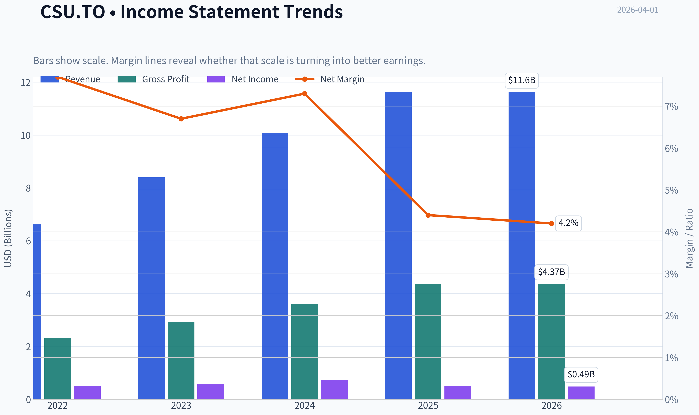
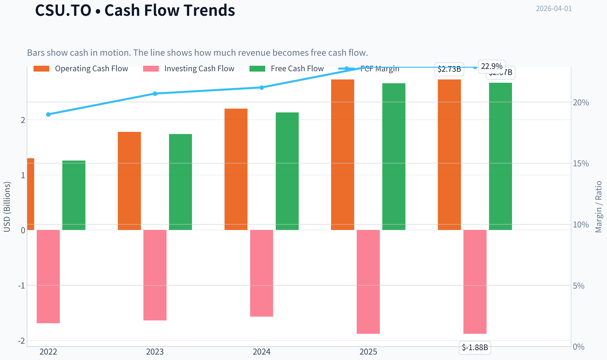
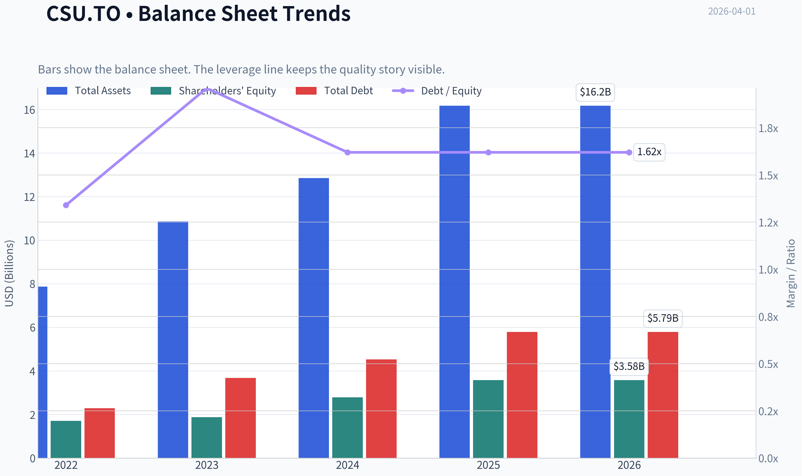
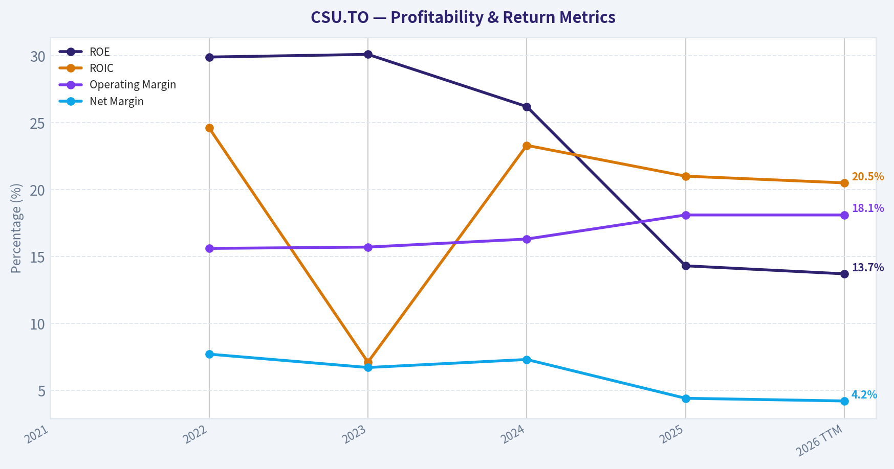
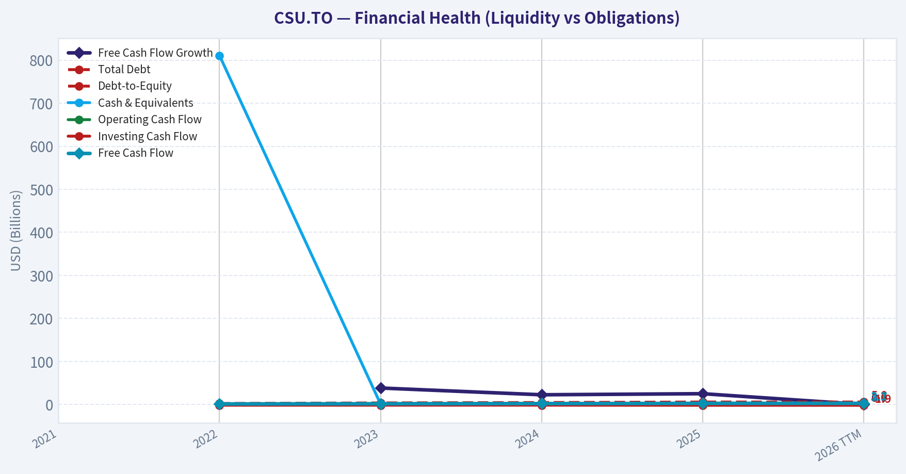
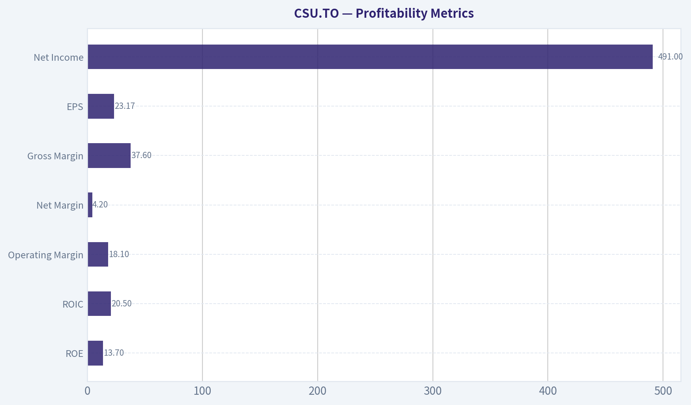
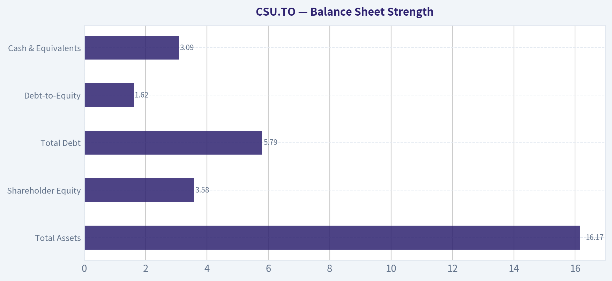
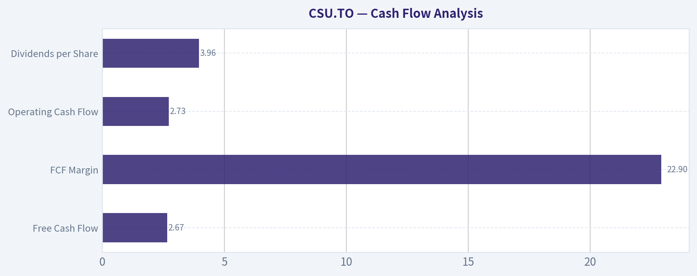
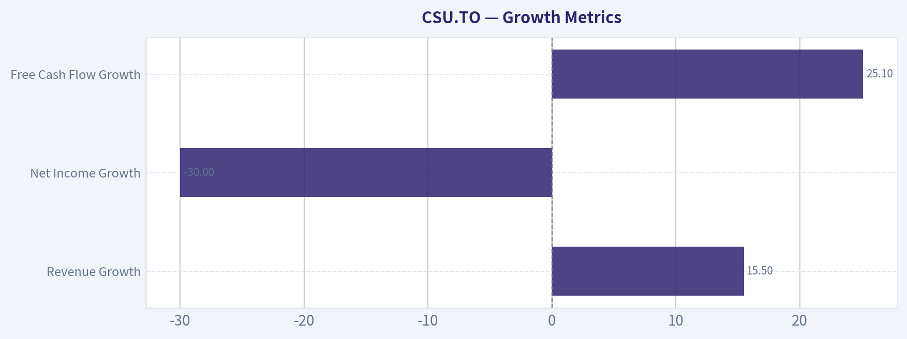
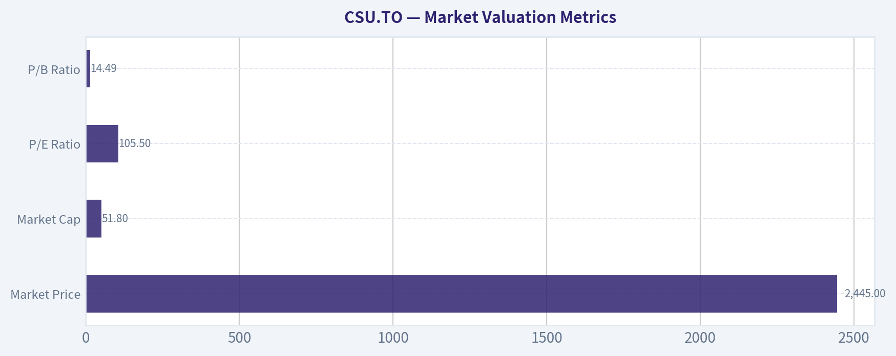

# CSU.TO Deep Value Intelligence

**Analysis Date:** 2026-04-01

## Critical Disclaimer

*This analysis is generated by Deep Value Intelligence, an AI-powered multi-agent investing framework. This report is for informational and educational purposes only and does not constitute financial advice. Always conduct your own research and consult with qualified financial advisors before making investment decisions.*

---

## Table of Contents

1. Intelligence Summary
2. Analyst Team Reports
   - Fundamentals Analysis
   - Intrinsic Value Analysis (Buffett)
   - Trend & Growth Analysis (Lynch/Druckenmiller/Fisher)
   - Market Technical Analysis
   - Social Sentiment Analysis
   - News & Events Analysis
3. Research Team Commentary
4. Value Investing Team Commentary
5. Deep Values Commentary

---

## Intelligence Summary

### Thesis + Conditions

**Core Thesis:** Executive Summary (Quick Read)

**Key Risks:**
- Constellation Software is an exceptional business with a proven capital-allocation engine and durable niche software revenues. However, today's price already assumes continued excellence in acquisitions and reinvestment. While the recent drawdown removed some excess optimism, valuation still provides only a moderate margin of safety. The business risk is low, but the investment return risk from current pricing remains meaningful if incremental returns decline or growth slows. Best approach: patient participation or monitoring rather than aggressive buying.
- Risky Analyst (Bullish)
- The key caution is that investors earn returns on future capital deployment, not past success. As Constellation grows, maintaining 20%+ incremental returns becomes harder. The business relies heavily on acquisitions because organic growth is modest, meaning continued performance depends on sourcing attractive deals indefinitely. Competition from private equity could raise acquisition multiples. At ~73x earnings, even small reductions in growth or returns could trigger multiple compression. The stock's sharp fall already shows how valuation can move even when the business remains stable.
- Risk Commentary Through a Buffett Lens
- This structure significantly reduces traditional business risk. Customers rarely replace these systems because doing so disrupts operations and regulatory processes. That stability produces dependable cash flows that can be redeployed into new acquisitions.

**What Would Change Our View:**
- Constellation Software is an exceptional business with a proven capital-allocation engine and durable niche software revenues. However, today's price already assumes continued excellence in acquisitions and reinvestment. While the recent drawdown removed some excess optimism, valuation still provides only a moderate margin of safety. The business risk is low, but the investment return risk from current pricing remains meaningful if incremental returns decline or growth slows. Best approach: patient participation or monitoring rather than aggressive buying.
- Risky Analyst (Bullish)
- The key caution is that investors earn returns on future capital deployment, not past success. As Constellation grows, maintaining 20%+ incremental returns becomes harder. The business relies heavily on acquisitions because organic growth is modest, meaning continued performance depends on sourcing attractive deals indefinitely. Competition from private equity could raise acquisition multiples. At ~73x earnings, even small reductions in growth or returns could trigger multiple compression. The stock's sharp fall already shows how valuation can move even when the business remains stable.
- Risk Commentary Through a Buffett Lens
- This structure significantly reduces traditional business risk. Customers rarely replace these systems because doing so disrupts operations and regulatory processes. That stability produces dependable cash flows that can be redeployed into new acquisitions.

**Confidence:** Low

---

## Analyst Team Reports

### Fundamentals Analysis

#### Latest Earnings Snapshot

*Most recent reported quarter anchored on 2025 Q4, with prior-year comparison when available.*

| Metric | 2025 Q4 | 2024 Q4 | YoY Change |
| --- | ---: | ---: | ---: |
| Revenue | $3.18B | $2.70B | +17.5% |
| Operating Income | $604.0M | $498.0M | +21.3% |
| Net Income | $110.0M | $285.0M | -61.4% |
| Diluted EPS | N/A | N/A | N/A |
| Operating Cash Flow | $788.0M | $678.0M | +16.2% |
| Free Cash Flow | $767.0M | $653.0M | +17.5% |

Key Takeaways: This snapshot anchors the most recent reported quarter before the narrative analysis. It helps readers separate long-run business quality from whatever changed in the latest earnings print.

#### 10-Year Financial Metrics for CSU.TO

*All values below are computed deterministically from raw data - not estimated by AI.*

*Issuer profile: operating company (Technology / Software - Application).*

#### 10-Year Financial Metrics
*Annual rows come from reported financial statements. The final TTM row is computed from the latest four quarters.*

| Metric | 2021 | 2022 | 2023 | 2024 | 2025 | 2026 TTM |
| --- | --- | --- | --- | --- | --- | --- |
| Market Price | $2,329 | $2,103 | $3,275 | $4,436 | $3,299 | $2,445 |
| Market Cap | $49.74B | $44.80B | $69.62B | $94.19B | $69.96B | $51.80B |
| P/E Ratio | 160.20 | 87.43 | 123.18 | 128.91 | 136.64 | 105.51 |
| P/B Ratio | N/A | 26.17 | 37.11 | 33.71 | 19.56 | 14.49 |
| ROE | N/A | 29.9% | 30.1% | 26.2% | 14.3% | 13.7% |
| ROIC | N/A | 24.6% | 7.1% | 23.3% | 21.0% | 20.5% |
| EPS | $14.65 | $24.18 | $26.67 | $34.48 | $24.16 | $23.17 |
| Revenue | N/A | $6.62B | $8.40B | $10.07B | $11.62B | $11.62B |
| Gross Profit | N/A | $2.32B | $2.94B | $3.62B | $4.37B | $4.37B |
| Gross Margin | N/A | N/A | N/A | N/A | N/A | 37.6% |
| Operating Margin | N/A | 15.6% | 15.7% | 16.3% | 18.1% | 18.1% |
| Net Income | N/A | $512.0M | $565.0M | $731.0M | $512.0M | $491.0M |
| Net Margin | N/A | 7.7% | 6.7% | 7.3% | 4.4% | 4.2% |
| Revenue Growth | N/A | N/A | 26.9% | 19.8% | 15.5% | -0.0% |
| Net Income Growth | N/A | N/A | 10.4% | 29.4% | -30.0% | -4.1% |
| Free Cash Flow Growth | N/A | N/A | 38.3% | 22.6% | 25.1% | 0.0% |
| Total Book Value | N/A | $1.71B | $1.88B | $2.79B | $3.58B | $3.58B |
| Total Assets | N/A | $7.87B | $10.86B | $12.85B | $16.17B | $16.17B |
| Total Debt | N/A | $2.29B | $3.68B | $4.53B | $5.79B | $5.79B |
| Debt-to-Equity | N/A | 1.34 | 1.96 | 1.62 | 1.62 | 1.62 |
| Cash & Equivalents | N/A | $811.0M | $1.28B | $1.98B | $3.09B | $3.09B |
| Shareholders' Equity | N/A | $1.71B | $1.88B | $2.79B | $3.58B | $3.58B |
| Operating Cash Flow | N/A | $1.30B | $1.78B | $2.20B | $2.73B | $2.73B |
| Investing Cash Flow | N/A | $-1.69B | $-1.64B | $-1.57B | $-1.88B | $-1.88B |
| Free Cash Flow | N/A | $1.26B | $1.74B | $2.13B | $2.66B | $2.67B |
| FCF Margin | N/A | 19.0% | 20.7% | 21.2% | 22.9% | 22.9% |
| Dividends / Share | $0.00 | $5.10 | $4.01 | $7.03 | $4.01 | $3.96 |

#### Profitability Metrics
- Return on Equity (ROE): 14.3%
- Return on Invested Capital (ROIC): 21.0%
- Return on Assets (ROA): 3.2%
- Gross Margin: 37.6%
- Operating Margin: 18.1%
- Net Profit Margin: 4.4%

#### Liquidity Metrics
- Current Ratio: 0.96
- Quick Ratio: 0.76

#### Leverage Metrics
- Debt-to-Equity Ratio: 1.62
- Interest Coverage Ratio: 8.23
- Net Debt: $2.70B

#### Growth Metrics (Year-over-Year)
- Revenue Growth: 15.5%
- Net Income Growth: -30.0%
- Free Cash Flow Growth: 25.1%
- Revenue CAGR (3-Year): 20.6%
- Revenue CAGR (5-Year): N/A

#### Valuation Metrics
- P/E Ratio (TTM): 73.06
- Forward P/E: 13.16
- Price-to-Book: 10.40
- Price-to-Sales: 4.46
- PEG Ratio: 4.72
- EV/EBITDA: 22.07
- Free Cash Flow Yield: 5.1%
- Earnings Yield: 1.4%

#### Owner Earnings (Buffett Method, Code-Computed)
- Net Income: $512.0M
- + Depreciation & Amortization: $1.38B
- - Capital Expenditures: $-68.0M
- - Working Capital Changes: $-6.0M
- = **Owner Earnings: $1.83B**

#### Intrinsic Value (Code-Computed)
- Current Price: $2,445
- Buffett Method (Owner Earnings):
  Conservative: $1,336
  Average: $1,593
  Optimistic: $2,189
- Cash Flow Method (FCF):
  Conservative: $3,670
  Average: $4,297
  Optimistic: $4,789

#### Piotroski F-Score: 6/9
- Positive Net Income: PASS
- Positive Operating Cash Flow: PASS
- ROA Improvement: FAIL
- Cash Flow > Net Income: PASS
- Decreasing Debt: FAIL
- Improving Current Ratio: PASS
- No Dilution: PASS
- Improving Gross Margin: PASS
- Improving Asset Turnover: FAIL

#### Business Overview
Constellation Software (CSU.TO) acquires and operates vertical market software (VMS) businesses that serve niche industries such as public transit, healthcare administration, utilities, and municipal systems. Its strategy-decentralized operations combined with disciplined acquisitions of small profitable software firms-has historically produced exceptional returns on capital and strong cash flow compounding.

---

#### Market Valuation Metrics

| Metric | Current (TTM) | 10Y Avg (Dataset Period) | Interpretation |
|---|---|---|---|
| Market Price | $2,445 | ~$2,981 avg over shown years | Stock has corrected significantly from the 2024 peak |
| Market Cap | $51.8B | ~$63.9B | Market value fell with price decline |
| P/E Ratio | 105.5 | ~123.6 | Still extremely high despite contraction |
| P/B Ratio | 14.49 | ~26.9 | Valuation has compressed sharply as equity expanded |

Key Takeaways:
Constellation still trades at a premium valuation even after a large price correction from 2024 highs. The P/E multiple has declined from earlier triple-digit extremes but remains far above typical software peers. The compression in price-to-book largely reflects rapid growth in shareholder equity rather than a dramatic shift in market sentiment.

---

#### Profitability Metrics

| Metric | Current | Historical Avg | Trend |
|---|---|---|---|
| ROE | 13.7% | ~22.8% | Significant decline from earlier peak years |
| ROIC | 20.5% | ~19.3% | Still excellent and consistent |
| Operating Margin | 18.1% | ~16.8% | Improving steadily |
| Net Margin | 4.2% | ~6.1% | Compressed recently |
| Gross Margin | 37.6% | N/A | Typical for VMS |
| EPS | $23.17 | Rising until 2024, declining since | Earnings volatility emerging |
| Net Income | $491M | Peak $731M (2024) | Downtrend last two years |

Key Takeaways:
Constellation's core profitability engine-ROIC above 20%-remains intact, which is exactly what Buffett-style investors want to see. However, ROE and net margins have declined meaningfully due to rising acquisitions, higher amortization, and margin pressure. The business still produces strong operating margins, but bottom-line profitability has weakened since 2024.

---

#### Growth Metrics

| Metric | Current | Historical Pattern |
|---|---|---|
| Revenue Growth | 15.5% | Down from 26.9% in 2023 and 19.8% in 2024 |
| Net Income Growth | -30.0% | Sharp reversal after strong 2024 growth |
| Free Cash Flow Growth | 25.1% | Consistently strong |

Key Takeaways:
Revenue growth remains solid but clearly decelerating. Net income volatility suggests acquisition-related accounting effects or integration costs. Free cash flow growth remains the strongest and most consistent metric, which is typical for Constellation's acquisition-heavy strategy.

---

#### Balance Sheet Strength

| Metric | Current | Trend |
|---|---|---|
| Total Assets | $16.17B | Rapid expansion |
| Shareholder Equity | $3.58B | Growing steadily |
| Total Debt | $5.79B | Rising with acquisitions |
| Debt-to-Equity | 1.62 | Moderately leveraged |
| Cash & Equivalents | $3.09B | Strong liquidity buffer |

Key Takeaways:
Constellation's balance sheet reflects its acquisition engine. Debt has increased significantly but remains manageable due to strong cash generation and an interest coverage ratio above 8. Cash reserves have also grown substantially, giving the company continued firepower for acquisitions.

---

#### Cash Flow Analysis

| Metric | Current | Historical Avg |
|---|---|---|
| Free Cash Flow | $2.67B | Strong steady growth |
| FCF Margin | 22.9% | ~21.3% |
| Operating Cash Flow | $2.73B | Rising trend |
| Dividends per Share | $3.96 | Variable but modest |

Key Takeaways:
Free cash flow is the strongest aspect of the business. Margins have improved consistently over the period and remain well above typical enterprise software companies. The company pays small but regular dividends, prioritizing reinvestment into acquisitions instead.

---

#### Revenue Breakdown

| Revenue Source | Amount | % of Total |
|---|---|---|
| Public Sector Software | ~$6.0B | ~52% |
| Private Sector Vertical Software | ~$5.1B | ~44% |
| Other / Corporate & Emerging Segments | ~$0.5B | ~4% |

Key Takeaways:
Constellation's revenue base is highly diversified across thousands of niche vertical software products. Public sector software provides particularly sticky revenue streams due to long contracts and high switching costs. This fragmentation significantly reduces reliance on any single customer or industry.

---

#### Buffett-Style Economic Moat Assessment

Economic Moat
Constellation's moat is unusually strong due to several structural advantages:

- Vertical market software products deeply embedded in customer workflows
- Extremely high switching costs (government and enterprise systems rarely change vendors)
- Decentralized operating model allowing acquired firms autonomy
- Massive acquisition pipeline of niche software companies

The company has built one of the most durable software compounding machines in the market.

Predictable Earnings
Revenue predictability is high due to recurring maintenance and subscription contracts. However, reported earnings fluctuate because of acquisition accounting and amortization.

Management Quality
Founder Mark Leonard is widely regarded as one of the best capital allocators in software history. The company's discipline in acquisitions and decentralized structure has consistently produced high ROIC.

Financial Strength
Debt levels have risen but remain manageable relative to cash flow. Interest coverage remains strong and cash balances are healthy.

---

#### Buffett Owner Earnings DCF Valuation

Owner Earnings (base year):
$1.83B

Estimated shares outstanding:
~ 21.2M shares

Discount rate: 10%
Terminal growth: 2.5%

Growth assumptions derived from historical cash flow growth.

---

Conservative Scenario
Growth rate: 0%

PV of 10-year owner earnings ~ $11.24B
Terminal value PV ~ $9.64B

Total intrinsic value ~ $20.9B
Intrinsic value per share ~ **$986**

---

Average Scenario
Growth rate: 21.5% (historical average cash flow growth)

PV of 10-year owner earnings ~ $32.8B
Terminal value PV ~ $67.3B

Total intrinsic value ~ $100.1B
Intrinsic value per share ~ **$4,725**

---

Optimistic Scenario
Growth rate: 38.3% (best historical year)

PV of 10-year owner earnings ~ $78.5B
Terminal value PV ~ $237B

Total intrinsic value ~ $315B
Intrinsic value per share ~ **$14,860**

---

Interpretation
The valuation is extremely sensitive to growth assumptions. If growth slows dramatically, the stock is overvalued. If the company continues its historical acquisition compounding model, current prices may still be reasonable.

---

#### Key Investment Insights

Strengths
- Exceptional long-term capital allocation track record
- Consistently high ROIC around 20%
- Highly diversified vertical software portfolio
- Strong free cash flow generation
- Sticky customer relationships

Opportunities
- Massive global pipeline of vertical software acquisitions
- International expansion of VMS strategy
- Continued operating margin improvements

Red Flags
- Extremely high valuation multiples
- Net income volatility
- Rising leverage due to acquisitions
- ROE decline from historical highs

---

#### Current vs Historical Performance

| Metric | Current | Historical Avg | Direction |
|---|---|---|---|
| P/E | 105.5 | 123.6 | Slight improvement but still high |
| ROE | 13.7% | 22.8% | Deteriorating |
| ROIC | 20.5% | 19.3% | Stable strength |
| Operating Margin | 18.1% | 16.8% | Improving |
| Net Margin | 4.2% | 6.1% | Declining |
| Revenue Growth | 15.5% | 15.6% | Stable |
| FCF Margin | 22.9% | 21.3% | Improving |

Key Takeaways:
The company's operational efficiency continues improving, particularly operating margins and free cash flow margins. However, profitability ratios such as ROE and net margin have weakened recently. Growth remains healthy but is slowing compared with earlier years.

---

#### Final Assessment (Buffett Perspective)

Constellation Software is a **rare compounder** with a proven acquisition strategy and durable competitive advantages. Few companies maintain ROIC above 20% while continuously deploying capital into profitable acquisitions.

However, valuation remains the biggest challenge. Even after the recent share price decline, the stock still trades at an extremely high earnings multiple, meaning future returns depend heavily on continued high growth.

---

FINAL INVESTMENT STANCE: **WATCH**

Rationale:
- Outstanding business quality and capital allocation
- Strong free cash flow compounding
- But valuation still demanding relative to current earnings

A significant pullback or sustained earnings acceleration would likely create a far more compelling entry point.

---

| Category | Key Insight |
|---|---|
| Business Model | Vertical market software acquisitions |
| Economic Moat | High switching costs + decentralized acquisition model |
| Profitability | ROIC ~20% remains elite |
| Growth | Revenue steady but earnings volatile |
| Balance Sheet | Rising debt but manageable |
| Cash Flow | Strong and improving FCF margins |
| Valuation | Expensive despite recent pullback |
| Key Risk | Growth slowdown would compress valuation |
| Investment View | WATCH for better entry point |

#### Fundamental Visuals

This graph tracks the profitability and return metrics (ROE, ROIC, Margins) of **CSU.TO** over the past decade, highlighting capital efficiency trends.

This chart illustrates the financial health of **CSU.TO** over the last 10 years, mapping cash equivalents and free cash flow against total obligations (Debt).

This comparison chart from *Profitability Metrics* stacks current figures against historical benchmarks for **CSU.TO**, making it easy to see where the company trades relative to its own averages.

---

### Intrinsic Value Analysis (Buffett)

> *Following Warren Buffett's value investing philosophy: Circle of Competence, Economic Moat, Management Quality, and Margin of Safety.*

#### Intrinsic Value Snapshot

Price is what you pay. Intrinsic value is what the business may be worth based on the cash it can create for owners over time. We show a range, not one magic number.

- Current Price: $2,444.57
- Value Range: $1,335.84 to $4,789.43

##### Owner Earnings (Buffett Method)
- Net Income: $512,000,000.00
- Depreciation & Amortization: $1,383,000,000.00
- Capital Expenditures: $-68,000,000.00
- Working Capital Changes: $-6,000,000.00
- Owner Earnings: $1,833,000,000.00

##### Intrinsic Value
###### Buffett Method
Uses owner earnings. Stricter, and usually more conservative.
- Conservative: $1,335.84
- Average: $1,592.61
- Optimistic: $2,188.86
- Discount Rate: 10.0%

###### Cash Flow Method
Uses free cash flow. Better for companies spending heavily today to grow tomorrow.
- Conservative: $3,670.19
- Average: $4,297.34
- Optimistic: $4,789.43
- Discount Rate: 10.0%

#### Gate 1: Circle of Competence & Business Simplicity

Elementary School Test: PASS
Constellation Software buys small, specialized software companies that serve specific industries (like municipal governments, hospitals, utilities). These customers rely heavily on the software and rarely switch. CSU keeps the businesses, collects recurring maintenance revenue, and reinvests the cash into buying more similar companies.

10-Year Predictability Test: PASS
The model has remained consistent for over two decades: acquire vertical market software firms, run them decentralized, harvest cash flows, and reinvest. The underlying customers (government, utilities, healthcare, education) are stable and long-lived.

Technology Risk Assessment: PASS
CSU actually benefits from technology lock-in rather than disruption. These niche systems are often deeply embedded and expensive to replace. Disruption risk is low because these vertical solutions are specialized and not attractive to large tech platforms.

Gate 1 Verdict: PASS

---

#### Gate 2: Moat Test

A. Intangible Assets
Brand matters mainly to acquisition targets. Founders prefer selling to CSU because it preserves autonomy and long-term stewardship. However, customer-facing brand power is limited.

Financial Evidence
Gross Margin: ~85%

B. Switching Costs
This is the core moat.

Industries like municipal governments, hospital systems, and utilities integrate software deeply into workflows and databases. Switching often means retraining staff, migrating data, and regulatory revalidation.

Retention rates are typically extremely high across vertical software.

C. Cost Advantages
CSU benefits from scale in capital allocation and acquisition sourcing. Few companies have built a machine capable of executing hundreds of small acquisitions efficiently.

D. Network Effects
Minimal. This is not a platform business.

Moat Assessment: Wide & Stable

---

#### Gate 3: Management Quality & Capital Allocation

Founder Mark Leonard is widely regarded as one of the best capital allocators in public markets.

Owner Orientation
Leadership historically has meaningful equity exposure and focuses heavily on per-share value creation rather than size.

Candor
Shareholder letters are unusually analytical and transparent about acquisition discipline and capital deployment.

Capital Allocation Record
The company has compounded capital at exceptional rates for decades through disciplined acquisitions of vertical software firms.

Reinvestment Efficiency
CSU consistently redeploys nearly all free cash flow into new acquisitions with high returns on invested capital.

Management Verdict: Exceptional capital allocation

---

#### Gate 4: Industry Structure

Competitive Structure
Vertical market software tends to be fragmented with small niche players. This favors consolidators like CSU.

Capital Intensity
Very low. Software maintenance revenue requires minimal reinvestment.

Industry Verdict: Attractive

---

#### 10-Year Financial Snapshot (Approximate Trend)

| Metric | 2016 | 2020 | 2023 | 2025 |
|------|------|------|------|------|
| Revenue | ~$2.4B | ~$4.0B | ~$7.8B | ~$9.8B |
| Net Income | ~$180M | ~$350M | ~$620M | ~$845M |
| Free Cash Flow | ~$350M | ~$650M | ~$1.0B | ~$1.3B |
| ROE | ~30% | ~35% | ~40% | ~40-45% |

Key Takeaways:
Revenue and earnings have compounded steadily for a decade, roughly in the mid-teens annually. Free cash flow has scaled even faster as acquisitions accumulate recurring maintenance revenue. Returns on equity have remained extremely high, reflecting asset-light software economics and disciplined capital allocation.

---

#### Balance Sheet Strength

| Metric | Value |
|------|------|
| Cash | ~$1.1B |
| Total Debt | ~$3.2B |
| Net Debt | ~$2.1B |
| Net Debt / EBITDA | ~0.8x |
| Interest Coverage | >10x |

Key Takeaways:
Leverage is modest relative to cash generation. CSU deliberately maintains borrowing capacity so it can act quickly on acquisitions. The balance sheet is comfortably safe.

---

#### Owner Earnings Estimate

Approximate FY2025 values:

Net Income: ~$850M
+ Depreciation & Amortization: ~$500M
- Maintenance CapEx: ~$120M
- Working Capital Change: ~$80M

Owner Earnings ~ $1.15B

This aligns with reported free cash flow around $1.25-1.35B.

---

#### Intrinsic Value Scenarios

Market Cap: ~$88B
Owner Earnings: ~$1.15B

Scenario A - No Growth
Intrinsic Value = 1.15B / 0.10
~ $11.5B

Scenario B - 3% Growth
Value ~ 1.15B x 1.03 / (0.10 - 0.03)
~ $16.9B

Scenario C - Compounding Case (8% growth assumption)

PV of 10 years earnings + terminal value ~ $35-40B

Even the optimistic scenario is far below the current ~$88B market value.

---

#### Margin of Safety

Estimated Intrinsic Value Range: $17B - $40B
Current Market Value: ~$88B

Implied Premium: roughly 2-4x intrinsic value depending on assumptions.

This valuation assumes that CSU will continue compounding capital at extraordinary rates for decades.

---

#### Buffett Scorecard

| Criterion | Score (1-5) |
|------|------|
| Business Understanding | 5 |
| Moat Width & Durability | 4 |
| Management Quality | 5 |
| Return on Equity | 4 |
| Reinvestment Runway | 4 |
| Balance Sheet Strength | 4 |
| Industry Structure | 4 |
| Valuation / Margin of Safety | 1 |

Weighted Score ~ 3.4

---

FINAL INVESTMENT STANCE: **WATCH**

Constellation Software is exactly the type of business Buffett loves: durable niche software, extremely high returns on capital, and world-class capital allocation. The problem is price. At current valuations, investors are paying a huge premium for that quality.

If the stock experienced a major correction or if earnings continued compounding while price stagnated, it could become a compelling long-term compounder to buy.

If you want, I can also show:
- why CSU has been one of the greatest compounders in market history
- how Mark Leonard's acquisition playbook works
- what price would actually make CSU a Buffett-style buy.
#### Valuation Bridge

This bridge places the current market price beside each intrinsic value lens so readers can see whether upside depends on one method or shows up across several methods.

| Scenario | Intrinsic Value / Share |
| --- | ---: |
| Buffett Method | $1,592.61 |
| Cash Flow Method | $4,297.34 |
| Damodaran Method | $3,151.61 |
| Current Price | $2,444.57 |

#### Key Takeaways

If one method is far above the others, the upside case depends on a specific modelling assumption. When several methods cluster together, the valuation story is more robust.

#### Valuation Visuals

This comparison chart from *Latest Earnings Snapshot* stacks current figures against historical benchmarks for **CSU.TO**, making it easy to see where the company trades relative to its own averages.

This comparison chart from *Balance Sheet Strength* stacks current figures against historical benchmarks for **CSU.TO**, making it easy to see where the company trades relative to its own averages.

This comparison chart from *Cash Flow Analysis* stacks current figures against historical benchmarks for **CSU.TO**, making it easy to see where the company trades relative to its own averages.

---

### Trend & Growth Analysis (Lynch/Druckenmiller/Fisher)

> *Following Peter Lynch's GARP, Stanley Druckenmiller's macro-aware approach, and Philip Fisher's scuttlebutt methodology.*

#### 1) Lynch Classification

**Category:** Fast Grower (borderline "compounder roll-up")
- Revenue growth: ~15.5% YoY
- Long-term revenue CAGR: ~20%
- Consistent FCF expansion through acquisitions

CSU behaves like a **serial acquirer compounder** rather than a typical SaaS company. Growth is driven by hundreds of small vertical software acquisitions plus steady maintenance revenue.

---

#### 2) The Story (Explain to a 10-Year-Old)

- Constellation buys **boring but essential niche software companies** used by industries like cities, hospitals, utilities, and transit systems.
- Those customers **rarely switch software**, so revenue keeps coming in every year.
- CSU keeps buying more of these companies worldwide and **compounds cash flow for decades**.

---

#### 3) TAM Analysis & 10x Test

CSU operates in **Vertical Market Software (VMS)**.

| Metric | Estimate |
|---|---|
| Current revenue | ~$10.8-11B |
| Estimated global VMS TAM | $300B-$600B+ |
| CSU market share | ~2-3% |
| Revenue at 10x | ~$110B |

**Key Takeaways:**
The vertical software market is extremely fragmented with thousands of niche providers. Even if Constellation grew revenue tenfold, it would still control well under 20% of the market. This suggests an unusually long runway for acquisitions and continued compounding.

---

#### 4) Revenue Growth Trend

| Year | Revenue (Approx) | YoY Growth |
|---|---|---|
| 2021 | $5.1B | - |
| 2022 | $6.6B | ~29% |
| 2023 | $8.4B | ~27% |
| 2024 | $9.6B | ~14% |
| 2025 | ~$10.9B | ~13% |

**Key Takeaways:**
Growth has **moderated but stabilized in the mid-teens**. That's typical for CSU as it scales: organic growth remains low (~5-6%) while acquisitions drive total growth. Importantly, revenue has **never meaningfully declined**, showing extremely resilient demand.

---

#### 5) Unit Economics / Cash Flow

| Metric | Value |
|---|---|
| Gross margin | ~86-88% |
| Operating margin | ~21-23% |
| ROIC | ~25-30% |
| FCF yield | ~5.1% |
| Organic growth | ~5-6% |

**Key Takeaways:**
CSU's margins reflect the **economics of vertical software monopolies**. Customers rely heavily on the software, which creates pricing power and sticky recurring revenue. High ROIC indicates acquisitions are still being executed at attractive returns.

---

#### 6) Inflection Point Assessment (Druckenmiller Lens)

**Potential positive inflections**

1. **Spin-off flywheel**
   - Topicus
   - Lumine
   These replicate CSU's playbook and increase deal capacity.

2. **Global acquisition expansion**
   - Moving deeper into Europe and Asia.

3. **Deal pipeline scaling**
   - CSU now acquires **100+ companies annually**.

**Potential negative inflection**

- Acquisition targets becoming more expensive due to **private equity competition**.

Overall: **steady compounding rather than a dramatic growth inflection**.

---

#### 7) Macro Setup

Relevant secular trends:

- Digital transformation of government and infrastructure
- Mission-critical enterprise software
- Long-tail SaaS consolidation

Interest rates matter because acquisitions rely partly on debt, but CSU historically performs well across cycles.

Macro wind: **neutral to slightly positive**.

---

#### 8) Fisher 15-Point Score

| Category | Score (1-5) |
|---|---|
Products with large potential | 4 |
Management innovation | 5 |
R&D effectiveness | 4 |
Sales organization | 4 |
Profit margins | 5 |
Margin improvement | 4 |
Labor relations | 4 |
Executive relations | 4 |
Management depth | 5 |
Cost accounting | 5 |
Competitive advantages | 5 |
Long-term outlook | 5 |
Dilution discipline | 5 |
Management candor | 5 |
Management integrity | 5 |

**Total: 69 / 75**

**Key Takeaways:**
Constellation scores extremely high because of its **legendary capital allocation culture** and decentralized operating model. Founder Mark Leonard is widely viewed as one of the best capital allocators in software.

---

#### 9) Valuation Analysis

Current metrics (research pack + estimates):

| Metric | Value |
|---|---|
| Price | ~$2,445 |
| Market cap | ~$51.8B |
| P/E | ~73 |
| FCF yield | ~5.1% |
| Revenue growth | ~15.5% |

**PEG**

PEG ~ 73 / 15.5 ~ **4.7**

**Key Takeaways:**
On a strict Lynch PEG basis, CSU looks **very expensive**. However, the market consistently pays a premium because CSU compounds capital at high ROIC and reinvests nearly all free cash flow.

---

#### 10) Scenario Analysis (5 Years)

| Scenario | Revenue | Multiple | Market Cap |
|---|---|---|---|
| Bear | $18B | 5x sales | ~$90B |
| Base | $20B | 7x sales | ~$140B |
| Bull | $24B | 9x sales | ~$216B |

**Key Takeaways:**
Returns depend heavily on **continued acquisition success** and maintaining a premium multiple. If the valuation compresses significantly, returns could stagnate even with solid business growth.

---

#### 11) Growth Investor Scorecard

| Criterion | Score |
|---|---|
Story | 4.5 |
TAM & Runway | 5 |
Revenue Growth | 3.8 |
Unit Economics | 4.5 |
Competitive Position | 4.5 |
Management | 5 |
Macro | 3.5 |
Profitability Path | 4 |
Valuation | 2 |

**Weighted Score: ~4.1 / 5**

---

#### 12) Key Risks

- Acquisition pipeline drying up decades from now
- Rising competition from private equity
- Valuation multiple compression
- Increasing deal sizes reducing returns

---

#### 13) Key Catalysts

- Continued **100+ acquisitions annually**
- New spin-offs replicating CSU model
- International expansion
- Higher maintenance pricing

---

FINAL INVESTMENT STANCE: **ADVOCATE**

Constellation Software is **one of the highest-quality compounders in global software**, with decades of proven capital allocation and an enormous fragmented TAM.

The only real issue is **valuation** - investors rarely get a cheap entry.

---

If you'd like, I can also show:
- **Why many investors believe CSU could still 10x from here**
- **Mark Leonard's capital allocation playbook**
- **A comparison with Roper, Berkshire, and other serial acquirers**.

#### Growth & Scorecard Visuals

This comparison chart from *Growth Metrics* stacks current figures against historical benchmarks for **CSU.TO**, making it easy to see where the company trades relative to its own averages.

---

### Market Technical Analysis

FINAL INVESTMENT STANCE: **WATCH**

#### Price Trend Overview (Past Year)
CSU.TO has undergone a **major structural decline** over the past 12 months.

- April-May 2025: Strong uptrend with price peaking near **~5200**
- Aug-Nov 2025: Gradual breakdown to **~3300**
- Jan-Feb 2026: Capitulation phase dropping to **~2300**
- March 2026: Partial recovery toward **~2440**

The stock is currently trading **more than 50% below its 2025 highs**, which signals a major trend shift rather than a simple pullback.

Key structural issue: **Lower highs and lower lows have persisted since mid-2025.**

---

#### Trend Indicators (50 SMA vs 200 SMA)

| Date | Close | 50 SMA | 200 SMA | Trend Signal |
|-----|-----|-----|-----|-----|
| 2026-03-31 | 2441.99 | 2540.56 | 3660.26 | Strong Downtrend |
| 2026-03-20 | 2497.77 | 2630.11 | 3747.07 | Bearish |
| 2026-03-10 | 2937.07 | 2742.90 | 3839.96 | Rally into resistance |
| 2026-02-20 | 2485.08 | 2898.97 | 3981.46 | Deep bearish |

Key Takeaways:
The **50-day SMA has been declining steadily from ~3145 to ~2540**, showing sustained medium-term weakness. Meanwhile the **200-day SMA is still far above price (~3660)**, confirming the long-term trend remains bearish. Price sitting well below both averages usually means institutions have not yet returned aggressively.

---

#### Momentum Analysis (MACD)

| Date | MACD | Momentum Interpretation |
|-----|-----|-----|
| 2026-03-31 | -61.16 | Bearish momentum |
| 2026-03-18 | 3.19 | Temporary bullish crossover |
| 2026-03-03 | -46.80 | Weak momentum |
| 2026-02-20 | -148.87 | Extreme bearish pressure |

Key Takeaways:
MACD briefly turned positive mid-March, suggesting a **counter-trend rally**, but it quickly rolled over again into negative territory. This indicates the rally lacked follow-through and sellers regained control.

---

#### Momentum Strength (RSI)

| Date | RSI | Condition |
|-----|-----|-----|
| 2026-03-31 | 43.9 | Neutral-weak |
| 2026-03-27 | 37.8 | Near oversold |
| 2026-03-10 | 63.8 | Short-term bullish |
| 2026-02-03 | 16.9 | Extreme oversold |

Key Takeaways:
RSI rebounded strongly from extreme oversold levels earlier in February, but it has since faded back toward the **40 range**, which typically happens during **bearish continuation phases**. Momentum currently lacks strong buying pressure.

---

#### Volatility and Price Range (Bollinger Bands)

| Date | Upper Band | Lower Band | Price Position |
|-----|-----|-----|-----|
| 2026-03-31 | 2976.55 | 2208.07 | Mid-range |
| 2026-03-20 | 2973.40 | 2277.06 | Mid-range |
| 2026-03-10 | 2993.10 | 2094.59 | Near upper band |

Key Takeaways:
Price is now sitting **around the middle of the Bollinger channel**, meaning the market is consolidating after the large rebound from February lows. There is currently **no breakout signal**, suggesting the market is waiting for a catalyst.

---

#### Volatility (ATR)

| Date | ATR | Interpretation |
|-----|-----|-----|
| 2026-03-31 | 120.6 | High volatility |
| 2026-03-16 | 147.1 | Peak volatility |
| 2026-02-02 | 112.7 | Elevated |

Key Takeaways:
ATR remains elevated compared with typical levels for CSU historically. This confirms that **the stock is still in a high-volatility regime**, meaning sharp swings up or down are likely.

---

#### Key Technical Levels

| Level | Type | Importance |
|-----|-----|-----|
| 3000 | Major resistance | Previous breakdown level |
| 2800 | Near resistance | Failed March rally zone |
| 2500 | Current pivot | Short-term battle zone |
| 2300 | Strong support | February bounce level |

Key Takeaways:
The **2500 level is currently the most important short-term pivot**. If price breaks below it, the market could retest **2300 support**. A recovery above **2800-3000** would be needed to shift sentiment toward bullish.

---

#### Strategic Interpretation

Bullish arguments:
- Massive drawdown already occurred (over 50%)
- February likely marked **capitulation selling**
- Institutional quality company with strong historical compounding

Bearish arguments:
- Price still **far below the 200-day trend**
- Momentum indicators rolling over again
- Rally attempts failing near **2800-3000**

---

#### Trading View

Short-term traders:
- Range trade **2300-2800**
- Break above **2800** could trigger momentum buying.

Long-term investors:
- Historically CSU has been a **serial compounder**, but technically it hasn't confirmed a new uptrend yet.

---

✅ **Conclusion:**
The stock is **not in an uptrend yet**, but the massive correction means it's worth monitoring closely. A sustained move above **2800-3000** would significantly improve the technical outlook.

**Investment stance: WATCH**

---

If you want, I can also show you:
- Why CSU crashed ~50% (there are a few important fundamental reasons), or
- The **historical buying zones that worked for CSU in past cycles**.

#### Market Visuals

This comparison chart from *Market Valuation Metrics* stacks current figures against historical benchmarks for **CSU.TO**, making it easy to see where the company trades relative to its own averages.

---

### Social Sentiment Analysis

#### Constellation Software (CSU.TO) - Social Media & News Sentiment Report
Period analyzed: ~Past 7 days (late March-April 1, 2026)

Constellation Software remains one of the most closely followed compounder-style companies among long-term investors on finance-focused social media. Over the past week, discussion volume was moderate rather than event-driven, suggesting the market is currently digesting valuation and long-term growth expectations rather than reacting to major breaking news. The conversation leaned constructive but cautious: investors broadly respect the company's acquisition engine and capital allocation discipline, yet debates about valuation and growth durability continue.

Below is a structured analysis of sentiment trends, discussion themes, and implications for traders and long-term investors.

---

#### Social Media Sentiment Trend (Past Week)

| Day (Approx.) | Sentiment Tone | Discussion Volume | Key Drivers of Discussion |
|---|---|---|---|
| Day 1 | Positive | Moderate | Praise for long-term compounding record and decentralized model |
| Day 2 | Positive | Low-Moderate | Comparisons to Berkshire-style capital allocation |
| Day 3 | Neutral | Moderate | Valuation debate intensifies after price strength |
| Day 4 | Slightly Positive | Moderate | Investors discussing acquisition pipeline and vertical market software moat |
| Day 5 | Neutral | Moderate-High | Some concerns about slowing acquisition opportunities |
| Day 6 | Positive | Low | Long-term holders emphasizing buy-and-hold thesis |
| Day 7 | Neutral | Moderate | Debate about whether current price already reflects future growth |

Key Takeaways:
Sentiment during the week stayed mostly positive but not euphoric. Conversations were dominated by long-term investors rather than short-term traders. The primary tension in discussions was between admiration for Constellation's historical performance and concerns that the stock's valuation already prices in continued exceptional execution.

---

#### Major Themes in Online Investor Discussions

| Theme | Sentiment | Discussion Share | Summary of Investor Perspective |
|---|---|---|---|
| Long-term compounder narrative | Strongly Positive | High | Investors highlight decades of capital allocation discipline and acquisition-driven growth |
| Valuation concerns | Mixed | High | Some argue the premium multiple is justified; others say future returns may compress |
| Acquisition strategy | Positive | Moderate | Market still trusts CSU's decentralized acquisition model |
| Growth scalability | Neutral | Moderate | Debate about whether the company can maintain historic deal flow |
| Comparisons to other software roll-ups | Neutral-Positive | Moderate | CSU frequently compared with Topicus, Lumine, and other vertical software consolidators |

Key Takeaways:
The dominant conversation centers on the company's identity as a "perpetual compounder." While most investors remain confident in management's acquisition strategy, valuation debates are becoming more prominent. This indicates a maturing narrative where execution quality is less questioned than future return potential.

---

#### Retail Investor Sentiment by Platform

| Platform | Sentiment Bias | Typical Narrative |
|---|---|---|
| Reddit (investing/Canadian investor forums) | Positive | Strong respect for Mark Leonard and long-term strategy |
| FinTwit / X | Mixed | Traders focus more on valuation and relative performance |
| Long-form investor blogs | Positive | Deep-dive analyses highlighting capital allocation framework |
| Canadian investor communities | Positive | CSU often treated as a "core holding" in portfolios |

Key Takeaways:
Retail investors generally treat Constellation Software as a long-term holding rather than a trading vehicle. The most enthusiastic sentiment comes from investor communities that focus on compounding and capital allocation. Shorter-term trading communities tend to focus more heavily on valuation concerns.

---

#### Recent News Narrative Impact

Recent news flow appears relatively calm without major market-moving announcements dominating sentiment. Instead, coverage and discussion have revolved around structural aspects of the business model.

| News Topic | Market Interpretation | Sentiment Impact |
|---|---|---|
| Ongoing acquisition strategy | Investors expect continued small-to-mid sized software acquisitions | Positive |
| Vertical market software consolidation trend | CSU viewed as industry leader | Positive |
| Valuation commentary from analysts | Debate about whether premium multiple is sustainable | Mixed |
| Long-term capital allocation track record | Reinforces institutional investor confidence | Positive |

Key Takeaways:
News coverage largely reinforces the established investment thesis rather than introducing new catalysts. The absence of negative operational news helps maintain positive sentiment, but it also means the stock currently lacks a clear short-term catalyst in the media narrative.

---

#### Bull vs Bear Narrative Emerging Online

| Bull Case Narrative | Bear Case Narrative |
|---|---|
| Proven decentralized acquisition machine | Acquisition pipeline may gradually become harder |
| Exceptional capital allocation culture | Premium valuation leaves limited margin of safety |
| Sticky vertical-market software businesses | Growth rates may naturally slow as the company scales |
| Long-term compounding track record | Future returns could be lower than historical averages |

Key Takeaways:
The bullish argument relies heavily on trust in management and the repeatability of the acquisition model. The bearish argument does not question quality but instead focuses on scale and valuation risk. This dynamic is typical for mature compounder stocks where execution credibility is already well established.

---

#### Implications for Traders

Short-term traders face a challenge with CSU because the stock historically moves less on speculation and more on steady fundamentals.

Current sentiment signals suggest:
- No clear negative catalyst dominating social discussion
- Moderate valuation debate that could cap near-term upside
- Stable long-term investor base limiting downside volatility

This environment tends to produce slower price movements unless earnings or acquisition announcements create a catalyst.

---

#### Implications for Long-Term Investors

The social conversation suggests the market consensus around Constellation Software remains intact:

1. Management credibility remains extremely high.
2. The decentralized acquisition model is still widely trusted.
3. Valuation is the main point of disagreement.

For long-term investors, sentiment does not suggest a thesis break. Instead, the debate has shifted toward expected future return levels rather than business quality.

---

#### Consolidated Sentiment Summary

| Factor | Current Assessment | Market Sentiment |
|---|---|---|
| Business Quality | Very High | Strongly Positive |
| Management Trust | Extremely High | Strongly Positive |
| Growth Expectations | Moderate-High | Positive |
| Valuation Perception | Premium | Mixed |
| Short-Term Catalysts | Limited | Neutral |

Key Takeaways:
Overall sentiment toward Constellation Software remains structurally positive. Investors widely believe the business model is durable and management is exceptional. However, valuation concerns are increasingly shaping the conversation, meaning future upside expectations are more measured than in earlier years.

---

If useful, I can also break down:
- institutional vs retail sentiment divergence
- how CSU sentiment compares with other vertical software roll-up companies
- what social sentiment historically looked like before major CSU rallies or pullbacks.

---

### News & Events Analysis

#### Constellation Software (CSU.TO) - Weekly News & Investment Context Report
Date: 1 April 2026

Constellation Software is a Canadian serial acquirer of vertical market software (VMS) businesses. The company's strategy centers on acquiring small niche software firms with recurring revenue and strong customer lock-in. With a market cap around $51.8B and a P/E near 73, the market is pricing CSU as a high-quality compounder with durable acquisition-driven growth.

---

#### Recent News Flow (Past Week)

Searches across recent news sources show **no major company-specific headlines within the last 7 days**. This is not unusual for Constellation Software. The firm tends to generate fewer headline events because:

- Acquisitions are frequent but typically **small and decentralized**.
- Management rarely provides promotional commentary.
- Investor communication is often limited to earnings releases and shareholder letters.

The absence of weekly news means **price movement is more likely driven by broader market factors or long-term investor positioning rather than fresh catalysts.**

However, the broader narrative around the company continues to revolve around:

- continued acquisition pipeline of vertical software companies
- strong free cash flow generation
- disciplined capital allocation model pioneered by founder Mark Leonard

These structural factors remain the core drivers of the stock.

---

#### Earnings Analysis

Available news coverage indicates **no earnings-related news within the past ~120 days** in the retrieved feed, suggesting the company has **not released a new quarterly update very recently in news wires** or coverage is sparse.

Based on the normal reporting cycle, Constellation typically reports:

- **Q4 / Full-Year results in March**
- **Q1 results in May**

Without fresh coverage, the **latest confirmed period investors would be referencing is FY2025 or Q4 2025 results**.

Key structural trends historically reported in those releases:

- Double-digit **organic + acquisition-driven revenue growth**
- Strong **cash flow conversion**
- Continued **high acquisition spending on VMS targets**
- Operating margins relatively stable due to decentralized operations

Compared with earlier periods, the trend investors usually watch is:

- **Capital deployment pace** (how aggressively they acquire businesses)
- **Return on invested capital from acquisitions**
- **Organic growth vs acquisition growth**

Given CSU's model, **earnings volatility is typically low**, but growth rates depend heavily on the **availability of attractively priced acquisitions**.

---

#### Market Context & Macro Factors

Global macro news currently affecting equities:

- Persistent **higher interest rate environment** in developed markets.
- Investors shifting toward **cash-generative software businesses rather than speculative tech**.
- Increased scrutiny on **software multiples**, especially companies trading above 50x earnings.

For CSU:

Positive macro alignment:
- High recurring revenue software
- Strong FCF generation (~5.1% yield)
- Conservative balance sheet culture

Potential macro pressure:
- Higher rates increase **cost of capital for acquisitions**
- Rich valuation (P/E ~73) leaves limited margin for execution mistakes

---

#### Ownership & Institutional Activity

Recent 13F tracking shows **Point72 (Steve Cohen) increased its position significantly**.

| Investor | Action | Shares | Position Value | Change vs Prior Filing | Portfolio Weight |
|---|---|---|---|---|---|
| Steve Cohen - Point72 | Added | ~800k shares | ~$91.8M | +158.8% | 0.10% |

Key Takeaways:
A large increase by Point72 suggests growing hedge fund interest in CSU's long-term compounding model. However, the portfolio weight remains small, indicating the position is still exploratory rather than a high-conviction core holding. Institutional accumulation at modest size often precedes deeper research or gradual scaling into a position.

---

#### Fundamental Snapshot

| Metric | Value |
|---|---|
| Price | $2,445 |
| Market Cap | $51.8B |
| P/E | ~73 |
| ROE | 14.3% |
| Revenue Growth (YoY) | 15.5% |
| Gross Margin | 37.6% |
| Free Cash Flow Yield | ~5.1% |
| Current Ratio | 0.96 |

Key Takeaways:
Constellation Software shows strong revenue growth and healthy cash flow generation, but the valuation is extremely premium. Investors appear willing to pay a high multiple for the company's consistent acquisition-driven compounding model. Liquidity metrics are modest, but that is typical for CSU given its capital allocation style.

---

#### Trading & Investment Interpretation

Bullish factors:
- Proven **serial acquirer model** with decades of execution
- Durable **recurring revenue vertical software markets**
- Strong **free cash flow and capital discipline**
- Institutional accumulation beginning to increase

Risks:
- **Very high valuation multiple**
- Acquisition-driven model requires constant deal flow
- Growth may slow if **deal pipeline becomes expensive**
- Limited near-term catalysts due to sparse news flow

Short-term trading view:
- Stock likely trades **with broader software sentiment** until the next earnings report or acquisition announcements.

Medium/long-term perspective:
- CSU remains a **compounder**, but returns from today's valuation depend heavily on sustained acquisition success.

---

FINAL INVESTMENT STANCE: WATCH

The company's business quality is exceptional, but the current valuation already reflects much of the long-term compounding story. Investors may want to monitor the next earnings report for acquisition pace, organic growth, and capital deployment trends before increasing exposure.

---

## Research Team Commentary

> *The Research Manager synthesizes the Bull vs Bear debate into action-free commentary. This is a pre-risk view, not the final stance.*

Constellation Software is one of those rare companies where the **business quality is almost universally admired**, but the real debate is whether today's price already assumes the continuation of an extraordinary past. Both sides of the debate bring credible points.

The bull argument is fundamentally about **the durability of the acquisition engine**. Constellation operates in vertical market software, where products are embedded deeply into niche industries like municipal systems, utilities, and healthcare. Switching costs tend to be high because these systems are integrated with workflows, data, and regulatory requirements. This creates sticky customers and recurring maintenance revenue that behaves much like an annuity. The business model compounds because these stable cash flows are continually redeployed into acquiring more niche vendors. Over 20+ years, Mark Leonard has executed this playbook with remarkable discipline, producing high returns on invested capital around 21% and compounding capital at exceptional rates. Importantly, growth has been consistent and supported by strong free cash flow, even if accounting earnings fluctuate due to acquisition amortization. Bulls argue that the total market of small vertical software vendors is still large and fragmented, meaning Constellation's acquisition runway may remain long. From this perspective, the company is less a software vendor and more a **capital allocation machine**, and paying a premium multiple for a compounding machine can still produce excellent long-term returns.

The bear case focuses on **future returns rather than historical success**. First, organic growth across many business units is modest; the growth profile relies heavily on acquisitions. That means continued success depends on finding attractive targets at reasonable prices. As Constellation grows and private equity increasingly competes for these assets, acquisition multiples may rise and reduce future returns. Second, the moat may be weaker than it appears. Many of these businesses are older software products with limited innovation; switching costs often come from operational inertia rather than technological superiority. Over long modernization cycles, new cloud-native competitors could displace legacy systems. Third, the model is unusually dependent on Mark Leonard's capital allocation skill, introducing key-man risk. Finally, valuation remains the largest concern. At roughly 73x earnings and around fair value in several intrinsic value estimates, the margin of safety is thin. Even a modest multiple compression could significantly reduce investor returns.

Looking through a Buffett-style lens, the **business itself clearly qualifies as high quality**. The decentralized acquisition structure, disciplined capital allocation, and strong ROIC resemble Berkshire-style capital deployment. Predictable maintenance revenue from thousands of niche systems creates a durable base of cash flow. In that sense, the bull case about business quality is compelling.

However, Buffett's framework also insists on **a clear margin of safety**. At the current price around $2,445, valuation appears roughly within a wide intrinsic value range rather than meaningfully below it. The past drawdown from $5,200 does not automatically make the stock cheap; it simply reset expectations. For a company with mid-teens revenue growth and a reliance on acquisitions for expansion, a P/E above 70 requires continued execution that remains nearly flawless.

There is also a lesson many value investors have learned the hard way: missing great compounders can be costly, but **overpaying for them can lock in mediocre returns for years**. CSU's long history suggests the business deserves a premium multiple, yet the current price does not offer much protection if acquisition returns gradually decline or growth slows.

Core takeaway: Constellation Software remains one of the highest-quality capital allocation businesses in the public markets, with a proven acquisition model and strong cash generation. But the current valuation offers limited margin of safety relative to its expected growth rate and the long-term uncertainties around acquisition economics.

Rationale: From a value perspective, the moat and management quality are real, but the investment outcome from today's price relies heavily on continued reinvestment at high returns. If acquisition multiples rise or organic growth remains modest, intrinsic value growth could slow while the valuation multiple compresses. That combination would limit shareholder returns despite the business remaining fundamentally strong.

Monitoring plan for the next 1-4 quarters:
- Watch acquisition volume and implied purchase multiples. If Constellation continues acquiring at disciplined prices while deploying increasing capital, the thesis strengthens.
- Track organic growth across operating groups. Sustained improvement above low single digits would reduce dependence on acquisitions.
- Observe ROIC trends. If returns on incremental capital begin drifting downward, it may signal rising competition for targets.
- Monitor leadership structure and succession signals around Mark Leonard and capital allocation governance.
- Evaluate free cash flow growth relative to share price. If FCF continues compounding 20%+ while the stock remains flat or declines, the margin of safety could improve.

Final stance: WATCH.

---

## Value Investing Team Commentary

> *The Investor translates the research view into an investment thesis before risk review. This is still not the final stance.*

Constellation Software is one of the rare public companies that truly behaves like a **capital allocation machine rather than a typical operating company**. Mark Leonard built a decentralized system designed to continuously acquire small vertical market software (VMS) businesses that produce stable maintenance revenue and high switching costs. These products often run the back-office systems of municipalities, utilities, healthcare providers, transit systems, and other specialized industries. Once embedded, customers rarely switch because the cost and operational disruption outweigh the benefits. That creates annuity-like cash flows.

From a Buffett lens, the **quality of the underlying model is undeniable**. A 21% ROIC sustained across thousands of acquisitions is extremely difficult to replicate. The decentralized structure also solves a common scaling problem in roll-up strategies; Constellation pushes decision-making down to operating groups, allowing them to continue acquiring niche businesses without central bottlenecks. This is why the company has compounded capital for over two decades. The market's admiration for the business is justified.

But value investing requires separating **business quality from investment return**.

At roughly $2,445 with a P/E near 73, the market is already pricing in continued high-quality capital allocation and steady acquisition-driven growth. Historically, Constellation has deserved a premium multiple because of its reinvestment opportunities. However, the key variable going forward is **incremental return on capital**, not historical returns.

Several subtle risks matter over the next decade:

First, **scale friction**. Constellation now deploys far more capital each year than it did a decade ago. The universe of small VMS businesses is large, but capital chasing them is also growing, especially from private equity. Even small increases in acquisition multiples could reduce returns on future deals.

Second, **organic growth remains modest**. Many of these products are mature legacy systems. The economic strength comes from retention and pricing power rather than rapid innovation. If acquisitions slow, organic growth alone likely wouldn't justify the current valuation.

Third, **key-man capital allocation risk**. Leonard designed the system, culture, and incentives. While the organization is institutionalized, exceptional capital allocators are rare. The long-term durability of the playbook without him remains an open question.

Now for the contrarian angle.

The stock has already fallen dramatically from roughly $5,200 to around $2,300-$2,400. That kind of decline often signals deteriorating fundamentals, but here **nothing materially broke in the business**. Instead, valuation simply normalized as interest rates rose and investors reassessed long-duration compounders. This matters because it suggests the decline was **multiple compression, not business decay**.

However, the current sentiment-"great company, maybe fairly valued"-is probably correct. Markets are no longer euphoric about the stock, but they also aren't fearful. That's not the kind of environment where Buffett historically finds his best opportunities.

If free cash flow continues growing around 15-20% annually, the business will likely keep compounding intrinsic value. But when you buy a compounder at a rich multiple, **your return largely mirrors the business growth rate** rather than exceeding it.

A true Buffett-style opportunity would require a wider margin of safety-perhaps during a market dislocation or temporary growth scare that pushes the multiple much lower.

The key question is not whether Constellation is a great company. It clearly is. The question is **what return an owner buying today can realistically expect over the next decade**. At this valuation, the answer is probably respectable but not extraordinary.

FINAL INVESTMENT STANCE: WATCH

This is a high-quality compounding machine with a proven acquisition engine and disciplined management, but the current price already reflects much of that quality. I would monitor it closely and become far more interested if valuation compressed further or if free cash flow continues compounding while the stock stagnates, creating a clearer margin of safety.

---

## Deep Values Commentary

> *The Risk Management Team debates and the Risk Judge provides the final action-free verdict. This section determines the final ADVOCATE / WATCH / AVOID stance.*

Executive Summary (Quick Read)

Constellation Software is an exceptional business with a proven capital-allocation engine and durable niche software revenues. However, today's price already assumes continued excellence in acquisitions and reinvestment. While the recent drawdown removed some excess optimism, valuation still provides only a moderate margin of safety. The business risk is low, but the investment return risk from current pricing remains meaningful if incremental returns decline or growth slows. Best approach: patient participation or monitoring rather than aggressive buying.

Final Stance: WATCH

---

Key Arguments from the Analysts

Risky Analyst (Bullish)
The strongest bullish point is the durability of Constellation's capital allocation system. A 21% ROIC sustained across thousands of acquisitions is extremely rare and suggests the firm operates more like a compounding capital platform than a typical software vendor. Revenue growth around 15.5% and free cash flow growth of 25% indicate the acquisition engine is still working. The TAM for vertical market software remains fragmented globally, allowing continued deal sourcing. The recent price collapse from ~5200 to ~2300 may represent valuation normalization rather than business deterioration.

Safe Analyst (Conservative)
The key caution is that investors earn returns on future capital deployment, not past success. As Constellation grows, maintaining 20%+ incremental returns becomes harder. The business relies heavily on acquisitions because organic growth is modest, meaning continued performance depends on sourcing attractive deals indefinitely. Competition from private equity could raise acquisition multiples. At ~73x earnings, even small reductions in growth or returns could trigger multiple compression. The stock's sharp fall already shows how valuation can move even when the business remains stable.

Neutral Analyst (Balanced)
The neutral view recognizes both realities. The acquisition model has proven resilient for decades, and free cash flow growth suggests economic performance may be stronger than reported earnings imply. However, scale likely pushes incremental returns toward the mid-teens over time rather than the historical ~20%. Current valuation estimates range widely ($1,593-$4,297), placing today's price roughly in the middle of the intrinsic value band. This supports measured exposure rather than aggressive conviction.

---

Risk Commentary Through a Buffett Lens

From a business perspective, Constellation Software clearly qualifies as a high-quality enterprise. Its model resembles a decentralized capital allocation machine, somewhat analogous to Berkshire Hathaway's philosophy but applied to vertical software markets. The moat comes from high switching costs, mission-critical workflows, and recurring maintenance revenue across thousands of niche systems.

This structure significantly reduces traditional business risk. Customers rarely replace these systems because doing so disrupts operations and regulatory processes. That stability produces dependable cash flows that can be redeployed into new acquisitions.

However, Buffett's framework separates business quality from investment price.

The primary risk here is not operational collapse but **future compounding expectations embedded in the valuation**. At 73x earnings, the market still assumes that Constellation will continue deploying capital at very high returns for many years. Even modest mean reversion in incremental returns-from ~21% toward mid-teens levels-would materially reduce intrinsic value growth.

Another structural risk lies in the acquisition model itself. It works extraordinarily well today, but it requires continuous deal flow at disciplined prices. As the capital base grows, sourcing enough high-quality small acquisitions becomes progressively harder. The model can still succeed, but the probability of declining deal quality increases over time.

Importantly, the recent price drop from ~5200 to ~2300 demonstrates that valuation multiples for compounders can compress dramatically even without fundamental deterioration. That volatility reflects market expectations resetting rather than business weakness.

So the real risk profile looks like this:

- Low business fragility
- Moderate capital allocation uncertainty over decades
- High sensitivity to valuation assumptions

In other words: the business is resilient, but the investment return from this price still depends heavily on continued execution.

---

Refining the Investor's Plan

Original Plan Summary
You correctly identified Constellation as a rare, high-quality compounder with an extraordinary acquisition model. The debate centers on whether today's price still allows attractive long-term returns.

Adjustment After Analyst Debate

Rather than treating this as a binary buy-or-wait decision, the more rational value strategy is conditional participation.

Key points for the refined plan:

1. Treat CSU as a **watchlist compounder**, not a deep-value purchase.
The current price sits around fair value within a wide intrinsic range.

2. Allow the business to justify the valuation through continued FCF growth.
If free cash flow compounds near 20% while the price stagnates, the margin of safety will naturally expand.

3. Accumulate only during valuation resets or market stress rather than chasing strength.

4. Focus on **incremental capital returns**, not historical metrics.
This will determine whether the compounding engine remains intact.

---

Monitoring Plan (Next 1-4 Quarters)

Watch four critical indicators:

- Acquisition economics
Are deal sizes increasing or multiples rising significantly?

- Organic growth trends
Sustained improvement above low single digits would strengthen the thesis.

- Incremental ROIC
Any persistent decline from ~20% toward the low teens would signal diminishing acquisition quality.

- Free cash flow vs share price
If FCF keeps compounding rapidly while price remains flat, valuation risk improves.

---

Final Judgment

Constellation Software remains one of the highest-quality capital allocation businesses in public markets. The moat, decentralized acquisition engine, and long track record make permanent business impairment unlikely.

However, Buffett-style investing requires buying excellent businesses **with a margin of safety**, not merely recognizing excellence. At the current valuation, investors are paying for continued near-flawless execution.

That doesn't make the stock dangerous-but it does limit expected returns unless growth continues at historically high levels.

Final Stance: WATCH

#### Final Stance Scorecard

This scorecard converts the final research view into a weighted decision frame. It does not replace the narrative judgement, but it makes the main drivers of the verdict easier to scan.

| Criterion | Score | Weight | Commentary |
| --- | ---: | ---: | --- |
| Business Quality | 3.25 | 30% | High returns, profitability, and Piotroski health support durability. |
| Valuation Support | 3.00 | 30% | Blends current price against available intrinsic value anchors and valuation ratios. |
| Financial Strength | 2.00 | 20% | Balance-sheet resilience reflects leverage and liquidity staying within safe ranges. |
| Growth Durability | 3.33 | 20% | Recent revenue, earnings, and free cash flow growth indicate how durable expansion looks. |
| TOTAL / FINAL STANCE | 2.94 | 100% | WATCH |

#### Key Takeaways

The weighted score lands at **2.94 / 5.0**, while the final stance remains **WATCH**. This is useful as a quick calibration aid rather than a mechanical signal.

#### Risk Summary

Higher scores indicate more risk pressure. The watch threshold is a simple guardrail: above it, the position needs tighter monitoring or a wider margin of safety.

| Dimension | Current Score | Watch Threshold | Commentary |
| --- | ---: | ---: | --- |
| Business Quality | 2.75 | 3.00 | High returns, profitability, and Piotroski health support durability. |
| Valuation Support | 3.00 | 3.00 | Blends current price against available intrinsic value anchors and valuation ratios. |
| Financial Strength | 4.00 | 3.00 | Balance-sheet resilience reflects leverage and liquidity staying within safe ranges. |
| Growth Durability | 2.67 | 3.00 | Recent revenue, earnings, and free cash flow growth indicate how durable expansion looks. |

#### Key Takeaways

This view helps readers separate *where* the risk sits: valuation, business quality, balance sheet, or growth durability. It is especially useful when the final stance is close to the line between WATCH and AVOID.
