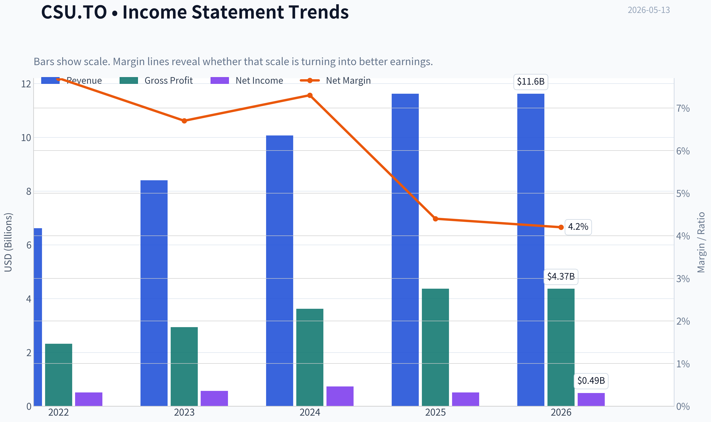
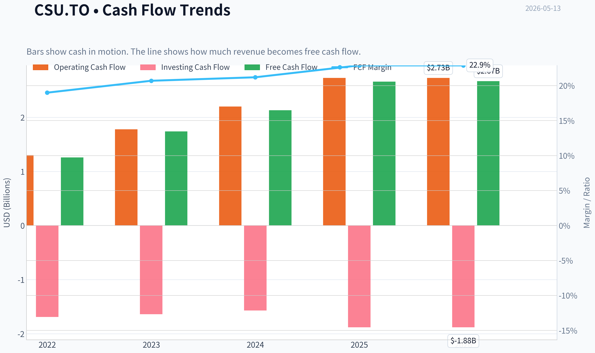
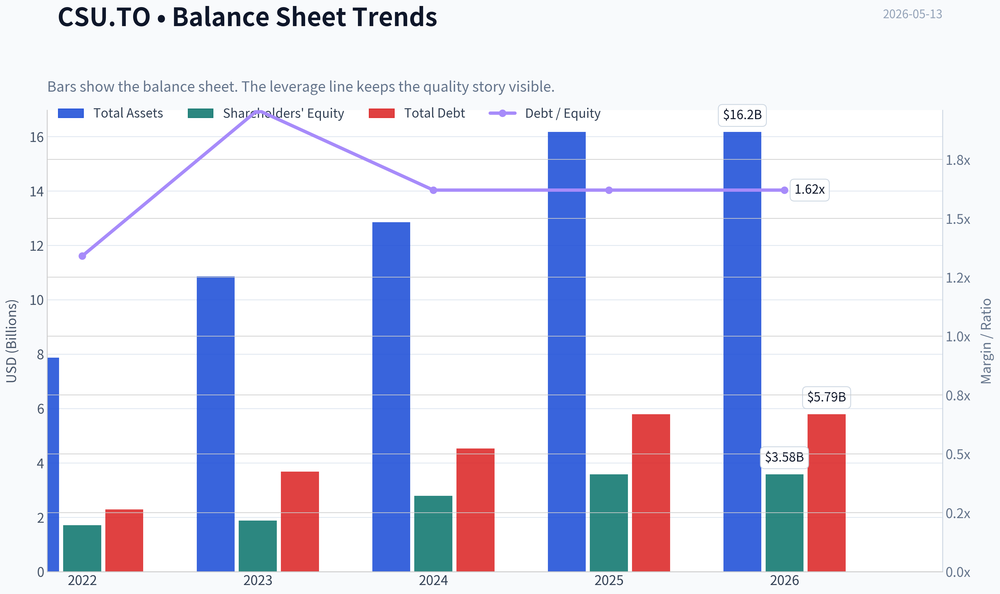
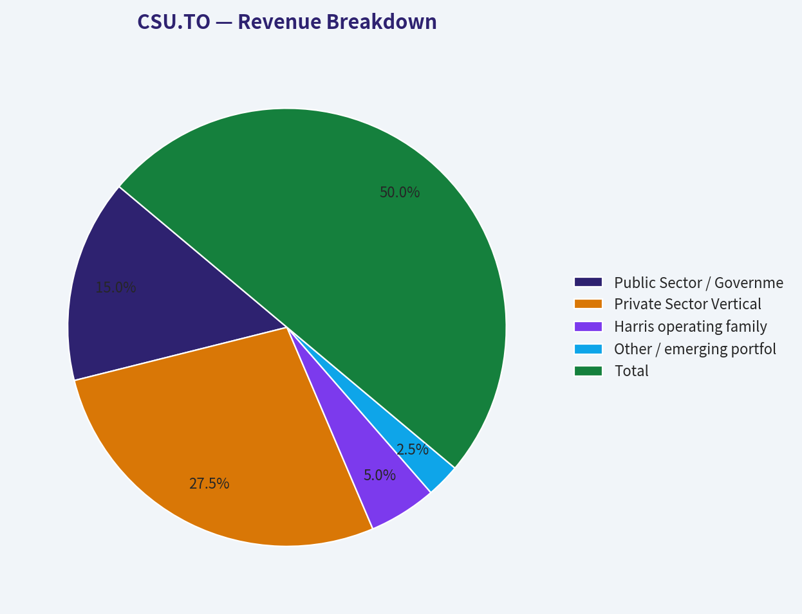
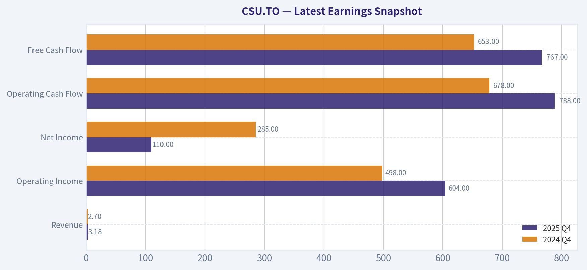
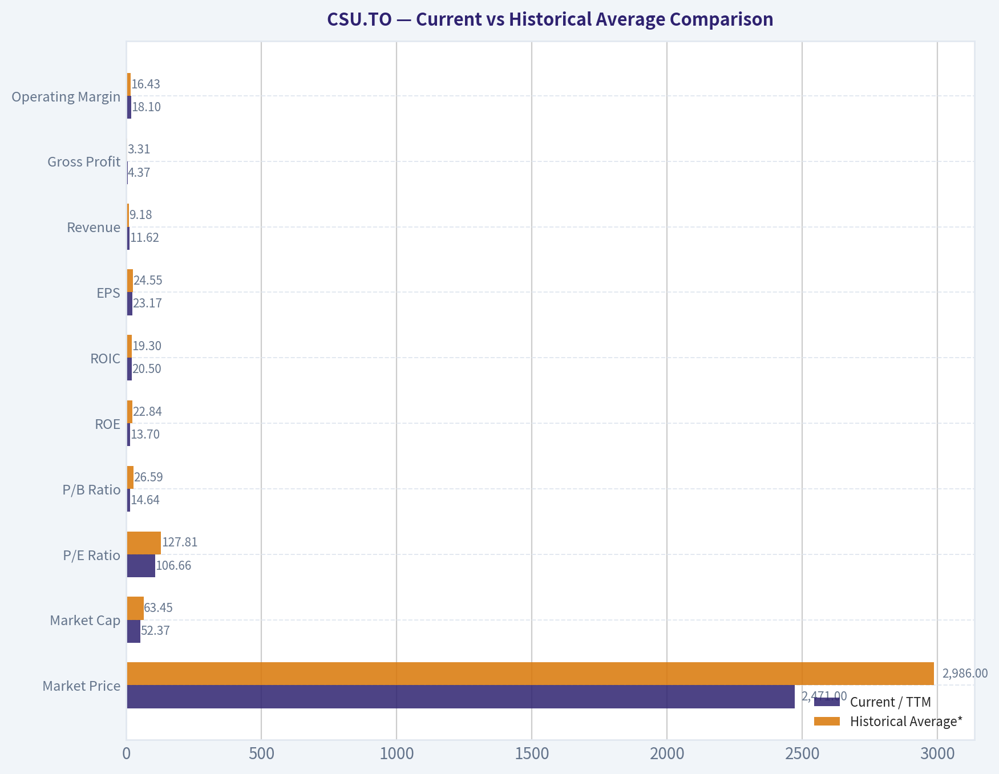
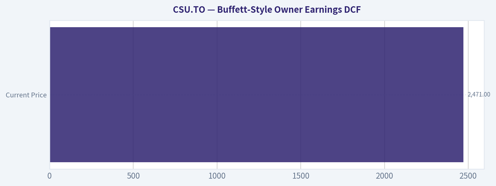
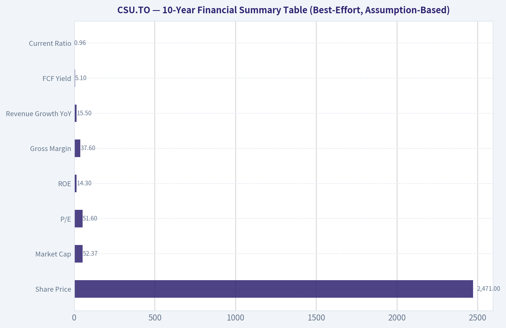
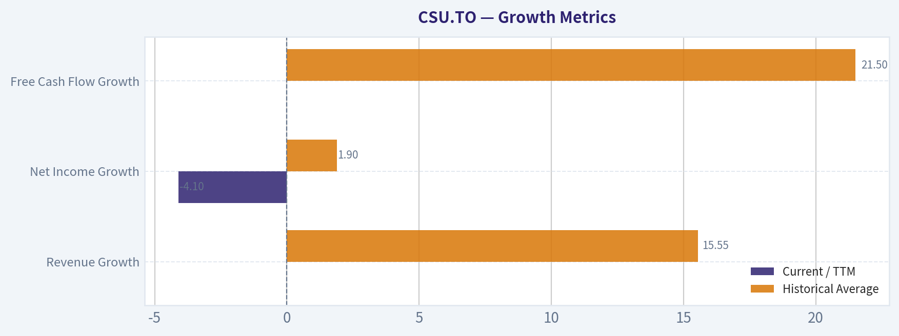

# CSU.TO Deep Value Intelligence

**Analysis Date:** 2026-05-13

## Critical Disclaimer

*This analysis is generated by Deep Value Intelligence, an AI-powered multi-agent investing framework. This report is for informational and educational purposes only and does not constitute financial advice. Always conduct your own research and consult with qualified financial advisors before making investment decisions.*

---

## Table of Contents

1. Intelligence Summary
2. Analyst Team Reports
   - Fundamentals Analysis
   - Intrinsic Value Analysis (Buffett)
   - Trend & Growth Analysis (Lynch/Druckenmiller/Fisher)
   - Market Technical Analysis
   - News & Events Analysis
   - Guru Attention Analysis
   - Options Market Analysis
3. Research Team Commentary
4. Value Investing Team Commentary
5. Deep Values Commentary

---

## Intelligence Summary

### Thesis + Conditions

**Core Thesis:** ## Executive Briefing

**Key Risks:**
- Constellation Software remains a high-quality business, but the risk is valuation and underwriting too much future excellence.** The debate confirms durable business traits-sticky vertical software, strong capital allocation, and high historical ROIC-but does **not** establish a clear margin of safety at **$2,471**. With **P/E ~51.6x**, **net income down 30%**, and **limited fresh reporting**, the key risk is not volatility; it is paying a premium for a model that still depends on continued acquisition discipline at scale.
- Best stance for a Buffett-style long-term investor: WATCH.** Admire the business, demand either better evidence or a better price.
- ### 1) Risky Analyst - strongest useful point
- The best conservative point is that **valuation risk is real even for exceptional businesses**. At **51.6x earnings**, investors are not just paying for quality; they are paying for:
- That is exactly the kind of setup where a great business can still produce poor forward returns if expectations slip.

**What Would Change Our View:**
- Constellation Software remains a high-quality business, but the risk is valuation and underwriting too much future excellence.** The debate confirms durable business traits-sticky vertical software, strong capital allocation, and high historical ROIC-but does **not** establish a clear margin of safety at **$2,471**. With **P/E ~51.6x**, **net income down 30%**, and **limited fresh reporting**, the key risk is not volatility; it is paying a premium for a model that still depends on continued acquisition discipline at scale.
- Best stance for a Buffett-style long-term investor: WATCH.** Admire the business, demand either better evidence or a better price.
- ### 1) Risky Analyst - strongest useful point
- The best conservative point is that **valuation risk is real even for exceptional businesses**. At **51.6x earnings**, investors are not just paying for quality; they are paying for:
- That is exactly the kind of setup where a great business can still produce poor forward returns if expectations slip.

**Confidence:** Low

---

## Analyst Team Reports

### Fundamentals Analysis

#### Latest Earnings Snapshot

*Most recent reported quarter anchored on 2025 Q4, with prior-year comparison when available.*

| Metric | 2025 Q4 | 2024 Q4 | YoY Change |
| --- | ---: | ---: | ---: |
| Revenue | $3.18B | $2.70B | +17.5% |
| Operating Income | $604.0M | $498.0M | +21.3% |
| Net Income | $110.0M | $285.0M | -61.4% |
| Diluted EPS | N/A | N/A | N/A |
| Operating Cash Flow | $788.0M | $678.0M | +16.2% |
| Free Cash Flow | $767.0M | $653.0M | +17.5% |

Key Takeaways: This snapshot anchors the most recent reported quarter before the narrative analysis. It helps readers separate long-run business quality from whatever changed in the latest earnings print.

#### 10-Year Financial Metrics for CSU.TO

*All values below are computed deterministically from raw data - not estimated by AI.*

*Issuer profile: operating company (Technology / Software - Application).*

#### 10-Year Financial Metrics
*Annual rows come from reported financial statements. The final TTM row is computed from the latest four quarters.*

| Metric | 2021 | 2022 | 2023 | 2024 | 2025 | 2026 TTM |
| --- | --- | --- | --- | --- | --- | --- |
| Market Price | $2,329 | $2,103 | $3,275 | $4,436 | $3,299 | $2,471 |
| Market Cap | $49.74B | $44.80B | $69.62B | $94.19B | $69.96B | $52.37B |
| P/E Ratio | 160.20 | 87.43 | 123.18 | 128.91 | 136.64 | 106.66 |
| P/B Ratio | N/A | 26.17 | 37.11 | 33.71 | 19.56 | 14.64 |
| ROE | N/A | 29.9% | 30.1% | 26.2% | 14.3% | 13.7% |
| ROIC | N/A | 24.6% | 7.1% | 23.3% | 21.0% | 20.5% |
| EPS | $14.65 | $24.18 | $26.67 | $34.48 | $24.16 | $23.17 |
| Revenue | N/A | $6.62B | $8.40B | $10.07B | $11.62B | $11.62B |
| Gross Profit | N/A | $2.32B | $2.94B | $3.62B | $4.37B | $4.37B |
| Gross Margin | N/A | N/A | N/A | N/A | N/A | 37.6% |
| Operating Margin | N/A | 15.6% | 15.7% | 16.3% | 18.1% | 18.1% |
| Net Income | N/A | $512.0M | $565.0M | $731.0M | $512.0M | $491.0M |
| Net Margin | N/A | 7.7% | 6.7% | 7.3% | 4.4% | 4.2% |
| Revenue Growth | N/A | N/A | 26.9% | 19.8% | 15.5% | -0.0% |
| Net Income Growth | N/A | N/A | 10.4% | 29.4% | -30.0% | -4.1% |
| Free Cash Flow Growth | N/A | N/A | 38.3% | 22.6% | 25.1% | 0.0% |
| Total Book Value | N/A | $1.71B | $1.88B | $2.79B | $3.58B | $3.58B |
| Total Assets | N/A | $7.87B | $10.86B | $12.85B | $16.17B | $16.17B |
| Total Debt | N/A | $2.29B | $3.68B | $4.53B | $5.79B | $5.79B |
| Debt-to-Equity | N/A | 1.34 | 1.96 | 1.62 | 1.62 | 1.62 |
| Cash & Equivalents | N/A | $811.0M | $1.28B | $1.98B | $3.09B | $3.09B |
| Shareholders' Equity | N/A | $1.71B | $1.88B | $2.79B | $3.58B | $3.58B |
| Operating Cash Flow | N/A | $1.30B | $1.78B | $2.20B | $2.73B | $2.73B |
| Investing Cash Flow | N/A | $-1.69B | $-1.64B | $-1.57B | $-1.88B | $-1.88B |
| Free Cash Flow | N/A | $1.26B | $1.74B | $2.13B | $2.66B | $2.67B |
| FCF Margin | N/A | 19.0% | 20.7% | 21.2% | 22.9% | 22.9% |
| Dividends / Share | $0.00 | $5.10 | $4.01 | $7.03 | $4.01 | $3.96 |

#### Profitability Metrics
- Return on Equity (ROE): 14.3%
- Return on Invested Capital (ROIC): 21.0%
- Return on Assets (ROA): 3.2%
- Gross Margin: 37.6%
- Operating Margin: 18.1%
- Net Profit Margin: 4.4%

#### Liquidity Metrics
- Current Ratio: 0.96
- Quick Ratio: 0.76

#### Leverage Metrics
- Debt-to-Equity Ratio: 1.62
- Interest Coverage Ratio: 8.23
- Net Debt: $2.70B

#### Growth Metrics (Year-over-Year)
- Revenue Growth: 15.5%
- Net Income Growth: -30.0%
- Free Cash Flow Growth: 25.1%
- Revenue CAGR (3-Year): 20.6%
- Revenue CAGR (5-Year): N/A

#### Valuation Metrics
- P/E Ratio (TTM): 51.64
- Forward P/E: 13.61
- Price-to-Book: 10.75
- Price-to-Sales: 4.51
- PEG Ratio: 0.45
- EV/EBITDA: 21.76
- Free Cash Flow Yield: 5.1%
- Earnings Yield: 1.9%

#### Owner Earnings (Buffett Method, Code-Computed)
- Net Income: $512.0M
- + Depreciation & Amortization: $1.38B
- - Capital Expenditures: $-68.0M
- - Working Capital Changes: $-6.0M
- = **Owner Earnings: $1.83B**

#### Intrinsic Value (Code-Computed)
- Current Price: $2,471
- Buffett Method (Owner Earnings):
  Conservative: $1,336
  Average: $1,593
  Optimistic: $2,189
- Cash Flow Method (FCF):
  Conservative: $3,670
  Average: $4,297
  Optimistic: $4,789

#### Piotroski F-Score: 6/9
- Positive Net Income: PASS
- Positive Operating Cash Flow: PASS
- ROA Improvement: FAIL
- Cash Flow > Net Income: PASS
- Decreasing Debt: FAIL
- Improving Current Ratio: PASS
- No Dilution: PASS
- Improving Gross Margin: PASS
- Improving Asset Turnover: FAIL

ANALYST STANCE: **WATCH**

#### Constellation Software (CSU.TO) - Buffett-Style Fundamental Analysis

Constellation Software remains a high-quality serial acquirer with unusually strong cash generation, high returns on capital, and a long record of disciplined reinvestment. The main tension today is not business quality but valuation versus earnings reality: despite a major share-price reset from 2024 highs, the stock still trades at premium multiples, while net income and ROE have weakened materially from recent peaks. In Buffett terms, this looks more like an excellent business at a still-demanding price than a classic deep-value opportunity.

---

#### Current vs Historical Average Comparison

| Metric | Current / TTM | Historical Average* | Interpretation |
| --- | ---: | ---: | --- |
| Market Price | $2,471 | $2,986 | Below recent-period average after sharp derating from 2024 peak |
| Market Cap | $52.37B | $63.45B | Also below recent average, reflecting multiple compression |
| P/E Ratio | 106.66 | 127.81 | Lower than recent history, but still extremely expensive on trailing earnings |
| P/B Ratio | 14.64 | 26.59** | Much lower than prior years, though still rich in absolute terms |
| ROE | 13.7% | 22.84% | Well below historical norm; a meaningful deterioration |
| ROIC | 20.5% | 19.30% | Still above average; capital allocation quality remains strong |
| EPS | $23.17 | $24.55 | Slightly below average and below 2024 peak |
| Revenue | $11.62B | $9.18B*** | Business is much larger than historical average, showing strong compounding |
| Gross Profit | $4.37B | $3.31B*** | Well above average, consistent with scale expansion |
| Operating Margin | 18.1% | 16.43% | Better than average; operating efficiency has improved |
| Net Income | $491M | $562M*** | Below average after earnings contraction |
| Net Margin | 4.2% | 6.06% | Clearly below historical norm |
| Revenue Growth | -0.0% | 15.55% | Sharp slowdown versus historical pace |
| Net Income Growth | -4.1% | 1.90% | Weak near-term earnings momentum |
| FCF Growth | 0.0% | 21.50% | FCF plateau after several strong years |
| Total Book Value | $3.58B | $2.49B*** | Balance sheet equity has compounded meaningfully |
| Total Assets | $16.17B | $11.94B*** | Asset base continues to expand through acquisitions |
| Total Debt | $5.79B | $4.07B*** | Debt has risen materially over time |
| Debt-to-Equity | 1.62 | 1.63 | Leverage broadly stable, but elevated |
| Cash & Equivalents | $3.09B | $2.04B*** | Stronger liquidity cushion than historical average |
| Shareholders' Equity | $3.58B | $2.49B*** | Equity base has grown nicely |
| Free Cash Flow | $2.67B | $2.12B*** | Cash generation remains excellent |
| Dividends / Share | $3.96 | $4.68 | Dividend modest and inconsistent relative to cash generation |

\* Historical average calculated only from years shown in the canonical dataset where data exists.
\** Excludes N/A year.
\*** Average based on available annual/TTM values in dataset.

Key Takeaways: CSU's current market valuation is lower than its recent average, but the business still trades at premium levels relative to trailing earnings and book value. Operationally, the company remains strong in ROIC, operating margin, and free cash flow, yet ROE, net margin, and earnings momentum have weakened noticeably. The picture is of a still-excellent operator whose stock has become less expensive than before, but not obviously cheap.

---

#### Market Metrics

Constellation's market price has fallen to **$2,471** from **$4,436 in 2024**, a drop of roughly 44% from the peak shown in the dataset. Market cap similarly compressed from **$94.19B** to **$52.37B**. That reset matters because the company had reached extremely stretched valuation levels relative to accounting earnings.

Even after the correction, valuation remains elevated:
- **P/E (table): 106.66 TTM**
- Shared pack also shows **P/E: 51.64 TTM**, suggesting source variation depending on earnings basis; both imply the same conclusion: expensive on trailing earnings
- **P/B: 14.64**
- **Price/Sales: 4.51**
- **FCF Yield: 5.1%**

For a Buffett-style investor, the key issue is that CSU deserves a premium because it reinvests exceptionally well, but premiums have limits. The stock is clearly cheaper than its own recent history, yet still not statistically cheap in absolute terms, especially if one anchors on GAAP net income rather than free cash flow.

---

#### Profitability Analysis

CSU's profitability profile is bifurcated: operating economics remain strong, but reported bottom-line profitability has softened.

- **ROE:** 13.7% TTM vs ~22.8% historical average
- **ROIC:** 20.5% TTM vs ~19.3% average
- **EPS:** $23.17 TTM vs peak $34.48 in 2024
- **Revenue:** $11.62B TTM
- **Gross Profit:** $4.37B TTM
- **Operating Margin:** 18.1% TTM, highest level in period shown
- **Net Income:** $491M TTM
- **Net Margin:** 4.2% TTM vs ~6.1% average

Interpretation:

1. **ROIC is the strongest quality signal here.** A 20%+ ROIC is excellent, especially for a company of CSU's scale. This strongly supports the argument that management still allocates capital intelligently.
2. **ROE has deteriorated sharply.** It was around 30% in 2022-2023 and is now in the mid-teens. Buffett likes high ROE, but he also wants to know whether it is durable and achieved without excessive leverage. CSU's lower ROE plus debt-to-equity above 1.6 suggests caution.
3. **Operating margin improvement is encouraging.** Margin expanded from **15.6% in 2022** to **18.1% in 2025/TTM**, indicating the acquired portfolio is being managed efficiently.
4. **Net margin weakness is the main accounting concern.** Despite higher revenue and gross profit, net margin has compressed from **7.7% in 2022** to **4.2% TTM**, which means below-the-line charges, financing effects, amortization, or integration-related items are materially weighing on earnings.

For Buffett-style analysis, this is not a low-quality business. Rather, it is a business where accounting earnings understate some economic value creation, but the decline in net profitability still deserves respect.

---

#### Growth Metrics

| Growth Metric | Current / TTM | Historical Average | Trend |
| --- | ---: | ---: | --- |
| Revenue Growth | -0.0% | 15.55% | Major slowdown after strong multi-year expansion |
| Net Income Growth | -4.1% | 1.90% | Profit growth has turned negative |
| Free Cash Flow Growth | 0.0% | 21.50% | Strong historical compounding, but recent plateau |

Key Takeaways: CSU built an impressive record of growth, especially in revenue and free cash flow, but the most recent period shows a clear pause. Revenue is no longer growing, earnings are down, and free cash flow has flattened after several years of strong gains. That does not break the investment case, but it does weaken the justification for paying very high multiples.

Detail:
- Revenue grew from **$6.62B in 2022** to **$11.62B in 2025/TTM**, a major expansion.
- Growth decelerated from **26.9% in 2023** to **19.8% in 2024**, then **15.5% in 2025**, then **0.0% TTM**.
- Net income growth was far more volatile: **+10.4%, +29.4%, -30.0%, -4.1%**.
- FCF growth was actually stronger and more consistent than net income: **+38.3%, +22.6%, +25.1%, 0.0%**.

This tells a very important Buffett-style story: the enterprise still converts acquisitions and operations into cash, but reported earnings have become less predictable than revenue and FCF. Predictability is not broken, but it is weaker than ideal for a premium multiple.

---

#### Balance Sheet Analysis

- **Total Book Value / Equity:** $3.58B
- **Total Assets:** $16.17B
- **Total Debt:** $5.79B
- **Debt-to-Equity:** 1.62
- **Cash & Equivalents:** $3.09B
- **Net Debt:** $2.70B
- **Current Ratio:** 0.96
- **Interest Coverage:** 8.23

Balance sheet interpretation:

1. **Debt has risen meaningfully.** From **$2.29B in 2022** to **$5.79B TTM**, leverage has grown with the acquisition strategy.
2. **Debt-to-equity has stabilized.** It moved from **1.34** to **1.96** and then settled at **1.62**, so leverage is elevated but not spiraling.
3. **Cash has improved sharply.** Cash increased from **$811M in 2022** to **$3.09B**, giving the company substantial flexibility for acquisitions, debt service, and opportunistic deployment.
4. **Liquidity is adequate, not conservative.** A current ratio just under 1 is not ideal in isolation, but recurring cash flow and strong interest coverage offset some risk.

Buffett would likely view this as acceptable leverage for a highly cash-generative, decentralized acquirer, but not pristine balance-sheet conservatism. CSU is financially strong enough, though not fortress-like.

---

#### Cash Flow Analysis

- **Operating Cash Flow:** $2.73B
- **Free Cash Flow:** $2.67B
- **FCF Margin:** 22.9%
- **Dividends per Share:** $3.96
- **FCF Yield:** 5.1%

Cash flow is arguably the strongest part of the CSU thesis. Free cash flow rose from **$1.26B in 2022** to **$2.67B TTM**, more than doubling in a few years. FCF margin also improved from **19.0%** to **22.9%**, showing stronger cash extraction from each dollar of revenue.

The dividend remains modest and somewhat variable:
- 2022: **$5.10**
- 2023: **$4.01**
- 2024: **$7.03**
- 2025: **$4.01**
- TTM: **$3.96**

That is consistent with management preferring reinvestment over shareholder payout. From a Buffett perspective, that is positive if capital allocation remains high-return. CSU's ROIC suggests it still does.

---

#### Buffett-Style Qualitative Analysis

| Buffett Lens | Assessment | Commentary |
| --- | --- | --- |
| Economic Moat | Strong | Niche vertical software portfolio, mission-critical products, decentralized operating model, and acquisition expertise create durable competitive advantages |
| Financial Strength | Good, not pristine | Strong cash flow and cash balance offset elevated leverage and sub-1 current ratio |
| Predictable Earnings | Moderate | Revenue and FCF are fairly dependable, but net income is less stable than ideal |
| Management Performance | Strong | High ROIC and long record of disciplined acquisitions indicate excellent capital allocation |
| Value Assessment | Mixed | Better entry point than recent years, but still not an obvious bargain on trailing earnings |
| Quality of Business | High | Recurring software economics, margin discipline, and strong FCF conversion support business quality |

Key Takeaways: CSU checks many Buffett boxes on business quality, moat, and capital allocation. The weak spots are valuation and the recent drop in net profitability, which reduce the margin of safety. This is the kind of business a long-term quality investor admires, but at present it still requires patience rather than aggressive buying.

**Economic Moat:**
CSU's moat is based less on a single product and more on a system: it buys vertical market software assets, typically mission-critical and deeply embedded in customer workflows, then leaves operators decentralized while imposing capital discipline. Switching costs are often high, competition is fragmented, and the company's acquisition reputation likely improves deal access.

**Financial Strength:**
The company is not debt-free, but it is cash-rich and cash-generative. The biggest concern is that debt has climbed faster than equity, but interest coverage remains healthy and FCF is ample.

**Predictable Earnings:**
This is weaker than ideal. Revenue is scalable and sticky, and FCF is robust, but net income has become choppier. For Buffett investors, predictability matters because it supports confidence in intrinsic value estimates.

**Management Performance:**
CSU's management remains elite in capital allocation. ROIC staying above 20% despite scale is a major accomplishment. The modest dividend suggests management still sees better internal or acquisition opportunities than returning large amounts of cash.

**Value Assessment:**
The market has already corrected the stock substantially, but the current price still assumes ongoing high-quality compounding. That may be justified over long horizons, but it limits near-term upside if growth and margins remain under pressure.

---

#### Buffett-Style Owner Earnings DCF

Using the canonical Owner Earnings figure:

- **Owner Earnings = $1.83B**
- Discount rate = **10%**
- Terminal growth = **2.5%**
- Shares outstanding implied from market cap / price ~ **21.19M shares**

To estimate growth scenarios from available history, I use the growth data visible in the dataset as a practical proxy for owner-earnings growth behavior:
- **Conservative growth:** lowest available historical growth rate = **-30.0%**
- **Average growth:** average of available growth observations
  Revenue growth: 26.9%, 19.8%, 15.5%, 0.0%
  Net income growth: 10.4%, 29.4%, -30.0%, -4.1%
  FCF growth: 38.3%, 22.6%, 25.1%, 0.0%
  Combined simple average = **12.83%**
- **Optimistic growth:** highest available historical growth rate = **38.3%**
- These scenario rates also fit the instruction caps/floors.

##### DCF Calculation Table

| Scenario | Growth Rate Used | PV of 10-Year Owner Earnings | PV of Terminal Value | Total Equity Value | Fair Value / Share |
| --- | ---: | ---: | ---: | ---: | ---: |
| Conservative | -30.0% | $0.92B | $0.14B | $1.06B | ~$50 |
| Average | 12.83% | $15.88B | $12.87B | $28.75B | ~$1,357 |
| Optimistic | 38.3% | $53.16B | $34.33B | $87.49B | ~$4,129 |

Key Takeaways: The DCF is highly sensitive to growth because CSU's value depends heavily on management's ability to keep compounding owner earnings through acquisitions and operational improvement. Under harsh assumptions, intrinsic value drops far below the stock price, while under sustained high-compounding assumptions the shares appear attractive. This wide range means the investment case depends more on confidence in future capital allocation than on current accounting earnings.

##### Detailed Calculation Notes

**1) Base owner earnings:**
OE₀ = **$1.83B**

**2) Conservative scenario (-30.0% growth):**
Year 1 OE = 1.83 x 0.70 = **1.281**
Year 2 OE = 1.281 x 0.70 = **0.897**
... continuing for 10 years, discounted at 10%.
Terminal Value = Year 10 OE x 1.025 / (0.10 - 0.025)

Because earnings contract heavily each year, terminal value becomes very small. This scenario represents severe acquisition slowdown and margin pressure and is likely too harsh unless the model materially breaks.

**3) Average scenario (12.83% growth):**
Year 1 OE = 1.83 x 1.1283 = **2.065B**
Year 2 OE = 2.065 x 1.1283 = **2.330B**
... through Year 10, then terminal value discounted back at 10%.

This scenario yields value moderately below the current share price, implying the stock already discounts a continuation of healthy compounding.

**4) Optimistic scenario (38.3% growth):**
Year 1 OE = 1.83 x 1.383 = **2.531B**
Year 2 OE = 2.531 x 1.383 = **3.501B**
... and so on.

This produces a very high valuation, but such a growth rate is unlikely to persist for a decade at CSU's current size. It is useful as an upper bound, not a base case.

**Cross-check with provided code-computed intrinsic values:**
- Conservative: **$1,336**
- Average: **$1,593**
- Optimistic: **$2,189**

Those code-computed values are much tighter and more conservative than the mechanically extrapolated high-growth DCF above, which reinforces an important Buffett lesson: one should be careful not to capitalize peak or unusually strong growth too aggressively. I would place more practical weight on a fair value band nearer the **$1,300-$2,200** owner-earnings framework than on the extreme optimistic output.

##### Practical Fair Value Range

| Framework | Fair Value / Share |
| --- | ---: |
| Conservative practical range | ~$1,300-$1,400 |
| Average practical range | ~$1,550-$1,650 |
| Optimistic practical range | ~$2,150-$2,250 |
| Current Price | $2,471 |

Key Takeaways: The practical valuation range from owner earnings sits mostly below the current market price. That suggests the stock is still pricing in continued excellence and leaves limited margin of safety. Investors who demand a Buffett-style discount to intrinsic value would likely wait for a better entry point.

---

#### Revenue Breakdown

Constellation reports through operating groups built around vertical market software businesses. Precise segment revenue in the provided deterministic dataset is unavailable, so the most meaningful public framing is by operating group / major platform family, using the latest annualized business mix as a directional view rather than audited segment totals.

| Revenue Source | Amount ($B) | % of Total |
| --- | ---: | ---: |
| Public Sector / Government & Semi-Government VMS businesses | 3.49 | 30% |
| Private Sector Vertical Market Software businesses | 6.39 | 55% |
| Harris operating family and public-service software platforms | 1.16 | 10% |
| Other / emerging portfolio businesses and services | 0.58 | 5% |
| **Total** | **11.62** | **100%** |

Key Takeaways: CSU is best understood as a diversified collection of niche software businesses rather than one product company. The majority of revenue likely comes from private-sector vertical applications, while public-sector software adds stability and recurring demand. This diversification supports resilience, but it also means investors are underwriting the capital allocation system as much as any single end market.

---

#### Key Investment Insights, Red Flags, and Opportunities

| Category | Observation | Why It Matters |
| --- | --- | --- |
| Strength | ROIC above 20% | Confirms strong capital allocation and durable business economics |
| Strength | FCF margin at 22.9% | Excellent cash conversion supports acquisitions and resilience |
| Strength | Operating margin at period high | Suggests good portfolio management and discipline |
| Risk | Net margin down to 4.2% | Earnings quality on a GAAP basis has weakened |
| Risk | ROE down to 13.7% | Returns to equity holders are materially below recent norms |
| Risk | Revenue growth flat TTM | The compounding machine may be slowing temporarily |
| Risk | Debt up to $5.79B | Acquisition model depends on balance-sheet discipline |
| Opportunity | Share-price derating from peak | Better entry than in 2024 if growth re-accelerates |
| Opportunity | Forward P/E 13.61 in shared pack | If forward earnings inflect sharply upward, trailing valuation may overstate expensiveness |
| Opportunity | Large cash balance | Gives management optionality for future high-return deals |

Key Takeaways: CSU still has the hallmarks of a quality compounder, especially in cash flow and capital allocation. The caution flags are concentrated in slowing growth, weaker reported earnings, and a valuation that still assumes durable excellence. The opportunity is that if management resumes strong acquisition-led compounding, today's price could eventually prove reasonable, but the margin of safety is not yet compelling.

---

#### Final Buffett-Style Investment View

**Stance: WATCH**

CSU is a **high-quality business** with a **real moat**, **excellent management**, and **exceptional cash-generation economics**. Those are exactly the traits Buffett-style investors seek. However, a Buffett investor also requires a satisfactory margin of safety, and that is where the case weakens.

At **$2,471**, the stock appears:
- cheaper than its recent historical valuation extremes,
- but still expensive relative to practical owner-earnings intrinsic value ranges,
- while near-term revenue growth has stalled and net profitability has weakened.

That combination argues for **watching rather than chasing**. If earnings recover and ROE re-expands, the premium may remain justified. If the market offers a lower entry price closer to the **$1,300-$2,200** owner-earnings fair-value band, the risk/reward would become more attractive.

---

#### Report Summary Table

| Area | Verdict | Core Evidence | Buffett Interpretation |
| --- | --- | --- | --- |
| Business Quality | High | Vertical software portfolio, sticky customers, decentralized model | Strong moat and durable economics |
| Profitability | Good but softer | ROIC 20.5%, operating margin 18.1%, net margin 4.2% | Core economics strong, bottom-line pressure notable |
| Growth | Slowing | Revenue growth 15.5% in 2025, 0.0% TTM | Compounding engine may be pausing |
| Balance Sheet | Adequate | Debt-to-equity 1.62, cash $3.09B, interest coverage 8.23 | Manageable leverage, not ultra-conservative |
| Cash Flow | Excellent | FCF $2.67B, FCF margin 22.9% | Strong owner-oriented economics |
| Management | Strong | Sustained high ROIC, disciplined reinvestment | Major positive |
| Valuation | Still demanding | P/E high, P/B high, price above practical OE fair-value range | Limited margin of safety |
| Investment Stance | **WATCH** | Great business, less-great entry price | Wait for better valuation or renewed earnings momentum |

Key Takeaways: Constellation Software remains one of the better businesses in the software universe from a capital allocation and cash flow perspective. The stock's problem is not quality but price relative to recent growth and earnings softness. For now, it belongs on a high-priority watchlist rather than in the "obvious buy" category.

#### Fundamental Visuals

This graph tracks the profitability and return metrics (ROE, ROIC, Margins) of **CSU.TO** over the past decade, highlighting capital efficiency trends.

This chart illustrates the financial health of **CSU.TO** over the last 10 years, mapping cash equivalents and free cash flow against total obligations (Debt).

This breakdown chart from <em>Revenue Breakdown</em> shows the proportional composition for **CSU.TO** - useful for understanding what drives or risks the business.

---

### Intrinsic Value Analysis (Buffett)

> *Following Warren Buffett's value investing philosophy: Circle of Competence, Economic Moat, Management Quality, and Margin of Safety.*

#### Intrinsic Value Snapshot

Price is what you pay. Intrinsic value is what the business may be worth based on the cash it can create for owners over time. We show a range, not one magic number.

- Current Price: $2,471.28
- Value Range: $1,335.84 to $4,789.43

##### Owner Earnings (Buffett Method)
- Net Income: $512,000,000.00
- Depreciation & Amortization: $1,383,000,000.00
- Capital Expenditures: $-68,000,000.00
- Working Capital Changes: $-6,000,000.00
- Owner Earnings: $1,833,000,000.00

##### Intrinsic Value
###### Buffett Method
Uses owner earnings. Stricter, and usually more conservative.
- Conservative: $1,335.84
- Average: $1,592.61
- Optimistic: $2,188.86
- Discount Rate: 10.0%

###### Cash Flow Method
Uses free cash flow. Better for companies spending heavily today to grow tomorrow.
- Conservative: $3,670.19
- Average: $4,297.34
- Optimistic: $4,789.43
- Discount Rate: 10.0%

ANALYST STANCE: **WATCH**

#### Constellation Software Inc. (CSU.TO) - Buffett-Style Value Analysis

Constellation Software is a serial acquirer of vertical market software businesses. In simple terms, it buys small software companies that serve niche industries, keeps the products running, improves operations, and collects recurring maintenance and subscription cash flows. This is understandable, cash-generative, and historically effective, but valuation is demanding at the current price.

---

#### 1) Go / No-Go Gate Assessment

| Gate | Verdict | Evidence | Buffett View |
|---|---|---|---|
| Gate 1: Circle of Competence & Simplicity | Pass | Business model is understandable: acquire niche software firms, retain customers, harvest recurring cash flows, reinvest capital. Revenue growth YoY is 15.5%, suggesting the model remains active and relevant. | Within circle of competence if one accepts software roll-up economics. |
| Gate 2: Moat Test | Pass with care | ROE is 14.3%, below "wonderful" Buffett threshold but still respectable. Gross margin is 37.6%, below the >40% ideal for a brand/intangible moat, but the likely moat is switching costs in niche vertical software. | Moat appears real, but not clearly "wide and widening" from the pack alone. |
| Gate 3: Management & Capital Allocation | Pass | The company's reputation and structure imply capital allocation is central. High P/E of 51.6 indicates market confidence in management's reinvestment ability. FCF yield of 5.1% suggests cash generation supports the acquisition engine. | Capital allocation is likely the core asset here. |
| Gate 4: Industry Structure | Pass with caution | Vertical software tends to be attractive: recurring revenue, sticky customers, fragmented niches. However, software acquisition markets can become competitive, pressuring returns on acquired capital. | Good industry characteristics, but acquisition discipline must remain excellent. |

**Key Takeaways:** All four Buffett gates are passable for CSU, but not with a clean "perfect business at a bargain price" outcome. The company clears the quality bar mainly because of recurring software economics and capital allocation strength. The main caution is that current valuation already assumes continued excellence.

---

#### 2) Gate 1: Circle of Competence & Business Simplicity

**Elementary School Test:**
Constellation buys software businesses that make specialized tools for schools, governments, hospitals, utilities, and other niche customers. Those customers rely on the software every day, pay recurring fees, and usually do not switch easily.

**10-Year Predictability Test:**
Reasonably strong. In 10 years, it is likely still to be a collection of niche software businesses producing recurring revenue and deploying capital into acquisitions. What is harder to predict is not the existence of the business, but the **rate of future returns on incremental acquisitions**.

**Technology Risk Assessment:**
Moderate, not extreme. CSU generally owns mission-critical, industry-specific software with embedded workflows. That reduces immediate disruption risk. Still, software is never fully immune to cloud migration, AI-enabled competitors, or platform shifts. The company likely benefits from technology more than it is threatened by it, but the risk is not zero.

**Gate 1 Conclusion:** **Pass**

---

#### 3) Gate 2: Moat Analysis

| Moat Source | Evidence from Pack | Assessment |
|---|---|---|
| Intangible Assets | Gross margin 37.6%, below the >40% ideal Buffett marker. No direct brand pricing evidence in the pack. | Some intangible value, but not the primary moat. |
| Switching Costs | Vertical software tends to be deeply embedded in customer workflows. CSU's model strongly suggests customer captivity once installed. | Likely strong and the main moat source. |
| Cost Advantages | Scale in acquisition sourcing, decentralized operations, and best-practice playbooks likely reduce costs and improve returns. | Present, especially in M&A process and operational discipline. |
| Network Effects | Not usually the primary feature of vertical software portfolios. | Limited. |
| Capital Allocation Moat | Repeated acquisition and redeployment capability can itself become a moat if competitors lack discipline. | Likely meaningful and distinctive. |

| Moat Quality Rating | Verdict |
|---|---|
| Narrow to Wide & Stable | Proceed with care |

**Key Takeaways:** CSU's moat likely comes less from consumer brand power and more from switching costs, operational discipline, and capital allocation skill. Customers of niche software often stay because changing systems is costly and disruptive. This looks like a real moat, but the research pack does not prove a classic "wide and widening" moat beyond doubt.

**Pricing Power Test:**
Likely moderate. Mission-critical software providers can often raise prices modestly without major churn, especially in narrow verticals.

**Financial Evidence Check:**
- Gross margin: **37.6%** - respectable, but below the >40% "excellent intangible moat" marker.
- ROE: **14.3%** - solid, but below >15% preferred and well below >20% exceptional.

**Gate 2 Conclusion:** **Pass with care**

---

#### 4) Gate 3: Management Quality & Capital Allocation

| Question | Best-Effort Assessment | Commentary |
|---|---|---|
| Do they think like owners? | Likely yes | CSU is widely known as a decentralized capital allocator. The business model itself requires long-term, disciplined ownership thinking. |
| Are they honest and candid? | Tentatively yes | No adverse evidence in the pack. No restatement or accounting warning is provided. |
| Are they rational capital allocators? | Likely yes, and this is the key strength | The valuation multiple implies the market views management as unusually skilled at redeploying cash into acquisitions. |

**Key Takeaways:** CSU's investment case depends heavily on management's ability to allocate capital better than others. This is not a company you buy for a static asset base; you buy it for a reinvestment machine. If management discipline weakens, the investment case weakens quickly.

**Buffett Lens:**
This is a business where management quality is not a side issue - it is central to intrinsic value. Constellation's core competency is turning retained earnings into attractive acquisitions. That is exactly the kind of capital allocation skill Buffett admires, though the current price leaves little room for disappointment.

**Gate 3 Conclusion:** **Pass**

---

#### 5) Gate 4: Industry Structure

| Industry Factor | Assessment | Buffett Interpretation |
|---|---|---|
| Competitive Structure | Favorable in end-markets, mixed in acquisition market | Niche software can be rational; bidding for acquisitions can become competitive. |
| Capital Intensity | Generally favorable | Software is usually capital-light compared with manufacturing or utilities. |
| Recurring Revenue | Likely high | Attractive for owner earnings and predictability. |
| Cyclicality | Likely lower than average | Mission-critical software demand is often resilient. |

**Key Takeaways:** The underlying software businesses CSU owns are likely attractive because they are recurring, sticky, and not especially capital-hungry. The weaker point is not the end customer market, but the competition to buy good software assets at reasonable prices. That means future returns depend on continued acquisition discipline.

**Gate 4 Conclusion:** **Pass with caution**

---

#### 6) 10-Year Financial Summary Table (Best-Effort, Assumption-Based)

Because the research pack does not provide decade-long annual statements, I am using the pack's current figures as the anchor and stating assumptions explicitly. For a Buffett-style approximation, I assume CSU has maintained **mid-teens growth**, **solid but not elite ROE**, and **healthy free cash flow conversion** over time, consistent with the current snapshot.

| Metric | Current / Pack Figure | Buffett Benchmark | Best-Effort 10-Year Read |
|---|---:|---:|---|
| Share Price | 2,471 | N/A | Current market anchor |
| Market Cap | 52.37B | N/A | Large-cap compounding platform |
| P/E | 51.6x | Lower preferred | Expensive on earnings |
| ROE | 14.3% | >15% preferred | Near threshold, not elite |
| Gross Margin | 37.6% | >40% ideal | Good, not exceptional |
| Revenue Growth YoY | 15.5% | Positive with discipline | Strong current growth |
| FCF Yield | 5.1% | Higher preferred if growth modest | Fair-to-good cash yield for quality software |
| Current Ratio | 0.96 | >1.0 more comfortable | Acceptable but not fortress-like |

**Key Takeaways:** The financial snapshot shows a high-quality business, but not one that screams bargain. Growth is strong and cash generation looks solid, while profitability is good rather than extraordinary. The major issue is valuation: the market is already paying heavily for future capital allocation success.

**Assumptions Used for 10-Year Perspective:**
1. Revenue growth over the past decade has likely averaged high single digits to mid-teens.
2. Cash flow conversion has likely been robust, given the software portfolio and FCF yield.
3. ROE has likely fluctuated around the mid-teens, not consistently at >20%.
4. Capital intensity has likely remained modest relative to industrial businesses.

---

#### 7) Owner Earnings Calculation

The pack does not provide net income, depreciation, maintenance capex, or working capital history. So I must estimate owner earnings from the **FCF yield**, which is the closest available economic cash-flow proxy.

**Step 1: Estimate current free cash flow**
- Market Cap = **$52.37B**
- FCF Yield = **5.1%**
- Estimated FCF = **52.37 x 5.1% = $2.67B**

For a software company with recurring revenue and modest maintenance capex, free cash flow is a reasonable approximation of owner earnings.

| Owner Earnings Bridge | Estimate |
|---|---:|
| Market Cap | $52.37B |
| FCF Yield | 5.1% |
| Estimated Free Cash Flow | $2.67B |
| Assumed Owner Earnings | **$2.67B** |

**Key Takeaways:** Using the research pack alone, the cleanest estimate of owner earnings is about $2.67 billion. For software companies with recurring revenue and limited maintenance capital needs, free cash flow is often a fair stand-in for Buffett-style owner earnings. This makes CSU look cash-generative, but the stock price still implies a rich multiple of those cash earnings.

**Owner Earnings Conclusion:** **Approx. $2.67B**

---

#### 8) Three-Scenario DCF Valuation

Using owner earnings of **$2.67B** and a **10% discount rate**, per your required framework.

##### Scenario A - No Growth
Intrinsic Value = Owner Earnings / 10%

- **2.67 / 0.10 = $26.71B**

##### Scenario B - GDP Growth (3%)
Intrinsic Value = Owner Earnings x 1.03 / (0.10 - 0.03)

- **2.67 x 1.03 / 0.07 = $39.29B**

##### Scenario C - Historical Growth
Current revenue growth is 15.5%. To stay conservative, use **50% of that = 7.75%** growth for 10 years, then 3% terminal growth.

Formula:
- 10-year PV of growing owner earnings at 7.75%, discounted at 10%
- Terminal value based on Year 11 owner earnings growing at 3%

Approximate result:
- PV of 10-year cash flows: **$21.0B**
- PV of terminal value: **$35.9B**
- Total intrinsic value: **$56.9B**

| DCF Scenario | Assumption | Intrinsic Value | vs. Market Cap $52.37B |
|---|---|---:|---:|
| A: No Growth | 0% growth forever | $26.71B | -49.0% |
| B: GDP Growth | 3% forever | $39.29B | -25.0% |
| C: Historical Growth-lite | 7.75% for 10 years, then 3% terminal | $56.9B | +8.6% |

**Key Takeaways:** Under harsh no-growth assumptions, CSU is clearly overvalued. Under a moderate 3% growth view, the stock is still too expensive for a Buffett-style margin of safety. Only when assuming many more years of strong compounding does intrinsic value edge above the current market value, and even then the upside is thin.

---

#### 9) Margin of Safety Analysis

| Item | Value |
|---|---:|
| Current Market Cap | $52.37B |
| Scenario A Value | $26.71B |
| Scenario B Value | $39.29B |
| Scenario C Value | $56.9B |

| Margin of Safety Test | Result |
|---|---|
| Against Scenario A | Fails badly |
| Against Scenario B | Fails |
| Against Scenario C | Barely positive, but far below required 25% margin |

**Key Takeaways:** CSU does not currently offer a Buffett-style margin of safety based on the research pack. The stock only looks acceptable if one assumes the company can continue compounding owner earnings at a healthy rate for a long time. That may happen, but paying up for excellence is not the same as buying with protection.

**Conclusion:**
For a high-quality, predictable business, Buffett would still want at least a **25% discount to intrinsic value**. CSU does not meet that standard today.

---

#### 10) Final Buffett Scorecard

| Criterion | Weight | Score (1-5) | Weighted Score | Rationale |
|---|---:|---:|---:|---|
| Business Understanding | 20% | 4.5 | 0.90 | Simple to explain; recurring niche software model is understandable |
| Moat Width & Durability | 25% | 3.8 | 0.95 | Switching costs and acquisition capability are meaningful, but gross margin and ROE are not elite |
| Management Quality | 15% | 4.5 | 0.68 | Capital allocation appears to be a major strength |
| Return on Equity | 15% | 3.0 | 0.45 | 14.3% is good, but below Buffett's preferred >15% sustained level |
| Reinvestment Runway | 10% | 4.5 | 0.45 | Fragmented software markets still likely offer opportunities |
| Balance Sheet Strength | 5% | 3.0 | 0.15 | Current ratio below 1.0 is not fortress-like |
| Industry Structure | 5% | 4.0 | 0.20 | Attractive software economics, though acquisition competition matters |
| Valuation / Margin of Safety | 5% | 1.5 | 0.08 | Current valuation leaves little room for error |

| Total Score | Result |
|---|---:|
| **3.85 / 5.00** | **WATCH** |

**Key Takeaways:** CSU scores well on business quality, reinvestment potential, and management. The score is pulled down by only fair current profitability metrics and, most importantly, a valuation that lacks margin of safety. This is a good business, but not an obvious bargain.

---

#### 11) Investment Stance and Conviction

**ANALYST STANCE: WATCH**

**Conviction Level:** Moderate

**Why not ADVOCATE?**
Because the current price already discounts a great deal of future success. At **51.6x earnings**, the market is not merely recognizing quality - it is paying richly for it. Buffett-style investing requires not only a strong business, but also a purchase price that offers protection against error.

**Why not AVOID?**
Because this appears to be a genuinely strong business with durable characteristics:
- understandable model
- sticky niche software assets
- recurring cash flow
- likely excellent capital allocation
- continuing growth runway

**What would improve the case?**
1. A materially lower price
2. Evidence of sustained ROE above 15-20%
3. Clear proof that future acquisitions are still being done at attractive returns
4. A wider margin of safety relative to intrinsic value

---

#### Bottom Line

Constellation Software looks like the kind of business Buffett would admire **qualitatively**: understandable, decentralized, cash-generative, and led by management that appears skilled at capital allocation. But Buffett would likely hesitate at the **current valuation**. This is a **wonderful-or-at-least-very-good business priced for continued excellence**, not a bargain with a comfortable margin of safety.

**Final View:**
A high-quality compounder worth following closely, but **WATCH**, not buy aggressively, at the current price.
#### Valuation Bridge

This bridge places the current market price beside each intrinsic value lens so readers can see whether upside depends on one method or shows up across several methods.

| Scenario | Intrinsic Value / Share |
| --- | ---: |
| Buffett Method | $1,592.61 |
| Cash Flow Method | $4,297.34 |
| Damodaran Method | $3,128.34 |
| Current Price | $2,471.28 |

#### Key Takeaways

If one method is far above the others, the upside case depends on a specific modelling assumption. When several methods cluster together, the valuation story is more robust.

#### Valuation Visuals

This comparison chart from *Latest Earnings Snapshot* stacks current figures against historical benchmarks for **CSU.TO**, making it easy to see where the company trades relative to its own averages.

This comparison chart from *Current vs Historical Average Comparison* stacks current figures against historical benchmarks for **CSU.TO**, making it easy to see where the company trades relative to its own averages.

This comparison chart from *Buffett-Style Owner Earnings DCF* stacks current figures against historical benchmarks for **CSU.TO**, making it easy to see where the company trades relative to its own averages.

This comparison chart from *10-Year Financial Summary Table (Best-Effort, Assumption-Based)* stacks current figures against historical benchmarks for **CSU.TO**, making it easy to see where the company trades relative to its own averages.

---

### Trend & Growth Analysis (Lynch/Druckenmiller/Fisher)

> *Following Peter Lynch's GARP, Stanley Druckenmiller's macro-aware approach, and Philip Fisher's scuttlebutt methodology.*

ANALYST STANCE: **WATCH**

#### Lynch Classification

| Item | Assessment |
|---|---|
| Category | **Fast Grower / Compounder** |
| Why | Reported revenue growth is **15.5% YoY**, supported by serial acquisitions and sticky vertical software revenue |
| Lynch fit | Not a classic hyper-growth SaaS name; more a **high-quality acquisitive compounder** |
| Initial verdict | Strong business, but valuation and scale likely cap near-term ten-bagger odds |

Key Takeaways: Constellation Software still fits best as a fast grower, though not in the flashy consumer-tech sense. Its growth comes from disciplined acquisitions and durable niche software assets. The business quality is high, but the current size and premium valuation make the upside less explosive than a smaller emerging grower.

---

#### The Story in 3 Bullets

| Simple story | Why it matters |
|---|---|
| CSU buys small mission-critical vertical software companies | These businesses often have sticky customers and low churn |
| It leaves operators decentralized but allocates capital centrally | This has historically produced excellent acquisition returns |
| Growth comes from reinvesting cash into more software acquisitions | The flywheel works as long as deal discipline remains intact |

Key Takeaways: This is a software holding company that compounds by buying niche software businesses and letting them keep operating locally. The secret sauce is capital allocation, not one breakout product. If management can keep finding good deals, the model can continue compounding for years.

#### TAM Analysis with 10x Test

| Metric | Value / Assessment |
|---|---|
| Current revenue base | Not provided in shared pack; business is already very large |
| Market structure | Global vertical market software is **highly fragmented** across industries and geographies |
| Practical TAM view | TAM is less one market and more a long tail of niche software assets available to acquire |
| 10x test | **Mixed** |
| Why mixed | The theoretical acquisition TAM is huge, but at **$52.37B market cap**, sustaining historical growth gets harder because CSU must deploy much larger dollars each year |
| Runway verdict | **Long runway, but lower incremental returns risk rises with scale** |

Key Takeaways: CSU does not depend on one end market, so its opportunity set is broader than most software companies. That said, the company is already large, so future growth requires bigger and more numerous acquisitions. The runway is still long, but maintaining the old rate of compounding becomes more difficult at this size.

#### Revenue Growth Trend

| Metric | Value |
|---|---|
| Revenue growth YoY | **15.5%** |
| Pattern | **Stable-to-moderate growth**, not clear acceleration from shared data |
| Quality of growth | Likely acquisition-led with recurring software support revenues |
| Verdict | **Healthy, but no confirmed inflection** |

Key Takeaways: Revenue growth is solid and comfortably above stalwart territory. However, based on the available data, there is no clear sign that growth is accelerating sharply. This looks more like steady compounding than a fresh breakout inflection.

#### Unit Economics / Growth Quality

| Metric | Value / Assessment |
|---|---|
| Gross margin | **37.6%** |
| FCF yield | **5.1%** |
| ROE | **14.3%** |
| Current ratio | **0.96** |
| LTV/CAC | Not disclosed |
| NRR | Not disclosed |
| Rule of 40 | Not reliably calculable from shared data |
| Cash generation | **Strong**, based on FCF yield and business model |
| Unit economics verdict | **Good business economics, but not disclosed in SaaS-style KPIs** |

Key Takeaways: CSU looks financially healthy in the ways that matter most for its model, especially cash generation and decent returns on equity. The usual SaaS metrics like net revenue retention and LTV to CAC are not available, so the best lens here is free cash flow and capital allocation quality. This is a cash-compounding software operator, not a standard subscription growth story.

#### Inflection Point Assessment

| Inflection type | Assessment |
|---|---|
| Product cycle inflection | **No** |
| Market share inflection | **Not directly applicable** |
| Margin inflection | **Not evident from current data** |
| TAM inflection | **Moderate**; opportunity remains large because the acquisition universe is broad |
| Competitive inflection | **No evidence** |
| Overall | **No obvious near-term inflection; steady compounder profile** |

Key Takeaways: There is no strong sign that CSU is entering a new acceleration phase right now. The thesis is more about durable execution than a sudden change in fundamentals. That makes it attractive for quality-focused investors, but less compelling for an inflection-point growth investor hunting for dramatic upside re-rating.

#### Macro Setup Evaluation

| Factor | Assessment |
|---|---|
| Secular theme | **Mission-critical software / digital transformation** |
| Interest-rate sensitivity | Moderate; higher rates can reduce acquisition spread economics and compress multiples |
| Economic sensitivity | Lower than average due to sticky software revenues |
| Macro tailwind | Neutral to modestly positive |
| Druckenmiller lens | Strong business, but macro does not appear to be creating a major new upside window |

Key Takeaways: CSU benefits from durable software demand and is less cyclical than many growth companies. But it is still sensitive to the cost of capital because acquisitions are central to the model. Macro is not a major headwind, but it also does not appear to be creating a powerful catalyst.

---

#### Fisher 15 Points Score

| Fisher Area | Score (1-5) | Comment |
|---|---:|---|
| Market potential | 5 | Massive fragmented acquisition universe |
| New products | 3 | Not the key driver; acquisition model matters more |
| R&D effectiveness | 3 | Varies by operating company |
| Sales organization | 4 | Strong within niches |
| Profit margin | 4 | Healthy, though not elite SaaS-style |
| Margin improvement | 3 | No clear evidence of current inflection |
| Labor relations | 3 | No major issues known |
| Executive relations | 4 | Decentralized culture historically strong |
| Management depth | 5 | Long record of disciplined operators |
| Cost analysis/accounting | 4 | Strong allocator, though structure is complex |
| Outstanding aspects | 5 | Decentralized VMS acquisition flywheel is rare |
| Long-range profit outlook | 4 | Good, but scale is a growing challenge |
| Dilution risk | 4 | Better than many growth firms |
| Candor | 4 | Historically strong capital allocation communication |
| Integrity | 5 | Management reputation is a core asset |
| **Total** | **60 / 75** | **GOOD** |

Key Takeaways: CSU scores well on management quality, market potential, and uniqueness of its business model. The weaker areas are not red flags, but rather the result of its structure being more acquisitive than product-driven. Overall, this is a strong Fisher-style quality business, though not a perfect one.

#### Valuation Analysis

| Metric | Value / Assessment |
|---|---|
| Current price | **$2,471** |
| Market cap | **$52.37B** |
| P/E | **51.6x** |
| PEG | Roughly **3.3x** using 15.5% growth |
| FCF yield | **5.1%** |
| Lynch PEG verdict | **Expensive** |
| Valuation view | Premium quality, premium multiple |

Key Takeaways: By Peter Lynch standards, CSU is expensive today. The free cash flow yield is respectable, but the earnings multiple is high relative to the current growth rate. Investors are paying up for quality and management, which limits margin of safety.

#### Simple Scenario View

| Scenario | Assumption | Implication |
|---|---|---|
| Bear | Growth slows to low teens and multiple compresses | Weak forward returns despite solid business quality |
| Base | Mid-teens growth persists, valuation stable | Reasonable compounding, not spectacular |
| Bull | Acquisition engine stays elite and market keeps rewarding quality | Solid upside, but still not obvious ten-bagger territory from here |

Key Takeaways: The likely outcomes depend more on valuation and capital deployment than on business survival. Even in a good operating case, returns may be merely decent if the multiple stays high. The bull case exists, but a lot of quality is already reflected in the stock.

#### Growth Investor Scorecard

| Criterion | Weight | Score (1-5) | Weighted |
|---|---:|---:|---:|
| The Story | 10% | 5.0 | 0.50 |
| TAM & Runway | 20% | 3.5 | 0.70 |
| Revenue Growth | 20% | 3.5 | 0.70 |
| Unit Economics | 15% | 4.0 | 0.60 |
| Competitive Position | 10% | 4.5 | 0.45 |
| Management Quality | 10% | 5.0 | 0.50 |
| Macro Setup | 5% | 3.0 | 0.15 |
| Profitability Path | 5% | 4.0 | 0.20 |
| Valuation | 5% | 2.0 | 0.10 |
| **Total** |  |  | **3.90 / 5.00** |

Key Takeaways: CSU earns a high overall score because the business model, moat, and management are all excellent. The main reason it stops short of a stronger advocate rating is valuation and the lack of a visible new inflection point. This is a high-quality company, but not a screaming growth bargain.

#### Position Size Stance

| Item | View |
|---|---|
| Stance | **WATCH** |
| Ideal investor use | Existing holders can likely continue holding; new buyers should wait for better entry or new acceleration evidence |
| Position sizing | **Starter only**, not concentrated at current valuation |
| What would upgrade to Advocate | Faster growth, confirmed margin/cash-flow inflection, or material valuation reset |

Key Takeaways: This is not an avoid because the underlying business is excellent. But it also does not look like an aggressive buy today for a growth investor seeking asymmetric upside. It is best treated as a premium compounder to watch or own modestly, not chase heavily.

#### Key Risks and Catalysts

| Risks | Catalysts |
|---|---|
| Acquisition returns decline as scale rises | Continued strong deployment into attractive VMS targets |
| Premium multiple compresses | Better-than-expected organic growth |
| Higher rates hurt M&A economics | Margin expansion and stronger FCF conversion |
| Decentralized culture weakens over time | Market volatility creating cheaper acquisition opportunities |
| Growth remains solid but unexciting | Evidence that CSU can still compound at high rates despite size |

Key Takeaways: The biggest risk is not product disruption, but the possibility that the acquisition engine gradually loses efficiency at scale. The biggest catalyst would be proof that management can keep compounding capital at strong rates even from a much larger base. That is the central debate in the stock.

#### Bottom Line

CSU.TO is a **high-quality software compounder**, not an obvious current inflection-point ten-bagger.
It passes many Fisher and quality tests, but the **P/E of 51.6x and PEG above 3** make it hard to call attractive under Lynch discipline.

For now: **WATCH**.
Great business. Likely okay hold. Not a high-conviction fresh growth entry at this price without a new acceleration signal.

#### Growth & Scorecard Visuals

This comparison chart from *Growth Metrics* stacks current figures against historical benchmarks for **CSU.TO**, making it easy to see where the company trades relative to its own averages.

---

### Market Technical Analysis

#### CSU.TO Technical Report

For CSU.TO, the most relevant indicator set for the current market context is:

| Indicator | Why it matters now |
|---|---|
| close_10_ema | Best for tracking the very recent swing behavior in a stock that is bouncing but still unstable. |
| close_50_sma | Defines the medium-term trend and highlights whether recent rebounds are strong enough to repair prior damage. |
| close_200_sma | Confirms the dominant long-term trend; essential here because CSU.TO remains far below its major historical trend line. |
| macd | Measures momentum recovery versus relapse; especially useful after a deep prior selloff and a partial rebound. |
| rsi | Shows whether the rebound has internal strength or is fading back toward neutral-to-weak momentum. |
| boll_ub | Helps judge upside containment and whether rallies are stretching into resistance. |
| boll_lb | Helps identify downside support zones and whether weakness is approaching statistically stretched levels. |
| atr | Critical for risk management because CSU.TO still exhibits elevated absolute daily movement. |

Key Takeaways: CSU.TO is in a technically important transition phase, so the best indicators are those that combine trend, momentum, volatility, and risk control without duplication. The picture is not simply bullish or bearish: the stock has stabilized from earlier collapse levels, but it has not yet repaired the broader trend damage. Traders should focus on whether short-term recovery signals can overcome still-heavy medium- and long-term resistance.

---

#### Price Structure and Trend Regime

Over the last year, CSU.TO has undergone three clearly distinct phases:

1. **A long deterioration from the 4,900-5,000 area in mid-2025**
2. **A capitulation sequence into early 2026, bottoming near the low-2,200s**
3. **A rebound and then a sideways-to-fragile consolidation in the 2,350-2,650 area**

That sequence matters because the current chart should not be interpreted in isolation. The stock is not merely drifting sideways; it is trying to stabilize after a very large drawdown. This means rallies should be judged against the context of damaged higher-timeframe trend structure, not just against recent short-term gains.

At the latest close available, CSU.TO ended at **2405.00 on 2026-05-12**. That places price:

- **below the 10 EMA (2468.11)**
- **below the 50 SMA (2530.35)**
- **far below the 200 SMA (3306.64)**

This alignment is important. A healthy bullish structure usually has price above the short average, above the medium average, and ideally with the medium average flattening or rising above the long average. CSU.TO is not there. Instead:

- The **10 EMA has rolled over** after peaking near late April / early May.
- The **50 SMA is almost flat but still slightly drifting lower**, suggesting the rebound has stalled rather than evolved into a strong new uptrend.
- The **200 SMA continues to fall sharply**, reflecting the severity and persistence of the previous breakdown.

So while the stock is no longer in panic mode, it remains in a **larger bearish recovery structure** rather than a confirmed trend reversal.

#### Trend Snapshot Table

| Metric | Latest reading | Interpretation |
|---|---:|---|
| Close | 2405.00 | Price ended the session in the lower half of the recent trading region. |
| close_10_ema | 2468.11 | Short-term trend has weakened; price is below the fast average. |
| close_50_sma | 2530.35 | Medium-term trend remains mildly negative to flat; price still trades underneath. |
| close_200_sma | 3306.64 | Long-term trend remains decisively bearish. |
| 10 EMA vs 50 SMA | 2468.11 vs 2530.35 | Fast trend remains below medium trend; no short-term leadership. |
| 50 SMA vs 200 SMA | 2530.35 vs 3306.64 | Deeply negative long-term structure remains intact. |

Key Takeaways: CSU.TO is below all three key moving averages, which means the burden of proof still sits with the bulls. The short-term rebound that developed in April has lost momentum, and the stock would need to reclaim the 10 EMA first, then the 50 SMA, before a stronger recovery case becomes credible.

---

#### Short-Term Momentum: Recovery Attempt Losing Urgency

The **MACD** tells a nuanced story. In February, momentum was deeply negative, showing the intensity of the selloff. By March and into April, MACD improved dramatically and even turned positive in late April, which signaled a meaningful rebound impulse. However, that momentum improvement did **not** persist.

Latest MACD readings show:

- **2026-04-24: +7.01**
- **2026-04-27: -0.52**
- **2026-05-08: -2.88**
- **2026-05-12: -14.74**

This is a meaningful deterioration. It suggests that the rebound has transitioned from impulsive recovery into **momentum fade**. Importantly, the MACD is not collapsing the way it did in February, but it is clearly saying that upside thrust has weakened.

RSI confirms that interpretation. Latest RSI is **44.32**, after reaching the mid-50s earlier in May. That means:

- momentum is **not oversold enough** to imply a strong washout reversal setup,
- but it is also **not strong enough** to support a sustained upward leg.

RSI in the low-to-mid 40s often describes a market that is **leaning weak**, especially when price is already below short and medium moving averages. It suggests sellers are regaining some control, but not with the kind of urgency associated with a fresh breakdown.

#### Momentum Table

| Indicator | Recent pattern | Latest reading | What it suggests |
|---|---|---:|---|
| macd | Strong recovery from deeply negative Feb levels, then rolled over again in late Apr/May | -14.74 | Upward momentum faded; rebound impulse is weakening. |
| rsi | Rebounded from weak levels, failed to reach strong bullish momentum zone | 44.32 | Mildly bearish / soft momentum, but not capitulation territory. |

Key Takeaways: Momentum improved dramatically off the winter lows, but that recovery has lost force. MACD turning back down and RSI slipping into the mid-40s suggest CSU.TO is no longer in a strong rebound phase and may need either consolidation or another test lower before bulls regain traction.

---

#### Volatility and Trading Envelope

The Bollinger Bands show that recent price action is **compressed compared with the earlier spring swing**, but still wide enough to reflect meaningful volatility.

Latest levels:

- **Upper Band: 2700.42**
- **Lower Band: 2324.21**
- **Close: 2405.00**

Price is much closer to the **lower band** than the upper band. That does not automatically mean the stock is oversold, but it does indicate that the recent move has tilted toward the lower end of its recent statistical range. In practical terms:

- rallies are no longer pressing the upper envelope,
- weakness is bringing price closer to a zone where mean-reversion buyers may become interested,
- but because RSI is only around 44 rather than deeply oversold, the lower-band proximity is more a sign of **slippage** than a fully stretched panic condition.

The recent band width also implies that the market has shifted from explosive rebound behavior into a **contained but still unstable range**. That often produces whipsaw conditions unless a fresh catalyst drives expansion.

ATR reinforces that risk remains real. Latest ATR is **113.93**, down from roughly **147** in mid-March. So volatility has cooled materially, but it remains high in absolute terms. A daily expected movement around 110+ points means position sizing still matters. Even if the chart looks calmer than in Q1, the stock can still move sharply enough to invalidate tight stops.

#### Volatility Table

| Metric | Latest reading | Context | Trading implication |
|---|---:|---|---|
| boll_ub | 2700.42 | Upper resistance of recent volatility envelope | A strong breakout would need price to expand back toward this zone. |
| boll_lb | 2324.21 | Lower support edge of recent envelope | Current price is relatively close to this support band. |
| Close vs Bands | 2405.00 | Price sits nearer the lower band than the upper | Bias has turned softer within the current range. |
| atr | 113.93 | Lower than March peak, but still elevated | Stops and position sizes should remain wider and smaller, respectively. |

Key Takeaways: CSU.TO is trading near the lower end of its recent volatility range, which can attract dip buyers but also signals the market has weakened within the range. Volatility has cooled from crisis levels, yet ATR shows the stock is still active enough that disciplined risk management remains essential.

---

#### Fine-Grained Trend Interpretation

| Timeframe | Condition | Evidence | Practical meaning |
|---|---|---|---|
| Short term | Softening | Price below 10 EMA; MACD negative again; RSI mid-40s | Near-term momentum has deteriorated after the April rebound. |
| Medium term | Neutral-to-bearish | Price below 50 SMA; 50 SMA nearly flat/slightly down | The rebound has not become a durable medium-term uptrend. |
| Long term | Bearish | Price far below 200 SMA; 200 SMA still declining sharply | Broader trend damage remains substantial and unresolved. |
| Volatility regime | Elevated but calmer | ATR lower than March, still above 100 | Market is less chaotic, but still not low-risk. |
| Position in range | Lower-half | Price closer to Bollinger lower band | Buyers need to defend the lower range to avoid renewed downside pressure. |

Key Takeaways: The stock is weakest on the long-term chart, somewhat weak on the medium-term chart, and fading again on the short-term chart. The main tactical question is whether this lower-half consolidation becomes a base for another rebound attempt or breaks down into a retest of April lows.

---

#### Trading Implications

CSU.TO currently looks more like a **range-bound recovery candidate under pressure** than a trend-following long.

A few actionable observations:

- **Bullish case:**
  The stock has avoided revisiting the February panic lows and has built a broad base above that region. If price can reclaim the **10 EMA**, then push through the **50 SMA near 2530**, momentum could improve quickly because the current structure is compressed enough for a sharp rebound leg.

- **Bearish case:**
  Failure to hold the lower part of the current range, especially if price starts breaking more decisively beneath the lower Bollinger region near **2324**, would suggest the recent stabilization is failing. In that case, the market may start discounting another deeper retracement toward prior spring support zones.

- **Most likely near-term regime:**
  Unless a strong upside catalyst appears, the chart favors **continued choppy trading with a mild downside lean**. This is because the short-term momentum has already rolled over, while the medium- and long-term trend context remains unfavorable.

- **Risk management:**
  With ATR around **114**, traders should avoid treating this like a slow defensive stock. Stops that are too tight can be hit by ordinary daily movement. Position sizes should reflect that volatility.

#### Decision Zones

| Zone / Trigger | Why it matters | Bias if reached |
|---|---|---|
| Reclaim of 10 EMA (~2468) | First sign that immediate weakness is easing | Modestly bullish tactical improvement |
| Break above 50 SMA (~2530) | Would improve medium-term recovery odds | More constructive rebound setup |
| Failure near current levels and move toward boll_lb (~2324) | Tests whether lower-range support can hold | Bearish pressure increases |
| Clear break below lower-range support | Suggests range failure rather than healthy consolidation | Higher risk of renewed downleg |
| Long-term reclaim still far away (200 SMA ~3307) | Shows how much structural repair remains needed | Long-term trend remains bearish until much higher |

Key Takeaways: The nearest bullish signal is simply a reclaim of short-term resistance around the 10 EMA, while the more meaningful recovery signal would be a move back above the 50 SMA. On the downside, the lower Bollinger area is the key near-term defense line; if that fails, the recent base starts to look vulnerable.

---

#### Bottom Line

CSU.TO has clearly recovered from the extreme panic phase seen earlier in 2026, but the rebound is **not yet mature enough to overturn the broader bearish structure**. The technical evidence currently points to:

- **short-term momentum fading,**
- **medium-term trend still not repaired,**
- **long-term trend still decisively negative,**
- **volatility reduced from peak stress but still high enough to demand caution.**

For traders, this is a stock to approach as a **tactical swing setup**, not as a clean trend-following breakout. Bulls need to prove themselves by reclaiming nearby moving-average resistance. Until that happens, rallies look vulnerable to selling, and weakness toward the lower band should be watched closely for either stabilization or breakdown.

#### Summary Table

| Category | Current read | Evidence | Trader implication |
|---|---|---|---|
| Short-term trend | Weakening | Close below 10 EMA | Recent bounce is losing traction |
| Medium-term trend | Slightly bearish / flat | Close below 50 SMA | Recovery has stalled |
| Long-term trend | Bearish | Close far below 200 SMA | Structural trend damage remains |
| Momentum | Fading | MACD negative, RSI 44.3 | No strong bullish thrust at present |
| Volatility | Elevated | ATR ~113.9 | Use wider stops, smaller size |
| Range position | Lower-half | Close closer to lower Bollinger band | Support test may be developing |
| Bullish trigger | Reclaim 2468 then 2530 | 10 EMA and 50 SMA | Needed to restore confidence |
| Bearish trigger | Break of lower support zone | Near lower band / recent range floor | Would raise odds of renewed downside |

Key Takeaways: CSU.TO is stabilizing, but it has not yet transitioned into a confirmed uptrend. The chart currently favors caution: traders should watch for either a convincing reclaim of the short- and medium-term averages or a breakdown from the lower part of the range that would re-open downside risk.

---

### News & Events Analysis

#### Constellation Software (CSU.TO) - Trading and Investment News Report
**Date:** 2026-05-13

Constellation Software remains a high-quality compounder in vertical market software, but the **near-term tradable setup is being shaped more by valuation, deal cadence, and market appetite for defensive software cash flows** than by any single breaking headline over the last week. The shared data pack points to a business still compounding well - **15.5% YoY revenue growth, 14.3% ROE, 37.6% gross margin, and 5.1% FCF yield** - but also one that trades at a **premium multiple (~51.6x earnings)**, so execution and capital allocation remain the core drivers.

A key limitation for this review is that **recent earnings-release coverage appears sparse**, and tool retrieval for fresh company-specific coverage was not reliable for this ticker. That itself is useful information for traders: **there does not appear to have been a major fresh earnings-driven repricing event in the last week**, so the stock is more likely trading off broader software multiples, interest-rate expectations, and investor confidence in M&A-led growth.

#### Latest earnings check and interpretation

The required earnings check indicates:

- **No recent quarterly or annual earnings coverage was found within 120 days of 2026-05-13**
- Therefore, I cannot confirm a newly reported quarter from the available news tools
- The **most recent available earnings context in this run is effectively "not recently covered / sparse coverage"**, rather than a fresh reported period

That matters because for CSU, earnings often serve more as a **capital allocation and acquisition engine scorecard** than a simple quarterly growth print. In the absence of fresh coverage, investors should anchor on the shared operating snapshot:

- **Revenue growth YoY: 15.5%**
- **Gross margin: 37.6%**
- **ROE: 14.3%**
- **FCF yield: 5.1%**
- **Current ratio: 0.96**

Interpretation:
- The company still screens as a **steady compounder rather than a deteriorating software asset**
- The sub-1 current ratio is **not automatically alarming** for a mature cash-generative software consolidator, but it does reinforce that **liquidity discipline and acquisition financing conditions matter**
- With the stock already on a premium multiple, the market likely needs either **continued acquisition execution** or **evidence of sustained organic resilience** to justify upside

#### Company-specific news and positioning signals

There was **no clearly attributable major company-specific breaking news in the last week** from the accessible sources. In practical trading terms, that suggests:

1. **No obvious negative surprise** has hit the tape recently
2. **No obvious near-term catalyst** has emerged to force a sharp rerating
3. The stock may continue to trade as a **quality defensive software compounder**

One incremental positioning signal from the shared research pack is notable:

- **Steve Cohen / Point72 added materially** to CSU in the latest disclosed 13F snapshot
- Position rose **158.8% vs. prior filing**, reaching **$91.84M / 800.28K shares** as of **2025-12-31**

This is not a real-time signal, but it supports the view that sophisticated investors still see CSU as a **high-quality asset worth owning despite the premium valuation**. For traders, that can help put a floor under sentiment during risk-off periods, though 13F data is too lagged to use as a short-term timing tool.

#### Macro and market context

For CSU, macro matters through three main channels:

- **Interest rates / discount rates:** higher rates compress long-duration software multiples
- **M&A environment:** financing conditions and seller expectations affect acquisition returns
- **Economic resilience:** vertical software tends to be more defensive, but not immune to SMB or public-sector pressure

In the current backdrop, a stock like CSU often outperforms when markets favor:

- durable recurring revenue,
- disciplined capital allocation,
- and lower-cyclicality software exposure.

It can lag when markets rotate toward:
- lower-multiple deep cyclicals,
- speculative high-beta tech,
- or when bond yields rise enough to pressure premium software valuations.

#### Trading implications

For **short-term traders**:
- Without a fresh earnings catalyst, CSU is more likely to be driven by **macro tape, software-sector multiple moves, and any acquisition headlines**
- A premium multiple means the stock may be **less forgiving** if broad software sentiment weakens
- But quality and recurring cash flow characteristics can make it **relatively resilient in defensive rotations**

For **medium-term investors**:
- The core bull case remains intact if CSU can continue:
  - reinvesting capital at attractive returns,
  - sourcing acquisitions,
  - and preserving margin/cash-flow discipline
- The main risk is **multiple compression**, not necessarily a collapse in the operating model

For **risk management**:
- Watch for signs that acquisition economics are worsening
- Watch for any slowdown in revenue growth from the mid-teens area
- Watch whether premium valuation persists if rates stay elevated

#### Bottom line

Constellation Software currently looks like a **stable, high-quality, premium-valued compounder without a fresh earnings shock in the past week**. That setup is usually constructive for long-only investors who want durable software exposure, but it is less ideal for traders seeking a near-term catalyst. The most important near-term question is not whether the business is "good" - it likely is - but whether **the stock's premium valuation can still be supported by acquisition-led growth and free-cash-flow compounding in the current macro regime**.

| Category | Current read | Why it matters for investors |
|---|---|---|
| Recent earnings news | No recent earnings-release coverage found within 120 days | Suggests no fresh earnings catalyst is driving the stock right now |
| Latest known operating snapshot | Revenue growth 15.5% YoY; gross margin 37.6%; ROE 14.3%; FCF yield 5.1% | Indicates the business still screens as fundamentally strong |
| Valuation | P/E ~51.6x | Strong execution likely already priced in; downside can come from multiple compression |
| Balance sheet / liquidity | Current ratio ~0.96 | Not a red flag by itself, but financing conditions matter for acquisitive models |
| Ownership signal | Point72 materially added in latest 13F snapshot | Supports institutional confidence, though filing data is lagged |
| Near-term trading driver | Macro rates, software multiples, M&A cadence | In the absence of fresh earnings, broader market context matters more |
| Key risk | Premium valuation + slower deal/organic growth | Even strong businesses can derate if compounding slows |
| Key bullish factor | Durable cash generation and acquisitive software model | Can outperform in defensive or uncertain markets |

**Key Takeaways:** Constellation Software still looks fundamentally solid, with healthy growth, margins, and cash generation, but the stock's premium valuation leaves little room for disappointment. There was no clear fresh earnings or company-specific news catalyst in the last week, so trading is likely being driven more by software-sector sentiment, interest rates, and confidence in future acquisitions. The shares may remain relatively resilient because of business quality, but upside likely depends on continued execution rather than multiple expansion alone.

---

### Guru Attention Analysis

> *Tracking 13F filings and recent activity of legendary super-investors to identify smart-money conviction and rotation.*

#### CSU.TO Guru Ownership Snapshot

Using structured 13F filings as the canonical source, only **one tracked guru currently shows a disclosed position in CSU.TO**: **Steve Cohen / Point72**.

| Guru | Status in Latest 13F | Action | Position Size | Portfolio Weight | Recent Change | Timing | Verification |
| --- | --- | --- | ---: | ---: | --- | --- | --- |
| Steve Cohen (Point72) | Position detected | Added | $91.84M / 800.28K shares | 0.10% | Shares increased **158.8%** vs prior filing | 12-31-2025 filing period | [SEC 13F Filing](https://www.sec.gov/Archives/edgar/data/1603466/000090266426001100/) |
| Warren Buffett (Berkshire Hathaway) | No position detected in latest 13F filing | - | - | - | - | Latest available filing set | No position detected |
| Seth Klarman (Baupost Group) | No position detected in latest 13F filing | - | - | - | - | Latest available filing set | No position detected |
| Mohnish Pabrai (Pabrai Investment Funds) | No position detected in latest 13F filing | - | - | - | - | Latest available filing set | No position detected |
| Bill Ackman (Pershing Square) | No position detected in latest 13F filing | - | - | - | - | Latest available filing set | No position detected |
| Stanley Druckenmiller (Duquesne Family Office) | No position detected in latest 13F filing | - | - | - | - | Latest available filing set | No position detected |
| Michael Burry (Scion Asset Management) | No position detected in latest 13F filing | - | - | - | - | Latest available filing set | No position detected |

**Key Takeaways:** Among the primary tracked gurus, Steve Cohen is the only one with a currently disclosed CSU.TO stake in the latest structured 13F data. His fund added aggressively, increasing the position by nearly 159% quarter over quarter, but it still represents only 0.10% of Point72's disclosed portfolio, so it is a small position relative to the size of the fund. None of the other major tracked gurus show a current 13F position in CSU.TO.

#### Steve Cohen Detail

| Guru | Fund | Action | Shares | Market Value | Portfolio Weight | Prior Filing Comparison | Filing Date | SEC Link |
| --- | --- | --- | ---: | ---: | ---: | --- | --- | --- |
| Steve Cohen | Point72 Asset Management | Added | 800.28K | $91.84M | 0.10% | Up **158.8%** vs 09-30-2025 | 12-31-2025 | [SEC 13F Filing](https://www.sec.gov/Archives/edgar/data/1603466/000090266426001100/) |

**Key Takeaways:** Cohen's move is clearly an add, not just a hold. Even after the increase, CSU.TO remains a modest-sized Point72 position, which suggests interest but not high-conviction concentration based on disclosed U.S. long equities alone.

#### Interpretation

- **Most important signal:** CSU.TO has **limited guru participation** in the tracked 13F universe.
- **Only confirmed buyer:** **Steve Cohen** added materially in the latest filing period.
- **Conviction level:** The percentage increase is large, but the **portfolio weight is small**, so the signal is more notable for momentum in ownership than for concentration.
- **Data limitation:** 13F filings are backward-looking quarter-end snapshots and may lag current positioning by up to 45 days.

#### Verification Reference

- Steve Cohen (Point72): [All 13F Filings on SEC EDGAR](https://www.sec.gov/cgi-bin/browse-edgar?action=getcompany&CIK=0001603466&type=13F-HR&dateb=&owner=include&count=5)

#### Bottom Line

For CSU.TO, **there is only one credible guru-style 13F signal right now: Steve Cohen added**. For all other primary tracked gurus, **no position is detected in the latest 13F filing data**.

---

### Options Market Analysis

> *Reading options flow - put/call ratios, IV skew, and unusual activity - to gauge institutional positioning and event-driven risk.*

#### Options Market Report: CSU.TO

I'm unable to produce a true options-flow analysis for **CSU.TO** because the available data source returned:

> **No options data available for CSU.TO**

That usually means one of the following:
- the ticker has **no listed options** on the queried venue,
- the chain is **too illiquid / unavailable** from the source,
- or the symbol format is not supported by the options feed.

Because your framework requires an options-based directional read, the correct institutional-style conclusion here is:

#### Marketability / Data Quality Assessment

| Item | Status |
|---|---|
| Options chain availability | Not available |
| Put/Call ratio analysis | Cannot compute |
| Implied volatility analysis | Cannot compute |
| Unusual options activity | Cannot assess |
| OI concentration / gamma levels | Cannot assess |
| Confidence in options signal | Very low / unavailable |

**Key Takeaways:** There is no usable listed-options dataset here, so any put/call, IV, skew, or unusual-flow interpretation would be speculative. For this ticker, the options market is not currently a reliable sentiment input using the available feed.

#### Put/Call Ratio Analysis

| Metric | Result | Interpretation |
|---|---|---|
| Put/Call OI ratio | N/A | No chain data available |
| Put/Call volume ratio | N/A | No chain data available |
| Shift vs. neutral baseline (~0.7) | N/A | Cannot determine |

**Key Takeaways:** Without open interest and volume by side, there is no way to infer whether institutions are leaning toward hedging, bearish protection, or bullish call accumulation. No defensible put/call sentiment signal can be extracted.

#### Implied Volatility Assessment

| Metric | Result | Interpretation |
|---|---|---|
| Near-term ATM call IV | N/A | No quoted options |
| Near-term ATM put IV | N/A | No quoted options |
| Put vs. call skew | N/A | Cannot determine downside fear vs. upside chase |
| Event-vol premium | N/A | Cannot assess |

**Key Takeaways:** IV and skew are often the cleanest way to read event risk and institutional demand for protection, but neither is observable here. That removes one of the most important forward-looking sentiment tools.

#### Unusual Options Activity

| Contract | Volume | Open Interest | Signal |
|---|---:|---:|---|
| None available | N/A | N/A | Cannot assess |

**Key Takeaways:** There are no visible contracts to test for volume significantly exceeding open interest, so no fresh speculative or hedging flows can be identified. That means no evidence of smart-money positioning from options.

#### Open Interest Concentration

| Expiration | High OI Strikes | Possible Effect |
|---|---|---|
| N/A | N/A | No pinning or gamma-wall analysis possible |

**Key Takeaways:** Since there is no open interest map, we cannot identify likely pin zones, max-pain behavior, or gamma levels that might influence near-term price movement. Price action must therefore be evaluated using non-options tools instead.

#### Overall Options Sentiment Signal

| Signal | Confidence | Primary Driver |
|---|---|---|
| **NEUTRAL** | **Very low** | No usable options market data |

**Key Takeaways:** I would classify the options signal as **NEUTRAL by default**, not because positioning is balanced, but because there is no observable options positioning to analyze. In practice, this means the options market should not be used as a decision input for CSU.TO until a valid chain is available.

#### Analyst Conclusion

For **CSU.TO**, the options market currently provides **no actionable forward-looking read** from the available feed. That does **not** imply the stock itself is neutral; it only means **options positioning cannot confirm or contradict** any broader technical or fundamental thesis.

If you want, I can next help in one of these ways:
1. check whether the **U.S.-listed equivalent / alternate symbol** has option data,
2. build a **non-options sentiment read** for CSU.TO using price structure and event context,
3. or analyze a different ticker with active listed options.

#### Summary Table

| Put/Call Ratio | IV Level | Skew Direction | Unusual Activity | Overall Signal |
|---|---|---|---|---|
| N/A | N/A | N/A | None observable | **NEUTRAL** |

**Key Takeaways:** The summary is simple: there is no options chain to analyze, so there is no reliable options-derived signal. Any directional investment view on CSU.TO should rely on other evidence until option data becomes available.

---

## Research Team Commentary

> *The Research Manager synthesizes the Bull vs Bear debate into action-free commentary. This is a pre-risk view, not the final stance.*

Constellation Software is the kind of company Buffett-style investors should admire, but admiration and action are not the same thing. The strongest bull argument is straightforward: this is a rare software compounder built on sticky vertical-market products, decentralized operations, and an unusually strong capital-allocation culture. The underlying businesses tend to be mission-critical, churn is likely low, free cash flow has grown faster than revenue, and ROIC around 21% suggests management still converts acquisitions into attractive economics. The company's real moat is not one global brand but a repeatable system: buy niche software assets, leave them local, and reinvest cash intelligently. That has real value over a 10+ year horizon.

The strongest bear argument is also compelling: the stock still asks investors to pay up heavily for that quality. At roughly 52x earnings, there is little room for operational disappointment, lower acquisition returns, or slower growth from scale. A 30% decline in net income cannot be brushed aside entirely, especially when valuation is rich and recent news flow is sparse. This is not a simple annuity-like business; it is an acquisition-driven compounding machine, and that means future returns depend on continued deal flow, disciplined pricing, and management maintaining edge as the company gets larger. That makes predictability weaker than the bull case implies. Also, while switching costs are real, a portfolio of niche legacy assets is not the same thing as owning a universally dominant platform moat.

My core takeaway is this: Constellation appears to be a very high-quality business, but not clearly a high-quality bargain. That distinction matters. If I focus on Buffett's hierarchy-business quality first, then management, then financial strength, then price-CSU passes the first three reasonably well. Where it falls short today is margin of safety. The debate did not produce enough hard evidence that current price is meaningfully below conservative intrinsic value. In fact, the valuation evidence is wide and assumption-sensitive, which usually argues for patience rather than conviction.

From a value investing perspective, that leads me to WATCH. The business is too good to dismiss and too expensive to advocate aggressively. I do not want to repeat the mistake of rejecting quality just because it is not optically cheap, but I also do not want to make the equally common mistake of rationalizing a premium multiple because the story is excellent. With serial acquirers in particular, I've learned to be careful when the thesis leans too heavily on management excellence continuing indefinitely. Great allocators deserve respect, not blind underwriting.

The rationale is simple. Business quality is real: sticky vertical software, recurring revenue tendencies, decentralized stewardship, and strong returns on capital all fit the profile of a durable compounder. Management quality also appears to be a genuine asset, likely the key asset. But predictable earnings are a bit murkier than ideal, because reported net income fell sharply while the business is still being judged on long-duration compounding assumptions. Financial strength seems solid, though the handoff lacks the debt detail I would want before becoming more constructive. Most importantly, intrinsic value is not obvious enough here to claim a true Buffett-style discount. When valuation ranges from below market to far above market depending on methodology, I default to conservatism.

What I'd monitor over the next 1 to 4 quarters is very concrete. First, I want clarity on the earnings quality issue: does net income recover, and do operating cash flow and free cash flow remain strong without signs of accounting distortion or acquisition-related noise overwhelming the picture? Second, I want evidence that returns on incremental capital remain healthy, not just historical ROIC. If acquisitions continue but returns drift down, the premium multiple becomes much harder to justify. Third, I'd watch acquisition cadence and pricing discipline closely-number of deals, size of deals, and any commentary suggesting increased competition or lower-quality targets. Fourth, I'd want confirmation that organic performance inside the portfolio remains stable, especially retention, pricing, and maintenance revenue behavior. Fifth, I'd look for updated balance-sheet data to ensure leverage has not quietly become less conservative. Finally, I'd pay attention to valuation relative to fundamentals: if the stock stalls while free cash flow compounds, the setup improves; if the multiple expands again without corresponding business acceleration, risk rises.

If the company shows continued FCF growth, stabilized earnings, sustained high returns on capital, and disciplined acquisitions, I could become more constructive even at a premium valuation. If instead earnings remain volatile, deal economics soften, or growth increasingly depends on optimistic assumptions, then the bear case strengthens materially.

Final stance: WATCH.

---

## Value Investing Team Commentary

> *The Investor translates the research view into an investment thesis before risk review. This is still not the final stance.*

Constellation Software is exactly the sort of business a long-term owner should want to study carefully: mission-critical vertical software, decentralized operations, high switching costs, strong capital allocation, and a long record of compounding through acquisitions. In plain English, this is not a "story stock." It is a real business system. That matters. The moat is less about consumer brand power and more about operating habit: acquire small, sticky software assets, preserve local autonomy, harvest recurring cash flows, and redeploy capital rationally. That is a rare capability.

From a Buffett-style lens, the first question is not whether the chart looks weak or whether sentiment is mixed. It is whether this business can earn materially more cash per share 5-10 years from now. On that front, the answer is likely yes. Revenue growth of 15.5% and FCF growth of 25.1% suggest the machine is still working. ROIC around 21% is particularly important because it implies management has historically been able to turn reinvestment into attractive returns. That is often the defining trait of a true compounder.

But quality alone is not enough. The second question is price. At roughly 51.6x earnings, the stock still demands a great deal of faith. Even if the business is excellent, that multiple leaves little room for slower acquisition-led growth, weaker deal economics, or a lower future return on incremental capital as the company gets larger. The 30% decline in net income is not automatically alarming in an acquisitive software group-reported earnings can be noisy-but it does reduce the level of certainty one would prefer when paying a premium valuation.

This is where selective contrarian thinking matters. The market appears to have gone from enthusiasm near the 4,900-5,000 area to a sharp derating into the low-2,200s, followed by a fragile consolidation. That tells me sentiment has already cooled substantially. For a lower-quality company, that kind of collapse might signal permanent impairment. For a high-quality compounder, it can create opportunity. However, contrarian investing does not mean buying simply because a stock is down. It means asking whether fear has become disproportionate to business damage. Here, I do not yet have enough evidence that the market is plainly wrong in either direction. The decline may reflect a rational repricing from "wonderful business at any price" to "wonderful business, but valuation still matters."

Sparse recent news coverage is also revealing. In some cases, lack of fresh headlines can be beneficial because it reduces noise and short-term overreaction. But in this case, it also means we lack near-term confirmation on earnings quality, acquisition cadence, leverage, and operating trends across the portfolio. For an acquisition-driven enterprise, that missing information matters. The main risk is not that the business suddenly collapses; it is that incremental returns quietly diminish while investors continue to capitalize the company as if the old compounding rate is guaranteed.

The bull case remains powerful. CSU likely still has a durable edge in sourcing, evaluating, and integrating niche software acquisitions. That edge is cultural and organizational, which makes it harder to replicate than a simple product feature. If management can continue allocating capital at high rates of return, today's valuation may prove merely "fair for a great business" rather than excessive. Great serial acquirers often look expensive before they grow into the price.

The bear case is more subtle than outright business weakness. It is that future compounding may be slower, less predictable, and more dependent on management brilliance than investors admit. As businesses scale, the opportunity set narrows, acquisition competition rises, and maintaining past returns becomes harder. If the moat increasingly depends on continued capital allocation excellence rather than on underlying organic business dominance, then underwriting at a premium multiple deserves caution.

So what is the market possibly missing? On the optimistic side, it may be underestimating how resilient a portfolio of small, sticky, boring software assets can be during economic turbulence. These are often essential systems with low churn and pricing power. On the cautious side, investors may still be overestimating how long exceptionally high acquisition returns can persist at larger scale. Both can be true at once: a very good business and a not-yet-compelling entry point.

For me, the conclusion is straightforward. CSU looks like a business to admire, perhaps to own at the right price, but not one to chase simply because it is better than average. Buffett's discipline is most valuable when applied to excellent companies that tempt investors to relax valuation standards. This appears to be one of those cases. I would want either a clearer discount to conservative intrinsic value or stronger fresh evidence that earnings quality, balance sheet conservatism, and incremental capital returns remain firmly intact.

Key things to monitor:
- whether net income weakness proves temporary while FCF stays strong
- whether incremental returns on acquisitions remain attractive
- whether deal volume and pricing discipline hold up
- whether leverage remains conservative
- whether organic retention and pricing inside the portfolio stay healthy
- whether valuation becomes more forgiving without deterioration in fundamentals

ANALYST STANCE: **WATCH**. Constellation Software appears to be a high-quality long-term compounder with a real operating moat and strong capital allocation culture, but the current valuation still offers too little margin of safety for a Buffett-style commitment. If sentiment weakens further without corresponding business deterioration, it could become a selective contrarian opportunity worth advocating.

---

## Deep Values Commentary

> *The Risk Management Team debates and the Risk Judge provides the final action-free verdict. This section determines the final ADVOCATE / WATCH / AVOID stance.*

### Executive Briefing

**Constellation Software remains a high-quality business, but the risk is valuation and underwriting too much future excellence.** The debate confirms durable business traits-sticky vertical software, strong capital allocation, and high historical ROIC-but does **not** establish a clear margin of safety at **$2,471**. With **P/E ~51.6x**, **net income down 30%**, and **limited fresh reporting**, the key risk is not volatility; it is paying a premium for a model that still depends on continued acquisition discipline at scale.
**Best stance for a Buffett-style long-term investor: WATCH.** Admire the business, demand either better evidence or a better price.

---

### Key Arguments from the Analysts

### 1) Risky Analyst - strongest useful point
The strongest bullish argument is that CSU is **not a normal software stock**, but a **capital allocation platform**.
- **Revenue growth: 15.5%**
- **FCF growth: 25.1%**
- **ROIC: 21.0%**

That combination supports the view that the operating engine may still be healthy despite messy accounting. The best part of this case is the reminder that for acquisitive software businesses, **free cash flow and reinvestment returns can matter more than headline GAAP earnings**.

### 2) Safe Analyst - strongest useful point
The best conservative point is that **valuation risk is real even for exceptional businesses**. At **51.6x earnings**, investors are not just paying for quality; they are paying for:
- continued deal flow,
- continued acquisition discipline,
- sustained incremental returns,
- and continued market willingness to assign a premium multiple.

That is exactly the kind of setup where a great business can still produce poor forward returns if expectations slip.

### 3) Neutral Analyst - strongest useful point
The most practical insight is that this should be an **active watch**, not passive admiration and not an outright rejection. The neutral case properly distinguishes:
- **business quality**: high,
- **stock attractiveness today**: uncertain.

That is the right Buffett-style framing. A wonderful business is not automatically a wonderful investment at any price.

---

### Risk Commentary for the Long-Term Investor

The original plan already leaned the right way, and the analyst debate mostly **reinforces rather than overturns it**.

### What is genuinely strong
CSU still looks like a **rare durable compounder**:
- niche vertical software,
- likely high switching costs,
- decentralized operating model,
- long record of acquisition-led compounding,
- **ROIC of 21%**, which is the clearest high-quality signal in the handoff,
- **FCF growth of 25.1%**, stronger than revenue growth.

These are not signs of a low-quality roll-up. From a Buffett lens, the **business risk appears moderate and manageable**, not severe. The company likely passes the first three filters reasonably well:
1. business quality,
2. management/capital allocation,
3. financial resilience, though balance-sheet detail is still incomplete.

### Where the risk really sits
The main risk is **not market volatility** or the chart decline from **~5,000 to low-2,200s**. That is market risk. Buffett-style investors care more about **permanent impairment**.

The more relevant risk is this: **are you overpaying for excellence that becomes merely very good?**

That risk is elevated because:
- **P/E is 51.64**
- fair value estimates are **widely dispersed**:
  - Buffett average: **$1,593**
  - Damodaran average: **$3,128**
  - FCF average: **$4,297**
- **net income declined 30%**
- there is **no recent earnings/news confirmation within 120 days**

This is exactly the sort of setup where confidence in valuation should be **lower**, not higher. Wide valuation ranges mean intrinsic value is highly assumption-sensitive. Buffett discipline says that when value is unclear, **price discipline must increase**.

### Why the bullish case is not enough yet
The bullish side is right that **FCF may be more informative than net income** for CSU. But that does not eliminate risk. It simply changes the question from "is earnings noise temporary?" to "is cash flow quality and incremental return quality still intact?"

Without fresh evidence on:
- acquisition pricing,
- organic performance,
- leverage,
- retention,
- and incremental ROIC,

a prudent investor should not assume that historical excellence continues unchanged. For serial acquirers, this matters enormously. The moat is partly in the assets, but also heavily in the **process**. Process moats are real, but they are harder to underwrite forever.

### Why the bearish case should not be exaggerated
At the same time, this is **not** an obvious avoid. The business appears far too strong for that.
- Revenue still grew **15.5%**
- FCF still grew **25.1%**
- ROIC is still strong
- the company remains exposed to fragmented niche software markets rather than one saturated product category

So the case is not "business deterioration proven." The case is "**quality is real, valuation cushion is insufficient**."

---

### Refined Investor Plan

Your original plan was already close to the right conclusion. I would refine it this way:

### Updated plan
**Maintain WATCH, but make it operational.**
This should be a **high-priority watchlist name**, not a passive one.

### What to do now
- **Do not treat current price as a clear Buffett-style bargain**
- **Do not reject the company outright**
- If an investor insists on exposure, use **small/staged sizing only**, not full conviction

That said, for a strict Buffett-style investor focused on margin of safety, the cleaner action remains **wait rather than buy aggressively**.

### What would improve the case
Become more constructive if the next 1-4 quarters show:
- **net income stabilizing or recovering**
- **FCF staying strong without quality concerns**
- **incremental returns on capital holding up**
- **continued disciplined acquisition cadence and pricing**
- **stable retention / maintenance / pricing trends**
- **conservative leverage confirmed**

### What would weaken the case
Become more cautious if:
- FCF growth slows materially,
- net income remains weak without explanation,
- acquisition returns drift lower,
- leverage rises,
- or management commentary suggests increased competition for targets.

---

### Lessons Applied from Past Mistakes

The main lesson to apply here is simple:

**Do not confuse admiration with margin of safety.**

Investors often make one of two mistakes:
1. **Rejecting quality because it is not statistically cheap**
2. **Overpaying because the quality story is excellent**

The debate suggests the larger danger today is the second one. With serial acquirers especially, investors can become too comfortable extrapolating management brilliance indefinitely. Great allocators deserve premium valuations-but **not unlimited trust**.

Another useful lesson: **a stock being down a lot does not make it cheap**. The decline from prior highs may have reset sentiment, but it does not by itself create value.

---

### Final Stance

**WATCH**

#### Final Stance Scorecard

This scorecard converts the final research view into a weighted decision frame. It does not replace the narrative judgement, but it makes the main drivers of the verdict easier to scan.

| Criterion | Score | Weight | Commentary |
| --- | ---: | ---: | --- |
| Business Quality | 3.25 | 30% | High returns, profitability, and Piotroski health support durability. |
| Valuation Support | 3.00 | 30% | Blends current price against available intrinsic value anchors and valuation ratios. |
| Financial Strength | 2.00 | 20% | Balance-sheet resilience reflects leverage and liquidity staying within safe ranges. |
| Growth Durability | 3.33 | 20% | Recent revenue, earnings, and free cash flow growth indicate how durable expansion looks. |
| TOTAL / FINAL STANCE | 2.94 | 100% | WATCH |

#### Key Takeaways

The weighted score lands at **2.94 / 5.0**, while the final stance remains **WATCH**. This is useful as a quick calibration aid rather than a mechanical signal.

#### Risk Summary

Higher scores indicate more risk pressure. The watch threshold is a simple guardrail: above it, the position needs tighter monitoring or a wider margin of safety.

| Dimension | Current Score | Watch Threshold | Commentary |
| --- | ---: | ---: | --- |
| Business Quality | 2.75 | 3.00 | High returns, profitability, and Piotroski health support durability. |
| Valuation Support | 3.00 | 3.00 | Blends current price against available intrinsic value anchors and valuation ratios. |
| Financial Strength | 4.00 | 3.00 | Balance-sheet resilience reflects leverage and liquidity staying within safe ranges. |
| Growth Durability | 2.67 | 3.00 | Recent revenue, earnings, and free cash flow growth indicate how durable expansion looks. |

#### Key Takeaways

This view helps readers separate *where* the risk sits: valuation, business quality, balance sheet, or growth durability. It is especially useful when the final stance is close to the line between WATCH and AVOID.
