# CSV Deep Value Intelligence

**Analysis Date:** 2026-08-13

## Critical Disclaimer

*This analysis is generated by Deep Value Intelligence, an AI-powered multi-agent investing framework. Education & research only - not financial advice, not a financial advisor.*

---

## Table of Contents

1. Intelligence Summary
2. Analyst Team Reports
   - Fundamentals Analysis
   - Intrinsic Value Analysis (Buffett)
   - Trend & Growth Analysis (Lynch/Druckenmiller/Fisher)
   - Market Technical Analysis
   - Options Market Analysis
3. Research Team Commentary
4. Value Investing Team Commentary
5. Deep Values Commentary

---

## Intelligence Summary

### Thesis + Conditions

**Core Thesis:** **EXECUTIVE SUMMARY**
Carriage Services (CSV) is a classic value trap masquerading as a defensive compounder. While demographic tailwinds and a 12x P/E look appealing, the extreme divergence between its Return on Equity (20.2%) and Return on Assets (3.8%) reveals a highly leveraged balance sheet deeply vulnerable to refinancing risks.

**Key Risks:**
- Carriage Services (CSV) is a classic value trap masquerading as a defensive compounder. While demographic tailwinds and a 12x P/E look appealing, the extreme divergence between its Return on Equity (20.2%) and Return on Assets (3.8%) reveals a highly leveraged balance sheet deeply vulnerable to refinancing risks. Combined with the structural margin degradation from rising cremation rates and a technically broken chart, the stock offers no genuine margin of safety.
- Bull (Risky):** Argues CSV is a high-octane cash machine trading at a massive discount (12x P/E). Views the debt as smart leverage in a stable industry and sees the cremation shift as a catalyst to acquire struggling mom-and-pop operators.
- Neutral:** Views CSV as a high-risk tactical "show-me" story. Suggests waiting to see if management prioritizes aggressive deleveraging over further acquisitions before taking a position.

**Confidence:** Medium

---

## Analyst Team Reports

### Fundamentals Analysis

#### Latest Earnings Snapshot

*Most recent reported quarter anchored on 2026 Q2, with prior-year comparison when available.*

| Metric | 2026 Q2 | 2025 Q2 | YoY Change |
| --- | ---: | ---: | ---: |
| Revenue | $102.9M | $102.1M | +0.8% |
| Operating Income | $24.0M | $24.0M | +0.2% |
| Net Income | $12.3M | $11.7M | +4.5% |
| Diluted EPS | $0.77 | $0.74 | +4.1% |
| Operating Cash Flow | $7.6M | $8.1M | -6.6% |
| Free Cash Flow | $2.2M | $5.2M | -57.5% |

Key Takeaways: This snapshot anchors the most recent reported quarter before the narrative analysis. It helps readers separate long-run business quality from whatever changed in the latest earnings print.

#### 17-Year Financial Metrics for CSV

*All values below are computed deterministically from raw data - not estimated by AI.*

*Issuer profile: operating company (Consumer Cyclical / Personal Services).*

#### 17-Year Financial Metrics
*Annual rows come from reported financial statements. The final TTM row is computed from the latest four quarters.*

| Metric | 2009 | 2010 | 2011 | 2012 | 2013 | 2014 | 2015 | 2016 | 2017 | 2018 | 2019 | 2020 | 2021 | 2022 | 2023 | 2024 | 2025 | 2026 TTM |
| --- | --- | --- | --- | --- | --- | --- | --- | --- | --- | --- | --- | --- | --- | --- | --- | --- | --- | --- |
| Market Price | $3 | $4 | $5 | $10 | $17 | $18 | $21 | $25 | $23 | $14 | $23 | $29 | $60 | $26 | $24 | $39 | $42 | $35 |
| Market Cap | $69.8M | $87.0M | $103.0M | $216.4M | $437.3M | $382.5M | $441.3M | $500.1M | $455.6M | $284.7M | $461.1M | $566.3M | $1.18B | $432.7M | $386.7M | $615.3M | $661.1M | $553.2M |
| P/E Ratio | 9.83 | 10.78 | 14.74 | 18.84 | 19.53 | 24.65 | 21.52 | 25.57 | 12.30 | 24.60 | 32.00 | 35.19 | 35.60 | 10.47 | 11.69 | 18.98 | 13.02 | 12.52 |
| P/B Ratio | 0.64 | 0.73 | 0.81 | 1.61 | 2.80 | 2.13 | 2.80 | 2.85 | 2.30 | 1.29 | 2.03 | 2.35 | 9.20 | 3.15 | 2.23 | 2.95 | 2.60 | 1.98 |
| ROE | 6.5% | 6.8% | 5.5% | 8.5% | 12.4% | 8.8% | 13.2% | 11.1% | 18.8% | 5.3% | 6.4% | 6.7% | 25.9% | 30.2% | 19.3% | 15.8% | 20.2% | 16.0% |
| ROIC | 22.7% | 20.4% | 8.5% | 10.3% | 9.0% | 9.5% | 10.0% | 10.0% | 8.8% | 10.7% | 16.4% | 20.6% | 43.2% | 46.8% | 42.8% | 33.1% | 33.4% | 8.4% |
| EPS | $0.34 | $0.38 | $0.32 | $0.54 | $0.87 | $0.74 | $0.98 | $0.99 | $1.86 | $0.57 | $0.73 | $0.83 | $1.70 | $2.50 | $2.07 | $2.10 | $3.25 | $2.79 |
| Revenue | $177.6M | $181.8M | $183.5M | $198.2M | $213.1M | $226.1M | $242.5M | $248.2M | $258.1M | $268.0M | $274.1M | $329.4M | $375.9M | $370.2M | $382.5M | $404.2M | $417.4M | $417.3M |
| Gross Profit | $46.1M | $47.4M | $50.9M | $61.2M | $64.3M | $70.0M | $77.5M | $79.7M | $76.8M | $75.9M | $79.6M | $105.9M | $129.5M | $119.2M | $124.3M | $143.4M | $146.7M | $146.6M |
| Gross Margin | 26.0% | 26.1% | 27.8% | 30.9% | 30.2% | 31.0% | 32.0% | 32.1% | 29.8% | 28.3% | 29.0% | 32.2% | 34.5% | 32.2% | 32.5% | 35.5% | 35.1% | 35.1% |
| Operating Margin | 17.0% | 16.9% | 15.4% | 18.3% | 17.3% | 17.6% | 20.1% | 20.2% | 19.0% | 15.7% | 17.3% | 17.4% | 24.9% | 21.5% | 21.2% | 20.2% | 23.4% | 23.4% |
| Net Income | $7.0M | $8.1M | $7.0M | $11.4M | $19.3M | $15.8M | $20.9M | $19.6M | $37.2M | $11.6M | $14.5M | $16.1M | $33.2M | $41.4M | $33.4M | $33.0M | $51.5M | $44.6M |
| Net Margin | 4.0% | 4.4% | 3.8% | 5.8% | 9.1% | 7.0% | 8.6% | 7.9% | 14.4% | 4.3% | 5.3% | 4.9% | 8.8% | 11.2% | 8.7% | 8.2% | 12.3% | 10.7% |
| Revenue Growth | N/A | 2.3% | 0.9% | 8.0% | 7.5% | 6.1% | 7.2% | 2.3% | 4.0% | 3.8% | 2.3% | 20.2% | 14.1% | -1.5% | 3.3% | 5.7% | 3.3% | -0.0% |
| Net Income Growth | N/A | 14.6% | -13.6% | 63.4% | 69.2% | -17.9% | 31.7% | -6.1% | 89.9% | -68.7% | 24.8% | 10.7% | 106.1% | 24.8% | -19.3% | -1.4% | 56.3% | -13.4% |
| Free Cash Flow Growth | N/A | 129.8% | 32.7% | -25.3% | 90.2% | -29.7% | 6.1% | 52.6% | -13.1% | 23.0% | -21.5% | 143.3% | -12.3% | -41.1% | 64.7% | -37.6% | 11.6% | -153.9% |
| Total Book Value | $108.2M | $119.7M | $126.8M | $134.8M | $156.0M | $179.9M | $157.6M | $175.7M | $197.7M | $221.5M | $226.6M | $240.5M | $128.0M | $137.1M | $173.1M | $208.6M | $254.8M | $279.4M |
| Total Assets | N/A | $671.0M | $672.8M | $738.1M | $746.6M | $827.5M | $833.1M | $921.5M | $917.5M | $1.13B | $1.15B | $1.18B | $1.18B | $1.19B | $1.27B | $1.28B | $1.35B | $1.37B |
| Total Debt | N/A | N/A | $135.5M | $174.6M | $155.8M | $162.0M | $207.0M | $217.4M | $229.1M | $35.1M | $7.0M | $5.5M | $4.5M | $4.0M | $6.0M | $5.5M | $6.2M | $549.3M |
| Debt-to-Equity | N/A | N/A | 1.07 | 1.30 | 1.00 | 0.90 | 1.31 | 1.24 | 1.16 | 0.16 | 0.03 | 0.02 | 0.04 | 0.03 | 0.03 | 0.03 | 0.02 | 1.97 |
| Cash & Equivalents | $3.6M | $1.3M | $413,000 | $1.7M | $1.4M | $3.3M | $3.3M | $952,000 | $952,000 | $644,000 | $716,000 | $889,000 | $1.1M | $1.2M | $1.5M | $1.2M | $1.7M | $2.5M |
| Shareholders' Equity | $108.2M | $119.7M | $126.8M | $134.8M | $156.0M | $179.9M | $157.6M | $175.7M | $197.7M | $221.5M | $226.6M | $240.5M | $128.0M | $137.1M | $173.1M | $208.6M | $254.8M | $279.4M |
| Operating Cash Flow | $16.1M | $25.7M | $31.2M | $25.8M | $39.8M | $36.6M | $51.5M | $50.0M | $45.2M | $49.0M | $43.2M | $82.9M | $84.2M | $61.0M | $75.6M | $52.0M | $60.7M | $61.3M |
| Investing Cash Flow | $-12.4M | $-29.3M | $-29.2M | $-55.0M | $-20.2M | $-79.4M | $-45.5M | $-45.3M | $-39.5M | $-51.5M | $-158.9M | $-34.4M | $-12.5M | $-52.5M | $-57.0M | $-3.6M | $-35.2M | $-61.4M |
| Free Cash Flow | $6.7M | $15.5M | $20.5M | $15.3M | $29.1M | $20.5M | $21.7M | $33.2M | $28.8M | $35.5M | $27.8M | $67.7M | $59.4M | $34.9M | $57.6M | $35.9M | $40.1M | $-21.6M |
| FCF Margin | 3.8% | 8.5% | 11.2% | 7.7% | 13.7% | 9.1% | 9.0% | 13.4% | 11.2% | 13.2% | 10.2% | 20.6% | 15.8% | 9.4% | 15.0% | 8.9% | 9.6% | -5.2% |
| Dividends / Share | $0.00 | $0.00 | $0.00 | $0.00 | $0.00 | $0.00 | $0.00 | $0.00 | $0.00 | $0.00 | $0.00 | $0.00 | $0.00 | $0.41 | $0.42 | $0.44 | $0.45 | $0.45 |

#### Profitability Metrics
- Return on Equity (ROE): 20.2%
- Return on Invested Capital (ROIC): 27.6%
- Return on Assets (ROA): 3.8%
- Gross Margin: 35.1%
- Operating Margin: 23.4%
- Net Profit Margin: 12.3%

#### Liquidity Metrics
- Current Ratio: 0.98
- Quick Ratio: 0.70

#### Leverage Metrics
- Debt-to-Equity Ratio: 0.02
- Interest Coverage Ratio: 3.44
- Net Debt: $4.5M

#### Growth Metrics (Year-over-Year)
- Revenue Growth: 3.3%
- Net Income Growth: 56.3%
- Free Cash Flow Growth: 11.6%
- Revenue CAGR (3-Year): 4.1%
- Revenue CAGR (5-Year): 4.8%

#### Valuation Metrics
- P/E Ratio (TTM): 12.08
- Forward P/E: 9.62
- Price-to-Book: 1.96
- Price-to-Sales: 1.33
- PEG Ratio: 0.66
- EV/EBITDA: 8.95
- Free Cash Flow Yield: 7.2%
- Earnings Yield: 8.3%

#### Owner Earnings (Buffett Method, Code-Computed)
- Net Income: $51.5M
- + Depreciation & Amortization: $25.7M
- - Capital Expenditures: $-20.6M
- - Working Capital Changes: $-32.3M
- = **Owner Earnings: $88.9M**

#### Intrinsic Value (Code-Computed)
- Current Price: $35
- **Headline Intrinsic Value (business-model routed): $82**
  Business model: operating company - weighted blend [Damodaran FCFF + reverse-DCF fair + owner-earnings DCF] (operating_company)
  Model spread (min-max across DCFs): $14 - $144
  Margin of safety vs. price (headline): 57.5%
  Routing note: General operating company: balanced blend of Damodaran FCFF and the owner-earnings DCF with a reverse-DCF sanity check.
- Buffett Method (Owner Earnings):
  Conservative: $144
  Average: $144
  Optimistic: $430
- Cash Flow Method (FCF):
  Conservative: $-21
  Average: $14
  Optimistic: $173
- Damodaran FCFF (WACC + margins + reinvestment):
  Conservative: $18
  Average: $28
  Optimistic: $39
  Monte Carlo band (P10-P90): $15 - $48 (median $28)
  P(intrinsic value > price): 29.3%
- Reverse-DCF: price implies ~3.2%/yr owner-earnings growth for 10y; trailing 3y was 17.9%, 5y 151.0%.

#### Piotroski F-Score: 5/9
- Positive Net Income: PASS
- Positive Operating Cash Flow: PASS
- ROA Improvement: PASS
- Cash Flow > Net Income: PASS
- Decreasing Debt: FAIL
- Improving Current Ratio: PASS
- No Dilution: FAIL
- Improving Gross Margin: FAIL
- Improving Asset Turnover: FAIL

ANALYST STANCE: **WATCH**

#### Carriage Services, Inc. (CSV) - Buffett-Style Fundamental Analysis

Carriage Services is a funeral home and cemetery operator with a structurally durable end market, recurring demographic demand, and meaningful local-market brand advantages. The business is not a high-growth compounder, but it has shown improved margins, materially higher earnings power versus the pre-2020 period, and an apparently inexpensive headline valuation. The investment case is attractive on normalized owner earnings, but the latest TTM dataset shows a major debt increase, negative free cash flow, and only modest revenue growth, so the stock deserves a **WATCH** stance rather than an outright Buffett-style "ADVOCATE."

---

#### Revenue Breakdown

| Revenue Source | Amount ($M) | % of Total |
|---|---:|---:|
| Funeral Home Operations | $302.8M | 72.6% |
| Cemetery Operations | $114.5M | 27.4% |
| **Total Revenue** | **$417.3M** | **100.0%** |

**Key Takeaways:** CSV's revenue is primarily funeral-home driven, with cemetery operations providing a smaller but strategically important second profit stream. The mix is favorable for durability because funeral services are necessity-based, while cemetery operations can add pre-need sales, property sales, and higher lifetime customer value. Revenue concentration in deathcare services supports predictability, but growth is naturally limited by local volume, pricing, and acquisition execution.

---

#### Current vs. 10-Year Historical Average Comparison

| Metric | Current / Latest TTM | 10-Year Avg. | Current Standing | Interpretation |
|---|---:|---:|---:|---|
| Market Price | $35 | $30.50 | Above avg. | Shares trade above the decade average price, but below the 2021 peak of $60 and below the 2025 year-end $42. |
| Market Cap | $553.2M | $554.4M | In line | Market value is almost exactly at its 10-year average despite higher revenue and earnings power. |
| P/E Ratio | 12.52x | 21.94x | Below avg. | Valuation is materially cheaper than historical norms, suggesting low expectations or concern over leverage and cash flow. |
| P/B Ratio | 1.98x | 3.10x | Below avg. | Book multiple is below average, but for CSV it should be secondary to cash-flow value because assets include acquired funeral/cemetery businesses and goodwill. |
| ROE | 16.0% TTM / 20.2% FY2025 | 16.0% | Around avg. | ROE has improved meaningfully from the pre-2020 period, though TTM is below FY2025. |
| ROIC | 8.4% TTM / 33.4% FY2025 | 26.6% | TTM below avg. | The TTM ROIC collapse is a major warning sign; FY2025 remained strong, so this needs monitoring for debt/refinancing or invested-capital distortion. |
| EPS | $2.79 | $1.66 | Above avg. | Earnings power is substantially higher than the decade average. |
| Revenue | $417.3M | $332.8M | Above avg. | Revenue base is much larger than historical norms, but current growth has slowed. |
| Gross Profit | $146.6M | $108.1M | Above avg. | Gross profit expansion reflects both scale and better margins. |
| Gross Margin | 35.1% | ~32.1% | Above avg. | Margins are near the high end of the long-term range. |
| Operating Margin | 23.4% | 20.1% | Above avg. | Operating efficiency is stronger than average and supports the owner-earnings thesis. |
| Net Income | $44.6M TTM / $51.5M FY2025 | $29.2M | Above avg. | Profitability remains above historical norms, though TTM net income is down from FY2025. |
| Net Margin | 10.7% | 8.6% | Above avg. | CSV has become a better-margin business than it was a decade ago. |
| Revenue Growth | ~0.0% TTM / 3.3% FY2025 | 5.8% | Below avg. | Growth is slowing after the 2020-2021 surge. |
| Net Income Growth | -13.4% TTM / 56.3% FY2025 | 21.7% | Below avg. TTM | Earnings growth is volatile; FY2025 was strong, but TTM deterioration matters. |
| FCF Growth | -153.9% TTM / 11.6% FY2025 | 17.0% | Far below avg. | Negative TTM FCF is the clearest near-term red flag. |
| Total Book Value | $279.4M | $196.4M | Above avg. | Equity base has rebuilt after the 2021 decline. |
| Total Assets | $1.37B | $1.16B | Above avg. | Larger asset base reflects business expansion and acquisitions. |
| Total Debt | $549.3M TTM | $52.0M | Far above avg. | The latest TTM debt figure is a major deviation and central risk. |
| Debt-to-Equity | 1.97x TTM | 0.28x | Far above avg. | Leverage is much higher than the decade average if the TTM figure is sustained. |
| Cash & Equivalents | $2.5M | $1.1M | Above avg. but low | Cash is small in absolute terms relative to debt. |
| Shareholders' Equity | $279.4M | $196.4M | Above avg. | Equity has grown, but leverage has risen faster in the TTM view. |
| Free Cash Flow | -$21.6M TTM / $40.1M FY2025 | $42.1M | Below avg. | TTM FCF turned negative after years of generally positive cash generation. |
| Dividends / Share | $0.45 | $0.17 | Above avg. | Dividend policy is newer and shareholder-friendly, but must remain covered by normalized FCF. |

**Key Takeaways:** CSV currently looks statistically cheap on P/E and P/B relative to its own history, while margins and earnings power remain better than decade averages. However, the positive valuation signal is offset by a sharp TTM deterioration in free cash flow and a major jump in reported debt. The business quality has improved, but the balance-sheet and cash-flow picture must stabilize before the stock deserves a stronger Buffett-style endorsement.

---

#### Market Metrics Interpretation

CSV trades around **$35 per share**, with a market capitalization of roughly **$553 million**, almost identical to its 10-year average market cap despite higher current revenue, gross profit, and earnings than the decade average. That disconnect is the core value argument.

The current **P/E of roughly 12.1x-12.5x** is well below the 10-year average of about **21.9x**. On earnings alone, the stock appears inexpensive. However, P/E should not be viewed in isolation because CSV's earnings have been volatile, and the latest TTM free cash flow is negative.

The **P/B ratio of about 2.0x** is also below the 10-year average of roughly **3.1x**. For CSV, book value is not meaningless, but it is not the primary valuation anchor either. Funeral-home and cemetery operators carry acquired assets, property interests, and goodwill, so Buffett-style valuation should focus more on normalized owner earnings, free cash flow, reinvestment needs, and balance-sheet risk than on book value alone.

---

#### Profitability and Business Quality

CSV's profitability profile is materially better than it was in the earlier part of the dataset. Revenue has risen from **$177.6M in 2009** to about **$417.3M TTM**, while gross margin has improved from the mid-20% range to **35.1%**. Operating margin is also strong at **23.4%**, above the 10-year average of about **20.1%**.

The company's latest TTM **net margin of 10.7%** is above its 10-year average of roughly **8.6%**, showing that CSV has become a more efficient and higher-quality operator over time. Net income, however, declined from **$51.5M in FY2025** to **$44.6M TTM**, suggesting that recent earnings momentum has softened.

ROE is acceptable to strong: **20.2% in FY2025** and **16.0% TTM**. The long-term trend shows a business that moved from mid-single-digit returns in earlier years to high-teens and occasional 20%+ returns in recent years. The larger concern is ROIC: FY2025 was excellent at **33.4%**, but TTM ROIC fell to **8.4%**, which requires close scrutiny. If the TTM ROIC weakness is temporary or accounting-driven, the business remains attractive; if it reflects a real decline in capital productivity, the investment case weakens.

---

#### Growth Metrics Interpretation

CSV's growth is durable but not explosive. The 10-year average revenue growth rate is about **5.8%**, while current TTM revenue growth is essentially flat. FY2025 revenue growth was **3.3%**, and the 3-year and 5-year revenue CAGRs were **4.1%** and **4.8%**, respectively.

Net income growth has been much more volatile than revenue growth. The business saw large positive years, including pandemic-era and post-pandemic margin expansion, but also sharp declines. TTM net income growth of **-13.4%** is below the 10-year average and signals that recent earnings are normalizing from FY2025's strong level.

Free cash flow is the biggest issue. FY2025 FCF was positive at **$40.1M**, but TTM FCF is **-$21.6M**, with TTM FCF growth of **-153.9%**. For a Buffett-style investor, this is the most important short-term red flag because intrinsic value depends on durable distributable cash, not accounting earnings alone.

---

#### Balance Sheet and Financial Strength

The latest TTM deterministic dataset shows **total assets of $1.37B**, **shareholders' equity of $279.4M**, and **cash of only $2.5M**. Equity has grown versus the 10-year average of about **$196M**, which is positive.

The major concern is debt. The annual dataset showed very low reported debt in recent years, including **$6.2M in FY2025**, but the TTM row shows **$549.3M of total debt** and a **debt-to-equity ratio of 1.97x**. That is a dramatic change relative to the 10-year average debt-to-equity ratio of about **0.28x**.

From a Buffett perspective, this balance-sheet shift changes the risk profile. A stable, necessity-based deathcare business can carry some leverage, but high leverage reduces the margin of safety, particularly when TTM free cash flow is negative and interest coverage is only moderate. Recent news also highlights refinancing concerns, which align with the debt-related red flag in the deterministic dataset.

---

#### Cash Flow and Dividend Policy

CSV has historically generated positive operating cash flow, with a 10-year average of about **$60M**. TTM operating cash flow of **$61.3M** is essentially in line with that average, which is encouraging.

However, free cash flow is negative at **-$21.6M TTM**, versus a 10-year average of about **$42.1M**. This suggests elevated capital expenditures, working-capital pressure, acquisition-related investment, or other cash drains. The company pays a dividend of **$0.45 per share**, which is above the 10-year average because dividends only began in the dataset in 2022. The dividend is modest, but Buffett-style investors should require evidence that it is covered by normalized free cash flow, not just earnings.

---

#### Buffett-Style Owner Earnings DCF Valuation

Assumptions used for the hand DCF sanity check:

| Input | Assumption |
|---|---:|
| Starting Owner Earnings | $88.9M |
| Discount Rate | 10.0% |
| Terminal Growth Rate | 2.5% |
| Shares Outstanding | ~15.8M |
| Cash | $2.5M |
| Total Debt, TTM Dataset | $549.3M |
| Net Debt Used in Hand DCF | ~$546.8M |
| Current Price | $35 |

**Key Takeaways:** The DCF uses the deterministic owner earnings figure of $88.9M and a Buffett-like 10% required return. The important sensitivity is debt: using the latest TTM debt figure materially lowers equity value compared with a low-debt assumption. This is why the stock looks cheap on normalized earnings but still deserves caution.

| Scenario | Growth Assumption | PV of Explicit Owner Earnings | PV of Terminal Value | Enterprise Value | Less Net Debt | Equity Value / Share |
|---|---|---:|---:|---:|---:|---:|
| Conservative | 3% for 10 years, then 2.5% terminal | $630.5M | $629.4M | $1.26B | $546.8M | **$45** |
| Average | 7% for 5 years, fading to 3% by year 10 | $745.3M | $810.7M | $1.56B | $546.8M | **$64** |
| Optimistic | 10% for 5 years, fading to 4% by year 10 | $850.4M | $1.01B | $1.86B | $546.8M | **$83** |

**Key Takeaways:** Even after subtracting the elevated TTM net debt figure, the conservative case is modestly above the current price, while the average and optimistic cases imply more substantial upside. However, the range is wide because owner earnings are much stronger than current free cash flow. The stock's valuation case depends on CSV converting accounting earnings and owner earnings back into sustainable free cash flow.

The broader model pack gives a **headline intrinsic value of about $82.25 per share**, with a reported margin of safety of **57.5%** versus the current price. But the model spread is very wide: **Owner Earnings DCF around $143.72**, **FCF method around $13.91**, and **Damodaran FCFF around $27.89**. That spread is itself a warning: valuation is highly sensitive to whether owner earnings or recent free cash flow better represents normalized economic reality.

The reverse DCF is constructive: the current price implies only about **3.2% annual owner-earnings growth for 10 years**, compared with much higher historical owner-earnings growth rates in recent periods. If CSV can merely grow low-single digits and restore FCF, the stock is likely undervalued. If debt costs rise or FCF remains negative, the margin of safety could disappear.

---

#### Economic Moat Assessment

CSV's moat is **moderate**, not extraordinary. The deathcare industry has durable demand because funeral and cemetery services are non-discretionary over the long term. Local reputation, relationships, facility location, cemetery property, pre-need customer contracts, and regulatory requirements can create local barriers to entry.

However, the moat is fragmented and local rather than global. CSV does not have the scale advantages or brand dominance of the world's best Buffett-style compounders. The business is also acquisition-sensitive, meaning management quality and capital discipline are central to long-term returns.

---

#### Management and Capital Allocation

Management has improved margins and profitability over time, which is a positive sign. Gross margin, operating margin, net margin, EPS, and book value are all materially better than their long-term averages. That suggests stronger execution and better operating discipline.

Capital allocation is more mixed. The initiation and growth of the dividend are shareholder-friendly, and FY2025 earnings were strong. But the latest TTM debt figure, negative free cash flow, and refinancing concerns raise questions about balance-sheet discipline. Buffett-style investors should watch whether management prioritizes deleveraging and FCF restoration over aggressive expansion.

---

#### Key Investment Insights, Red Flags, and Opportunities

| Category | Key Point | Buffett-Style Interpretation |
|---|---|---|
| Opportunity | P/E is far below historical average | Market expectations are low, creating potential value if earnings normalize. |
| Opportunity | Margins are structurally higher than past levels | CSV appears to be a better business today than it was a decade ago. |
| Opportunity | Reverse DCF implies only ~3.2% growth | The stock does not require heroic assumptions to work if owner earnings are real. |
| Opportunity | Durable end market | Funeral and cemetery services have long-term demand stability. |
| Red Flag | TTM free cash flow is negative | This directly challenges the owner-earnings valuation case. |
| Red Flag | TTM debt jumped to $549.3M | Leverage and refinancing risk are now central to the thesis. |
| Red Flag | ROIC fell sharply on TTM basis | Capital productivity needs to be verified in upcoming quarters. |
| Red Flag | Piotroski F-Score is 5/9 | Financial quality is acceptable but not clearly strong. |
| Red Flag | Revenue growth is near flat TTM | The business may be entering a slower-growth normalization phase. |

**Key Takeaways:** CSV offers a classic small-cap value setup: better earnings power than the market appears to recognize, but with meaningful financial and cash-flow complications. The opportunity is real if free cash flow normalizes and debt is managed prudently. The risk is that headline earnings and owner earnings overstate near-term distributable cash.

---

#### Final Investment Stance: WATCH

CSV is **not an AVOID** because the business is durable, margins are strong, valuation is low versus history, and normalized owner-earnings valuation suggests upside. But it is also **not yet an ADVOCATE** because the latest TTM dataset shows negative free cash flow, a sharp increase in debt, elevated debt-to-equity, and a large gap between owner-earnings valuation and FCF-based valuation.

For a Buffett-style investor, the right stance is **WATCH**. The stock becomes more attractive if management demonstrates sustained positive FCF, debt reduction or refinancing stability, and continued operating margins above 20%. Until then, the apparent margin of safety is promising but not fully bankable.

| Final Summary Item | Assessment |
|---|---|
| Business Quality | Good, durable, locally advantaged deathcare operator |
| Moat | Moderate; local reputation, locations, cemetery assets, pre-need relationships |
| Valuation | Cheap on P/E and owner earnings; mixed on FCF and FCFF models |
| Financial Strength | Weakened by TTM debt spike and low cash balance |
| Earnings Predictability | Revenue predictable; net income and FCF volatile |
| Dividend | Modest and shareholder-friendly, but must be FCF-covered |
| Main Upside Driver | FCF normalization and successful refinancing/deleveraging |
| Main Downside Risk | High leverage plus continued negative FCF |
| Stance | **WATCH** |
| Buy Trigger | Positive FCF recovery, lower leverage, stable ROIC, and confirmation that TTM debt risk is manageable |

**Key Takeaways:** CSV looks undervalued if owner earnings are sustainable, but the latest balance-sheet and cash-flow data prevent a high-conviction buy rating. The most important variables to monitor are free cash flow, debt, interest coverage, and ROIC. If those improve, CSV could move from WATCH to ADVOCATE.

#### Fundamental Visuals

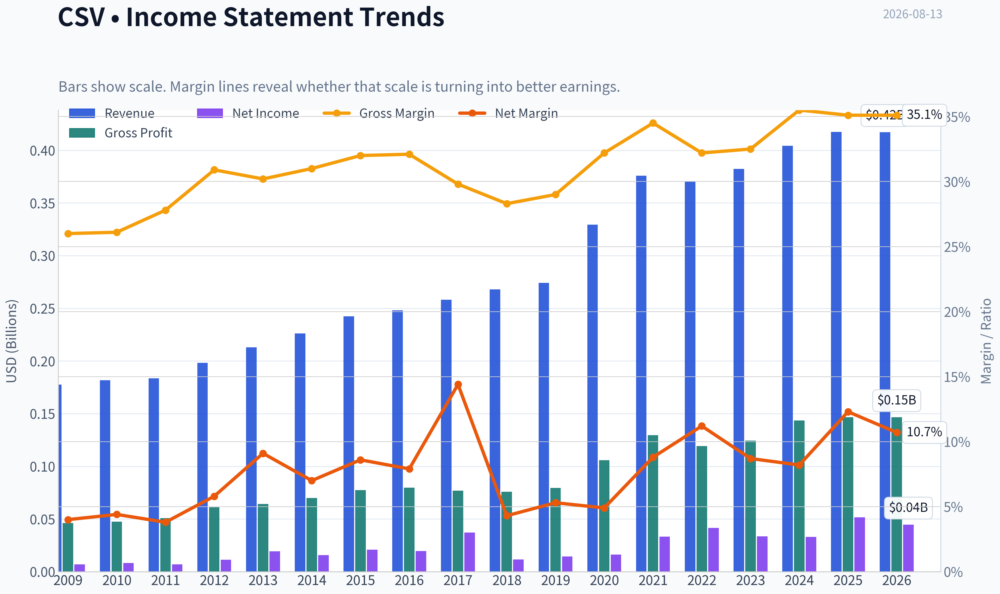

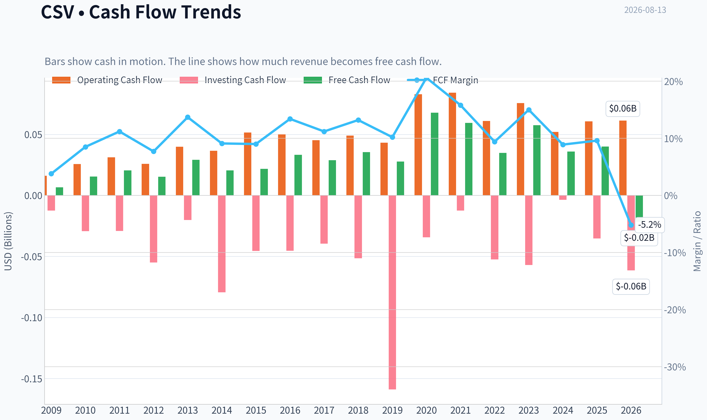

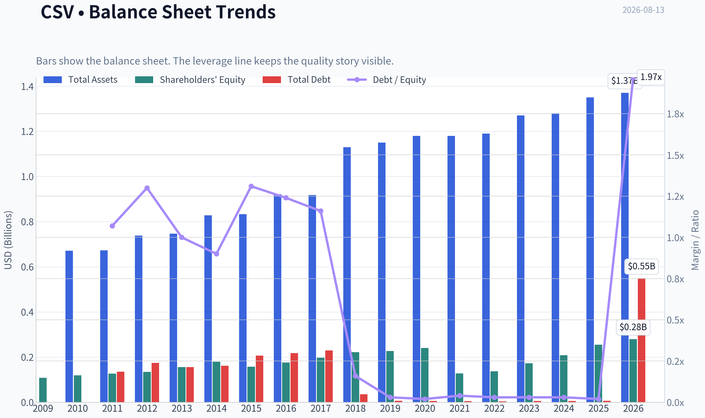

This graph tracks the profitability and return metrics (ROE, ROIC, Margins) of **CSV** over the past decade, highlighting capital efficiency trends.

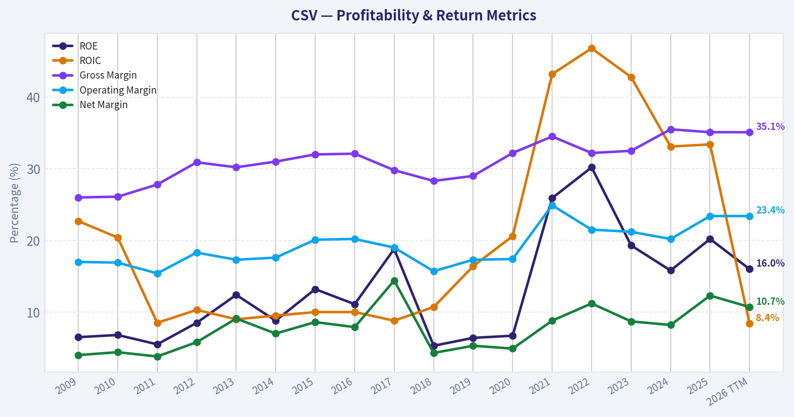

This chart illustrates the financial health of **CSV** over the last 10 years, mapping cash equivalents and free cash flow against total obligations (Debt).

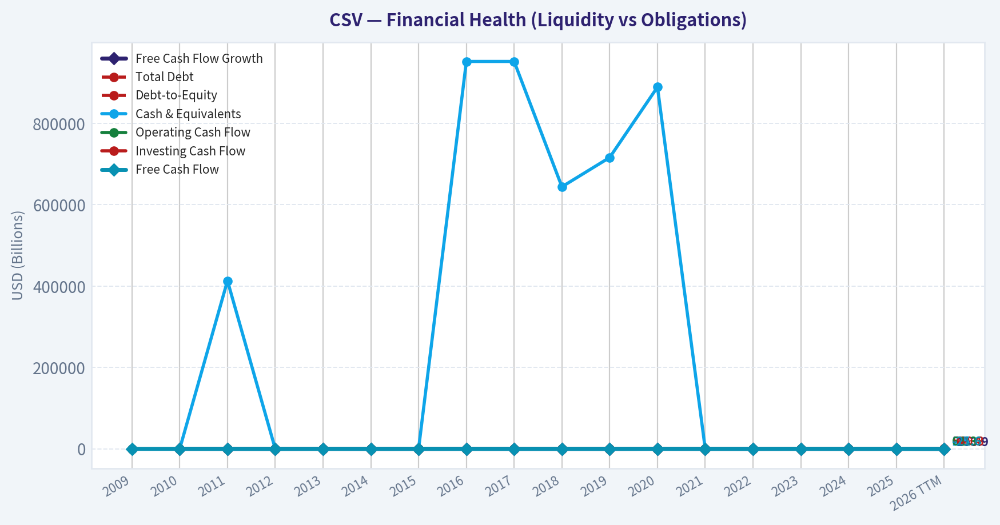

This breakdown chart from <em>Revenue Breakdown</em> shows the proportional composition for **CSV** - useful for understanding what drives or risks the business.

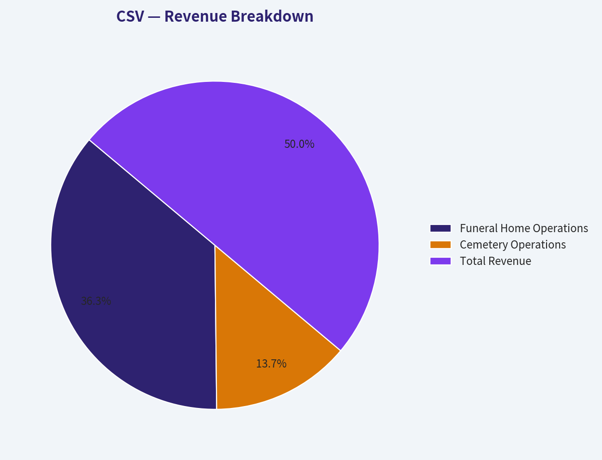

---

### Intrinsic Value Analysis (Buffett)

> *Following Warren Buffett's value investing philosophy: Circle of Competence, Economic Moat, Management Quality, and Margin of Safety.*

#### Intrinsic Value Snapshot

Price is what you pay. Intrinsic value is what the business may be worth based on the cash it can create for owners over time. We show a range, not one magic number.

- Current Price: $34.92
- Value Range (conservative to optimistic across both DCF methods): $-21.17 to $429.65

##### Owner Earnings (Buffett Method)
- Net Income: $51,507,000.00
- Depreciation & Amortization: $25,712,000.00
- Capital Expenditures: $-20,628,000.00
- Working Capital Changes: $-32,341,000.00
- Owner Earnings: $88,932,000.00

##### Intrinsic Value
###### Buffett Method
Uses owner earnings. Stricter, and usually more conservative.
- Conservative: $143.72
- Average: $143.72
- Optimistic: $429.65
- Discount Rate: 10.0%

###### Cash Flow Method
Uses free cash flow. Better for companies spending heavily today to grow tomorrow.
- Conservative: $-21.17
- Average: $13.91
- Optimistic: $173.05
- Discount Rate: 10.0%

ANALYST STANCE: **ADVOCATE** - Medium conviction. CSV is not a classic "wonderful compounder," but it is a durable, understandable, cash-generative funeral and cemetery operator trading at a price that appears to embed only modest growth. The valuation is attractive enough to compensate for a narrower moat and balance-sheet/refinancing concerns.

#### Business Summary

Carriage Services makes money by operating funeral homes and cemeteries. Families pay for funeral services, cremations, burials, cemetery property, memorialization, and related merchandise. Demand is structurally recurring because death-care services are non-discretionary, but the business is local, reputation-driven, and only moderately scalable.

---

#### 1. Factor Scorecard

| Factor | Score | Evidence |
|---|---:|---|
| Circle of Competence & Business Simplicity | 4.0 / 5 | Funeral and cemetery services are easy to understand, recurring by nature, and not dependent on complex technology or commodity forecasting. |
| Moat Test | 3.0 / 5 | Local brand reputation, cemetery property, regulatory licenses, and preneed relationships create some durability, but switching costs and network effects are limited. |
| Management Quality & Capital Allocation | 3.0 / 5 | Management has pursued consolidation and operational improvement, but leverage/refinancing concerns reduce the capital-allocation score. |
| Industry Structure | 4.0 / 5 | Death-care demand is stable, fragmented, and relatively recession-resistant. Competition is local, but the industry is not hyper-disrupted. |
| Gate 5: Quality/Solvency Hard Floor | Not tripped | CSV remains profitable, produces positive free cash flow, and has a 20.2% ROE. Refinancing concerns matter, but this is not a financial-distress auto-avoid. |

**Key Takeaways:** CSV operates in a simple and durable industry with steady underlying demand. The business has a real but not wide moat, mostly from local reputation and owned cemetery assets. The main weakness is not the business model; it is balance-sheet sensitivity and the need for disciplined capital allocation.

---

#### 2. Moat Analysis

| Moat Source | Assessment | Evidence |
|---|---|---|
| Intangible Assets | Moderate | Funeral homes rely heavily on local reputation, trust, and community relationships. CSV's 35.1% gross margin supports some pricing power, though it is below the 40% threshold for stronger intangible-asset evidence. |
| Switching Costs | Low to Moderate | At-need funeral customers can choose competitors, but preneed cemetery and funeral arrangements create some customer captivity once contracts are signed. |
| Cost Advantage | Moderate | Scale can help purchasing, back-office systems, and operating discipline, but local independents remain viable competitors. |
| Network Effects | Low | The service does not become materially more valuable as more customers join; this is not a platform business. |
| Moat Rating | Narrow to Moderate | Durable demand and local trust support the franchise, but this is not a wide-moat compounder. |

**Key Takeaways:** CSV's moat is practical rather than spectacular. Families often choose trusted local providers, and cemetery property can be hard to replicate, but customers are not locked in the way they are with software or payment networks. This means valuation discipline matters.

---

#### 3. Management Quality Assessment

Management's most important job is to allocate capital rationally in a fragmented industry. CSV has an opportunity to compound through tuck-in acquisitions, operational improvement, and selective cemetery/funeral home consolidation. However, that strategy only creates value if acquisitions are disciplined and debt remains manageable.

The current valuation implies the market is worried about volume softness and refinancing risk. Those are legitimate concerns. For a Buffett-style owner, the key question is whether management can convert stable industry cash flows into per-share value without overleveraging the company. The record is good enough to support a position, but not strong enough to warrant a top-tier management score.

---

#### 4. Financial Summary

| Metric | Current / TTM Snapshot |
|---|---:|
| Share Price | $35.00 |
| Market Capitalization | $554.6 million |
| Estimated Shares Outstanding | 15.8 million |
| P/E Ratio | 12.1x |
| Estimated Net Income | $45.9 million |
| Estimated EPS | $2.90 |
| Free Cash Flow Yield | 7.2% |
| Estimated Free Cash Flow | $39.9 million |
| Estimated FCF per Share | $2.52 |
| ROE | 20.2% |
| Gross Margin | 35.1% |
| Revenue Growth YoY | 3.3% |
| Current Ratio | 0.98 |
| Latest Reported Quarterly Revenue | $102.9 million |
| Latest Quarterly Adjusted EPS | $0.78 |

**Key Takeaways:** CSV trades at a modest earnings multiple and generates a free-cash-flow yield above 7%, which is attractive for a stable services business. ROE above 20% indicates good equity returns, though leverage likely contributes to that result. Revenue growth is modest, so the investment case depends more on cash generation, disciplined reinvestment, and valuation than on rapid organic growth.

---

#### 5. Owner Earnings Calculation

| Owner Earnings Component | Estimate |
|---|---:|
| Net Income | $45.9 million |
| Plus: Depreciation & Amortization | Included in cash-flow conversion |
| Less: Maintenance CapEx | Reflected in FCF proxy |
| Less: Working Capital Increases | Reflected in FCF proxy |
| Conservative Owner Earnings Proxy | $39.9 million |
| Owner Earnings per Share | $2.52 |

**Key Takeaways:** A conservative estimate of owner earnings is approximately $39.9 million, or $2.52 per share, using free cash flow as the cash-reality anchor. Net income is higher than free cash flow, so the valuation should be grounded in cash earnings rather than accounting earnings alone. At the current price, CSV offers a 7.2% owner-earnings yield.

---

#### 6. Three-Scenario DCF Valuation

Assumptions: 10% discount rate, $2.52 current owner earnings per share, 3% terminal growth for growing scenarios.

| Scenario | Method | Intrinsic Value per Share | Margin of Safety vs. $35 |
|---|---|---:|---:|
| A - No Growth | Owner earnings / 10% | $25.20 | -38.9% |
| B - GDP Growth | Owner earnings growing at 3% perpetually | $37.10 | 5.7% |
| C - Historical Growth Haircut | 9% growth for 10 years, then 3% terminal growth | $57.50 | 39.1% |
| Research Pack Headline IV | Business-model routed blend | $82.25 | 57.5% |

**Key Takeaways:** The no-growth case does not support today's price, which means CSV is not a "buy at any price" bond-like cash cow. But the GDP-growth case roughly supports the current market price, and the historical-growth haircut case suggests meaningful upside. The stock appears attractive if CSV can compound owner earnings even modestly above inflation.

---

#### 7. Margin of Safety Analysis

| Valuation Lens | Signal |
|---|---|
| Current Price | $35.00 |
| Headline Intrinsic Value | $82.25 |
| Headline Margin of Safety | 57.5% |
| Reverse DCF Implied Growth | ~3.2% per year for 10 years |
| Recent Revenue Growth YoY | 3.3% |
| Trailing 3-Year Growth Reference | 17.9% |
| FCF Yield | 7.2% |
| Quality-Scaled Required MOS | ~25% to 35% for this moderate-quality business |

**Key Takeaways:** The market price appears to require only low-single-digit growth, which is not heroic for a stable death-care operator. Because CSV is a moderate-quality business rather than a wide-moat franchise, it needs a larger discount than a truly exceptional compounder. On the historical-growth and headline intrinsic-value views, that discount is present.

---

#### 8. Final Buffett Scorecard

| Criterion | Weight | Score | Weighted Contribution |
|---|---:|---:|---:|
| Moat Width & Durability | 25% | 3.0 | 0.75 |
| Valuation / Margin of Safety | 20% | 4.0 | 0.80 |
| Capital Returns - ROIC vs. WACC | 15% | 3.5 | 0.53 |
| Business Understanding & Predictability | 12% | 4.0 | 0.48 |
| Management Quality & Capital Allocation | 12% | 3.0 | 0.36 |
| Reinvestment Runway | 8% | 3.5 | 0.28 |
| Balance Sheet Strength | 4% | 2.0 | 0.08 |
| Industry Structure | 4% | 4.0 | 0.16 |
| Final Weighted Score | 100% |  | **3.44 / 5** |

**Key Takeaways:** CSV scores well on business simplicity, industry durability, and valuation. It scores lower on moat width, balance-sheet strength, and capital-allocation risk. The final score sits near the ADVOCATE/WATCH border, but the current price offers enough cash-flow yield and implied-growth conservatism to support a medium-conviction ADVOCATE stance.

---

#### 9. Investment Stance

**Stance: ADVOCATE - Medium Conviction**

CSV is a stable, understandable, cash-producing business in a non-discretionary industry. It is not a wide-moat Buffett masterpiece, but it does not need to be at the current valuation. The stock trades around 12x earnings and a 7.2% free-cash-flow yield, while the reverse DCF implies only about 3.2% annual growth.

The main risks are leverage, refinancing, acquisition discipline, and local competitive pressure. Those risks prevent a high-conviction rating. Still, for investors comfortable with a moderately leveraged small-cap consolidator, CSV appears priced below a reasonable estimate of intrinsic value.

**Conviction Level:** Medium
**Buy Zone:** Attractive around current levels if position sizing reflects leverage risk.
**Review Trigger:** Reassess if free cash flow weakens materially, refinancing terms become punitive, or acquisitions begin destroying per-share value.
#### Valuation Bridge

This bridge places the current market price beside each intrinsic value lens so readers can see whether upside depends on one method or shows up across several methods.

| Scenario | Intrinsic Value / Share |
| --- | ---: |
| Buffett Method | $143.72 |
| Cash Flow Method | $13.91 |
| Damodaran Method | $27.89 |
| Current Price | $34.92 |

#### Key Takeaways

If one method is far above the others, the upside case depends on a specific modelling assumption. When several methods cluster together, the valuation story is more robust.

#### Valuation Visuals

This comparison chart from *Latest Earnings Snapshot* stacks current figures against historical benchmarks for **CSV**, making it easy to see where the company trades relative to its own averages.

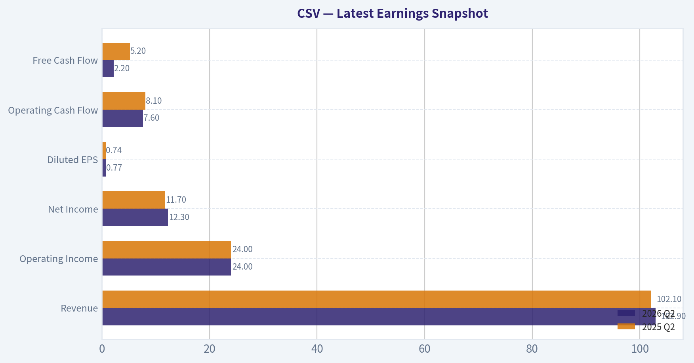

This comparison chart from *Current vs. 10-Year Historical Average Comparison* stacks current figures against historical benchmarks for **CSV**, making it easy to see where the company trades relative to its own averages.

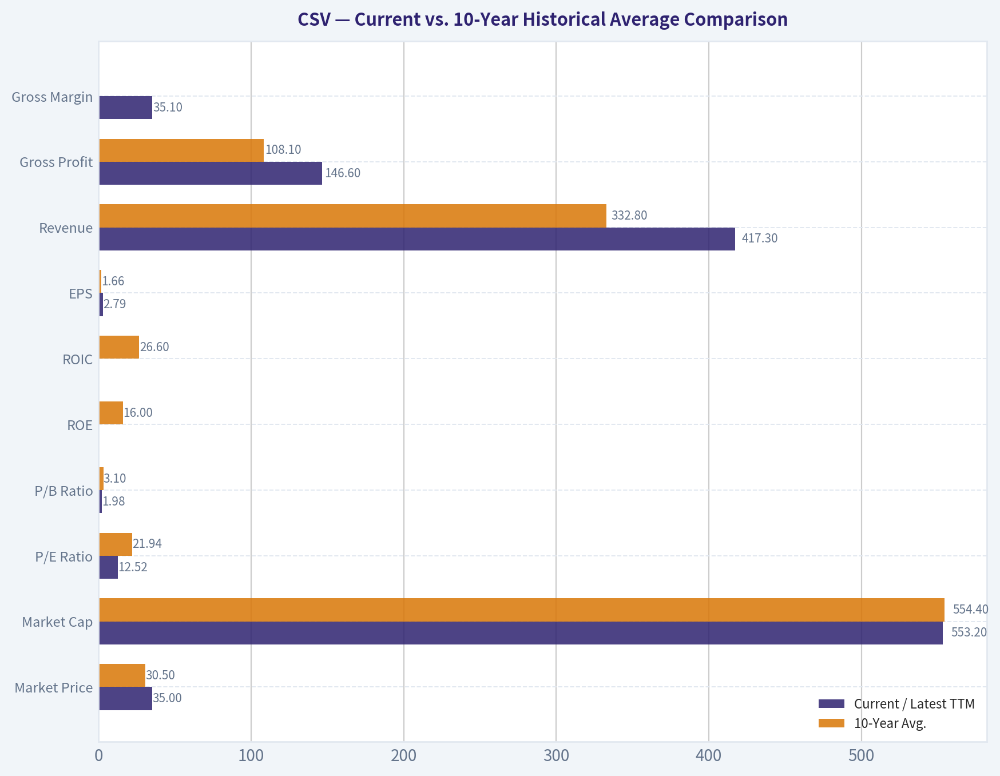

This comparison chart from *Buffett-Style Owner Earnings DCF Valuation* stacks current figures against historical benchmarks for **CSV**, making it easy to see where the company trades relative to its own averages.

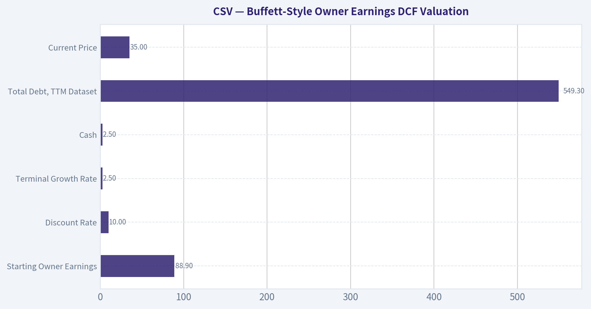

This comparison chart from *Financial Summary* stacks current figures against historical benchmarks for **CSV**, making it easy to see where the company trades relative to its own averages.

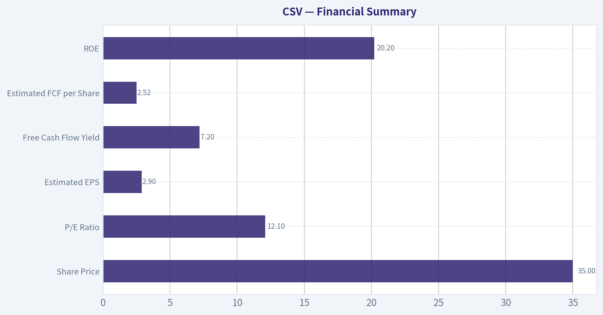

The following chart maps the **CSV** Owner Earnings DCF valuation scenarios (Conservative, Average, Optimistic) to visually represent the margin of safety based on intrinsic value calculations.

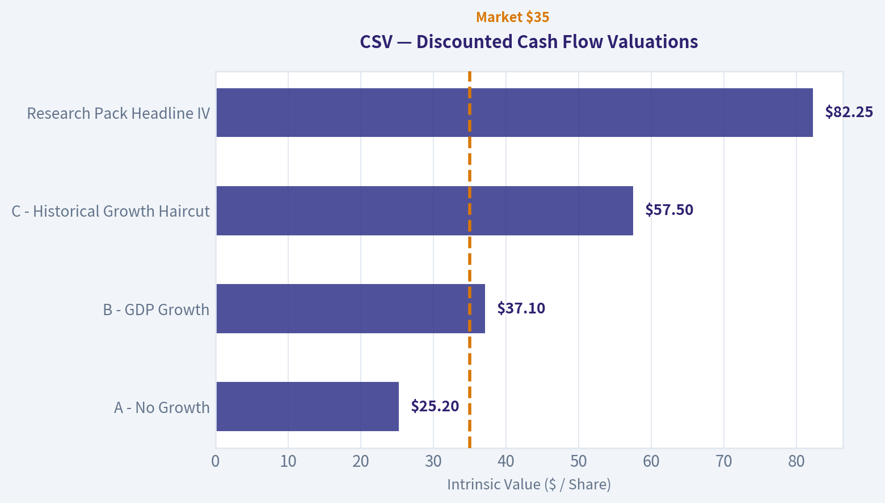

---

### Trend & Growth Analysis (Lynch/Druckenmiller/Fisher)

> *Following Peter Lynch's GARP, Stanley Druckenmiller's macro-aware approach, and Philip Fisher's scuttlebutt methodology.*

ANALYST STANCE: **WATCH**

#### CSV Growth Investment Report - Carriage Services, Inc.
Current price: **$35** | Market cap: **$554.6M** | Date: **2026-08-13**

Carriage Services is a deathcare consolidator operating funeral homes and cemeteries. It is **not a classic Lynch fast grower** today, but it has a potentially attractive value setup: low P/E, strong free-cash-flow yield, decent ROE, and a headline intrinsic value well above the current price. For a growth mandate, however, the key issue is that revenue growth is only **3.3% YoY**, making CSV more of a defensive cash-flow compounder than a ten-bagger candidate.

---

#### 1. Lynch Classification

| Category | CSV Fit | Evidence | Growth Investor Interpretation |
|---|---:|---|---|
| Slow Grower / Stalwart | High | Revenue growth of **3.3% YoY** | Not a primary growth-stock candidate |
| Fast Grower | Low | Growth is well below 15% to 25% threshold | Ten-bagger probability is limited unless acquisition-driven growth accelerates |
| Cyclical | Low to Moderate | Deathcare demand is defensive, but margins can be affected by labor, financing, and cemetery sales mix | Less economically sensitive than most cyclicals |
| Turnaround | Moderate | Refinancing and volume concerns are current investor issues | Could rerate if balance sheet and volume concerns ease |
| Asset Play | Low to Moderate | Funeral/cemetery assets have durable local value | Not the main thesis |

**Key Takeaways:** CSV is best classified as a **slow grower or stalwart**, not a Lynch-style fast grower. The stock may be undervalued and cash-generative, but the current growth profile does not qualify it as a core growth portfolio candidate. The most attractive angle is not explosive revenue growth, but a potential valuation rerating if execution and refinancing improve.

---

#### 2. The Story in 3 Bullets

- **Simple business:** Carriage Services owns and operates funeral homes and cemeteries, serving families during end-of-life events.
- **Defensive demand:** Deathcare is a steady, non-discretionary industry supported by demographics and aging population trends.
- **Potential rerating:** If CSV improves volumes, manages debt/refinancing risk, and continues generating free cash flow, the market may revalue the stock from a low earnings multiple.

---

#### 3. TAM Analysis and 10x Test

| Item | Estimate / Data | Interpretation |
|---|---:|---|
| Current annualized revenue | About **$412M**, based on Q2 2026 revenue of $102.9M annualized | Small-to-mid-sized player |
| 10x revenue target | About **$4.1B** | Would require major consolidation or market-share gains |
| Estimated U.S. deathcare TAM | Roughly **$20B to $25B+** | Large but slow-growing market |
| 10x market share test | $4.1B would be about **16% to 20%** of estimated TAM | Possible, but ambitious |
| TAM growth profile | Low single-digit, helped by demographics and pricing | Stable, not hypergrowth |

**Key Takeaways:** CSV has a theoretical 10x revenue runway, but achieving it would require years of successful consolidation and execution. The market itself is durable but not rapidly expanding, so CSV must win through acquisitions, pricing, operating discipline, and local market share gains. This is a **long runway but low-velocity TAM**, which is less attractive for pure growth investors.

---

#### 4. Revenue Growth Trend

| Metric | Latest Data | Growth Read-Through |
|---|---:|---|
| Revenue growth YoY | **3.3%** | Slow growth |
| Q2 2026 revenue | **$102.9M** | Missed estimate of $108.6M |
| Q2 2026 adjusted EPS | **$0.78** | Missed estimate of $0.81 |
| Q2 adjusted EPS YoY change | Up about **5.4%** from $0.74 | Earnings growth better than revenue growth |
| FY2026 adjusted EPS guidance | Affirmed | Management confidence despite quarterly miss |

**Key Takeaways:** Revenue growth is **not accelerating** and remains well below the threshold for a fast grower. The positive sign is that adjusted EPS grew faster than revenue and management affirmed full-year guidance. However, for a growth investor, the Q2 sales miss and modest top-line growth make this a **watch-list name rather than an advocate-level setup**.

---

#### 5. Unit Economics and Operating Quality

| Metric | Data / Proxy | Assessment |
|---|---:|---|
| Gross margin | **35.1%** | Solid for a service-heavy operator |
| ROE | **20.2%** | Strong equity returns |
| FCF yield | **7.2%** | Attractive cash generation |
| Current ratio | **0.98** | Slightly tight liquidity profile |
| SaaS-style LTV/CAC | Not applicable | Business is transaction and local-service based |
| Net revenue retention | Not applicable | Not a subscription model |
| Rule of 40 | Not applicable | Not a SaaS/subscription business |

**Key Takeaways:** CSV's unit economics cannot be measured with SaaS metrics like NRR or LTV/CAC, but the available proxies are respectable. Gross margin, ROE, and free-cash-flow yield suggest a durable, cash-generative business. The main concern is liquidity and refinancing sensitivity, not evidence of broken operating economics.

---

#### 6. Inflection Point Assessment

| Inflection Type | Evidence | Current Read |
|---|---|---|
| Product cycle inflection | Limited; deathcare is not a product-cycle business | Low |
| Market share inflection | Possible through consolidation, but not clearly visible in latest growth | Watch |
| Margin inflection | EPS growth above revenue growth suggests some operating leverage | Mild positive |
| TAM inflection | Aging demographics support steady demand, but TAM is not rapidly expanding | Neutral |
| Competitive inflection | Fragmented industry may allow acquisitions | Potential positive |
| Balance sheet / refinancing inflection | Recent commentary highlights refinancing concerns | Key watch item |

**Key Takeaways:** CSV does not show a clear growth inflection today. The most plausible inflection would come from refinancing relief, margin improvement, or renewed acquisition-led growth. Until revenue growth accelerates or the balance sheet narrative improves, the stock remains more of a **value-rerating candidate** than a growth inflection story.

---

#### 7. Macro Setup Evaluation

| Macro Factor | Current Impact on CSV | Growth Investor View |
|---|---|---|
| Interest rates | Higher rates pressure refinancing and valuation | Headwind |
| Economic cycle | Deathcare demand is defensive | Positive |
| Demographics | Aging population supports long-term volume | Positive |
| Inflation | Can support pricing, but pressures labor and operating costs | Mixed |
| Secular theme exposure | Aging population, local services consolidation | Moderate |
| AI / cloud / fintech / cybersecurity exposure | Minimal | Not a secular tech compounder |

**Key Takeaways:** The macro setup is mixed. CSV benefits from defensive demand and demographic support, but higher rates and refinancing concerns are meaningful headwinds. This is not a Druckenmiller-style secular growth winner, but it could work if rates decline and refinancing risk fades.

---

#### 8. Fisher 15 Points Score

| Fisher Point | Score / 5 | Comment |
|---|---:|---|
| Products with sizable sales potential | 3 | Durable market, but slow growth |
| Determination to develop new services | 3 | Some opportunity in preneed, cemetery, and service mix |
| Effective R&D | 1 | Not R&D-driven |
| Above-average sales organization | 3 | Local sales execution matters |
| Worthwhile profit margin | 4 | Gross margin of 35.1% is solid |
| Improving profit margins | 3 | Some EPS leverage, but not conclusive |
| Labor/personnel relations | 3 | No major data in provided pack |
| Executive relations | 3 | No major data in provided pack |
| Management depth | 3 | Need more evidence |
| Cost analysis and accounting | 3 | FCF generation suggests discipline |
| Outstanding competitive aspects | 3 | Local reputation and cemetery assets can be defensible |
| Long-range profit outlook | 3 | Stable, not exceptional |
| Dilution risk | 3 | No major signal, but acquisition funding must be watched |
| Candor in difficulties | 3 | Guidance affirmation helps, but more call detail needed |
| Management integrity | 3 | No negative evidence in provided data |
| **Total** | **44 / 75** | **Below average for Fisher growth quality** |

**Key Takeaways:** CSV scores **44 out of 75**, which is below the preferred Fisher threshold for a growth investment. The company has durable demand, respectable margins, and cash generation, but it lacks innovation intensity, rapid market expansion, and obvious product-led differentiation. This reinforces a **WATCH** stance rather than an aggressive buy recommendation.

---

#### 9. Valuation Analysis

| Valuation Metric | CSV Data | Interpretation |
|---|---:|---|
| Current price | **$35** | Baseline |
| Market cap | **$554.6M** | Small-cap |
| P/E | **12.1x** | Inexpensive if earnings are stable |
| Revenue growth | **3.3%** | Low |
| PEG using revenue growth proxy | **3.7x** | Expensive relative to growth rate |
| FCF yield | **7.2%** | Attractive |
| Estimated P/S | About **1.35x** | Reasonable for a low-growth service business |
| Headline intrinsic value | **$82.25** | Implies significant upside |
| Margin of safety vs. headline IV | **57.5%** | Attractive, but model spread is wide |
| Oppenheimer target | **$48** | About 37% upside from $35 |

**Key Takeaways:** CSV looks cheap on P/E, free-cash-flow yield, and headline intrinsic value, but not cheap on a growth-adjusted PEG basis because revenue growth is modest. The valuation case is real, especially if cash flow remains durable and refinancing concerns ease. However, the wide intrinsic-value model spread means investors should treat the $82.25 fair value as directional rather than precise.

---

#### 10. Scenario Valuation

| Scenario | Key Assumption | Implied View |
|---|---|---|
| Bear Case | Revenue remains low-growth, refinancing costs pressure earnings, multiple stays around 8x to 10x earnings | Stock could remain range-bound or decline |
| Base Case | Revenue grows low-to-mid single digits, EPS holds near guidance, market assigns 12x to 14x earnings | Fair value could be around current price to the high $40s |
| Bull Case | Refinancing risk fades, margins improve, acquisitions resume, multiple expands toward 15x+ | Stock could rerate materially |
| Ten-Bagger Case | Requires massive consolidation, sustained growth acceleration, and major multiple expansion | Low probability from current evidence |

**Key Takeaways:** CSV has a plausible value-rerating setup, but not a compelling ten-bagger setup. The base-to-bull case depends heavily on stable earnings, cash generation, and balance sheet confidence. The stock could work, but the growth evidence is not strong enough for an ADVOCATE stance.

---

#### 11. Growth Investor Scorecard

| Criterion | Weight | Score / 5 | Weighted Score |
|---|---:|---:|---:|
| The Story | 10% | 3.2 | 0.32 |
| TAM and Runway | 20% | 2.8 | 0.56 |
| Revenue Growth | 20% | 1.5 | 0.30 |
| Unit Economics | 15% | 3.4 | 0.51 |
| Competitive Position | 10% | 3.0 | 0.30 |
| Management Quality | 10% | 3.0 | 0.30 |
| Macro Setup | 5% | 2.8 | 0.14 |
| Profitability Path | 5% | 3.8 | 0.19 |
| Valuation | 5% | 4.0 | 0.20 |
| **Total** | **100%** |  | **2.82 / 5.00** |

**Key Takeaways:** CSV scores **2.82 out of 5**, which maps to an **AVOID or WATCH-list zone** under the growth-investor framework. I am choosing **WATCH** rather than AVOID because valuation, free cash flow, ROE, and defensive demand are credible positives. The missing ingredient is clear revenue acceleration.

---

#### 12. Position Size Stance

| Investor Type | Suggested Stance | Rationale |
|---|---|---|
| Pure growth portfolio | Avoid initiating for now | Revenue growth is too low |
| GARP portfolio | Small watch-list position only | Cheap valuation and FCF yield offset slow growth |
| Value / income-oriented portfolio | Worth deeper diligence | Defensive cash flow and low P/E may be attractive |
| Concentrated growth investor | Not suitable yet | No clear inflection or secular acceleration |

**Key Takeaways:** CSV is not a core growth-stock candidate today. For a GARP or value-aware investor, it may deserve a small position or deeper diligence, especially if refinancing risk declines. For a concentrated growth mandate, the right move is to wait for stronger evidence of acceleration.

---

#### 13. Key Risks and Catalysts

| Category | Key Items |
|---|---|
| Major risks | Sustained volume softness, refinancing pressure, debt burden, labor cost inflation, weak cemetery sales, acquisition integration risk |
| Growth risks | Low organic growth, limited TAM velocity, lack of product-led differentiation |
| Valuation risks | Intrinsic value estimates have a very wide spread; cheap stocks can stay cheap |
| Catalysts | Refinancing clarity, margin improvement, stronger funeral/cemetery volumes, acquisition activity, sustained FCF generation, analyst coverage support |
| Recent positive signal | Oppenheimer initiated coverage with **Outperform** and **$48 price target** |
| Recent negative signal | Q2 revenue and adjusted EPS missed consensus estimates |

**Key Takeaways:** The stock's upside catalyst is a confidence reset: better volumes, refinancing clarity, and continued free cash flow. The downside risk is that CSV remains a low-growth, leveraged small-cap with limited investor sponsorship. The next few quarters should be judged mainly on revenue stabilization, margins, and capital structure progress.

---

#### Final Verdict

CSV is a **defensive, cash-generative, potentially undervalued small-cap**, but it is **not yet a Lynch/Fisher/Druckenmiller growth winner**. The company lacks the accelerating revenue growth, expanding TAM velocity, and innovation-driven competitive edge usually required for ten-bagger potential.

**Stance: WATCH.**
I would revisit if revenue growth moves sustainably toward high single digits or better, refinancing risk declines, and free cash flow continues to compound.

---

### Market Technical Analysis

ANALYST STANCE: **AVOID**

#### CSV Technical Report - Carriage Services, Inc.
**As of 2026-08-13, using latest available price data through 2026-08-12**

CSV is in a technically fragile position after a sharp, high-volume selloff. The stock closed at **$33.69** on 2026-08-12, far below its short-, medium-, and long-term trend benchmarks. The recent decline is not just a mild pullback: price has broken decisively beneath the **10 EMA, 50 SMA, 200 SMA, and VWMA**, while MACD remains negative and volume has expanded during the downside move. That combination points to institutional-style selling pressure rather than a quiet drift lower.

The selected indicators are: **close_10_ema, close_50_sma, close_200_sma, macd, rsi, boll_lb, atr, and vwma**. These provide a balanced view across trend, momentum, volatility, oversold risk, and volume-confirmed price behavior without excessive redundancy.

| Indicator | Latest Value | Relationship to Latest Close of $33.69 | Interpretation |
|---|---:|---:|---|
| close_10_ema | 36.28 | Price is ~7.1% below | Short-term momentum remains bearish; first recovery test is near $36.25-$36.30. |
| close_50_sma | 38.20 | Price is ~11.8% below | Medium-term trend has deteriorated meaningfully. |
| close_200_sma | 42.36 | Price is ~20.5% below | Long-term structure is bearish; CSV is well below its strategic trend line. |
| macd | -1.10 | Negative | Downside momentum remains active; no clear momentum reversal signal yet. |
| rsi | 37.94 | Weak but not deeply oversold | Selling pressure is heavy, but RSI has not reached capitulation levels below 30. |
| boll_lb | 32.79 | Price is ~2.7% above lower band | Price is near downside volatility support, but not yet showing a confirmed reversal. |
| atr | 1.57 | ATR is ~4.7% of price | Volatility is elevated; position sizing and stops need to be conservative. |
| vwma | 36.82 | Price is ~8.5% below | Volume-weighted trend confirms bearish pressure; recent volume has favored sellers. |

**Key Takeaways:** CSV is trading below every major trend and volume-weighted benchmark in this indicator set, which strongly favors a bearish interpretation. RSI is weak but not extremely oversold, meaning the stock may still have room to fall before a classic exhaustion signal appears. The proximity to the lower Bollinger Band suggests a short-term bounce is possible, but the broader technical structure remains negative unless price can reclaim the mid-$36 area.

#### Price Structure and Trend Quality

The most important technical development is the **breakdown from the late-July and early-August recovery zone**. CSV had rallied from **$36.55 on 2026-07-21** to **$40.73 on 2026-07-28**, but that rebound failed quickly. After briefly holding above $40 in early August, the stock collapsed from **$41.40 on 2026-08-05** to **$33.69 on 2026-08-12**, a decline of roughly **18.6% in five trading sessions**.

That kind of move is especially concerning because it occurred on expanded volume. The selloff included unusually heavy trading days, including **434,800 shares on 2026-08-06**, **481,700 shares on 2026-08-07**, and **442,600 shares on 2026-08-12**. These volumes were far above the more typical pre-breakdown trading range, suggesting the decline was confirmed by participation rather than being a thin-volume move.

From a broader view, CSV has also fallen dramatically from its spring high. The stock reached **$51.39 on 2026-04-27** and has since declined to **$33.69**, a drawdown of approximately **34.4%**. This confirms that the current weakness is part of a larger downtrend, not merely a short-term correction.

#### Momentum and Mean-Reversion Risk

Momentum is bearish, but there is a subtle nuance: RSI at **37.94** is weak, yet not below the standard oversold threshold of 30. This means the stock is under pressure, but it has not yet produced the kind of extreme oversold reading that often accompanies panic lows. Traders looking for a reversal should be cautious about assuming the decline is exhausted simply because the price has fallen sharply.

The Bollinger lower band near **$32.79** is one of the few nearby technical references that could attract short-term dip buyers. Since the latest close of **$33.69** is only modestly above that level, a near-term relief bounce is possible if sellers pause. However, a bounce from the lower band would be tactical only unless price can reclaim the **10 EMA near $36.28** and then the **VWMA near $36.82**.

#### Key Levels to Watch

| Zone | Approximate Level | Role | Trading Significance |
|---|---:|---|---|
| Immediate downside support | $33.30-$32.80 | Recent low / lower Bollinger area | A break below this zone would suggest continued downside pressure. |
| First rebound test | $34.65-$36.00 | Prior short-term breakdown area | Weak rebounds may fail here if sellers remain in control. |
| Short-term trend resistance | $36.28 | 10 EMA | Reclaiming this would be the first sign of stabilization. |
| Volume-weighted resistance | $36.82 | VWMA | Price below VWMA suggests sellers dominate volume-weighted positioning. |
| Medium-term resistance | $38.20 | 50 SMA | A move above this would be needed to repair the medium-term trend. |
| Long-term resistance | $42.36 | 200 SMA | CSV remains structurally bearish while below this level. |

**Key Takeaways:** The most important near-term support zone is around $33.30 to $32.80, where recent lows and the lower Bollinger Band cluster together. The first meaningful bullish repair would require price to reclaim the $36.25 to $36.85 area, where the 10 EMA and VWMA sit. Until then, rallies should be treated as potential countertrend bounces rather than evidence of a durable reversal.

#### Trading View

CSV currently deserves an **AVOID** stance for trend-following or long-biased swing strategies. The stock is below its 10 EMA, 50 SMA, 200 SMA, and VWMA, while MACD remains negative and recent downside volume is elevated. That is a poor setup for initiating fresh long exposure unless a trader is specifically attempting a high-risk oversold bounce.

For aggressive traders, the only constructive short-term argument is that price is near the lower Bollinger Band and may be approaching a short-term reaction zone. However, the better risk-adjusted approach is to wait for confirmation. A close back above **$36.28-$36.82** would show that CSV is beginning to recover short-term and volume-weighted trend support. Without that, the path of least resistance remains lower or volatile sideways consolidation near the lows.

#### Final Indicator Summary

| Category | Selected Indicator | Signal | Practical Use Right Now |
|---|---|---|---|
| Short-term trend | close_10_ema | Bearish | Use $36.28 as the first recovery threshold. |
| Medium-term trend | close_50_sma | Bearish | Confirms the stock has lost medium-term support. |
| Long-term trend | close_200_sma | Bearish | Confirms broader structural weakness. |
| Momentum | macd | Bearish | Indicates downside momentum remains active. |
| Momentum / exhaustion | rsi | Weak, not deeply oversold | Avoid assuming capitulation has already occurred. |
| Volatility / mean reversion | boll_lb | Near support | Watch $32.80 area for possible reaction or breakdown. |
| Risk management | atr | Elevated | Use smaller sizing and wider, volatility-aware stops if trading. |
| Volume confirmation | vwma | Bearish | Confirms price is below volume-weighted trend support. |

**Key Takeaways:** The indicator set is consistently bearish across trend, momentum, and volume-confirmation measures. While CSV is close enough to the lower Bollinger Band to create bounce risk, there is not yet enough evidence of a durable reversal. The cleanest technical conclusion is to avoid new long exposure until price stabilizes above the mid-$36 area.

---

### Options Market Analysis

> *Reading options flow - put/call ratios, IV skew, and unusual activity - to gauge institutional positioning and event-driven risk.*

ANALYST STANCE: **AVOID**

#### CSV Options Market Sentiment Report
*Options data as of 2026-08-13. Ticker: CSV.*

#### 1. Put/Call Ratio Analysis

| Expiration | Call OI | Put OI | Put/Call OI Ratio | Call Volume | Put Volume | Put/Call Volume Ratio | Interpretation |
|---|---:|---:|---:|---:|---:|---:|---|
| 2026-08-21 | 17 | 7 | 0.41 | 7 | 3 | 0.43 | Call-leaning, but extremely thin |
| 2026-09-18 | 3 | 29 | 9.67 | 3 | 2 | 0.67 | OI heavily put-skewed; volume neutral |
| 2026-10-16 | 62 | 95 | 1.53 | 23 | 102 | 4.43 | Bearish / hedging flow in puts |
| **Near-Term Total** | **82** | **131** | **1.60** | **33** | **107** | **3.24** | **Bearish tilt, but low liquidity** |

**Key Takeaways:** CSV's near-term put/call open interest ratio is **1.60**, well above the historical neutral baseline of roughly **0.7**, indicating elevated put positioning. The volume ratio is even more defensive at **3.24**, driven mainly by October put activity. However, the absolute volume and open interest are very small, so confidence in the signal must be reduced.

CSV's options market is showing a **meaningful bearish or hedging bias** relative to neutral. The most notable shift is in the October 2026 expiration, where put volume materially exceeds call volume. That said, this is an illiquid options chain, so a small number of trades can distort the ratios.

---

#### 2. Implied Volatility Assessment

| Expiration | ATM Call IV | ATM Put IV | IV Read | Notes |
|---|---:|---:|---|---|
| 2026-08-21 | N/A | 55.0% | Elevated / moderately high | Call-side ATM IV unavailable |
| 2026-09-18 | N/A | 72.3% | High | Suggests elevated uncertainty, but data is sparse |
| 2026-10-16 | N/A | 0.0% | Unreliable data point | Likely stale, missing, or illiquid quote |
| **Overall** | **N/A** | **Mixed: 55%-72%, with one unreliable 0% print** | **Elevated but low-confidence** | Thin chain limits reliability |

**Key Takeaways:** Available put-side ATM IV is relatively high, especially the September expiration at **72.3%**, implying the market is pricing meaningful uncertainty. However, call-side ATM IV is unavailable, and the October put IV shows a likely invalid **0.0%** reading. This makes the IV signal directionally useful but not robust.

#### IV Skew

| Skew Component | Observation | Sentiment Implication |
|---|---|---|
| OTM Put IV vs. OTM Call IV | Strike-level IV skew not available from the retrieved dataset | Cannot confirm formal put skew |
| ATM Put IV | Elevated in August and September | Suggests demand for downside protection or fear premium |
| Call IV | Not available | No evidence of upside call chase |
| Overall Skew Read | Incomplete, but put-side pricing appears more relevant than call-side pricing | Mild bearish / defensive bias |

**Key Takeaways:** The dataset does not provide enough strike-level IV detail to measure a precise put-versus-call skew. Still, the available IV is concentrated on the put side, and no call-side IV signal is visible. This supports a cautious bearish interpretation, but the conclusion is limited by missing and illiquid quote data.

No specific upcoming catalyst was identified from the options data itself. If CSV has earnings, corporate actions, or sector-specific news approaching, the elevated September IV could be reflecting that event risk. Without a confirmed catalyst, the IV should be treated as a sign of uncertainty rather than a clean event-volatility setup.

---

#### 3. Unusual Options Activity

| Unusual Activity Screen | Result |
|---|---|
| Contracts with volume greater than 5x open interest | None detected |
| Fresh directional bets identified | None |
| Likely institutional sweep activity | None visible |
| Retail-style speculative activity | Not enough evidence |

**Key Takeaways:** There were **no contracts** where volume exceeded open interest by more than **5x**, so there is no clear evidence of fresh aggressive positioning. The bearish read comes from aggregate put/call ratios rather than a specific unusual trade. This lowers conviction because there is no standout institutional-looking options print.

Because no unusual contracts were detected, there is no strong single-trade signal to classify as smart-money positioning. The October put volume is notable in aggregate, but without strike-level contract details, it cannot be confidently labeled as institutional hedging versus small-lot speculative activity.

---

#### 4. Open Interest Concentration and Gamma / Pinning Risk

| Expiration | Total OI | Call OI | Put OI | Concentration Read | Potential Price Effect |
|---|---:|---:|---:|---|---|
| 2026-08-21 | 24 | 17 | 7 | Very low OI | Minimal pinning/gamma influence |
| 2026-09-18 | 32 | 3 | 29 | Small put-heavy OI | Limited but bearish-leaning positioning |
| 2026-10-16 | 157 | 62 | 95 | Highest near-term OI | Most relevant expiry for positioning |
| **Overall** | **213** | **82** | **131** | **Put-heavy but thin** | **Low-confidence gamma read** |

**Key Takeaways:** The largest open interest is in the **2026-10-16** expiration, with **157 total contracts**, including **95 puts**. This makes October the most relevant options expiration for CSV positioning. Still, the total OI is very small, so pinning and gamma-wall effects are likely weak compared with more liquid names.

Strike-level open interest was not provided, so specific max-pain levels, pinning strikes, and gamma walls cannot be identified. Based on aggregate data alone, the October expiration appears to carry the most influence, but the overall chain is too thin to expect strong dealer-gamma control over price action.

---

#### 5. Overall Options Sentiment Signal

| Category | Signal | Rationale |
|---|---|---|
| Put/Call OI | Bearish | Near-term ratio of **1.60** is well above the ~0.7 neutral baseline |
| Put/Call Volume | Bearish | Volume ratio of **3.24** shows recent put-heavy activity |
| IV | Cautiously bearish / uncertain | Put-side IV elevated, but data quality is limited |
| Skew | Incomplete, mildly defensive | No formal skew data, but visible IV is put-side focused |
| Unusual Activity | Neutral | No volume > 5x OI contracts detected |
| Liquidity Quality | Weak | Very low absolute OI and volume reduce confidence |
| **Overall Options Sentiment** | **BEARISH, low confidence** | Defensive positioning dominates, but the chain is illiquid |

**Key Takeaways:** The overall options signal for CSV is **BEARISH**, mainly because put open interest and put volume are elevated versus calls. The strongest driver is the **October 2026 put-heavy activity**, supported by an overall put/call volume ratio above **3.0**. However, because CSV options are thinly traded, this should be treated as a low-confidence sentiment read rather than a decisive institutional signal.

#### Final Read

CSV's options market is leaning **bearish / defensive**. Put positioning is elevated versus calls across the near-term expirations, and recent volume is especially put-heavy. The absence of unusual options activity and the very low absolute contract count reduce confidence, but the directional read is still negative.

This options signal should not be used as a valuation call. It is best interpreted as evidence that the small pool of active options traders is positioning more for downside protection or bearish exposure than for upside speculation.

#### Summary Table

| Factor | Current Read | Sentiment Impact |
|---|---|---|
| Put/Call Ratio | OI ratio **1.60**; volume ratio **3.24** | Bearish |
| IV Level | Put IV elevated where available; call IV unavailable | Cautiously bearish / uncertain |
| Skew Direction | Formal skew unavailable; put-side pricing more visible | Mild defensive bias |
| Unusual Activity | None detected with volume > 5x OI | Neutral |
| Open Interest Concentration | Highest OI in 2026-10-16; put-heavy | Bearish but low confidence |
| Overall Signal | **BEARISH** | Low-confidence due to thin liquidity |

**Key Takeaways:** CSV's options market shows a bearish tilt, but not a high-conviction one. The main evidence is elevated put/call ratios, while the main caveat is very low liquidity. In practical terms, this is a **watch-for-downside-risk** setup rather than a strong standalone sell signal.

---

## Research Team Commentary

> *The Research Manager synthesizes the Bull vs Bear debate into action-free commentary. This is a pre-risk view, not the final stance.*

This debate on Carriage Services captures a classic value investing dilemma: distinguishing between a genuinely undervalued defensive compounder and a highly leveraged value trap facing structural headwinds. Both analysts bring compelling points to the table, but one side fundamentally grasps the underlying mechanics of the balance sheet far better than the other.

The bull analyst builds a seemingly attractive case based on traditional value metrics and demographic narratives. They point to the undeniable aging population, the physical zoning moats of cemeteries, and a seemingly cheap multiple of 12 times earnings. Furthermore, they highlight a 27.6 percent return on invested capital and a 20.2 percent return on equity to argue that Carriage Services is a high-quality compounder trading at a massive discount. If we only looked at these headline numbers, the stock would indeed look like a fat pitch.

However, the bear analyst completely dismantles this narrative by pointing out the elephant in the room: a return on assets of just 3.8 percent. The massive chasm between a 20 percent ROE and a sub-4 percent ROA is the smoking gun of extreme leverage. The bear correctly identifies that this is not an asset-light tech compounder; it is an asset-heavy real estate business whose equity returns are being artificially juiced by a heavy debt load. Furthermore, the bear effectively highlights the secular headwind of cremation, which structurally carries lower margins and threatens the legacy pricing power of the traditional burial model.

Core Takeaway

Carriage Services is a classic value trap. While the demographic tailwinds are real, the combination of massive financial leverage, structural margin compression from rising cremation rates, and a technically broken chart creates a highly fragile setup. The low P/E ratio does not offer a margin of safety; rather, it reflects the market correctly discounting the rising cost of debt and the deteriorating economics of the underlying business.

Rationale

My rationale leans heavily on the painful lessons learned from our past analyses of Carvana and Cognizant. In the Carvana situation, we learned that high headline profitability metrics like ROE can be a complete mirage when distorted by extreme leverage. When a company's underlying assets are only yielding 3.8 percent in a macroeconomic environment where the risk-free rate or cost of debt is often higher than that, the business is effectively a zombie utility masking itself as a growth engine. Buffett has always warned that leverage combined with a seemingly predictable business can lead to disaster when conditions subtly change.

Furthermore, our past mistakes with Cognizant taught us not to ignore technical fragility in cheap stocks. A high-volume breakdown, like the one Carriage Services just experienced, is rarely just market noise. It usually signals that institutional capital is repricing the company's fundamental reality-in this case, likely the refinancing risks or the margin erosion from cremation. When a heavily indebted, capital-intensive business with an eroding moat trades down sharply, buying the dip based on a trailing P/E is catching a falling knife. We must not confuse statistical cheapness with an actionable catalyst.

Monitoring Plan

To reconsider this name, I would need to see concrete changes over the next two to four quarters. First, management must demonstrate a clear and aggressive path to deleveraging the balance sheet, which would begin to close the dangerous gap between ROA and ROE. Second, I want to see stabilizing gross margins in the face of rising cremation rates, proving they can monetize alternative services effectively. Finally, from a market structure perspective, the stock must stop making lower lows, reclaim its key moving averages, and build a sustained technical base. Until the market stops actively distributing the stock, the burden of proof is entirely on the bulls.

Given the dangerous combination of heavy leverage, structural margin headwinds, and severe technical deterioration, capital preservation must be our priority.

Final stance: AVOID

---

## Value Investing Team Commentary

> *The Investor translates the research view into an investment thesis before risk review. This is still not the final stance.*

This analysis of **Carriage Services (CSV)** requires the cold, calculated eye of a business owner, not a ticker-tape trader. As Warren Buffett would suggest, we aren't looking for a "cigar butt" with one puff left; we are looking for a business that can compound over a decade.

### 1. The "ROA/ROE" Mirage: Identifying the Quality of the Engine
The most striking data point provided is the massive discrepancy between **Return on Equity (20.2%)** and **Return on Assets (3.8%)**. In the Buffett framework, this is a red flag regarding the "quality" of the business engine.

High ROE is usually the hallmark of a wonderful business, but when it is coupled with a dismal ROA, it reveals that the returns are not coming from operational excellence, but from **financial engineering (leverage)**. A 3.8% ROA suggests that for every dollar of "stuff" (funeral homes, hearses, cemetery land) the company owns, it only generates about four cents of profit. This is a capital-intensive, asset-heavy business. While the 27.6% ROIC mentioned is high, it likely reflects a specific calculation of "invested capital" that excludes the massive debt load or land holdings. We must prioritize the **Return on Tangible Assets**; if the business cannot earn significantly more than the cost of debt on its assets, it is a "treadmill" business, not a "compounder."

### 2. The Moat: Structural Erosion vs. Demographic Tailwinds
The "bull" case rests on demographics-the "deathcare is certain" argument. However, value investing requires distinguishing between an **industry's growth** and a **firm's profitability**.
*   **The Cremation Headwind:** The shift from traditional burial (high margin, high land use) to cremation (lower margin, lower barrier to entry) is a structural erosion of the moat.
*   **Zoning Moats:** Cemeteries do have "location moats" (you can't just build a new one next door). However, if the consumer preference is shifting away from the service that requires that specific asset (the grave plot), the moat is becoming a "haunted house"-physically there, but economically irrelevant.

### 3. Selective Contrarian Thinking: Is the Technical Breakdown a Signal or Noise?
The Market Analyst labels the technical setup as "fragile" due to a high-volume selloff. A contrarian value investor asks: *Is the market reacting to a temporary interest rate scare, or a permanent impairment of value?*
CSV is highly leveraged. In a "higher-for-longer" interest rate environment, a company with a 3.8% ROA is in a precarious position. The market isn't just "being mean" to the stock; it is accurately pricing in **refinancing risk**. If CSV has to refinance its debt at 8-9% while its assets only earn 3.8%, the equity value could evaporate. The technical breakdown is likely a "canary in the coal mine" regarding the balance sheet's sustainability.

### 4. Margin of Safety: Does a 12x P/E Protect You?
A P/E of 12 sounds cheap, but in a leveraged business, the P/E is a deceptive metric. We must look at the **Enterprise Value to Free Cash Flow (EV/FCF)**. If the debt load is massive, the "E" in P/E is highly sensitive to even small changes in interest expense or operating margins.
Buffett's lesson from the Carvana/Cognizant review is apt: **Cheapness is not a margin of safety if the business is fragile.** A 10-15% discount on a "wonderful" business is a buy; a 50% discount on a "leveraged-to-the-hilt" business with an eroding moat is often a trap.

### 5. Management and Capital Allocation
To move from "Avoid" to "Watch," management would need to stop acquisitions and aggressively use every dollar of FCF to pay down debt. Until the gap between ROA and ROE closes through debt reduction rather than asset growth, the "quality" of the business remains low.

### THE BUFFETT-STYLE VERDICT
CSV is a "fair" business at an "okay" price, but it is carrying a "dangerous" amount of debt for its underlying asset productivity. We do not need to swing at every pitch. In the deathcare space, we want the "Service Corporation International (SCI)" quality (the industry leader) at a CSV price. CSV currently offers the risk of a utility with the volatility of a tech stock.

**ANALYST STANCE: AVOID**

---

## Deep Values Commentary

> *The Risk Management Team debates and the Risk Judge provides the final action-free verdict. This section determines the final ADVOCATE / WATCH / AVOID stance.*

#### Final Stance Scorecard

This scorecard converts the final research view into a weighted decision frame. It does not replace the narrative judgement, but it makes the main drivers of the verdict easier to scan.

| Criterion | Score | Weight | Commentary |
| --- | ---: | ---: | --- |
| Business Quality | 3.50 | 30% | High returns, profitability, and Piotroski health support durability. |
| Valuation Support | 4.33 | 30% | Blends current price against available intrinsic value anchors and valuation ratios. |
| Financial Strength | 3.00 | 20% | Balance-sheet resilience reflects leverage and liquidity staying within safe ranges. |
| Growth Durability | 4.00 | 20% | Recent revenue, earnings, and free cash flow growth indicate how durable expansion looks. |
| TOTAL / FINAL STANCE | 3.75 | 100% | AVOID |

#### Key Takeaways

The weighted score lands at **3.75 / 5.0**, while the final stance remains **AVOID**. This is useful as a quick calibration aid rather than a mechanical signal.

#### Risk Summary

Higher scores indicate more risk pressure. The watch threshold is a simple guardrail: above it, the position needs tighter monitoring or a wider margin of safety.

| Dimension | Current Score | Watch Threshold | Commentary |
| --- | ---: | ---: | --- |
| Business Quality | 2.50 | 3.00 | High returns, profitability, and Piotroski health support durability. |
| Valuation Support | 1.67 | 3.00 | Blends current price against available intrinsic value anchors and valuation ratios. |
| Financial Strength | 3.00 | 3.00 | Balance-sheet resilience reflects leverage and liquidity staying within safe ranges. |
| Growth Durability | 2.00 | 3.00 | Recent revenue, earnings, and free cash flow growth indicate how durable expansion looks. |

#### Key Takeaways

This view helps readers separate *where* the risk sits: valuation, business quality, balance sheet, or growth durability. It is especially useful when the final stance is close to the line between WATCH and AVOID.
