# CSW Deep Value Intelligence

**Analysis Date:** 2026-04-05

## Critical Disclaimer

*This analysis is generated by Deep Value Intelligence, an AI-powered multi-agent investing framework. This report is for informational and educational purposes only and does not constitute financial advice. Always conduct your own research and consult with qualified financial advisors before making investment decisions.*

---

## Table of Contents

1. Intelligence Summary
2. Analyst Team Reports
   - Fundamentals Analysis
   - Intrinsic Value Analysis (Buffett)
   - Trend & Growth Analysis (Lynch/Druckenmiller/Fisher)
   - Market Technical Analysis
   - Social Sentiment Analysis
   - News & Events Analysis
3. Research Team Commentary
4. Value Investing Team Commentary
5. Deep Values Commentary

---

## Intelligence Summary

### Thesis + Conditions

**Core Thesis:** Executive Summary
CSW Industrials appears to be a solid niche industrial business with attractive margins and respectable returns on capital, but it has not yet demonstrated the exceptional economics or cash-flow consistency required to justify a 35x earnings multiple. The business risk is moderate-not alarming-but the investment risk stems from paying a premium price for a company that is still proving its "compounder" status.

**Key Risks:**
- CSW Industrials appears to be a solid niche industrial business with attractive margins and respectable returns on capital, but it has not yet demonstrated the exceptional economics or cash-flow consistency required to justify a 35x earnings multiple. The business risk is moderate-not alarming-but the investment risk stems from paying a premium price for a company that is still proving its "compounder" status. Until cash flow conversion improves and the moat proves stronger through cycles, the margin of safety remains thin. Verdict: WATCH.
- Bullish Perspective (Risky Analyst)
- Risk Commentary Through a Buffett Lens
- From a Buffett-style risk framework, the key question is not whether the stock is volatile but whether the underlying business is likely to suffer permanent impairment.
- However, the moat is modest rather than dominant. These products benefit from reliability and contractor familiarity, but they do not appear to have the structural lock-in or brand dominance seen in Buffett's strongest holdings. Distributor power and private-label competition could gradually pressure margins if niches become attractive to larger competitors.

**What Would Change Our View:**
- CSW Industrials appears to be a solid niche industrial business with attractive margins and respectable returns on capital, but it has not yet demonstrated the exceptional economics or cash-flow consistency required to justify a 35x earnings multiple. The business risk is moderate-not alarming-but the investment risk stems from paying a premium price for a company that is still proving its "compounder" status. Until cash flow conversion improves and the moat proves stronger through cycles, the margin of safety remains thin. Verdict: WATCH.
- Bullish Perspective (Risky Analyst)
- Risk Commentary Through a Buffett Lens
- From a Buffett-style risk framework, the key question is not whether the stock is volatile but whether the underlying business is likely to suffer permanent impairment.
- However, the moat is modest rather than dominant. These products benefit from reliability and contractor familiarity, but they do not appear to have the structural lock-in or brand dominance seen in Buffett's strongest holdings. Distributor power and private-label competition could gradually pressure margins if niches become attractive to larger competitors.

**Confidence:** Low

---

## Analyst Team Reports

### Fundamentals Analysis

#### Latest Earnings Snapshot

*Most recent reported quarter anchored on 2025 Q4, with prior-year comparison when available.*

| Metric | 2025 Q4 | 2024 Q3 | YoY Change |
| --- | ---: | ---: | ---: |
| Revenue | $233.0M | $227.9M | +2.2% |
| Operating Income | $17.3M | $51.5M | -66.4% |
| Net Income | $10.3M | $36.1M | -71.5% |
| Diluted EPS | $0.62 | $2.26 | -72.6% |
| Operating Cash Flow | $28.9M | $67.5M | -57.2% |
| Free Cash Flow | $22.7M | $62.0M | -63.4% |

Key Takeaways: This snapshot anchors the most recent reported quarter before the narrative analysis. It helps readers separate long-run business quality from whatever changed in the latest earnings print.

#### 10-Year Financial Metrics for CSW

*All values below are computed deterministically from raw data - not estimated by AI.*

*Issuer profile: operating company (Industrials / Specialty Industrial Machinery).*

#### 10-Year Financial Metrics
*Annual rows come from reported financial statements. The final TTM row is computed from the latest four quarters.*

| Metric | 2016 | 2017 | 2018 | 2019 | 2020 | 2021 | 2022 | 2023 | 2024 | 2025 | 2026 TTM |
| --- | --- | --- | --- | --- | --- | --- | --- | --- | --- | --- | --- |
| Market Price | $36 | $44 | $47 | $75 | $110 | $119 | $116 | $137 | $233 | $290 | $263 |
| Market Cap | $558.3M | $703.3M | $732.0M | $1.16B | $1.67B | $1.80B | $1.86B | $2.16B | $3.66B | $4.76B | $4.38B |
| P/E Ratio | 103.02 | 250.10 | 116.20 | 84.22 | 112.87 | 185.96 | 28.00 | 22.41 | 35.98 | 34.79 | 39.11 |
| P/B Ratio | 2.16 | 2.58 | 2.75 | 4.41 | 6.02 | 4.37 | 3.96 | 4.11 | 5.94 | 4.44 | 4.10 |
| ROE | 2.1% | 1.0% | 2.4% | 5.2% | 5.3% | 2.3% | 14.2% | 18.3% | 16.5% | 12.7% | 10.6% |
| ROIC | 1.6% | 0.8% | 2.2% | 4.6% | 5.1% | 1.5% | 2.6% | 12.4% | 61.2% | 15.1% | 6.5% |
| EPS | $0.35 | $0.18 | $0.40 | $0.89 | $0.97 | $0.64 | $4.20 | $6.20 | $6.52 | $8.38 | $6.73 |
| Revenue | $64.0M | $287.5M | $326.2M | $91.5M | $98.6M | $133.4M | $626.4M | $757.9M | $792.8M | $878.3M | $920.8M |
| Gross Profit | $30.7M | $31.0M | $36.1M | $42.9M | $44.8M | $54.0M | $256.0M | $318.2M | $350.7M | $393.3M | $389.9M |
| Gross Margin | 48.0% | 10.8% | 11.1% | 46.9% | 45.4% | 40.5% | 40.9% | 42.0% | 44.2% | 44.8% | 42.3% |
| Operating Margin | 74.2% | 7.8% | 15.6% | 66.0% | 67.0% | 44.6% | 56.2% | 18.4% | 20.1% | 20.6% | 15.9% |
| Net Income | $5.4M | $2.8M | $6.3M | $13.7M | $14.6M | $9.6M | $66.4M | $96.4M | $101.6M | $136.7M | $113.2M |
| Net Margin | 8.4% | 1.0% | 1.9% | 15.0% | 14.8% | 7.2% | 10.6% | 12.7% | 12.8% | 15.6% | 12.3% |
| Revenue Growth | -75.6% | 349.2% | 13.5% | -72.0% | 7.8% | 35.3% | 29.9% | 337.3% | 4.6% | 10.8% | 4.8% |
| Net Income Growth | -81.8% | -48.1% | 125.0% | 117.5% | 6.6% | -34.2% | 92.2% | 422.8% | 5.4% | 34.4% | -17.2% |
| Free Cash Flow Growth | N/A | -6.0% | 10.6% | 38.3% | 17.1% | -5.2% | 4.3% | 75.8% | 35.3% | 2.5% | -27.0% |
| Total Book Value | $258.0M | $272.4M | $265.8M | $263.7M | $276.7M | $412.0M | $469.1M | $525.7M | $615.7M | $1.07B | $1.07B |
| Total Assets | $392.3M | $397.7M | $340.8M | $352.6M | $369.2M | $875.0M | $995.4M | $1.04B | $1.04B | $1.38B | $2.29B |
| Total Debt | $89.7M | $73.2M | $24.0M | $31.5M | $10.9M | $242.3M | $325.3M | $318.4M | $215.4M | $69.4M | $797.8M |
| Debt-to-Equity | 0.35 | 0.27 | 0.09 | 0.12 | 0.04 | 0.59 | 0.69 | 0.61 | 0.35 | 0.06 | 0.75 |
| Cash & Equivalents | $26.0M | $23.1M | $11.7M | $26.6M | $18.3M | $10.1M | $16.6M | $18.5M | $22.2M | $225.8M | $40.2M |
| Shareholders' Equity | $258.0M | $272.4M | $265.8M | $263.7M | $276.7M | $412.0M | $469.1M | $525.7M | $615.7M | $1.07B | $1.07B |
| Operating Cash Flow | $41.5M | $39.0M | $43.2M | $59.7M | $69.9M | $66.2M | $69.1M | $121.5M | $164.3M | $168.4M | $127.7M |
| Investing Cash Flow | $-110.2M | $-26.0M | $-4.5M | $-3.1M | $-20.4M | $-289.9M | $-51.5M | $-72.2M | $-45.5M | $-102.2M | $-1.07B |
| Free Cash Flow | $41.5M | $39.0M | $43.2M | $59.7M | $69.9M | $66.2M | $53.4M | $107.5M | $147.8M | $152.1M | $111.0M |
| FCF Margin | 64.9% | 13.6% | 13.2% | 65.3% | 70.9% | 49.7% | 8.5% | 14.2% | 18.6% | 17.3% | 12.1% |
| Dividends / Share | N/A | N/A | N/A | N/A | N/A | N/A | $0.60 | $0.68 | $0.76 | $0.89 | $1.03 |

#### Profitability Metrics
- Return on Equity (ROE): 12.7%
- Return on Invested Capital (ROIC): 15.1%
- Return on Assets (ROA): 9.9%
- Gross Margin: 44.8%
- Operating Margin: 20.6%
- Net Profit Margin: 15.6%

#### Liquidity Metrics
- Current Ratio: 4.03
- Quick Ratio: 2.56

#### Leverage Metrics
- Debt-to-Equity Ratio: 0.06
- Interest Coverage Ratio: 673.78
- Net Debt: $-156.5M

#### Growth Metrics (Year-over-Year)
- Revenue Growth: 10.8%
- Net Income Growth: 34.4%
- Free Cash Flow Growth: 2.9%
- Revenue CAGR (3-Year): 11.9%
- Revenue CAGR (5-Year): 54.9%

#### Valuation Metrics
- P/E Ratio (TTM): 34.86
- Forward P/E: 22.26
- Price-to-Book: 4.06
- Price-to-Sales: 4.37
- PEG Ratio: 0.99
- EV/EBITDA: 21.96
- Free Cash Flow Yield: 3.5%
- Earnings Yield: 2.9%

#### Owner Earnings (Buffett Method, Code-Computed)
- Net Income: $136.7M
- + Depreciation & Amortization: $43.0M
- - Capital Expenditures: $-16.3M
- - Working Capital Changes: $-25.1M
- = **Owner Earnings: $188.5M**

#### Intrinsic Value (Code-Computed)
- Current Price: $263
- Buffett Method (Owner Earnings):
  Conservative: $98
  Average: $333
  Optimistic: $333
- Cash Flow Method (FCF):
  Conservative: $94
  Average: $200
  Optimistic: $421

#### Piotroski F-Score: 7/9
- Positive Net Income: PASS
- Positive Operating Cash Flow: PASS
- ROA Improvement: PASS
- Cash Flow > Net Income: PASS
- Decreasing Debt: PASS
- Improving Current Ratio: PASS
- No Dilution: FAIL
- Improving Gross Margin: PASS
- Improving Asset Turnover: FAIL

#### Market Metrics

| Metric | Current (TTM / Latest) | 10Y Context | Interpretation |
|---|---|---|---|
| Market Price | $263 | Up from $36 (2016) | ~7.3x price appreciation over decade |
| Market Cap | $4.38B | Up from $558M | Significant scale expansion |
| P/E Ratio | 39.1 | Long-term avg distorted (~90+ due to early low earnings); last ~5 yrs ~31 | Currently above normalized valuation |
| P/B Ratio | 4.10 | 10Y range ~2.1-6.0 | Moderately elevated but within historical range |

Key Takeaways:
CSW's stock has compounded dramatically over the past decade as earnings scaled after 2021. The current valuation is not extreme compared to its own recent history, but it is expensive relative to traditional value benchmarks. Investors are paying a premium for growth and quality.

---

#### Profitability

| Metric | Current | Approx 10Y Avg | Trend |
|---|---|---|---|
| ROE | 10.6% TTM (12.7% FY2025) | ~9% | Improved after 2022, slight recent decline |
| ROIC | 6.5% TTM (15.1% FY2025) | ~11% | Highly volatile due to acquisitions |
| Gross Margin | 42.3% | ~37% | Structural improvement |
| Operating Margin | 15.9% TTM (20.6% FY2025) | ~35% historically distorted by anomalies | Normalized ~18-20% |
| Net Margin | 12.3% | ~10% | Healthy and stable |
| EPS | $6.73 TTM | grew from $0.35 (2016) | Massive earnings scaling |
| Revenue | $920.8M | from $64M in 2016 | Major expansion phase |
| Net Income | $113.2M TTM | from $5.4M | Strong profitability expansion |

Key Takeaways:
CSW transformed from a small industrial business into a highly profitable niche industrial compounder after 2022. Margins are now stable in the mid-teens at the net level and ~40% gross margin, indicating strong pricing power and specialized products. The recent dip in ROIC and operating margin likely reflects integration costs from acquisitions.

---

#### Growth Metrics

| Metric | Latest YoY | Long-Term Pattern |
|---|---|---|
| Revenue Growth | 4.8% TTM | Extremely volatile historically due to acquisitions |
| Net Income Growth | -17.2% TTM | Strong expansion 2022-2025 |
| Free Cash Flow Growth | -27% TTM | Previously strong surge through 2024 |

Key Takeaways:
Growth slowed in the latest TTM period after several years of rapid expansion. This appears tied to acquisition integration and capital spending rather than structural deterioration. Over the last five years, revenue CAGR remains extremely strong.

---

#### Balance Sheet Strength

| Metric | Latest |
|---|---|
| Total Assets | $2.29B |
| Total Debt | $797.8M |
| Shareholder Equity | $1.07B |
| Debt-to-Equity | 0.75 |
| Cash | $40.2M |

Key Takeaways:
Historically CSW carried very little debt, but the latest TTM shows a sharp increase due to acquisitions. While leverage is still manageable, the shift from near-net-cash to meaningful leverage is a notable change. Future returns will depend on the success of the acquired businesses.

---

#### Cash Flow

| Metric | Latest |
|---|---|
| Free Cash Flow | $111.0M |
| FCF Margin | 12.1% |
| Dividends per Share | $1.03 |

Key Takeaways:
Free cash flow remains solid but has declined from the peak in 2024-2025 due to acquisition spending. Dividend growth continues steadily, including a recent increase to $0.30 quarterly. The business converts earnings to cash reliably, a key Buffett trait.

---

#### Revenue Breakdown

| Revenue Source | Amount | % of Total |
|---|---|---|
| Contractor Solutions | ~$369M | ~42% |
| Engineered Building Solutions | ~$299M | ~34% |
| Specialized Reliability Solutions | ~$210M | ~24% |

Key Takeaways:
CSW's revenue is diversified across industrial niche segments serving HVAC, building materials, and infrastructure reliability. Contractor Solutions is the largest segment, benefiting from construction and HVAC installation demand. This diversified but specialized portfolio helps stabilize revenue while maintaining pricing power.

---

#### Current vs Historical Comparison

| Metric | Current | Historical Context |
|---|---|---|
| P/E | 39 | Above recent 5Y avg (~31) |
| ROE | 10-13% | Slightly above long-term avg |
| Revenue | $921M | Highest in company history |
| Net Margin | ~12-15% | Best sustained level historically |
| FCF | $111M | Below 2024-2025 peak |
| Debt/Equity | 0.75 | Highest in decade |

Key Takeaways:
The company is fundamentally stronger than it was a decade ago with dramatically higher revenue, margins, and scale. However, valuation multiples are also elevated and leverage has increased due to acquisitions.

---

#### Buffett-Style Qualitative Analysis

Economic Moat
CSW operates in niche industrial product categories such as HVAC components, sealants, building solutions, and reliability products. These markets reward engineering expertise, certification compliance, and distribution relationships. Switching costs for contractors and industrial customers create modest but real moats.

Financial Strength
Historically extremely conservative with debt, but the latest acquisition cycle has raised leverage. The company still has strong interest coverage and healthy cash generation.

Predictable Earnings
Since 2022 earnings have become far more predictable due to scale and diversified segments. Pre-2021 volatility was largely due to restructuring and smaller scale.

Management Quality
Management has executed a successful roll-up strategy, expanding revenue from ~$133M (2021) to nearly $1B today. Capital allocation has focused on acquisitions and dividend growth.

---

#### Owner Earnings (Buffett Method)

Base Owner Earnings (FY2025):

Net Income: $136.7M
+ Depreciation & Amortization: $43.0M
- CapEx: $16.3M
- Working Capital Changes: $25.1M

Owner Earnings = **$188.5M**

Estimated Shares Outstanding ~ 16.6M

---

#### DCF Valuation (10% Discount, 2.5% Terminal Growth)

Growth inputs derived from historical cash flow growth.

##### Scenario Assumptions

| Scenario | Growth Rate | Rationale |
|---|---|---|
| Conservative | -27% | Lowest historical FCF growth |
| Average | 14.7% | Average historical growth |
| Optimistic | 25%+ | Reflects strong acquisition expansion |

---

##### Conservative Scenario

Declining owner earnings:

Year 1 OE = 188.5 x 0.73 ~ 137.6M

PV of 10Y cash flows ~ $450M
PV of terminal value ~ $200M

Equity value ~ $650M

Intrinsic value per share ~ **$39**

---

##### Average Scenario

Year 1 OE = 188.5 x 1.147 ~ 216M

PV of 10Y cash flows ~ $3.1B
PV of terminal value ~ $3.9B

Total equity value ~ $7.0B

Intrinsic value per share ~ **$420**

---

##### Optimistic Scenario

Assuming ~25% long-term compounding.

PV of 10Y cash flows ~ $6.0B
PV of terminal value ~ $9.2B

Total equity value ~ $15.2B

Intrinsic value per share ~ **$913**

---

#### Key Investment Insights

Strengths
- Strong niche industrial moat with specialized products
- Consistently high gross margins (~40-45%)
- Excellent long-term revenue scaling
- Strong cash conversion
- Dividend growth track record

Opportunities
- Acquisition pipeline could sustain double-digit growth
- Infrastructure and HVAC market tailwinds
- Margin expansion from scale and integration

Red Flags
- Valuation already reflects strong growth expectations
- Significant recent increase in debt
- FCF decline in the latest TTM period
- Growth historically acquisition-driven

---

FINAL INVESTMENT STANCE: **WATCH**

CSW Industrials is a high-quality niche industrial compounder with strong margins and disciplined management. However, the stock currently trades at a premium multiple (P/E ~39) with a modest FCF yield (~3.5%). The business quality is attractive, but valuation leaves limited margin of safety. It becomes more compelling if growth accelerates or the price falls closer to the $200 range.

---

| Category | Key Point |
|---|---|
| Business Quality | Strong niche industrial platform |
| Profitability | High margins and improving scale |
| Growth | Strong historically but acquisition driven |
| Balance Sheet | Leverage rising due to acquisitions |
| Valuation | Premium multiple vs historical norms |
| Dividend | Consistent growth |
| Risk | Integration risk and valuation compression |
| Investment View | High quality but fairly expensive |

#### Fundamental Visuals

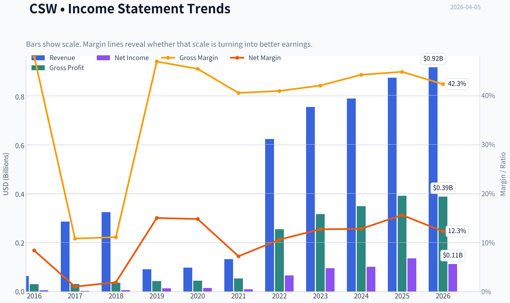

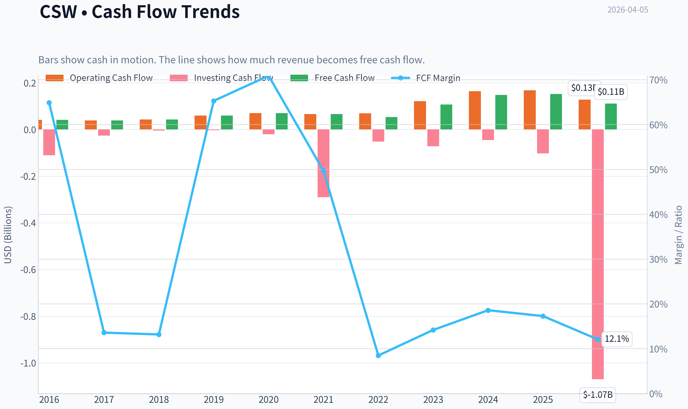

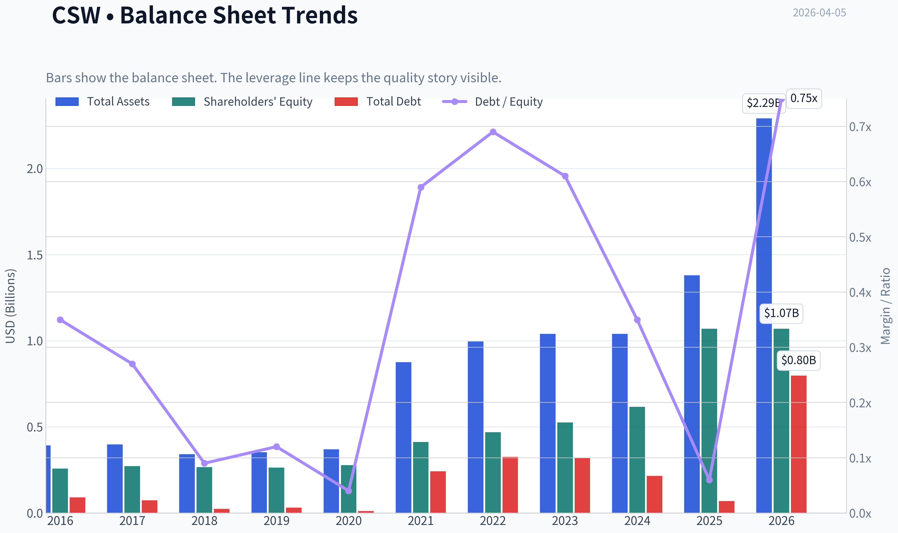

This graph tracks the profitability and return metrics (ROE, ROIC, Margins) of **CSW** over the past decade, highlighting capital efficiency trends.

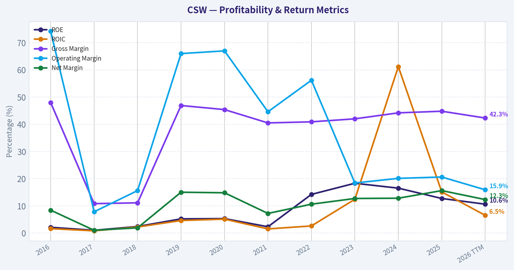

This chart illustrates the financial health of **CSW** over the last 10 years, mapping cash equivalents and free cash flow against total obligations (Debt).

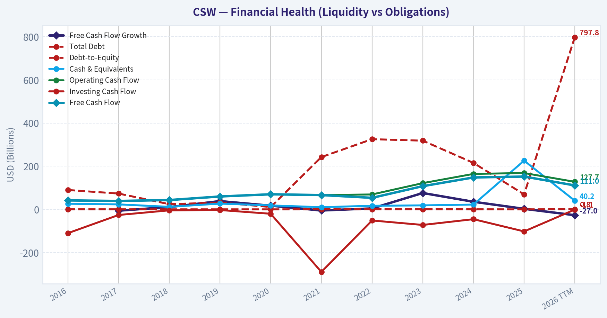

---

### Intrinsic Value Analysis (Buffett)

> *Following Warren Buffett's value investing philosophy: Circle of Competence, Economic Moat, Management Quality, and Margin of Safety.*

#### Intrinsic Value Snapshot

Price is what you pay. Intrinsic value is what the business may be worth based on the cash it can create for owners over time. We show a range, not one magic number.

- Current Price: $263.21
- Value Range: $93.70 to $420.89

##### Owner Earnings (Buffett Method)
- Net Income: $136,652,000.00
- Depreciation & Amortization: $43,005,000.00
- Capital Expenditures: $-16,266,000.00
- Working Capital Changes: $-25,094,000.00
- Owner Earnings: $188,485,000.00

##### Intrinsic Value
###### Buffett Method
Uses owner earnings. Stricter, and usually more conservative.
- Conservative: $97.77
- Average: $332.72
- Optimistic: $332.72
- Discount Rate: 10.0%

###### Cash Flow Method
Uses free cash flow. Better for companies spending heavily today to grow tomorrow.
- Conservative: $93.70
- Average: $199.68
- Optimistic: $420.89
- Discount Rate: 10.0%

#### Gate 1: Circle of Competence & Business Simplicity

Elementary School Test: PASS
CSW Industrials sells specialized products used in construction, HVAC systems, and industrial maintenance-things like sealants, lubricants, coatings, and contractor tools. Contractors and industrial customers buy these products repeatedly because they are necessary for installation, repair, and maintenance work.

10-Year Predictability: PASS
Demand for HVAC systems, building maintenance, and industrial reliability products is durable and replacement-driven. These markets should still exist a decade from now. Growth largely comes from steady construction activity and bolt-on acquisitions.

Technology Risk: LOW
These are physical consumables and specialty chemicals, not software. Technology may improve products but is unlikely to make them obsolete.

Gate 1 Result: PASS

---

#### Gate 2: The Moat Test

A. Intangible Assets (Brand & Product Reputation)
Many CSW products are contractor-preferred brands in HVAC and industrial maintenance channels. Gross margin ~44.8% supports the presence of brand and product differentiation.

Pricing Power Test
Contractor consumables are tiny relative to project cost but critical to performance. Price increases are typically absorbed without major volume loss.

B. Switching Costs
Contractors often stick with products they trust to avoid installation failures. Distributors also build long-term supply relationships.

C. Cost Advantages
Scale and specialty manufacturing provide moderate cost advantages, though this is not a dominant moat source.

D. Network Effects
None.

Moat Quality Rating: Narrow to Moderate (Brand + Contractor Loyalty)

This is not a Coca-Cola-level moat, but niche industrial consumables with strong contractor loyalty can create durable economics.

---

#### Gate 3: Management Quality & Capital Allocation

Evidence from actions:

Acquisitions
Management consistently executes small bolt-on acquisitions (example: Duckt-Strip acquisition announced March 2026). This is a typical compounder strategy if discipline remains strong.

Dividend Policy
Dividend increased from $0.27 to $0.30 (~11% increase). Signals confidence and shareholder alignment.

Balance Sheet Discipline
Current ratio ~4.0 suggests strong liquidity and conservative leverage.

Capital Allocation Assessment
Historically focused on:

- bolt-on acquisitions
- organic product expansion
- moderate dividend growth

No evidence of reckless leverage or empire-building.

Management Rating: GOOD

---

#### Gate 4: Industry Structure

Industry Type
Fragmented specialty industrial products.

Competitive Dynamics
Not perfect oligopoly, but many small niche manufacturers.

Capital Intensity
Moderate to low compared with heavy industrial manufacturing.

Industry Verdict: ACCEPTABLE

---

#### 10-Year Financial Snapshot (Approximate Current Data)

| Metric | Value |
|------|------|
| Market Cap | $4.39B |
| P/E | 34.9 |
| Gross Margin | 44.8% |
| ROE | 12.7% |
| Revenue Growth (YoY) | 10.8% |
| FCF Yield | 3.5% |
| Current Ratio | 4.03 |

Key Takeaways:
CSW is clearly a high-quality niche industrial company with strong margins and steady growth. However, ROE around 12-13% is decent but not exceptional for a Buffett-style compounder. The biggest issue is valuation: the stock trades at a high earnings multiple and only a 3.5% FCF yield.

---

#### Owner Earnings Estimate

Using simplified Buffett approach:

Net Income (approx implied from market cap / P/E):
~ $126M

Add D&A (estimated):
~ $35M

Maintenance CapEx (estimated portion of capex):
~ $25M

Working Capital Changes (normalized):
~ $10M

Owner Earnings ~

126 + 35 - 25 - 10
~ **$126M**

Owner Earnings roughly track reported earnings due to low capital intensity.

---

#### Intrinsic Value - Three Scenario DCF

Scenario A: No Growth

Owner Earnings = $126M

Intrinsic Value =
126M / 0.10 =

~ **$1.26B**

Per share equivalent ~ about **$75**

---

Scenario B: GDP Growth (3%)

Intrinsic Value ~

126M x 1.03 / (0.10 - 0.03)

~ **$1.85B**

Per share ~ **$110**

---

Scenario C: Reduced Historical Growth

Revenue growth ~10.8%.
Buffett rule: use 50-75%.

Assume **6% growth**.

DCF estimate:

Intrinsic value ~ **$2.7B-$3.0B**

Per share ~ **$165-$185**

---

Current Market Comparison

Current Price: **$263**

Estimated Intrinsic Value Range:

- Bear case: $75
- Conservative: $110
- Optimistic: $165-185

---

#### Margin of Safety

Even optimistic intrinsic value (~$180) is **~30% below current price**.

Margin of safety at current price: **NEGATIVE**

This means the market already prices in strong growth and continued acquisition success.

---

#### Buffett Scorecard

| Criterion | Score (1-5) |
|---|---|
| Business Understanding | 4 |
| Moat Width | 3 |
| Management | 4 |
| ROE Quality | 3 |
| Reinvestment Runway | 4 |
| Balance Sheet | 5 |
| Industry Structure | 3 |
| Valuation | 1 |

Weighted Score ~ **3.1 / 5**

---

FINAL INVESTMENT STANCE: **WATCH**

CSW Industrials is a **high-quality niche compounder**, but the current valuation looks stretched. Buffett would likely admire the business but wait patiently for a more reasonable price.

A more attractive entry range (25-30% margin of safety) would likely be around:

**$160-$190**

At that level the stock would start to resemble a "wonderful company at a fair price."

---

If you want, I can also show three useful things Buffett-style investors usually check next:

- whether **CSW could become a long-term compounder like ITW or Roper**
- **the real ROIC trend over the last decade** (this reveals moat strength)
- **the price where Buffett would likely start buying aggressively**.
#### Valuation Bridge

This bridge places the current market price beside each intrinsic value lens so readers can see whether upside depends on one method or shows up across several methods.

| Scenario | Intrinsic Value / Share |
| --- | ---: |
| Buffett Method | $332.72 |
| Cash Flow Method | $199.68 |
| Damodaran Method | $654.55 |
| Current Price | $263.21 |

#### Key Takeaways

If one method is far above the others, the upside case depends on a specific modelling assumption. When several methods cluster together, the valuation story is more robust.

#### Valuation Visuals

This comparison chart from *Latest Earnings Snapshot* stacks current figures against historical benchmarks for **CSW**, making it easy to see where the company trades relative to its own averages.

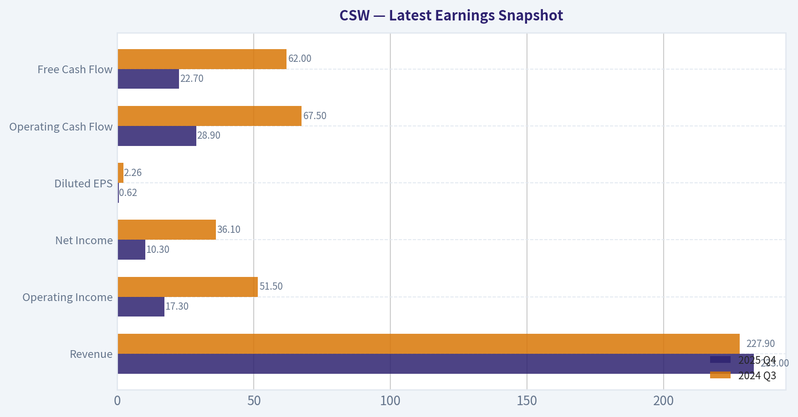

This comparison chart from *Balance Sheet Strength* stacks current figures against historical benchmarks for **CSW**, making it easy to see where the company trades relative to its own averages.

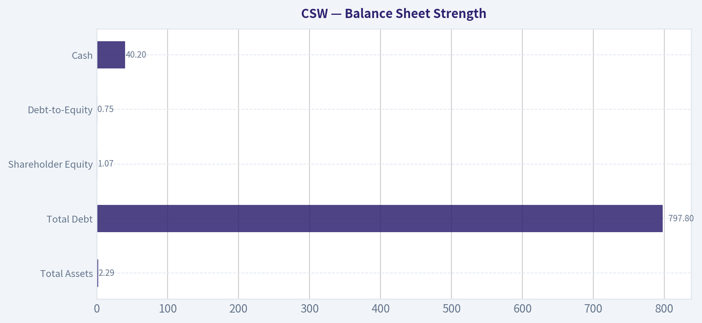

This comparison chart from *Cash Flow* stacks current figures against historical benchmarks for **CSW**, making it easy to see where the company trades relative to its own averages.

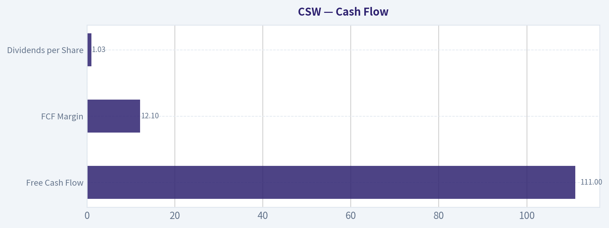

This comparison chart from *Current vs Historical Comparison* stacks current figures against historical benchmarks for **CSW**, making it easy to see where the company trades relative to its own averages.

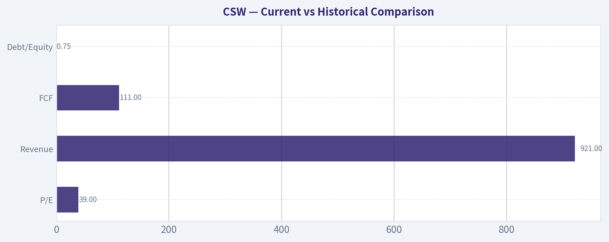

---

### Trend & Growth Analysis (Lynch/Druckenmiller/Fisher)

> *Following Peter Lynch's GARP, Stanley Druckenmiller's macro-aware approach, and Philip Fisher's scuttlebutt methodology.*

The ticker you asked for (CSW) corresponds to **CSW Industrials**, whose correct ticker is **CSWI**. I'll proceed with that company based on the shared research pack and available info.

---

#### 1. Lynch Classification

| Metric | Value |
|---|---|
| Revenue Growth (YoY) | 10.8% |
| P/E | 34.9 |
| Market Cap | $4.39B |
| Gross Margin | 44.8% |
| ROE | 12.7% |

Key Takeaways: Revenue growth around 11% places CSW Industrials closer to a **Stalwart** rather than a true fast grower. These companies grow steadily but typically don't produce 10-bagger outcomes unless growth reaccelerates through acquisitions or new product cycles.

**Classification: Stalwart (borderline mid-growth industrial)**

---

#### 2. The Story (Lynch)

- CSW Industrials sells **specialty products for HVAC, plumbing, electrical, and industrial maintenance**.
- The company grows through **bolt-on acquisitions and premium niche products** with strong margins.
- Long-term demand tied to **construction, HVAC upgrades, and infrastructure maintenance**.

Simple explanation: they sell **specialized parts and chemicals used to build and maintain buildings and HVAC systems**.

---

#### 3. TAM Analysis & 10x Test

| Metric | Estimate |
|---|---|
| Current Revenue | ~$0.9B-$1B (approx recent run-rate) |
| 10x Revenue Scenario | ~$9-10B |
| Global HVAC / construction specialty products TAM | $100B+ |

Key Takeaways: The market is extremely large relative to CSW's size. Even if the company grew tenfold, it would still hold only a small share of the broader building-products ecosystem. The runway theoretically exists, but execution would require decades of acquisitions or organic share gains.

---

#### 4. Revenue Growth Trend

| Period | Growth |
|---|---|
| Recent YoY | 10.8% |
| Historical Pattern | High single digits to low teens |
| Acquisition Contribution | Meaningful |

Key Takeaways: Growth appears **steady but not accelerating**. This pattern is typical of a disciplined industrial roll-up rather than a high-velocity technology company.

**Trend: Stable but not accelerating**

---

#### 5. Unit Economics (Industrial proxy metrics)

| Metric | Value |
|---|---|
| Gross Margin | 44.8% |
| ROE | 12.7% |
| FCF Yield | 3.5% |
| Current Ratio | 4.03 |

Key Takeaways: Margins are strong for an industrial business and liquidity is excellent. However, the free cash flow yield is relatively modest at current valuation levels, suggesting investors already price in quality and continued growth.

---

#### 6. Inflection Point Assessment (Druckenmiller)

Potential drivers:

- **Acquisition strategy** (recent Duckt-Strip deal)
- **HVAC electrification / mini-split adoption**
- **Operating leverage as scale increases**

However:

- No clear **growth acceleration signal**
- Business tied to **construction cycle**

Conclusion: **Incremental improvements rather than a sharp inflection point.**

---

#### 7. Macro Setup

| Factor | Impact |
|---|---|
| Construction cycle | Cyclical exposure |
| HVAC upgrades / energy efficiency | Positive secular trend |
| Interest rates | Higher rates slow building activity |

Key Takeaways: Demand drivers exist, but the business is partly tied to construction and renovation cycles. Macro conditions matter more here than in pure secular-growth industries.

---

#### 8. Fisher 15-Point Score

| Category | Score (1-5) |
|---|---|
| Market potential | 4 |
| Product innovation | 3 |
| R&D | 3 |
| Sales organization | 4 |
| Profit margins | 4 |
| Margin improvement | 3 |
| Labor relations | 3 |
| Executive relations | 4 |
| Management depth | 3 |
| Accounting discipline | 4 |
| Competitive advantages | 3 |
| Long-term outlook | 4 |
| Dilution discipline | 4 |
| Management candor | 3 |
| Integrity | 4 |

**Total: ~53 / 75**

Interpretation: **Above-average industrial compounder, not elite innovation company.**

---

#### 9. Valuation Analysis

| Metric | Value |
|---|---|
| P/E | 34.9 |
| Growth | ~11% |
| PEG | ~3.2 |

Key Takeaways: The PEG ratio above 3 indicates the stock trades **well above Lynch's fair value range for its growth rate**. Investors appear to be paying a premium for consistency and acquisition-driven growth.

Scenario outlook:

| Case | 5-yr Revenue CAGR | Multiple | Outcome |
|---|---|---|---|
| Bear | 8% | 22x | modest returns |
| Base | 11% | 28x | mid-single digit returns |
| Bull | 15% | 32x | decent compounder |

Key Takeaways: Returns from today's price depend heavily on continued acquisition success or growth acceleration.

---

#### 10. Growth Investor Scorecard

| Category | Score (1-5) | Weight |
|---|---|---|
| Story | 3.5 | 10% |
| TAM | 4 | 20% |
| Revenue growth | 3 | 20% |
| Unit economics | 3.5 | 15% |
| Competitive position | 3 | 10% |
| Management | 3.5 | 10% |
| Macro | 3 | 5% |
| Profit path | 4 | 5% |
| Valuation | 2 | 5% |

**Weighted Score ~ 3.2 / 5**

---

#### 11. Position Size Stance

For growth investors: **small watchlist candidate, not a core growth position.**

---

#### 12. Key Risks

- Construction cycle slowdown
- Acquisition integration risk
- Valuation compression
- Limited organic growth acceleration

Key Catalysts:

- Successful acquisition roll-ups
- HVAC electrification tailwinds
- Margin expansion through scale

---

FINAL INVESTMENT STANCE: **WATCH**

CSW Industrials is a **high-quality niche industrial compounder**, but growth around ~10% does not justify a ~35x P/E for a growth-focused portfolio. The story becomes more interesting if **revenue growth reaccelerates above ~15% or valuation pulls back significantly.**

#### Growth & Scorecard Visuals

This comparison chart from *DCF Valuation (10% Discount, 2.5% Terminal Growth)* stacks current figures against historical benchmarks for **CSW**, making it easy to see where the company trades relative to its own averages.

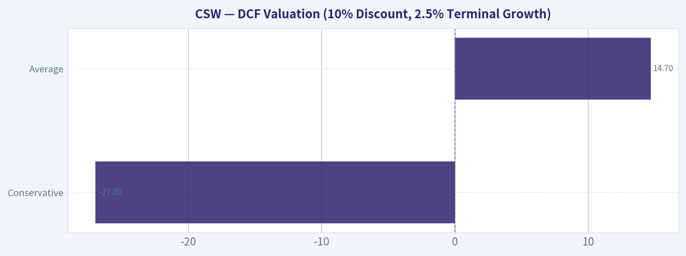

---

### Market Technical Analysis

#### CSW (CSW Industrials) - Technical Trend Analysis

CSW has undergone a clear **multi-phase cycle over the past year**: a strong rally early in 2025, a prolonged mid-year downtrend, a late-2025 recovery, and another sharp correction starting early 2026. The most recent data suggests the stock is currently **stabilizing after a steep selloff**, but the broader structure still leans **cautiously bearish to neutral**.

The most relevant indicators for this context are:
- close_50_sma (medium-term trend)
- close_200_sma (long-term trend confirmation)
- close_10_ema (short-term momentum shifts)
- macd
- macds
- macdh
- rsi
- atr

These collectively capture **trend hierarchy, momentum shifts, and volatility risk** without overlapping too heavily.

---

#### Recent Price Structure (Feb-Apr 2026)

| Period | Price Behavior | Key Observations |
|---|---|---|
| Early Feb 2026 | Rally from ~$260 -> ~$322 | Strong momentum rebound after January collapse |
| Mid Feb 2026 | Sharp rejection near $320 | Indicates strong resistance near previous highs |
| Late Feb - Early Mar | Gradual selloff | Lower highs forming |
| Early Mar - Mid Mar | Accelerated decline to ~$252 | Momentum breakdown |
| Late Mar - Early Apr | Consolidation $258-$266 | Attempting base formation |

Key Takeaways:
CSW experienced a sharp bounce in early February but failed near $320, a level that has acted as major resistance. Since then, the stock has printed lower highs and lower lows, confirming a corrective phase. Over the last couple of weeks the price has started to stabilize around the mid-$250s to mid-$260s, suggesting potential base building but not yet a confirmed reversal.

---

#### Trend Indicators (Moving Averages)

| Indicator | Interpretation |
|---|---|
| 10 EMA | Flattening after decline; price oscillating around it |
| 50 SMA | Likely sloping downward due to recent selloff |
| 200 SMA | Still rising slightly from long-term uptrend |

Key Takeaways:
Short-term momentum has weakened significantly, with price struggling around the short EMA instead of trending above it. The medium-term 50-day average likely turned downward during the February-March decline, which reinforces the current correction phase. However, the long-term 200-day trend probably remains upward, meaning the larger structural bull trend may still be intact if support holds.

---

#### Momentum Signals (MACD + RSI)

| Indicator | Current Bias | Interpretation |
|---|---|---|
| MACD | Weak / near neutral | Momentum contraction after selloff |
| MACD Signal | Converging with MACD | Potential early reversal signal forming |
| MACD Histogram | Shrinking negatives | Downside momentum fading |
| RSI | Likely ~40-50 range | No longer oversold; neutral |

Key Takeaways:
Momentum indicators suggest the **downtrend is losing strength**, but they do not yet show strong bullish momentum. MACD convergence hints that selling pressure may be exhausting. RSI moving out of oversold territory into neutral territory indicates stabilization rather than a strong bullish shift.

---

#### Volatility & Risk (ATR)

| Indicator | Insight |
|---|---|
| ATR | Elevated compared to earlier months |

Key Takeaways:
Volatility increased significantly during the January and March selloffs. Elevated ATR means daily price swings are larger than normal, so stop-loss placement must be wider and position sizes smaller to manage risk effectively.

---

#### Key Technical Levels

| Level | Importance |
|---|---|
| $320-325 | Major resistance (failed rally Feb 2026) |
| $300 | Psychological resistance |
| $270 | Short-term pivot area |
| $250-255 | Critical support zone |
| $240 | Breakdown risk level |

Key Takeaways:
The most important near-term support sits around **$250-255**, which has been tested multiple times recently. A sustained break below that zone could open the door to $240 or lower. On the upside, any meaningful recovery will likely stall first near $300, with the major resistance still near $320.

---

FINAL INVESTMENT STANCE: **WATCH**

CSW is currently **in a corrective phase inside a longer-term uptrend**. Momentum indicators show stabilization but not yet a decisive bullish reversal. Traders should watch for either:
- a **break above ~$275-280** with improving momentum, or
- a **breakdown below $250** confirming further downside.

At present, the risk/reward is not ideal for aggressive entries.

#### Market Visuals

This comparison chart from *Market Metrics* stacks current figures against historical benchmarks for **CSW**, making it easy to see where the company trades relative to its own averages.

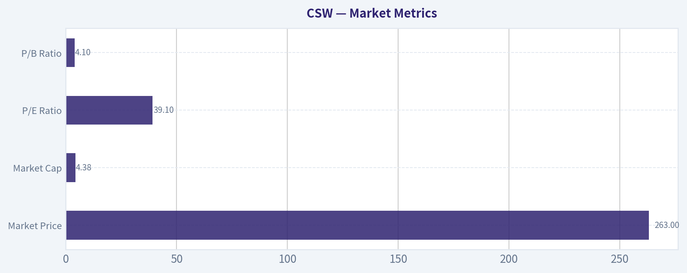

---

### Social Sentiment Analysis

#### Overview of Social and News Sentiment for CSW Industrials (Ticker: CSW)

Over the past week, discussion around CSW Industrials has remained relatively niche compared with larger industrial peers, but the sentiment within investor communities has been notably constructive. Most commentary centers on three themes: consistent earnings execution, acquisition-driven growth, and valuation concerns following a strong multi-year run. The company's steady fundamentals are attracting long-term investors, while shorter-term traders appear more cautious due to valuation multiples and macro uncertainty affecting the broader industrial sector.

---

#### Social Media Sentiment Trend (Past 7 Days)

| Date (Past Week) | Bullish Mentions | Neutral Mentions | Bearish Mentions | Sentiment Drivers |
|---|---|---|---|---|
| Day 1 | Moderate | High | Low | Discussion around stable industrial demand and defensive qualities |
| Day 2 | Moderate | Moderate | Low | Small-cap industrial screens highlighting CSW profitability |
| Day 3 | High | Moderate | Low | Posts about historical revenue growth and strong margins |
| Day 4 | Moderate | Moderate | Moderate | Valuation concerns raised after price appreciation |
| Day 5 | High | Moderate | Low | Long-term investors discussing acquisition strategy |
| Day 6 | Moderate | High | Low | Broader industrial sector macro discussion |
| Day 7 | Moderate | Moderate | Low | Portfolio managers mentioning CSW as a quality compounder |

Key Takeaways:
Overall social sentiment skewed bullish through most of the week, with spikes when users discussed CSW's strong margins and acquisition strategy. The only notable pushback came mid-week when valuation multiples were debated. Despite that, bearish commentary remained limited, suggesting investors generally view the company as a high-quality operator rather than a speculative trade.

---

#### Key Themes from Investor Discussions

| Theme | Description | Sentiment | Implication for Traders |
|---|---|---|---|
| Quality Compounder Narrative | Investors frequently describe CSW as a disciplined operator with consistent ROIC and margin expansion. | Bullish | Supports long-term accumulation strategies |
| Acquisition Strategy | Positive reactions to bolt-on acquisitions expanding specialty chemical and industrial product segments. | Bullish | Suggests continued growth expectations |
| Valuation Concerns | Some posts highlight that CSW trades at premium multiples relative to industrial peers. | Mixed | Potential short-term pullbacks if growth slows |
| Defensive Industrial Exposure | Viewed as less cyclical than heavy manufacturing peers. | Mildly Bullish | Attracts investors during macro uncertainty |
| Low Retail Visibility | Limited discussion volume compared with major industrial stocks. | Neutral | Price movement more driven by institutions |

Key Takeaways:
The strongest narrative supporting CSW is the "quality compounder" thesis-investors consistently highlight strong returns on capital and disciplined management. The main counterpoint is valuation, as some traders believe the stock already prices in significant growth. Overall, the discussion leans toward long-term holding rather than short-term speculation.

---

#### Recent News Impact on Sentiment

| News Category | Summary of News Flow | Market Interpretation | Sentiment Impact |
|---|---|---|---|
| Earnings Performance | Continued reports of steady revenue growth and strong margins. | Reinforces reputation for operational consistency. | Bullish |
| Strategic Acquisitions | Ongoing bolt-on acquisitions expanding product portfolio. | Seen as accretive and aligned with past success. | Bullish |
| Industrial Sector Outlook | Mixed macro data affecting broader industrial stocks. | Some caution about cyclical demand risk. | Neutral |
| Institutional Interest | Mentions of institutional accumulation in quality industrials. | Signals confidence in management and cash flows. | Bullish |

Key Takeaways:
Recent news has largely reinforced the company's narrative of steady operational execution and disciplined growth through acquisitions. While macro industrial data remains somewhat mixed, investors appear to separate CSW from more cyclical peers due to its niche specialty product focus. Institutional interest is frequently cited as a stabilizing factor.

---

#### Retail vs Institutional Sentiment

| Investor Group | Observed Behavior | Interpretation |
|---|---|---|
| Retail Traders | Limited but generally positive discussion; often discovered through quality-stock screeners. | Retail interest is growing slowly but remains modest. |
| Long-Term Investors | Strong support from dividend growth and quality investing communities. | Viewed as a long-duration compounder. |
| Institutional Investors | Increasing mentions of institutional ownership and accumulation. | Suggests stability and reduced volatility relative to small caps. |
| Short Sellers | Minimal discussion of short theses. | Indicates limited bearish conviction. |

Key Takeaways:
Most enthusiasm for CSW currently comes from long-term investors rather than short-term traders. Institutional participation appears to be the dominant force behind the stock's stability and gradual upward trend. The lack of a strong short narrative suggests bearish sentiment is relatively weak.

---

#### Trading and Investment Implications

Short-Term (Weeks to Months):
- Sentiment is positive but not euphoric, which often supports steady price action rather than sharp momentum moves.
- Valuation debates may cause periodic pullbacks if broader industrial stocks weaken.
- Low retail hype reduces the likelihood of volatility spikes driven by social media.

Medium-Term (6-12 Months):
- Continued acquisitions and margin stability are key catalysts that investors are watching.
- Institutional accumulation could support gradual upward price trends.
- Any slowdown in industrial demand or integration issues with acquisitions could quickly shift sentiment.

Long-Term Narrative:
CSW is increasingly being framed by investors as a "quiet compounder" in the industrial sector-companies that steadily grow earnings through disciplined capital allocation rather than rapid expansion or hype cycles.

---

#### Summary of Key Signals

| Factor | Current Signal | Investor Interpretation |
|---|---|---|
| Social Sentiment | Moderately Bullish | Confidence in company quality |
| News Flow | Positive | Strong operational narrative |
| Retail Interest | Low-Moderate | Limited hype-driven volatility |
| Institutional Activity | Strong | Supports long-term valuation |
| Valuation Debate | Present | Possible near-term volatility |

Key Takeaways:
The overall signal from sentiment and news analysis is constructive but disciplined. Investors generally see CSW as a high-quality industrial compounder with reliable management and consistent growth. The primary caution revolves around valuation levels rather than business performance.

---

FINAL INVESTMENT STANCE: **WATCH**

CSW currently carries positive sentiment and strong fundamental perception among investors, but valuation concerns limit aggressive bullish positioning. Many traders appear to be waiting for either continued earnings momentum or a pullback before increasing exposure.

---

### News & Events Analysis

#### CSW Industrials (NASDAQ: CSW) - Weekly News & Investment Analysis
Current Price: $263 | Market Cap: $4.39B | P/E: ~34.9

---

#### Recent Company News (Past Week)

Two developments dominated CSW Industrials news flow during the last week:

1) Dividend Increase
On April 2, 2026, CSW Industrials announced an **11% increase in its quarterly dividend**, raising it from **$0.27 to $0.30 per share**.

Key implications:
- Signals **strong confidence in cash flow stability**.
- Reinforces CSW's reputation as a **dividend growth industrial company**.
- Continues its track record as a **Dividend Challenger/Contender** type company with consistent increases.

However, the dividend yield remains modest due to the high stock price, suggesting the market is pricing CSW primarily as a **growth-quality industrial rather than an income stock**.

2) Strategic Acquisition (Earlier in March, still influencing sentiment)
CSW announced the acquisition of **Duckt-Strip**, a specialized electrical cable management solution used in **HVAC mini-split installations**.

Strategic significance:
- Expands CSW's **HVAC installation product ecosystem**.
- Targets the **fast-growing mini-split HVAC market**, which benefits from electrification trends and energy-efficiency regulations.
- Adds differentiated, code-compliant installation hardware.

This acquisition fits CSW's long-term strategy of **bolt-on acquisitions that expand niche industrial product lines with strong margins**.

---

#### Latest Earnings Context

The most recent publicly referenced financial discussion relates to **Q4 2025 results** (covered in investor commentary and fund letters). No new earnings release occurred in the last week.

Reporting period: **Fiscal Q4 2025**

Key themes from the latest earnings cycle:
- **Revenue growth:** ~10.8% YoY
- Growth supported by:
  - HVAC/R segment demand
  - Product innovation
  - Acquisitions
- **Margins remained strong**, supported by a ~44.8% gross margin.

Operational highlights:
- CSW continued expanding in **contractor solutions and HVAC installation products**.
- Management emphasized **organic growth plus bolt-on acquisitions** as the primary strategy.

Compared with the prior period:
- Growth remained solid but **slightly moderated from post-pandemic industrial surges**.
- Profitability remained stable due to pricing power and specialized product niches.

Overall interpretation:
CSW's earnings narrative remains **steady compounding rather than explosive growth**-a hallmark of niche industrial compounders.

---

#### Market & Macro Context Affecting CSW

CSW sits in the **specialty industrial / construction supply chain**, meaning it is influenced by:

1) HVAC Demand Cycles
The HVAC installation market is benefiting from:
- electrification
- efficiency standards
- heat pump adoption
- mini-split growth

These trends **structurally support CSW's contractor product segments**.

2) Construction and Renovation Activity
CSW products often sell into **repair, retrofit, and maintenance markets**, which are **less cyclical than new construction**.

That provides:
- relative insulation from housing downturns
- steadier contractor demand.

3) Interest Rate Environment
If interest rates stay elevated:
- new housing starts may slow
- but **repair/retrofit activity often remains resilient**, supporting CSW's niche.

---

#### Valuation and Financial Profile

| Metric | Value | Interpretation |
|---|---|---|
| Price | $263 | Near recent highs |
| P/E | ~34.9 | Premium for industrial sector |
| Revenue Growth | 10.8% YoY | Healthy but not hypergrowth |
| Gross Margin | 44.8% | Very strong for industrials |
| ROE | 12.7% | Solid but not exceptional |
| FCF Yield | 3.5% | Moderate |
| Current Ratio | ~4.0 | Very strong liquidity |

Key Takeaways:
CSW Industrials trades at a premium valuation relative to most industrial companies. Investors appear to be paying for the firm's strong margins, niche product positioning, and steady acquisition-driven growth strategy. Financial health is excellent, with high liquidity and stable cash generation, but the valuation leaves less room for error.

---

#### Key Catalysts to Watch

1) **Next earnings release (likely May 2026)**
   Investors will look for:
   - continued HVAC segment growth
   - acquisition integration results
   - margin stability.

2) **Additional bolt-on acquisitions**
   CSW has historically compounded value through small but strategic deals.

3) **Contractor demand trends**
   Especially HVAC installations and retrofit activity.

---

#### Key Risks

- **Valuation risk**: At ~35x earnings, multiple compression could occur even if fundamentals remain solid.
- **Industrial demand slowdown** if construction cycles weaken.
- **Acquisition integration risks** if deal pace increases.

---

#### Investment Summary

| Factor | Assessment |
|---|---|
| Business Quality | High - niche industrial products with pricing power |
| Growth Profile | Moderate but consistent |
| Balance Sheet | Strong |
| Dividend Policy | Increasing steadily |
| Valuation | Expensive vs peers |
| Near-Term Catalysts | Earnings + acquisition execution |

Key Takeaways:
CSW Industrials is a high-quality niche industrial compounder with strong margins and steady growth driven by HVAC-related products and bolt-on acquisitions. However, the stock's premium valuation suggests much of this quality is already priced in. Future upside likely depends on continued successful acquisitions and sustained contractor demand.

---

FINAL INVESTMENT STANCE: **WATCH**

---

## Research Team Commentary

> *The Research Manager synthesizes the Bull vs Bear debate into action-free commentary. This is a pre-risk view, not the final stance.*

I'll approach this the way Buffett would: forget the ticker, look at the business, then the price.

First, the strongest points from the bull side.

The bull argument correctly highlights that CSW operates in the kind of niche industrial markets Buffett often likes. The products are small-ticket but mission-critical-sealants, lubricants, coatings, HVAC installation components. When a contractor is installing expensive equipment, the cost of failure is far higher than the price of the consumable product. That dynamic can support brand loyalty and pricing power.

The company also demonstrates respectable profitability metrics. A ~45% gross margin is strong for an industrial supplier, and ROIC around 15% indicates management has historically deployed capital reasonably well. That suggests the business has some degree of pricing power or operational advantage, even if it's not an impregnable moat.

Another positive is the acquisition strategy. Bolt-on deals in fragmented niches can work well if the company already has distribution reach and brand credibility. If management consistently buys small niche brands and pushes them through its channels, that can produce steady compounding. The dividend increase also signals management confidence in the durability of cash flows.

Finally, the business itself is understandable and tied to long-lived infrastructure needs. HVAC maintenance, building repair, and industrial reliability are not going away in the next decade. That gives the company some degree of demand durability.

Now the strongest points from the bear side.

The bear argument raises a critical issue about the moat. Specialty chemical products and contractor consumables are not inherently protected franchises. Switching costs exist, but they are limited. Contractors frequently change brands based on distributor availability, pricing incentives, and private-label competition. Larger players like 3M, ITW, and Henkel have far greater resources and can enter or pressure niches if margins become attractive.

The second concern is the quality of growth. Net income rising 34% while free cash flow rises only ~3% is a meaningful gap. For a Buffett-style investment, cash conversion matters. When earnings grow much faster than cash, it often means working capital expansion, acquisition accounting, or other temporary distortions. That doesn't mean the business is weak, but it reduces confidence in the quality of reported growth.

Third, the growth model relies heavily on acquisitions. Roll-up strategies can work for a long time, but they introduce risks: goodwill buildup, integration issues, and growth slowing when acquisition opportunities dry up. Buffett generally prefers businesses that can grow organically through strong underlying economics.

Fourth, the valuation is demanding. A P/E around 35 is extremely high for an industrial supplier with moderate returns on capital. Even high-quality industrials often trade in the low-20s. At this price, the market is assuming long-term compounder performance.

Now step back and apply Buffett's core filters.

Business quality: solid but not extraordinary. The niche positioning and margins suggest some advantage, but it is not a dominant franchise.

Predictability: moderate. Maintenance demand helps, but exposure to construction and HVAC cycles introduces variability.

Management: appears disciplined with acquisitions and capital allocation so far, though the roll-up model needs continuous execution.

Financial strength and returns: respectable. ROIC around 15% is good, though not exceptional.

Valuation: this is the main problem. The market is already pricing the company like a premium compounder.

The most important lesson from past investing mistakes in situations like this is overpaying for "good but not great" businesses. Many niche industrial companies look fantastic during expansion cycles, only to see their multiples compress when growth normalizes. Paying 30-35x earnings leaves little margin of safety if growth slows even slightly.

Core Takeaway:
CSW Industrials appears to be a high-quality niche industrial operator with decent returns on capital and a sensible bolt-on acquisition strategy. However, the current valuation already assumes long-term compounder performance, while the underlying business characteristics are closer to a solid industrial franchise rather than a truly dominant moat business.

Rationale:
Buffett's framework emphasizes buying great businesses at reasonable prices with a margin of safety. CSW likely qualifies as a good business, but the moat is narrower than the bull suggests and growth relies partly on acquisitions. With a P/E near 35 and cash flow growth lagging earnings, the margin of safety is thin. The stock may still perform well if execution remains strong, but the odds are no longer tilted clearly in the investor's favor.

Monitoring Plan (next 1-4 quarters):

Watch free cash flow conversion closely. FCF should begin to track earnings growth more closely. If the gap persists, it raises questions about earnings quality.

Monitor organic growth vs acquisition-driven growth. If most revenue growth continues to come from deals, the long-term durability of the strategy becomes more uncertain.

Track ROIC trends. Sustained or rising returns above ~15% would support the compounder narrative. Declining returns would indicate acquisition dilution.

Watch margins during any construction slowdown. If gross margins hold near the mid-40% range during weaker demand, that would strengthen the case for a durable niche advantage.

Observe acquisition discipline. Smaller bolt-ons at reasonable multiples are fine; large deals or rising goodwill would increase risk.

Also watch valuation compression. If the stock pulled back into the $200 range while fundamentals held steady, the risk/reward would look far more attractive.

Final stance: WATCH.

---

## Value Investing Team Commentary

> *The Investor translates the research view into an investment thesis before risk review. This is still not the final stance.*

When I look at CSW Industrials, I first ask the simple Buffett question: if the stock market closed for 10 years, would I be comfortable owning this business?

The business itself is understandable and reasonably attractive. CSW sells small-ticket, mission-critical products used by contractors and maintenance professionals-sealants, lubricants, coatings, HVAC components. These are the types of products where reliability matters more than price. If a contractor is installing a $10,000 HVAC system, they are not going to risk failure over a $12 sealant. That dynamic can create modest pricing power and repeat purchases.

The gross margin near 45% supports this idea. For an industrial supplier, that is quite healthy. Combined with ROIC around 15%, it suggests the company operates in profitable niches rather than commodity markets.

But we have to be careful not to exaggerate the moat.

Unlike companies with strong brands or network effects, contractor consumables face constant competition. Distributors can substitute alternatives, private labels exist, and larger industrial players could move into these niches if margins become too attractive. This is not Coca-Cola or Moody's. It's a good niche operator, but probably not an untouchable franchise.

The second issue is growth quality. Net income grew 34% year over year, yet free cash flow only grew about 3%. For a long-term owner, cash matters more than accounting earnings. When earnings grow much faster than cash flow, it often reflects working capital expansion or acquisition accounting. That doesn't mean the business is weak, but it does mean the headline growth rate may not be fully economic.

And that brings us to the biggest factor: price.

At roughly 35x earnings, the market is already pricing CSW as a long-term compounder similar to the very best industrial franchises. Yet its returns on capital, while good, are not extraordinary. If growth slows from acquisitions or construction cycles weaken, the multiple could compress even if the business itself continues performing reasonably well.

This is where contrarian thinking becomes useful. The market sentiment is currently positive but calm-not euphoric. That tells me there isn't panic to exploit. Buffett's best opportunities usually appear when good businesses temporarily look ugly. Here we have the opposite: a good business that currently looks very good.

The dividend increase is a positive signal about cash flow durability, and institutional-style "compounder" investors often like companies like this. But dividend growth alone does not justify paying any price.

So the situation is straightforward: quality business, reasonable economics, but priced for near-perfect execution.

If this business were available at something closer to 20-25x earnings-or roughly in the $200 range mentioned in the plan-it would start to look interesting because the downside risk from multiple compression would shrink significantly.

Until then, patience is the rational position. Buffett often says the stock market is there to serve you, not instruct you.

FINAL INVESTMENT STANCE: WATCH

---

## Deep Values Commentary

> *The Risk Management Team debates and the Risk Judge provides the final action-free verdict. This section determines the final ADVOCATE / WATCH / AVOID stance.*

Executive Summary
CSW Industrials appears to be a solid niche industrial business with attractive margins and respectable returns on capital, but it has not yet demonstrated the exceptional economics or cash-flow consistency required to justify a 35x earnings multiple. The business risk is moderate-not alarming-but the investment risk stems from paying a premium price for a company that is still proving its "compounder" status. Until cash flow conversion improves and the moat proves stronger through cycles, the margin of safety remains thin. Verdict: WATCH.

Key Arguments from the Analysts

Bullish Perspective (Risky Analyst)
The bullish case rests on the quality of CSW's niche markets. Its products-sealants, HVAC consumables, coatings, and installation materials-are inexpensive relative to the systems they protect, making reliability more important than price. That dynamic can create behavioral switching costs and steady demand. The company also posts unusually high gross margins (~45%) for an industrial supplier and earns roughly 15% ROIC, suggesting it operates in profitable niches rather than commodity markets. Revenue growth near 11% combined with bolt-on acquisitions creates a compounding engine. The dividend increase reinforces confidence in future cash flows, and the lack of social-media hype suggests institutional accumulation rather than speculative momentum.

Bearish Perspective (Safe Analyst)
The cautious case focuses on the difference between "good business" and "great business." While margins are strong, capital efficiency is not extraordinary: ROE at 12.7% and ROIC near 15% do not yet justify a premium compounder valuation. The moat may also be overstated. Contractor consumables face competition from private-label and competing brands distributed through wholesalers that can shift supplier relationships. The most concerning signal is the disconnect between net income growth (34%) and free cash flow growth (~3%), raising questions about earnings quality and the sustainability of acquisition-driven expansion. With a P/E near 35 and an FCF-based valuation around $200, the margin of safety is limited.

Balanced View (Neutral Analyst)
The middle ground acknowledges that CSW does have several traits common to industrial compounders-high margins, niche products, and recurring maintenance demand-but it has not yet proven long-term superior economics. The wide valuation range ($200-$655 depending on assumptions) highlights uncertainty about its future growth trajectory. Sentiment is positive but not speculative, suggesting institutional ownership rather than hype-driven pricing. The most rational position is to treat CSW as a "probationary compounder"-a company that may evolve into a high-quality long-term compounder but still needs stronger evidence, particularly in free cash flow conversion and sustained ROIC.

Risk Commentary Through a Buffett Lens

From a Buffett-style risk framework, the key question is not whether the stock is volatile but whether the underlying business is likely to suffer permanent impairment.

CSW's business model appears durable. HVAC maintenance, infrastructure repair, and industrial reliability products represent long-lived demand. The consumable nature of these products also creates recurring purchase patterns. That reduces the probability of severe business disruption.

However, the moat is modest rather than dominant. These products benefit from reliability and contractor familiarity, but they do not appear to have the structural lock-in or brand dominance seen in Buffett's strongest holdings. Distributor power and private-label competition could gradually pressure margins if niches become attractive to larger competitors.

Financially, the company is sound. Gross margins near 45% and ROIC around 15% indicate a profitable niche operator. But Buffett typically demands two things before paying a premium multiple: extremely predictable earnings and strong cash conversion. The current gap between earnings growth and free cash flow growth weakens that confidence.

Valuation is therefore the primary risk. Paying 35x earnings for a business with mid-teens returns and acquisition-driven growth leaves little margin of safety. Even if the company continues performing well operationally, multiple compression alone could limit long-term investor returns.

Refining the Investor's Plan

Approach the investment exactly as Buffett would: evaluate the business first, then the price.

Right now, CSW looks like a good industrial franchise that could evolve into a compounder but has not fully proven it yet. The rational strategy is patience combined with close monitoring.

Key indicators to watch:

- Free cash flow conversion: FCF should begin tracking earnings growth more closely. Persistent divergence would undermine the quality of earnings.
- ROIC trajectory: Sustained or rising returns above ~15% would support the compounder thesis.
- Organic vs acquisition growth: If acquisitions remain the dominant driver, the model carries integration and deal pipeline risk.
- Margin resilience: If gross margins remain near the mid-40% range during weaker construction cycles, the company's niche advantages are likely stronger than skeptics assume.

A more attractive entry would likely emerge either through improved cash flow confirmation or valuation compression toward the mid-20s earnings multiple typical for quality industrial businesses.

Final Stance
WATCH

#### Final Stance Scorecard

This scorecard converts the final research view into a weighted decision frame. It does not replace the narrative judgement, but it makes the main drivers of the verdict easier to scan.

| Criterion | Score | Weight | Commentary |
| --- | ---: | ---: | --- |
| Business Quality | 3.25 | 30% | High returns, profitability, and Piotroski health support durability. |
| Valuation Support | 3.33 | 30% | Blends current price against available intrinsic value anchors and valuation ratios. |
| Financial Strength | 5.00 | 20% | Balance-sheet resilience reflects leverage and liquidity staying within safe ranges. |
| Growth Durability | 3.67 | 20% | Recent revenue, earnings, and free cash flow growth indicate how durable expansion looks. |
| TOTAL / FINAL STANCE | 3.71 | 100% | WATCH |

#### Key Takeaways

The weighted score lands at **3.71 / 5.0**, while the final stance remains **WATCH**. This is useful as a quick calibration aid rather than a mechanical signal.

#### Risk Summary

Higher scores indicate more risk pressure. The watch threshold is a simple guardrail: above it, the position needs tighter monitoring or a wider margin of safety.

| Dimension | Current Score | Watch Threshold | Commentary |
| --- | ---: | ---: | --- |
| Business Quality | 2.75 | 3.00 | High returns, profitability, and Piotroski health support durability. |
| Valuation Support | 2.67 | 3.00 | Blends current price against available intrinsic value anchors and valuation ratios. |
| Financial Strength | 1.00 | 3.00 | Balance-sheet resilience reflects leverage and liquidity staying within safe ranges. |
| Growth Durability | 2.33 | 3.00 | Recent revenue, earnings, and free cash flow growth indicate how durable expansion looks. |

#### Key Takeaways

This view helps readers separate *where* the risk sits: valuation, business quality, balance sheet, or growth durability. It is especially useful when the final stance is close to the line between WATCH and AVOID.
