# CTAS Deep Value Intelligence

**Analysis Date:** 2026-09-22

## Critical Disclaimer

*This analysis is generated by Deep Value Intelligence, an AI-powered multi-agent investing framework. Education & research only - not financial advice, not a financial advisor.*

---

## Table of Contents

1. Intelligence Summary
2. Analyst Team Reports
   - Fundamentals Analysis
   - Intrinsic Value Analysis (Buffett)
   - Trend & Growth Analysis (Lynch/Druckenmiller/Fisher)
   - Market Technical Analysis
   - Options Market Analysis
3. Research Team Commentary
4. Value Investing Team Commentary
5. Deep Values Commentary

---

## Intelligence Summary

### Thesis + Conditions

**Core Thesis:** ## Executive Briefing

**Key Risks:**
- The principal risk is not business failure but **overpayment**. The **2.5% earnings yield** leaves returns dependent on sustained low-double-digit growth and a continuing premium valuation. Missing free-cash-flow, maintenance-capex, and incremental-ROIC data prevents confirmation that EPS adequately represents owner earnings.
- Retain **WATCH**. Existing diversified owners can hold, but new investors should not establish a full position without either stronger owner-earnings evidence or a quality-adjusted margin of safety.
- ### Risky Analyst: strongest points

**Confidence:** Low

---

## Analyst Team Reports

### Fundamentals Analysis

#### Latest Earnings Snapshot

*Most recent reported quarter anchored on 2026 Q2, with prior-year comparison when available.*

| Metric | 2026 Q2 | 2025 Q2 | YoY Change |
| --- | ---: | ---: | ---: |
| Revenue | $2.91B | $2.67B | +8.9% |
| Operating Income | $688.2M | $597.5M | +15.2% |
| Net Income | $511.0M | $448.3M | +14.0% |
| Diluted EPS | $1.26 | $1.09 | +15.6% |
| Operating Cash Flow | $709.1M | $635.7M | +11.5% |
| Free Cash Flow | $613.1M | $521.1M | +17.7% |

Key Takeaways: This snapshot anchors the most recent reported quarter before the narrative analysis. It helps readers separate long-run business quality from whatever changed in the latest earnings print.

#### 17-Year Financial Metrics for CTAS

*All values below are computed deterministically from raw data - not estimated by AI.*

*Issuer profile: operating company (Industrials / Specialty Business Services).*

#### 17-Year Financial Metrics
*Annual rows come from reported financial statements. The final TTM row is computed from the latest four quarters.*

| Metric | 2009 | 2010 | 2011 | 2012 | 2013 | 2014 | 2015 | 2016 | 2017 | 2018 | 2019 | 2020 | 2021 | 2022 | 2023 | 2024 | 2025 | 2026 TTM |
| --- | --- | --- | --- | --- | --- | --- | --- | --- | --- | --- | --- | --- | --- | --- | --- | --- | --- | --- |
| Market Price | $5 | $5 | $7 | $8 | $10 | $13 | $19 | $21 | $29 | $42 | $52 | $58 | $84 | $96 | $115 | $166 | $224 | $197 |
| Market Cap | N/A | $993.6M | $1.20B | $1.20B | $1.42B | $1.89B | $2.53B | $2.61B | $3.39B | $5.00B | $6.07B | $6.63B | $9.52B | $10.51B | $48.81B | $70.08B | $92.93B | $79.60B |
| P/E Ratio | 3.93 | 4.64 | 4.89 | 4.06 | 4.53 | 5.09 | 5.93 | 3.82 | 7.18 | 6.03 | 6.94 | 7.64 | 8.63 | 8.55 | 36.32 | 44.72 | 51.48 | 40.10 |
| P/B Ratio | N/A | 0.39 | 0.52 | 0.56 | 0.65 | 0.86 | 1.31 | 1.41 | 1.47 | 1.66 | 2.02 | 2.05 | 2.58 | 3.18 | 12.63 | 16.24 | 19.84 | 15.49 |
| ROE | 9.6% | 8.5% | 10.7% | 13.9% | 14.3% | 17.1% | 22.3% | 37.6% | 20.9% | 27.9% | 29.5% | 27.1% | 30.1% | 37.4% | 34.9% | 36.4% | 38.7% | 38.9% |
| ROIC | 14.4% | 10.6% | 9.7% | 11.8% | 12.2% | 13.1% | 15.4% | 17.6% | 13.2% | 16.4% | 15.7% | 16.8% | 21.3% | 22.5% | 23.8% | 26.3% | 28.7% | 27.7% |
| EPS | $1.18 | $1.14 | $1.39 | $1.91 | $2.15 | $2.64 | $3.22 | $5.57 | $3.98 | $6.94 | $7.42 | $7.61 | $9.75 | $11.20 | $3.16 | $3.79 | $4.40 | $4.91 |
| Revenue | $3.77B | $3.55B | $3.81B | $4.10B | $4.25B | $4.19B | $4.37B | $4.80B | $5.32B | $6.48B | $6.89B | $7.09B | $7.12B | $7.85B | $8.82B | $9.60B | $10.34B | $11.26B |
| Gross Profit | N/A | $1.50B | $1.61B | $1.74B | $1.75B | $1.75B | $1.89B | $2.10B | $2.38B | $2.91B | $3.13B | $3.23B | $3.31B | $3.63B | $4.17B | $4.69B | $5.17B | $5.71B |
| Gross Margin | N/A | 42.2% | 42.2% | 42.4% | 41.3% | 41.7% | 43.3% | 43.8% | 44.7% | 44.9% | 45.4% | 45.6% | 46.6% | 46.2% | 47.3% | 48.8% | 50.0% | 50.7% |
| Operating Margin | 10.8% | 11.0% | 11.6% | 13.2% | 13.3% | 14.4% | 15.6% | 16.0% | 14.5% | 14.7% | 16.4% | 16.4% | 19.5% | 20.2% | 20.4% | 21.6% | 22.8% | 23.3% |
| Net Income | $226.4M | $215.6M | $247.0M | $297.6M | $315.4M | $374.4M | $430.6M | $693.5M | $480.7M | $842.6M | $885.0M | $876.0M | $1.11B | $1.24B | $1.35B | $1.57B | $1.81B | $2.00B |
| Net Margin | 6.0% | 6.1% | 6.5% | 7.3% | 7.4% | 8.9% | 9.9% | 14.5% | 9.0% | 13.0% | 12.8% | 12.4% | 15.6% | 15.7% | 15.3% | 16.4% | 17.5% | 17.8% |
| Revenue Growth | N/A | -6.0% | 7.4% | 7.7% | 3.5% | -1.2% | 4.2% | 9.8% | 11.0% | 21.7% | 6.4% | 2.8% | 0.4% | 10.4% | 12.2% | 8.9% | 7.7% | 8.9% |
| Net Income Growth | N/A | -4.7% | 14.5% | 20.5% | 6.0% | 18.7% | 15.0% | 61.1% | -30.7% | 75.3% | 5.0% | -1.0% | 26.8% | 11.2% | 9.1% | 16.6% | 15.3% | 10.4% |
| Free Cash Flow Growth | N/A | 25.1% | -65.2% | 95.2% | 15.3% | 29.2% | -21.3% | -47.5% | 157.6% | 41.2% | 14.3% | 34.1% | 14.7% | 6.5% | -3.2% | 32.2% | 5.9% | 7.1% |
| Total Book Value | $2.37B | $2.53B | $2.30B | $2.14B | $2.20B | $2.19B | $1.93B | $1.84B | $2.30B | $3.02B | $3.00B | $3.24B | $3.69B | $3.31B | $3.86B | $4.32B | $4.68B | $5.14B |
| Total Assets | N/A | $3.97B | $4.35B | $4.17B | $4.35B | $4.46B | $4.19B | $4.10B | $6.84B | $6.96B | $7.44B | $7.67B | $8.24B | $8.15B | $8.55B | $9.17B | $9.83B | $10.53B |
| Total Debt | N/A | $786.1M | $1.29B | $1.28B | $1.31B | $1.30B | $1.30B | $1.29B | $3.13B | $2.54B | $3.16B | $2.54B | $2.54B | $2.80B | $2.49B | $2.48B | $2.42B | $2.71B |
| Debt-to-Equity | N/A | 0.31 | 0.56 | 0.60 | 0.59 | 0.59 | 0.67 | 0.70 | 1.36 | 0.84 | 1.05 | 0.79 | 0.69 | 0.85 | 0.64 | 0.57 | 0.52 | 0.53 |
| Cash & Equivalents | $129.7M | $411.3M | $438.1M | $339.8M | $352.3M | $513.3M | $417.1M | $139.4M | $169.3M | $138.7M | $96.6M | $145.4M | $493.6M | $90.5M | $124.1M | $342.0M | $264.0M | $289.0M |
| Shareholders' Equity | $2.37B | $2.53B | $2.30B | $2.14B | $2.20B | $2.19B | $1.93B | $1.84B | $2.30B | $3.02B | $3.00B | $3.24B | $3.69B | $3.31B | $3.86B | $4.32B | $4.68B | $5.14B |
| Operating Cash Flow | $523.5M | $565.7M | $340.9M | $469.9M | $552.7M | $606.0M | $580.3M | $465.8M | $763.9M | $964.2M | $1.07B | $1.29B | $1.36B | $1.54B | $1.59B | $2.07B | $2.17B | $2.28B |
| Investing Cash Flow | $-203.2M | $-207.6M | $-298.6M | $-104.3M | $-284.2M | $-14.5M | $45.0M | $128.4M | $-2.31B | $-135.7M | $-235.6M | $-285.4M | $-137.2M | $-402.6M | $-381.6M | $-603.3M | $-623.6M | $-568.4M |
| Free Cash Flow | $363.4M | $454.6M | $158.3M | $309.1M | $356.3M | $460.4M | $362.6M | $190.5M | $490.6M | $692.5M | $791.1M | $1.06B | $1.22B | $1.30B | $1.26B | $1.66B | $1.76B | $1.88B |
| FCF Margin | 9.6% | 12.8% | 4.2% | 7.5% | 8.4% | 11.0% | 8.3% | 4.0% | 9.2% | 10.7% | 11.5% | 15.0% | 17.1% | 16.5% | 14.2% | 17.3% | 17.0% | 16.7% |
| Dividends / Share | N/A | $0.00 | $0.00 | $0.00 | $0.00 | $0.00 | $0.00 | $0.00 | $0.00 | $0.00 | $0.00 | $0.00 | $0.00 | $0.00 | $1.06 | $1.28 | $1.49 | $1.74 |

#### Profitability Metrics
- Return on Equity (ROE): 38.9%
- Return on Invested Capital (ROIC): 28.6%
- Return on Assets (ROA): 19.0%
- Gross Margin: 50.7%
- Operating Margin: 23.1%
- Net Profit Margin: 17.8%

#### Liquidity Metrics
- Current Ratio: 1.43
- Quick Ratio: 0.69

#### Leverage Metrics
- Debt-to-Equity Ratio: 0.47
- Interest Coverage Ratio: 24.52
- Net Debt: $2.14B

#### Growth Metrics (Year-over-Year)
- Revenue Growth: 8.9%
- Net Income Growth: 10.4%
- Free Cash Flow Growth: 7.1%
- Revenue CAGR (3-Year): 8.5%
- Revenue CAGR (5-Year): 9.6%

#### Valuation Metrics
- P/E Ratio (TTM): 40.18
- Forward P/E: 32.19
- Price-to-Book: 15.33
- Price-to-Sales: 6.99
- PEG Ratio: 3.14
- EV/EBITDA: 27.11
- Free Cash Flow Yield: 2.4%
- Earnings Yield: 2.5%

#### Owner Earnings (Buffett Method, Code-Computed)
- Net Income: $1.81B
- + Depreciation & Amortization: $512.8M
- - Capital Expenditures: $-395.1M
- - Working Capital Changes: $-422.7M
- = **Owner Earnings: $2.14B**

#### Intrinsic Value (Code-Computed)
- Current Price: $197
- **Headline Intrinsic Value (business-model routed): $131**
  Business model: operating company - weighted blend [Damodaran FCFF + reverse-DCF fair + owner-earnings DCF] (operating_company)
  Model spread (min-max across DCFs): $55 - $180
  Margin of safety vs. price (headline): -50.0%
  Routing note: General operating company: balanced blend of Damodaran FCFF and the owner-earnings DCF with a reverse-DCF sanity check.
- Buffett Method (Owner Earnings):
  Conservative: $59
  Average: $180
  Optimistic: $583
- Cash Flow Method (FCF):
  Conservative: $67
  Average: $79
  Optimistic: $161
- Damodaran FCFF (WACC + margins + reinvestment):
  Conservative: $40
  Average: $55
  Optimistic: $81
  Monte Carlo band (P10-P90): $43 - $78 (median $57)
  P(intrinsic value > price): 0.0%
- Reverse-DCF: price implies ~26.8%/yr owner-earnings growth for 10y; trailing 3y was 29.1%, 5y 27.1%.

#### Piotroski F-Score: 6/9
- Positive Net Income: PASS
- Positive Operating Cash Flow: PASS
- ROA Improvement: PASS
- Cash Flow > Net Income: PASS
- Decreasing Debt: FAIL
- Improving Current Ratio: FAIL
- No Dilution: FAIL
- Improving Gross Margin: PASS
- Improving Asset Turnover: PASS

ANALYST STANCE: **AVOID**

#### Executive Summary

Cintas Corporation is an unusually strong operating business, but the current price appears to discount an exceptionally high growth path. Revenue, margins, ROE, ROIC, operating cash flow, and free cash flow have all improved substantially over the long term. However, at **$197 per share**, approximately **40.1 times earnings**, and only a **2.4% free-cash-flow yield**, the stock offers little margin of safety under conservative or normal valuation assumptions.

The deterministic valuation pack produces a blended intrinsic value of approximately **$131 per share**, versus the current price of $197. Its model range is wide, from roughly **$55 to $180**, reflecting the sensitivity of valuation to growth assumptions. The stock price implies approximately **26.8% annual owner-earnings growth for ten years**, which is close to or above recent historical owner-earnings growth and leaves substantial room for disappointment.

#### Current Metrics Versus Historical Averages

The comparison below uses approximate averages from the ten completed fiscal years from 2016 through 2025. The deterministic dataset remains the canonical source for the individual historical observations.

| Metric | Current / 2026 TTM | Approx. 2016-2025 Average | Interpretation |
|---|---:|---:|---|
| Market Price | $197 | $88.70 | More than twice the ten-year average, reflecting both earnings growth and major multiple expansion |
| Market Cap | $79.60B | Approx. $25.7B | Scale has increased sharply, particularly after the 2022 acquisition of UniFirst |
| P/E Ratio | 40.10x | 18.13x | More than double the historical average |
| P/B Ratio | 15.49x | 6.31x | Elevated, but not a meaningful primary valuation metric for this operating company |
| ROE | 38.9% | 32.1% | Current profitability is well above the long-term average |
| ROIC | 27.7% | 20.2% | Strong improvement and evidence of attractive economics |
| Revenue | $11.26B | Approx. $7.95B | Revenue has compounded materially, with current sales about 42% above the period average |
| Gross Margin | 50.7% | Approx. 46.1% | Consistent long-term expansion |
| Operating Margin | 23.3% | 18.3% | Current margin is approximately five percentage points above the average |
| Net Margin | 17.8% | 14.6% | Stronger profitability and operating leverage |
| Revenue Growth | 8.9% | 9.1% | Near the historical average, not dramatically above it |
| Net Income Growth | 10.4% | 18.9% | Below the average, which was inflated by unusually strong rebound and acquisition years |
| Free Cash Flow Growth | 7.1% | 25.6% | Well below the average because historical FCF growth was volatile and included recovery years |
| Total Book Value | $5.14B | Approx. $3.43B | Book value has increased, although less rapidly than market capitalization |
| Total Assets | $10.53B | Approx. $7.99B | Asset base has expanded with acquisitions and business growth |
| Total Debt | $2.71B | Approx. $2.68B | Debt is close to the period average in absolute terms |
| Debt-to-Equity | 0.53x | Approx. 0.78x | Leverage is currently below the average |
| Cash and Equivalents | $289M | Approx. $200M | Better than average, but modest relative to debt |
| Free Cash Flow | $1.88B | Approx. $1.00B | Current FCF is substantially above the average |
| Dividends per Share | $1.74 | Approx. $0.56 | Dividend has been initiated and increased, but the payout remains modest |

**Key Takeaways:** Cintas is operating at or near its strongest historical levels for margins, ROE, ROIC, and free cash flow. The problem is valuation: the P/E and market price are far above historical norms while current growth is broadly in line with the decade average rather than dramatically higher. Balance-sheet leverage has improved relative to equity, but the valuation premium is much larger than the operating improvement alone appears to justify.

#### Market Metrics

- **Market price:** $197.
- **Total market capitalization:** approximately $79.60 billion in the deterministic TTM dataset.
- **P/E ratio:** 40.10x, compared with an approximate 18.13x 2016-2025 average.
- **P/B ratio:** 15.49x.

The P/E ratio is the most useful of these market metrics, although it is still affected by expectations for continued margin expansion, acquisitions, and earnings compounding. A 40x earnings multiple implies that investors expect Cintas to maintain a combination of high-single-digit revenue growth, further operating leverage, strong capital efficiency, and relatively low business risk for many years.

The P/B ratio should not be interpreted mechanically as a standard "cheap versus expensive" asset-value measure. Cintas is an operating services company whose customer relationships, route density, brand, service infrastructure, and recurring contracts are not fully captured by book equity. Buybacks, acquisitions, and accounting treatment can also distort book value. Nevertheless, the very high P/B ratio reinforces the conclusion that the market is valuing Cintas primarily on future cash flows rather than liquidation value.

#### Profitability and Operating Quality

| Metric | Current / 2026 TTM | Historical Context |
|---|---:|---|
| ROE | 38.9% | Up from 9.6% in 2009 and above the approximate 32.1% 2016-2025 average |
| ROIC | 27.7% | Up from 14.4% in 2009 and well above the approximate 20.2% recent-decade average |
| EPS | $4.91 | Long-term growth is substantial, although reported EPS contains acquisition and capital-structure effects |
| Revenue | $11.26B | Up from $3.77B in 2009 |
| Gross Profit | $5.71B | Up from $1.50B in 2010 |
| Gross Margin | 50.7% | Up from roughly 42% in the early 2010s |
| Operating Margin | 23.3% | Up from 10.8% in 2009 |
| Net Income | $2.00B | Up from $226.4M in 2009 |
| Net Margin | 17.8% | Up from 6.0% in 2009 |

**Key Takeaways:** Cintas has demonstrated a powerful combination of revenue growth and margin expansion. ROIC of approximately 28% is particularly important because it indicates that the business has generated strong returns on the capital required to operate and expand it. The historical progression supports the existence of a durable moat, although sustaining the same rate of improvement becomes harder as the company grows larger.

ROE is excellent, but it should be interpreted alongside ROIC. The fact that both are high reduces the risk that the ROE is driven primarily by leverage or a small equity base. Operating margin has more than doubled since 2009, suggesting meaningful scale economies, pricing power, route density, and disciplined cost control.

#### Growth Analysis

Revenue growth is **8.9%**, compared with an approximate 9.1% average for 2016-2025. Revenue has grown from $3.77 billion in 2009 to $11.26 billion currently, with three-year and five-year revenue CAGRs of approximately 8.5% and 9.6%.

Net income growth is **10.4%**, below the approximate 18.9% average for 2016-2025. The historical average is distorted by unusually large increases in certain years and sharp declines in others, including the 2017 decline and 2018 rebound. The more important pattern is that net income has generally grown faster than revenue over the long term because of margin expansion and operating leverage.

Free cash flow growth is **7.1%**, materially below the approximate 25.6% recent-decade average. FCF growth has been volatile, ranging from substantial declines to very large increases. The current 7.1% rate is healthy but does not independently support a 40x earnings valuation.

The company's growth is therefore high quality but not obviously high enough to justify the current price without continued execution well above normalized levels. The reverse DCF is especially demanding: the current price implies approximately **26.8% annual owner-earnings growth for ten years**, versus trailing three-year and five-year owner-earnings growth of approximately 29.1% and 27.1%.

#### Balance Sheet and Financial Strength

| Metric | Current / 2026 TTM | Assessment |
|---|---:|---|
| Total Assets | $10.53B | Expanded with acquisitions and business growth |
| Total Book Value | $5.14B | Positive and growing |
| Shareholders' Equity | $5.14B | Provides a meaningful capital base |
| Total Debt | $2.71B | Manageable relative to cash generation |
| Debt-to-Equity | 0.53x | Moderate and below the recent-decade average |
| Cash and Equivalents | $289M | Positive but not large relative to debt |
| Net Debt | $2.14B | Modest relative to approximately $2.28B of operating cash flow |
| Current Ratio | 1.43x | Adequate short-term liquidity |
| Quick Ratio | 0.69x | Below 1.0, reflecting working-capital dependence |
| Interest Coverage | 24.52x | Very strong debt-servicing capacity |

**Key Takeaways:** Cintas has a financially sound balance sheet, supported by high recurring cash generation and excellent interest coverage. Cash does not fully offset debt, but leverage is reasonable for the company's earnings profile. The quick ratio below 1.0 deserves monitoring, although it is less concerning for a recurring-service business with predictable customer collections than it would be for a cyclical manufacturer.

Debt increased materially around the UniFirst acquisition period, but the debt-to-equity ratio has since declined from its 2020s levels. The principal financial risk is not immediate solvency; it is the possibility that future acquisitions, buybacks, or capital deployment could increase leverage at an unattractive point in the cycle.

#### Cash Flow and Capital Allocation

Current free cash flow is approximately **$1.88 billion**, with a **16.7% FCF margin**. This is well above the early-period levels of 4% to 10% and confirms that the business has become significantly more cash generative.

Owner earnings under the Buffett-style calculation are approximately:

| Owner-Earnings Calculation | Amount |
|---|---:|
| Net income | $1.81B |
| Plus depreciation and amortization | $512.8M |
| Less capital expenditures | $(395.1M) |
| Less working-capital investment | $(422.7M) |
| Estimated owner earnings | **$2.14B** |
| Approximate shares outstanding | 404M |
| Owner earnings per share | **Approximately $5.30** |

**Key Takeaways:** Cintas converts accounting earnings into substantial cash, although working-capital investment is currently a meaningful deduction from owner earnings. The $2.14 billion owner-earnings estimate is higher than reported net income, but the difference should not be treated as entirely distributable because acquisitions and working-capital requirements remain important to growth.

The dividend is currently **$1.74 per share**, up from zero before 2023. This represents a payout of roughly 35% of current TTM EPS and approximately 33% of estimated owner earnings per share. The dividend policy appears conservative and leaves substantial cash available for acquisitions, debt reduction, reinvestment, and repurchases. The main capital-allocation question is whether future acquisitions can earn returns comparable to the company's high ROIC.

#### Revenue Breakdown

Cintas reports its business through service categories. Precise current-year segment amounts were not included in the deterministic dataset, so the following is a reasonable approximate allocation based on publicly reported business mix and the latest revenue of $11.26 billion.

| Revenue Source | Amount ($B) | % of Total |
|---|---:|---:|
| Uniform Rental and Facility Services | $9.0B | 80% |
| First Aid and Safety Services | $1.6B | 14% |
| Fire Protection Services and other | $0.7B | 6% |
| **Total** | **$11.26B** | **100%** |

**Key Takeaways:** Uniform Rental and Facility Services is the economic center of Cintas and provides recurring revenue through scheduled delivery, laundering, replacement, and facility-support services. First Aid and Safety and Fire Protection add complementary compliance-oriented services, increasing customer wallet share and reducing dependence on any single product. The concentration in recurring service relationships is a strength, but the dominant segment also means execution in the core uniform and facility network remains critical.

#### Economic Moat and Business Durability

Cintas appears to possess several reinforcing competitive advantages:

1. **Route density and scale:** A dense delivery and service network lowers per-customer costs and makes it difficult for smaller competitors to match service frequency and geographic coverage.
2. **Recurring customer relationships:** Uniform rental, laundering, safety, and facility services are operationally embedded in customer workflows. Switching providers can create inconvenience, compliance risk, and implementation costs.
3. **Cross-selling:** Customers using uniforms can also purchase first-aid, safety, restroom, floor-care, and fire-protection services.
4. **Brand and reliability:** Business customers value compliance, consistency, cleanliness, and reliable delivery more than the lowest nominal price.
5. **Acquisition capability:** Cintas has historically used acquisitions to expand density and add service capabilities, although acquisition discipline must remain strong.
6. **Scale-driven margins:** Gross margin has risen from approximately 42% in the early 2010s to 50.7% currently, while operating margin has reached 23.3%.

The moat is strongest where contracts are recurring and local route density is high. It is less absolute than a software monopoly: labor, fuel, textile costs, customer churn, competitive pricing, and acquisition integration can still pressure returns.

#### Management and Capital Allocation

Management's operating record is strong. ROE has risen from single digits in the early historical period to nearly 39%, while ROIC has approached 28%. The improvement in ROIC is more persuasive than ROE alone because it indicates that management has increased returns on the operating capital base, not merely benefited from financial leverage.

The dividend was initiated only recently, suggesting that management historically prioritized reinvestment, acquisitions, and repurchases. That approach is sensible if reinvested capital continues to earn high returns. However, a high-growth acquisition strategy creates two risks:

- Paying excessive prices for acquisitions as the company's own valuation rises.
- Increasing debt or goodwill without achieving equivalent cash-flow growth.

The Piotroski F-score of **6 out of 9** is generally healthy but not perfect. Positive earnings, positive operating cash flow, cash flow above net income, improved ROA, gross margin, and asset turnover are positives. Failing indicators include increasing debt, a weaker current-ratio trend, and dilution. Those failures do not invalidate the business thesis, but they argue for careful scrutiny of acquisition financing and share-count trends.

#### Buffett-Style Owner-Earnings DCF

The model uses approximately **$2.14 billion of current owner earnings**, or about **$5.30 per share**, a roughly **10% discount rate**, and a **2.5% terminal growth rate**. Growth is assumed to fade toward the terminal rate rather than continue indefinitely at a high level.

The basic structure is:

\[
\text{Fair Value} =
\frac{\text{Present Value of Years 1-10 Owner Earnings}+
\text{Present Value of Terminal Value}}
{\text{Shares Outstanding}}
\]

\[
\text{Terminal Value}_{10} =
\frac{\text{Owner Earnings}_{10}\times(1+2.5\%)}
{10\%-2.5\%}
\]

| Scenario | Growth Assumption | Model Fair Value per Share | Interpretation |
|---|---|---:|---|
| Conservative | Approximately 0% initial growth, fading toward 2.5% terminal growth | **$59** | Protects against normalization, slower growth, and limited margin expansion |
| Average | Approximately 15% initial owner-earnings growth, fading toward 2.5% | **$180** | Requires strong execution and continued operating leverage |
| Optimistic | Approximately 32% initial growth, fading toward 2.5% | **$583** | Requires an exceptionally strong decade with sustained acquisition and margin success |

**Key Takeaways:** The average-case owner-earnings value of $180 is already below the current price of $197, while the conservative case is far below it. The optimistic case demonstrates the mathematical sensitivity of a DCF to high growth, but it requires an unusually aggressive outcome and should not be treated as the central estimate. The current price therefore depends on a growth outcome closer to the optimistic side than to a normal Buffett margin-of-safety case.

The model-based values from the research pack provide an important cross-check:

| Valuation Method | Conservative | Average | Optimistic |
|---|---:|---:|---:|
| Owner Earnings | $59 | $180 | $583 |
| FCF Method | $67 | $79 | $161 |
| Damodaran FCFF | $40 | $55 | $81 |
| Headline blended intrinsic value | - | **$131** | - |
| Current market price | - | **$197** | - |

**Key Takeaways:** Independent cash-flow approaches produce a wide range, but most of the non-optimistic values fall below the market price. The headline blended value of $131 implies approximately 50% downside, while even the owner-earnings average case implies modest downside. The model dispersion is itself a warning that the valuation depends heavily on assumptions rather than on a large current cash-flow yield.

A simplified year-one owner-earnings illustration is:

- Current owner earnings: $2.14 billion.
- Approximate shares: 404 million.
- Owner earnings per share: approximately $5.30.
- At the current price of $197, the owner-earnings yield is approximately **2.7%**.
- The dataset's FCF yield is approximately **2.4%**.
- The earnings yield is approximately **2.5%**.

For a Buffett-style investor, these yields are too low unless the business can sustain unusually high growth for a long period. Cintas is a high-quality business, but quality does not eliminate valuation risk.

#### Key Investment Insights, Risks, and Opportunities

| Category | Assessment |
|---|---|
| Primary opportunity | Recurring service revenue, route density, cross-selling, and continued margin expansion |
| Long-term moat | Strong, supported by scale, customer retention, reliability, and embedded workflows |
| Earnings quality | Good; operating cash flow and FCF are consistently positive |
| Growth opportunity | Further penetration of safety, facility, and compliance services; disciplined acquisitions |
| Valuation opportunity | Limited at $197; more attractive after a substantial price correction |
| Acquisition risk | Overpaying or failing to integrate acquired routes and customers |
| Margin risk | Labor, textile, fuel, and inflationary costs could reverse some margin gains |
| Competitive risk | Regional providers and price competition could pressure retention or pricing |
| Balance-sheet risk | Debt is manageable, but acquisitions could increase leverage |
| Capital-allocation risk | Buybacks or acquisitions at elevated valuations could destroy value |
| Macro risk | Customer bankruptcies, weaker employment, and small-business stress could reduce demand |
| Market risk | A lower premium multiple could cause significant price compression even if operations remain strong |

**Key Takeaways:** The opportunity is operational rather than valuation-driven: Cintas can continue compounding if it preserves customer retention, route economics, and acquisition discipline. The principal risk is multiple compression, not imminent business failure. A high-quality company purchased at a demanding price can still produce disappointing returns if earnings growth merely normalizes.

#### Final Investment Stance

**AVOID at the current price.**

This is not a judgment that Cintas is a poor company. On the contrary, it is one of the stronger industrial and business-services franchises in the dataset:

- ROE is approximately 38.9%.
- ROIC is approximately 27.7%.
- Operating margin is approximately 23.3%.
- Net margin is approximately 17.8%.
- Free cash flow is approximately $1.88 billion.
- Interest coverage is approximately 24.5x.
- Revenue and cash flow have grown substantially over the long term.

The issue is that the current valuation requires exceptional performance. The P/E is more than twice its recent-decade average, the FCF yield is only 2.4%, and the reverse DCF implies approximately 26.8% annual owner-earnings growth for ten years. The headline intrinsic value of $131 is approximately 33% below the current price, while the average owner-earnings value of $180 is still below the market.

A more attractive entry would require either a materially lower share price, a sustained acceleration in normalized free-cash-flow growth, or evidence that the company can continue expanding margins and returns at a rate well above its historical normalized trend. Until then, Cintas belongs on a high-quality watchlist rather than in a new value-oriented purchase.

#### Key Points Summary

| Key Point | Conclusion |
|---|---|
| Business quality | Excellent recurring-service business with a durable scale and customer-retention advantage |
| Profitability | Exceptional and improving; ROIC near 28% is a major strength |
| Growth | Strong long-term growth, but current revenue and FCF growth do not clearly justify the valuation |
| Balance sheet | Sound, with moderate leverage and very strong interest coverage |
| Cash generation | Excellent; current FCF is approximately $1.88B |
| Valuation | Expensive at 40.1x earnings and a 2.4% FCF yield |
| DCF conclusion | Headline intrinsic value approximately $131; average owner-earnings value approximately $180 |
| Biggest risk | Multiple compression if growth normalizes |
| Best opportunity | Purchase after a meaningful valuation reset while business economics remain intact |
| Final stance | **AVOID at $197; WATCH for a substantially better entry price** |

**Key Takeaways:** Cintas combines excellent economics with an unfavorable entry valuation. The company merits continued monitoring because its moat and management execution are strong, but the current price leaves insufficient protection against slower growth, acquisition problems, or a lower market multiple.

#### Fundamental Visuals

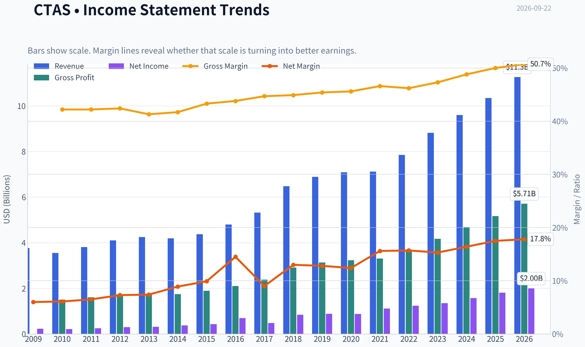

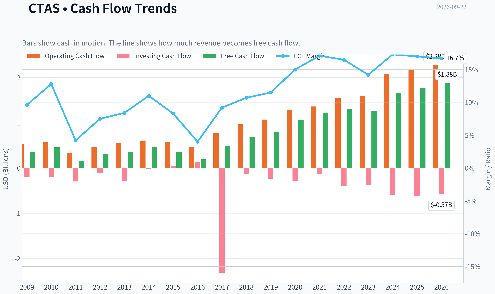

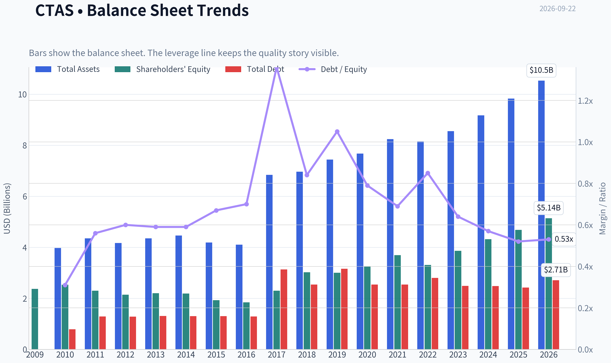

This graph tracks the profitability and return metrics (ROE, ROIC, Margins) of **CTAS** over the past decade, highlighting capital efficiency trends.

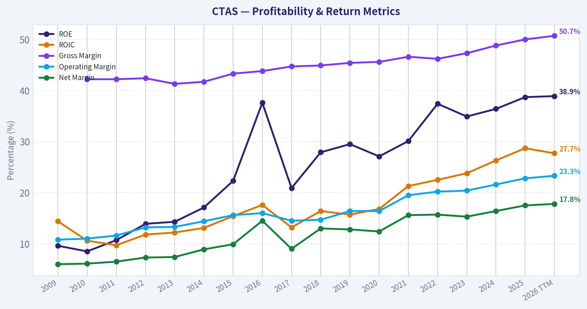

This chart illustrates the financial health of **CTAS** over the last 10 years, mapping cash equivalents and free cash flow against total obligations (Debt).

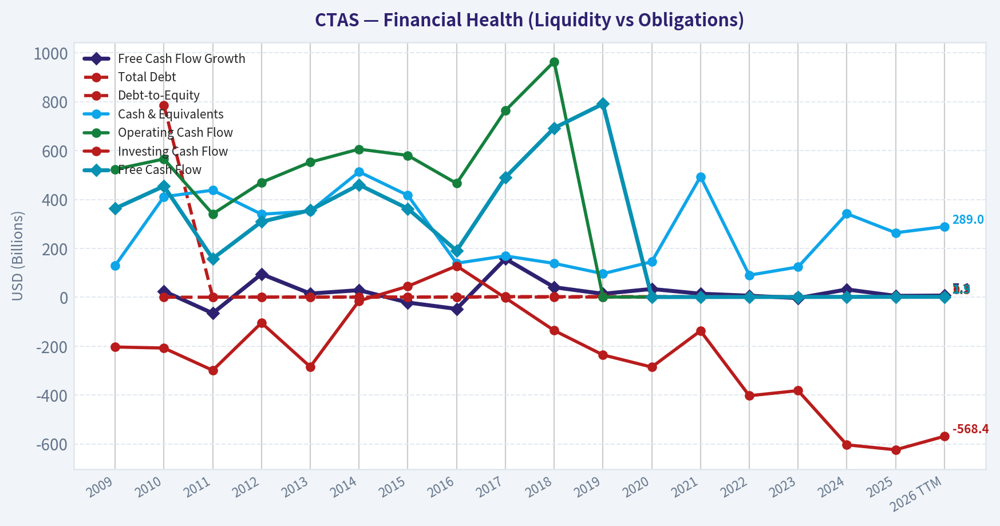

This comparison chart from *Profitability and Operating Quality* stacks current figures against historical benchmarks for **CTAS**, making it easy to see where the company trades relative to its own averages.

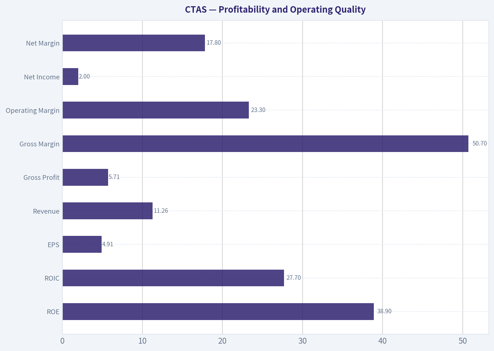

This breakdown chart from <em>Cash Flow and Capital Allocation</em> shows the proportional composition for **CTAS** - useful for understanding what drives or risks the business.

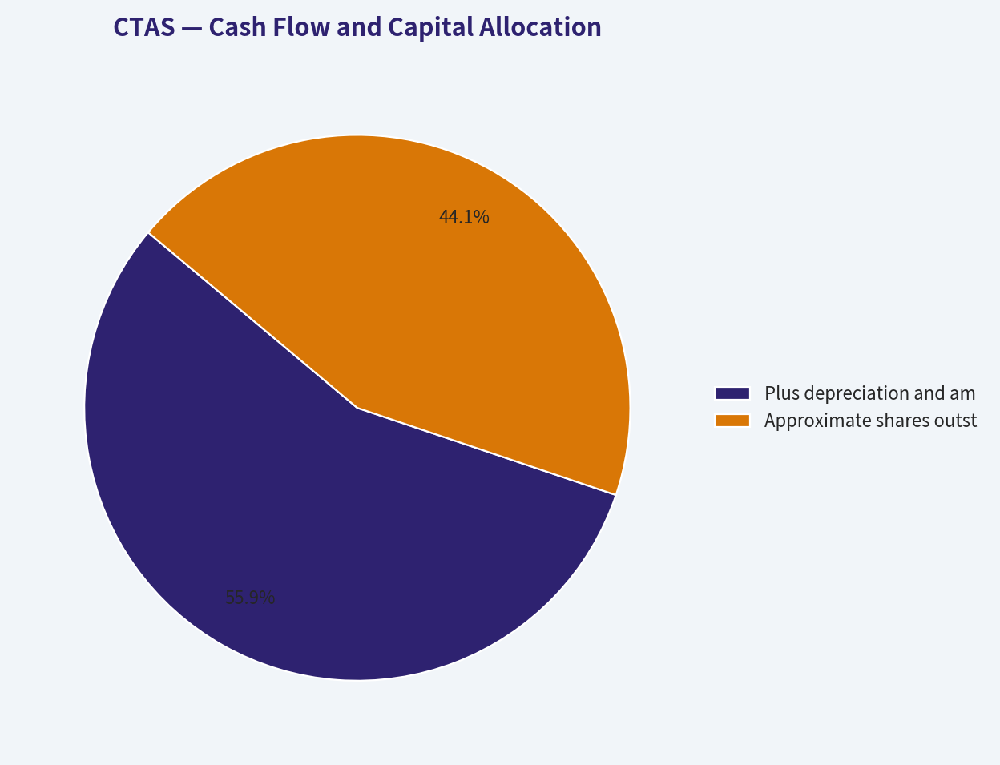

This breakdown chart from <em>Revenue Breakdown</em> shows the proportional composition for **CTAS** - useful for understanding what drives or risks the business.

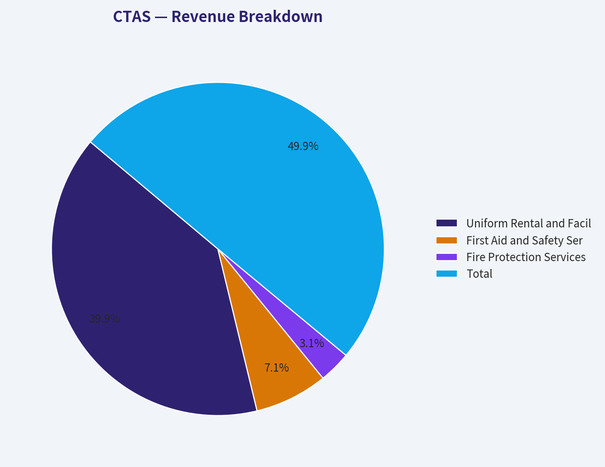

---

### Intrinsic Value Analysis (Buffett)

> *Following Warren Buffett's value investing philosophy: Circle of Competence, Economic Moat, Management Quality, and Margin of Safety.*

#### Intrinsic Value Snapshot

Price is what you pay. Intrinsic value is what the business may be worth based on the cash it can create for owners over time. We show a range, not one magic number.

- Current Price: $196.88
- Value Range (conservative to optimistic across both DCF methods): $58.82 to $582.69

##### Owner Earnings (Buffett Method)
- Net Income: $1,812,281,000.00
- Depreciation & Amortization: $512,846,000.00
- Capital Expenditures: $-395,105,000.00
- Working Capital Changes: $-422,702,000.00
- Owner Earnings: $2,141,320,000.00

##### Intrinsic Value
###### Buffett Method
Uses owner earnings. Stricter, and usually more conservative.
- Conservative: $58.82
- Average: $180.09
- Optimistic: $582.69
- Discount Rate: 10.0%

###### Cash Flow Method
Uses free cash flow. Better for companies spending heavily today to grow tomorrow.
- Conservative: $67.32
- Average: $78.61
- Optimistic: $161.22
- Discount Rate: 10.0%

ANALYST STANCE: **WATCH**

#### Executive Summary

Cintas is an excellent operating business with a durable route-density advantage, recurring customer relationships, strong margins, and high returns on capital. The central problem is valuation: at $197 per share, the market capitalization is approximately $78.8 billion, while the headline intrinsic-value estimate is $131.23.

The reverse DCF is particularly demanding. The current price implies approximately 26.8% annual growth for ten years, materially above Cintas's recent revenue growth of 8.9%. This is a wonderful business, but the stock currently appears priced for near-perfect execution.

#### 1. Factor Scorecard

| Factor | Score | Assessment |
|---|---:|---|
| Circle of Competence and Simplicity | 4/5 | Cintas rents and services uniforms and workplace supplies through recurring routes. The model is understandable and relatively predictable. |
| Moat | 4/5 | Dense local service routes, customer relationships, scale, brand reputation, and embedded service routines create meaningful advantages. |
| Management and Capital Allocation | 4/5 | The company has demonstrated disciplined execution, profitable growth, and a long-term operating orientation. |
| Industry Structure | 4/5 | The industry benefits from recurring demand and scale economies, although competition remains present and acquisitions must be managed carefully. |

**Gate 5 - Quality and Solvency:** Not tripped. The available evidence shows strong profitability, cash generation, and operating momentum rather than deteriorating earnings combined with financial distress.

**Key Takeaways:** Cintas scores highly on business quality, moat, and predictability. The decisive weakness is not the business itself but the price investors are being asked to pay for it.

#### 2. Moat Analysis

| Moat Source | Evidence | Assessment |
|---|---|---|
| Intangible assets and brand | Cintas is a trusted provider for uniforms, facility services, safety products, and workplace compliance needs. | Strong, though not an emotionally powerful consumer brand. |
| Switching costs | Customers rely on established delivery, pickup, cleaning, replacement, and compliance routines. | Moderate to strong; switching is possible but operationally inconvenient. |
| Cost advantages | Route density allows more efficient servicing as customer concentration increases geographically. | Strong and structurally reinforcing. |
| Network effects | Traditional network effects are limited, but each additional customer can improve route economics. | Indirect network and density effects. |

Cintas's most important advantage is route density. A larger installed customer base allows the company to spread delivery, pickup, laundry, sales, and service costs over more accounts. This creates a reinforcing cycle: greater density improves economics, which supports sales investment and acquisitions, which can further increase density.

The 50.7% gross margin and 38.9% ROE are consistent with a high-quality service business. The moat appears **wide and stable**, with potential to widen through scale and consolidation, but it is not completely immune to local competition or customer insourcing.

#### 3. Management Quality and Capital Allocation

Management quality appears strong based on the company's sustained operating performance, recurring revenue model, and history of profitable expansion.

Positive indicators include:

- Consistent revenue growth and high profitability.
- A business model that supports reinvestment in routes, service infrastructure, and customer acquisition.
- The ability to use acquisitions to add customers and density.
- Limited dependence on commodity prices or highly leveraged financial engineering.
- A long-term operating model where customer retention and service quality matter more than one quarter's results.

The main diligence point is valuation discipline. At a high earnings multiple, management must continue allocating capital intelligently. Acquisitions that merely increase revenue without improving route economics would reduce shareholder value.

#### 4. Financial Summary

| Metric | Latest Available Reading |
|---|---:|
| Share price | $197 |
| Market capitalization | $78.79 billion |
| P/E ratio | 40.2x |
| Revenue growth, year over year | 8.9% |
| Gross margin | 50.7% |
| ROE | 38.9% |
| FCF yield | 2.4% |
| Implied annual free cash flow | Approximately $1.89 billion |
| Current ratio | 1.43x |
| Headline intrinsic value | $131.23 per share |
| Reverse-DCF growth implied by price | Approximately 26.8% annually for 10 years |

**Key Takeaways:** Cintas combines an impressive 50.7% gross margin with a 38.9% ROE and solid 8.9% revenue growth. However, the 2.4% FCF yield and 40.2x P/E show that the market already assigns a substantial premium to those qualities.

#### 5. Owner Earnings Calculation

The conservative calculation uses free cash flow as a proxy for owner earnings because the available data does not separately identify maintenance capital expenditure from growth capital expenditure.

| Owner Earnings Component | Estimate |
|---|---:|
| Net income | Not separately provided in the research summary |
| Add: depreciation and amortization | Not separately provided |
| Less: maintenance capital expenditure | Not separately provided |
| Less: working-capital investment | Not separately provided |
| Conservative owner-earnings proxy: free cash flow | Approximately $1.89 billion |
| Owner-earnings yield at $78.79 billion market cap | Approximately 2.4% |

**Key Takeaways:** The conservative cash-flow proxy indicates that Cintas currently produces about $1.89 billion of annual free cash flow. The resulting owner-earnings yield is low at approximately 2.4%, leaving little room for disappointment in growth, margins, or capital allocation.

#### 6. Three-Scenario DCF Valuation

The following scenarios use approximately $1.89 billion of current free cash flow as conservative owner earnings, a 10% discount rate, and roughly 400 million diluted shares implied by the market capitalization and share price.

| Scenario | Key Assumptions | Estimated Value per Share |
|---|---|---:|
| A. No growth | Owner earnings capitalized at 10% | $47 |
| B. GDP-like growth | 3% annual growth with 3% terminal growth | $70 |
| C. Moderated historical growth | Approximately 6.7% annual growth for 10 years, followed by 3% terminal growth | $87 |
| Research-pack weighted valuation | Damodaran FCFF, reverse DCF, and owner-earnings models | $131 |
| Research-pack model range | FCF / Damodaran FCFF / owner earnings | $78.61 / $54.98 / $180.09 |

**Key Takeaways:** Conservative cash-flow scenarios produce values well below the current $197 price. Even the research-pack headline valuation of $131.23 implies that the stock is substantially above estimated intrinsic value, although the owner-earnings model produces a more optimistic result.

#### 7. Margin of Safety Analysis

| Valuation Reference | Value per Share | Upside/(Downside) Versus $197 |
|---|---:|---:|
| No-growth DCF | $47 | -76% |
| GDP-growth DCF | $70 | -65% |
| Moderated-growth DCF | $87 | -56% |
| Headline blended intrinsic value | $131.23 | -33% |
| Owner-earnings model | $180.09 | -9% |
| FCF model | $78.61 | -60% |
| Damodaran FCFF model | $54.98 | -72% |

The headline margin of safety is approximately **negative 50%**, according to the research pack's blended valuation framework. The reverse DCF indicates that the market price requires approximately 26.8% annual growth for a decade. That is close to recent three- and five-year growth rates, but it is an aggressive assumption for a company of Cintas's scale.

For a wide-moat compounder, a 10% to 15% premium-to-value situation can sometimes be acceptable. Cintas appears to trade at a substantially larger premium than that, so the quality-scaled valuation benefit does not overcome the price risk.

#### 8. Final Buffett Scorecard

| Criterion | Weight | Score | Weighted Contribution |
|---|---:|---:|---:|
| Moat width and durability | 25% | 4.0 | 1.00 |
| Valuation and margin of safety | 20% | 1.0 | 0.20 |
| Capital returns versus WACC | 15% | 4.5 | 0.68 |
| Business understanding and predictability | 12% | 4.0 | 0.48 |
| Management quality and capital allocation | 12% | 4.0 | 0.48 |
| Reinvestment runway | 8% | 4.0 | 0.32 |
| Balance-sheet strength | 4% | 4.0 | 0.16 |
| Industry structure | 4% | 4.0 | 0.16 |
| **Total** | **100%** |  | **3.48/5.00** |

**Key Takeaways:** Cintas earns a strong quality score because its moat, returns, predictability, and reinvestment runway are all attractive. The valuation score pulls the overall result below the threshold for an outright buy recommendation.

#### 9. Investment Stance

**WATCH - High conviction in the business, high conviction that the current price offers an inadequate margin of safety.**

Cintas is the type of company Buffett could reasonably admire: understandable, recurring, asset-efficient, profitable, and supported by scale advantages. The investment case would improve materially if the share price declined toward the $130 range, or if earnings and owner earnings compounded rapidly enough to close the valuation gap.

At $197, investors are paying for exceptional growth to continue for many years. I would not sell solely because the business is expensive if already owned with a low tax basis, but I would wait for a better entry point before initiating a position.
#### Valuation Bridge

This bridge places the current market price beside each intrinsic value lens so readers can see whether upside depends on one method or shows up across several methods.

| Scenario | Intrinsic Value / Share |
| --- | ---: |
| Buffett Method | $180.09 |
| Cash Flow Method | $78.61 |
| Damodaran Method | $54.98 |
| Current Price | $196.88 |

#### Key Takeaways

If one method is far above the others, the upside case depends on a specific modelling assumption. When several methods cluster together, the valuation story is more robust.

#### Valuation Visuals

This comparison chart from *Latest Earnings Snapshot* stacks current figures against historical benchmarks for **CTAS**, making it easy to see where the company trades relative to its own averages.

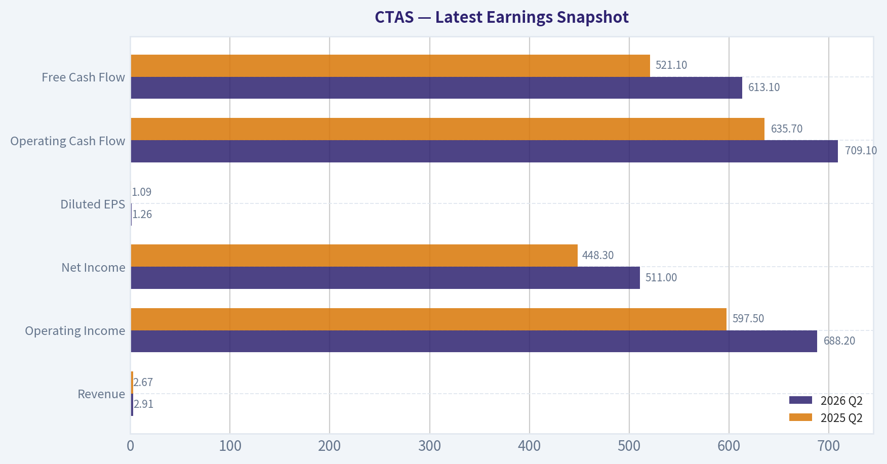

This comparison chart from *Current Metrics Versus Historical Averages* stacks current figures against historical benchmarks for **CTAS**, making it easy to see where the company trades relative to its own averages.

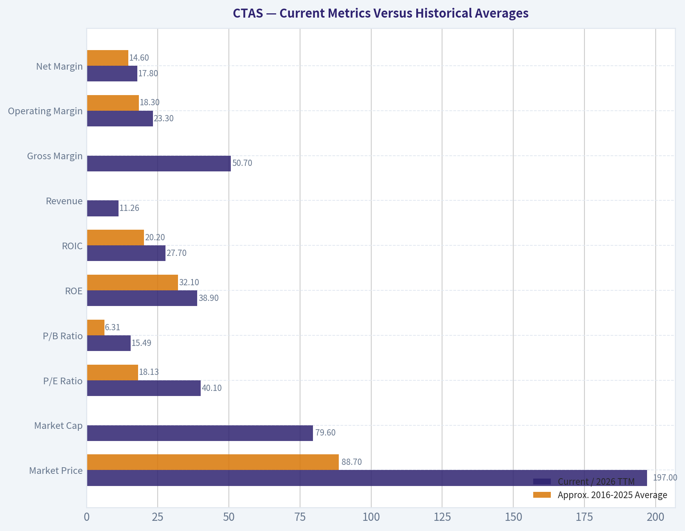

This comparison chart from *Balance Sheet and Financial Strength* stacks current figures against historical benchmarks for **CTAS**, making it easy to see where the company trades relative to its own averages.

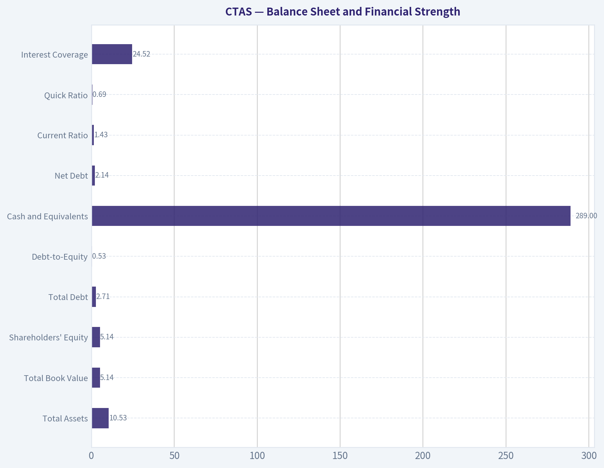

---

### Trend & Growth Analysis (Lynch/Druckenmiller/Fisher)

> *Following Peter Lynch's GARP, Stanley Druckenmiller's macro-aware approach, and Philip Fisher's scuttlebutt methodology.*

ANALYST STANCE: **AVOID** for new money; existing holders may **HOLD** while monitoring growth and valuation.

#### 1. Lynch Classification

| Metric | Assessment |
|---|---:|
| Classification | Stalwart, approaching slow-grower territory |
| Revenue growth | 8.9% year over year |
| P/E | 40.2x |
| ROE | 38.9% |
| Gross margin | 50.7% |
| FCF yield | 2.4% |

**Key Takeaways:** Cintas is a high-quality, recurring-revenue service company, but its current growth rate fits Lynch's stalwart category rather than fast grower. A 40x earnings multiple is difficult to justify against sub-10% revenue growth unless earnings growth accelerates substantially.

#### 2. The Story in Three Bullets

- Cintas rents and services uniforms, restroom supplies, first-aid products, and facility-related goods for businesses.
- Its competitive advantage comes from route density, customer relationships, recurring contracts, brand reputation, and operational scale.
- The business can compound steadily through pricing, cross-selling, small acquisitions, and continued outsourcing by employers-but the current data does not show a clear acceleration inflection.

#### 3. TAM and Runway

| Runway factor | Assessment |
|---|---|
| Core market | Large, fragmented uniform and workplace-services market |
| Secular driver | Businesses outsourcing non-core facility functions |
| Expansion opportunities | First aid, safety, fire protection, facility supplies, international markets |
| 10x revenue test | Difficult to validate; a 10x outcome would require very substantial share gains and adjacency expansion |
| TAM growth | Likely moderate rather than a rapidly expanding 15%+ market |

**Key Takeaways:** Cintas has a durable runway, but it is not an obvious hypergrowth market. The 10x test is challenging because Cintas is already a large company and its core categories are mature; significant upside would require sustained acquisitions, cross-selling, and market-share gains.

#### 4. Revenue Growth Trend

| Indicator | Result | Interpretation |
|---|---:|---|
| Latest revenue growth | 8.9% YoY | Stable-to-moderate growth |
| Evidence of acceleration | Not established | No confirmed 20%+ acceleration |
| Growth quality | Recurring service revenue plus pricing and acquisitions | Generally high quality |
| Current category | Stalwart | Below fast-grower threshold |

**Key Takeaways:** Revenue growth is respectable but not accelerating according to the available information. The upcoming earnings report could change the assessment, particularly if organic growth, customer retention, and guidance improve materially.

#### 5. Unit Economics and Profitability

| Metric | Available assessment |
|---|---|
| LTV/CAC | Not disclosed in the research pack |
| Net revenue retention | Not disclosed; not a conventional SaaS metric for CTAS |
| Rule of 40 | Not directly applicable |
| Gross margin | 50.7% |
| FCF yield | 2.4% |
| Current ratio | 1.43 |
| ROE | 38.9% |

**Key Takeaways:** Cintas shows strong profitability and capital efficiency, but the available data does not permit a precise LTV/CAC or retention calculation. Its recurring route-based model should support attractive customer economics, though acquisitions and operating costs need to be monitored.

#### 6. Inflection Point Assessment

| Potential inflection | Current evidence | Assessment |
|---|---|---|
| Product cycle | No major new product cycle identified | Neutral |
| Market share | Company remains a scale leader | Positive, but not accelerating |
| Margin expansion | High gross margin; future leverage possible | Mildly positive |
| TAM expansion | Adjacencies and acquisitions | Positive but gradual |
| Competitive disruption | No major competitor failure identified | Neutral |
| Earnings acceleration | Reverse DCF implies an aggressive future outcome | Not yet supported |

**Key Takeaways:** Cintas has a compounding-quality profile, but not a confirmed Druckenmiller-style inflection point. The market price appears to require roughly 26.8% annualized performance for ten years in the reverse-DCF analysis, far above the currently reported revenue growth rate.

#### 7. Macro Setup

| Macro factor | Assessment |
|---|---|
| Economic sensitivity | Moderate; employment and business formation matter |
| Interest rates | High valuation makes the stock rate-sensitive |
| Secular trend | Positive outsourcing and workplace-safety demand |
| Cycle position | Not enough evidence to call a strong early-cycle setup |
| Overall macro | Neutral to mildly positive |

**Key Takeaways:** Cintas benefits from outsourcing and compliance-related demand, but it is not a direct beneficiary of the strongest current technology or industrial secular trends. Its elevated valuation increases sensitivity to interest rates and any economic slowdown.

#### 8. Fisher's 15-Point Score

| Fisher criterion | Score / 5 |
|---|---:|
| Market potential | 4 |
| New-product determination | 3 |
| R&D effectiveness | 3 |
| Sales organization | 5 |
| Profit margins | 5 |
| Margin improvement | 4 |
| Labor relations | 4 |
| Executive relations | 4 |
| Management depth | 4 |
| Cost analysis and accounting | 4 |
| Outstanding competitive aspects | 5 |
| Long-range profit outlook | 4 |
| Dilution risk | 4 |
| Management candor | 4 |
| Management integrity | 4 |
| **Total** | **61 / 75** |

**Key Takeaways:** A 61 out of 75 score places Cintas in Fisher's "good" range. Its strongest attributes are sales execution, margins, recurring customer relationships, route density, and operational scale; its weaker areas are limited evidence of breakthrough innovation and a less expansive growth runway.

#### 9. Valuation Analysis

| Valuation measure | Result | Interpretation |
|---|---:|---|
| Current price | $197 | Elevated |
| P/E | 40.2x | Expensive for 8.9% revenue growth |
| FCF yield | 2.4% | Low forward cash-flow yield |
| Headline intrinsic value | $131.23 | Approximately 50% below market price |
| Owner-earnings model | $180.09 | Slightly below current price |
| FCF model | $78.61 | Materially below current price |
| Damodaran FCFF model | $54.98 | Materially below current price |
| Implied reverse-DCF growth | 26.8% annually for 10 years | Very demanding |

**Key Takeaways:** Valuation is the central problem. Even the more favorable owner-earnings estimate is below the current price, while the headline blended value of $131.23 implies approximately 50% downside. A PEG calculation is not precise without forward EPS growth, but at 40x earnings, CTAS would need roughly 40% EPS growth for a PEG of 1.0-well above the current revenue-growth profile.

#### 10. Revenue-Multiple Scenario Framework

Because current revenue and share-count inputs were not included in the research pack, a precise price-target model cannot be responsibly calculated. The directional framework is:

| Scenario | Operating outcome | Valuation implication |
|---|---|---|
| Bear | Growth remains below 10% and the multiple contracts | Significant downside |
| Base | High-single-digit growth with modest margin expansion | Limited return potential from current price |
| Bull | Growth accelerates toward the mid-teens and margins expand | Current valuation becomes more defensible |
| Exceptional | Sustained 20%+ earnings growth | Meaningful upside, but not currently evidenced |

**Key Takeaways:** The bull case depends on an acceleration that has not yet appeared in the available figures. The base case suggests a good business but weak prospective returns because much of the quality appears priced in.

#### 11. Growth Investor Scorecard

| Criterion | Weight | Score / 5 |
|---|---:|---:|
| Lynch story | 10% | 3.5 |
| TAM and runway | 20% | 3.0 |
| Revenue growth | 20% | 2.5 |
| Unit economics | 15% | 3.5 |
| Competitive position | 10% | 4.5 |
| Management quality | 10% | 4.0 |
| Macro setup | 5% | 3.0 |
| Profitability path | 5% | 4.0 |
| Valuation | 5% | 1.5 |
| **Weighted score** | **100%** | **3.25 / 5** |

**Key Takeaways:** The score falls into the "WATCH" range on business quality and growth-investor characteristics. I assign an overall **AVOID** stance for new purchases because the valuation penalty is more important than the company's operational strengths at the current price.

#### 12. Position Size Stance

| Investor situation | Position guidance |
|---|---|
| New investor | Avoid initiating at $197 |
| Existing normal-sized position | Hold and monitor |
| Existing oversized position | Consider trimming or rebalancing |
| High-conviction quality investor | Wait for a materially better valuation or clear acceleration |
| Suggested watch trigger | Organic growth acceleration, raised guidance, or substantial price reset |

**Key Takeaways:** CTAS is a better business than its valuation makes it a stock. Existing shareholders can reasonably hold because of the company's quality and recurring cash flows, but new investors should demand either a lower entry price or evidence that growth is accelerating.

#### 13. Key Catalysts and Risks

| Catalysts | Risks |
|---|---|
| Organic revenue growth above 10-12% | Growth remains stuck in the high-single digits |
| Strong customer retention and cross-selling | Multiple compression from 40x earnings |
| Margin expansion from route density and scale | Wage, fuel, and operating-cost inflation |
| Accretive acquisitions | Acquisition integration or overpayment |
| Expansion into safety and facility adjacencies | Economic slowdown reducing business activity |
| Lower interest rates | Reverse-DCF expectations prove unrealistic |

**Key Takeaways:** The main catalyst is not simply another solid quarter; it is a demonstrable acceleration in organic growth and earnings. The principal risk is valuation compression: even if the business executes well, a lower earnings multiple could overwhelm operating gains.

#### Bottom Line

Cintas is a high-quality compounder with strong competitive advantages, recurring revenue, high margins, and excellent capital efficiency. However, it currently resembles a **stalwart**, not a fast grower, while the valuation assumes growth closer to a high-growth technology company.

**Conclusion: AVOID new purchases at $197; HOLD existing positions, but require clear revenue acceleration before upgrading the stance.**

---

### Market Technical Analysis

ANALYST STANCE: **WATCH**

#### CTAS technical outlook

The latest available trading session is **September 21, 2026**, when CTAS closed at **$196.88**. September 22 is not listed as a trading day in the data, so the analysis should be treated as current through September 21.

CTAS presents a **long-term constructive but short-term weakening** technical profile. The stock remains materially above its 200-day SMA, preserving a broader bullish structure, but price has fallen below its short- and medium-term averages. Momentum indicators have also deteriorated, suggesting that the recent pullback has not yet produced a confirmed reversal.

#### Trend structure and moving averages

The **200-day SMA is $186.79**, placing the stock roughly **5.4% above** its long-term trend benchmark. The 200-day average is still rising gradually, which indicates that the longer-term trend has not been decisively damaged. The area around **$186-$187** is therefore an important strategic support zone.

The medium-term picture is less favorable. CTAS closed approximately **2.3% below its 50-day SMA of $201.58**, while the 50-day average has been rising strongly from about $191.37 on August 24 to $201.58 on September 21. This means the stock's recent weakness is occurring against an otherwise upward-sloping medium-term average. A sustained close back above $201.50-$202 would help repair the intermediate trend; continued trading below it would imply that the rising 50-day SMA is losing its role as support.

The **10-day EMA is $199.00**, and the stock is about **1.1% below** it. The EMA has declined from approximately $203.94 on August 28, showing that short-term momentum has been weakening for several weeks. The immediate trend would improve if CTAS could reclaim $199-$200 and then hold above that region. Until then, rallies toward the 10-day EMA may encounter selling pressure.

#### Momentum and MACD behavior

The MACD configuration has shifted decisively from bullish to bearish. MACD declined from **+2.64 on August 24** to **-0.68 on September 21**, crossing below zero during the period. More importantly, the deterioration accelerated after mid-September: MACD moved from **+0.15 on September 14** to **-0.68** one week later.

The MACD histogram is also negative at approximately **-0.64**. Although the histogram is not as deeply negative as it was in early September, it remains below zero and has recently become more negative, moving from about **-0.56 on September 14** to **-0.64 on September 21**. This indicates that bearish momentum is still active rather than fully exhausted.

The MACD evidence argues against treating the recent decline as an already-confirmed buying opportunity. A more reliable bullish signal would require the histogram to turn upward, followed by a MACD crossover and, preferably, a move back above the zero line.

#### RSI interpretation

The RSI is approximately **42.1**, down from **62.8 on August 24**. This is a meaningful loss of momentum, but it is not yet an oversold reading under the conventional 30 threshold.

The current RSI suggests that sellers have gained control of short-term momentum, but the stock has not reached the type of deeply depressed condition that would independently support a high-confidence mean-reversion trade. If RSI falls toward 30-35 while CTAS holds above the $186-$190 support region, the risk-reward profile for a tactical rebound could improve. Conversely, a recovery above 50 would indicate that downside momentum is stabilizing.

#### Volume-weighted trend confirmation

The **VWMA is approximately $199.23**, slightly above the current price and close to the 10-day EMA. This alignment is significant: both short-term price trend measures are clustered near **$199-$200**, creating a clearly defined overhead recovery threshold.

Because price is below the VWMA, recent trading activity is not confirming bullish price acceptance. A move above $199-$200 accompanied by stronger volume would be more meaningful than a low-volume price bounce. Until that occurs, the volume-weighted trend remains mildly bearish.

#### Volatility and risk management

ATR has declined from approximately **$4.51 on August 24** to **$3.73 on September 21**. The reduction indicates that daily price ranges have compressed, even as the stock has drifted lower. This can reflect orderly selling, consolidation, or a volatility contraction before a larger directional move.

At the current ATR, a one-ATR daily movement is roughly **$3.70**. Traders using stops should account for this normal fluctuation rather than placing stops too tightly around obvious short-term levels. For a tactical position, a break below the recent **$194.87 intraday low** would be an early warning of renewed selling, while the broader trend would become more concerning if price moved toward or below the $186-$187 200-day SMA zone.

#### Key levels and possible scenarios

The first resistance area is **$199-$200**, where the 10-day EMA and VWMA converge. A close above this zone would indicate initial short-term stabilization. The more important resistance band is **$201.50-$203**, encompassing the 50-day SMA and recent September highs. Reclaiming that band would materially improve the intermediate outlook and could open a path toward the **$205-$207** area, where CTAS traded in late August.

On the downside, **$194.87** is the nearest observable support reference from the latest session's low. A decisive break below that level would suggest that the recent drift is becoming a more forceful decline. The next major support region is approximately **$186-$190**, with the 200-day SMA near $186.79 providing the most important long-term reference.

The most constructive scenario is a hold above $194-$195 followed by an RSI recovery through 50, a bullish MACD histogram turn, and a reclaim of $199-$202 on improving volume. The bearish scenario is a failure near $199-$202 followed by a break under $194.87, which would increase the probability of a retest of the $186-$190 area.

Overall, CTAS is **not technically broken on a long-term basis**, because it remains above a rising 200-day SMA. However, the short-term evidence is unfavorable: price is below the 10-day EMA, 50-day SMA, and VWMA; MACD is negative; the histogram remains bearish; and RSI is below neutral. The appropriate stance is therefore to **watch for confirmation rather than chase a rebound**.

#### Selected indicators

The selected indicators are designed to cover distinct dimensions of the market:

- **10-day EMA:** Short-term direction and early momentum shifts.
- **50-day SMA:** Intermediate trend and dynamic resistance or support.
- **200-day SMA:** Long-term trend regime.
- **MACD:** Directional momentum and trend-change confirmation.
- **MACD Histogram:** Acceleration or deceleration of momentum.
- **RSI:** Momentum strength and potential oversold or overbought conditions.
- **VWMA:** Price trend confirmed or challenged by trading volume.
- **ATR:** Volatility-aware position sizing and stop placement.

| Indicator | Latest reading | Direction or interpretation | Trading relevance |
|---|---:|---|---|
| Closing price | $196.88 | Below short- and medium-term averages | Immediate bias remains cautious |
| 10-day EMA | $199.00 | Declining; price below it | First recovery threshold |
| 50-day SMA | $201.58 | Rising, but price below it | Important intermediate resistance |
| 200-day SMA | $186.79 | Gradually rising; price above it | Long-term trend remains constructive |
| MACD | -0.68 | Negative and recently weakening | Bearish momentum signal |
| MACD Histogram | -0.64 | Below zero; still negative | Downside momentum remains active |
| RSI | 42.1 | Below neutral, not oversold | Weak momentum, but limited reversal evidence |
| VWMA | $199.23 | Above current price | Volume-weighted trend is mildly bearish |
| ATR | $3.73 | Lower than late August | Moderate volatility; avoid overly tight stops |
| Key resistance | $199-$203 | EMA, VWMA, and 50-day SMA cluster | Reclaim would improve the setup |
| Key support | $194.87, then $186-$190 | Recent low followed by long-term support zone | Break below these levels raises downside risk |

**Key Takeaways:** CTAS remains above its rising 200-day average, so the long-term trend is still broadly constructive. However, price is below the 10-day EMA, 50-day SMA, and VWMA, while MACD and RSI show weakening momentum. A reclaim of $199-$203 would improve the outlook; a break below $194.87 would increase the risk of a move toward the $186-$190 support zone.

---

### Options Market Analysis

> *Reading options flow - put/call ratios, IV skew, and unusual activity - to gauge institutional positioning and event-driven risk.*

#### CTAS Options Market Report

**As of September 22, 2026.** The available near-term options data is unusually sparse and reports zero open interest across all listed expirations. That makes positioning analysis lower confidence than normal, particularly for open-interest ratios, gamma levels, and institutional-versus-retail classification.

#### Put/Call Ratio Analysis

| Expiration | Call OI | Put OI | Call Volume | Put Volume | Put/Call Volume |
|---|---:|---:|---:|---:|---:|
| Sep. 25, 2026 | 0 | 0 | 459 | 582 | 1.27 |
| Oct. 2, 2026 | 0 | 0 | 14 | 149 | 10.64 |
| Oct. 9, 2026 | 0 | 0 | 8 | 5 | 0.63 |
| **Total** | **0** | **0** | **481** | **736** | **1.53** |

The put/call open-interest ratio is unavailable because both call and put open interest are reported as zero. The aggregate volume ratio of 1.53 is materially above the approximate neutral baseline of 0.7, indicating that put activity dominates near-term trading. This can reflect downside speculation or protective hedging, but the absence of usable open interest prevents a firm distinction.

**Key Takeaways:** CTAS shows a put-heavy near-term volume profile, led by the September 25 and October 2 expirations. The signal is directionally cautious to bearish, but zero reported open interest substantially reduces confidence in the interpretation.

#### Implied Volatility Assessment

| Expiration | Call ATM IV | Put ATM IV | Relative IV Read |
|---|---:|---:|---|
| Sep. 25, 2026 | 3.2% | 3.5% | Slight put premium |
| Oct. 2, 2026 | 2.3% | 1.8% | Call premium |
| Oct. 9, 2026 | 1.2% | 1.6% | Put premium |
| **Near-term range** | **1.2%-3.2%** | **1.6%-3.5%** | **Generally low, inconsistent skew** |

Reported near-term ATM implied volatility is extremely low, ranging from 1.2% to 3.5%. The September 25 and October 9 expirations show modest put IV premiums, while October 2 shows a call IV premium. The data does not include specific out-of-the-money put and call IV values, so a true OTM skew calculation cannot be completed.

There is no catalyst calendar supplied with the options data. Accordingly, elevated event-driven IV cannot be confirmed; in fact, the reported IV levels appear subdued rather than elevated. These unusually low figures may also indicate stale, incomplete, or nonstandard data.

**Key Takeaways:** IV is reported as very low, with no consistent directional skew across expirations. Slight put premiums in two expirations support a cautious tone, but the lack of OTM IV data and potentially unreliable IV figures make this a weak signal.

#### Unusual Options Activity

The data provider defines unusual activity as contracts with volume greater than five times open interest. No contracts met that criterion.

| Finding | Result | Interpretation |
|---|---|---|
| Contracts with volume greater than 5x OI | None reported | No identifiable fresh, outsized positions |
| Highest visible volume | Sep. 25 calls: 459; Sep. 25 puts: 582 | Short-dated activity, but not classifiable by opening or closing |
| Smart-money signal | Not established | No sweep, block, or volume/OI evidence supplied |

Because open interest is reported as zero for every near-term expiration, it is not possible to identify contracts with genuinely fresh directional positioning. Current volume could represent opening trades, closing trades, data-mapping issues, or a combination of these.

**Key Takeaways:** There is no confirmed unusual options activity under the provider's screening rule. The absence of qualifying contracts means there is no reliable evidence of institutional call buying, put accumulation, or aggressive speculative positioning.

#### Open Interest Concentration and Gamma Levels

| Metric | Observation | Implication |
|---|---|---|
| Highest call OI | None; all reported as 0 | No identifiable call concentration |
| Highest put OI | None; all reported as 0 | No identifiable put concentration |
| Max-pain analysis | Not available | Requires valid strike-level OI |
| Gamma walls | Not identifiable | Requires strike-level OI and Greeks |
| Price-pinning risk | Cannot be assessed | No usable concentration data |

No strike-level open-interest concentrations are available. Therefore, CTAS options data cannot identify major gamma walls, max-pain levels, or likely pinning strikes near expiration.

**Key Takeaways:** There are no usable open-interest data points to establish support, resistance, or dealer gamma positioning. Any claim about a specific options-derived price level would be speculative.

#### Overall Options Sentiment Signal

**Signal: BEARISH - LOW CONFIDENCE**

The primary bearish driver is the aggregate near-term put/call volume ratio of 1.53, well above the approximate neutral level of 0.7. Put volume is particularly dominant in the October 2 expiration, although the absolute volume is small and there is no open-interest confirmation.

The bearish signal should be treated cautiously because:

- All reported call and put open interest is zero.
- No unusual-volume contracts were identified.
- OTM IV skew is unavailable.
- Strike-level concentration and gamma data are unavailable.
- The reported IV levels are unusually low and may reflect incomplete or stale market data.
- No specific catalyst, such as earnings, was provided for the observed period.

This is therefore a **cautious bearish read based primarily on volume imbalance**, not a high-conviction institutional positioning signal.

#### Summary

| Category | Assessment |
|---|---|
| Put/Call Ratio | **Bearish-leaning:** volume ratio 1.53 versus approximately 0.7 neutral; OI ratio unavailable |
| IV Level | **Very low reported IV:** roughly 1.2%-3.5%; possible data-quality concern |
| Skew Direction | **Slightly put-skewed overall, but inconsistent:** put IV exceeds call IV in two of three expirations |
| Unusual Activity | **None identified:** no contracts exceeded 5x open interest |
| Overall Signal | **BEARISH, low confidence:** put-heavy volume without open-interest confirmation |

**Key Takeaways:** CTAS options flow leans bearish because near-term put volume substantially exceeds call volume. However, zero reported open interest and very low stated IV make the dataset unusually thin, so this should be treated as a low-confidence warning rather than a strong institutional bearish signal.

---

## Research Team Commentary

> *The Research Manager synthesizes the Bull vs Bear debate into action-free commentary. This is a pre-risk view, not the final stance.*

Core takeaway: Cintas is a genuinely excellent business, but at $197 and roughly 40 times earnings, the stock offers too little valuation protection to advocate buying today. The bull makes the stronger case on franchise quality: route density, recurring service relationships, cross-selling, scale, and acquisition integration form a durable moat, while a 28.6% ROIC and 19% ROA confirm that the economics are real. The bear makes the stronger case on the investment price: the apparent discount depends on favorable DCF assumptions and on treating EPS as owner earnings without adequate cash-flow data. My conclusion is to keep Cintas on WATCH rather than call it an outright AVOID. This is a wonderful company at a price that appears closer to demanding than fair, but not so clearly irrational that a hard rejection is warranted.

The strongest bull argument is that Cintas does not need a dramatic growth inflection. Its compounding engine is diversified across pricing, customer additions, route density, cross-selling, outsourcing, operating leverage, and tuck-in acquisitions. These drivers reinforce one another. Adding customers to an existing route can improve unit economics, while an established customer relationship creates opportunities to sell facility, safety, first-aid, and related services without repeating the full acquisition cost. That is a more durable model than one dependent on a single product cycle.

The reported profitability supports this view. A 50.7% gross margin, 28.6% ROIC, 38.9% ROE, and 19% ROA are exceptional. ROE may be influenced by leverage or repurchases, but high ROIC and ROA indicate that the franchise itself produces attractive returns. The moat is not absolute, yet competitors cannot instantly reproduce Cintas's local route density, service infrastructure, reliability, breadth, and national scale. For a long-duration owner, this business deserves a substantial valuation premium.

The strongest bear argument is that the bull's valuation margin of safety is not robust. The estimate that $197 implies only about 11% annual growth relies on an 8.5% discount rate, 4% perpetual growth, and EPS as a proxy for owner earnings. Those assumptions are individually possible, but collectively favorable. A 4% terminal growth rate also embeds a roughly 23-times terminal multiple, meaning the model assumes Cintas will still command premium economics and valuation after ten years.

Using a 9% discount rate and 3.5% terminal growth raises the implied growth hurdle toward approximately 13% or more. That is plausible for Cintas, but plausibility is not the same as margin of safety. At 40 times earnings, the investor needs sustained excellent execution rather than merely a continuation of a good business.

The missing cash-flow information is particularly important. Cintas requires rental inventory, laundries, fleets, service facilities, customer acquisition, and working capital. EPS may approximate owner earnings over time, but that cannot simply be assumed. Free-cash-flow conversion, maintenance capital expenditures, and acquisition spending need to be examined before accepting the bull's $223-$232 valuation range.

The bear also correctly emphasizes multiple compression. If EPS grows 10% annually for five years but the valuation falls from 40 times to 25 times, the share price would be approximately unchanged before dividends. Cintas does not need to experience operational deterioration for returns to disappoint; it only needs to perform well rather than exceptionally. A 2.5% earnings yield provides little immediate cushion against that risk.

From a Buffett perspective, quality scales down the required discount, but it does not eliminate it. For a wide-moat, predictable, high-ROIC compounder, a 10%-15% discount to conservatively estimated intrinsic value can be enough. The problem is that the bull's roughly 13% indicated discount is derived from a relatively optimistic base case. Under more restrained assumptions, $197 looks approximately fully valued or moderately overvalued. The valuation range is therefore too assumption-sensitive to establish a reliable margin of safety.

I would not adopt the bear's full AVOID stance because there is no evidence here of distress, deteriorating franchise economics, or obviously heroic growth embedded under every reasonable model. Cintas may sustain low-double-digit per-share growth for a long time, and premium compounders often appear expensive while continuing to create value. A hard AVOID would repeat the mistake of allowing one framework-here, a high headline multiple-to overwhelm clear evidence of superior business quality. At the same time, advocating the shares would repeat the opposite mistake: allowing quality to excuse a valuation that leaves little room for error.

There is also no usable technical information in the handoff. Moving-average labels without actual values provide no evidence about entry timing. I would not infer either an imminent decline or a favorable short-term setup. This is a long-term valuation decision, not a 30-day price forecast.

Rationale: Cintas passes the business-quality test decisively but does not yet pass the purchase-price test. The market appears to be underwriting roughly 11% growth under favorable assumptions and potentially 13%-16% under more conservative ones. The lower end is credible; the upper end demands sustained low-to-mid-teens growth, stable margins, high incremental returns, disciplined acquisitions, and a premium terminal valuation. With no clear acceleration and incomplete owner-earnings data, the expected return is not sufficiently asymmetric at $197.

Monitoring plan: Over the next one to four quarters, I would focus first on organic revenue growth, separating pricing, volume, acquisitions, and cross-selling. Sustained organic growth near the level needed to support low-double-digit earnings growth would strengthen the thesis; growth slipping toward the mid-single digits without compensating productivity would weaken it.

Second, I would examine free-cash-flow conversion relative to net income, maintenance capital expenditures, rental inventory investment, and working-capital demands. Consistently strong conversion would validate EPS as a reasonable owner-earnings proxy. Materially weaker conversion would lower intrinsic value.

Third, I would track operating margins and incremental ROIC rather than relying only on historical company-wide ROIC. Stable or improving margins alongside organic expansion would show that route density and pricing remain effective. Falling incremental returns, rising customer-acquisition costs, or acquisition-dependent growth would support the bear case.

Fourth, I would monitor customer retention, route productivity, customer additions, cross-selling penetration, and any evidence of contract rebidding or pricing resistance. These are the best practical indicators of moat durability.

Finally, I would review net leverage, interest coverage, acquisition prices, and repurchase activity. Tuck-in deals that improve density at attractive returns would be positive. Expensive acquisitions or aggressive repurchases at around 40 times earnings would weaken confidence in capital allocation.

An upgrade to ADVOCATE would require either a meaningful price decline-roughly into the $160-$175 area, subject to updated fundamentals-or evidence that organic owner earnings can sustainably compound in the low-to-mid teens with strong cash conversion and incremental returns. A downgrade to AVOID would require deteriorating organic growth, margins, retention, or cash conversion while the valuation remains near 40 times earnings.

Final stance: WATCH

---

## Value Investing Team Commentary

> *The Investor translates the research view into an investment thesis before risk review. This is still not the final stance.*

### Cintas: Exceptional Franchise, Demanding Expectations

Cintas is the type of business a long-term owner should want: understandable, recurring, operationally entrenched, and capable of reinvesting at high returns. The central question is not whether Cintas is a wonderful company. It is whether an investor paying approximately $197 and 40 times earnings is likely to earn an attractive return without relying on unusually favorable assumptions.

### Business quality and moat

Cintas benefits from several reinforcing competitive advantages:

- **Route density:** More customers along established routes reduce service costs per customer and improve local economics.
- **Recurring relationships:** Uniform rental and facility-service programs are operational necessities rather than discretionary purchases.
- **Switching friction:** Replacing a provider involves garment changes, employee coordination, inventory management, service disruption, and contract negotiations.
- **Cross-selling:** Existing relationships can support sales of first-aid, safety, restroom, and facility products at relatively low incremental acquisition cost.
- **Scale and reputation:** Cintas can serve national accounts while maintaining local service infrastructure.
- **Acquisition integration:** Smaller operators and customer books can become more valuable when absorbed into Cintas's denser network.

The reported economics corroborate the moat. A **50.7% gross margin, 28.6% ROIC, and 19.0% ROA** are outstanding. The **38.9% ROE** is also impressive, although leverage and repurchases can magnify that figure. ROIC and ROA provide stronger evidence that the underlying operations-not merely the capital structure-generate superior returns.

This is not a business that requires explosive industry growth. It can compound through modest pricing, customer additions, cross-selling, route productivity, outsourcing, acquisitions, and repurchases. Those drivers are individually ordinary but collectively powerful.

### Management and capital allocation

Cintas's ability to expand margins and sustain high returns suggests strong execution. Its acquisition strategy also fits the economics of the business: acquiring customers or local operators can improve route density and create cross-selling opportunities.

Nevertheless, the valuation makes capital allocation more important. Repurchasing shares at approximately 40 times earnings creates value only if Cintas can sustain unusually strong per-share growth for a long time. Management should favor investments that increase route density and incremental ROIC over repurchases made simply to maintain an established capital-return pattern.

The missing cash-flow details prevent a complete owner-earnings assessment. Uniform rental inventory, laundries, fleets, facilities, working capital, and acquisitions all consume cash. Before treating reported EPS as distributable owner earnings, investors should examine:

- Free cash flow relative to net income
- Maintenance versus growth capital expenditures
- Rental inventory requirements
- Working-capital intensity
- Acquisition spending needed to sustain growth
- Share-based compensation and repurchase effectiveness

High accounting returns are highly encouraging, but cash conversion determines how much of those earnings ultimately belongs to shareholders.

### Valuation and reverse-DCF reality check

At $197 and a P/E of 40.18, implied EPS is approximately:

\[
\$197 \div 40.18 \approx \$4.90
\]

That represents an earnings yield of only about **2.5%**. A low starting yield can still produce an excellent result if earnings compound rapidly and the premium valuation persists. But it provides little protection if growth normalizes or interest rates keep valuation multiples below historical extremes.

The supplied reverse-DCF work suggests that the price requires approximately:

- **11% annual growth** under relatively favorable assumptions; or
- **13% or more** under a 9% discount rate and 3.5% terminal growth.

Neither hurdle is impossible for Cintas. The problem is that the valuation turns sustained excellence into a requirement rather than a source of upside.

A simple ten-year exit-multiple illustration makes the risk clearer:

| EPS growth | Year-10 EPS | Value at 25x earnings | Approx. price CAGR |
|---|---:|---:|---:|
| 10% | $12.71 | $318 | 4.9% |
| 12% | $15.22 | $381 | 6.8% |
| 13% | $16.62 | $416 | 7.8% |

These figures exclude dividends, which would improve total returns modestly. At a 30-times terminal multiple, returns would be better, but the investor would still depend on Cintas retaining a substantial premium a decade from now.

The five-year compression example is more striking. If EPS grows 10% annually, estimated EPS reaches roughly $7.90. At 25 times earnings, the resulting price is approximately $197-essentially unchanged from today before dividends. The business could execute well while the stock produces an uninspiring return.

A 25-times terminal multiple may prove too conservative for a company of this quality. Conversely, assuming that today's 40-times multiple remains intact would remove much of the margin of safety. A sensible appraisal should not require either extreme.

### Quality-scaled margin of safety

Cintas deserves a smaller valuation discount than an average or cyclical company. A dependable, wide-moat, high-ROIC compounder can be attractive at only a 10%-15% discount to conservatively estimated intrinsic value.

The issue is that the apparent discount at $197 seems to emerge mainly from optimistic assumptions:

- EPS closely approximates owner earnings;
- Low-double-digit growth persists for many years;
- Margins remain structurally elevated;
- Acquisitions continue to create value;
- Incremental returns remain high;
- The terminal valuation remains premium.

Because the valuation is sensitive to small changes in discount rate, terminal growth, and cash conversion, there is not yet a dependable margin of safety. The suggested **$160-$175** range is more attractive, representing approximately 33-36 times the currently implied EPS. That would still be a premium valuation, but one more consistent with the principle of buying an exceptional business at a reasonable price.

### Selective contrarian interpretation

There are two tempting but incomplete narratives.

The bearish narrative is that no company should be purchased at 40 times earnings. That is too simplistic. Cintas has superior economics, recurring demand, a durable local-service moat, and multiple avenues for compounding. Investors who automatically reject premium compounders frequently miss businesses whose intrinsic value rises much faster than that of an average company.

The bullish narrative is that Cintas has "always looked expensive," so valuation can be ignored. That is equally dangerous. A wonderful company does not make every entry price intelligent. At a 2.5% earnings yield, shareholders are effectively paying today for a substantial portion of the next decade's growth.

The contrarian opportunity would emerge if short-term concerns-slower employment, recession fears, temporary volume weakness, or broad multiple compression-lowered the stock price without damaging customer retention, route economics, cash conversion, or long-term outsourcing demand. Such a decline could create an attractive entry into a business whose competitive position remained intact.

By contrast, a falling price would not automatically create value if it coincided with pricing resistance, deteriorating retention, weaker route productivity, acquisition-dependent growth, or structurally lower cash conversion.

The options information is not useful. Zero reported call and put open interest may reflect limited data coverage or an unusable options snapshot; it should not be interpreted as bullish or bearish sentiment. Likewise, moving-average labels without actual values or dates provide no actionable technical evidence. For a ten-year owner, the investment case should rest primarily on business economics and price relative to normalized owner earnings.

### What to monitor

An upgrade would require evidence in at least one of two areas:

1. **A better price:** A decline toward approximately $160-$175, assuming the franchise and earnings outlook remain intact.
2. **A stronger earnings case:** Evidence that organic owner earnings can compound in the low-to-mid teens with strong cash conversion and high incremental ROIC.

Operationally, the most important indicators are:

- Organic revenue growth separated into price and volume
- Customer retention and new-customer additions
- Cross-selling penetration
- Route productivity and service costs
- Operating and incremental margins
- Free-cash-flow conversion
- Maintenance capital expenditure and rental inventory investment
- Incremental ROIC on acquisitions
- Net leverage and interest coverage
- The prices paid for acquisitions and repurchased shares

A downgrade to AVOID would be warranted if organic growth, retention, margins, or cash conversion weakened while the valuation remained near 40 times earnings. That combination would indicate that the market was still pricing Cintas as an elite compounder after the evidence had begun to deteriorate.

**ANALYST STANCE: WATCH** - Cintas is an exceptional, wide-moat compounder with outstanding returns on capital and credible long-term growth avenues. However, at approximately $197 and 40 times earnings, the current price appears to require sustained low-double-digit growth, excellent cash conversion, and continued premium valuation. Existing owners can reasonably hold through ordinary volatility, but new capital should wait for either a more favorable price or stronger proof that owner earnings can compound in the low-to-mid teens.

---

## Deep Values Commentary

> *The Risk Management Team debates and the Risk Judge provides the final action-free verdict. This section determines the final ADVOCATE / WATCH / AVOID stance.*

#### Final Stance Scorecard

This scorecard converts the final research view into a weighted decision frame. It does not replace the narrative judgement, but it makes the main drivers of the verdict easier to scan.

| Criterion | Score | Weight | Commentary |
| --- | ---: | ---: | --- |
| Business Quality | 4.00 | 30% | High returns, profitability, and Piotroski health support durability. |
| Valuation Support | 1.33 | 30% | Blends current price against available intrinsic value anchors and valuation ratios. |
| Financial Strength | 3.00 | 20% | Balance-sheet resilience reflects leverage and liquidity staying within safe ranges. |
| Growth Durability | 3.33 | 20% | Recent revenue, earnings, and free cash flow growth indicate how durable expansion looks. |
| TOTAL / FINAL STANCE | 2.86 | 100% | WATCH |

#### Key Takeaways

The weighted score lands at **2.86 / 5.0**, while the final stance remains **WATCH**. This is useful as a quick calibration aid rather than a mechanical signal.

#### Risk Summary

Higher scores indicate more risk pressure. The watch threshold is a simple guardrail: above it, the position needs tighter monitoring or a wider margin of safety.

| Dimension | Current Score | Watch Threshold | Commentary |
| --- | ---: | ---: | --- |
| Business Quality | 2.00 | 3.00 | High returns, profitability, and Piotroski health support durability. |
| Valuation Support | 4.67 | 3.00 | Blends current price against available intrinsic value anchors and valuation ratios. |
| Financial Strength | 3.00 | 3.00 | Balance-sheet resilience reflects leverage and liquidity staying within safe ranges. |
| Growth Durability | 2.67 | 3.00 | Recent revenue, earnings, and free cash flow growth indicate how durable expansion looks. |

#### Key Takeaways

This view helps readers separate *where* the risk sits: valuation, business quality, balance sheet, or growth durability. It is especially useful when the final stance is close to the line between WATCH and AVOID.
