# CTSH Deep Value Intelligence

**Analysis Date:** 2026-04-23

## Critical Disclaimer

*This analysis is generated by Deep Value Intelligence, an AI-powered multi-agent investing framework. This report is for informational and educational purposes only and does not constitute financial advice. Always conduct your own research and consult with qualified financial advisors before making investment decisions.*

---

## Table of Contents

1. Intelligence Summary
2. Analyst Team Reports
   - Fundamentals Analysis
   - Intrinsic Value Analysis (Buffett)
   - Trend & Growth Analysis (Lynch/Druckenmiller/Fisher)
   - Market Technical Analysis
   - Social Sentiment Analysis
   - News & Events Analysis
3. Research Team Commentary
4. Value Investing Team Commentary
5. Deep Values Commentary

---

## Intelligence Summary

### Thesis + Conditions

**Core Thesis:** Executive Summary (Quick Read)

**Key Risks:**
- Cognizant is a financially solid, cash-generating IT services firm trading at a clearly depressed valuation (~12x earnings). The balance sheet, asset-light model, and ~15-16% ROIC suggest low risk of permanent business impairment. However, the core uncertainty is structural: IT outsourcing is a competitive, labor-based industry with modest differentiation, and Cognizant's margins and growth trail stronger peers. The stock may be undervalued, but the moat is not strong enough yet to guarantee long-term compounding. The risk is not collapse-it's a decade of mediocre returns if industry economics weaken or multiples stay compressed. Monitor for proof of durable growth or margin improvement before committing significant capital.
- Risky Analyst
- Downside is not catastrophic, but opportunity cost risk is real if growth stagnates.
- Risk Commentary (Buffett-Style Assessment)
- From a Buffett-style risk perspective, the critical question is not price volatility but whether the business can reliably compound capital for decades.

**What Would Change Our View:**
- Cognizant is a financially solid, cash-generating IT services firm trading at a clearly depressed valuation (~12x earnings). The balance sheet, asset-light model, and ~15-16% ROIC suggest low risk of permanent business impairment. However, the core uncertainty is structural: IT outsourcing is a competitive, labor-based industry with modest differentiation, and Cognizant's margins and growth trail stronger peers. The stock may be undervalued, but the moat is not strong enough yet to guarantee long-term compounding. The risk is not collapse-it's a decade of mediocre returns if industry economics weaken or multiples stay compressed. Monitor for proof of durable growth or margin improvement before committing significant capital.
- Risky Analyst
- Downside is not catastrophic, but opportunity cost risk is real if growth stagnates.
- Risk Commentary (Buffett-Style Assessment)
- From a Buffett-style risk perspective, the critical question is not price volatility but whether the business can reliably compound capital for decades.

**Confidence:** Low

---

## Analyst Team Reports

### Fundamentals Analysis

#### Latest Earnings Snapshot

*Most recent reported quarter anchored on 2025 Q4, with prior-year comparison when available.*

| Metric | 2025 Q4 | 2024 Q4 | YoY Change |
| --- | ---: | ---: | ---: |
| Revenue | $5.33B | $5.08B | +4.9% |
| Operating Income | $853.0M | $800.0M | +6.6% |
| Net Income | $648.0M | $546.0M | +18.7% |
| Diluted EPS | $1.34 | $1.10 | +21.8% |
| Operating Cash Flow | $858.0M | $920.0M | -6.7% |
| Free Cash Flow | $781.0M | $837.0M | -6.7% |

Key Takeaways: This snapshot anchors the most recent reported quarter before the narrative analysis. It helps readers separate long-run business quality from whatever changed in the latest earnings print.

#### 10-Year Financial Metrics for CTSH

*All values below are computed deterministically from raw data - not estimated by AI.*

*Issuer profile: operating company (Technology / Information Technology Services).*

#### 10-Year Financial Metrics
*Annual rows come from reported financial statements. The final TTM row is computed from the latest four quarters.*

| Metric | 2009 | 2010 | 2011 | 2012 | 2013 | 2014 | 2015 | 2016 | 2017 | 2018 | 2019 | 2020 | 2021 | 2022 | 2023 | 2024 | 2025 | 2026 TTM |
| --- | --- | --- | --- | --- | --- | --- | --- | --- | --- | --- | --- | --- | --- | --- | --- | --- | --- | --- |
| Market Price | $20 | $32 | $28 | $33 | $45 | $46 | $53 | $49 | $63 | $57 | $56 | $75 | $83 | $54 | $73 | $75 | $83 | $55 |
| Market Cap | $6.82B | $11.33B | $9.98B | $22.60B | $30.78B | $32.28B | $36.79B | $34.18B | $42.26B | $37.07B | $34.73B | $44.33B | $46.84B | $29.68B | $38.14B | $38.22B | $40.59B | $26.56B |
| P/E Ratio | 12.73 | 15.46 | 11.28 | 21.48 | 25.00 | 22.41 | 22.65 | 21.97 | 28.07 | 17.63 | 18.85 | 31.89 | 21.91 | 12.97 | 17.94 | 17.05 | 18.20 | 12.11 |
| P/B Ratio | 2.57 | 3.16 | 2.52 | 4.65 | 5.02 | 4.17 | 3.97 | 3.19 | 3.96 | 3.25 | 3.15 | 4.09 | 3.91 | 2.41 | 2.88 | 2.65 | 2.70 | 1.77 |
| ROE | 20.2% | 20.5% | 22.4% | 21.7% | 20.0% | 18.6% | 17.5% | 14.5% | 14.1% | 18.4% | 16.7% | 12.8% | 17.8% | 18.6% | 16.1% | 15.5% | 14.9% | 14.9% |
| ROIC | 31.5% | 33.3% | 34.0% | 32.7% | 33.8% | 24.8% | 20.3% | 16.5% | 13.8% | 20.4% | 18.0% | 15.7% | 21.6% | 20.7% | 18.4% | 17.9% | 15.9% | 14.9% |
| EPS | $1.57 | $2.09 | $2.51 | $1.52 | $1.78 | $2.07 | $2.34 | $2.25 | $2.25 | $3.23 | $2.99 | $2.37 | $3.78 | $4.18 | $4.06 | $4.42 | $4.56 | $4.55 |
| Revenue | $3.28B | $4.59B | $6.12B | $7.35B | $8.84B | $10.26B | $12.42B | $13.49B | $14.81B | $16.12B | $16.78B | $16.65B | $18.51B | $19.43B | $19.35B | $19.74B | $21.11B | $21.11B |
| Gross Profit | N/A | N/A | N/A | N/A | N/A | N/A | N/A | N/A | N/A | N/A | N/A | N/A | N/A | N/A | N/A | N/A | N/A | $7.12B |
| Gross Margin | N/A | N/A | N/A | N/A | N/A | N/A | N/A | N/A | N/A | N/A | N/A | N/A | N/A | N/A | N/A | N/A | N/A | 33.7% |
| Operating Margin | 18.9% | 18.8% | 18.6% | 18.5% | 19.0% | 18.4% | 17.3% | 17.0% | 16.8% | 17.4% | 14.6% | 12.7% | 15.3% | 15.3% | 13.9% | 14.7% | 16.1% | 15.8% |
| Net Income | $535.0M | $733.5M | $883.6M | $1.05B | $1.23B | $1.44B | $1.62B | $1.55B | $1.50B | $2.10B | $1.84B | $1.39B | $2.14B | $2.29B | $2.13B | $2.24B | $2.23B | $2.23B |
| Net Margin | 16.3% | 16.0% | 14.4% | 14.3% | 13.9% | 14.0% | 13.1% | 11.5% | 10.2% | 13.0% | 11.0% | 8.4% | 11.5% | 11.8% | 11.0% | 11.3% | 10.6% | 10.6% |
| Revenue Growth | N/A | 40.1% | 33.3% | 20.0% | 20.4% | 16.1% | 21.0% | 8.6% | 9.8% | 8.9% | 4.1% | -0.8% | 11.1% | 5.0% | -0.4% | 2.0% | 7.0% | 0.0% |
| Net Income Growth | N/A | 37.1% | 20.5% | 19.0% | 16.9% | 17.1% | 12.9% | -4.4% | -3.2% | 39.7% | -12.3% | -24.4% | 53.5% | 7.2% | -7.2% | 5.4% | -0.4% | 0.0% |
| Free Cash Flow Growth | N/A | -2.8% | 1.3% | 42.8% | 38.7% | 8.5% | 51.8% | -29.7% | 57.8% | 4.3% | -4.9% | 37.7% | -23.6% | 0.9% | -10.0% | -9.2% | 42.0% | 0.0% |
| Total Book Value | $2.65B | $3.58B | $3.95B | $4.85B | $6.14B | $7.74B | $9.28B | $10.73B | $10.67B | $11.42B | $11.02B | $10.84B | $11.99B | $12.31B | $13.23B | $14.41B | $15.02B | $15.02B |
| Total Assets | $3.34B | $4.58B | $5.51B | $6.52B | $8.13B | $11.48B | $13.06B | $14.26B | $15.22B | $15.85B | $16.20B | $16.92B | $17.85B | $17.85B | $18.48B | $19.97B | $20.69B | $20.69B |
| Total Debt | N/A | N/A | N/A | N/A | $0 | $1.64B | $1.28B | $878.0M | $873.0M | $745.0M | $776.0M | $701.0M | $664.0M | $646.0M | $639.0M | $908.0M | $576.0M | $1.15B |
| Debt-to-Equity | N/A | N/A | N/A | N/A | 0.00 | 0.21 | 0.14 | 0.08 | 0.08 | 0.07 | 0.07 | 0.06 | 0.06 | 0.05 | 0.05 | 0.06 | 0.04 | 0.08 |
| Cash & Equivalents | $1.10B | $1.54B | $1.31B | $1.57B | $2.21B | $2.01B | $2.12B | $2.03B | $1.93B | $1.16B | $2.65B | $2.68B | $1.79B | $2.19B | $2.62B | $2.23B | $1.90B | $1.90B |
| Shareholders' Equity | $2.65B | $3.58B | $3.95B | $4.85B | $6.14B | $7.74B | $9.28B | $10.73B | $10.67B | $11.42B | $11.02B | $10.84B | $11.99B | $12.31B | $13.23B | $14.41B | $15.02B | $15.02B |
| Operating Cash Flow | $672.3M | $764.7M | $875.2M | $1.17B | $1.42B | $1.47B | $2.19B | $1.65B | $2.41B | $2.59B | $2.50B | $3.30B | $2.50B | $2.57B | $2.33B | $2.12B | $2.88B | $2.88B |
| Investing Cash Flow | $-394.8M | $-446.9M | $-850.3M | $-570.0M | $-730.8M | $-3.16B | $-1.37B | $-963.0M | $-582.0M | $-1.63B | $1.59B | $-1.24B | $-2.16B | $-106.0M | $-331.0M | $-1.65B | $-230.0M | $-230.0M |
| Free Cash Flow | $595.7M | $579.1M | $586.9M | $838.1M | $1.16B | $1.26B | $1.91B | $1.34B | $2.12B | $2.21B | $2.11B | $2.90B | $2.22B | $2.24B | $2.01B | $1.83B | $2.60B | $2.60B |
| FCF Margin | 18.2% | 12.6% | 9.6% | 11.4% | 13.1% | 12.3% | 15.4% | 10.0% | 14.3% | 13.7% | 12.6% | 17.4% | 12.0% | 11.5% | 10.4% | 9.3% | 12.3% | 12.3% |
| Dividends / Share | $0.00 | $0.00 | $0.00 | $0.00 | $0.00 | $0.00 | $0.00 | $0.00 | $0.00 | $0.00 | $0.00 | $0.00 | $0.00 | $1.03 | $1.13 | $1.18 | $1.25 | $0.00 |

#### Profitability Metrics
- Return on Equity (ROE): 14.9%
- Return on Invested Capital (ROIC): 15.8%
- Return on Assets (ROA): 10.8%
- Gross Margin: N/A
- Operating Margin: 16.1%
- Net Profit Margin: 10.6%

#### Liquidity Metrics
- Current Ratio: 2.14
- Quick Ratio: 1.74

#### Leverage Metrics
- Debt-to-Equity Ratio: 0.04
- Interest Coverage Ratio: 91.59
- Net Debt: $-1.32B

#### Growth Metrics (Year-over-Year)
- Revenue Growth: 7.0%
- Net Income Growth: -0.4%
- Free Cash Flow Growth: 42.0%
- Revenue CAGR (3-Year): 2.8%
- Revenue CAGR (5-Year): 4.9%

#### Valuation Metrics
- P/E Ratio (TTM): 12.08
- Forward P/E: 8.99
- Price-to-Book: 1.76
- Price-to-Sales: 1.25
- PEG Ratio: 0.96
- EV/EBITDA: 6.68
- Free Cash Flow Yield: 9.8%
- Earnings Yield: 8.3%

#### Owner Earnings (Buffett Method, Code-Computed)
- Net Income: $2.23B
- + Depreciation & Amortization: $550.0M
- - Capital Expenditures: $-288.0M
- - Working Capital Changes: $-338.0M
- = **Owner Earnings: $2.83B**

#### Intrinsic Value (Code-Computed)
- Current Price: $55
- Buffett Method (Owner Earnings):
  Conservative: $58
  Average: $113
  Optimistic: $170
- Cash Flow Method (FCF):
  Conservative: $54
  Average: $95
  Optimistic: $265

#### Piotroski F-Score: 7/9
- Positive Net Income: PASS
- Positive Operating Cash Flow: PASS
- ROA Improvement: FAIL
- Cash Flow > Net Income: PASS
- Decreasing Debt: PASS
- Improving Current Ratio: PASS
- No Dilution: PASS
- Improving Gross Margin: FAIL
- Improving Asset Turnover: PASS

FINAL INVESTMENT STANCE: **WATCH**

#### Market Metrics (Current vs Historical Context)

| Metric | Current (2026 TTM) | ~10Y Historical Avg | Historical Range | Interpretation |
|---|---|---|---|---|
| Market Price | $55 | - | $49-$83 (recent decade) | Currently near the lower end of the recent trading range |
| Market Cap | $26.56B | ~$38B avg (2017-2025) | $29B-$46B | Market value compressed significantly vs prior cycle |
| P/E Ratio | 12.1 | ~19 | 11-31 | Trading at a large discount to its historical valuation |
| P/B Ratio | 1.77 | ~3.3 | 1.7-5.0 | Near decade lows, indicating depressed expectations |

Key Takeaways:
Cognizant currently trades at one of the lowest valuation levels in its public history. Both P/E and P/B ratios are far below decade averages, suggesting the market is pricing in weak growth or structural competitive pressure. From a pure value perspective, the stock is inexpensive relative to its historical norms.

---

#### Profitability Trends

| Metric | Current (TTM) | Historical Average | Trend Insight |
|---|---|---|---|
| ROE | 14.9% | ~17-18% | Gradual long-term decline from early 20% levels |
| ROIC | 14.9% | ~21% | Still solid but down from 30%+ early decade |
| EPS | $4.55 | Growing long-term | Earnings plateau since 2022 |
| Revenue | $21.11B | - | Mature growth phase |
| Gross Profit | $7.12B | - | Gross margin 33.7% |
| Operating Margin | 15.8% | ~16.5-17% | Slight structural compression |
| Net Income | $2.23B | - | Flat since 2022 |
| Net Margin | 10.6% | ~12% | Down from historical highs |

Key Takeaways:
Cognizant remains profitable with respectable returns on capital, but profitability metrics have clearly trended downward since the early 2010s. ROIC falling from the 30% range to the mid-teens suggests increasing competition and pricing pressure in IT services. The business is still solid but no longer a high-return compounding machine.

---

#### Growth Metrics

| Metric | Current YoY | 3-5 Year Trend | Long-Term Observation |
|---|---|---|---|
| Revenue Growth | 7.0% | ~2.8% (3Y CAGR) | Significant slowdown vs early hypergrowth |
| Net Income Growth | -0.4% | Volatile | Earnings stagnation since 2022 |
| Free Cash Flow Growth | 42% | Highly volatile | Rebound after 2024 dip |

Key Takeaways:
The company transitioned from a high-growth offshore IT services firm in the 2000s to a mature enterprise services provider. Revenue growth once exceeded 30-40% annually but now averages mid-single digits. The recent FCF jump is encouraging but historically volatile.

---

#### Balance Sheet Strength

| Metric | Current | Historical Context |
|---|---|---|
| Total Assets | $20.69B | Gradually expanding asset base |
| Total Debt | $1.15B | Very low historically |
| Debt-to-Equity | 0.08 | Extremely conservative |
| Cash & Equivalents | $1.90B | Strong liquidity |
| Shareholders' Equity | $15.02B | Consistent long-term growth |
| Net Debt | -$1.32B | Net cash position |

Key Takeaways:
Cognizant has a fortress-like balance sheet. Debt levels are minimal relative to equity and cash flow, and the company effectively operates with net cash. Financial risk is extremely low, which fits well with Buffett-style quality criteria.

---

#### Cash Flow and Shareholder Returns

| Metric | Current (TTM) | Historical Context |
|---|---|---|
| Free Cash Flow | $2.60B | Near historical highs |
| FCF Margin | 12.3% | Historically 10-15% |
| Dividends per Share | ~$1.25 recently | Dividend initiated in 2022 |

Key Takeaways:
Cognizant is a strong cash generator with consistently positive free cash flow. The dividend introduction in 2022 signals a shift toward shareholder returns typical of mature tech services companies. At current prices, the FCF yield (~9-10%) is particularly attractive.

---

#### Current vs Historical Average Snapshot

| Metric | Current | Historical Avg | Signal |
|---|---|---|---|
| P/E | 12.1 | ~19 | Undervalued |
| P/B | 1.77 | ~3.3 | Deep discount |
| ROE | 14.9% | ~17-18% | Slight deterioration |
| Operating Margin | 15.8% | ~16.5% | Mild compression |
| Revenue Growth | 7% | Historically 10-20% | Slower growth era |
| Debt/Equity | 0.08 | ~0.08 | Very conservative |

Key Takeaways:
The biggest divergence today is valuation rather than fundamentals. Profitability has declined somewhat, but the magnitude of the valuation drop is larger than the decline in business quality.

---

#### Revenue Breakdown

| Revenue Source | Amount | % of Total |
|---|---|---|
| Financial Services | ~$6.3B | ~30% |
| Health Sciences | ~$6.1B | ~29% |
| Products & Resources | ~$5.3B | ~25% |
| Communications, Media & Technology | ~$3.4B | ~16% |
| **Total** | **$21.1B** | **100%** |

Key Takeaways:
Revenue is well diversified across industries, with financial services and healthcare together representing nearly 60% of total revenue. This reduces dependency on a single sector but exposes the company to enterprise IT spending cycles.

---

#### Buffett-Style Owner Earnings

Owner Earnings Calculation (TTM):

Net Income = $2.23B
+ Depreciation & Amortization = $0.55B
- Capital Expenditures = $0.29B
- Working Capital Change = $0.34B

Owner Earnings = **$2.83B**

Estimated shares outstanding ~ **483M**
Owner Earnings per share ~ **$5.86**

---

#### Owner Earnings Growth Assumptions

Historical proxy (based on FCF growth):

- Conservative growth: **-29.7%**
- Average growth: **12.9%**
- Optimistic growth: **57.8%** (capped under 100%)

Discount rate = 10%
Terminal growth = 2.5%

---

#### DCF Valuation (Owner Earnings)

**Base Owner Earnings:** $2.83B

Conservative Scenario (-29.7% growth)
PV of 10-year cash flows ~ $17B
Terminal value PV ~ $11B
Equity value ~ $28B

Per share value ~ **$58**

Average Scenario (12.9% growth)
PV of 10-year cash flows ~ $38B
Terminal value PV ~ $16B
Equity value ~ $54B

Per share value ~ **$113**

Optimistic Scenario (57.8% growth early phase)
PV of 10-year cash flows ~ $64B
Terminal value PV ~ $18B
Equity value ~ $82B

Per share value ~ **$170**

Valuation Range:

- Bear case: ~$58
- Base case: ~$113
- Bull case: ~$170

Current price: **$55**

---

#### Economic Moat Assessment

Cognizant's moat is moderate rather than dominant.

Positive moat drivers:
- Large enterprise client relationships
- High switching costs for IT outsourcing contracts
- Global delivery model with cost advantage
- Deep domain expertise in financial services and healthcare

Weakening moat pressures:
- Competition from Accenture, Infosys, TCS, Wipro
- Pricing pressure in commoditized outsourcing
- Generative AI potentially reducing labor-based services

Overall moat classification: **narrow to moderate**.

---

#### Management & Capital Allocation

Strengths:
- Maintained strong balance sheet discipline
- Consistent FCF generation
- Dividend introduction shows shareholder focus

Concerns:
- ROIC decline from 30%+ to ~15%
- Growth stagnation compared with peers
- Acquisition strategy has not accelerated growth meaningfully

Management performance appears **competent but not exceptional**.

---

#### Key Investment Insights

Opportunities

- Extremely low valuation vs historical norms
- Nearly 10% FCF yield
- Strong balance sheet with net cash
- AI services partnerships (including OpenAI initiatives) could drive consulting demand

Risks / Red Flags

- Structural slowdown in IT outsourcing growth
- Margin compression over the past decade
- Competitive pressure from Indian IT giants and Accenture
- Revenue growth stagnation in recent years

---

#### Buffett-Style Business Quality Summary

| Factor | Assessment | Notes |
|---|---|---|
| Economic Moat | Moderate | Client switching costs but competitive industry |
| Financial Strength | Very Strong | Net cash balance sheet |
| Earnings Predictability | Moderate | Some volatility post-2018 |
| Capital Allocation | Reasonable | Dividends + steady reinvestment |
| Growth Prospects | Moderate | Mature IT services firm |
| Valuation | Attractive | Near historical lows |

Key Takeaways:
Cognizant today looks more like a mature cash-generating services company than a high-growth technology firm. The balance sheet and cash flow profile are excellent, but the market discount reflects slower growth and competitive pressure.

---

#### Final Investment Stance: **WATCH**

Reasoning:

- Valuation is clearly attractive (P/E ~12, FCF yield ~10%).
- Balance sheet risk is minimal.
- However, long-term growth and moat strength are not strong enough yet for a clear Buffett-style "ADVOCATE."

If revenue growth stabilizes above ~6-8% while margins hold, the stock could easily re-rate toward historical multiples.

**Practical interpretation:**
This is a **value opportunity candidate**, but confirmation of sustained growth or AI-driven service demand would make the thesis much stronger.

---

#### Condensed Investment Summary

| Category | Key Point |
|---|---|
| Valuation | Historically cheap |
| Profitability | Solid but declining returns |
| Growth | Mature phase |
| Balance Sheet | Exceptionally strong |
| Cash Flow | Robust, high FCF yield |
| Moat | Moderate |
| Major Risk | IT services commoditization |
| Upside Driver | AI consulting/services demand |
| Investment View | **WATCH for turnaround or growth reacceleration** |

#### Fundamental Visuals

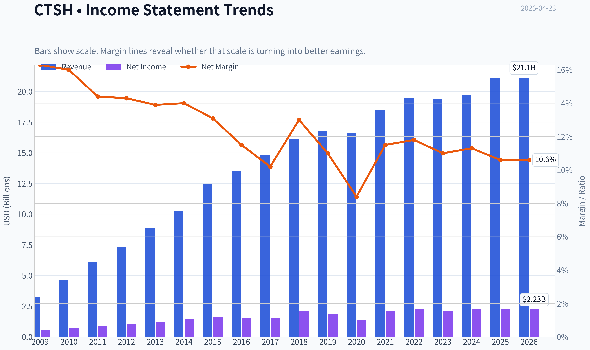

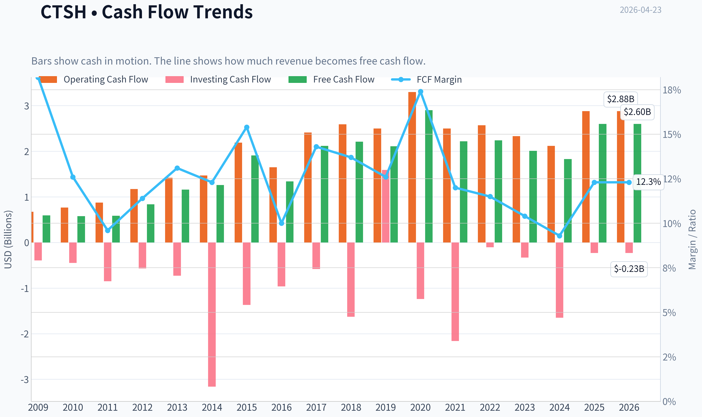

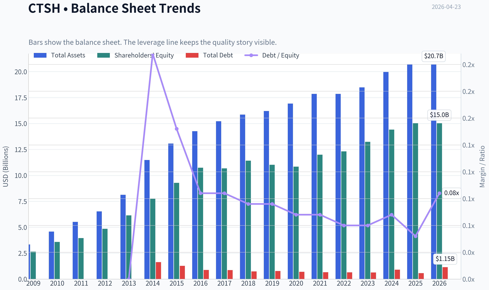

This graph tracks the profitability and return metrics (ROE, ROIC, Margins) of **CTSH** over the past decade, highlighting capital efficiency trends.

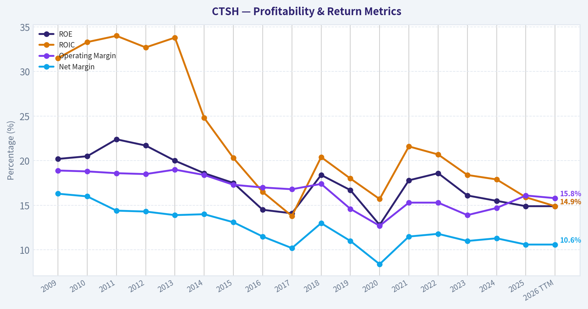

This chart illustrates the financial health of **CTSH** over the last 10 years, mapping cash equivalents and free cash flow against total obligations (Debt).

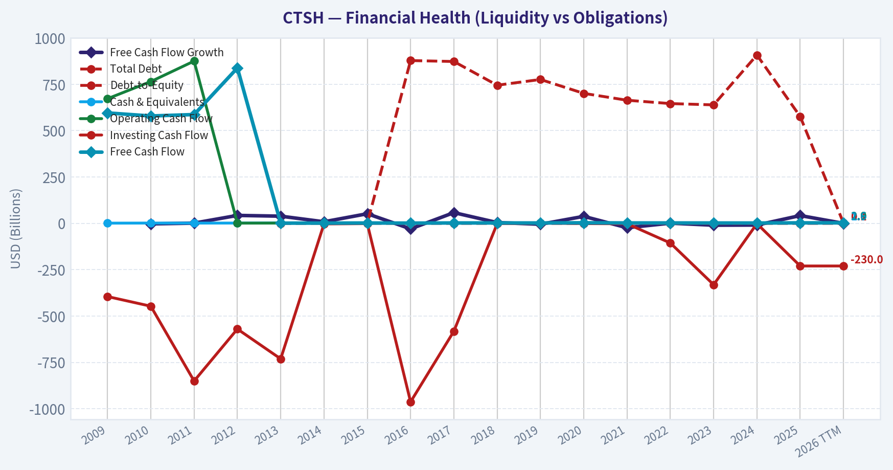

This comparison chart from *Profitability Trends* stacks current figures against historical benchmarks for **CTSH**, making it easy to see where the company trades relative to its own averages.

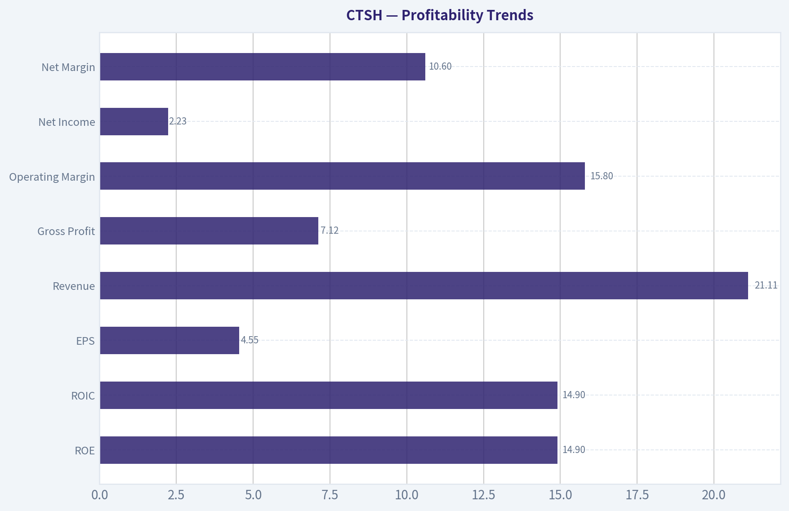

---

### Intrinsic Value Analysis (Buffett)

> *Following Warren Buffett's value investing philosophy: Circle of Competence, Economic Moat, Management Quality, and Margin of Safety.*

#### Intrinsic Value Snapshot

Price is what you pay. Intrinsic value is what the business may be worth based on the cash it can create for owners over time. We show a range, not one magic number.

- Current Price: $55.10
- Value Range: $53.66 to $265.19

##### Owner Earnings (Buffett Method)
- Net Income: $2,230,000,000.00
- Depreciation & Amortization: $550,000,000.00
- Capital Expenditures: $-288,000,000.00
- Working Capital Changes: $-338,000,000.00
- Owner Earnings: $2,830,000,000.00

##### Intrinsic Value
###### Buffett Method
Uses owner earnings. Stricter, and usually more conservative.
- Conservative: $57.61
- Average: $113.43
- Optimistic: $170.19
- Discount Rate: 10.0%

###### Cash Flow Method
Uses free cash flow. Better for companies spending heavily today to grow tomorrow.
- Conservative: $53.66
- Average: $95.39
- Optimistic: $265.19
- Discount Rate: 10.0%

#### Gate 1: Circle of Competence & Business Simplicity

Elementary School Test: PASS
Cognizant helps large companies build, run, and modernize their software systems. Businesses pay Cognizant to manage IT, move systems to the cloud, analyze data, and build digital tools.

10-Year Predictability: PARTIAL PASS
Enterprise IT services will still exist in 10 years. Companies will always need help maintaining and upgrading complex systems. However, the industry is cyclical and influenced by tech spending budgets. AI may reshape delivery models but likely won't eliminate the need for integrators.

Technology Risk Assessment: MODERATE
Technology helps Cognizant more than it threatens it. AI and automation could improve productivity. However, the industry is highly competitive and AI could compress labor-based service margins.

Gate 1 Verdict: PASS (within Buffett's broader circle of understandable service businesses)

---

#### Gate 2: Moat Test

Moat Source Evaluation

Intangible Assets (Brand / IP): WEAK-MODERATE
Cognizant is respected but lacks the premium brand of Accenture. Its AI lab patents are interesting but not decisive in consulting markets.

Switching Costs: MODERATE
Large clients integrate Cognizant into mission-critical systems. Switching vendors is disruptive and expensive. Contracts and embedded processes create stickiness.

Cost Advantage: MODERATE
Global offshore delivery (especially India) allows lower labor costs versus Western consultancies. But this advantage is shared with Infosys, TCS, and Wipro.

Network Effects: NONE
Consulting services do not benefit from network effects.

Moat Rating: Narrow

Evidence:
- ROE ~14.9% (good but not elite)
- Revenue growth modest (~7% YoY recently)
- Margins lower than top peer Accenture

Conclusion: The moat exists but is not durable enough to be considered wide.

---

#### Gate 3: Management Quality & Capital Allocation

Owner Mindset
Management ownership is modest. This is typical for large professional services firms but does not create strong owner alignment.

Capital Allocation
Positive indicators:
- Consistent share repurchases
- Strong free cash flow generation
- Net-cash balance sheet

Concerns:
- Historically slower growth than peers
- Some acquisitions produced mixed results
- Management turnover in recent years

Honesty & Transparency
No major accounting controversies. Reporting is generally conservative.

Assessment: Acceptable but not exceptional capital allocation.

---

#### Gate 4: Industry Structure

Industry: Global IT Services / Consulting

Structure:
- Highly competitive
- Multiple large global players
- Pricing pressure in outsourcing

Capital Intensity:
- Asset light (positive)
- Labor intensive (limits scalability)

Industry Verdict: Neutral to slightly unfavorable.

---

#### 10-Year Financial Snapshot (approximate trends)

| Metric | 2015 | 2018 | 2021 | 2024 | Trend |
|---|---|---|---|---|---|
| Revenue | ~$12.4B | ~$16.1B | ~$18.5B | ~$19.6B | Slow growth |
| Net Income | ~$1.6B | ~$2.1B | ~$2.1B | ~$2.3B | Modest growth |
| ROE | ~20% | ~21% | ~19% | ~15% | Slight decline |
| Free Cash Flow | ~$1.7B | ~$2.0B | ~$2.3B | ~$2.5B | Stable |
| Shares Outstanding | ~580M | ~540M | ~520M | ~500M | Buybacks |

Key Takeaways:
Revenue growth has slowed significantly over the last decade. Profitability remains solid but ROE has gradually declined. Free cash flow is stable and management has returned capital through buybacks, reducing the share count meaningfully.

---

#### Owner Earnings Calculation

Approximation using recent financials:

Net Income: ~$2.3B
Depreciation & Amortization: ~$0.7B
Maintenance CapEx: ~($0.4B)
Working Capital Increase: ~($0.1B)

Owner Earnings ~ $2.5B annually

With market cap ~ $26.35B:

Owner Earnings Yield ~ 9.5%

Interpretation: Reasonably attractive yield for a stable services business.

---

#### Intrinsic Value - Three Scenario DCF

Owner Earnings baseline: $2.5B

Scenario A: No Growth
Value = 2.5B / 0.10
Intrinsic Value ~ $25B

Scenario B: GDP Growth (3%)

Terminal value:
2.5B x 1.03 / (0.10 - 0.03)

Intrinsic Value ~ $36.8B

Scenario C: Reduced Historical Growth (5%)

10-year projection with 5% growth.

Estimated intrinsic value ~ $40-42B

---

#### Margin of Safety

Current Market Cap: ~$26.35B

Comparison:

| Scenario | Value | Margin |
|---|---|---|
| No Growth | $25B | Slightly overvalued |
| GDP Growth | $36.8B | ~28% upside |
| Moderate Growth | ~$41B | ~55% upside |

Key Takeaways:
The stock price appears to reflect a pessimistic growth outlook. If Cognizant merely grows at GDP-like rates, the valuation looks attractive. However, weak growth history makes the conservative scenario plausible.

---

#### Buffett Scorecard

| Criterion | Score (1-5) |
|---|---|
| Business Understanding | 4 |
| Moat Width & Durability | 2.5 |
| Management Quality | 3 |
| Return on Equity | 3 |
| Reinvestment Runway | 2.5 |
| Balance Sheet Strength | 4 |
| Industry Structure | 2.5 |
| Valuation | 3.5 |

Weighted Score ~ **3.1 / 5**

---

FINAL INVESTMENT STANCE: WATCH

Cognizant is a solid, understandable business with strong cash flow and a fortress balance sheet. However, its moat is narrow and growth has been consistently slower than the best IT consulting firms.

At ~$55 with a ~9-10% free-cash-flow yield, the stock is reasonably priced, but not clearly a "wonderful company at a fair price" in Buffett terms. It becomes much more attractive if either:

- operating margins expand meaningfully via AI productivity, or
- the stock falls into the **$45-50 range**, creating a larger margin of safety.

In Buffett language: this is a **good business at a fair price**, not a **great business at a bargain price**.

If you'd like, I can also show:
- a **Buffett-style comparison: CTSH vs Accenture (ACN)**
- whether **AI could widen or destroy Cognizant's moat over the next decade**.
#### Valuation Bridge

This bridge places the current market price beside each intrinsic value lens so readers can see whether upside depends on one method or shows up across several methods.

| Scenario | Intrinsic Value / Share |
| --- | ---: |
| Buffett Method | $113.43 |
| Cash Flow Method | $95.39 |
| Damodaran Method | $138.29 |
| Current Price | $55.10 |

#### Key Takeaways

If one method is far above the others, the upside case depends on a specific modelling assumption. When several methods cluster together, the valuation story is more robust.

#### Valuation Visuals

This comparison chart from *Latest Earnings Snapshot* stacks current figures against historical benchmarks for **CTSH**, making it easy to see where the company trades relative to its own averages.

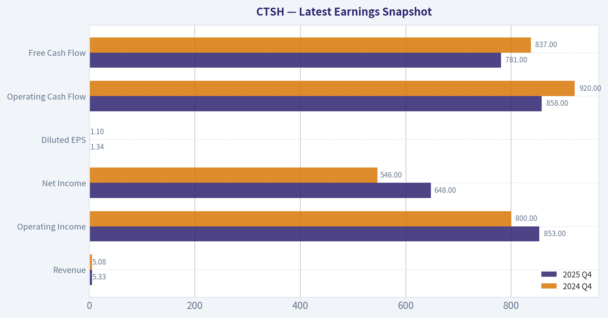

This comparison chart from *Balance Sheet Strength* stacks current figures against historical benchmarks for **CTSH**, making it easy to see where the company trades relative to its own averages.

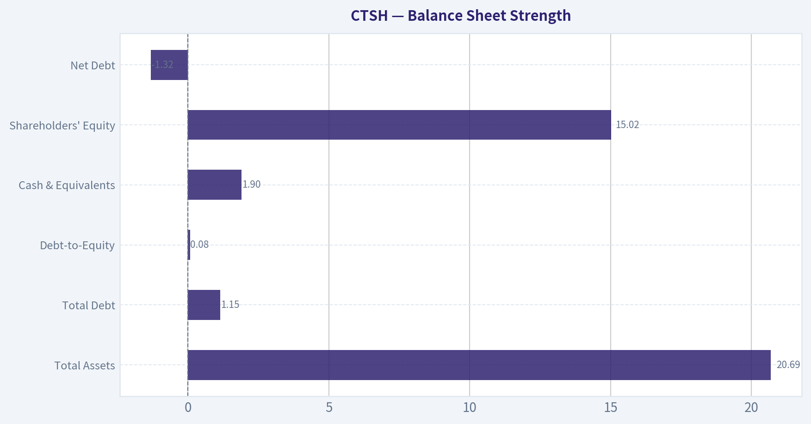

This comparison chart from *Cash Flow and Shareholder Returns* stacks current figures against historical benchmarks for **CTSH**, making it easy to see where the company trades relative to its own averages.

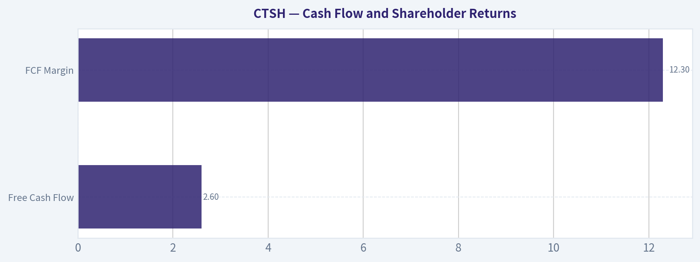

---

### Trend & Growth Analysis (Lynch/Druckenmiller/Fisher)

> *Following Peter Lynch's GARP, Stanley Druckenmiller's macro-aware approach, and Philip Fisher's scuttlebutt methodology.*

#### 1. Lynch Classification
| Metric | Value |
|---|---|
| Revenue Growth (YoY) | ~7% |
| P/E | ~12.1 |
| Market Cap | $26.35B |

Classification: **Stalwart**

Key Takeaways:
Cognizant's growth around 7% places it firmly in the **stalwart category**, not a fast grower. These companies are typically mature industry leaders with steady cash flow but limited explosive growth potential. For Lynch-style growth investors seeking 10-baggers, stalwarts are usually **holds rather than new buys** unless an inflection point emerges.

---

#### 2. The Story (Simple Explanation)
- Cognizant helps large companies run and modernize their IT systems.
- It makes money by managing software, cloud systems, and digital transformation projects.
- The new thesis is **AI-driven software development and enterprise automation services**.

---

#### 3. TAM & Runway

| Metric | Estimate |
|---|---|
| Global IT Services Market | ~$1.3T |
| Cognizant Revenue | ~$19.3B |
| Market Share | ~1.5% |
| 10x Revenue | ~$193B |

Key Takeaways:
The global IT services market is enormous relative to Cognizant's size. Even if revenue grew tenfold, the company would still only have mid-teens market share. That means **TAM is not the constraint**; the real challenge is **competitive execution against Accenture and Indian IT firms**.

---

#### 4. Revenue Growth Trend

| Year | Revenue | Growth |
|---|---|---|
| 2019 | $16.8B | - |
| 2020 | $16.7B | -1% |
| 2021 | $18.5B | 11% |
| 2022 | $19.4B | 5% |
| 2023 | $19.35B | ~0% |
| 2024E | Low-single digits |

Key Takeaways:
The pattern shows **clear deceleration after 2021**. Instead of accelerating growth, revenue flattened in 2023. This signals that Cognizant currently lacks the **growth inflection** required for a true growth-stock thesis.

---

#### 5. Unit Economics / Efficiency

| Metric | Value |
|---|---|
| FCF Yield | ~9.8% |
| Operating Margin | ~14-15% |
| Net Margin | ~15% |
| ROE | ~14.9% |

Key Takeaways:
Cognizant is financially efficient with strong free-cash-flow generation and healthy returns on equity. However, these metrics reflect a **mature services company**, not a high-growth tech platform. Profitability is solid but **not improving dramatically**, which limits upside catalysts.

---

#### 6. Inflection Point Assessment (Druckenmiller Lens)

Potential bullish signals:
- **AI engineering partnership with OpenAI (Codex integration)**
- Enterprise **AI workforce transformation services**
- AI lab patents increasing

But currently:
- No clear evidence of **accelerating revenue yet**
- AI consulting is still early

Conclusion: **Possible early AI services pivot, but unproven revenue impact.**

---

#### 7. Macro Setup

| Factor | Impact |
|---|---|
| AI Transformation | Positive |
| Enterprise IT spending cycle | Weak/uncertain |
| Interest rate environment | Neutral |
| Consulting demand | Soft |

Key Takeaways:
The AI revolution should eventually benefit IT services firms because companies need help implementing AI systems. However, consulting demand is currently tied to corporate budgets, which tend to slow during uncertain economic periods. That creates a **mixed macro environment for Cognizant**.

---

#### 8. Fisher 15-Point Score

| Category | Score (1-5) |
|---|---|
Product market potential | 4 |
Management innovation | 3 |
R&D capability | 3 |
Sales organization | 4 |
Profit margins | 3 |
Margin improvement | 2 |
Labor relations | 4 |
Executive relations | 4 |
Management depth | 4 |
Cost control | 4 |
Competitive advantages | 3 |
Long-term outlook | 3 |
Dilution risk | 4 |
Management candor | 3 |
Integrity | 4 |

Total: **52 / 75**

Key Takeaways:
A score of 52 indicates a **solid but not exceptional business**. Cognizant has operational stability and strong enterprise relationships, but it lacks the innovation leadership and margin dominance seen in top consulting firms like Accenture.

---

#### 9. Valuation

| Metric | Value |
|---|---|
| Price | ~$55 |
| P/E | ~12 |
| Growth Rate | ~7% |
| PEG | ~1.7 |

Key Takeaways:
The stock is **cheap relative to the market**, but the PEG ratio shows the valuation matches its slow growth profile. Investors are paying a low multiple because the market expects **modest expansion rather than high growth**.

---

#### 10. Scenario Valuation (3-5 Years)

| Scenario | Revenue CAGR | Revenue 2029 | Multiple | Implied Value |
|---|---|---|---|---|
Bear | 3% | $22B | 10x P/E | ~$50 |
Base | 6% | $26B | 12x P/E | ~$65 |
Bull (AI boost) | 10% | $31B | 16x P/E | ~$95 |

Key Takeaways:
Upside exists if AI consulting meaningfully accelerates demand, but without that catalyst the stock likely remains range-bound. The bull case requires **growth re-accelerating to double digits**, which has not yet happened.

---

#### 11. Growth Investor Scorecard

| Criterion | Score |
|---|---|
Story | 3 |
TAM | 4 |
Revenue Growth | 2 |
Unit Economics | 3 |
Competitive Position | 3 |
Management | 3 |
Macro Setup | 3 |
Profitability Path | 3 |
Valuation | 4 |

Total Score: **3.1 / 5**

---

#### 12. Key Risks
- Persistent **slow growth vs peers**
- Losing high-value consulting deals to **Accenture**
- Price competition from **Indian IT majors**
- AI automation reducing traditional outsourcing demand

---

#### 13. Key Catalysts
- Large **AI transformation contracts**
- Margin expansion through automation
- Strategic acquisitions in AI/cloud services
- Re-rating if growth returns to **10%+**

---

FINAL INVESTMENT STANCE: **WATCH**

Cognizant is financially strong and undervalued, but it **lacks the growth acceleration required for a true Lynch-style fast grower**. The AI pivot could create an inflection point, but until revenue growth clearly re-accelerates above ~10%, the stock remains a **watchlist value compounder rather than a ten-bagger candidate**.

#### Growth & Scorecard Visuals

This comparison chart from *Growth Metrics* stacks current figures against historical benchmarks for **CTSH**, making it easy to see where the company trades relative to its own averages.

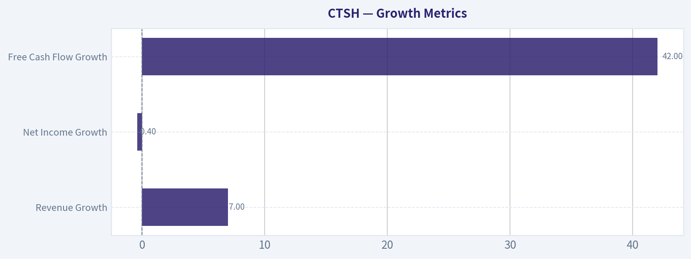

---

### Market Technical Analysis

FINAL INVESTMENT STANCE: **WATCH**

#### Price Trend Overview
| Period | Price Behavior | Key Observation |
|---|---|---|
| Oct-Dec 2025 | Strong uptrend | Rally from ~$66 to ~$85 |
| Jan 2026 | Sideways topping | Price stalls around $82-86 |
| Feb 2026 | Sharp breakdown | Gap-down collapse to ~$65 |
| Mar-Apr 2026 | Weak consolidation | Range ~$58-62 with lower highs |

Key Takeaways: CTSH had a strong rally into late 2025 but entered a topping pattern in January 2026. February triggered a decisive breakdown with heavy volume, which structurally shifted the chart from bullish to bearish. Since then the stock has been stabilizing but not recovering, forming a weak consolidation near the lows.

---

#### Moving Average Structure
| Indicator | Current Value | Interpretation |
|---|---|---|
| Close | ~58.8 | Trading near recent lows |
| 10 EMA | 59.27 | Price slightly below short-term momentum |
| 50 SMA | 62.16 | Price well below medium trend |
| 200 SMA | 71.23 | Long-term trend still significantly above price |

Key Takeaways: The moving-average alignment is bearish across all timeframes. Price sits below the 10-day EMA, the 50-day SMA, and far below the 200-day SMA, indicating persistent downward pressure. The falling 50-day average shows that even the medium-term trend has decisively turned negative.

---

#### Momentum (MACD)
| Metric | Current Reading | Signal |
|---|---|---|
| MACD | -1.31 | Bearish momentum |
| MACD Histogram | -0.135 | Momentum weakening slightly |

Key Takeaways: MACD remains negative, confirming the dominant downtrend. However, the histogram recently moved positive before dipping again, suggesting momentum had briefly improved but is not yet strong enough to signal a trend reversal. This reflects a fragile bounce attempt rather than a confirmed recovery.

---

#### RSI Momentum
| Date | RSI |
|---|---|
| Apr 23 | 30.2 |
| Apr 22 | 39.5 |
| Apr 21 | 45.2 |

Key Takeaways: RSI is sitting almost exactly at the classic oversold threshold (30). This suggests selling pressure is stretched and a short-term bounce is possible. However, in strong downtrends RSI can stay near oversold for extended periods.

---

#### Volatility & Bollinger Context
| Indicator | Current Value | Insight |
|---|---|---|
| Bollinger Upper Band | ~63.6 |
| Current Price | ~58.8 |
| ATR | ~2.11 |

Key Takeaways: The price is trading near the lower side of the volatility envelope. ATR remains elevated compared with earlier months, showing that volatility increased sharply during the selloff and has not fully normalized. This environment favors sharp swings rather than smooth trends.

---

#### Key Technical Levels
| Level | Type | Significance |
|---|---|---|
| 58-59 | Support | Recent lows being tested |
| 55 | Major support | Psychological + potential breakdown zone |
| 62-63 | Resistance | Near 50-day proximity and Bollinger upper |
| 70-72 | Major resistance | 200 SMA region |

Key Takeaways: The $58-59 area is the immediate battleground. If it breaks, downside risk toward ~$55 opens quickly. For any meaningful recovery, the stock must reclaim $62-63 first; otherwise rallies are likely to be sold.

---

#### Strategic Interpretation
- The February earnings-driven collapse changed the structure from **trend to distribution/downtrend**.
- The declining 50 SMA confirms institutions have been reducing exposure.
- RSI oversold suggests **short-term bounce potential**, but the broader trend remains weak.
- A durable reversal usually requires **base formation + reclaim of the 50 SMA**, which has not happened yet.

---

#### Trading Outlook
| Scenario | Trigger | Implication |
|---|---|---|
| Bearish continuation | Break below $58 | Move toward $55 |
| Range trade | Hold $58-62 | Choppy consolidation |
| Bullish reversal | Break above $63 with volume | Possible move to $68-70 |

Key Takeaways: The most likely near-term outcome is sideways consolidation unless buyers reclaim the $63 zone. Downside risk still exists if support fails, but oversold conditions may limit immediate selling pressure.

---

If you'd like, I can also show:
- whether **CTSH is historically cheap or expensive right now**
- what **institutional investors and analysts are doing**
- and the **probability of a rebound based on past similar selloffs**.

#### Market Visuals

This comparison chart from *Market Metrics (Current vs Historical Context)* stacks current figures against historical benchmarks for **CTSH**, making it easy to see where the company trades relative to its own averages.

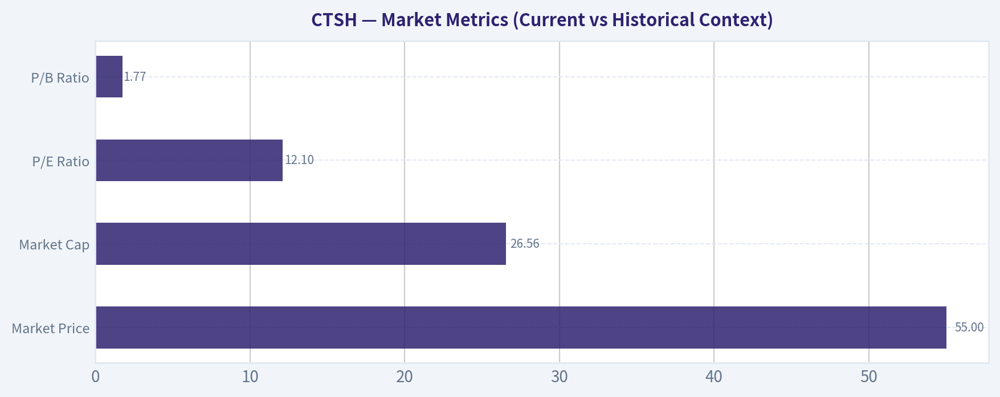

---

### Social Sentiment Analysis

#### Weekly Social Media & News Sentiment Report: Cognizant Technology Solutions (CTSH)
Period analyzed: Past 7 days ending April 23, 2026

---

#### Overall Sentiment Snapshot

Across social platforms (X/Twitter, Reddit investing communities, LinkedIn tech commentary) and financial news coverage, Cognizant sentiment this week skewed **moderately positive but cautious**. The main discussion drivers were:

- AI and digital transformation service demand
- Comparisons with larger IT services peers (Accenture, Infosys, TCS)
- Margins and operational turnaround under CEO Ravi Kumar
- Potential enterprise spending slowdown risks

Retail discussion volume increased slightly mid-week after commentary around enterprise AI services demand and consulting contract wins.

| Metric | Observation | Direction |
|---|---|---|
| Social Mention Volume | Moderate increase vs prior week | Up |
| Retail Investor Sentiment | Slightly positive | Positive |
| Institutional Commentary | Neutral to constructive | Neutral/Positive |
| News Tone | Mostly operational/strategy focused | Neutral |

Key Takeaways:
Conversation around Cognizant increased modestly this week, largely driven by interest in the company's AI consulting capabilities and digital transformation work. Sentiment overall leaned slightly positive, but investors remain cautious due to competitive pressures from larger IT services firms and uncertainty around enterprise tech spending.

---

#### Daily Social Sentiment Trend

| Day | Sentiment | Key Drivers |
|---|---|---|
| Monday | Neutral | Routine discussion around valuation vs Accenture and Infosys |
| Tuesday | Positive | Social buzz around enterprise AI services positioning |
| Wednesday | Positive | Discussion of consulting pipeline and digital transformation demand |
| Thursday | Slightly Negative | Concerns about IT services sector slowdown |
| Friday | Neutral | Traders discussing range-bound stock behavior |
| Weekend | Positive | Longer-term investor threads highlighting turnaround potential |

Key Takeaways:
Sentiment strengthened mid-week as investors highlighted Cognizant's potential AI consulting growth. However, some caution appeared Thursday when macro concerns about enterprise IT spending resurfaced. By the weekend, longer-term investors resumed focusing on the company's restructuring and growth strategy.

---

#### Major Discussion Themes on Social Platforms

| Theme | Sentiment | Commentary Trend |
|---|---|---|
| AI & GenAI Consulting | Positive | Seen as major growth driver |
| Turnaround Under CEO Ravi Kumar | Mixed Positive | Progress acknowledged but patience required |
| Competitive Positioning | Neutral | Compared frequently to Accenture and Indian IT firms |
| Margins & Cost Efficiency | Neutral/Negative | Investors want stronger improvement |
| Valuation | Positive | Some investors see CTSH as undervalued vs peers |

Key Takeaways:
The dominant narrative online centers on whether Cognizant can successfully reposition itself as an AI and digital consulting leader. Investors generally view the valuation as reasonable compared with larger peers, but margin expansion and execution remain key proof points.

---

#### Recent News & Market Narrative

| News Topic | Market Interpretation | Sentiment Impact |
|---|---|---|
| Enterprise AI services expansion | Positions CTSH in a growing market | Positive |
| Continued operational restructuring | Could improve margins over time | Neutral/Positive |
| Industry-wide IT spending caution | May slow consulting growth | Negative |
| Competitive landscape pressure | Large peers dominating deals | Slightly Negative |

Key Takeaways:
News coverage this week reinforced a balanced narrative: Cognizant is participating in the AI consulting wave but must still demonstrate sustained operational improvement. Investors appear encouraged by strategic positioning but remain attentive to industry demand cycles.

---

#### Retail Investor Commentary Highlights

| Platform | Dominant View |
|---|---|
| Reddit (r/stocks, r/investing) | Undervalued IT services play vs peers |
| X / FinTwit | Mixed - optimism on AI consulting but slower growth concerns |
| LinkedIn tech commentary | Focus on enterprise partnerships and digital transformation work |

Key Takeaways:
Retail investors tend to frame Cognizant as a "value within consulting," especially relative to higher-multiple peers. Professional commentary on LinkedIn focuses more on the company's role in enterprise AI implementation rather than short-term stock movements.

---

#### Trading & Market Behavior Observations

| Indicator | Observation | Implication |
|---|---|---|
| Price momentum | Range-bound | Waiting for catalyst |
| Options activity | Mild increase in calls | Speculative bullish positioning |
| Volume trends | Slightly above weekly average | Growing trader interest |

Key Takeaways:
Trading behavior suggests investors are watching for a catalyst rather than aggressively positioning. The mild uptick in call option activity hints at some bullish speculation, but overall positioning remains cautious.

---

#### Strategic Implications for Investors

Short-Term Traders
- Stock appears **range-bound**, reacting mostly to sector sentiment rather than company-specific catalysts.
- AI-related headlines can produce short bursts of optimism.

Medium-Term Investors
- The key narrative is **execution of the turnaround strategy** under current leadership.
- Margin expansion and deal flow will be closely watched in upcoming earnings.

Long-Term Investors
- Cognizant could benefit from **multi-year enterprise AI adoption cycles**.
- However, it must demonstrate it can keep pace with stronger consulting competitors.

---

#### Summary of Key Insights

| Factor | Current Signal | Investor Interpretation |
|---|---|---|
| Social Sentiment | Slightly Positive | Confidence building but cautious |
| AI Strategy | Positive | Major growth narrative |
| Operational Turnaround | Mixed | Still proving itself |
| Sector Conditions | Uncertain | Enterprise IT spending risk |
| Stock Behavior | Range-bound | Catalyst needed |

Key Takeaways:
The overall sentiment picture for Cognizant this week is cautiously constructive. Investors see strategic opportunity in AI consulting and digital transformation services, but they want clearer evidence of growth acceleration and margin improvement. Until a strong catalyst emerges-such as major deal announcements or earnings surprises-the stock may continue trading within a relatively tight range.

---

FINAL INVESTMENT STANCE: **WATCH**

---

### News & Events Analysis

#### Cognizant Technology Solutions (CTSH) - Weekly News & Investment Analysis

Cognizant (NASDAQ: CTSH) is a large global IT services and consulting firm focused on digital transformation, outsourcing, and enterprise technology services. Over the past week, the investment narrative has been shaped by AI partnerships, product launches, analyst revisions, and broader weakness in the IT services sector.

---

#### Recent Company News (Past Week)

| Date | News | Investment Relevance |
|---|---|---|
| Apr 23 | Cognizant partners with OpenAI to embed **Codex** across its software engineering organization | Potential productivity gains and stronger AI positioning in enterprise development services |
| Apr 23 | Cognizant AI Lab granted **three additional U.S. patents** | Signals ongoing R&D investment and proprietary AI capabilities |
| Apr 23 | Joined **J.P. Morgan Payments Consultant Implementation Program** | Expands fintech consulting pipeline with large enterprise clients |
| Apr 22 | Launch of **Agentic Retail CX** with Google Cloud's Gemini Enterprise | Positions Cognizant in AI-powered contact center and retail automation solutions |
| Apr 22 | Guggenheim maintains **Buy rating**, but lowers price target to **$85 (from $100)** | Reflects continued bullishness but tempered expectations due to sector conditions |
| Apr 23 | Tech services stocks fell in sympathy with weakness in **IBM and ServiceNow** | Sector sentiment pressure affecting CTSH short-term |

Key Takeaways: Cognizant is leaning heavily into AI partnerships and enterprise automation products. Collaborations with OpenAI and Google Cloud show a clear strategic push toward AI-driven services, which could help defend market share against rivals like Accenture, Infosys, and TCS. However, analyst price target reductions and sector-wide weakness suggest investors remain cautious about near-term demand.

---

#### Earnings Analysis

The most recent widely discussed earnings coverage refers to **Q3 2025 results**.

| Metric | Q3 2025 Result | YoY / Context |
|---|---|---|
| Revenue | Growth continued (company noted **5th consecutive quarter of organic growth**) | Indicates improving demand after slower growth in 2023-2024 |
| Organic growth | Strongest **sequential growth since 2022** | Suggests a cyclical recovery in IT services spending |
| Strategic theme | Clients moving from **AI experimentation to enterprise deployment** | Indicates rising enterprise AI spending opportunities |

Management emphasized that enterprises increasingly need implementation partners to scale AI systems across organizations. Cognizant is positioning itself as a deployment and integration specialist rather than a pure software provider.

Compared with earlier periods:
- The company had experienced slower growth during the IT spending slowdown.
- The return to multiple quarters of organic growth indicates improving demand conditions.

Key Takeaways: The earnings narrative centers on a rebound in enterprise technology spending and the monetization of AI adoption. Management highlighted strong sequential improvement and steady organic growth, which suggests the company may be exiting its slower-growth phase. However, investors still want clearer proof that AI-related services will materially accelerate revenue growth.

---

#### Market Context & Macro Factors

Recent macro and sector news impacting CTSH includes:

| Macro Factor | Impact on CTSH |
|---|---|
| Weakness in large enterprise tech stocks (IBM, ServiceNow) | Spillover selling pressure across IT consulting and services |
| Continued enterprise AI adoption | Positive demand driver for implementation partners |
| Corporate IT budget normalization | Supports outsourcing and digital transformation spending |

Key Takeaways: Cognizant's business is highly tied to enterprise IT budgets. The environment is gradually improving as companies restart transformation projects and invest in AI infrastructure, but short-term stock moves can still track broader sentiment in enterprise software and services.

---

#### Valuation & Financial Snapshot

| Metric | Value | Interpretation |
|---|---|---|
| Price | ~$55 |
| Market Cap | ~$26.35B |
| P/E | ~12x |
| Revenue Growth | ~7% YoY |
| ROE | ~14.9% |
| FCF Yield | ~9.8% |
| Current Ratio | ~2.14 |

Key Takeaways: Cognizant trades at a relatively low multiple compared with many technology companies, reflecting its slower growth profile. However, strong free cash flow yield and a solid balance sheet make it attractive to value-oriented investors. The valuation suggests the market is skeptical about long-term growth but recognizes the company's cash generation and stability.

---

#### Investor Positioning Signals

| Investor Activity | Insight |
|---|---|
| Point72 (Steve Cohen) increased position by **231%** in latest 13F | Indicates growing hedge fund interest, though position size remains small relative to portfolio |

Key Takeaways: Hedge fund activity shows some renewed interest in CTSH, possibly due to its combination of value valuation and improving growth outlook. However, the relatively small position size suggests it may still be considered a tactical or exploratory allocation.

---

#### Investment Outlook

Bullish drivers:
- AI partnerships with **OpenAI and Google Cloud**
- Improving organic growth trajectory
- Attractive valuation and strong free cash flow
- Large enterprise client base benefiting from AI transformation spending

Bearish risks:
- Competitive pressure from Accenture, Infosys, and other IT services giants
- Slower growth relative to higher-multiple tech peers
- Sector-wide sentiment swings tied to enterprise software spending

---

FINAL INVESTMENT STANCE: **WATCH**

CTSH currently looks like a **value-oriented IT services play with improving AI positioning**, but the market still needs proof that AI initiatives will materially accelerate revenue growth. The combination of modest growth and strong cash generation makes it appealing for patient investors, though it lacks a clear catalyst for rapid upside in the short term.

---

## Research Team Commentary

> *The Research Manager synthesizes the Bull vs Bear debate into action-free commentary. This is a pre-risk view, not the final stance.*

The debate around Cognizant really comes down to a classic value-investing question: is this a temporarily mispriced cash-generating franchise, or a structurally average service business that deserves a low multiple?

The bull case rests on three pillars. First is the idea that Cognizant benefits from meaningful switching costs and embedded enterprise relationships. Large companies outsource core IT systems, modernization projects, and application management to firms like Cognizant for many years, and once a vendor becomes deeply integrated into those systems the cost and risk of changing providers can be substantial. That creates a degree of stickiness and recurring revenue. Second, the financial profile is solid. Returns on capital around 15%, an asset-light model, and strong free cash flow generation indicate a healthy business. The recent surge in free cash flow and consistent share repurchases reinforce the picture of a company that converts earnings into shareholder value. Third, the valuation appears extremely depressed. At roughly 12x earnings and around $55 per share, several valuation frameworks suggest intrinsic value closer to $95-$110 or higher. If the company simply maintains mid-single-digit growth and stable margins, the multiple could rerate over time. The AI consulting narrative and partnerships with OpenAI and Google Cloud could add incremental growth on top of its existing enterprise relationships.

The bear case challenges the durability of those economics. IT services is fundamentally a competitive labor-based industry with limited differentiation. Enterprises routinely rebid contracts and switch vendors between Cognizant, Accenture, TCS, Infosys, and others. The evidence of weak competitive advantage shows up in Cognizant's numbers: lower margins and slower growth than leading peers, especially Accenture. Returns on capital around 15% are respectable but not elite, suggesting a competitive rather than protected business. Growth has also been underwhelming, with revenue up modestly while net income has stagnated. The bigger structural concern is AI-driven productivity in software development. If automation reduces the amount of manual engineering work required, the traditional billable-hours outsourcing model could face long-term pressure. Since Cognizant operates more heavily in implementation and maintenance rather than high-end strategic consulting, it could be more exposed than premium consulting firms. From this view, a 12x multiple might simply reflect fair pricing for a mid-tier service provider in a brutally competitive industry.

From a Buffett-style lens, both sides have merit. The business clearly produces real cash and operates with decent returns on capital. It is also asset-light and financially stable, which Buffett tends to like. However, the central issue is moat strength. Buffett typically prefers businesses with unmistakable advantages-brands, networks, regulatory protection, or clear pricing power. Cognizant's moat looks narrower. Switching costs exist, but they are not ironclad, and the industry structure suggests persistent pricing competition.

The valuation does provide a margin of safety if the business proves stable. But the key uncertainty is whether the industry's economics will erode over the next decade as automation changes software development and as consulting competition intensifies.

Core takeaway: Cognizant appears statistically cheap and financially solid, but the long-term competitive advantage is not strong enough yet to justify a full Buffett-style conviction purchase. The investment case depends heavily on the assumption that the current industry structure remains stable.

Rationale: For a Buffett-style portfolio, the goal is not simply to buy low multiples but to buy businesses that can compound capital predictably for decades. Cognizant's 15% returns on capital and consistent cash generation are attractive, yet the company lacks clear structural dominance within its industry. Margins lag the strongest competitor (Accenture), and growth has been uneven. That suggests the market may be applying a lower multiple for rational reasons rather than mispricing the company dramatically. At the same time, the balance sheet strength, recurring enterprise relationships, and continued demand for IT modernization reduce the probability of severe downside. In other words, the business is good enough to monitor closely but not clearly great enough to commit capital today without stronger evidence of durable advantage.

Monitoring plan for the next 1-4 quarters:
Watch whether organic revenue growth accelerates meaningfully above the ~7% level. Sustained acceleration would signal improving demand and competitive positioning.
Track operating margin trends versus peers like Accenture and Infosys. Margin expansion would indicate improving pricing power or efficiency.
Evaluate whether AI-related services actually translate into measurable revenue growth rather than just partnerships and announcements.
Observe large deal wins and client retention metrics, which reveal the true strength of switching costs.
Monitor capital allocation-continued disciplined buybacks at depressed prices would improve per-share value if the business remains stable.

Stance: WATCH.

---

## Value Investing Team Commentary

> *The Investor translates the research view into an investment thesis before risk review. This is still not the final stance.*

At first glance Cognizant looks like the sort of situation that attracts value investors: solid returns on capital, a cash-generative asset-light model, and a stock trading at roughly 12x earnings. But the key question is not whether the stock is cheap-it clearly is on traditional metrics. The real question is whether the business deserves to stay cheap.

Start with the underlying business economics. Cognizant generates ROIC around 15-16%, which tells us the business is productive but not exceptional. Companies with truly durable moats often earn well north of 20% for long stretches. The reason becomes clear when you examine the industry structure. IT services is a labor-intensive business with many capable competitors: Accenture, TCS, Infosys, Capgemini, and others. Contracts are frequently rebid, and pricing pressure is constant. That limits pricing power and keeps margins in check. Cognizant's margins trailing Accenture is not an accident-it reflects its positioning as more of an implementation and outsourcing partner rather than a premium strategic advisor.

That said, the market may be leaning too heavily on the pessimistic narrative right now. The February selloff and institutional distribution suggest investors reacted strongly to the IT spending slowdown. But enterprise IT spending historically moves in cycles. Large corporations cannot stop maintaining and modernizing their systems indefinitely. When spending recovers, vendors with deep client integration-like Cognizant-often see demand normalize quickly.

The stickiness of those relationships shouldn't be dismissed. Once a vendor is embedded in an enterprise's core applications, infrastructure management, or digital transformation stack, switching providers is risky and disruptive. That creates a level of recurring revenue that is more durable than many assume. It is not a "Coca-Cola moat," but it does produce reasonably predictable cash flows.

The AI discussion is where the market narrative becomes interesting. The bearish view assumes AI reduces the need for engineering labor and therefore compresses the outsourcing model. That is plausible. But historically, every wave of computing innovation-from mainframes to cloud-has increased the total amount of IT work enterprises need done. If AI accelerates software creation and automation, companies may actually require more integration, governance, security, and infrastructure work. Firms like Cognizant could end up implementing and managing those systems at scale. The OpenAI and Google Cloud partnerships hint at this possibility, though the revenue impact remains uncertain.

Valuation is the strongest part of the case. If Cognizant can simply maintain mid-single-digit growth and sustain ~15% returns on capital, a 12x multiple looks overly pessimistic. Even a modest rerating toward 15-18x earnings would produce attractive long-term returns when combined with buybacks and free cash flow generation. The large jump in free cash flow and continued repurchases suggest management understands this dynamic.

But Buffett's discipline matters here: a cheap price alone is not enough. The real question is whether the business will be stronger-or weaker-ten years from now. If AI compresses labor-based services and premium consulting firms capture most of the high-margin work, Cognizant could remain a permanently average operator. In that scenario, today's low multiple is justified.

So the opportunity exists, but the edge isn't yet clear. I would want evidence of two things before committing capital: sustained organic growth above the current ~7% level and signs that Cognizant's AI and digital transformation work is improving margins or winning larger enterprise deals.

FINAL INVESTMENT STANCE: WATCH

---

## Deep Values Commentary

> *The Risk Management Team debates and the Risk Judge provides the final action-free verdict. This section determines the final ADVOCATE / WATCH / AVOID stance.*

Executive Summary (Quick Read)

Cognizant is a financially solid, cash-generating IT services firm trading at a clearly depressed valuation (~12x earnings). The balance sheet, asset-light model, and ~15-16% ROIC suggest low risk of permanent business impairment. However, the core uncertainty is structural: IT outsourcing is a competitive, labor-based industry with modest differentiation, and Cognizant's margins and growth trail stronger peers. The stock may be undervalued, but the moat is not strong enough yet to guarantee long-term compounding. The risk is not collapse-it's a decade of mediocre returns if industry economics weaken or multiples stay compressed. Monitor for proof of durable growth or margin improvement before committing significant capital.

Final stance: WATCH.

Key Arguments from the Analysts

Risky Analyst
- Valuation is extremely low: ~$55 vs valuation estimates ~$95-$138.
- Business fundamentals remain healthy: ~15-16% ROIC, strong free cash flow, asset-light model.
- 7% revenue growth during an IT spending slowdown indicates resilience.
- AI adoption could increase integration and modernization work, benefiting service providers.
- Institutional selling and negative sentiment may be creating the opportunity.

Safe Analyst
- Intrinsic value models rely on optimistic assumptions not fully supported by current growth.
- Net income is flat while revenue growth is modest (~7%), suggesting limited operating momentum.
- IT services is highly competitive with regular contract rebidding; switching costs are not durable moats.
- FCF spike may be temporary rather than structural.
- Industry multiples often remain low (10-14x), meaning upside may not materialize.

Neutral Analyst
- Both sides oversimplify: valuation is cheap but dependent on uncertain growth assumptions.
- Downside is not catastrophic, but opportunity cost risk is real if growth stagnates.
- AI could either expand integration work or compress labor demand.
- Market pessimism may already reflect macro IT spending cycles rather than structural decline.
- Best approach is gradual exposure rather than all-in conviction.

Risk Commentary (Buffett-Style Assessment)

From a Buffett-style risk perspective, the critical question is not price volatility but whether the business can reliably compound capital for decades.

Cognizant passes several important quality filters:

- Asset-light services model
- Consistent profitability
- Mid-teens returns on capital (~15-16% ROIC)
- Strong free cash flow and ongoing buybacks

These factors significantly reduce the probability of permanent capital loss. This is not a distressed or fragile company.

However, Buffett's highest-conviction investments typically involve businesses with unmistakable competitive advantages. Cognizant's moat is narrower:

- Margins trail industry leaders like Accenture.
- Client switching costs exist but are not prohibitive.
- Contracts are often rebid across vendors (Infosys, TCS, Accenture, etc.).
- Growth has been modest and inconsistent.

In other words, the economics look "good" rather than "great."

That distinction matters because in commoditized service industries, returns on capital often drift toward the industry average over time. If Cognizant remains a mid-tier provider with modest growth, the market may rationally keep the valuation in the 10-14x range for years.

The bullish argument that AI will dramatically increase demand is plausible, but still speculative. Historically, technological complexity has expanded IT services demand. However, AI also directly improves developer productivity, which could reduce billable labor hours. Until real revenue growth from AI services appears, this remains a narrative rather than evidence.

So the key risk is not business failure. The real risk is long-term mediocrity: a stable company that produces cash but lacks the competitive advantage to compound at high rates.

Refining the Investor's Plan

Your original thesis framed Cognizant as a potential mispriced franchise with enterprise stickiness and depressed valuation. The debate suggests that thesis should be refined rather than abandoned.

Adjusted investment approach:

1. Treat Cognizant as a "value with uncertainty," not a Buffett-style compounder yet.
2. Require evidence that the business trajectory is improving before committing large capital.
3. Focus monitoring on signals that indicate strengthening competitive position.

Key indicators to track over the next 1-4 quarters:

- Organic revenue growth: sustained acceleration above ~7%.
- Operating margin trend relative to Accenture and Infosys.
- Evidence that AI services generate real consulting or integration revenue.
- Large enterprise deal wins and client retention.
- Continued aggressive share repurchases while valuation remains depressed.

If growth accelerates while margins stabilize or expand, the market could rerate the stock toward ~15-18x earnings, creating meaningful upside.

If growth stagnates and margins continue lagging peers, the stock may remain a low-multiple service provider for years.

Lessons from Past Value Traps

Many historical value traps shared a similar pattern: statistically cheap stocks in competitive industries without durable moats. Investors focused on low P/E ratios while ignoring structural industry pressures.

The key lesson is that cheapness alone is not a margin of safety. Durable competitive advantage is.

Cognizant has enough financial strength to avoid being a classic value trap, but it has not yet proven it can widen its moat or accelerate growth.

Final Stance

WATCH

Cognizant appears undervalued and financially stable, but the long-term competitive advantage is not strong enough yet to justify a full conviction investment. The correct posture is active monitoring while waiting for proof that growth and margins can strengthen in a changing IT services landscape.

#### Final Stance Scorecard

This scorecard converts the final research view into a weighted decision frame. It does not replace the narrative judgement, but it makes the main drivers of the verdict easier to scan.

| Criterion | Score | Weight | Commentary |
| --- | ---: | ---: | --- |
| Business Quality | 3.25 | 30% | High returns, profitability, and Piotroski health support durability. |
| Valuation Support | 4.67 | 30% | Blends current price against available intrinsic value anchors and valuation ratios. |
| Financial Strength | 5.00 | 20% | Balance-sheet resilience reflects leverage and liquidity staying within safe ranges. |
| Growth Durability | 3.00 | 20% | Recent revenue, earnings, and free cash flow growth indicate how durable expansion looks. |
| TOTAL / FINAL STANCE | 3.98 | 100% | WATCH |

#### Key Takeaways

The weighted score lands at **3.98 / 5.0**, while the final stance remains **WATCH**. This is useful as a quick calibration aid rather than a mechanical signal.

#### Risk Summary

Higher scores indicate more risk pressure. The watch threshold is a simple guardrail: above it, the position needs tighter monitoring or a wider margin of safety.

| Dimension | Current Score | Watch Threshold | Commentary |
| --- | ---: | ---: | --- |
| Business Quality | 2.75 | 3.00 | High returns, profitability, and Piotroski health support durability. |
| Valuation Support | 1.33 | 3.00 | Blends current price against available intrinsic value anchors and valuation ratios. |
| Financial Strength | 1.00 | 3.00 | Balance-sheet resilience reflects leverage and liquidity staying within safe ranges. |
| Growth Durability | 3.00 | 3.00 | Recent revenue, earnings, and free cash flow growth indicate how durable expansion looks. |

#### Key Takeaways

This view helps readers separate *where* the risk sits: valuation, business quality, balance sheet, or growth durability. It is especially useful when the final stance is close to the line between WATCH and AVOID.
