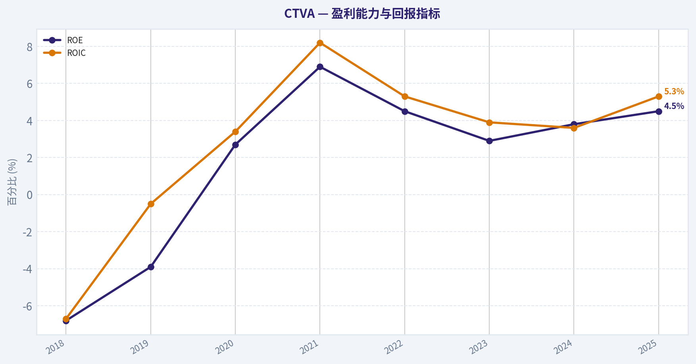
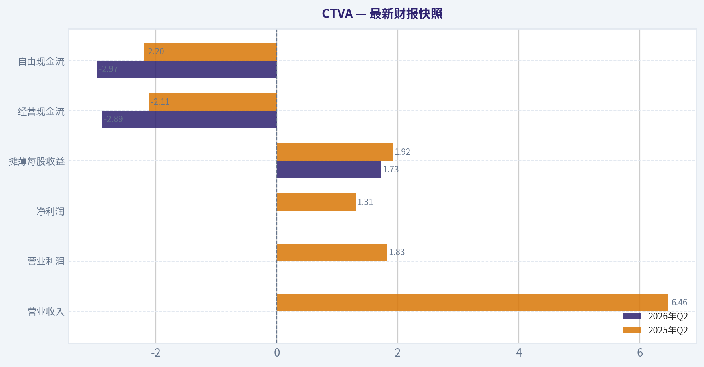
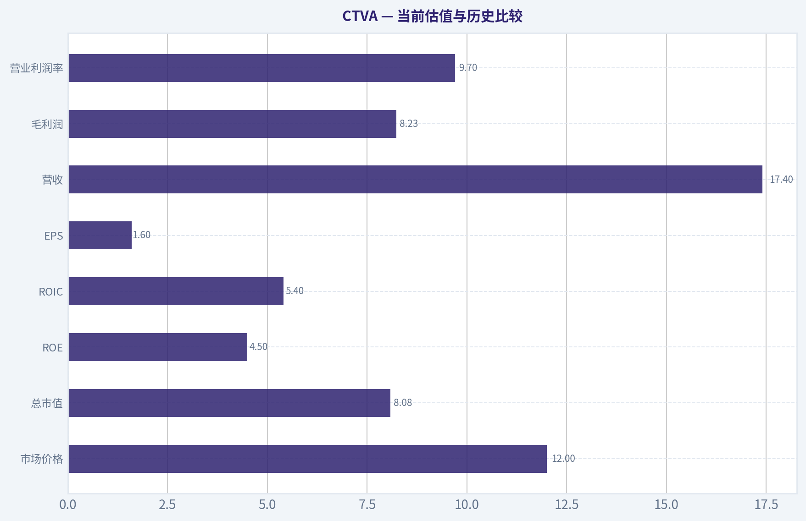
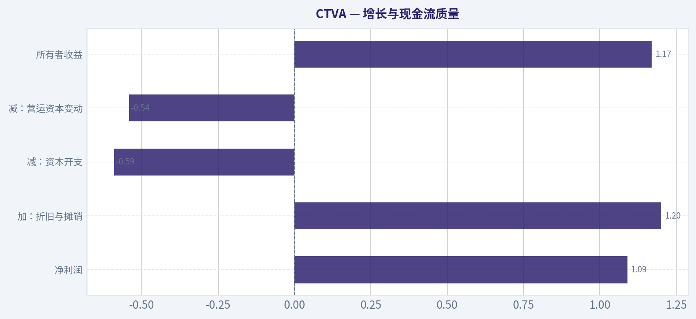
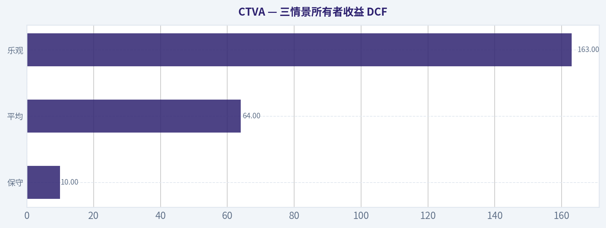
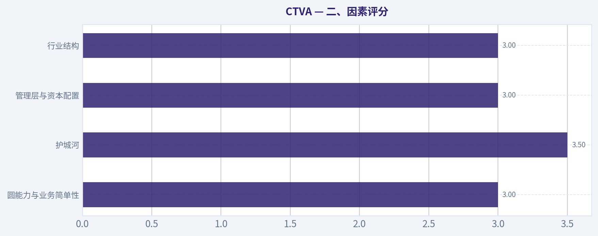
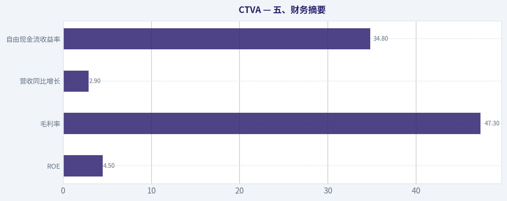
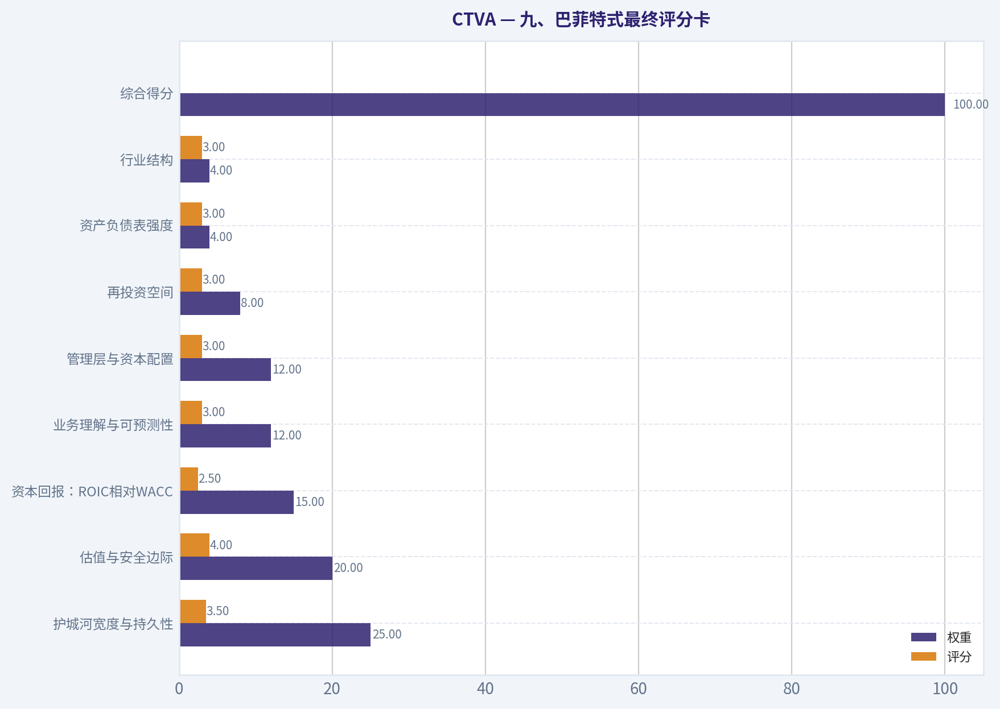

# CTVA 深度价值情报

**调研日期:** 2026-11-10

## 关键免责声明

*本报告由 Deep Value Intelligence（一个基于 AI 的多智能体投资分析框架）自动生成。 仅供教育和研究用途 - 非财务建议，非财务顾问。*

---

## 目录

1. 情报摘要
2. 分析师团队报告
   - 基本面分析
   - 价值分析 (巴菲特)
   - 成长性分析 (林奇/德鲁肯米勒/费雪)
   - 市场分析
   - 期权市场分析
3. 研究团队评论
4. 投资团队评论
5. Deep Values 团队洞察

---

## 情报摘要

### 核心观点与前提条件

**核心论点:** **结论不变，但行动标准更明确：继续观察，当前不下单。** 最大风险不是股价波动，而是12.11美元、7.48倍PE及1.62美元EPS可能来自同一条错误数据链。 Corteva拥有种质资源、Pioneer品牌、研发、注册数据和渠道壁垒，农业科技需求也具有长期基础；但5.4%的ROIC、4.5%的ROE和近三年收入停滞，尚未证明这些资产能持续创造超额回报。 多头关于周期修复的判断可能正确，但其16至23美元估值把EPS近似当成可分配现金流，并低估了研发、再投资、净债务与潜在责任。 **不必等所有指标全面转好，但必须先验证证券、所有者收益和资产负债表。** 若保守估值仍有25%至35%的安全边际，可建立极小普通股仓位；否则继续等待。

**主要风险:**
- **中性**

**置信度:** 中

---

## 分析师团队报告

### 基本面分析

#### 最新财报快照

*以下数据基于最近一期已披露财报（2026年Q2），并尽量与上一年同期对比。*

| 指标 | 2026年Q2 | 2025年Q2 | 同比变化 |
| --- | ---: | ---: | ---: |
| 营业收入 | N/A | $6.46B | N/A |
| 营业利润 | N/A | $1.83B | N/A |
| 净利润 | N/A | $1.31B | N/A |
| 摊薄每股收益 | $1.73 | $1.92 | -9.9% |
| 经营现金流 | $-2.89B | $-2.11B | -37.1% |
| 自由现金流 | $-2.97B | $-2.20B | -34.9% |

关键结论：这张快照先把最新一期财报放在桌面上，再去看长周期分析。这样读者能更清楚地区分"公司长期质量"和"这次财报发生了什么"。

#### CTVA 8年财务指标

*以下数值均由原始数据确定性计算得出，并非 AI 估算。*

*发行人类型：operating company（Basic Materials / Agricultural Inputs）。*

#### 8年财务指标
*年度行来自已披露财务报表，最后一行 TTM 由最近四个季度滚动计算得出。*

| 指标 | 2018 | 2019 | 2020 | 2021 | 2022 | 2023 | 2024 | 2025 |
| --- | --- | --- | --- | --- | --- | --- | --- | --- |
| 市场价格 | N/A | $4 | $5 | $7 | $8 | $7 | $8 | $10 |
| 总市值 | N/A | $3.32B | $4.36B | $5.26B | $6.39B | $5.12B | $5.95B | $6.85B |
| 市盈率 | N/A | -3.46 | 6.38 | 2.99 | 5.58 | 6.98 | 6.57 | 6.29 |
| 市净率 | N/A | 0.14 | 0.18 | 0.21 | 0.25 | 0.20 | 0.25 | 0.28 |
| ROE | -6.8% | -3.9% | 2.7% | 6.9% | 4.5% | 2.9% | 3.8% | 4.5% |
| ROIC | -6.7% | -0.5% | 3.4% | 8.2% | 5.3% | 3.9% | 3.6% | 5.3% |
| 每股收益 | $-6.76 | $-1.18 | $0.86 | $2.25 | $1.52 | $1.00 | $1.30 | $1.60 |
| 营收 | $14.29B | $13.85B | $14.22B | $15.65B | $17.45B | $17.23B | $16.91B | $17.40B |
| 毛利润 | $4.34B | $5.27B | $5.71B | $6.43B | $7.02B | $7.31B | $7.38B | $8.23B |
| 毛利率 | 30.4% | 38.1% | 40.2% | 41.1% | 40.2% | 42.4% | 43.6% | 47.3% |
| 营业利润率 | -47.6% | -2.3% | 4.7% | 15.0% | 8.2% | 6.3% | 7.5% | 9.7% |
| 净利润 | $-5.07B | $-959.0M | $681.0M | $1.76B | $1.15B | $735.0M | $907.0M | $1.09B |
| 净利率 | -35.5% | -6.9% | 4.8% | 11.2% | 6.6% | 4.3% | 5.4% | 6.3% |
| 营收增长 | N/A | -3.1% | 2.7% | 10.1% | 11.5% | -1.3% | -1.8% | 2.9% |
| 净利润增长 | N/A | -81.1% | -171.0% | 158.3% | -34.8% | -35.9% | 23.4% | 20.6% |
| 自由现金流增长 | N/A | -90.9% | -1808.6% | 35.6% | -87.6% | 339.7% | 31.9% | 81.8% |
| 总账面价值 | $74.66B | $24.31B | $24.82B | $25.38B | $25.30B | $25.04B | $23.79B | $24.14B |
| 总资产 | $108.68B | $42.40B | $42.65B | $42.34B | $42.62B | $43.00B | $40.83B | $42.84B |
| 总债务 | $7.94B | $122.0M | $1.10B | $1.12B | $1.31B | $2.49B | $2.70B | $2.58B |
| 债务股权比 | 0.11 | 0.01 | 0.04 | 0.04 | 0.05 | 0.10 | 0.11 | 0.11 |
| 现金及等价物 | $2.27B | $1.76B | $3.53B | $4.46B | $3.19B | $2.64B | $3.11B | $4.52B |
| 股东权益 | $74.66B | $24.31B | $24.82B | $25.38B | $25.30B | $25.04B | $23.79B | $24.14B |
| 经营现金流 | $483.0M | $1.07B | $2.06B | $2.73B | $872.0M | $1.77B | $2.15B | $3.41B |
| 投资现金流 | $-505.0M | $-904.0M | $-674.0M | $-362.0M | $-632.0M | $-1.99B | $-589.0M | $-543.0M |
| 自由现金流 | $-1.02B | $-93.0M | $1.59B | $2.15B | $267.0M | $1.17B | $1.55B | $2.81B |
| 自由现金流利润率 | -7.1% | -0.7% | 11.2% | 13.8% | 1.5% | 6.8% | 9.2% | 16.2% |
| 每股分红 | $0.00 | $0.00 | $0.00 | $0.51 | $0.55 | $0.60 | $0.66 | $0.00 |

#### 盈利能力指标
- 净资产收益率 (ROE): 4.5%
- 投入资本回报率 (ROIC): 5.4%
- 总资产收益率 (ROA): 2.6%
- 毛利率: 47.3%
- 营业利润率: 9.7%
- 净利率: 6.3%

#### 流动性指标
- 流动比率: 1.43
- 速动比率: 0.79

#### 杠杆指标
- 债务股权比: 0.11
- 利息覆盖倍数: 9.38
- 净负债: $-1.95B

#### 增长指标（同比）
- 营收增长: 2.9%
- 净利润增长: 20.6%
- 自由现金流增长: 81.8%
- 营收复合增长率（3年）: -0.1%
- 营收复合增长率（5年）: 4.1%

#### 估值指标
- 市盈率 (TTM): 7.48
- 预期市盈率: 10.77
- 市净率: 1.00
- 市销率: 1.63
- PEG 比率: 0.62
- 企业价值/EBITDA: 16.50
- 自由现金流收益率: 34.8%
- 盈利收益率: 13.4%

#### 所有者收益（巴菲特方法，代码计算）
- 净利润: $1.09B
- + 折旧与摊销: $1.20B
- - 资本开支: $-591.0M
- - 营运资本变动: $541.0M
- = **所有者收益: $1.17B**

#### 内在价值（代码计算）
- 当前价格: $12
- **头条内在价值（按商业模式路由）: $32**
  商业模式: cyclical - weighted blend [Damodaran FCFF + reverse-DCF fair + owner-earnings DCF] (cyclical)
  模型区间（各 DCF 最小-最大）: $12 - $83
  相对价格的安全边际（头条）: 62.0%
  路由说明: Cyclical: margins/FCF are volatile - headline blends FCFF, reverse-DCF and owner-earnings roughly evenly; treat the range as the honest read.
- 巴菲特方法（所有者收益）:
  保守: $10
  平均: $64
  乐观: $163
- 现金流方法（FCF）:
  保守: $83
  平均: $83
  乐观: $375
- Damodaran FCFF（WACC + 利润率 + 再投资）:
  保守: $6
  平均: $12
  乐观: $12
  蒙特卡洛区间（P10-P90）：$2 - $16（中位数 $10）
  P(内在价值 > 当前价格)：33.1%
- 反向 DCF：当前价格隐含约 -21.8%/年 的所有者收益增长（10年）；过去 3 年为 -29.5%，5 年为 41.4%。

#### Piotroski F分数: 7/9
- 净利润为正: 通过
- 经营现金流为正: 通过
- 资产回报率改善: 通过
- 现金流大于净利润: 通过
- 债务下降: 通过
- 流动比率改善: 未通过
- 未稀释股本: 通过
- 毛利率改善: 通过
- 资产周转率改善: 未通过

ANALYST STANCE: **中性**

#### 投资结论

CTVA 是一家农业投入品公司，主营种子与作物保护产品。当前股价约 **12美元**，市值 **80.8亿美元**，PE **7.48倍**，自由现金流收益率高达 **34.8%**，表面估值非常便宜；但公司具有明显周期性，收入增长缓慢，ROE 和 ROIC 仍低于优质企业标准，盈利与自由现金流在过去八年波动较大。

确定性模型给出的商业模式加权内在价值约 **31.91美元**，对应约 **62%的安全边际**；但 Damodaran FCFF 模型区间仅为 **6-12美元**，并且模型估计当前价格低于内在价值的概率只有 **33.1%**。因此，CTVA 更适合等待经营改善或安全边际进一步扩大，而不是直接视为典型的高确定性"巴菲特式复利股"。

#### 当前估值与历史比较

| 指标 | 当前值 | 历史平均或参考值 | 当前相对历史的含义 |
|---|---:|---:|---|
| 市场价格 | $12.00 | 2019-2025平均约$7.00 | 股价已高于多数历史年份，但公司盈利和现金流也明显改善 |
| 总市值 | $8.08B | 约$5.32B | 市值处于历史高位，市场已部分反映经营修复 |
| PE | 7.48倍 | 含亏损年份约3.83倍；剔除负PE约6.56倍 | 当前略高于盈利年份平均水平，但仍属低估值 |
| PB | 1.00倍 | 2019-2025约0.22倍 | 当前明显高于历史账面倍数，不能单独据此判断便宜 |
| ROE | 4.5% | 约1.8% | 高于历史平均，但远低于优质企业常见的15%以上 |
| ROIC | 5.4% | 约2.4% | 已改善，但仅略高于资本成本的可能水平 |
| EPS | $1.60 | 约$0.07 | 显著高于八年平均，主要因为2018-2019年巨额亏损拉低基数 |
| 营收 | $17.40B | 约$15.97B | 规模高于历史平均，但近三年基本停滞 |
| 毛利润 | $8.23B | 约$6.69B | 绝对毛利处于高位 |
| 营业利润率 | 9.7% | 八年平均约5.2% | 明显改善，显示产品组合或成本控制有效 |
| 净利润 | $1.09B | 约$586M | 高于历史平均，但仍受农业周期影响 |
| 净利率 | 6.3% | 含2018年约-0.5% | 已恢复为正，但尚未达到特别稳定的水平 |
| 自由现金流 | $2.81B | 约$1.05B | 当前处于历史高位，需关注是否包含周期高点因素 |
| 自由现金流利润率 | 16.2% | 历史平均约6.9% | 现金转换能力显著增强，但可持续性仍需验证 |
| 总债务 | $2.58B | 约$2.42B | 绝对债务接近历史平均，杠杆仍低 |
| 债务权益比 | 0.11 | 约0.06 | 高于早期，但仍属保守水平 |
| 现金及等价物 | $4.52B | 约$3.19B | 现金处于高位，净现金约$1.95B |
| 每股分红 | $0.00 | 2019-2025平均约$0.33 | 最新年度停止分红，资本回报政策出现变化 |

**关键结论：** CTVA 当前的盈利能力和现金流明显好于历史平均，但收入增长和资本回报率仍不够强。低 PE 与高自由现金流收益率构成估值吸引力，而较低 ROE、周期性和停止分红则限制了估值重估的确定性。

#### 市场与盈利能力分析

当前 PE 为 **7.48倍**，盈利收益率约 **13.4%**。从传统价值投资角度看，这一估值并不昂贵，尤其是公司拥有 **4.52亿美元现金？** 更正为 **45.2亿美元现金**，总债务仅 **25.8亿美元**，处于净现金状态。

PB 当前约 **1.00倍**，高于历史披露数据中的低水平。不过，CTVA 的账面价值受到业务分拆、无形资产、商誉和资本结构变化影响，PB 不应作为唯一估值依据。更重要的是，当前 ROE 只有 **4.5%**，说明公司尚未证明其账面资本能够产生高回报；因此，PB 低并不自动意味着公司便宜。

盈利质量方面：

- 毛利率从2018年的30.4%提升至当前47.3%，是最积极的结构性改善。
- 营业利润率从2018年的负47.6%提升至9.7%，说明公司已从重大重组或异常损失阶段恢复。
- 净利率为6.3%，高于历史平均，但仍明显低于软件、消费品牌或高质量工业特许经营企业。
- ROIC 为5.4%，相较历史改善，但仍不足以证明公司拥有非常强的资本配置效率。
- EPS 从2019年的负1.18美元提升至当前1.60美元，但这一改善部分来自低基数，不能完全视为持续复利。

#### 增长与现金流质量

最新营收增长为 **2.9%**，五年营收复合增长率约 **4.1%**，但三年复合增长率约 **-0.1%**。这表明公司具备较大的收入规模，却缺乏持续快速增长能力。

净利润同比增长 **20.6%**，自由现金流同比增长 **81.8%**，表面上非常强劲，但农业投入品行业的库存、价格、天气、农产品价格和渠道周期都会造成较大波动。历史自由现金流增长数据包括负90.9%、负1808.6%、正339.7%等极端值，说明增长率平均值没有太大统计意义。

当前所有者收益计算如下：

| 项目 | 金额 |
|---|---:|
| 净利润 | $1.09B |
| 加：折旧与摊销 | $1.20B |
| 减：资本开支 | -$0.591B |
| 减：营运资本变动 | -$0.541B |
| 所有者收益 | **$1.17B** |
| 按约6.73亿股估算的所有者收益/股 | **约$1.74** |
| 所有者收益收益率 | **约14.5%** |

**关键结论：** 当前现金流表现极具吸引力，但自由现金流的历史波动非常大，不能简单把当前2.81亿美元？更正为 **28.1亿美元** 作为永久正常化水平。营运资本和农产品周期正常化后，所有者收益可能低于当前值。

#### 资产负债表与财务安全

CTVA 的财务安全性是投资逻辑中较强的一部分：

- 总债务 **25.8亿美元**，债务权益比仅 **0.11**。
- 现金及等价物 **45.2亿美元**，净负债为负 **19.5亿美元**。
- 利息覆盖倍数 **9.38倍**，短期偿债压力不高。
- 流动比率 **1.43**，但速动比率只有 **0.79**，说明部分流动资产依赖库存。
- Piotroski F分数为 **7/9**，净利润、经营现金流、债务、毛利率等项目表现较好，但流动比率和资产周转率没有改善。

资产负债表提供了抗周期缓冲，但不能消除经营风险。农业行业库存和应收账款可能在下行周期消耗现金，因此速动比率低于1值得持续监控。

#### 经济护城河与业务质量

CTVA 的护城河并非来自低成本制造，而主要来自以下因素：

1. **种子遗传资源和育种研发**
   种子品种、农艺数据、抗病虫害特征和专利形成一定进入壁垒。

2. **经销商与农户渠道**
   农业产品需要长期渠道关系、试验数据和本地化服务，新进入者很难立即建立完整网络。

3. **规模化研发能力**
   农业研发周期长、失败率高，规模有助于分摊研发成本。

4. **产品组合协同**
   种子与作物保护产品可以共同服务农户，形成交叉销售和客户黏性。

但护城河不是绝对稳固的。仿制产品、农产品价格下跌、监管变化、气候异常和大型农化竞争者都可能压低利润率。与拥有强定价权的品牌消费品或软件企业相比，CTVA 的护城河更偏向技术、渠道和规模，而不是强定价权。

#### 收入来源分布

以下为基于最新约174亿美元总收入及公司主要业务结构的合理估算；由于当前资料未提供完整最新分部金额，比例应视为近似值，而非替代公司正式分部披露。

| 收入来源 | 金额（十亿美元） | 占比 |
|---|---:|---:|
| 种子业务 | 约$10.1B | 约58% |
| 作物保护业务 | 约$7.3B | 约42% |
| 合计 | 约$17.4B | 100% |

**关键结论：** CTVA 的收入大致由种子和作物保护两大板块构成，种子业务占比较高，通常具有较强的技术和品种壁垒；作物保护业务则更容易受到大宗商品价格、库存周期和竞争定价影响。收入来源相对集中，行业周期风险不能忽视。

#### 三情景所有者收益 DCF

模型输入：

- 当前所有者收益：**11.7亿美元**
- 估算股份数：约 **6.73亿股**
- 当前所有者收益/股：约 **1.74美元**
- 折现率：约 **10%**
- 永续增长率：**2.5%**
- 高增长情景均采用逐步回落，而不是永久维持高增长。

手工DCF公式为：

\[
价值=\sum_{t=1}^{10}\frac{OE_t}{(1+10\%)^t}
+\frac{OE_{10}\times(1+2.5\%)}{(10\%-2.5\%)\times(1+10\%)^{10}}
\]

| 情景 | 主要增长假设 | 手工DCF估值/股 | 研究包模型参考值 | 解释 |
|---|---|---:|---:|---|
| 保守 | 前十年约0%增长，终值增长2.5% | 约$20 | $10 | 假设当前现金流接近周期高点，采用更严格正常化折价 |
| 平均 | 前五年约8%，随后降至5%、3.5%和2.5% | 约$36 | $64 | 假设利润率改善部分可持续，但收入增长保持中个位数 |
| 乐观 | 前五年约15%，随后降至8%、5%、3.5%和2.5% | 约$52 | $163 | 假设研发、产品组合和周期回升带来较强现金流扩张，但仍设置终值约束 |

**关键结论：** 手工DCF显示CTVA的合理价值大致可能落在20-52美元，但结果对正常化现金流极其敏感。研究包中的所有者收益模型给出10、64和163美元的更宽区间，说明周期性假设差异很大；因此，约32美元的加权内在价值比直接采用163美元的乐观估值更可靠。

研究包中其他模型结果如下：

- 加权商业模式内在价值：约 **31.91美元**
- 所有者收益模型：保守 **10美元**、平均 **64美元**、乐观 **163美元**
- FCF模型：约 **83美元**，但对当前高自由现金流的持续性较敏感
- Damodaran FCFF模型：保守 **6美元**、平均 **12美元**、乐观 **12美元**
- Damodaran蒙特卡洛区间：**2-16美元**，中位数约 **10美元**
- 当前价格隐含十年所有者收益年增长率约 **-21.8%**

反向DCF显示市场定价非常悲观，甚至隐含未来所有者收益大幅下降。这是潜在机会，但反向DCF的可靠性取决于当前所有者收益是否被周期高点抬高。如果当前现金流无法维持，市场的悲观可能并非完全错误。

#### 巴菲特式定性评价

| 评价维度 | 判断 | 具体分析 |
|---|---|---|
| 经济护城河 | 中等 | 种子技术、研发、渠道和品种数据构成壁垒，但行业竞争和周期性较强 |
| 财务实力 | 较强 | 净现金、低债务和较高利息覆盖提供抗风险能力 |
| 盈利可预测性 | 中等偏弱 | 盈利已恢复，但历史中存在巨额亏损和现金流剧烈波动 |
| 管理层资本配置 | 中等 | 毛利率和经营利润改善明显，但最新年度停止分红，需要解释现金用途 |
| 资本回报质量 | 偏弱至中等 | ROE 4.5%、ROIC 5.4%，尚不足以证明高效复利 |
| 估值吸引力 | 较强但不确定 | PE低、现金流收益率高，但FCFF模型和周期正常化估值差异极大 |
| 收入质量 | 中等 | 农业投入品有一定刚性，但受农户收入、库存和产品价格影响 |
| 长期复利能力 | 尚未确认 | 需要连续多年维持利润率、现金流和资本回报改善 |

#### 关键投资机会

- **估值修复空间较大：** 当前价格仅约12美元，而加权模型内在价值约32美元。
- **资产负债表稳健：** 净现金约19.5亿美元，降低了破产和被迫融资风险。
- **毛利率趋势积极：** 从30.4%提升至47.3%，是最具说服力的运营改善证据。
- **现金流潜在催化剂：** 如果当前自由现金流不是周期峰值，市场可能重新评估公司的现金创造能力。
- **行业长期需求稳定：** 全球粮食需求、农业效率提升和种植技术升级支持长期市场存在。

#### 主要风险与红旗

- **周期风险：** 农产品价格、农户种植收益和渠道库存可能导致订单与利润快速下降。
- **现金流不可持续风险：** 过去自由现金流增长数据极端波动，当前高水平可能包含营运资本释放或周期因素。
- **增长不足：** 三年营收复合增长率约为负0.1%，说明公司尚未建立明确的持续增长引擎。
- **资本回报偏低：** ROE和ROIC虽改善，但距离高质量复利企业仍有明显差距。
- **分红暂停：** 最新年度每股分红为0美元，投资者需要确认公司是否将现金用于研发、并购、偿债或其他资本配置。
- **竞争与监管：** 农化产品可能面临仿制竞争、监管限制和环保政策变化。
- **PB解读风险：** 当前PB约1倍，高于历史值，但账面价值受企业分拆和无形资产影响，不能据此独立判断估值。

#### 需要跟踪的关键指标

1. 营收能否连续两到三年保持中个位数增长。
2. 营业利润率能否维持在9%-10%以上。
3. 自由现金流能否在农业周期正常化后保持在15亿-20亿美元以上。
4. ROIC能否持续超过8%-10%。
5. 分红是否恢复，或管理层能否证明留存现金具有更高回报。
6. 种子业务是否继续扩大占比并支撑定价能力。
7. 库存、应收账款和速动比率是否恶化。

#### 最终立场

**中性**

CTVA 的低估值、净现金资产负债表和显著改善的毛利率使其具备较好的风险收益潜力；若所有者收益能够稳定在当前水平附近，12美元的价格具有较大上行空间。

但从巴菲特式投资标准看，公司目前仍缺少足够长的高回报、稳定增长和可预测盈利记录。ROE与ROIC偏低，收入增长停滞，现金流高度周期化，且不同DCF模型从6美元到163美元的估值分歧极大。因此，现阶段更适合列入观察名单，等待以下任一信号出现后再提高评级：持续的营收增长、ROIC明显上升、现金流在周期正常化后仍然强劲，或股价进一步下跌并提供更高安全边际。

| 关键项目 | 当前判断 |
|---|---|
| 当前价格 | $12 |
| 市值 | $8.08B |
| PE | 7.48倍 |
| ROE / ROIC | 4.5% / 5.4% |
| 自由现金流 | $2.81B，历史高位但周期性强 |
| 净现金 | 约$1.95B |
| 加权内在价值 | 约$31.91 |
| DCF合理范围 | 手工约$20-52；模型区间约$10-163 |
| 最大优势 | 低估值、净现金、毛利率改善 |
| 最大问题 | 周期性、增长不足、资本回报偏低 |
| 投资立场 | **中性** |

**关键结论：** CTVA 不是缺乏价值，而是缺乏足够的盈利确定性。当前价格提供了潜在安全边际，但只有在现金流可持续、ROIC继续改善以及收入恢复增长后，才更符合高质量价值投资的标准。

#### 基本面关键图表

本图追踪 **CTVA** 过去十年的盈利能力与回报指标（ROE、ROIC、利润率），突出呈现资本效率的变化趋势。

---

### 价值分析 (巴菲特)

> *基于沃伦·巴菲特的价值投资哲学：能力圈、经济护城河、管理层质量与安全边际。*

#### 内在价值快照

价格是你付的钱，内在价值是企业未来可能为股东创造的现金价值。我们给出一个区间，而不是假装只有一个神奇数字。

- 当前价格: $12.11
- 估值区间（两种 DCF 方法、保守到乐观）: $9.95 至 $374.94

##### 所有者收益（巴菲特方法）
- 净利润: $1,094,000,000.00
- 折旧与摊销: $1,203,000,000.00
- 资本支出: $-591,000,000.00
- 营运资金变化: $541,000,000.00
- 所有者收益: $1,165,000,000.00

##### 内在价值
###### 所有者收益法
使用所有者收益，更严格，通常更保守。
- 保守: $9.95
- 平均: $64.36
- 乐观: $163.03
- 折现率: 10.0%

###### 自由现金流法
使用自由现金流，更适合今天投入很多、为未来增长铺路的公司。
- 保守: $82.85
- 平均: $82.85
- 乐观: $374.94
- 折现率: 10.0%

ANALYST STANCE: **中性**

#### 一、投资结论

Corteva（CTVA）是一家拥有种子、作物保护产品和农业生物技术资产的全球农业投入品公司。当前股价约为12美元，市盈率约7.5倍，表面估值非常便宜；但公司盈利具有明显周期性，ROE仅4.5%，因此低估值并不自动等于高质量投资机会。

按研究包提供的综合内在价值31.91美元计算，当前价格对应约62%的安全边际。不过，综合考虑农业周期、盈利正常化风险以及资本回报率偏低，当前更适合列入观察名单，而不是立即重仓。

#### 二、因素评分

| 因素 | 评分（满分5分） | 主要依据 |
|---|---:|---|
| 圆能力与业务简单性 | 3.0 | 业务可以概括为销售种子和农化产品，但盈利受农产品价格、天气、库存和农业周期影响 |
| 护城河 | 3.5 | 种子遗传技术、品牌、监管资质、研发能力和经销网络构成一定壁垒 |
| 管理层与资本配置 | 3.0 | 大型成熟企业，治理基础较稳健；但目前缺少足够证据证明其资本配置能力属于顶级水平 |
| 行业结构 | 3.0 | 行业集中度较高，但竞争、研发投入和农业周期仍然显著 |
| Gate 5 财务健康底线 | 未触发 | 没有同时出现"持续恶化的盈利现金流"和"明显偿债红线"的证据 |

**关键结论：** CTVA不是没有竞争优势的普通周期股，但其护城河尚未转化为高质量、高回报的财务表现。Gate 5没有触发，因此不能因ROE偏低或行业周期性而直接否决，但这些问题会显著压低综合评分。

#### 三、护城河分析

| 护城河来源 | 具体证据 | 判断 |
|---|---|---|
| 无形资产 | 种子品种、育种技术、专利、农化配方和监管审批形成进入壁垒 | 中等偏强 |
| 品牌与客户关系 | 农民通常重视产量稳定性、抗病虫害能力和多年试验结果 | 中等 |
| 转换成本 | 更换种子和农化方案会带来产量风险、试验成本及供应链调整 | 中等 |
| 成本优势 | 全球研发、生产和分销规模有助于降低单位成本 | 中等 |
| 网络效应 | 不属于典型互联网网络效应，但试验数据、研发规模和经销网络具有一定规模效应 | 较弱至中等 |
| 定价能力 | 高毛利率有一定支持，但客户收入受农业周期影响，持续提高价格的能力有限 | 中等 |

当前毛利率约47.3%，说明产品组合和知识产权具有较高附加值。但毛利率不能完全等同于强定价权，因为农业投入品需求最终仍受农民现金流、作物价格和种植面积影响。

**关键结论：** CTVA的护城河主要来自研发、品种资产、监管审批和规模，而不是不可替代的网络效应。其护城河更接近"窄护城河至中等宽度"，稳定性尚可，但盈利会随着农业周期波动。

#### 四、管理层与资本配置

管理层评价重点如下：

- 业务运营需要长期研发投入，短期削减研发可能损害未来品种竞争力。
- 公司应优先将资本投入高回报种子和生物技术项目，而不是在周期高点进行大型并购。
- 当前ROE仅4.5%，说明过去投入的资本尚未产生非常突出的股东回报。
- 低市盈率和较高自由现金流收益率为回购提供了潜在机会，但只有在现金流接近正常化水平时回购才真正创造价值。
- 农业周期股容易在高盈利年份进行过度扩张，投资者应关注资本支出、库存和并购纪律。

管理层暂评3分，而不是4分或5分，原因不是治理明显恶化，而是现有数据尚不足以证明其持续实现"每留存1美元就创造超过1美元价值"。

#### 五、财务摘要

| 指标 | 当前数据 |
|---|---:|
| 股价 | 12.00美元 |
| 总市值 | 80.8亿美元 |
| 市盈率 | 7.48倍 |
| ROE | 4.5% |
| 毛利率 | 47.3% |
| 营收同比增长 | 2.9% |
| 自由现金流收益率 | 34.8% |
| 推算自由现金流 | 约28.1亿美元 |
| 流动比率 | 1.43倍 |
| 综合内在价值 | 31.91美元 |
| 反向DCF隐含年增长率 | 约负21.8% |

**关键结论：** 估值指标非常便宜，自由现金流收益率尤其突出；但ROE只有4.5%，与优秀复利公司的标准相距甚远。自由现金流可能处于周期性高位，因此不能机械地把当前自由现金流全部视为可持续所有者收益。

#### 六、所有者收益估算

按照当前市值和自由现金流收益率粗略推算：

| 项目 | 估算值 |
|---|---:|
| 总市值 | 80.8亿美元 |
| 自由现金流收益率 | 34.8% |
| 当前自由现金流代理值 | 约28.1亿美元 |
| 推算稀释后股数 | 约6.73亿股 |
| 每股自由现金流代理值 | 约4.18美元 |

所有者收益公式为：

> 净利润 + 折旧摊销 - 维持性资本支出 - 营运资本增加

由于当前研究包没有单独拆分维持性资本支出和营运资本变化，本文以自由现金流作为所有者收益的代理值，并对其进行周期性折价。28.1亿美元更接近当前现金流能力，而不一定代表长期正常化所有者收益。

**关键结论：** 当前现金流相对于市值非常充裕，这是低估值论点的核心。但农业行业现金流具有周期性，投资决策应使用正常化现金流，而不是把单一年度的高现金流永久化。

#### 七、三情景DCF估值

以下以约28.1亿美元所有者收益代理值、10%折现率和约6.73亿股为基础。由于现金流可能处于周期高位，结果应视为敏感性分析，而非精确目标价。

| 情景 | 核心假设 | 总股权价值 | 每股价值 |
|---|---|---:|---:|
| A：零增长 | 所有者收益除以10%折现率 | 281亿美元 | 41.78美元 |
| B：GDP增长 | 永续增长3%，折现率10% | 413.5亿美元 | 61.41美元 |
| C：历史增长折价 | 采用约2%长期增长，显式预测10年 | 约362亿美元 | 约53.80美元 |
| 研究包综合值 | FCFF、反向DCF和所有者收益加权 | 约214.9亿美元 | 31.91美元 |

**关键结论：** 直接使用当前自由现金流会得到非常高的估值，说明市场价格已经隐含了严重的现金流下滑或周期性回落。相比之下，31.91美元的综合估值更保守，也更适合作为决策锚点。

#### 八、安全边际分析

| 估值指标 | 数值 |
|---|---:|
| 当前价格 | 12.00美元 |
| 综合内在价值 | 31.91美元 |
| 综合安全边际 | 约62.0% |
| 研究包三模型估值区间 | 11.84至82.85美元 |
| 反向DCF隐含增长 | 约负21.8%年增长 |
| 过去3年营收增长参考 | 约负29.5% |
| 过去5年营收增长参考 | 约41.4% |

三模型差异极大，说明估值对现金流正常化假设高度敏感。FCFF模型给出约11.84美元，接近当前价格；所有者收益模型则给出64.36美元，反映出对现金流持续性的不同判断。

反向DCF显示，当前价格隐含未来十年现金流每年大幅下降约21.8%。如果公司只是经历正常农业周期，而不是进入长期衰退，那么这一价格可能过度悲观。可是，若当前自由现金流确实处于异常高位，市场折价也可能是合理的。

**关键结论：** 按综合估值看，安全边际足够大；按最保守的FCFF模型看，股价接近合理价值。估值优势真实存在，但并不像62%的单一数字那么确定，关键取决于现金流是否能够正常化后保持在较高水平。

#### 九、巴菲特式最终评分卡

| 评价标准 | 权重 | 评分 | 加权得分 |
|---|---:|---:|---:|
| 护城河宽度与持久性 | 25% | 3.5 | 0.88 |
| 估值与安全边际 | 20% | 4.0 | 0.80 |
| 资本回报：ROIC相对WACC | 15% | 2.5 | 0.38 |
| 业务理解与可预测性 | 12% | 3.0 | 0.36 |
| 管理层与资本配置 | 12% | 3.0 | 0.36 |
| 再投资空间 | 8% | 3.0 | 0.24 |
| 资产负债表强度 | 4% | 3.0 | 0.12 |
| 行业结构 | 4% | 3.0 | 0.12 |
| **综合得分** | **100%** |  | **3.26** |

**关键结论：** CTVA的综合得分为3.26，属于"业务方向正确、价格有吸引力，但质量和周期性仍需验证"的公司。估值分数较高，但低ROE、现金流正常化风险和行业周期性限制了整体评级。

#### 十、最终投资立场

**ANALYST STANCE: 中性**

** conviction：中等。**

CTVA值得持续跟踪，尤其适合在以下条件得到确认后提高评级：

1. 自由现金流在农业周期正常化后仍能维持较高水平；
2. ROE和ROIC持续改善，而不是单纯依靠周期高点；
3. 管理层将现金优先投入高回报研发、减少低回报扩张；
4. 毛利率和市场份额保持稳定；
5. 资产负债表没有因并购或回购而明显恶化。

在12美元附近，价格已经反映了相当悲观的未来情景，因此下行风险可能有限；但由于最保守DCF接近当前价格，不能把它视为无条件的"捡烟蒂"。更合理的做法是小仓位观察，等待现金流持续性和资本回报率改善后再考虑提高配置。
#### 估值桥

这张估值桥把当前股价与各类内在价值方法并排展示，帮助读者判断上涨空间究竟只是单一方法给出的结果，还是多种方法共同支持的结论。

| 项目 | 每股内在价值 |
| --- | ---: |
| 巴菲特方法 | $64.36 |
| 现金流方法 | $82.85 |
| Damodaran 方法 | $11.84 |
| 当前价格 | $12.11 |

#### 关键结论

如果只有一种方法显著高于其他方法，说明上行空间更依赖特定建模假设。若多种方法的估值接近，则说明估值逻辑更加稳健。

#### 估值图表

本对比图（来自「最新财报快照」）将 **CTVA** 的当前数据与历史基准并排呈现，直观反映公司相对自身历史均值的估值水平。

本对比图（来自「当前估值与历史比较」）将 **CTVA** 的当前数据与历史基准并排呈现，直观反映公司相对自身历史均值的估值水平。

本对比图（来自「增长与现金流质量」）将 **CTVA** 的当前数据与历史基准并排呈现，直观反映公司相对自身历史均值的估值水平。

本对比图（来自「三情景所有者收益 DCF」）将 **CTVA** 的当前数据与历史基准并排呈现，直观反映公司相对自身历史均值的估值水平。

本对比图（来自「二、因素评分」）将 **CTVA** 的当前数据与历史基准并排呈现，直观反映公司相对自身历史均值的估值水平。

本对比图（来自「五、财务摘要」）将 **CTVA** 的当前数据与历史基准并排呈现，直观反映公司相对自身历史均值的估值水平。

本对比图（来自「九、巴菲特式最终评分卡」）将 **CTVA** 的当前数据与历史基准并排呈现，直观反映公司相对自身历史均值的估值水平。

---

### 成长性分析 (林奇/德鲁肯米勒/费雪)

> *基于彼得·林奇的GARP成长投资法、斯坦利·德鲁肯米勒的宏观拐点分析法，以及菲利普·费雪的深度调研法。*

ANALYST STANCE: **中性**

#### 一、投资结论

Corteva（CTVA）目前更像是**低估的农业周期股**，而不是符合 Lynch "15%-25% 高增长"标准的快速成长股。公司估值便宜、自由现金流收益率很高，但营收仅同比增长 2.9%，ROE 只有 4.5%，尚未显示出明显的增长或盈利加速拐点。

在 $12 股价附近，安全边际看似较大，但其核心风险是：低估值可能反映了农业投入品行业的周期性、盈利波动和增长不足。适合价值型投资者跟踪，不适合作为高确信度的十倍股重仓。

#### 二、Lynch 分类与投资故事

| 项目 | 判断 |
|---|---|
| Lynch 分类 | 周期股，兼具大型农业投入品公司特征 |
| 当前股价 | $12 |
| 总市值 | $8.08B |
| 营收同比增长 | 2.9% |
| PE | 7.48 |
| 毛利率 | 47.3% |
| ROE | 4.5% |
| 自由现金流收益率 | 34.8% |

**关键结论：** CTVA 的低 PE 和高自由现金流收益率具有吸引力，但 2.9%的营收增长明显低于快速成长股标准。公司当前的投资逻辑主要是"估值修复和周期回升"，而不是"持续高速增长"。

**三点投资故事：**

1. Corteva 销售种子、作物保护产品，是全球农业生产链的重要供应商，需求具有长期刚性。
2. 全球人口增长、粮食安全和提高单位面积产量，支持农业科技投入的长期需求。
3. 如果农业周期、产品组合或成本结构改善，低估值可能带来较大的估值修复空间。

但这不是一个容易向十岁孩子解释为"未来五年每年增长 20%"的故事；目前更接近"优质周期资产处于低估状态"。

#### 三、TAM 与十倍测试

| 维度 | 分析 |
|---|---|
| 主要市场 | 商业种子、作物保护、农业生物技术 |
| 长期需求驱动 | 人口增长、粮食安全、气候变化、单位面积增产 |
| 市场属性 | 大型、成熟、周期性市场 |
| 当前收入数据 | 共享资料未提供完整最新营收 |
| 十倍收入测试 | 缺少精确收入基数，无法严格计算 |
| 定性判断 | 作为成熟农业投入品龙头，十倍收入的可行性偏低 |
| TAM 增长 | 长期中低个位数至中个位数，受农业周期影响 |

**关键结论：** CTVA 所处市场足够大，但"大市场"不等于"高增长市场"。由于种子和农化市场成熟、竞争激烈且受农产品价格影响，公司未来十倍增长需要依靠重大技术突破、持续市场份额提升或进入新市场，目前没有足够证据支持这一情景。

#### 四、营收增长趋势与收入质量

| 指标 | 当前观察 | 评价 |
|---|---:|---|
| 营收同比增长 | 2.9% | 低增长 |
| 增长趋势 | 缺少连续季度序列 | 无法确认加速 |
| 有机增长 | 未提供拆分 | 需要核实 |
| 并购贡献 | 未提供 | 需要核实 |
| 周期暴露 | 高 | 农产品价格、库存和种植面积影响明显 |
| 增长分类 | 低个位数增长 | 不属于 Fast Grower |

**关键结论：** 目前只有 2.9%的同比增长数据，无法证明营收正在加速。除非未来几个季度出现连续的收入加速、种子或作物保护产品市场份额提升，否则 CTVA 仍应按周期股而非成长股估值。

#### 五、单位经济与盈利质量

| 指标 | 数据或判断 | 评价 |
|---|---:|---|
| 毛利率 | 47.3% | 较好 |
| ROE | 4.5% | 偏低 |
| 自由现金流收益率 | 34.8% | 极具吸引力，但需检验周期性 |
| 流动比率 | 1.43 | 短期流动性尚可 |
| LTV/CAC | 不适用或未披露 | 非典型订阅模式 |
| NRR | 不适用 | 非 SaaS 业务 |
| Rule of 40 | 不适用 | 非订阅型商业模式 |

**关键结论：** 47.3%的毛利率和 34.8%的自由现金流收益率说明公司具有较强现金创造能力，但低 ROE 表明资本使用效率并不突出。自由现金流收益率可能受周期高点、营运资本释放或资本开支阶段性下降影响，不能简单外推为永久水平。

#### 六、Druckenmiller：拐点评估

| 潜在拐点 | 当前证据 | 判断 |
|---|---|---|
| 产品周期拐点 | 共享资料未显示新产品高速放量 | 未确认 |
| 市场份额拐点 | 未提供明确份额数据 | 未确认 |
| 利润率拐点 | 毛利率较高，但未提供趋势 | 未确认 |
| TAM 拐点 | 农业科技长期需求存在 | 温和利好 |
| 竞争拐点 | 未见主要竞争者持续失速证据 | 未确认 |
| 估值拐点 | PE 约 7.5 倍，股价明显低 | 已出现估值修复潜力 |

**关键结论：** CTVA 当前最明确的拐点是估值，而不是基本面增长。若未来出现收入重新加速、利润率扩张和自由现金流持续稳定，市场可能重新评级；在此之前，低估值本身不足以证明成长拐点已经发生。

#### 七、宏观环境

| 宏观因素 | 对 CTVA 的影响 |
|---|---|
| 农产品价格 | 农民收入和种植意愿上升时利好 |
| 农业库存周期 | 去库存阶段可能压制订单 |
| 化肥及能源成本 | 成本下降有利于客户盈利和需求 |
| 利率 | 高利率提高库存、设备和农场融资压力 |
| 粮食安全 | 支持长期农业投入需求 |
| 气候变化 | 增加病虫害和产量不确定性，同时提高技术需求 |
| 当前宏观判断 | 中性，周期信号尚不明确 |

**关键结论：** CTVA 受农业周期和宏观环境影响较大。粮食安全是长期顺风，但短期盈利仍取决于农产品价格、库存、种植面积和农户现金流，因此当前宏观环境不足以形成强烈的顺周期投资信号。

#### 八、Fisher 15 项评分

| Fisher 项目 | 评分（满分5分） | 简要判断 |
|---|---:|---|
| 1. 市场潜力 | 4 | 全球农业投入品市场庞大 |
| 2. 新产品决心 | 4 | 农业科技研发重要性高 |
| 3. R&D 效率 | 3 | 缺少最新产品转化数据 |
| 4. 销售组织 | 4 | 全球渠道和客户基础较强 |
| 5. 利润率 | 4 | 毛利率 47.3% |
| 6. 利润率改善 | 3 | 缺少连续趋势证据 |
| 7. 劳资关系 | 3 | 公开资料不足 |
| 8. 高管关系 | 3 | 公开资料不足 |
| 9. 管理层深度 | 4 | 大型全球化企业 |
| 10. 成本分析 | 3 | 需要进一步核实 |
| 11. 特殊优势 | 4 | 品种、研发、渠道和监管壁垒 |
| 12. 长期利润前景 | 4 | 长期稳健，但周期性明显 |
| 13. 股权稀释 | 3 | 当前资料未显示严重稀释 |
| 14. 诚实披露 | 3 | 信息不足，暂不加分 |
| 15. 管理层诚信 | 3 | 信息不足，暂不加分 |
| **总分** | **52/75** | **平均水平** |

**关键结论：** CTVA 的 Fisher 得分约为 52 分，主要优势在于市场规模、研发和渠道壁垒；主要扣分来自盈利增长不明确、ROE 偏低以及公开资料不足。它更像一家有竞争壁垒的成熟企业，而非具备显著创新加速度的超级成长股。

#### 九、估值分析

| 估值项目 | 结果 | 解读 |
|---|---:|---|
| PE | 7.48倍 | 绝对水平偏低 |
| PEG（以2.9%营收增速替代盈利增速） | 约2.58 | 仅作粗略参考，不能严格使用 |
| 自由现金流收益率 | 34.8% | 极低估信号，但周期性需折价 |
| 头条内在价值 | $31.91 | 基于多模型加权 |
| 所有者收益模型 | $64.36 | 对长期现金流较乐观 |
| FCF 模型 | $82.85 | 对当前现金流持续性较敏感 |
| Damodaran FCFF | $11.84 | 更保守，接近现价 |
| 当前价格安全边际 | 约62.0% | 依赖模型和周期假设 |
| 反向 DCF 隐含增长 | 约-21.8%/年，十年期 | 市场定价非常悲观 |

**关键结论：** CTVA 在 PE 和自由现金流口径下明显便宜，但不同 DCF 模型给出的价值区间从 $11.84 到 $82.85，分歧极大，说明估值高度依赖周期和现金流持续性。以 2.9%的营收增长计算 PEG 没有严格意义；如果盈利增长不能明显高于营收增长，低 PE 可能是合理的周期性折价。

**情景分析：**

| 情景 | 关键假设 | 估值方向 |
|---|---|---|
| 悲观 | 农业周期疲弱、现金流回落、增长停滞 | 接近 $10-$15 |
| 基准 | 营收低个位数增长、现金流正常化、PE 温和修复 | 约 $18-$30 |
| 乐观 | 产品周期改善、市场份额提升、利润率扩张 | $35以上 |
| 极度乐观 | 新技术平台成功且持续高增长 | 可能更高，但概率较低 |

**关键结论：** 基准情景下，CTVA 具备一定上涨空间；但达到十倍股所需的乐观假设并不现实。最合理的回报来源是现金流回归正常、周期反转和估值从极低水平修复，而非高速复利增长。

#### 十、增长投资者评分卡

| 维度 | 权重 | 评分（5分） | 加权分 |
|---|---:|---:|---:|
| Lynch 故事 | 10% | 3.0 | 0.30 |
| TAM 与增长空间 | 20% | 3.0 | 0.60 |
| 营收增长 | 20% | 2.0 | 0.40 |
| 单位经济 | 15% | 3.5 | 0.53 |
| 竞争地位 | 10% | 4.0 | 0.40 |
| 管理层质量 | 10% | 3.0 | 0.30 |
| 宏观环境 | 5% | 3.0 | 0.15 |
| 盈利路径 | 5% | 3.5 | 0.18 |
| 估值 | 5% | 4.5 | 0.23 |
| **总分** | **100%** | - | **3.09/5.00** |

**关键结论：** 3.09分落在 中性区间。估值和竞争地位较好，但增长、拐点和资本回报不足以支持高确信度看多。

#### 十一、仓位建议

| 投资者类型 | 建议仓位 |
|---|---:|
| 十倍股或高增长投资者 | 0%-1%观察仓 |
| 价值型、周期型投资者 | 1%-3%试探仓 |
| 高度重视稳定复利者 | 暂不建仓 |
| 已持有者 | 可继续观察，不宜因低估值盲目加仓 |

**关键结论：** CTVA 更适合小仓位等待基本面确认，而不是作为核心成长仓位。只有在营收重新加速、利润率改善和自由现金流经过完整周期验证后，才考虑提高仓位。

#### 十二、关键风险与催化剂

| 类型 | 因素 | 影响 |
|---|---|---|
| 风险 | 农业周期下行 | 压低订单、价格和现金流 |
| 风险 | 低 ROE 持续 | 表明资本效率不足 |
| 风险 | 自由现金流周期性过强 | 当前高收益率可能不可持续 |
| 风险 | 新产品商业化不及预期 | 难以形成增长拐点 |
| 风险 | 全球农户收入承压 | 影响高附加值投入品需求 |
| 催化剂 | 种子或作物保护产品放量 | 推动营收加速 |
| 催化剂 | 毛利率和经营利润率扩张 | 形成盈利拐点 |
| 催化剂 | 农产品价格和种植面积回升 | 改善行业景气 |
| 催化剂 | 资本回报提升或回购 | 支持每股价值重估 |
| 催化剂 | PE 从低位向行业正常水平修复 | 可能带来估值收益 |

**关键结论：** 最重要的跟踪信号不是股价，而是未来两到三个季度的收入增速、种子业务表现、作物保护产品库存和自由现金流质量。若增长仍停留在低个位数，CTVA 可能只是便宜的周期股；若增长重新达到中双位数并伴随利润率提升，投资逻辑才会转向成长拐点。

**最终判断：** CTVA 是"估值便宜、业务有壁垒、但增长证据不足"的周期型机会。当前维持 **中性**，等待收入加速和资本回报改善的确认信号。

---

### 市场分析

ANALYST STANCE: **中性**

#### CTVA 技术面概览

截至最新交易日 **2026年11月9日**，CTVA 收于 **12.11**。数据中显示，2026年10月1日发生了 **6.665倍股票拆分调整**，随后价格和成交量出现显著跳变，因此近期技术指标容易受到公司行动、基数变化及异常成交量的干扰。以下分析以拆分调整后的价格序列为基础，适合用于交易节奏判断，不宜单独作为长期基本面结论。

整体来看，CTVA 正处于"长期趋势尚未完全破坏、但中期调整仍未结束"的阶段。价格略高于200日均线，却明显低于50日均线；短期动能从极弱状态有所修复，但尚未形成明确的上升趋势确认。

#### 趋势与均线结构

10日EMA为 **12.03**，50日SMA为 **12.49**，200日SMA为 **12.10**。最新收盘价12.11几乎贴近200日均线，并略高于10日EMA，但仍低于50日均线。

这形成了一个重要的分层结构：

- **短线方面**：价格重新站上10日EMA，说明10月下旬以来的快速下跌出现了初步企稳。
- **中期方面**：价格仍低于50日SMA，且50日均线已经从10月中旬的上升转为缓慢下行，表明中期趋势偏弱。
- **长期方面**：价格仍略高于200日SMA，200日均线保持温和上升，长期多头结构尚未被完全破坏。

因此，12.10附近的200日均线是当前最重要的多空分界。若价格能够连续收盘站稳12.10至12.20区域，并重新突破12.49，技术面才可能由"反弹修复"升级为"趋势反转尝试"。若再次跌破12.10，则可能回测11.60至11.80区域。

#### MACD 动能

MACD在10月中旬仍处于明显正值，随后持续下滑，于10月26日前后跌破零轴。到11月9日，MACD为 **-0.187**，仍处于负值，但较11月初的约 **-0.256** 已经明显改善。

这说明下跌动能正在减弱，但并不等同于上升趋势已经确立。当前更接近于：

1. 负动能收窄；
2. 空头压力减弱；
3. 价格进入修复或横向筑底阶段；
4. 尚需MACD重新上穿信号线并继续向零轴靠近，才能确认更可靠的趋势改善。

如果后续价格无法突破12.40至12.50，而MACD重新转弱，则本轮反弹可能只是超跌后的技术性修复。

#### RSI 动能状态

RSI从10月28日的约 **35** 反弹至11月9日的 **47.8**。这说明此前接近超卖的状态已经缓解，但目前仍未进入强势区间。

RSI的含义较为中性：

- RSI低于50，说明多头尚未取得主导权；
- RSI已经脱离35附近的弱势区域，表明卖压较10月底有所减轻；
- 若RSI能够突破50至55，同时价格站上50日均线，则反弹的可信度会明显提高；
- 若RSI在45至50附近反复受阻，通常意味着价格仍处于震荡偏弱环境。

当前不宜因为RSI从低位回升就直接视为买入信号，更适合等待价格和RSI同步突破。

#### 布林带与波动区间

11月9日布林上轨约为 **13.54**，下轨约为 **11.08**。价格12.11位于布林区间的下半部，距离下轨约1.03，距离上轨约1.43，说明价格并未处于极端超卖，但整体仍偏弱。

布林带结构呈现两个阶段：

- 10月下旬价格快速下跌时，布林带明显扩张，反映趋势性波动和恐慌交易增加；
- 进入11月后，上轨和下轨开始收窄，意味着波动率有所下降，市场可能进入整理阶段。

不过，布林带收窄本身不代表方向。若未来价格放量突破12.40至12.70，可能打开向13.00甚至13.50方向的修复空间；若跌破11.60至11.80，布林带重新扩张时，向下波动可能再次加速。

#### ATR 与风险管理

ATR约为 **0.53**，相当于最新收盘价的约 **4.4%**。对一只价格约12美元的股票而言，这属于较高的日波动水平。

ATR从10月中旬约0.67逐步回落至0.53，说明极端波动正在减弱，但绝对波动仍然较大。交易上应注意：

- 不宜使用过于紧密的固定止损，否则容易被正常日内波动扫出；
- 可将止损距离设置为约1至1.5倍ATR，并结合关键支撑位调整；
- 若价格跌破12.10附近的200日均线，风险控制应优先于抄底；
- 仓位大小应低于低波动股票，以避免单日波动造成过大的组合损失。

#### 关键价位与交易情景

目前最值得关注的并非单一指标，而是价格相对于三条均线和近期波动区间的位置。

**偏多确认情景：**
价格站稳12.10上方，并进一步突破12.40至12.50，同时RSI突破50、MACD负值继续收窄。此时短线目标可关注12.70至13.00，若成交量同步放大，才有机会进一步测试13.50附近的布林上轨。

**区间震荡情景：**
价格在11.80至12.50之间反复波动，RSI维持40至55，MACD继续在零轴下方修复。这种环境更适合轻仓、区间交易，不适合追涨。

**偏空破位情景：**
价格有效跌破11.80，尤其是跌破200日均线附近的12.10后持续走弱，并伴随成交量增加，可能重新测试11.60甚至11.10附近的布林下轨。若同时RSI跌回40以下，反弹修复失败的概率会上升。

#### 指标选择说明

本次选择八项指标，分别覆盖长期趋势、中期趋势、短线动能、趋势动量、超买超卖、波动区间和风险管理，尽量避免信息重复：

- **close_10_ema**：观察短期价格修复和快速转折。
- **close_50_sma**：判断中期趋势及反弹阻力。
- **close_200_sma**：识别长期多空分界。
- **macd**：评估趋势动能是否从负面状态改善。
- **rsi**：判断动量强弱及是否接近超买超卖。
- **boll_ub**、**boll_lb**：识别当前价格所处的波动区间和潜在突破位置。
- **atr**：用于止损距离、仓位和波动风险管理。

#### 结论

CTVA当前不是明确的强势上升结构，也不是已经确认的长期破位。价格略站在200日均线之上，MACD和RSI均较10月底改善，但价格仍低于50日均线，说明市场更像是在下跌后的修复阶段。策略上宜维持谨慎观察，等待12.40至12.50的突破确认，或等待价格回到11.80附近并出现明确止跌信号；在此之前，不宜追高，也不宜仅凭RSI反弹贸然重仓抄底。

| 指标或维度 | 最新读数/区域 | 当前信号 | 对交易的意义 |
|---|---:|---|---|
| 最新收盘价 | 12.11 | 接近200日均线 | 多空关键分界，方向尚未确认 |
| 10日EMA | 12.03 | 价格略高于均线 | 短线下跌暂时企稳 |
| 50日SMA | 12.49 | 价格明显低于均线 | 中期趋势仍偏弱，12.40至12.50构成阻力 |
| 200日SMA | 12.10 | 价格略高于均线 | 长期多头结构尚未完全破坏 |
| MACD | -0.187 | 仍为负值，但较前期改善 | 空头动能减弱，尚未形成趋势反转确认 |
| RSI | 47.8 | 中性偏弱 | 已脱离超卖，但多头尚未占优 |
| 布林上轨/下轨 | 13.54 / 11.08 | 价格位于区间下半部 | 上方空间存在，但下行风险仍不可忽视 |
| ATR | 0.53，约占股价4.4% | 波动仍高 | 应降低仓位，避免使用过紧止损 |
| 主要支撑 | 12.10、11.80、11.60 | 分层支撑 | 跌破12.10后需重点防范回测11.80及以下 |
| 主要阻力 | 12.40至12.50、12.70、13.00 | 反弹阻力密集 | 只有突破并放量，反弹才更具持续性 |

关键结论：CTVA目前处于长期均线附近的震荡修复阶段，短线动能有所改善，但中期趋势仍未转强。12.10是首要多空分界，12.40至12.50是反弹确认区域；在价格突破阻力或跌破关键支撑前，维持中性观察比追涨或重仓抄底更稳妥。

---

### 期权市场分析

> *解读期权流向--认沽/认购比、隐含波动率偏斜与异常活跃合约--以判断机构定位与事件驱动风险。*

ANALYST STANCE: **看多**

#### CTVA 期权市场概览

数据截至 2026 年 11 月 10 日。近期期权总体显示看多倾向，但成交量偏低、异常活动缺失，信号强度有限。

| 到期日 | 看涨期权未平仓量 | 看跌期权未平仓量 | 看涨成交量 | 看跌成交量 | 未平仓量看跌/看涨比 |
|---|---:|---:|---:|---:|---:|
| 2026-11-20 | 1,228 | 363 | 114 | 453 | 0.30 |
| 2026-12-18 | 1,689 | 1,958 | 321 | 286 | 1.16 |
| 2027-03-19 | 2,105 | 537 | 582 | 39 | 0.26 |
| **合计** | **5,022** | **2,858** | **1,017** | **778** | **0.57** |

**关键结论：** 综合未平仓量看跌/看涨比为 0.57，低于约 0.70 的历史中性基线，说明看涨期权仓位整体占优。短期近月看跌成交量较高，可能包含保护性对冲；但 2027 年 3 月合约明显由看涨期权主导，令整体信号偏向看多。

#### 隐含波动率与偏斜

| 到期日 | 看涨期权平值隐含波动率 | 看跌期权平值隐含波动率 | 解读 |
|---|---:|---:|---|
| 2026-11-20 | 6.3% | 0.0% | 数据可能存在流动性或报价缺失 |
| 2026-12-18 | 3.1% | 0.0% | 看跌期权波动率数据不完整 |
| 2027-03-19 | 1.6% | 0.0% | 长期限波动率极低，需谨慎解读 |

**关键结论：** 看涨平值隐含波动率从近月的 6.3% 降至 2027 年 3 月的 1.6%，整体没有显示市场在押注剧烈波动。看跌隐含波动率全部显示为 0.0%，更可能是报价不足或数据异常，而不是实际的零风险，因此无法可靠判断看跌或看涨偏斜。当前数据也未提供已知财报、产品发布或其他催化剂信息，不能确认是否存在事件前波动率溢价。

#### 异常期权活动

工具定义的异常活动标准为：成交量超过未平仓量的 5 倍。本次近期期限没有符合标准的合约。

| 项目 | 结果 | 含义 |
|---|---|---|
| 成交量远高于未平仓量的合约 | 未发现 | 没有明确的新建大额方向性仓位 |
| 看涨期权异常买入 | 未发现 | 无法确认机构追涨或看涨投机 |
| 看跌期权异常买入 | 未发现 | 无法确认机构性下行保护或看空押注 |
| 机构与散户行为区分 | 不适用 | 缺少逐笔成交、主动买卖方向和成交金额 |

**关键结论：** 没有明显的异常期权活动，因此不能把整体低看跌/看涨比直接解释为机构强力看多。当前看多判断主要来自未平仓量结构，而不是新近资金流入；信号更接近温和看多，而非高确信度看涨。

#### 未平仓量集中与价格引力位

| 到期日 | 看涨未平仓量 | 看跌未平仓量 | 结构特征 |
|---|---:|---:|---|
| 2026-11-20 | 1,228 | 363 | 看涨仓位明显较多 |
| 2026-12-18 | 1,689 | 1,958 | 看跌仓位略占优势，可能形成短期对冲压力 |
| 2027-03-19 | 2,105 | 537 | 看涨仓位高度集中 |
| **合计** | **5,022** | **2,858** | 看涨未平仓量整体领先 |

工具没有返回具体执行价、当前股价或各执行价的未平仓量分布，因此无法准确识别最大痛点、具体价格引力位或伽马墙。仅从到期日总量看，2027 年 3 月的看涨仓位最集中，可能对中长期价格形成支撑性情绪，但不能直接推导具体支撑价位。

**关键结论：** 未平仓量的主要优势来自 2027 年 3 月看涨期权，而 2026 年 12 月看跌期权较多，说明短期存在一定防守性仓位。由于缺少执行价分布，无法判断价格会被哪个具体价位吸引，也无法确认伽马暴露会放大还是抑制行情。

#### 综合判断

| 分析维度 | 观察结果 | 信号 |
|---|---|---|
| 未平仓量看跌/看涨比 | 0.57，低于 0.70 中性基线 | 偏多 |
| 成交量看跌/看涨比 | 0.76，略低于中性水平 | 轻微偏多 |
| 隐含波动率 | 看涨近月波动率低，整体不高 | 低波动、低恐慌 |
| 波动率偏斜 | 看跌波动率显示为 0.0%，数据不完整 | 无法确认 |
| 异常活动 | 未发现成交量超过未平仓量 5 倍的合约 | 无明确方向性资金流 |
| 流动性 | 总成交量仅 1,795 张，且看跌波动率报价异常 | 偏薄，降低置信度 |
| 主要驱动 | 看涨未平仓量，尤其是 2027 年 3 月期限 | 温和看多 |

**关键结论：** CTVA 的期权结构整体偏多，主要依据是总看跌/看涨未平仓量比为 0.57，以及远期看涨仓位明显占优。可是成交量不高、没有异常合约、看跌波动率显示异常的 0.0%，因此该信号只能评为低至中等置信度的看多，而不是强势突破信号。近月看跌成交量高于看涨成交量，仍提示短线存在对冲或回撤风险。

#### 最终摘要

| 项目 | 结论 |
|---|---|
| 看跌/看涨未平仓量比 | 0.57，低于 0.70 中性基线，偏多 |
| 看跌/看涨成交量比 | 0.76，轻微偏多 |
| 隐含波动率水平 | 近月看涨平值波动率 6.3%，整体偏低；看跌数据疑似缺失 |
| 偏斜方向 | 无法可靠确认；看跌波动率为 0.0% 可能是报价异常 |
| 异常活动 | 未发现成交量超过未平仓量 5 倍的合约 |
| 未平仓量重点 | 2027 年 3 月看涨未平仓量最多；2026 年 12 月看跌仓位相对集中 |
| 整体信号 | **BULLISH（看多）**，但置信度偏低至中等 |

**关键结论：** CTVA 期权市场给出温和看多信号，核心依据是看涨未平仓量占优，尤其是较远期限的看涨仓位。由于期权流动性偏薄、缺少具体执行价、且看跌隐含波动率数据异常，建议将该信号视为辅助判断，不能单独作为交易依据。

---

## 研究团队评论

> *研究经理将多空辩论综合为中性评论。此为风险评审前的初步观点，并非最终立场。*

核心结论：我会把 Corteva 放在观察名单，而不是现在买入。多头正确识别了种质资源、研发平台、监管数据、Pioneer 品牌和渠道网络的长期价值；如果股价确为12.11美元、PE确为7.48倍，而且当前盈利能较高比例转化为自由现金流，市场可能确实计入了过度悲观的长期衰退预期。但问题在于，这些关键估值输入明显可疑，同时公司5.4%的 ROIC、4.5%的 ROE和近三年收入停滞，都不足以证明它是一家已经成熟的高回报复利企业。这里最重要的动作不是急着逆向买入，而是先验证数据、盈利质量与正常化现金流。

最强的多头论点是，Corteva 并非普通化工公司。种子业务需要长期积累种质资源、区域试验数据、育种技术、知识产权和农户信任；作物保护业务也有研发、注册和全球渠道壁垒。全球粮食安全、耕地约束和提高单位面积产量的需要，为未来十年以上的农业科技需求提供了基础。47.3%的毛利率也说明产品具备一定差异化。若12.11美元的价格和1.62美元左右的每股盈利真实且可持续，那么公司不必实现高速增长，只要避免长期萎缩，并通过新品和产品组合改善实现低个位数增长，就可能获得盈利与估值的双重修复。

最强的空头论点则更具决定性：看起来便宜的前提尚未得到验证。股价、PE、每股盈利和证券映射只要有一项口径错误，整个反向 DCF都会失效。即便数据无误，EPS也不能直接视为所有者收益。农业科技需要持续研发、注册投入、营运资金和产品更新，其中相当一部分是维持竞争地位的必要成本。缺少自由现金流、维护性资本支出、净债务和潜在责任数据时，将70%至100%的 EPS视为可分配现金流并不稳健。

更关键的是，护城河最终必须转化为资本回报。5.4%的 ROIC可能低于公司的资本成本，说明现有差异化尚未充分形成经济利润。农户每个种植季都可以重新选择种子，作物保护产品还面对专利到期、仿制竞争、抗性演化和监管风险。因此，这是一条需要持续投入、持续重新赢得客户的护城河，而不是近乎无维护成本的锁定效应。长期粮食需求保证行业存在，却不保证 Corteva 能获得超额回报。

从估值纪律看，CTVA目前更像周期性和经营改善型公司，而不是已验证的宽护城河高回报复利企业，所以应要求约25%至35%的安全边际，而非优质复利企业可以接受的10%至15%。多头自己的保守情景显示，在10%折现率、较低现金转换率和零增长假设下，内在价值可能只接近当前给定价格。把永续增长率降至0%至2%，再计入净债务和其他负担后，所谓巨大折价可能迅速消失。换句话说，当前价格是否隐含"长期衰退"，完全取决于正常化所有者收益，而这正是目前最缺失的数据。

我也不会因为短期站上10日均线或期权看跌/看涨比为0.57而改变判断。价格仍低于50日均线，只说明中期情绪偏弱；期权成交有限且隐含波动率数据异常，无法提供可靠的增量信息。这些信号既不能证明低估，也不能证明永久性价值受损。

从过去类似判断中应吸取的教训，是不能让一个低 PE先入为主地定义整个投资故事。正确顺序应当是先核实市场报价和财务口径，再用五至七年的正常化自由现金流评估价值；先判断研发是创造增量价值还是维护性支出，再决定盈利质量；先看到 ROIC改善，再为经营改善支付价格。宏观需求叙事和潜在催化剂只能作为辅助，不能替代公司层面的现金回报证据。

未来一至四个季度，我会重点观察四组信息。第一，彻底核对股价、稀释股数、市值、GAAP与调整后 EPS，确认12.11美元和7.48倍 PE是否属于同一证券及同一期间。第二，重建所有者收益，检查经营现金流、资本支出、营运资金、重组费用和股权激励，最好看到正常化自由现金流达到净利润的约80%或以上。第三，追踪经营改善是否真实出现，包括有机收入恢复正增长、种子市场份额和定价保持稳定、新产品收入占比提升、作物保护渠道库存正常化，以及毛利率不依赖削减关键研发来改善。第四，观察 ROIC能否持续升至资本成本以上，至少进入高个位数，并核实净债务、利息覆盖、债务期限及潜在环境和产品责任。

如果未来几个季度确认报价无误、自由现金流支持报告盈利、ROIC持续向8%至10%以上改善，并且按9%至10%折现率、0%至2%永续增长率计算仍有至少25%至35%的折价，我会转向 看多。相反，如果低 PE来自周期高点盈利、现金转换低迷、收入继续停滞且 ROIC长期低于资本成本，那么这会成为价值陷阱，并应转向 看空。

目前既没有足够证据证明公司陷入财务困境，也没有可靠依据证明存在明确而充足的安全边际。最理性的结论是承认资产有价值，但等待数据和经营结果把"可能便宜"升级为"可验证的低估"。

中性

---

## 投资团队评论

> *投资经理将研究观点转化为投资论点，等待风险评审。此仍非最终立场。*

### 核心判断

Corteva 的业务资产值得研究，但这份材料尚不足以支持买入。真正的问题不是农业科技有没有长期需求，而是公司能否把种质资源、研发平台、品牌和渠道转化为持续高于资本成本的自由现金流回报。

目前最重要的逆向观点是：市场可能对农业周期、渠道库存和收入停滞过度悲观，但投资者也可能被表面的低 PE误导。由于股价12.11美元、PE 7.48倍及相关期权数据存在明显口径疑点，在证券映射和财务数据核实之前，所谓低估不能成立。

### 生意质量：具备护城河，但维护成本不低

Corteva 并非普通大宗化工企业，其竞争优势主要来自：

- 种质资源、育种数据库和多年区域试验积累；
- Pioneer 品牌、农艺服务和农户关系；
- 生物技术、知识产权及监管注册壁垒；
- 全球分销渠道和跨区域产品组合；
- 农业增产、粮食安全及耕地约束带来的长期需求。

这些资产使新竞争者很难迅速复制其产品组合。不过，这并不是低维护成本的护城河。农户每个种植季都可重新选择供应商，公司必须持续投入研发、试验、注册和渠道支持。作物保护产品还面对专利到期、仿制竞争、杂草与害虫抗性、监管限制以及潜在产品责任。

因此，47.3%的毛利率能够证明产品具有一定差异化，却不能单独证明公司拥有卓越的经济护城河。真正的验证指标应是长期 ROIC，而当前5.4%的 ROIC很可能接近或低于资本成本。

### 估值：低 PE尚未转化为足够安全边际

假设材料中的1.62美元每股盈利成立：

- 若正常化所有者收益仅为 EPS的80%，约为1.30美元；
- 在10%折现率、零永续增长下，粗略价值约为13美元；
- 在10%折现率、1%永续增长下，粗略价值约为14.4美元。

相对于12.11美元，这只提供约7%至16%的折价，明显达不到经营改善型公司所需的25%至35%安全边际。

只有在以下较乐观条件下，低估论点才会变强：

1. EPS接近全部转化为自由现金流；
2. 当前盈利并非农业周期高点；
3. 营运资金占用能够正常化；
4. 研发投入足以维持未来竞争力；
5. 净债务、养老金、环境责任和其他潜在负担较低；
6. 长期利润至少不萎缩。

如果每股所有者收益接近1.62美元，在10%折现率及0%至1%长期增长下，粗略价值可能达到16至18美元，对12.11美元才可能形成约25%至33%的折价。但这种结论对现金转换率极为敏感，也尚未扣除每股净债务及其他负担。

更根本的问题是，12.11美元的报价本身需要核实。若该数字来自错误证券、复权问题、数据字段错位或期权标的映射错误，整套估值将完全失效。

### 选择性逆向思考

当前值得逆向关注的地方，是市场可能把暂时性问题当成永久性衰退：

- 农业投入品渠道去库存可能压低短期销售，但不会消除长期增产需求；
- 农产品价格疲弱可能削弱农户购买力，却未必破坏种子和创新农药的长期价值；
- 若产品组合改善、新品放量及成本效率提升同时发生，利润增长可能快于收入；
- 中期股价走弱若主要来自周期情绪，而非市场份额流失，可能创造机会。

但不能为了逆向而逆向。粮食需求增长只证明行业会长期存在，并不保证 Corteva 获得超额回报。若新品仅用于填补老产品专利到期，研发支出本质上更接近维护性成本；若收入长期停滞且 ROIC持续低于资本成本，低 PE可能只是对低质量盈利的合理定价。

### 市场情绪没有提供可靠增量信息

股价重新站上10日 EMA，只能说明急跌后短线压力有所缓和；仍低于50日 SMA，则表明中期信心尚未恢复。略高于200日 SMA也不足以判断内在价值。

期权未平仓量看跌/看涨比为0.57，看似偏多，但存在三个限制：

- 成交量偏低，信号容易被少数仓位扭曲；
- 看跌隐含波动率为零明显可能是报价或数据质量问题；
- 极低的远月隐含波动率同样缺乏可信度。

因此，期权数据更适合作为弱情绪指标，不能作为买入依据。低波动预期也不等于低经营风险。

### 转向买入所需的证据

未来几个季度应重点验证：

1. **数据口径**：核实普通股报价、市值、稀释股数、GAAP EPS及调整后 EPS。
2. **现金质量**：正常化自由现金流最好达到净利润的80%以上，并剔除营运资金释放等暂时因素。
3. **资本回报**：ROIC应持续进入8%至10%以上，并明确高于 WACC。
4. **经营动能**：有机收入恢复增长，而非仅依赖提价、汇率或并购。
5. **竞争地位**：种子市场份额、定价能力、新品收入和渠道库存均保持健康。
6. **研发纪律**：利润率改善不能主要依靠削减关键研发，否则是在牺牲长期竞争力换取短期利润。
7. **资产负债表**：核实净债务、利息覆盖、养老金以及环境和产品责任。
8. **估值纪律**：在9%至10%折现率、0%至2%永续增长率和审慎现金转换率下，仍应具有至少25%至35%的折价。

Corteva 具备成为优质农业科技公司的资产基础，但现有4.5%的 ROE、5.4%的 ROIC和停滞的三年收入尚未证明它是高回报复利企业。最合理的行动不是因低 PE抢先买入，而是等待报价、所有者收益和资本回报得到验证。如果这些数据改善而市场仍维持悲观，届时才是真正有依据的逆向机会。

**ANALYST STANCE: 中性**

---

## Deep Values 团队洞察

> *风险管理团队进行辩论，由风险裁判给出最终不含操作建议的裁定。本章节决定最终的「看多 / 中性 / 看空」立场。*

#### 最终立场评分卡

这张评分卡把最终研究结论转成加权决策框架。它不替代文字判断，但能让读者更快看清楚这次结论的核心驱动因素。

| 维度 | 评分 | 权重 | 说明 |
| --- | ---: | ---: | --- |
| 业务质量 | 3.00 | 30% | 高回报率、盈利能力与 Piotroski 评分共同支撑业务韧性。 |
| 估值支撑 | 5.00 | 30% | 综合当前股价相对内在价值锚点以及常用估值比率。 |
| 财务强度 | 3.33 | 20% | 资产负债表韧性主要取决于杠杆与流动性是否处于安全区间。 |
| 成长持续性 | 4.00 | 20% | 近期营收、利润与自由现金流增长共同反映增长是否可持续。 |
| 总分 / 最终立场 | 3.87 | 100% | 中性 |

#### 关键结论

加权总分为 **3.87 / 5.0**，最终立场为 **中性**。它更适合作为快速校准工具，而不是机械买卖信号。

#### 风险摘要

分数越高代表风险压力越大。观察阈值是一个简单的护栏：一旦高于该阈值，就意味着需要更严格跟踪，或者需要更大的安全边际。

| 维度 | 当前分数 | 观察阈值 | 说明 |
| --- | ---: | ---: | --- |
| 业务质量 | 3.00 | 3.00 | 高回报率、盈利能力与 Piotroski 评分共同支撑业务韧性。 |
| 估值支撑 | 1.00 | 3.00 | 综合当前股价相对内在价值锚点以及常用估值比率。 |
| 财务强度 | 2.67 | 3.00 | 资产负债表韧性主要取决于杠杆与流动性是否处于安全区间。 |
| 成长持续性 | 2.00 | 3.00 | 近期营收、利润与自由现金流增长共同反映增长是否可持续。 |

#### 关键结论

这张图帮助读者区分风险究竟来自哪里：估值、业务质量、资产负债表，还是增长持续性。尤其当最终结论处在「观望」与「回避」边缘时，这种拆解非常有帮助。
