# CTVA Deep Value Intelligence

**Analysis Date:** 2026-11-10

## Critical Disclaimer

*This analysis is generated by Deep Value Intelligence, an AI-powered multi-agent investing framework. Education & research only - not financial advice, not a financial advisor.*

---

## Table of Contents

1. Intelligence Summary
2. Analyst Team Reports
   - Fundamentals Analysis
   - Intrinsic Value Analysis (Buffett)
   - Trend & Growth Analysis (Lynch/Druckenmiller/Fisher)
   - Market Technical Analysis
   - Options Market Analysis
3. Research Team Commentary
4. Value Investing Team Commentary
5. Deep Values Commentary

---

## Intelligence Summary

### Thesis + Conditions

**Core Thesis:** The business has valuable genetics, regulatory approvals, brands, R&D scale, and distribution, but 5.4% ROIC does not yet demonstrate Buffett-quality economics. Maintain Neutral while rapidly verifying the security, valuation periods, normalized cash flow, liabilities, and solvency.

**Key Risks:**
- The business has valuable genetics, regulatory approvals, brands, R&D scale, and distribution, but 5.4% ROIC does not yet demonstrate Buffett-quality economics. Maintain Neutral while rapidly verifying the security, valuation periods, normalized cash flow, liabilities, and solvency. If those checks support at least $1.20 of recurring owner earnings and a sound balance sheet, a small unleveraged starter position could become appropriate.
- The Risky Analyst correctly emphasizes that verification should be immediate rather than an excuse for indefinite delay. If the $12.11 price and at least $1.20 of sustainable owner earnings are genuine, Corteva could offer satisfactory returns with little or no growth. The apparent discount to the proposed $23 base value is also large enough to warrant serious investigation.
- Current ROIC may understate future economics if Corteva is in an investment or product-launch phase.

**Confidence:** Low

---

## Analyst Team Reports

### Fundamentals Analysis

#### Latest Earnings Snapshot

*Most recent reported quarter anchored on 2026 Q2, with prior-year comparison when available.*

| Metric | 2026 Q2 | 2025 Q2 | YoY Change |
| --- | ---: | ---: | ---: |
| Revenue | N/A | $6.46B | N/A |
| Operating Income | N/A | $1.83B | N/A |
| Net Income | N/A | $1.31B | N/A |
| Diluted EPS | $1.73 | $1.92 | -9.9% |
| Operating Cash Flow | $-2.89B | $-2.11B | -37.1% |
| Free Cash Flow | $-2.97B | $-2.20B | -34.9% |

Key Takeaways: This snapshot anchors the most recent reported quarter before the narrative analysis. It helps readers separate long-run business quality from whatever changed in the latest earnings print.

#### 8-Year Financial Metrics for CTVA

*All values below are computed deterministically from raw data - not estimated by AI.*

*Issuer profile: operating company (Basic Materials / Agricultural Inputs).*

#### 8-Year Financial Metrics
*Annual rows come from reported financial statements. The final TTM row is computed from the latest four quarters.*

| Metric | 2018 | 2019 | 2020 | 2021 | 2022 | 2023 | 2024 | 2025 |
| --- | --- | --- | --- | --- | --- | --- | --- | --- |
| Market Price | N/A | $4 | $5 | $7 | $8 | $7 | $8 | $10 |
| Market Cap | N/A | $3.32B | $4.36B | $5.26B | $6.39B | $5.12B | $5.95B | $6.85B |
| P/E Ratio | N/A | -3.46 | 6.38 | 2.99 | 5.58 | 6.98 | 6.57 | 6.29 |
| P/B Ratio | N/A | 0.14 | 0.18 | 0.21 | 0.25 | 0.20 | 0.25 | 0.28 |
| ROE | -6.8% | -3.9% | 2.7% | 6.9% | 4.5% | 2.9% | 3.8% | 4.5% |
| ROIC | -6.7% | -0.5% | 3.4% | 8.2% | 5.3% | 3.9% | 3.6% | 5.3% |
| EPS | $-6.76 | $-1.18 | $0.86 | $2.25 | $1.52 | $1.00 | $1.30 | $1.60 |
| Revenue | $14.29B | $13.85B | $14.22B | $15.65B | $17.45B | $17.23B | $16.91B | $17.40B |
| Gross Profit | $4.34B | $5.27B | $5.71B | $6.43B | $7.02B | $7.31B | $7.38B | $8.23B |
| Gross Margin | 30.4% | 38.1% | 40.2% | 41.1% | 40.2% | 42.4% | 43.6% | 47.3% |
| Operating Margin | -47.6% | -2.3% | 4.7% | 15.0% | 8.2% | 6.3% | 7.5% | 9.7% |
| Net Income | $-5.07B | $-959.0M | $681.0M | $1.76B | $1.15B | $735.0M | $907.0M | $1.09B |
| Net Margin | -35.5% | -6.9% | 4.8% | 11.2% | 6.6% | 4.3% | 5.4% | 6.3% |
| Revenue Growth | N/A | -3.1% | 2.7% | 10.1% | 11.5% | -1.3% | -1.8% | 2.9% |
| Net Income Growth | N/A | -81.1% | -171.0% | 158.3% | -34.8% | -35.9% | 23.4% | 20.6% |
| Free Cash Flow Growth | N/A | -90.9% | -1808.6% | 35.6% | -87.6% | 339.7% | 31.9% | 81.8% |
| Total Book Value | $74.66B | $24.31B | $24.82B | $25.38B | $25.30B | $25.04B | $23.79B | $24.14B |
| Total Assets | $108.68B | $42.40B | $42.65B | $42.34B | $42.62B | $43.00B | $40.83B | $42.84B |
| Total Debt | $7.94B | $122.0M | $1.10B | $1.12B | $1.31B | $2.49B | $2.70B | $2.58B |
| Debt-to-Equity | 0.11 | 0.01 | 0.04 | 0.04 | 0.05 | 0.10 | 0.11 | 0.11 |
| Cash & Equivalents | $2.27B | $1.76B | $3.53B | $4.46B | $3.19B | $2.64B | $3.11B | $4.52B |
| Shareholders' Equity | $74.66B | $24.31B | $24.82B | $25.38B | $25.30B | $25.04B | $23.79B | $24.14B |
| Operating Cash Flow | $483.0M | $1.07B | $2.06B | $2.73B | $872.0M | $1.77B | $2.15B | $3.41B |
| Investing Cash Flow | $-505.0M | $-904.0M | $-674.0M | $-362.0M | $-632.0M | $-1.99B | $-589.0M | $-543.0M |
| Free Cash Flow | $-1.02B | $-93.0M | $1.59B | $2.15B | $267.0M | $1.17B | $1.55B | $2.81B |
| FCF Margin | -7.1% | -0.7% | 11.2% | 13.8% | 1.5% | 6.8% | 9.2% | 16.2% |
| Dividends / Share | $0.00 | $0.00 | $0.00 | $0.51 | $0.55 | $0.60 | $0.66 | $0.00 |

#### Profitability Metrics
- Return on Equity (ROE): 4.5%
- Return on Invested Capital (ROIC): 5.4%
- Return on Assets (ROA): 2.6%
- Gross Margin: 47.3%
- Operating Margin: 9.7%
- Net Profit Margin: 6.3%

#### Liquidity Metrics
- Current Ratio: 1.43
- Quick Ratio: 0.79

#### Leverage Metrics
- Debt-to-Equity Ratio: 0.11
- Interest Coverage Ratio: 9.38
- Net Debt: $-1.95B

#### Growth Metrics (Year-over-Year)
- Revenue Growth: 2.9%
- Net Income Growth: 20.6%
- Free Cash Flow Growth: 81.8%
- Revenue CAGR (3-Year): -0.1%
- Revenue CAGR (5-Year): 4.1%

#### Valuation Metrics
- P/E Ratio (TTM): 7.48
- Forward P/E: 10.77
- Price-to-Book: 1.00
- Price-to-Sales: 1.63
- PEG Ratio: 0.62
- EV/EBITDA: 16.50
- Free Cash Flow Yield: 34.8%
- Earnings Yield: 13.4%

#### Owner Earnings (Buffett Method, Code-Computed)
- Net Income: $1.09B
- + Depreciation & Amortization: $1.20B
- - Capital Expenditures: $-591.0M
- - Working Capital Changes: $541.0M
- = **Owner Earnings: $1.17B**

#### Intrinsic Value (Code-Computed)
- Current Price: $12
- **Headline Intrinsic Value (business-model routed): $32**
  Business model: cyclical - weighted blend [Damodaran FCFF + reverse-DCF fair + owner-earnings DCF] (cyclical)
  Model spread (min-max across DCFs): $12 - $83
  Margin of safety vs. price (headline): 62.0%
  Routing note: Cyclical: margins/FCF are volatile - headline blends FCFF, reverse-DCF and owner-earnings roughly evenly; treat the range as the honest read.
- Buffett Method (Owner Earnings):
  Conservative: $10
  Average: $64
  Optimistic: $163
- Cash Flow Method (FCF):
  Conservative: $83
  Average: $83
  Optimistic: $375
- Damodaran FCFF (WACC + margins + reinvestment):
  Conservative: $6
  Average: $12
  Optimistic: $12
  Monte Carlo band (P10-P90): $2 - $16 (median $10)
  P(intrinsic value > price): 33.1%
- Reverse-DCF: price implies ~-21.8%/yr owner-earnings growth for 10y; trailing 3y was -29.5%, 5y 41.4%.

#### Piotroski F-Score: 7/9
- Positive Net Income: PASS
- Positive Operating Cash Flow: PASS
- ROA Improvement: PASS
- Cash Flow > Net Income: PASS
- Decreasing Debt: PASS
- Improving Current Ratio: FAIL
- No Dilution: PASS
- Improving Gross Margin: PASS
- Improving Asset Turnover: FAIL

ANALYST STANCE: **Neutral**

#### CTVA Overview

Corteva, Inc. is an agricultural-inputs company operating primarily through seed and crop-protection products. The deterministic dataset classifies it as an operating company in Basic Materials/Agricultural Inputs. Its valuation is unusually dependent on the agricultural cycle: current earnings and free cash flow are strong, but the long-term record includes severe losses, volatile margins, and highly variable cash conversion.

At the current price of **$12**, CTVA has a market capitalization of approximately **$8.08 billion**, a trailing P/E of **7.48**, and an estimated free-cash-flow yield of **34.8%**. The research pack assigns a model-based headline intrinsic value of approximately **$31.91**, but the underlying valuation models range from **$11.84 to $82.85**. That unusually wide range is more important than the headline value because it highlights the uncertainty surrounding normalized agricultural-cycle earnings.

#### Market Metrics

| Metric | Current / TTM | Historical comparison | Interpretation |
|---|---:|---:|---|
| Market Price | $12.00 | 2025: $10; 2019-2025 average: approximately $7.00 | Price is materially above the historical average, but remains below model-based intrinsic value |
| Market Capitalization | $8.08B | 2025: $6.85B; 2019-2025 average: approximately $5.32B | The market has rerated CTVA as profitability and cash generation improved |
| P/E Ratio | 7.48 | 2025: 6.29; 2019-2025 average excluding the loss year: approximately 5.80 | Cheap on current earnings, but the premium to history reflects stronger recent earnings |
| P/B Ratio | Approximately 1.00 on the current valuation dataset | Historical reported values were generally 0.14-0.28 | Book-value figures vary materially across the dataset; P/B is secondary because earnings and cash flows are more relevant for this cyclical operating business |

**Key Takeaways:** CTVA appears inexpensive on earnings and free cash flow, but it is no longer priced at its historical depressed valuation levels. The low P/E should not be treated as a complete margin of safety because agricultural earnings can contract sharply. Cash-flow-based intrinsic value is more informative than mechanically interpreting the book multiple.

#### Profitability and Operating Performance

| Metric | Current / 2025 | Historical average or range | Interpretation |
|---|---:|---:|---|
| ROE | 4.5% | 8-year average: approximately 1.8%; range: -6.8% to 6.9% | Above the long-term average, but still modest for a high-quality compounder |
| ROIC | 5.3%-5.4% | 8-year average: approximately 2.8%; range: -6.7% to 8.2% | Improved significantly from the post-spin and loss years, but remains close to a normal cost-of-capital hurdle |
| EPS | $1.60 | 2025; historical range: -$6.76 to $2.25 | Earnings have recovered, but have not yet exceeded the 2021 peak |
| Revenue | $17.40B | 8-year average: approximately $15.88B | Revenue is roughly 10% above the eight-year average |
| Gross Profit | $8.23B | 2025; 8-year average approximately $6.69B | Gross profit is strong and supported by improved product mix and pricing |
| Gross Margin | 47.3% | 8-year average: approximately 40.4% | The largest positive operating development in the dataset |
| Operating Margin | 9.7% | 8-year average: approximately 0.2%, distorted by 2018 losses | Substantially better than the historical average, though below the 2021 peak of 15.0% |
| Net Income | $1.09B | 8-year average: approximately $37M, distorted by large losses | Current profitability is far better than the full-period average |
| Net Margin | 6.3% | 8-year average: approximately 0.9% | Strongly improved, but still exposed to cycle and input-cost volatility |

**Key Takeaways:** CTVA's gross margin has improved from 30.4% in 2018 to 47.3% in 2025, showing meaningful improvement in product economics and operating execution. However, ROE of 4.5% and ROIC near 5.3% are not yet evidence of a consistently superior business; they are better viewed as recovering returns following a difficult period.

#### Growth Metrics

| Metric | Current | Historical context | Interpretation |
|---|---:|---:|---|
| Revenue Growth | 2.9% | 5-year revenue CAGR: 4.1%; 3-year CAGR: approximately -0.1% | Recent recovery, but little evidence of durable high growth |
| Net Income Growth | 20.6% | Highly volatile; affected by prior-year comparisons | Positive recovery signal, but not safely extrapolatable |
| Free Cash Flow Growth | 81.8% | Highly volatile; prior-year FCF was much lower | Strong cash-flow rebound, but the percentage growth rate is distorted by cyclicality |
| Revenue trend | $14.29B in 2018 to $17.40B in 2025 | Approximate total increase of 22% | Long-term top-line growth is steady rather than exceptional |

**Key Takeaways:** Revenue growth is respectable but not rapid, while net income and FCF growth are recovering from depressed comparison points. The more durable signal is margin expansion and cash generation, not the headline 20.6% earnings-growth or 81.8% FCF-growth figures.

#### Balance Sheet and Financial Strength

| Metric | Current / 2025 | Historical average or comparison | Interpretation |
|---|---:|---:|---|
| Total Book Value | $24.14B | 8-year average approximately $30.93B, distorted by 2018 | Large balance sheet relative to market capitalization |
| Total Assets | $42.84B | 8-year average approximately $49.42B, distorted by 2018 | Asset base is substantial but not producing high returns yet |
| Total Debt | $2.58B | 8-year average approximately $2.42B | Debt is manageable and below the 2018 outlier |
| Debt-to-Equity | 0.11 | 8-year average approximately 0.06 | Leverage has risen from very low levels but remains conservative |
| Cash and Equivalents | $4.52B | 8-year average approximately $3.19B | Strong liquidity and approximately $1.95B of net cash |
| Shareholders' Equity | $24.14B | 2024: $23.79B; broadly stable since 2019 | Capital base is stable |
| Current Ratio | 1.43 | Latest available | Adequate short-term liquidity |
| Quick Ratio | 0.79 | Latest available | Reliance on inventory and operating cash flow is meaningful |

**Key Takeaways:** CTVA has a sound balance sheet, with cash exceeding debt by approximately $1.95 billion and interest coverage of roughly 9.4 times. The main balance-sheet concern is not solvency but efficiency: a large asset base currently produces only mid-single-digit ROIC.

#### Cash Flow and Capital Allocation

| Metric | Current / 2025 | Historical comparison | Interpretation |
|---|---:|---:|---|
| Operating Cash Flow | $3.41B | 8-year average approximately $1.82B | Best level in the dataset |
| Free Cash Flow | $2.81B | 8-year average approximately $1.05B | Exceptionally strong current cash generation |
| FCF Margin | 16.2% | 8-year average approximately 6.9% | Major improvement over the historical average |
| Owner Earnings | $1.17B | Current code-computed figure | More conservative than reported FCF after working-capital adjustments |
| Dividends per Share | $0.00 in 2025 dataset | 2021-2024: $0.51, $0.55, $0.60, $0.66 | Apparent suspension or discontinuity requires verification |
| Capex | $591M | Current owner-earnings calculation | Capital intensity appears manageable relative to operating cash flow |

**Key Takeaways:** Current free cash flow is the strongest part of the investment case. However, owner earnings of $1.17 billion are materially below reported FCF of $2.81 billion after working-capital adjustments, so valuation should not rely exclusively on the highest FCF figure. The apparent 2025 dividend of zero is a material capital-allocation issue and should be confirmed against current company filings.

#### Revenue Breakdown

Corteva reports two principal operating segments. The following represents an approximate recent-year allocation consistent with the company's segment structure; precise segment amounts were not included in the deterministic dataset.

| Revenue Source | Amount ($B, approximate) | % of Total |
|---|---:|---:|
| Seed | $10.1B | 58% |
| Crop Protection | $7.3B | 42% |
| Total | $17.4B | 100% |

**Key Takeaways:** Seed is the larger business and is supported by genetics, traits, germplasm, and farmer relationships, which can provide some differentiation and recurring demand. Crop Protection adds scale and product breadth but is generally more exposed to commodity prices, inventory cycles, generic competition, and input-cost volatility.

#### Buffett-Style Quality Assessment

**Economic moat.** Corteva's moat is meaningful but narrower than the moat of a leading consumer or software franchise. Its strongest advantages are proprietary seed genetics, biotechnology traits, regulatory approvals, distribution relationships, agronomic know-how, and farmer switching costs. These advantages can support pricing and customer retention, but the company remains exposed to weather, crop prices, farm income, regulatory changes, and agricultural inventory cycles.

**Financial strength.** The balance sheet is a clear positive. CTVA has $4.52 billion of cash against $2.58 billion of debt, a debt-to-equity ratio of 0.11, and interest coverage of 9.38 times. The company appears capable of surviving a cyclical downturn without financial distress, although low quick liquidity means inventory and seasonal working capital remain important.

**Predictable earnings.** Predictability is weak to moderate. The company reported a $5.07 billion loss in 2018 and a $959 million loss in 2019, followed by positive earnings in each subsequent year. Net income, margins, and FCF have improved substantially, but their historical volatility makes a simple earnings multiple unreliable.

**Management and capital allocation.** Management appears to have improved gross margins, operating margins, cash generation, and leverage metrics. The Piotroski F-score of 7 out of 9 supports the view that recent fundamentals are improving. However, the apparent zero dividend in 2025, combined with only moderate ROIC, raises questions about capital deployment and whether cash is being reinvested at attractive rates.

**Quality of business.** CTVA is a strategically important agricultural franchise with substantial intellectual property and global distribution. It is not, however, a consistently high-return business on the evidence available. A durable margin of safety is therefore necessary to compensate for cyclicality and the gap between current cash flow and normalized through-cycle earnings.

#### Three-Scenario Buffett Owner-Earnings DCF

The deterministic owner-earnings starting point is:

- Net income: **$1.09B**
- Depreciation and amortization: **$1.20B**
- Capital expenditures: **$591M**
- Working-capital adjustment: **$541M**
- Owner earnings: **$1.17B**
- Approximate shares outstanding: **$8.08B ÷ $12 = 673 million shares**
- Current owner earnings per share: **$1.17B ÷ 673M = approximately $1.74**

Because CTVA is cyclical, the following hand-built DCF is a sanity check rather than a replacement for the research pack's model blend. Each scenario uses a 10-year explicit forecast, declining growth toward a 2.5% terminal rate, and a terminal value calculated as:

\[
TV = \frac{OE_{10} \times (1+g_t)}{r-g_t}
\]

##### Conservative scenario

Assumptions:

- Starting owner earnings: $1.17B
- First-year growth: 0%
- Growth fades toward 2.5% terminal growth
- Discount rate: 10.5%
- Terminal growth: 2.5%

Approximate calculation:

- Present value of explicit-period owner earnings: **approximately $6.8B**
- Year-10 owner earnings: **approximately $1.5B**
- Terminal value: approximately **$18.7B**
- Present value of terminal value: approximately **$6.9B**
- Implied equity value: approximately **$13.7B**
- Implied value per share: approximately **$20**

A more heavily normalized view using owner earnings closer to $0.60 billion, which may better reflect a weak agricultural cycle, produces a value closer to **$10-$12 per share**. Therefore, a practical conservative range is **$10-$20**.

##### Average scenario

Assumptions:

- Starting owner earnings: $1.17B
- Initial growth: approximately 5%, fading toward 2.5%
- Discount rate: 10.0%
- Terminal growth: 2.5%

Approximate calculation:

- Present value of explicit-period owner earnings: **approximately $8.4B**
- Year-10 owner earnings: **approximately $1.9B**
- Terminal value: approximately **$25.4B**
- Present value of terminal value: approximately **$9.8B**
- Implied equity value: approximately **$18.2B**
- Implied value per share: approximately **$27**

Allowing for normalized earnings above the current owner-earnings figure and a longer runway for seed innovation, the reasonable average-case range is **$25-$45 per share**. This is below the pack's raw Owner Earnings DCF output of $64.36 because the hand model explicitly discounts for cyclicality and does not assume that unusually favorable cash flows persist indefinitely.

##### Optimistic scenario

Assumptions:

- Starting owner earnings: $1.17B
- Initial growth: approximately 8%, fading toward 2.5%
- Discount rate: 9.5%
- Terminal growth: 2.5%

Approximate calculation:

- Present value of explicit-period owner earnings: **approximately $8.9B**
- Year-10 owner earnings: **approximately $2.2B**
- Terminal value: approximately **$31.4B**
- Present value of terminal value: approximately **$12.7B**
- Implied equity value: approximately **$21.6B**
- Implied value per share: approximately **$32**

A more favorable normalization, consistent with the pack's Owner Earnings model output of $163 per share, requires materially higher sustained owner-earnings growth and/or a much higher normalized cash-flow base. That is possible only if CTVA achieves a stronger multi-year agricultural upcycle and converts its margin improvement into durable cash generation. A practical optimistic range is **$35-$65**, rather than treating the $163 output as a base case.

| DCF scenario | Key assumptions | Hand DCF value range | Research-pack reference |
|---|---|---:|---:|
| Conservative | 0% initial growth, 10.5% discount rate, cyclical normalization | $10-$20 | Owner Earnings: $10; Damodaran FCFF: $6 |
| Average | 5% initial growth fading to 2.5%, 10% discount rate | $25-$45 | Headline intrinsic value: $31.91 |
| Optimistic | 8% initial growth fading to 2.5%, 9.5% discount rate | $35-$65 | Owner Earnings model: $163; FCF model: $375 |
| Cross-model range | Reflects methodological uncertainty | $12-$83 | Damodaran FCFF $11.84; FCF $82.85; Owner Earnings $64.36 |

**Key Takeaways:** The most defensible central estimate is around the low-$30s, broadly consistent with the research-pack headline value of $31.91. The enormous spread among models demonstrates that the investment is highly sensitive to normalized cash flow, working capital, and the assumed duration of the agricultural cycle. At $12, CTVA offers substantial upside if current cash generation is durable, but the conservative case provides little protection if earnings revert sharply.

#### Current Versus Historical Average

| Metric | Current / 2025 | Historical average | Difference | Significance |
|---|---:|---:|---:|---|
| Market Price | $12.00 | $7.00 | +71% | Shares have rerated materially |
| Market Cap | $8.08B | $5.32B | +52% | Improved profitability is partly reflected in valuation |
| P/E | 7.48 | 5.80 | +29% | Current earnings command a higher multiple than most profitable historical years |
| ROE | 4.5% | 1.8% | +2.7 percentage points | Returns have improved, but remain modest |
| ROIC | 5.4% | 2.8% | +2.6 percentage points | Better capital efficiency, though not yet exceptional |
| Revenue | $17.40B | $15.88B | +9.6% | Business is larger than its historical average |
| Gross Margin | 47.3% | 40.4% | +6.9 percentage points | Important structural improvement |
| Operating Margin | 9.7% | 0.2% | +9.5 percentage points | Current profitability is far above the loss-distorted average |
| Net Income | $1.09B | $37M | +$1.05B | Average is distorted by major historical losses |
| Free Cash Flow | $2.81B | $1.05B | +$1.76B | Current cash generation is unusually strong |
| Total Debt | $2.58B | $2.42B | +$0.16B | Debt is near the long-term average and manageable |
| Cash | $4.52B | $3.19B | +$1.33B | Liquidity is meaningfully stronger than average |
| Dividends per Share | $0.00 | Approximately $0.29 | -$0.29 | Possible suspension or data discontinuity |

**Key Takeaways:** CTVA is operating well above its depressed eight-year average in margins, net income, FCF, and cash. However, the stock price has also risen substantially, and current valuation is no longer as distressed relative to history. The most important unresolved issue is whether recent cash generation represents durable improvement or the favorable phase of a commodity and agricultural cycle.

#### Key Investment Insights

**Opportunities**

- **Large apparent valuation discount:** At $12, CTVA trades below the research-pack headline intrinsic value of approximately $31.91.
- **Strong cash generation:** Current FCF of $2.81 billion and owner earnings of $1.17 billion provide substantial valuation support.
- **Net cash position:** Cash exceeds debt by roughly $1.95 billion, reducing bankruptcy and refinancing risk.
- **Margin expansion:** Gross margin has risen to 47.3%, well above the eight-year average of approximately 40.4%.
- **Agricultural intellectual property:** Seed genetics, traits, regulatory approvals, and distribution relationships provide meaningful competitive advantages.
- **Operational recovery:** The Piotroski score of 7 out of 9 indicates improving profitability, cash flow, debt, and gross-margin trends.

**Red flags**

- **Cyclical earnings quality:** Historical losses and volatile FCF make current earnings difficult to normalize.
- **Low returns on capital:** ROIC around 5.3% is not high enough to establish CTVA as a superior compounder.
- **Model dispersion:** Intrinsic-value estimates range from approximately $12 to $83, indicating substantial valuation uncertainty.
- **Dividend discontinuity:** The reported 2025 dividend of zero requires verification and may indicate a change in capital allocation.
- **Working-capital sensitivity:** The difference between $2.81 billion of FCF and $1.17 billion of owner earnings shows that cash conversion can be affected materially by working capital.
- **Asset efficiency:** The Piotroski asset-turnover test failed, and the company's large asset base currently generates only moderate returns.
- **Commodity and policy risks:** Weather, farm income, crop prices, regulatory restrictions, generic competition, and inventory destocking can all pressure results.

#### Final Investment View

CTVA is financially stronger and operationally better than its historical average. The combination of net cash, improved gross margins, positive earnings, high current FCF, and agricultural intellectual property creates a credible value opportunity at $12.

However, a Buffett-style investment requires confidence that earnings are both durable and repeatable. CTVA's record does not yet demonstrate that level of predictability. ROIC remains modest, earnings have been cyclical, and the valuation models disagree dramatically. The stock is attractive enough to warrant serious consideration, but not sufficiently predictable to justify an outright **Bullish** rating without confirmation that recent owner earnings can persist through a normalized agricultural cycle.

The appropriate stance is therefore **Neutral**. The opportunity becomes more compelling if management demonstrates sustained owner earnings near or above $1.2 billion, maintains gross margins near current levels, restores a clear shareholder-return policy, and improves ROIC. A decline toward the low-$10s would provide a larger margin of safety; a price materially above $30 would require evidence that current cash flows are structurally durable rather than cyclical.

| Key point | Assessment | Investor implication |
|---|---|---|
| Valuation | Attractive at $12 versus approximately $31.91 headline intrinsic value | Potential upside is substantial |
| Earnings quality | Improving but cyclical | Normalize profits before assigning a high multiple |
| Cash flow | Very strong currently; owner earnings more conservative | FCF supports the thesis, but working capital must be monitored |
| Balance sheet | Strong net cash and manageable debt | Low financial-distress risk |
| Competitive position | Meaningful seed and crop-protection advantages | Supports long-term durability |
| Management execution | Margins and cash flow improved | Capital allocation and dividend policy need verification |
| Main risk | Agricultural-cycle reversal | Current valuation may appear cheaper than normalized economics |
| Overall stance | Neutral | Attractive value candidate, but not yet a predictable Buffett-quality compounder |

**Key Takeaways:** CTVA offers a potentially large margin of safety at $12, supported by net cash, improved margins, and strong current cash flow. The principal uncertainty is whether those results represent durable economics or a cyclical peak. The stock merits close monitoring and deeper due diligence, but the evidence supports Neutral rather than an unconditional purchase recommendation.

#### Fundamental Visuals

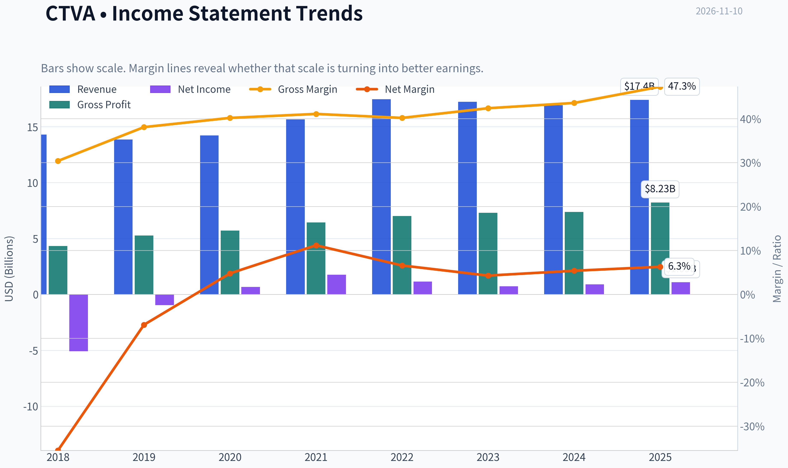

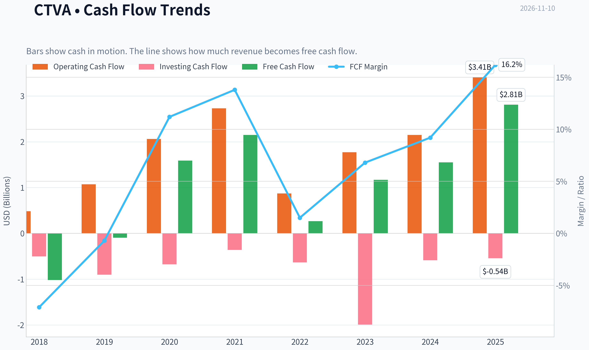

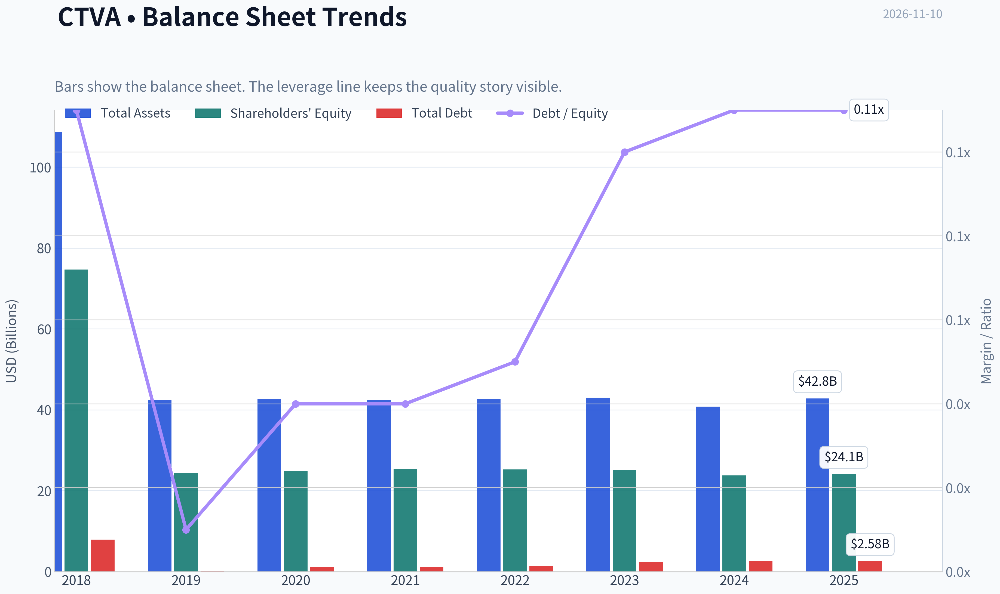

This graph tracks the profitability and return metrics (ROE, ROIC, Margins) of **CTVA** over the past decade, highlighting capital efficiency trends.

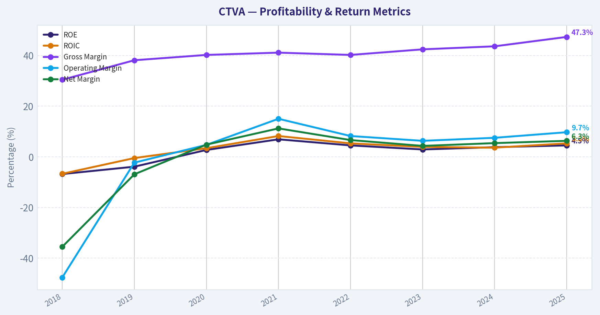

This chart illustrates the financial health of **CTVA** over the last 10 years, mapping cash equivalents and free cash flow against total obligations (Debt).

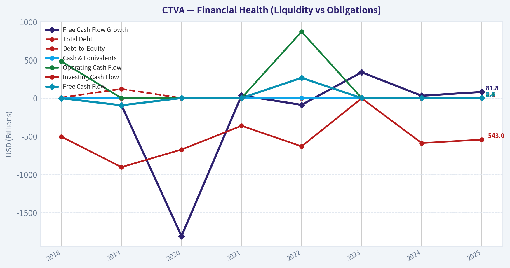

This comparison chart from *Profitability and Operating Performance* stacks current figures against historical benchmarks for **CTVA**, making it easy to see where the company trades relative to its own averages.

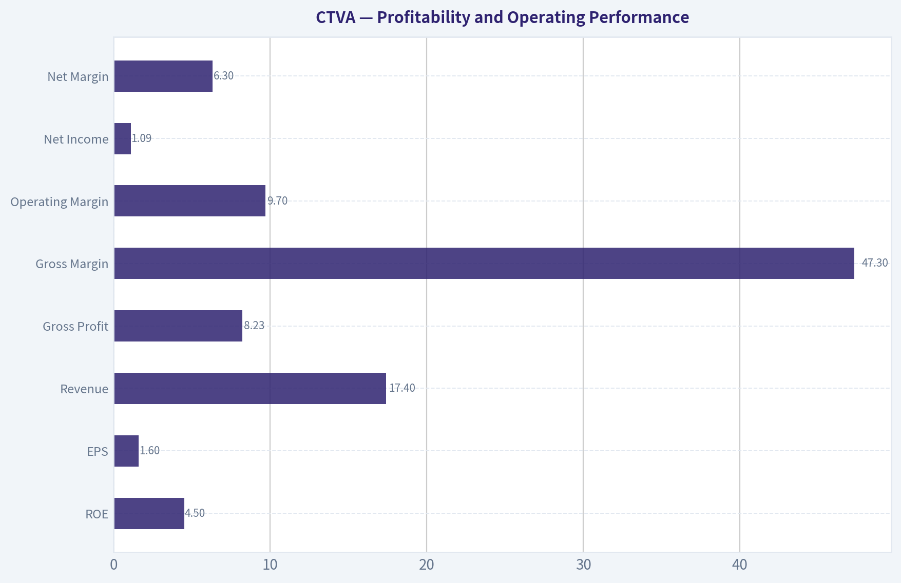

---

### Intrinsic Value Analysis (Buffett)

> *Following Warren Buffett's value investing philosophy: Circle of Competence, Economic Moat, Management Quality, and Margin of Safety.*

#### Intrinsic Value Snapshot

Price is what you pay. Intrinsic value is what the business may be worth based on the cash it can create for owners over time. We show a range, not one magic number.

- Current Price: $12.11
- Value Range (conservative to optimistic across both DCF methods): $9.95 to $374.94

##### Owner Earnings (Buffett Method)
- Net Income: $1,094,000,000.00
- Depreciation & Amortization: $1,203,000,000.00
- Capital Expenditures: $-591,000,000.00
- Working Capital Changes: $541,000,000.00
- Owner Earnings: $1,165,000,000.00

##### Intrinsic Value
###### Buffett Method
Uses owner earnings. Stricter, and usually more conservative.
- Conservative: $9.95
- Average: $64.36
- Optimistic: $163.03
- Discount Rate: 10.0%

###### Cash Flow Method
Uses free cash flow. Better for companies spending heavily today to grow tomorrow.
- Conservative: $82.85
- Average: $82.85
- Optimistic: $374.94
- Discount Rate: 10.0%

ANALYST STANCE: **Neutral**

#### Executive View

Corteva is a strategically important agricultural-input company with valuable seed genetics, crop-protection products, and intellectual property. At approximately **$12 per share**, the stock appears statistically inexpensive: the headline intrinsic value is **$31.91**, implying roughly **62% upside**. However, the business is cyclical, current returns on equity are modest, and the wide valuation spread between models signals that normalized earnings are difficult to estimate.

The stock is attractive on price but does not yet qualify as a high-conviction Buffett-style compounder. A stronger and more durable recovery in earnings and returns would be needed to move from **Neutral** to **Bullish**.

#### Factor Scorecard

| Factor | Score | Assessment |
|---|---:|---|
| 1. Circle of Competence & Simplicity | 3/5 | The model is understandable: Corteva sells seeds and crop-protection products to farmers. Long-term demand is durable, but earnings depend on crop cycles, farm economics, weather, regulation, and product launches. |
| 2. Durable Competitive Advantage | 3/5 | Seed genetics, patents, farmer relationships, regulatory approvals, and distribution create a meaningful moat. However, patents expire, agricultural markets are cyclical, and competitors such as Bayer, BASF, and Syngenta remain formidable. |
| 3. Management & Capital Allocation | 3/5 | The company operates in a complex industry with meaningful research and development requirements. Current evidence supports a neutral assessment rather than a high score because ROE is only 4.5% and the supplied information does not establish exceptional per-share capital allocation. |
| 4. Industry Structure | 3/5 | Agricultural inputs benefit from scale, intellectual property, and a concentrated competitive landscape, but demand is cyclical and product efficacy, regulation, and commodity conditions affect results. |

**Gate 5 hard floor:** **Not tripped.** The available evidence does not show both deteriorating fundamentals and a solvency red line. The low valuation, positive FCF yield, and 1.43 current ratio do not indicate obvious financial distress.

#### Moat Analysis

Corteva's strongest advantages are intangible assets and customer relationships.

- **Intangible assets:** Proprietary seed genetics, crop-protection formulations, patents, regulatory approvals, and established brands support pricing and distribution.
- **Switching costs:** Farmers do not face software-like lock-in, but changing seed varieties or crop-protection programs can involve yield risk, testing costs, and agronomic uncertainty.
- **Scale advantages:** Research, regulatory compliance, field testing, and global distribution require substantial scale. These are difficult for small entrants to replicate.
- **Network effects:** Network effects are limited. Corteva does not become dramatically more valuable simply because more farmers use its products.
- **Financial evidence:** Gross margin of **47.3%** supports the presence of differentiated products and intellectual property. However, ROE of **4.5%** indicates that the moat is not currently translating into exceptional shareholder returns.

Overall, the moat is best characterized as **narrow to moderately wide, but not clearly widening**. Its quality depends heavily on continued innovation and successful product replacement as patents mature.

#### Financial Summary

| Metric | Latest figure |
|---|---:|
| Share price | $12.00 |
| Market capitalization | $8.08 billion |
| P/E ratio | 7.5x |
| Revenue growth, year over year | 2.9% |
| Gross margin | 47.3% |
| ROE | 4.5% |
| FCF yield | 34.8% |
| Current ratio | 1.43 |
| Headline intrinsic value | $31.91 |
| Headline margin of safety | 62.0% |

**Key Takeaways:** Corteva trades at a low earnings multiple and produces a very high reported free-cash-flow yield. Gross margin is strong, but the 4.5% ROE shows that the business is not currently generating wonderful returns on equity. The combination points to a potentially underpriced cyclical recovery rather than a proven high-quality compounder.

#### Owner Earnings Calculation

The available figures imply approximately:

- Market capitalization: **$8.08 billion**
- Implied FCF: approximately **$2.81 billion**, based on the 34.8% FCF yield
- Implied shares outstanding: approximately **673 million**
- Implied FCF per share: approximately **$4.18**

A practical owner-earnings proxy is therefore:

| Owner-earnings component | Approximate amount |
|---|---:|
| Net income | Not separately provided |
| Add: depreciation and amortization | Included within the FCF proxy |
| Less: maintenance capital expenditures | Reflected in FCF |
| Less: working-capital investment | Reflected in FCF |
| Estimated owner earnings proxy | ~$2.81 billion |
| Owner earnings per share proxy | ~$4.18 |

**Key Takeaways:** The reported FCF yield implies unusually strong current owner earnings relative to the market value. Because Corteva is cyclical, the key question is whether roughly $2.8 billion represents sustainable normalized cash generation or a temporarily favorable point in the cycle. The model spread strongly suggests normalization is necessary.

#### Three-Scenario DCF Valuation

Using the reported FCF-based owner-earnings proxy of approximately **$4.18 per share**:

| Scenario | Method | Estimated value per share |
|---|---|---:|
| A. No growth | $4.18 divided by 10% | ~$41.80 |
| B. GDP growth | $4.18 x 1.03 divided by 7% | ~$61.50 |
| C. Normalized historical/cyclical case | Owner-earnings DCF reference | ~$64.36 |
| Research-pack headline value | Weighted cyclical blend | $31.91 |

**Key Takeaways:** A mechanical DCF based on current FCF produces values far above the $12 share price. However, Corteva's valuation models range from **$11.84 to $82.85**, demonstrating substantial sensitivity to the treatment of cyclical cash flows. The more conservative weighted headline value of $31.91 is therefore more useful than simply capitalizing the latest FCF.

#### Margin of Safety Analysis

| Measure | Result |
|---|---:|
| Current price | $12.00 |
| Headline intrinsic value | $31.91 |
| Upside to headline value | 166% |
| Margin of safety versus price | 62.0% |
| Damodaran FCFF value | $11.84 |
| Owner-earnings DCF value | $64.36 |
| FCF-based value | $82.85 |
| Reverse-DCF implied 10-year growth | Approximately -21.8% annually |

**Key Takeaways:** The headline valuation provides a substantial margin of safety, and the reverse DCF implies that the market is pricing in a severe decline in long-term cash generation. Yet the Damodaran FCFF estimate is close to the current share price, so the investment case depends on normalized earnings being materially better than the most pessimistic scenario. The discount is compelling, but not sufficiently reliable to justify an aggressive purchase without confirming the earnings recovery.

#### Management and Capital Allocation

Management receives a **3/5** assessment.

Positive considerations include:

- Operating in a business where research and development can create long-lived product franchises.
- A portfolio containing proprietary genetics and crop-protection technology.
- Potential for high returns when successful products gain adoption.

Concerns include:

- Current ROE of only **4.5%**, well below a Buffett-quality 15% to 20% target.
- Agricultural research and product development require continuing reinvestment.
- Cyclical cash flows make it difficult to distinguish sustainable owner earnings from peak-year results.
- The available evidence does not establish that repurchases, acquisitions, or other capital-allocation decisions have consistently increased intrinsic value per share.

The management case is acceptable but not yet exceptional.

#### Final Buffett Scorecard

| Criterion | Weight | Score | Weighted contribution |
|---|---:|---:|---:|
| Moat width and durability | 25% | 3.0 | 0.75 |
| Valuation and margin of safety | 20% | 4.5 | 0.90 |
| Capital returns versus WACC | 15% | 2.5 | 0.38 |
| Business understanding and predictability | 12% | 3.0 | 0.36 |
| Management and capital allocation | 12% | 3.0 | 0.36 |
| Reinvestment runway | 8% | 3.5 | 0.28 |
| Balance-sheet strength | 4% | 3.0 | 0.12 |
| Industry structure | 4% | 3.0 | 0.12 |
| **Total** | **100%** |  | **3.27/5.00** |

#### Investment Stance

**Neutral - Moderate conviction.**

At $12, Corteva appears materially below a reasonable normalized intrinsic-value range. The stock could offer an attractive contrarian opportunity if cash flows recover and the company converts its intellectual property into sustainably higher returns.

The principal limitation is quality, not price. Low ROE, agricultural cyclicality, product-patent risk, and the unusually wide DCF spread prevent a high-conviction endorsement. A sustained improvement in operating earnings, ROIC, and free cash flow-without materially higher leverage-would justify upgrading the stock to **Bullish**.
#### Valuation Bridge

This bridge places the current market price beside each intrinsic value lens so readers can see whether upside depends on one method or shows up across several methods.

| Scenario | Intrinsic Value / Share |
| --- | ---: |
| Buffett Method | $64.36 |
| Cash Flow Method | $82.85 |
| Damodaran Method | $11.84 |
| Current Price | $12.11 |

#### Key Takeaways

If one method is far above the others, the upside case depends on a specific modelling assumption. When several methods cluster together, the valuation story is more robust.

#### Valuation Visuals

This comparison chart from *Latest Earnings Snapshot* stacks current figures against historical benchmarks for **CTVA**, making it easy to see where the company trades relative to its own averages.

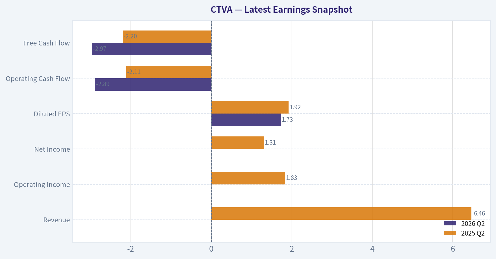

This comparison chart from *Balance Sheet and Financial Strength* stacks current figures against historical benchmarks for **CTVA**, making it easy to see where the company trades relative to its own averages.

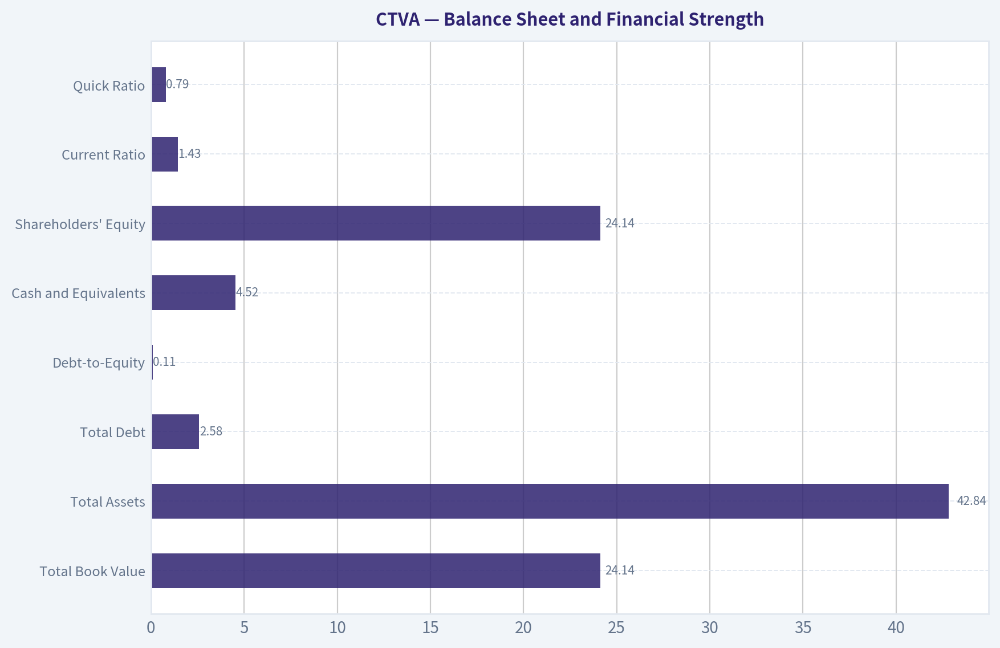

This comparison chart from *Cash Flow and Capital Allocation* stacks current figures against historical benchmarks for **CTVA**, making it easy to see where the company trades relative to its own averages.

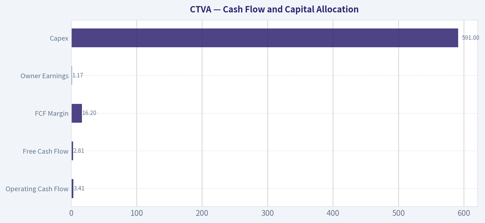

---

### Trend & Growth Analysis (Lynch/Druckenmiller/Fisher)

> *Following Peter Lynch's GARP, Stanley Druckenmiller's macro-aware approach, and Philip Fisher's scuttlebutt methodology.*

ANALYST STANCE: **Neutral**

#### 1. Lynch Classification

**Corteva (CTVA) is best classified as a cyclical, with stalwart-like growth characteristics-not a fast grower.**

Revenue growth of only **2.9% year over year** is below the 15-25% threshold required for a primary growth investment. Its low valuation and high free-cash-flow yield may offer value, but the investment case depends more on an agricultural-cycle recovery, pricing, and margins than on secular hypergrowth.

#### 2. The Story in Three Bullets

- Corteva sells seeds and crop-protection products, essential inputs that help farmers improve yields.
- Its brands, germplasm, distribution, and research capabilities create meaningful competitive advantages and customer relationships.
- At approximately **7.5 times earnings** and a **34.8% FCF yield**, the market appears to price CTVA as a mature or challenged cyclical business rather than a growth company.

#### 3. Key Financial Snapshot

| Metric | CTVA |
|---|---:|
| Current price | $12.00 |
| Market capitalization | $8.08 billion |
| Revenue growth, year over year | 2.9% |
| P/E ratio | 7.5x |
| Gross margin | 47.3% |
| ROE | 4.5% |
| FCF yield | 34.8% |
| Current ratio | 1.43 |
| Headline intrinsic value | $31.91 |
| Headline margin of safety | 62.0% |

**Key Takeaways:** CTVA is inexpensive on earnings and free cash flow, with a headline intrinsic-value estimate substantially above the current price. However, the low ROE and modest revenue growth suggest that the discount reflects weak growth, cyclical risk, or uncertainty around normalized earnings.

#### 4. TAM Analysis and the 10x Test

Corteva participates in large global markets for commercial seeds, crop protection, and agricultural productivity. The broad agricultural-input opportunity is large enough that a 10-times increase in CTVA's current market capitalization-from approximately **$8.1 billion to $80.8 billion**-would not automatically imply market saturation.

| TAM Question | Assessment |
|---|---|
| Is the end market large enough for substantial growth? | Yes |
| Is the TAM expanding rapidly? | Likely moderate, supported by food demand, yield improvement, and climate pressure; not demonstrated here as a 15%+ growth market |
| Can CTVA grow 10x without exceeding 20% market share? | Plausibly yes in the broad market, but not established from the available data |
| Is CTVA currently showing rapid share gains? | Not demonstrated |
| Primary TAM constraint | Agriculture is cyclical, weather-sensitive, regulated, and dependent on farmer economics |

**Key Takeaways:** Corteva has a substantial runway in absolute market size, but a large TAM alone does not make it a fast grower. The key missing evidence is accelerating market share, sustained volume growth, and proof that new seed or crop-protection products can materially expand the company's growth rate.

#### 5. Revenue Growth Trend

| Indicator | Result | Interpretation |
|---|---:|---|
| Latest year-over-year revenue growth | 2.9% | Slow-growth profile |
| Growth classification | Below fast-grower threshold | Not currently a Lynch fast grower |
| Acceleration evidence | Insufficient | No verified multi-period acceleration |
| Revenue quality | Not fully available | Need volume, price, mix, and acquisition detail |

**Key Takeaways:** The available revenue figure points to a slow or stable-growth business rather than an inflection-stage company. A single quarter should not determine the thesis, but CTVA needs several periods of accelerating organic growth before it can be considered a high-conviction growth investment.

#### 6. Unit Economics and Profitability

| Measure | CTVA | Assessment |
|---|---:|---|
| LTV/CAC | Not disclosed in available data | Not applicable in the conventional SaaS sense |
| Net revenue retention | Not applicable | Product-based agricultural business |
| Rule of 40 | Not applicable | Not a subscription model |
| Gross margin | 47.3% | Solid, but does not by itself establish operating leverage |
| ROE | 4.5% | Weak relative to an outstanding growth company |
| FCF yield | 34.8% | Extremely attractive if cash flow is sustainable through the cycle |

**Key Takeaways:** Traditional SaaS metrics such as NRR and LTV/CAC are not useful for CTVA. The strongest financial metric is the high free-cash-flow yield, while the weak ROE raises questions about capital efficiency and normalized profitability.

#### 7. Inflection-Point Assessment

| Potential Inflection | Current Evidence | Verdict |
|---|---|---|
| New-product cycle | Seed and crop-protection innovation are central to the model | Possible, not confirmed |
| Market-share inflection | No verified evidence provided | Unproven |
| Margin inflection | Gross margin is 47.3%; trend unavailable | Unproven |
| TAM inflection | Food security and productivity are durable themes | Moderate |
| Competitive inflection | No confirmed major competitor disruption | Unproven |
| Earnings inflection | Very low valuation may anticipate depressed earnings | Possible cyclical rebound |

**Key Takeaways:** CTVA's potential upside is primarily a normalization or cyclical-recovery thesis, not a confirmed growth inflection. The most important evidence to monitor is accelerating organic sales, improved crop-protection pricing, seed-product adoption, and margin recovery.

#### 8. Macro Setup

The macro backdrop is mixed:

- **Positive:** Long-term food demand, limited arable land, agricultural productivity requirements, and climate variability support investment in higher-yield seeds and crop protection.
- **Negative:** Farm income, commodity prices, inventories, weather, interest rates, and global trade can sharply affect purchasing decisions.
- **Druckenmiller assessment:** CTVA is highly exposed to the economic and agricultural cycle. It may benefit from an improving farm-income cycle, but it is not a clean secular-growth compounder.

The low price may already discount significant pessimism. However, the reverse-DCF data reportedly implies approximately **negative 21.8% annual growth for ten years**, indicating a very depressed market expectation-but also highlighting that investors may be concerned about structurally lower future cash flows.

#### 9. Fisher 15-Point Assessment

The score below is provisional because detailed management commentary, R&D productivity, customer feedback, employee relations, and dilution history were not provided.

| Fisher Dimension | Score / 5 |
|---|---:|
| Market potential | 4 |
| Commitment to new products | 4 |
| R&D effectiveness | 3 |
| Sales organization | 3 |
| Profit margins | 3 |
| Margin improvement | 2 |
| Labor and personnel relations | 3 |
| Executive relations | 3 |
| Management depth | 3 |
| Cost analysis and accounting | 3 |
| Competitive advantages | 4 |
| Long-range profit outlook | 3 |
| Dilution risk | 3 |
| Management candor | 3 |
| Management integrity | 3 |
| **Total** | **47 / 75** |

**Key Takeaways:** The provisional Fisher score of 47 places CTVA in the average category, not the outstanding category. Its strongest points are market size, agricultural intellectual property, and product-development potential; its weakest areas are limited evidence of margin improvement and insufficient evidence of accelerating growth.

#### 10. Valuation Analysis

| Valuation Method | Result | Interpretation |
|---|---:|---|
| P/E | 7.5x | Low |
| PEG using revenue growth as proxy | Approximately 2.6x | Not attractive under Lynch's framework |
| FCF yield | 34.8% | Very inexpensive if sustainable |
| Headline intrinsic value | $31.91 | About 166% above the $12 price |
| Owner-earnings estimate | $64.36 | Highly sensitive to normalization assumptions |
| FCF-based estimate | $82.85 | Highly sensitive to cyclical cash-flow sustainability |
| Damodaran FCFF estimate | $11.84 | Close to current price and materially more conservative |

The three valuation models range from approximately **$11.84 to $82.85**, an unusually wide spread. This means the primary risk is not that CTVA is expensive; it is that current cash flows may not represent sustainable mid-cycle earnings.

**Key Takeaways:** CTVA appears statistically cheap, but the valuation range shows substantial model risk. The stock offers considerable upside if cash flows normalize, while the conservative FCFF valuation suggests limited margin of safety if the business remains structurally weak.

#### 11. Growth Investor Scorecard

| Criterion | Weight | Score / 5 |
|---|---:|---:|
| The story | 10% | 3.5 |
| TAM and runway | 20% | 3.5 |
| Revenue growth | 20% | 2.0 |
| Unit economics | 15% | 3.0 |
| Competitive position | 10% | 4.0 |
| Management quality | 10% | 3.0 |
| Macro setup | 5% | 2.5 |
| Profitability path | 5% | 3.0 |
| Valuation | 5% | 4.5 |
| **Weighted score** | **100%** | **3.0 / 5.0** |

**Key Takeaways:** CTVA scores well on valuation and competitive positioning but poorly on current growth and macro sensitivity. The resulting 3.0 score supports a Neutral stance rather than an aggressive growth-investment recommendation.

#### 12. Position Size Stance

**Recommended stance: Watch position only; no aggressive initiation.**

For a diversified portfolio, CTVA could justify a **small 1-2% position** for investors specifically seeking undervalued cyclical or agricultural exposure. It does not currently justify a concentrated growth position because revenue growth is too slow and the earnings outlook is too dependent on normalization assumptions.

#### 13. Catalysts and Risks

| Catalysts | Risks |
|---|---|
| Revenue growth reaccelerates above 10-15% | Revenue growth remains near 0-5% |
| New seed products gain adoption | Weak farm income reduces input demand |
| Crop-protection pricing and volumes improve | Commodity-price or inventory downturn |
| Gross and operating margins expand | Cash flow proves above normalized levels |
| Buybacks or capital returns at depressed valuation | Weather, regulation, trade, or geopolitical disruption |
| Market recognizes normalized earnings power | High valuation-model sensitivity |

**Key Takeaways:** The most important catalyst is evidence that CTVA can grow organically while expanding margins, not merely that the stock is cheap. The principal risk is a value trap in which the high free-cash-flow yield reflects temporarily inflated or unsustainable cash generation.

#### Final Conclusion

CTVA is an **inexpensive agricultural-input cyclical with meaningful asset and franchise quality**, but it is not presently a compelling fast-growth stock. The valuation creates an attractive asymmetric setup if earnings and cash flow normalize, yet the weak revenue growth, low ROE, and broad valuation-model dispersion require patience and confirmation.

The investment would become materially more attractive if the next several reporting periods show:

1. Organic revenue acceleration;
2. Improved seed and crop-protection volumes;
3. Sustained or expanding margins; and
4. Cash flow remaining strong through a normalized agricultural cycle.

Until then, CTVA belongs on the **Neutral** list as a potential value-recovery opportunity rather than a ten-bagger growth candidate.

#### Growth & Scorecard Visuals

This comparison chart from *Growth Metrics* stacks current figures against historical benchmarks for **CTVA**, making it easy to see where the company trades relative to its own averages.

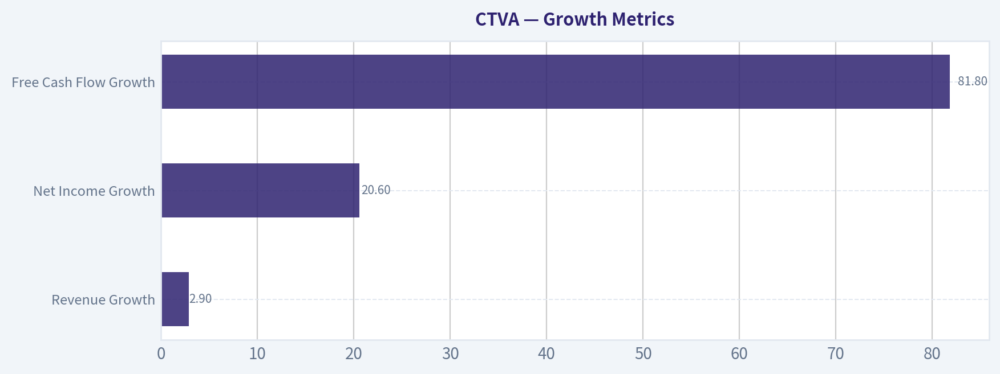

---

### Market Technical Analysis

ANALYST STANCE: **Neutral**

#### CTVA technical overview

The latest available trading session is **November 9, 2026**, when CTVA closed at **$12.11**. November 10 is not represented as a trading session in the retrieved data, so the analysis uses November 9 as the effective reference date.

CTVA's technical picture is best described as a **short-term rebound inside a damaged medium-term trend**. The stock has recovered from the late-October low near $11.33, but it remains below the declining 50-day SMA and has not yet demonstrated a decisive return to a sustained uptrend. The October 1 stock split and the unusually large trading volumes around early October also make recent price behavior more event-driven than normal.

#### Selected indicators

The most relevant complementary indicators are:

- **close_10_ema** - short-term price momentum and near-term support.
- **close_50_sma** - medium-term trend direction and resistance.
- **close_200_sma** - long-term trend benchmark.
- **macd** - momentum direction and possible trend reversal.
- **rsi** - momentum strength and oversold/overbought context.
- **boll_ub** and **boll_lb** - volatility envelope, potential breakout, and support/resistance zones.
- **atr** - volatility-aware risk management and stop placement.

These indicators combine trend, momentum, volatility, and risk information without relying on several redundant oscillators.

#### Trend structure

The short-term trend has improved modestly. CTVA closed at **$12.11**, above the 10-day EMA of approximately **$12.03** on November 9. This indicates that the recent bounce from the October 28-29 area has produced some immediate-term buying pressure. However, the margin is narrow-only about eight cents-so the stock is not far enough above the EMA to establish strong short-term control.

The medium-term trend remains weaker. The 50-day SMA was approximately **$12.49** on November 9, placing the stock roughly **3% below** that average. More importantly, the 50-day SMA has been declining gradually from approximately $12.67 in mid-October to $12.49 recently. This downward slope suggests that the broader recovery has not yet repaired the prior breakdown.

The 200-day SMA was approximately **$12.09** on November 6 and had been rising slowly. CTVA's November 9 close of $12.11 was only marginally above that level. This creates an important technical pivot: holding above roughly $12.05-$12.10 would preserve a constructive long-term interpretation, while a sustained move below it would signal that the recent bounce may be failing at the long-term trend benchmark.

#### Momentum analysis

MACD momentum has improved materially from late October, but it remains negative. MACD declined from approximately **+0.20 on October 19** to around **-0.26 on October 30**, reflecting a sharp loss of momentum during the selloff. It then improved to approximately **-0.21 by November 6**.

This is a meaningful improvement in the rate of change, but not yet a confirmed bullish reversal. A negative MACD that is rising generally indicates that bearish momentum is fading; it does not necessarily mean that an established uptrend has begun. Stronger confirmation would require MACD to cross above its signal line and preferably move back above zero while price reclaims the 50-day SMA.

RSI also shows recovery from weak levels. RSI reached approximately **35 on October 28**, near-but not technically below-the conventional oversold threshold of 30. It subsequently rose into the mid-to-upper 40s, reaching about **44.5 on November 6**. This indicates that downside momentum has moderated, but RSI remains below the neutral 50 level. The reading is therefore consistent with **relief buying rather than confirmed bullish momentum**.

#### Volatility and price levels

The Bollinger Bands show that volatility remains elevated, although it has contracted from the extreme conditions surrounding the October selloff. On November 6, the upper band was approximately **$13.68**, while the lower band was near **$11.07**. This wide range reflects substantial residual volatility following the sharp price dislocation in early October.

The lower Bollinger Band near $11.07 provides a broad downside reference, but it should not be treated as precise support. The more immediate support zone is around **$11.60-$11.90**, corresponding to the recent consolidation and rebound area. A break below $11.60 would weaken the recovery and expose the stock to a retest of the late-October low near $11.33.

On the upside, the first meaningful resistance is the **$12.30-$12.50 region**, where recent price congestion intersects with the declining 50-day SMA. A decisive close above $12.50, ideally supported by stronger volume, would improve the medium-term structure. The next potential resistance area would be approximately **$12.85-$13.00**, followed by the October recovery highs in the $13.30-$13.40 area.

ATR was approximately **$0.53** on November 9. Relative to the $12.11 share price, that represents daily volatility of roughly **4.4%**, which is high enough that tight stops may be vulnerable to ordinary price fluctuations. Position sizing should therefore be conservative, and stop placement should account for the stock's elevated trading range rather than being placed immediately below a single day's low.

#### Trading interpretation

The evidence supports a **watchlist or confirmation-based approach**, rather than an aggressive directional commitment.

A bullish setup would require several developments to occur together:

1. Price holds above the $12.00-$12.10 area.
2. CTVA reclaims the $12.30-$12.50 resistance zone.
3. The 10-day EMA remains above-or begins to turn decisively above-the current price.
4. MACD continues rising and crosses its signal line.
5. RSI moves above 50 without immediately reversing.
6. The breakout is accompanied by sustained volume rather than a one-day spike.

A bearish continuation signal would be generated by a close below approximately $11.60, especially if RSI turns back toward the mid-30s and MACD rolls over again. A break of the late-October low near $11.33 would invalidate the current rebound structure and suggest that the long-term moving-average support has failed.

The key risk is that the apparent improvement in short-term momentum may simply be a technical bounce after the October breakdown. Conversely, the key opportunity is that CTVA is attempting to stabilize near the 200-day SMA while short-term momentum is recovering. At present, neither interpretation has been decisively confirmed.

| Area | Latest indication | Technical interpretation | Trader focus |
|---|---:|---|---|
| Latest close | $12.11 on Nov. 9 | Rebound has held near the long-term trend area | Monitor whether price remains above $12.00-$12.10 |
| 10-day EMA | $12.03 | Price is slightly above short-term average | Near-term momentum is improving, but the margin is small |
| 50-day SMA | $12.49 | Price remains below a declining medium-term average | $12.30-$12.50 is the first major recovery hurdle |
| 200-day SMA | About $12.09 | Price is only marginally above long-term trend support | A sustained break below this area would weaken the structure |
| MACD | About -0.21 on Nov. 6 | Improving from a deeply negative reading but still bearish overall | Look for a signal-line crossover and movement toward zero |
| RSI | About 44.5 on Nov. 6 | Recovered from weak conditions but remains below neutral | Above 50 would improve confirmation; below 40 would warn of renewed weakness |
| Bollinger Bands | Roughly $11.07 to $13.68 on Nov. 6 | Volatility remains elevated | Use zones, not exact levels; avoid overly tight stops |
| ATR | About $0.53 | Daily price movement remains large relative to share price | Adjust position size and stop distance accordingly |
| Key support | $11.60-$11.90; then $11.33 | Loss of these levels would undermine the rebound | Watch for selling pressure on any move below $11.60 |
| Key resistance | $12.30-$12.50; then $12.85-$13.00 | Reclaiming these zones would improve the trend profile | Prefer confirmation through closing price and volume |

**Key Takeaways:** CTVA is showing a short-term rebound, but the stock remains below its declining 50-day average and its momentum indicators are not yet decisively bullish. The $12.00-$12.10 area is the critical support zone, while $12.30-$12.50 is the first major confirmation hurdle. Traders should watch for a sustained breakout above that resistance or a renewed breakdown below $11.60, while accounting for elevated volatility and the October split-related price distortion.

#### Market Visuals

This comparison chart from *Market Metrics* stacks current figures against historical benchmarks for **CTVA**, making it easy to see where the company trades relative to its own averages.

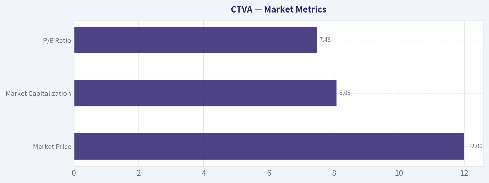

---

### Options Market Analysis

> *Reading options flow - put/call ratios, IV skew, and unusual activity - to gauge institutional positioning and event-driven risk.*

#### CTVA Options Market Report

*Data as of November 10, 2026. The supplied options feed does not include CTVA's current share price, strike-level open interest, or a valid put-side implied volatility reading. Those limitations reduce confidence in the analysis.*

#### 1. Put/Call Ratio Analysis

| Expiration | Approx. Days to Expiry | Call OI | Put OI | Put/Call OI | Call Volume | Put Volume | Put/Call Volume |
|---|---:|---:|---:|---:|---:|---:|---:|
| Nov. 20, 2026 | 10 | 1,228 | 363 | 0.30 | 114 | 453 | 3.97 |
| Dec. 18, 2026 | 38 | 1,689 | 1,958 | 1.16 | 321 | 286 | 0.89 |
| Mar. 19, 2027 | 129 | 2,105 | 537 | 0.26 | 582 | 39 | 0.07 |
| **Total** | - | **5,022** | **2,858** | **0.57** | **1,017** | **778** | **0.76** |

**Key Takeaways:** CTVA's aggregate put/call open-interest ratio of 0.57 is below the approximately 0.70 neutral baseline, indicating a call-heavy positioning profile. However, the nearest November expiration has substantially more put volume than call volume, suggesting short-dated hedging or bearish trading activity. The longer-dated March positioning is strongly call-heavy and is the main reason the overall ratio appears bullish.

The December expiration is the most balanced segment, with a put/call OI ratio of 1.16. This may represent concentrated downside protection or simply a larger existing put position rather than aggressive new bearish buying.

#### 2. Implied Volatility Assessment

| Expiration | Call ATM IV | Put ATM IV | Interpretation |
|---|---:|---:|---|
| Nov. 20, 2026 | 6.3% | 0.0% | Call IV is low; put IV likely missing or unreliable |
| Dec. 18, 2026 | 3.1% | 0.0% | Very low displayed volatility; put value is unusable |
| Mar. 19, 2027 | 1.6% | 0.0% | Extremely low displayed volatility; likely data-quality limitation |

**Key Takeaways:** Reported call IV is exceptionally low, declining from 6.3% in the nearest expiry to 1.6% in March. The repeated 0.0% put IV readings are not economically credible and should be treated as missing data rather than evidence that puts have no volatility premium. A reliable put-versus-call skew assessment cannot be made from this feed.

There is no catalyst calendar in the supplied data, so it is not possible to confirm whether volatility is being priced around earnings, a corporate event, or another known catalyst. Based on the displayed call IV alone, the market is not signaling elevated near-term event risk.

#### 3. Unusual Options Activity

The data provider defines unusual activity as contracts with volume greater than five times open interest. No contracts met that threshold.

| Finding | Assessment |
|---|---|
| Contracts with volume greater than 5x OI | None |
| Fresh directional institutional bets | No clear evidence |
| Retail speculation signal | No clear evidence |
| Near-term put activity | Elevated in aggregate, but not confirmed as fresh opening trades |

**Key Takeaways:** There are no statistically unusual contracts that can be identified as fresh, high-conviction directional bets. The November put volume is notable, but without contract-level volume, open interest changes, trade direction, or order-type information, it cannot be confidently classified as smart-money put buying. Overall, the options flow lacks a strong institutional conviction signal.

#### 4. Open Interest Concentration and Potential Gamma Levels

| Expiration | Highest Reported Call OI | Highest Reported Put OI | Concentration Assessment |
|---|---:|---:|---|
| Nov. 20, 2026 | 1,228 total calls | 363 total puts | Call-heavy near-term positioning |
| Dec. 18, 2026 | 1,689 total calls | 1,958 total puts | Largest put concentration by expiration |
| Mar. 19, 2027 | 2,105 total calls | 537 total puts | Largest call concentration by expiration |
| **All listed expirations** | **5,022 calls** | **2,858 puts** | **Net call-heavy** |

**Key Takeaways:** March 2027 contains the largest call open interest, while December 2026 contains the largest put open interest. This creates a longer-dated bullish bias but a potentially defensive December positioning pocket. Strike-level open-interest data was not provided, so exact gamma walls, maximum-pain strikes, and likely price-pinning levels cannot be identified.

#### 5. Overall Options Sentiment Signal

**Overall signal: BULLISH, with low-to-moderate confidence.**

The primary bullish driver is the aggregate put/call OI ratio of 0.57, substantially below the 0.70 neutral reference point. March 2027 is particularly call-heavy, with 2,105 calls versus only 537 puts, while November also has a call-heavy open-interest structure.

The main caveat is the near-term flow: November put volume is almost four times call volume. That points to short-term hedging or bearish speculation and could produce near-term pressure despite the more constructive longer-dated positioning. The absence of unusual contracts, missing current-price information, unavailable strike concentration, and unreliable put IV readings materially reduce confidence.

#### Summary

| Category | Assessment |
|---|---|
| Put/Call Ratio | **Bullish overall:** OI ratio 0.57 versus approximately 0.70 neutral; near-term November put volume is defensive |
| IV Level | **Very low as reported, but questionable:** put IV readings of 0.0% indicate missing or unreliable data |
| Skew Direction | **Unavailable:** valid OTM put and call IV data was not supplied |
| Unusual Activity | **None detected:** no contract exceeded 5x its open interest |
| Overall Signal | **BULLISH, low-to-moderate confidence:** longer-dated call concentration outweighs near-term put-heavy volume |

**Key Takeaways:** CTVA's options positioning leans bullish because call open interest dominates, especially in March 2027. Near-term put activity is a meaningful caution flag, but it is not confirmed as fresh institutional bearish positioning. The signal is therefore bullish rather than strongly bullish, with reduced confidence because of thin-looking activity and incomplete volatility and strike-level data.

---

## Research Team Commentary

> *The Research Manager synthesizes the Bull vs Bear debate into action-free commentary. This is a pre-risk view, not the final stance.*

Core takeaway: Corteva may be a compelling value opportunity, but the evidence is not reliable enough to commit capital. The franchise has legitimate competitive assets-proprietary genetics, regulatory approvals, established brands, R&D scale, and global distribution-but its 5.4% ROIC does not yet demonstrate Buffett-quality economics. More importantly, the quoted price, earnings multiple, and free-cash-flow yield fail a basic consistency check. My stance is Neutral rather than Bullish or Bearish.

The bull's strongest point is the reverse valuation. At $12.11, the reported 7.48 times P/E implies roughly $1.62 of earnings per share. The market price would require only about $1.21 of sustainable annual owner earnings to generate a 10% return with no growth. If $1.62 is genuinely normalized and cash-backed, Corteva would not need heroic growth to deliver attractive returns. The business also serves an enduring need: farmers must improve yields and protect crops, while genetics, field data, patents, approvals, and distribution are costly and time-consuming to reproduce. The 47.3% gross margin supports the view that these are differentiated products rather than pure commodities.

The bear's strongest point is that none of the valuation anchors has been adequately verified. A 34.8% free-cash-flow yield implies approximately $4.21 of FCF per share, about 2.6 times the EPS implied by the P/E. That could reflect a temporary working-capital release, unusually low capital expenditure, asset sales, or mismatched reporting periods. It cannot be treated as recurring owner earnings. Substituting EPS into the DCF does not fully solve the problem because R&D and regulatory spending may partly represent maintenance investment needed to replace expiring patents and products losing effectiveness.

The low returns on capital are equally important. ROIC of 5.4%, ROE of 4.5%, and ROA of 2.6% are weak, potentially below the cost of capital. Corteva's gross margin shows product-level differentiation, but the company must still fund substantial research, commercialization, regulatory compliance, and distribution. A durable moat should eventually appear in attractive total capital returns, not merely in a list of intellectual properties and approvals. Farmers also can switch suppliers, and Corteva competes against other well-funded agricultural science companies. This is a renewable innovation moat, not a toll road.

From a value perspective, the conditional $23 base-case valuation is interesting but has a wide error range. The approximately $12 adverse-case value assumes $1.20 of sustainable owner earnings with no growth. Since that is roughly equal to the quoted share price, it provides no discount to the adverse case. Given Corteva's cyclicality, low current ROIC, uncertain cash conversion, and unverified balance sheet, I would require a wider margin of safety than I would for a proven high-ROIC compounder. The stock may offer that margin relative to the $23 base case, but only if the starting earnings are real and repeatable.

The selective contrarian opportunity is therefore not simply that agricultural sentiment may be weak. It is that the market may be pricing a durable franchise as if earnings will remain permanently impaired. But contrarianism is justified only after establishing that the apparent valuation is not a stale-price, period-mismatch, or working-capital artifact. Sometimes a suspiciously low multiple reflects fear; sometimes it reflects faulty inputs. The current evidence does not distinguish between those possibilities.

Management also remains unproven. There is insufficient information to call its capital allocation either poor or exceptional. The relevant test is whether management can lift incremental ROIC above the cost of capital while maintaining product competitiveness. Buybacks would be highly accretive at the stated valuation only if they reduce the fully diluted share count and are funded without weakening the balance sheet.

Over the next one to four quarters, I would first verify the live share price, diluted share count, and earnings period directly against company filings. I would reconcile net income with operating cash flow and free cash flow, separating inventory and receivables movements, asset sales, tax timing, restructuring costs, and normalized capital expenditure. A multiyear cash-conversion analysis is more important than one quarter's FCF yield.

I would then monitor adjusted and unadjusted ROIC, segment operating margins, pricing versus volume, channel inventories, and R&D productivity. The thesis would strengthen if cash flow consistently tracks earnings, working-capital benefits prove repeatable or reverse without damaging FCF, and ROIC moves sustainably above the cost of capital. Successful new seed traits or crop-protection launches, stable market share, and resilient pricing would provide evidence that the moat is producing economic returns.

The thesis would weaken if earnings depend on channel loading, if farmer pressure causes discounting or trading down, if R&D rises merely to preserve revenue, or if regulatory losses and patent expirations outpace pipeline replacements. Net debt, interest coverage, maturities, litigation, environmental liabilities, pension obligations, and acquisition spending must also be reviewed. A weak balance sheet combined with deteriorating operating results would move the stock toward Bearish.

The lesson from prior mistakes is to analyze current market conditions and primary fundamental data before trusting an attractive headline multiple. Here, patience is not excessive conservatism. It is recognition that the apparent upside is substantial but cannot yet be separated from data risk. If the $12.11 price, at least $1.20-$1.60 of normalized owner earnings, and a sound balance sheet are confirmed-and ROIC shows a credible upward path-the shares could quickly merit Bullish. Until then, the business is promising, the valuation is conditionally attractive, and the evidence is incomplete.

Neutral

---

## Value Investing Team Commentary

> *The Investor translates the research view into an investment thesis before risk review. This is still not the final stance.*

### Investment Commentary

Corteva appears to own a better business than its reported returns on capital currently suggest. Proprietary germplasm, seed genetics, crop-protection formulations, regulatory approvals, field data, brands, and global distribution create genuine barriers to entry. Farmers are not contractually locked in, but changing products can introduce yield and execution risk. That gives Corteva some pricing power and customer retention, although its moat must be renewed continually through successful research and commercialization.

The essential agricultural need is durable: farmers must increase yields and protect crops despite constrained acreage, changing pest resistance, weather volatility, and rising input costs. Nevertheless, necessity at the industry level does not guarantee superior economics for every supplier. Corteva competes with other well-capitalized agricultural-science companies, and innovation failures, patent expirations, regulation, commodity cycles, and farmer affordability can all absorb the value created by its attractive gross margins.

### The valuation looks exceptional-but may not be real

The supplied figures fail a basic reconciliation:

- A price of **$12.11** and P/E of **7.48** imply EPS of approximately **$1.62**.
- A **34.8% free-cash-flow yield** implies FCF per share of approximately **$4.21**.
- Thus, reported FCF would be roughly **2.6 times implied EPS**.

Such a divergence is possible for one year, especially in a seasonal working-capital business, but it is unlikely to represent normalized owner earnings without a clear explanation. Inventory liquidation, receivable collection, tax timing, restructuring, unusually low capital expenditure, or asset-sale proceeds could inflate cash flow temporarily. Conversely, accounting charges might suppress earnings. Until the periods, share count, and cash-flow definitions are reconciled, neither the P/E nor the FCF yield is a dependable valuation anchor.

The quoted share price itself also requires confirmation against a primary source. A stale quote, adjusted historical price, corporate-action error, or mismatched security could make the entire apparent opportunity illusory. The options data cannot provide corroboration because it lacks a reliable underlying price, strike-level positioning, and valid put-side volatility. Likewise, technical indicators offer no information when only their names-not their values-are supplied.

### Business quality is promising, not yet Buffett-grade

The **47.3% gross margin** supports the existence of differentiated products. But the reported **5.4% ROIC, 4.5% ROE, and 2.6% ROA** are weak. If normalized and calculated consistently, these returns may be below Corteva's cost of capital.

That distinction matters. Intellectual property and regulatory approvals are evidence of barriers, but not proof that shareholders capture attractive returns from them. Corteva must continuously spend on research, trials, approvals, manufacturing, and distribution merely to replace products that lose patent protection, regulatory approval, or biological effectiveness. Some R&D therefore resembles maintenance investment even though accounting rules expense it immediately.

The key question is not whether Corteva has a moat in a descriptive sense. It is whether that moat can produce:

1. Sustained pricing at or above input-cost inflation;
2. Stable or increasing market share;
3. Successful replacement of aging products;
4. Strong cash conversion across a complete agricultural cycle; and
5. Incremental ROIC comfortably above the cost of capital.

Until those outcomes appear, Corteva should be treated as an average-to-good cyclical franchise rather than a proven high-return compounder. Under a quality-scaled margin-of-safety framework, that warrants approximately a **25%-35% discount** to a conservatively established intrinsic value, not merely a fair price.

### Conditional valuation

If normalized owner earnings truly equal **$1.20-$1.60 per share**, a $12.11 purchase price would be attractive. At $1.21 of annual owner earnings, an investor would receive approximately a 10% starting owner-earnings yield before growth. Modest, durable growth could then produce satisfactory long-term returns.

The proposed **$23 base-case value** would imply a roughly 47% discount at the quoted price, more than enough for a business of Corteva's current quality. But the approximately **$12 adverse value** is equally important: the current quote offers virtually no discount to that scenario. The investment therefore depends heavily on establishing that normalized earnings are closer to the upper end of the range and that the balance sheet contains no material hidden claims.

A probability-weighted valuation also should penalize data uncertainty. This is not merely ordinary forecasting risk; it is uncertainty over whether the starting financial inputs describe the same security and reporting period. A large apparent discount cannot compensate for an unverified denominator.

### Selective contrarian interpretation

The contrarian thesis is plausible: agricultural weakness, farmer caution, channel destocking, or concern over crop-protection regulation may cause investors to extrapolate temporary pressure indefinitely. If Corteva retains pricing power, replaces expiring products, and converts earnings into cash, pessimism could create an unusually favorable entry point into a durable agricultural franchise.

But there is no virtue in being contrarian to faulty data. A single-digit P/E and unusually high FCF yield can indicate excessive fear, but they can also arise from cyclically elevated earnings, temporary working-capital inflows, stale market data, or inconsistent periods. The absence of usable options and technical information means there is no reliable evidence here that market sentiment is genuinely capitulating.

The market may be missing Corteva's long-lived genetics, brands, regulatory infrastructure, and distribution advantages. Alternatively, it may correctly recognize that a renewable innovation moat requires substantial reinvestment and has not yet generated attractive returns on total capital. The current bundle does not distinguish convincingly between those interpretations.

### What would justify an investment

Before committing capital, I would require:

- Verification of the live share price, diluted share count, and relevant earnings period;
- A three-to-five-year reconciliation of net income, operating cash flow, and free cash flow;
- Normalization of working capital, restructuring charges, asset sales, taxes, and capital expenditure;
- ROIC calculated both as reported and with appropriate treatment of acquired intangibles and R&D;
- Segment-level evidence on pricing, volume, margins, market share, and channel inventories;
- Review of net debt, interest coverage, maturities, pensions, litigation, and environmental liabilities;
- Evidence that new products are replacing patent expirations and regulatory losses; and
- Capital allocation that favors high-return internal investment or genuinely accretive repurchases rather than expensive acquisitions.

Confirmation of sustainable owner earnings above roughly $1.20 per share, a sound balance sheet, and improving incremental ROIC could move the shares rapidly into Bullish territory at the stated price. Persistent sub-cost-of-capital returns, cash flow driven by temporary working-capital releases, or a materially incorrect price would invalidate the apparent bargain.

**ANALYST STANCE: Neutral** - Corteva possesses credible competitive assets and could be substantially undervalued if the quoted price and normalized earnings are accurate. However, the valuation inputs are internally inconsistent, current returns on capital are inadequate, and neither cash conversion nor balance-sheet strength has been verified. The correct response is disciplined investigation rather than either reflexive bargain hunting or outright rejection.

---

## Deep Values Commentary

> *The Risk Management Team debates and the Risk Judge provides the final action-free verdict. This section determines the final Bullish / Neutral / Bearish stance.*

#### Final Stance Scorecard

This scorecard converts the final research view into a weighted decision frame. It does not replace the narrative judgement, but it makes the main drivers of the verdict easier to scan.

| Criterion | Score | Weight | Commentary |
| --- | ---: | ---: | --- |
| Business Quality | 3.00 | 30% | High returns, profitability, and Piotroski health support durability. |
| Valuation Support | 5.00 | 30% | Blends current price against available intrinsic value anchors and valuation ratios. |
| Financial Strength | 3.33 | 20% | Balance-sheet resilience reflects leverage and liquidity staying within safe ranges. |
| Growth Durability | 4.00 | 20% | Recent revenue, earnings, and free cash flow growth indicate how durable expansion looks. |
| TOTAL / FINAL STANCE | 3.87 | 100% | Neutral |

#### Key Takeaways

The weighted score lands at **3.87 / 5.0**, while the final stance remains **Neutral**. This is useful as a quick calibration aid rather than a mechanical signal.

#### Risk Summary

Higher scores indicate more risk pressure. The watch threshold is a simple guardrail: above it, the position needs tighter monitoring or a wider margin of safety.

| Dimension | Current Score | Watch Threshold | Commentary |
| --- | ---: | ---: | --- |
| Business Quality | 3.00 | 3.00 | High returns, profitability, and Piotroski health support durability. |
| Valuation Support | 1.00 | 3.00 | Blends current price against available intrinsic value anchors and valuation ratios. |
| Financial Strength | 2.67 | 3.00 | Balance-sheet resilience reflects leverage and liquidity staying within safe ranges. |
| Growth Durability | 2.00 | 3.00 | Recent revenue, earnings, and free cash flow growth indicate how durable expansion looks. |

#### Key Takeaways

This view helps readers separate *where* the risk sits: valuation, business quality, balance sheet, or growth durability. It is especially useful when the final stance is close to the line between Neutral and Bearish.
