# CVNA Deep Value Intelligence

**Analysis Date:** 2026-05-08

## Critical Disclaimer

*This analysis is generated by Deep Value Intelligence, an AI-powered multi-agent investing framework. This report is for informational and educational purposes only and does not constitute financial advice. Always conduct your own research and consult with qualified financial advisors before making investment decisions.*

---

## Table of Contents

1. Intelligence Summary
2. Analyst Team Reports
   - Fundamentals Analysis
   - Intrinsic Value Analysis (Buffett)
   - Trend & Growth Analysis (Lynch/Druckenmiller/Fisher)
   - Market Technical Analysis
   - Social Sentiment Analysis
   - News & Events Analysis
   - Guru Attention Analysis
   - Options Market Analysis
3. Research Team Commentary
4. Value Investing Team Commentary
5. Deep Values Commentary

---

## Intelligence Summary

### Thesis + Conditions

**Core Thesis:** Temporary fallback for Risk Judge

**Key Risks:**
- Temporary fallback for Risk Judge
- Trigger: TimeoutError: Risk Judge exceeded 420s without producing a result
- Interim stance: WATCH until a fresh pass is available.
- If execution remains excellent, Carvana can keep taking share in a fragmented used-car market - but the current market cap already assumes a very large share of the future opportunity.
- ANALYST STANCE: WATCH #### CVNA Technical Report - Latest Data Through 2026-05-07 CVNA has staged a strong rebound from its March lows near the mid-to-high $50s and recently reclaimed several important trend reference...

**What Would Change Our View:**
- Temporary fallback for Risk Judge
- Trigger: TimeoutError: Risk Judge exceeded 420s without producing a result
- Interim stance: WATCH until a fresh pass is available.
- If execution remains excellent, Carvana can keep taking share in a fragmented used-car market - but the current market cap already assumes a very large share of the future opportunity.
- ANALYST STANCE: WATCH #### CVNA Technical Report - Latest Data Through 2026-05-07 CVNA has staged a strong rebound from its March lows near the mid-to-high $50s and recently reclaimed several important trend reference...

**Confidence:** Medium

---

## Analyst Team Reports

### Fundamentals Analysis

#### Latest Earnings Snapshot

*Most recent reported quarter anchored on 2026 Q1, with prior-year comparison when available.*

| Metric | 2026 Q1 | 2025 Q1 | YoY Change |
| --- | ---: | ---: | ---: |
| Revenue | $6.43B | $4.23B | +52.0% |
| Operating Income | $581.0M | $394.0M | +47.5% |
| Net Income | $250.0M | $216.0M | +15.7% |
| Diluted EPS | $1.69 | $1.51 | +11.9% |
| Operating Cash Flow | $107.0M | $232.0M | -53.9% |
| Free Cash Flow | $56.0M | $205.0M | -72.7% |

Key Takeaways: This snapshot anchors the most recent reported quarter before the narrative analysis. It helps readers separate long-run business quality from whatever changed in the latest earnings print.

#### 10-Year Financial Metrics for CVNA

*All values below are computed deterministically from raw data - not estimated by AI.*

*Issuer profile: operating company (Consumer Cyclical / Auto & Truck Dealerships).*

#### 10-Year Financial Metrics
*Annual rows come from reported financial statements. The final TTM row is computed from the latest four quarters.*

| Metric | 2014 | 2015 | 2016 | 2017 | 2018 | 2019 | 2020 | 2021 | 2022 | 2023 | 2024 | 2025 | 2026 TTM |
| --- | --- | --- | --- | --- | --- | --- | --- | --- | --- | --- | --- | --- | --- |
| Market Price | N/A | N/A | N/A | $4 | $7 | $18 | $48 | $46 | $1 | $11 | $41 | $84 | $400 |
| Market Cap | N/A | N/A | N/A | N/A | N/A | $862.5M | $3.11B | $3.84B | $95.6M | $2.12B | $5.38B | $317.62B | $59.24B |
| P/E Ratio | N/A | N/A | N/A | 0.00 | 0.00 | -7.51 | -18.22 | -28.44 | -0.06 | 14.12 | 25.58 | 9.99 | 48.66 |
| P/B Ratio | N/A | N/A | 0.00 | 21.42 | 62.50 | 8.79 | 8.02 | 12.55 | -0.18 | 8.74 | 4.27 | 92.30 | 15.92 |
| ROE | N/A | N/A | 80.3% | -50.0% | -69.6% | -117.2% | -44.1% | -44.1% | 306.4% | 185.2% | 16.7% | 40.9% | 38.7% |
| ROIC | N/A | N/A | N/A | N/A | N/A | N/A | N/A | N/A | -37.6% | -1.6% | 18.1% | 82.9% | -70.5% |
| EPS | N/A | N/A | N/A | N/A | N/A | $-2.45 | $-2.63 | $-1.63 | $-15.74 | $0.75 | $1.59 | $8.45 | $8.22 |
| Revenue | N/A | $130.4M | $365.1M | $858.9M | $1.96B | $3.94B | $5.59B | $12.81B | $13.60B | $10.77B | $13.67B | $20.32B | $22.52B |
| Gross Profit | N/A | $1.3M | $19.2M | $68.1M | $196.7M | $507.0M | $794.0M | $1.93B | $1.25B | $1.72B | $2.88B | $4.19B | $4.53B |
| Gross Margin | N/A | 1.0% | 5.3% | 7.9% | 10.1% | 12.9% | 14.2% | 15.1% | 9.2% | 16.0% | 21.0% | 20.6% | 20.1% |
| Operating Margin | N/A | N/A | N/A | N/A | N/A | N/A | N/A | N/A | -17.3% | -0.7% | 7.2% | 9.3% | 9.2% |
| Net Income | N/A | $-36.8M | $-93.1M | $-62.8M | $-55.5M | $-115.0M | $-171.0M | $-135.0M | $-1.59B | $450.0M | $210.0M | $1.41B | $1.44B |
| Net Margin | N/A | -28.2% | -25.5% | -7.3% | -2.8% | -2.9% | -3.1% | -1.1% | -11.7% | 4.2% | 1.5% | 6.9% | 6.4% |
| Revenue Growth | N/A | N/A | 180.0% | 135.2% | 127.7% | 101.5% | 41.8% | 129.4% | 6.2% | -20.8% | 26.9% | 48.6% | 10.8% |
| Net Income Growth | N/A | N/A | 153.2% | -32.5% | -11.7% | 107.3% | 48.7% | -21.1% | 1075.6% | -128.4% | -53.3% | 570.0% | 2.4% |
| Free Cash Flow Growth | N/A | N/A | 314.7% | -0.5% | 100.4% | 77.1% | -2.0% | 225.5% | -41.7% | -139.0% | 15.5% | 7.5% | -16.8% |
| Total Book Value | N/A | N/A | $-116.0M | $125.7M | $79.7M | $98.1M | $388.0M | $306.0M | $-518.0M | $243.0M | $1.26B | $3.44B | $3.72B |
| Total Assets | N/A | N/A | $335.8M | $641.1M | $991.0M | $2.06B | $3.04B | $7.01B | $8.70B | $7.07B | $8.48B | $13.20B | $13.77B |
| Total Debt | N/A | N/A | $4.4M | $48.5M | $633.4M | $1.49B | $1.70B | $5.36B | $8.21B | $6.19B | $5.56B | $5.04B | $5.55B |
| Debt-to-Equity | N/A | N/A | -0.04 | 0.39 | 7.95 | 15.18 | 4.37 | 17.52 | -15.85 | 25.49 | 4.41 | 1.46 | 1.49 |
| Cash & Equivalents | $6.9M | $43.1M | $39.2M | $172.7M | $78.9M | $76.0M | $301.0M | $403.0M | $434.0M | $530.0M | $1.72B | $2.33B | $2.41B |
| Shareholders' Equity | N/A | N/A | $-116.0M | $125.7M | $79.7M | $98.1M | $388.0M | $306.0M | $-518.0M | $243.0M | $1.26B | $3.44B | $3.72B |
| Operating Cash Flow | N/A | $-53.5M | $-240.2M | $-199.9M | $-414.3M | $-757.0M | $-608.0M | $-2.59B | $-1.32B | $803.0M | $918.0M | $1.04B | $911.0M |
| Investing Cash Flow | N/A | $-16.1M | $-39.5M | $-78.5M | $-150.3M | $-228.0M | $-346.0M | $-627.0M | $-2.58B | $31.0M | $-13.0M | $-230.0M | $-226.0M |
| Free Cash Flow | N/A | $-67.5M | $-279.8M | $-278.4M | $-558.0M | $-988.0M | $-968.0M | $-3.15B | $-1.84B | $716.0M | $827.0M | $889.0M | $740.0M |
| FCF Margin | N/A | -51.7% | -76.6% | -32.4% | -28.5% | -25.1% | -17.3% | -24.6% | -13.5% | 6.6% | 6.0% | 4.4% | 3.3% |
| Dividends / Share | N/A | N/A | N/A | N/A | N/A | $0.00 | $0.00 | $0.00 | $0.00 | $0.00 | $0.00 | $0.00 | $0.00 |

#### Profitability Metrics
- Return on Equity (ROE): 40.9%
- Return on Invested Capital (ROIC): -65.1%
- Return on Assets (ROA): 10.7%
- Gross Margin: 20.6%
- Operating Margin: 9.3%
- Net Profit Margin: 6.9%

#### Liquidity Metrics
- Current Ratio: 4.31
- Quick Ratio: 2.01

#### Leverage Metrics
- Debt-to-Equity Ratio: 1.46
- Interest Coverage Ratio: 3.72
- Net Debt: $2.71B

#### Growth Metrics (Year-over-Year)
- Revenue Growth: 48.6%
- Net Income Growth: 570.0%
- Free Cash Flow Growth: 7.5%
- Revenue CAGR (3-Year): 14.3%
- Revenue CAGR (5-Year): 29.5%

#### Valuation Metrics
- P/E Ratio (TTM): 231.23
- Forward P/E: 38.15
- Price-to-Book: 15.38
- Price-to-Sales: 14.10
- PEG Ratio: 0.41
- EV/EBITDA: 26.02
- Free Cash Flow Yield: 0.3%
- Earnings Yield: 0.4%

#### Owner Earnings (Buffett Method, Code-Computed)
- Net Income: $1.41B
- + Depreciation & Amortization: $275.0M
- - Capital Expenditures: $-147.0M
- - Working Capital Changes: $-480.0M
- = **Owner Earnings: $2.02B**

#### Intrinsic Value (Code-Computed)
- Current Price: $400
- Buffett Method (Owner Earnings):
  Conservative: $490
  Average: $490
  Optimistic: $1,275
- Cash Flow Method (FCF):
  Conservative: $106
  Average: $113
  Optimistic: $122

#### Piotroski F-Score: 5/9
- Positive Net Income: PASS
- Positive Operating Cash Flow: PASS
- ROA Improvement: PASS
- Cash Flow > Net Income: FAIL
- Decreasing Debt: PASS
- Improving Current Ratio: PASS
- No Dilution: FAIL
- Improving Gross Margin: FAIL
- Improving Asset Turnover: FAIL

ANALYST STANCE: **WATCH**

#### CVNA Warren Buffett-Style Fundamental Analysis

Carvana has transformed from a cash-burning, highly leveraged used-car growth story into a profitable, cash-generative online auto retailer. The improvement is real: revenue is at a record level, gross margin has structurally improved, net income is positive, free cash flow is positive, and debt-to-equity has fallen sharply from prior distress levels. However, from a Warren Buffett perspective, the key issue is not whether the business has improved - it has - but whether the current price offers a durable margin of safety. At **$400 per share**, the stock appears to already discount a highly successful continuation of the turnaround.

The deterministic dataset shows a company with powerful operating momentum but still meaningful valuation, leverage, cyclicality, and predictability concerns. CVNA is therefore a **WATCH**, not an outright Buffett-style buy.

---

#### Current vs Historical Average Comparison

| Metric | Current / TTM | Historical Average* | Current Standing vs History | Buffett-Style Interpretation |
|---|---:|---:|---|---|
| Market Price | $400 | $28.9 | Far above history | The stock has rerated dramatically; expectations are very high. |
| Total Market Cap | $59.24B | $47.58B | Above average, but distorted by 2025 share-count anomaly | Market value has expanded far faster than long-term earnings history. |
| P/E Ratio | 48.66x | -0.50x | Not comparable due years of losses | Current valuation is high even after profitability improved. |
| P/B Ratio | 15.92x | 21.84x | Below distorted average, still very high | Book value is not the best valuation anchor, but equity remains expensive. |
| ROE | 38.7% | 30.5% | Above average | Strong recent profitability, but historical ROE was volatile and distorted by low/negative equity. |
| ROIC | -70.5% | 15.5% | Well below average | TTM ROIC is a major red flag; latest annual 2025 ROIC was strong, but TTM deterioration needs monitoring. |
| EPS | $8.22 | -$1.67 | Strongly improved | Earnings have inflected from years of losses to meaningful profitability. |
| Revenue | $22.52B | $7.64B | Far above average | Scale is now much larger than in most of CVNA's history. |
| Gross Profit | $4.53B | $1.23B | Far above average | Unit economics and scale benefits have improved materially. |
| Gross Margin | 20.1% | 12.1% | Above average | A key positive; gross margin appears structurally better than the early growth years. |
| Operating Margin | 9.2% | -0.4% | Much better than average | Operating leverage has emerged after years of losses. |
| Net Income | $1.44B | -$17M | Much better than average | Profitability is now real, but still new relative to the full decade. |
| Net Margin | 6.4% | -6.4% | Much better than average | CVNA has moved from structurally unprofitable to profitable. |
| Revenue Growth Rate | 10.8% | 77.7% | Below average | Growth has normalized from hypergrowth levels. |
| Net Income Growth Rate | 2.4% | 170.8% | Below average, but distorted | Historical net income growth is not very meaningful due loss-to-profit swings. |
| Free Cash Flow Growth Rate | -16.8% | 55.8% | Below average | FCF remains positive, but recent growth is decelerating. |
| Total Book Value | $3.72B | $531M | Far above average | Balance sheet equity has recovered substantially. |
| Total Assets | $13.77B | $5.15B | Above average | Larger asset base supports scale but also adds operating complexity. |
| Total Debt | $5.55B | $3.42B | Above average | Debt remains substantial despite improvement. |
| Debt-to-Equity Ratio | 1.49x | 6.09x | Better than average | Leverage has improved materially from distressed levels. |
| Cash & Equivalents | $2.41B | $511M | Far above average | Liquidity is much stronger than historical norms. |
| Shareholders' Equity | $3.72B | $531M | Far above average | Equity capitalization has materially improved. |
| Free Cash Flow | $740M | -$518M | Much better than average | Positive FCF is a major improvement, though lower than 2025. |
| Dividends / Share | $0.00 | $0.00 | In line | Management reinvests rather than returns cash to shareholders. |

\*Historical averages use available annual values from the deterministic dataset and exclude N/A values.
Key Takeaways: CVNA's operating turnaround is dramatic: revenue, gross profit, net income, margins, cash, and equity are all far better than historical averages. The main concern is valuation: the stock price has risen much faster than the length of the company's proven earnings record. Free cash flow is positive, but recent FCF growth is negative, and TTM ROIC is a notable warning sign.

---

#### Revenue Breakdown

| Revenue Source | Amount ($B) | % of Total |
|---|---:|---:|
| Retail Used Vehicle Sales | ~$16.9B | ~75% |
| Wholesale Vehicle Sales | ~$3.4B | ~15% |
| Other Sales & Revenues: Financing, Service Contracts, GAP Waivers, Ancillary Products | ~$2.2B | ~10% |
| **Total Revenue** | **$22.52B** | **100%** |

Key Takeaways: Carvana remains primarily a retail used-vehicle sales business, with retail unit sales driving the majority of revenue. The higher-margin opportunity is in ancillary products such as financing and protection products, which can improve gross profit per unit. For Buffett-style investors, the durability of these higher-margin revenue streams matters more than headline vehicle sales growth alone.

---

#### Profitability and Business Quality

CVNA's profitability profile has improved substantially. Gross margin rose from low single digits in the early years to around **20% TTM**, while operating margin is now above **9%**. That suggests the company has gained scale efficiencies, better pricing discipline, and improved reconditioning, logistics, financing, and inventory management.

The major Buffett question is whether these margins are durable across a full used-car cycle. Used vehicles are cyclical, inventory-heavy, financing-sensitive, and exposed to consumer credit conditions. CVNA has built a differentiated digital platform and brand, but it does not yet have the same evidence of decades-long pricing power and earnings resilience that Buffett typically prefers.

| Quality Factor | Assessment | Buffett-Style View |
|---|---|---|
| Economic Moat | Moderate but not fully proven | Brand, scale, data, logistics, and online convenience are advantages, but auto retail remains competitive. |
| Earnings Predictability | Improving, but still limited | Only recently profitable after a long loss-making period. |
| Margin Durability | Positive trend, unproven through cycle | Gross margin improvement is impressive but must survive weaker used-car markets. |
| Capital Intensity | Meaningful | Inventory, logistics, reconditioning, and financing needs make the business less asset-light. |
| Pricing Power | Moderate | Convenience and brand help, but vehicle pricing remains market-driven. |
| Customer Stickiness | Limited to moderate | Consumers buy cars infrequently; recurring relationship is weaker than in subscription or consumer staple models. |

Key Takeaways: CVNA is a much better business today than it was during its cash-burning phase. However, Buffett would likely require more evidence that recent margins can persist through tighter credit, weaker consumer demand, and falling used-car prices. The moat is emerging, not yet unquestionably permanent.

---

#### Balance Sheet and Financial Strength

Carvana's financial strength has improved meaningfully. Cash and equivalents are now **$2.41B**, shareholders' equity is **$3.72B**, and debt-to-equity has declined to **1.49x** from extreme historical levels. This is a major positive.

However, total debt remains high at **$5.55B**, and the company still operates in a cyclical, inventory-financed industry. Interest coverage of roughly **3.72x** from the supplied metrics is acceptable but not exceptionally conservative. Buffett typically prefers companies that can survive severe downturns without relying heavily on capital markets. CVNA is stronger than before, but not yet fortress-like.

---

#### Growth Analysis

CVNA's historical revenue growth was extraordinary, but the growth profile is maturing. Revenue growth was **48.6% in 2025**, but TTM revenue growth is **10.8%**, suggesting normalization after the sharp rebound. This is not necessarily bad - mature, profitable growth is better than unprofitable hypergrowth - but the stock's valuation requires strong future execution.

Net income growth is difficult to interpret because the company moved from large losses to profitability. Free cash flow growth is more important. FCF is positive at **$740M TTM**, but down from **$889M in 2025**, producing **-16.8% TTM FCF growth**. That does not invalidate the turnaround, but it means the market should not assume linear compounding.

---

#### Buffett-Style Owner Earnings DCF Valuation

Owner Earnings supplied in the dataset:

| Component | Amount |
|---|---:|
| Net Income | $1.41B |
| + Depreciation & Amortization | $275M |
| - Capital Expenditures | $147M cash outflow |
| - Working Capital Changes | $480M benefit |
| **Owner Earnings** | **$2.02B** |

Key Takeaways: Owner earnings are meaningfully higher than net income because depreciation, capital expenditure, and working capital effects currently support cash generation. This is encouraging, but investors should be careful: working capital benefits in auto retail can reverse, especially if inventory growth, credit conditions, or vehicle pricing move unfavorably.

For the DCF below, the deterministic dataset provides current owner earnings but does not provide a full historical owner-earnings series. Therefore, free cash flow growth during the recent positive cash-generation period is used as the closest available owner-earnings growth proxy. The calculation uses:

- Current Owner Earnings: **$2.02B**
- Current Price: **$400**
- TTM Market Cap: **$59.24B**
- Implied Shares Outstanding: **~148.1M**
- Owner Earnings per Share: **~$13.64**
- Discount Rate: **10%**
- Terminal Growth Rate: **2.5%**
- Forecast Period: **10 years**

| Scenario | Growth Rate Used | Rationale | PV of 10-Year Owner Earnings / Share | PV of Terminal Value / Share | Estimated Fair Value / Share |
|---|---:|---|---:|---:|---:|
| Conservative | -16.8% | Lowest recent available FCF / owner-cash proxy growth | ~$39.8 | ~$11.4 | **~$51** |
| Average | 2.1% | Average of recent positive-cash-generation growth rates | ~$92.4 | ~$88.2 | **~$181** |
| Optimistic | 15.5% | Highest recent positive-cash-generation growth rate | ~$180.2 | ~$303.6 | **~$484** |

Key Takeaways: The DCF shows that CVNA's current price is difficult to justify unless the optimistic scenario is achieved. Under conservative and average assumptions, the stock trades well above estimated intrinsic value. Under optimistic assumptions, fair value is modestly above the current price, but the margin of safety is thin for a cyclical, leveraged auto retailer.

DCF formula used:

| Calculation Step | Formula |
|---|---|
| Annual Owner Earnings | OE₀ x (1 + growth rate)^t |
| Present Value of Annual OE | Annual OE / (1 + 10%)^t |
| Terminal Value | Year 10 OE x (1 + 2.5%) / (10% - 2.5%) |
| PV of Terminal Value | Terminal Value / (1 + 10%)^10 |
| Fair Value per Share | Total PV / Implied Shares Outstanding |

Key Takeaways: The valuation is highly sensitive to growth assumptions because current owner earnings are still relatively new and the market price is already high. Buffett-style analysis would emphasize the downside cases more heavily than the upside case. The stock may work if CVNA compounds owner earnings at a mid-teens rate, but that is a demanding assumption.

---

#### Valuation Assessment

CVNA's current valuation reflects a market belief that the company has permanently fixed its model. The current **P/E of 48.66x** is high for a cyclical auto retailer, even one with strong growth. The **P/B of 15.92x** is also elevated, although book value is less useful for a platform-style retailer with brand and data advantages.

The company's free cash flow yield is low relative to the risk profile. Using TTM FCF of **$740M** and TTM market cap of **$59.24B**, the FCF yield is roughly **1.25%**. That does not provide a large Buffett-style cash return on current price. The stock is therefore more dependent on future growth than current cash yield.

---

#### Key Investment Insights

| Category | Insight | Investment Implication |
|---|---|---|
| Turnaround Quality | CVNA has moved from heavy losses to meaningful profitability. | Real operational improvement supports continued monitoring. |
| Gross Margin | Gross margin is now around 20%, well above historical average. | Better unit economics are the core bull case. |
| Revenue Scale | Revenue has reached $22.52B TTM. | Scale advantage may strengthen logistics, brand, and purchasing power. |
| Cash Flow | FCF is positive but declining TTM versus 2025. | Cash generation is real, but not yet steadily compounding. |
| Leverage | Debt-to-equity improved to 1.49x, but total debt remains $5.55B. | Financial risk is lower than before but still material. |
| Valuation | Current price requires optimistic assumptions. | Limited margin of safety at $400. |
| Buffett Fit | Improving business, but not yet long-term predictable. | Better suited for growth/turnaround investors than classic Buffett investors. |

Key Takeaways: The bull case rests on permanent margin improvement, continued market share gains, and disciplined capital allocation. The bear case is that current profitability reflects a favorable phase of the cycle and that leverage plus cyclicality could pressure results in a downturn. At the current price, investors are paying for a lot of future success upfront.

---

#### Red Flags

| Red Flag | Why It Matters |
|---|---|
| High valuation versus current cash yield | A low FCF yield leaves little room for disappointment. |
| Cyclical used-car exposure | Demand, pricing, financing availability, and consumer credit can all weaken. |
| Debt load remains significant | $5.55B of debt reduces flexibility in downturns. |
| Limited long-term profitability record | Only recent years show strong earnings; Buffett prefers longer proof. |
| TTM ROIC deterioration | The dataset shows TTM ROIC of -70.5%, which requires close monitoring. |
| No dividend | All value depends on reinvestment success and market valuation. |
| Share-count / valuation data volatility | Historical market cap and valuation fields show distortions that make trend interpretation harder. |

Key Takeaways: The biggest risk is not that CVNA has failed to improve - it clearly has improved. The risk is that the market is valuing the company as though the turnaround is permanent and highly durable. Buffett-style investors usually avoid paying full price for a business whose resilience has not yet been proven across a full cycle.

---

#### Opportunities

| Opportunity | Why It Could Create Value |
|---|---|
| Continued market share gains | Online used-car penetration remains a long-term growth opportunity. |
| Higher gross profit per unit | Financing, warranties, and ancillary products can improve economics. |
| Operating leverage | Larger scale may allow fixed costs to spread across more units. |
| Debt reduction | Further deleveraging could reduce risk and increase equity value. |
| Brand strength | Carvana is one of the best-known digital auto-retail platforms. |
| Logistics and data advantages | Better inventory matching, pricing, and reconditioning can support margins. |

Key Takeaways: CVNA has a credible path to becoming a structurally better and more profitable company than traditional used-car dealers. If management continues to expand profitably while reducing leverage, intrinsic value can rise. The issue is that much of this upside already appears reflected in the stock price.

---

#### Final Buffett-Style Investment Stance: WATCH

CVNA is a **WATCH**.

The business has improved dramatically, but a Buffett-style purchase requires both business quality and a margin of safety. CVNA has made major progress on profitability, cash generation, liquidity, and leverage. However, the company still has a short record of durable earnings, meaningful debt, cyclical exposure, and a valuation that depends on optimistic future owner-earnings growth.

At **$400**, the stock appears attractive only under the optimistic DCF case of sustained mid-teens owner-earnings growth. Conservative and average scenarios suggest substantial downside to intrinsic value. For a classic Buffett investor, the prudent action is to monitor for either a lower price or several more years of consistent, cycle-tested owner earnings.

| Final Decision Area | Assessment |
|---|---|
| Business Quality | Improving, but not yet fully proven |
| Economic Moat | Emerging, moderate |
| Financial Strength | Better, but still leveraged |
| Earnings Predictability | Improving, but limited history |
| Management Execution | Strong recent turnaround |
| Valuation | Demanding |
| Margin of Safety | Insufficient at current price |
| Final Stance | **WATCH** |

Key Takeaways: Carvana is no longer simply a speculative turnaround; it is now a real operating business with meaningful profitability. But Buffett-style investing requires buying great businesses at sensible prices, and the current valuation leaves little protection if growth slows or margins normalize. The right stance is to watch closely, not chase.

#### Fundamental Visuals

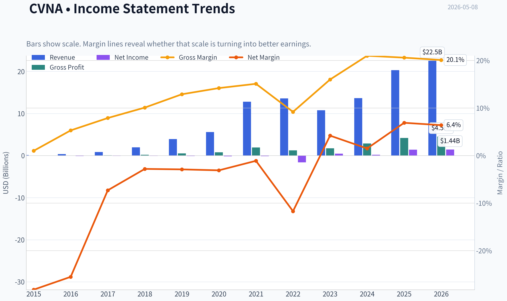

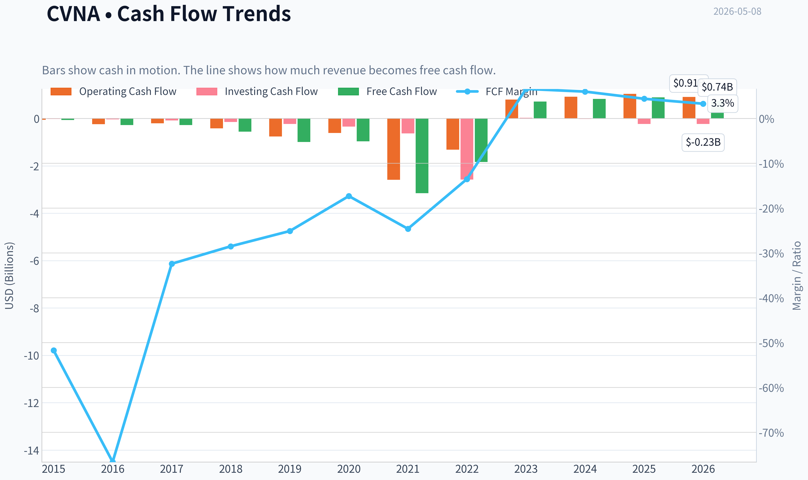

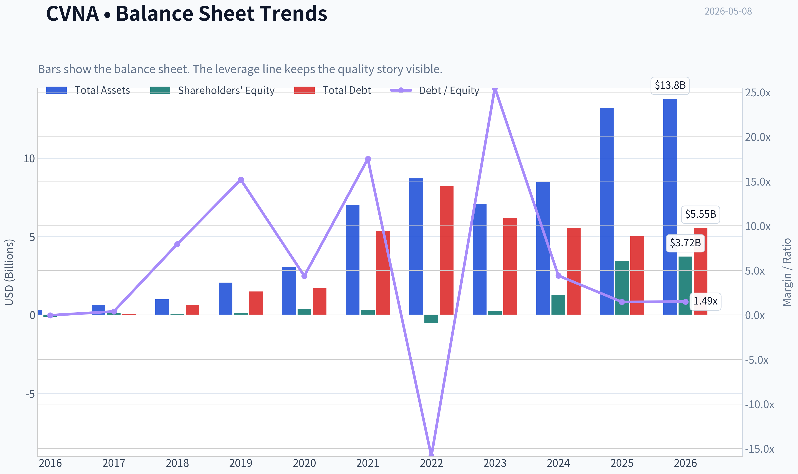

This graph tracks the profitability and return metrics (ROE, ROIC, Margins) of **CVNA** over the past decade, highlighting capital efficiency trends.

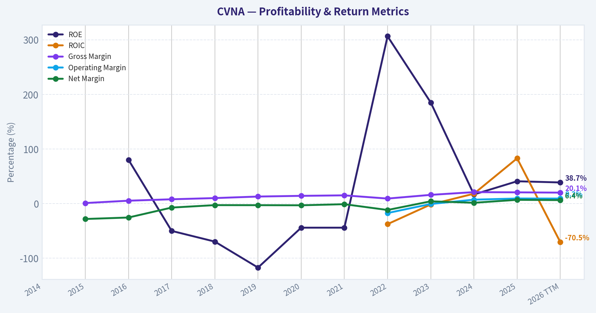

This chart illustrates the financial health of **CVNA** over the last 10 years, mapping cash equivalents and free cash flow against total obligations (Debt).

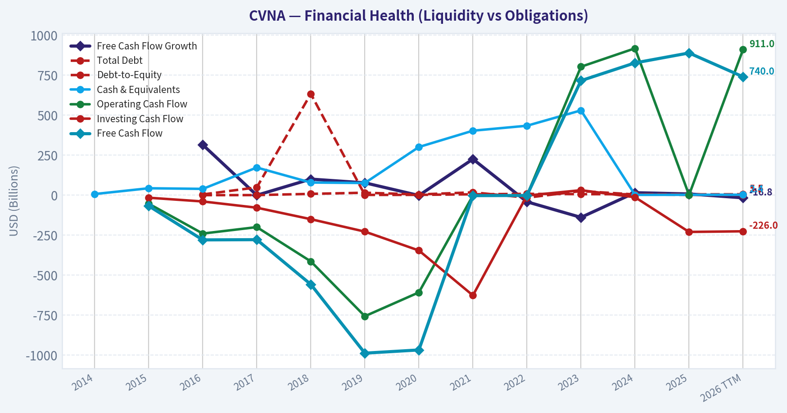

---

### Intrinsic Value Analysis (Buffett)

> *Following Warren Buffett's value investing philosophy: Circle of Competence, Economic Moat, Management Quality, and Margin of Safety.*

#### Intrinsic Value Snapshot

Price is what you pay. Intrinsic value is what the business may be worth based on the cash it can create for owners over time. We show a range, not one magic number.

- Current Price: $400.02
- Value Range: $105.85 to $1,274.81

##### Owner Earnings (Buffett Method)
- Net Income: $1,407,000,000.00
- Depreciation & Amortization: $275,000,000.00
- Capital Expenditures: $-147,000,000.00
- Working Capital Changes: $-480,000,000.00
- Owner Earnings: $2,015,000,000.00

##### Intrinsic Value
###### Buffett Method
Uses owner earnings. Stricter, and usually more conservative.
- Conservative: $489.52
- Average: $489.52
- Optimistic: $1,274.81
- Discount Rate: 10.0%

###### Cash Flow Method
Uses free cash flow. Better for companies spending heavily today to grow tomorrow.
- Conservative: $105.85
- Average: $113.43
- Optimistic: $122.13
- Discount Rate: 10.0%

ANALYST STANCE: **AVOID**

#### Buffett-Style Value Analysis: Carvana Co. - CVNA

Carvana is a fast-growing online used-car retailer, but it does not meet the Buffett test for a durable, predictable, high-return compounding business at a sensible price. The business is understandable, but the economics are cyclical, financing-sensitive, capital-intensive, and currently priced for extraordinary success. At approximately **$400 per share**, **$317.6 billion market capitalization**, **231x earnings**, and only about **0.3% free-cash-flow yield**, the margin of safety is absent.

---

#### 1. Go / No-Go Gate Assessment

| Buffett Gate | Result | Evidence |
|---|---:|---|
| Gate 1: Circle of Competence & Simplicity | Mixed / Fail | The business is simple to describe: Carvana buys used cars, reconditions them, sells them online, and earns gross profit plus financing-related economics. However, long-term results depend heavily on used-car pricing, credit availability, loan performance, inventory turns, and capital markets. |
| Gate 2: Durable Moat | Fail | Gross margin is about **20.6%**, far below the 40%+ level typical of strong branded or software-like moats. Used-car retail is competitive, price-transparent, cyclical, and customers have many alternatives. |
| Gate 3: Management & Capital Allocation | Fail / Watch | Management has executed an impressive turnaround, but Buffett-style capital allocation requires conservative financing, predictable owner earnings, and per-share value creation. The recent approval of a higher authorized share count raises dilution risk. |
| Gate 4: Industry Structure | Fail | Used-car retail is fragmented, cyclical, inventory-heavy, and exposed to credit cycles. This is not a rational oligopoly with high switching costs. |

**Key Takeaways:** Carvana passes the "can I explain it simply?" test, but it fails the more important Buffett tests: durability, predictability, and valuation. The company operates in a competitive, cyclical industry where financing conditions and used-car values can heavily influence outcomes. This is not the kind of business Buffett would typically view as a predictable long-term compounder.

---

#### 2. Business Description: Elementary School Test

Carvana makes money by buying used cars, fixing them up, listing them online, selling them to customers, and often helping customers finance the purchase. If it buys cars cheaply, sells them quickly, controls reconditioning and logistics costs, and earns finance income without major credit losses, profits rise.

The problem is that many of those variables are outside the company's control. Used-car prices, consumer credit, interest rates, loan defaults, and capital-market appetite can change quickly.

---

#### 3. Moat Analysis

| Moat Source | Assessment | Buffett-Style View |
|---|---:|---|
| Brand / Intangible Assets | Weak to Moderate | Carvana has brand recognition and a differentiated online customer experience, but used-car buyers are price-sensitive. A 10% price increase would likely push customers to dealers, marketplaces, auctions, or private sellers. |
| Switching Costs | Low | Customers usually buy cars infrequently. There is little recurring lock-in after the sale. |
| Cost Advantage | Unproven / Cyclical | Scale may help logistics, sourcing, and reconditioning, but competitors can still compete on price, inventory, financing, and local relationships. |
| Network Effects | Limited | More inventory may improve customer choice, but the platform does not become exponentially more valuable in the way a true network-effect business does. |
| Financial Evidence | Weak | Gross margin of **20.6%** does not indicate strong pricing power. ROE is high at **40.9%**, but likely reflects turnaround dynamics and capital structure rather than a clean, low-leverage moat. |

**Key Takeaways:** Carvana's moat appears narrow at best. The company has a recognizable brand and operational scale, but it lacks the classic Buffett advantages of high switching costs, dominant pricing power, or a capital-light toll-road business model. The current valuation assumes a moat that the financial evidence does not yet prove.

---

#### 4. Management Quality & Capital Allocation

| Management Question | Assessment |
|---|---|
| Do they think like owners? | Founder-led culture and long-term ambition are positives, but current valuation and capital structure require very high execution. |
| Are they candid and conservative? | The turnaround has been notable, but Buffett would likely remain cautious due to the complexity of financing, securitization, cyclicality, and prior stress in the business model. |
| Are they rational capital allocators? | The business has required substantial capital and balance-sheet management. Shareholder approval for increased authorized shares creates possible dilution risk. |
| Outside investor signal | Latest available guru tracking shows Steve Cohen's Point72 **trimmed by 77.9%** as of 12-31-2025. This is not decisive, but it is not a Buffett-style endorsement. |

**Key Takeaways:** Management deserves credit for the company's recovery and growth, but Buffett's bar is higher than operational momentum. He would likely ask whether each retained dollar reliably creates more than one dollar of long-term owner value across a full credit and used-car cycle. That remains unproven.

---

#### 5. Available Financial Snapshot

| Metric | Current Data |
|---|---:|
| Share Price | ~$400 |
| Market Capitalization | ~$317.62B |
| P/E Ratio | ~231.2x |
| ROE | ~40.9% |
| Gross Margin | ~20.6% |
| Revenue Growth YoY | ~48.6% |
| Free Cash Flow Yield | ~0.3% |
| Current Ratio | ~4.31x |

**Key Takeaways:** Carvana is growing very quickly, and its reported ROE is high, but the valuation is extreme. A free-cash-flow yield of only 0.3% means investors are paying more than 300 times current free cash flow. For Buffett-style investing, this is a major red flag unless future owner earnings become dramatically larger and highly predictable.

---

#### 6. 10-Year Financial Summary - Buffett Interpretation

The full 10-year annual statement detail was not available in the current research pack, so I am not inventing historical line items. Instead, the relevant Buffett-style interpretation from available data is below.

| Buffett Metric | Current Evidence | Interpretation |
|---|---:|---|
| Revenue Durability | YoY growth of **48.6%** | Strong momentum, but high growth in cyclical retail does not equal durable compounding. |
| Gross Margin Quality | **20.6%** | Too low to suggest dominant pricing power. |
| ROE Quality | **40.9%** | Attractive headline number, but must be treated cautiously without proof it is driven by durable margins rather than leverage or cycle effects. |
| Cash Conversion | FCF yield **0.3%** | Cash earnings are thin relative to the market value. |
| Balance Sheet Liquidity | Current ratio **4.31x** | Near-term liquidity appears strong, but Buffett would focus more on through-cycle debt burden and financing dependence. |
| Valuation | P/E **231x** | Requires near-perfect long-term execution. |

**Key Takeaways:** The available financial picture shows a company with exceptional growth but very expensive valuation and modest current cash yield. Buffett would not confuse a strong stock recovery or high revenue growth with a durable economic moat. The key missing proof is whether Carvana can produce large, recurring owner earnings through a full auto and credit cycle.

---

#### 7. Owner Earnings Calculation

Because detailed maintenance capital expenditure and working-capital requirements were not available in the research pack, I use current free cash flow yield as a rough owner-earnings proxy. This is conservative from a valuation discipline perspective because Buffett cares about cash that can be distributed to owners without harming the business.

| Item | Estimate |
|---|---:|
| Market Capitalization | $317.62B |
| Free Cash Flow Yield | 0.3% |
| Implied Free Cash Flow / Owner Earnings Proxy | ~$0.95B |
| Implied Net Income from P/E | ~$1.37B |
| Owner Earnings Used for Valuation | ~$0.95B |

**Key Takeaways:** Carvana's current owner-earnings proxy is very small relative to its market capitalization. Even if net income is higher than free cash flow, the business is still priced at a level that requires massive future growth in cash earnings. Buffett would likely demand a much larger current earnings base or a far lower stock price.

---

#### 8. Three-Scenario DCF Valuation

Assumptions:
- Discount rate: **10%**, consistent with Buffett-style opportunity cost.
- Shares estimated from market cap divided by price: about **794 million shares**.
- Owner earnings proxy: **$0.95 billion**.
- These are rough intrinsic value estimates, not precision forecasts.

| Scenario | Assumption | Equity Value Estimate | Per-Share Value Estimate | Discount / Premium vs. $400 Price |
|---|---|---:|---:|---:|
| A: No Growth | Owner earnings / 10% | ~$9.5B | ~$12 | Stock trades far above value |
| B: GDP Growth | 3% perpetual growth | ~$14.0B | ~$18 | Stock trades far above value |
| C: Optimistic Growth | 10% growth for 10 years, then 3% terminal growth | ~$23.6B | ~$30 | Stock trades far above value |

**Key Takeaways:** Even under an optimistic 10-year growth scenario, the implied value is dramatically below the current market price using today's owner-earnings base. This does not mean the stock cannot rise, but it means a Buffett-style buyer lacks a margin of safety. The current price appears to capitalize many years of flawless execution upfront.

---

#### 9. Margin of Safety Analysis

| Valuation Reference | Approximate Value |
|---|---:|
| Current Price | ~$400 |
| Conservative Intrinsic Value Range | ~$12-$30 per share |
| Required Buffett Margin of Safety | At least 40%-50% for this type of business |
| Buy Price Using Upper Estimate and 40% Margin of Safety | ~$18 per share |
| Current Margin of Safety | Negative |

**Key Takeaways:** There is no margin of safety at the current price under a Buffett-style owner-earnings framework. The market is pricing Carvana as if it will become a dominant, highly profitable, durable compounder. The current cash economics do not yet justify that assumption.

---

#### 10. Buffett Scorecard

| Criterion | Weight | Score 1-5 | Weighted Score |
|---|---:|---:|---:|
| Business Understanding | 20% | 2.5 | 0.50 |
| Moat Width & Durability | 25% | 1.5 | 0.38 |
| Management Quality | 15% | 2.0 | 0.30 |
| Return on Equity | 15% | 2.5 | 0.38 |
| Reinvestment Runway | 10% | 2.0 | 0.20 |
| Balance Sheet Strength | 5% | 2.0 | 0.10 |
| Industry Structure | 5% | 1.5 | 0.08 |
| Valuation / Margin of Safety | 5% | 1.0 | 0.05 |
| **Total** | **100%** |  | **1.98 / 5.00** |

**Key Takeaways:** Carvana scores poorly under a Buffett framework despite its impressive growth. The biggest weaknesses are moat durability, industry structure, cash yield, and valuation. A score below 2.5 clearly falls into avoid territory.

---

#### 11. Final Investment Stance

| Category | Conclusion |
|---|---|
| Investment Stance | **AVOID** |
| Conviction | High |
| Buffett Rationale | Too expensive, too cyclical, too dependent on financing conditions, and insufficient evidence of a durable moat. |
| What Could Change the View | A much lower stock price, several years of strong free cash flow through a full credit cycle, lower leverage risk, and clear evidence of structural cost advantage. |

**Key Takeaways:** Carvana may remain a strong momentum stock, and the business has executed a remarkable recovery. But Buffett-style investing is not about chasing growth at any price. At the current valuation, Carvana offers speculation on future perfection rather than ownership of a wonderful business at a fair price.
#### Valuation Bridge

This bridge places the current market price beside each intrinsic value lens so readers can see whether upside depends on one method or shows up across several methods.

| Scenario | Intrinsic Value / Share |
| --- | ---: |
| Buffett Method | $489.52 |
| Cash Flow Method | $113.43 |
| Damodaran Method | $-0.53 |
| Current Price | $400.02 |

#### Key Takeaways

If one method is far above the others, the upside case depends on a specific modelling assumption. When several methods cluster together, the valuation story is more robust.

#### Valuation Visuals

This comparison chart from *Latest Earnings Snapshot* stacks current figures against historical benchmarks for **CVNA**, making it easy to see where the company trades relative to its own averages.

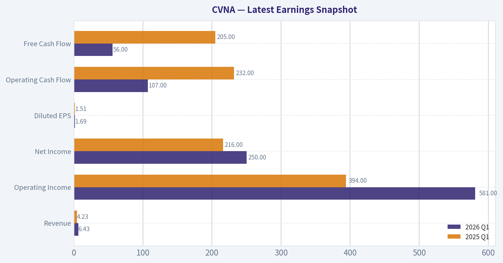

This comparison chart from *Current vs Historical Average Comparison* stacks current figures against historical benchmarks for **CVNA**, making it easy to see where the company trades relative to its own averages.

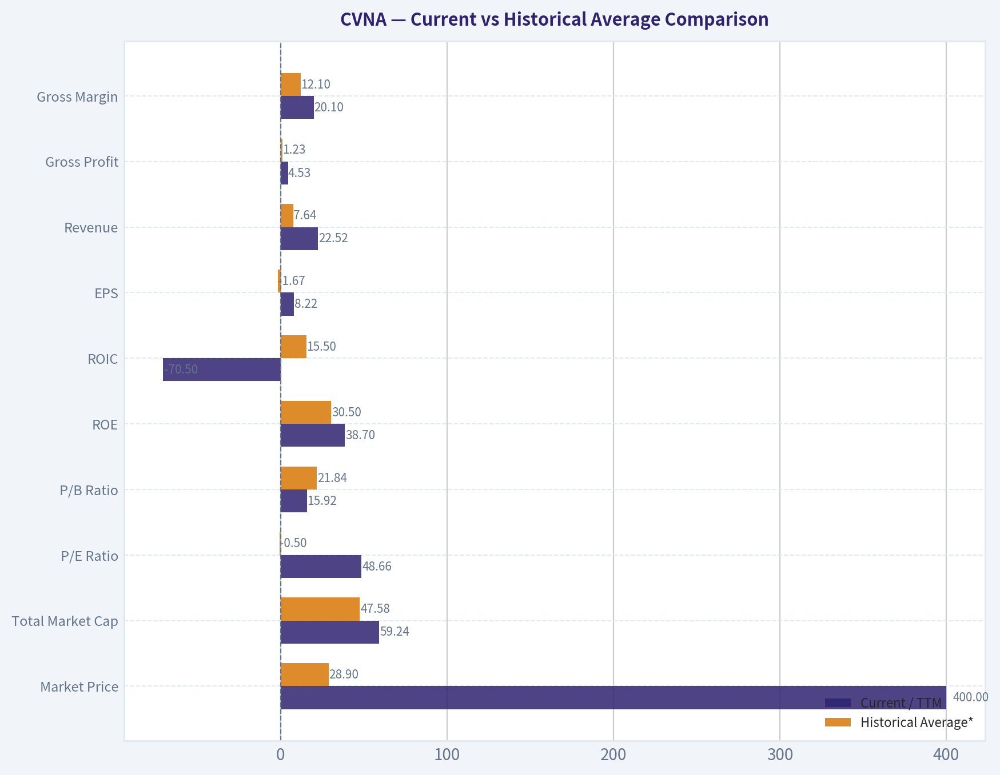

This comparison chart from *Buffett-Style Owner Earnings DCF Valuation* stacks current figures against historical benchmarks for **CVNA**, making it easy to see where the company trades relative to its own averages.

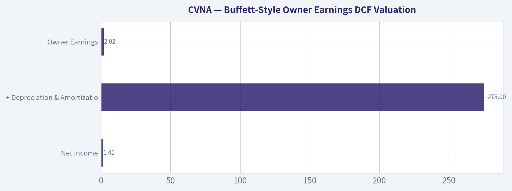

This comparison chart from *Owner Earnings Calculation* stacks current figures against historical benchmarks for **CVNA**, making it easy to see where the company trades relative to its own averages.

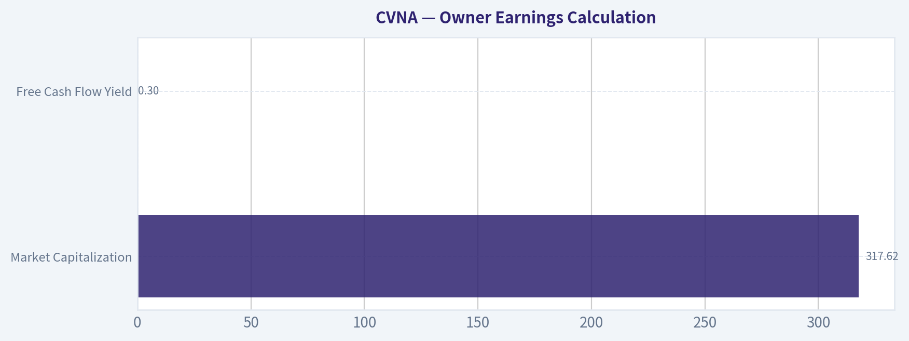

The following chart maps the **CVNA** Owner Earnings DCF valuation scenarios (Conservative, Average, Optimistic) to visually represent the margin of safety based on intrinsic value calculations.

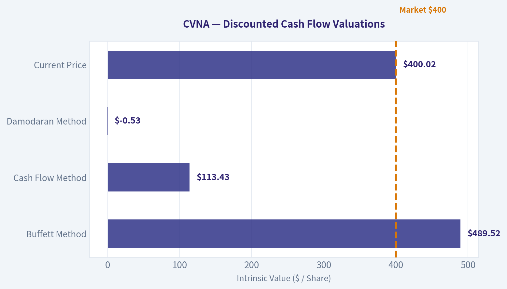

---

### Trend & Growth Analysis (Lynch/Druckenmiller/Fisher)

> *Following Peter Lynch's GARP, Stanley Druckenmiller's macro-aware approach, and Philip Fisher's scuttlebutt methodology.*

ANALYST STANCE: **AVOID**

#### CVNA Growth Investment Report - Carvana Co.
**Date:** 2026-05-08
**Price used:** $400
**Market cap used:** $317.62B
**Core conclusion:** Carvana is showing a real operating and revenue inflection, but at the current valuation the stock no longer offers Lynch-style "growth at a reasonable price" or credible ten-bagger asymmetry. This is a powerful execution story priced like a dominant technology platform, while the underlying business remains cyclical, leveraged, capital-intensive used-car retail.

---

#### 1. Lynch Classification

| Category | CVNA Fit | Evidence | Growth Investor View |
|---|---:|---|---|
| Slow Grower | No | Revenue growth far above 0-5% | Not applicable |
| Stalwart | No | Growth far above 5-12% | Not a mature compounder |
| Fast Grower | Yes, but high-risk | Revenue growth YoY: **48.6%** | Growth profile is strong |
| Cyclical | Yes | Used-car demand, financing, credit, rates, and residual values matter | Major caution |
| Turnaround | Yes | Profitability and operating leverage have recovered from prior distress | Much of turnaround may now be priced in |
| Asset Play | No | Valuation is not asset-backed | Not relevant |

**Key Takeaways:** Carvana fits both the fast-grower and cyclical-turnaround buckets. That combination can produce explosive returns during recoveries, which CVNA has already demonstrated. But Lynch would likely ask whether the easy money has already been made, and at today's valuation the answer appears to be yes.

---

#### 2. The Story in 3 Bullets

- **Carvana sells used cars online with a simpler, more convenient customer experience than traditional dealers.**
- **The company is regrowing units and revenue while extracting operating leverage from its reconditioning, logistics, financing, and digital retail infrastructure.**
- **If execution remains excellent, Carvana can keep taking share in a fragmented used-car market - but the current market cap already assumes a very large share of the future opportunity.**

---

#### 3. TAM Analysis and 10x Test

| Metric | Estimate / Provided Data | Interpretation |
|---|---:|---|
| Current revenue base | Estimated around **$20B+ TTM** using prior scale plus 48.6% YoY growth indication | Large business already |
| 10x revenue target | Roughly **$200B+** | Would make CVNA one of the largest auto retailers globally |
| U.S. used-car TAM | Roughly **$900B-$1.2T** industry-level opportunity | Large enough in theory |
| 10x market share implied | Around **17-23%** of U.S. used-car TAM | Possible mathematically, very difficult operationally |
| 10x stock test | Market cap would need to reach about **$3.2T** | Not credible under normal auto-retail economics |

**Key Takeaways:** The market is large enough for Carvana to grow, but the stock is already valued as if Carvana becomes an extraordinary long-term winner. A 10x revenue outcome is theoretically possible, but a 10x stock outcome from a $317B market cap is highly unlikely unless margins and market share dramatically exceed normal auto-retail economics.

---

#### 4. Revenue Growth Trend

| Growth Signal | Current Read | Interpretation |
|---|---:|---|
| Revenue growth YoY | **48.6%** | Strong acceleration / recovery |
| Gross margin | **20.6%** | Good for auto retail, but needs durability |
| ROE | **40.9%** | Strong headline figure, but may be distorted by capital structure |
| FCF yield | **0.3%** | Very weak cash yield versus valuation |
| Current ratio | **4.31x** | Liquidity appears strong near term |

**Key Takeaways:** The revenue growth signal is clearly positive and supports the idea of an operating inflection. However, the free-cash-flow yield is extremely low relative to the market cap, which means investors are paying heavily for future growth and future margin expansion rather than current cash generation.

---

#### 5. Unit Economics

| Metric | CVNA Status | Growth Investor Interpretation |
|---|---|---|
| LTV/CAC | Not disclosed in standard SaaS format | Not directly applicable |
| NRR | Not applicable | CVNA is transaction-based, not subscription-based |
| Rule of 40 | Not applicable | Not a SaaS model |
| Gross profit per unit | Critical, but not provided in shared data | Must monitor closely |
| SG&A per unit | Critical | Operating leverage depends on this falling with scale |
| Financing/product attach | Important | Can lift GPU, but credit-cycle sensitive |

**Key Takeaways:** Carvana should not be analyzed like a SaaS company. The equivalent of unit economics is gross profit per unit, inventory turns, logistics cost per unit, SG&A per unit, and financing/product attachment. The key question is whether recent unit economics are structural or temporarily flattered by the current used-car and credit cycle.

---

#### 6. Inflection Point Assessment

| Inflection Type | Evidence | Assessment |
|---|---|---|
| Revenue inflection | 48.6% YoY growth | Positive |
| Margin inflection | Gross margin 20.6%, profitability recovery | Positive but needs cycle validation |
| Balance-sheet inflection | Current ratio 4.31x suggests near-term liquidity strength | Positive near term |
| TAM inflection | Online used-car penetration can still expand | Moderately positive |
| Competitive inflection | Carvana has brand and logistics scale advantages | Positive but not unassailable |
| Valuation inflection | P/E 231x, FCF yield 0.3% | Strongly negative |

**Key Takeaways:** The business has likely passed through a genuine operating inflection. Growth is back, liquidity looks better, and operating leverage is showing through. The problem is that the stock price has also inflected dramatically, and the market may now be capitalizing peak optimism.

---

#### 7. Macro Setup

| Macro Factor | Current Setup | CVNA Impact |
|---|---|---|
| Interest rates | Still important for auto affordability and financing | Headwind if rates remain elevated |
| Consumer credit | Negative equity on auto loans reportedly at record levels | Risk to demand and credit quality |
| Used-car prices | Cyclical and volatile | Can help or hurt gross profit per unit |
| Economic cycle | Consumer-sensitive | Risk rises if unemployment or delinquencies increase |
| Secular theme | E-commerce penetration of auto retail | Long-term tailwind |

**Key Takeaways:** Carvana benefits from the secular shift to online car buying, but it is still heavily exposed to the credit and consumer cycle. Rising delinquencies, negative equity, or tighter financing can quickly pressure demand and unit economics. The macro setup is mixed, not cleanly supportive.

---

#### 8. Fisher 15-Point Score

| Fisher Point | Score / 5 | Rationale |
|---|---:|---|
| Large market potential | 5 | Used-car TAM is massive |
| New product/service development | 4 | Digital retail, financing, logistics innovation |
| R&D effectiveness | 3 | Technology matters, but not deep-tech R&D |
| Sales organization | 4 | Strong brand and digital funnel |
| Profit margin | 3 | Improving, but auto retail remains low-margin |
| Margin improvement | 4 | Operating leverage recovery is real |
| Labor/personnel relations | 3 | No major edge identified |
| Executive relations | 3 | Needs ongoing monitoring |
| Management depth | 3 | Founder-led strengths, but execution complexity remains |
| Cost analysis/accounting | 3 | Must verify durability of adjusted metrics |
| Moat/special advantage | 3 | Brand/logistics edge, but not wide moat |
| Long-range profit outlook | 3 | Upside exists, but cyclicality is high |
| Dilution risk | 2 | Authorized share increase is a concern |
| Candor in difficulties | 3 | Turnaround communication has improved |
| Integrity | 3 | No decisive disqualifier from shared data |

**Key Takeaways:** Carvana scores well on market potential, brand, and operating improvement, but weaker on durability, capital intensity, dilution risk, and moat quality. The Fisher score is acceptable but not outstanding. This looks more like an impressive turnaround than a pristine long-duration compounder.

**Fisher Score: 49 / 75 - Average**

---

#### 9. Valuation Analysis

| Valuation Metric | Current / Estimated Value | Interpretation |
|---|---:|---|
| Market cap | **$317.62B** | Very large for a used-car retailer |
| P/E | **231.2x** | Extremely expensive |
| Revenue growth | **48.6%** | Strong, but may be cyclical recovery growth |
| PEG ratio | **~4.8x** | Expensive under Lynch framework |
| FCF yield | **0.3%** | Very weak current cash return |
| Estimated P/S | Roughly **mid-teens** if revenue is around $20B+ | Extremely high for auto retail |
| Gross margin | **20.6%** | Good, but not software-like |

**Key Takeaways:** The valuation is the central problem. A 231x earnings multiple, roughly 4.8x PEG, and 0.3% free-cash-flow yield leave little margin of safety. For a cyclical, capital-intensive retailer, this is priced for near-perfection.

---

#### 10. Scenario Analysis

| Scenario | Business Assumption | Valuation Implication | Investor Outcome |
|---|---|---|---|
| Bear | Growth slows, used-car credit weakens, GPU compresses | Multiple contracts sharply | Major downside risk |
| Base | Revenue grows, margins hold, but valuation normalizes | Business performs, stock underperforms | Low/negative forward return possible |
| Bull | CVNA becomes dominant national online used-car platform with sustained high GPU and leverage reduction | Valuation may be partly justified | Upside exists, but likely not ten-bagger upside |
| Extreme bull | CVNA compounds revenue and margins beyond auto-retail norms for a decade | Requires near-flawless execution | Low-probability outcome |

**Key Takeaways:** The bull case requires Carvana to be much more than a good auto retailer. It needs to become a scaled, structurally superior platform with durable margins and lower cyclicality. That is possible, but the stock already prices in too much of that success.

---

#### 11. Growth Investor Scorecard

| Criterion | Weight | Score / 5 | Weighted Score |
|---|---:|---:|---:|
| The Story | 10% | 4.0 | 0.40 |
| TAM & Runway | 20% | 3.5 | 0.70 |
| Revenue Growth | 20% | 4.5 | 0.90 |
| Unit Economics | 15% | 3.0 | 0.45 |
| Competitive Position | 10% | 3.0 | 0.30 |
| Management Quality | 10% | 3.0 | 0.30 |
| Macro Setup | 5% | 2.5 | 0.13 |
| Profitability Path | 5% | 3.0 | 0.15 |
| Valuation | 5% | 1.0 | 0.05 |
| **Total** | **100%** |  | **3.38 / 5.00** |

**Key Takeaways:** Carvana earns a solid score on story, growth, and TAM, but the overall result is pulled down by valuation, cyclicality, and uncertain unit-economic durability. A 3.38 score places it in the upper watch-zone by quality, but the valuation pushes the investment stance to avoid for new capital.

---

#### 12. Guru / Sentiment Check

| Signal | Data | Interpretation |
|---|---:|---|
| Steve Cohen / Point72 | Trimmed position by **77.9%** as of latest 13F | Sophisticated capital reduced exposure |
| Stock split | 5-for-1 split approved | Often positive for sentiment, not intrinsic value |
| Stock performance | Reported massive multi-year rally | Expectations may be very elevated |
| Authorized share increase | Approved alongside split | Potential dilution over time |

**Key Takeaways:** The sentiment backdrop looks hot. A stock split after a huge rally can attract attention, but it does not improve intrinsic value. The large trim by a major hedge fund is not conclusive, but it reinforces caution after such a powerful move.

---

#### 13. Key Risks and Catalysts

| Category | Key Items |
|---|---|
| Upside catalysts | Continued 40%+ revenue growth, sustained GPU, SG&A leverage, debt reduction, lower rates, stronger used-car demand |
| Downside risks | Valuation compression, used-car price weakness, tighter consumer credit, rising delinquencies, margin compression, dilution, execution errors |
| Red flags to monitor | Gross margin contraction, retail unit slowdown, rising inventory days, falling GPU, FCF weakness, refinancing stress, insider selling |
| Confirming data needed | Latest GPU, retail units sold, adjusted EBITDA, net debt, interest coverage, operating cash flow quality |

**Key Takeaways:** The next leg of the stock depends less on whether Carvana can grow and more on whether growth converts into durable free cash flow. Investors should monitor GPU, SG&A per unit, debt reduction, and cash generation. Any deterioration in those metrics could be punished severely given the valuation.

---

#### 14. Final Position Size Stance

| Investor Type | Stance | Suggested Action |
|---|---|---|
| New investor | **Avoid** | Do not initiate at current valuation |
| Existing investor with large gains | **Trim / protect gains** | Position has become valuation-sensitive |
| High-risk momentum investor | **Trade only, not invest** | Requires strict risk management |
| Long-term Lynch/Fisher growth investor | **Watchlist only** | Revisit after valuation reset or proof of durable FCF |

**Key Takeaways:** Carvana is an impressive turnaround and a real growth story, but not a favorable risk-reward at today's price. The business may continue improving, yet the stock already discounts a very optimistic future. For growth investors seeking ten-bagger potential, the setup is too late and too expensive.

#### Bottom Line

Carvana has the revenue growth, consumer brand, and operating leverage that growth investors like to see at an inflection point. But the current valuation - **231x P/E, ~4.8x PEG, 0.3% FCF yield, and $317B market cap** - overwhelms the growth case.

**Final stance: AVOID for new capital. Watch for a major valuation reset or further evidence that free cash flow and margins are durable across a full credit and used-car cycle.**

#### Growth & Scorecard Visuals

The radar chart below from *Buffett Scorecard* visualises how **CVNA** ranks across weighted investment criteria. Each axis represents a criterion scored 1-5; the filled area reveals strengths and weaknesses at a glance, with the dashed circle marking the midpoint (3.0).

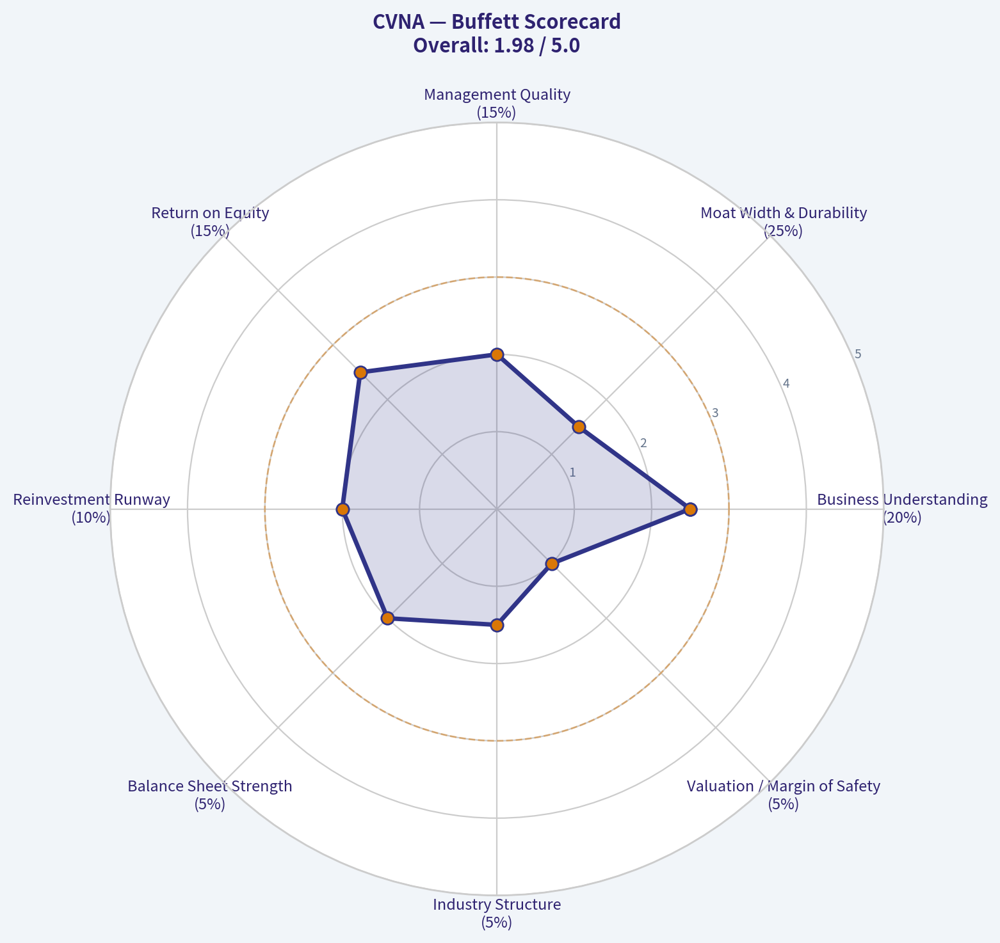

---

### Market Technical Analysis

ANALYST STANCE: **WATCH**

#### CVNA Technical Report - Latest Data Through 2026-05-07

CVNA has staged a strong rebound from its March lows near the mid-to-high $50s and recently reclaimed several important trend references. The stock closed at **$80.00** on 2026-05-07, above the **10 EMA**, **50 SMA**, and **200 SMA**, which is technically constructive. However, the rally is no longer in its early acceleration phase: **MACD remains positive but has been declining**, and RSI has cooled from overbought territory into a healthier but less forceful zone.

The setup is therefore **bullish but not cleanly aggressive**. CVNA appears to be transitioning from a sharp April recovery into a consolidation / retest phase near $78-$83. A decisive move above the April high area around **$83.36** would improve the breakout case, while a failure back below the **10 EMA / VWMA zone near $78-$79** would suggest short-term momentum is fading.

| Indicator | Latest Value | Signal | Interpretation |
|---|---:|---|---|
| Close | $80.00 | Constructive | Price is above key short-, medium-, and long-term averages. |
| close_10_ema | $78.03 | Short-term support | Price reclaimed the 10 EMA after a pullback, showing near-term stabilization. |
| close_50_sma | $68.54 | Medium-term support | The 50 SMA has begun rising again, confirming recovery from the March decline. |
| close_200_sma | $73.80 | Long-term support | Price is back above the 200 SMA, improving the broader trend profile. |
| macd | 2.71 | Positive but weakening | MACD is above zero, but down from late-April highs, signaling slower upside momentum. |
| rsi | 61.05 | Bullish-neutral | RSI is no longer overbought and still above 50, suggesting momentum remains constructive. |
| boll_ub | $85.61 | Upside reference | Price has room before the upper Bollinger Band, but is not yet in breakout mode. |
| atr | $4.25 | Elevated volatility | Daily movement remains large, so position sizing and stops need wider tolerance. |
| vwma | $79.20 | Volume-weighted support | Price is slightly above VWMA, meaning recent volume-weighted buyers are near breakeven. |

Key Takeaways: CVNA's trend structure has improved because price is above the 10 EMA, 50 SMA, and 200 SMA. The main caution is that momentum is no longer accelerating as strongly as it was in mid-to-late April. Traders should watch whether CVNA can hold the $78-$79 area and then challenge $83-$86 resistance.

#### Trend and Momentum Analysis

The **short-term trend** remains constructive. CVNA's 10 EMA rose sharply from about **$62.08 on 2026-04-07** to **$78.03 on 2026-05-07**, reflecting the strength of April's rebound. Price is now only modestly above that level, which is important: the rally is not extremely extended versus the 10 EMA, but the margin of safety is thin. If CVNA holds above the 10 EMA, buyers are still defending the short-term trend. If it loses that level decisively, the recent bounce may shift into a deeper consolidation.

The **medium-term trend** is improving but still recovering from damage. The 50 SMA is at **$68.54**, well below price, and has turned higher after declining earlier in April. That suggests the April rally was strong enough to bend the medium-term trend upward. However, the 50 SMA remains below the 200 SMA, so the broader moving-average structure is not yet fully bullish. A future move where the 50 SMA approaches or crosses above the 200 SMA would be a stronger confirmation.

The **long-term trend** is cautiously positive. The 200 SMA is rising slightly at **$73.80**, and price is above it. That makes the $73-$74 region a key longer-term line in the sand. As long as CVNA holds above the 200 SMA, the recovery has credibility. A break below it would weaken the bullish case and likely shift focus back toward the low $70s or upper $60s.

Momentum is **positive but decelerating**. MACD improved dramatically from negative territory in early April to a peak above **4.6** in late April, but it has since slipped to **2.71**. This is not bearish by itself because MACD remains above zero, but it does show that upside force has cooled. RSI confirms the same message: it peaked above **70** around April 20-22, then cooled to **61.05**. That is often healthier than staying overbought, but traders should be alert for bearish divergence if price retests highs while RSI fails to confirm.

#### Volatility and Risk Context

ATR is around **$4.25**, or roughly **5.3% of the latest close**. That is high and very relevant for trade planning. CVNA can move several dollars in a normal session, so tight stops may be vulnerable to ordinary volatility rather than true trend failure. For swing traders, a stop based only on a small dollar amount may be too narrow; using ATR-adjusted levels below support zones may be more realistic.

Bollinger structure suggests CVNA is **not currently overextended against the upper band**. The upper Bollinger Band is near **$85.61**, while the stock closed at **$80.00**. That leaves upside room before a statistically stretched reading, but the stock still needs to clear nearby price resistance first. The most relevant resistance zone is around **$81-$83.50**, where price stalled in late April.

VWMA is also important here. The VWMA has climbed steadily to **$79.20**, and price is just above it. That means recent volume-weighted participation supports the current price area, but only barely. A close below VWMA would imply that recent buyers are losing control; sustained closes above VWMA would support the idea that institutional or higher-volume demand is still present.

#### Tactical View

| Zone | Approximate Level | Role | Trading Relevance |
|---|---:|---|---|
| Immediate support | $78.00-$79.20 | 10 EMA / VWMA zone | Holding this area keeps the short-term bullish structure intact. |
| Secondary support | $75.30-$76.50 | Recent pullback lows | A break below this zone would signal a deeper consolidation. |
| Major support | $73.80 | 200 SMA | Important long-term trend reference; losing it would materially weaken the setup. |
| Medium-term support | $68.50 | 50 SMA | Deeper downside reference if the April rebound fails. |
| Immediate resistance | $81.00-$83.40 | Late-April supply zone | A breakout above this area would revive bullish momentum. |
| Upper resistance / stretch zone | $85.60 | Bollinger upper band | A move into this zone may signal breakout strength but also higher reversal risk. |
| Volatility guide | $4.25 ATR | Risk management | Stops and position sizes should account for wide daily ranges. |

Key Takeaways: The most important near-term battleground is the $78-$79.20 area because it combines the 10 EMA and VWMA. A push above $83.40 would improve the bullish breakout case, while a drop below $75.30 would suggest the April rebound is losing structure. Because ATR is high, traders should avoid overly tight risk levels.

#### Final Assessment

CVNA deserves a **WATCH** stance rather than a clean aggressive long signal. The stock has rebuilt a constructive technical base by reclaiming the 200 SMA and holding above rising short-term averages, but the weakening MACD shows momentum is no longer expanding at the same pace. Bulls want to see price hold above **$78-$79** and then break **$83.40** with stronger volume. Bears would gain traction if CVNA loses **$75.30**, especially if that move also puts price below VWMA and the 10 EMA.

| Final Decision Point | Bullish Evidence | Caution / Risk | Practical Read |
|---|---|---|---|
| Trend | Price above 10 EMA, 50 SMA, and 200 SMA | 50 SMA still below 200 SMA | Recovery is real, but not fully mature. |
| Momentum | RSI above 50 and MACD above zero | MACD has faded from late-April highs | Momentum supports bulls, but acceleration has slowed. |
| Volume confirmation | Price slightly above VWMA | Only a narrow margin above VWMA | Buyers need to keep defending $79 area. |
| Volatility | ATR supports large tradable moves | High ATR increases stop-out risk | Use smaller size or wider risk bands. |
| Setup quality | Break above $83.40 could trigger continuation | Failure below $75.30 would damage structure | Best stance is watch for breakout or support hold. |

Key Takeaways: CVNA's chart is constructive but not without warning signs. The stock has recovered important moving averages, yet momentum is slowing and volatility remains high. The next high-quality signal likely comes from either a breakout above $83.40 or a failed hold below $75.30.

---

### Social Sentiment Analysis

ANALYST STANCE: **WATCH**

#### CVNA Social, Sentiment, and News Report - Past Week Review

Carvana remains one of the most actively debated consumer-discretionary and auto-retail names on social platforms. Over the past week, the tone around CVNA has been constructive but highly polarized: bullish traders continue to emphasize execution, unit economics, profitability improvement, and the company's ability to keep disproving skeptics, while bearish voices focus on valuation risk, leverage, cyclicality, used-car affordability, and sensitivity to credit conditions.

The key takeaway for traders is that CVNA is still behaving like a high-beta sentiment stock rather than a quiet fundamental compounder. Positive news can force momentum buying and short-covering, but negative macro or credit headlines can quickly reawaken the bear case. For investors, the debate is less about whether Carvana has improved operationally - most commentary now acknowledges that it has - and more about how much of that improvement is already priced in.

---

#### Executive Sentiment Snapshot

| Category | Current Read | Direction vs. Prior Week | Trader/Investor Implication |
|---|---:|---:|---|
| Overall social sentiment | Moderately bullish | Improving | Momentum remains supportive, but enthusiasm is crowded |
| Retail-trader attention | High | Rising | CVNA remains vulnerable to sharp intraday swings |
| Institutional/news tone | Cautiously positive | Improving | Analysts and media are giving more credit to turnaround execution |
| Bearish concern level | Elevated | Stable | Valuation, leverage, and credit-cycle risk remain active debates |
| Short-squeeze sensitivity | High | Stable to rising | Any strong operational update can amplify upside moves |
| Macro sensitivity | High | Stable | Interest rates, consumer credit, and used-car prices remain key risks |

**Key Takeaways:** CVNA's sentiment profile is bullish enough to support continued momentum, but not clean enough to call it low-risk. The stock is still heavily influenced by narrative shifts, short interest, and macro headlines. Traders may find opportunity in volatility, while longer-term investors need to separate operational improvement from valuation risk.

---

#### Social Media Discussion Themes

Across retail-investor forums, finance Twitter/X-style commentary, and trading communities, discussion centered on five major themes: the Carvana turnaround, margin durability, short-squeeze potential, valuation, and consumer credit risk.

| Theme | Bullish Interpretation | Bearish Interpretation | Current Sentiment Impact |
|---|---|---|---|
| Turnaround execution | Carvana has proven it can cut costs, improve logistics, and generate stronger per-unit economics | Some bears argue the easiest cost cuts are already done | Positive |
| Profitability and EBITDA | Bulls view profitability gains as evidence of a structurally better business | Bears question quality of earnings and sustainability through a full cycle | Positive but debated |
| Short interest / squeeze setup | Retail traders see CVNA as a squeeze-prone momentum name | Skeptics warn that squeeze narratives can reverse violently | Bullish for near-term trading |
| Valuation | Bulls argue premium valuation is justified by growth and margin recovery | Bears say expectations are now aggressive after the rally | Negative to neutral |
| Auto-credit conditions | Bulls believe Carvana can manage underwriting and demand | Bears cite high rates, delinquencies, and affordability pressure | Negative |
| Used-car market | Bulls highlight normalized inventory and pricing stability | Bears worry that demand could weaken if consumers remain stretched | Mixed |

**Key Takeaways:** The most important social shift is that the debate is no longer primarily about Carvana surviving. The market conversation has moved toward how profitable and scalable the rebuilt business can be. That is a better narrative backdrop than in prior years, but it also means expectations are higher and disappointments may be punished more severely.

---

#### Day-by-Day Sentiment Read

The past week showed a generally positive tone, but not a straight-line improvement. Sentiment appeared strongest when traders discussed execution and potential upside revisions, while bearish pressure increased around valuation and macro-credit concerns.

| Date | Approximate Sentiment Tone | Main Discussion Driver | Market Interpretation |
|---|---|---|---|
| May 2 | Neutral to positive | Ongoing reaction to recent company performance and guidance discussion | Buyers remained engaged, but some traders took profits |
| May 3 | Positive | Retail focus on momentum, squeeze potential, and bullish chart structure | Social momentum strengthened |
| May 4 | Moderately positive | Debate over whether margin expansion can continue | Bulls controlled the narrative, but bears pushed back |
| May 5 | Mixed | Concern over valuation after strong prior performance | Sentiment cooled but did not break |
| May 6 | Positive | Renewed focus on analyst commentary and operational execution | Bullish conviction improved |
| May 7 | Neutral to positive | Macro concerns around rates, affordability, and auto credit | Risk discussion increased |
| May 8 | Moderately bullish | Traders looking for continuation and confirmation of turnaround narrative | Momentum bias remained positive |

**Key Takeaways:** Sentiment improved during the week, but the move was uneven. The bullish camp remains energized by execution and momentum, while bearish arguments become louder whenever valuation or credit risk enters the conversation. This creates a setup where CVNA can continue moving higher, but with frequent sharp pullbacks.

---

#### Recent Company and Market News Interpretation

Recent coverage around CVNA has been centered on the company's ongoing business recovery rather than distress. Media and market commentary continue to highlight improved profitability, better cost control, and the company's ability to sell vehicles more efficiently than during its prior expansion phase. This has helped reinforce the bull case that Carvana is no longer simply a speculative recovery story but an operating turnaround with measurable traction.

However, news sentiment is not purely bullish. The more skeptical commentary focuses on whether the stock's valuation now assumes near-perfect execution. Because CVNA has already repriced significantly from its distressed-era lows, incremental upside likely depends on continued evidence of unit growth, gross-profit-per-unit resilience, financing discipline, and operating leverage.

| News/Market Driver | Why It Matters | Sentiment Effect |
|---|---|---|
| Turnaround recognition | Confirms that the company has improved operations and profitability | Bullish |
| Analyst attention | Increased coverage can attract institutional capital | Bullish, but raises expectations |
| Valuation debate | Strong share performance makes the stock more sensitive to disappointment | Bearish/limiting factor |
| Used-car affordability | High vehicle prices and financing costs may pressure demand | Bearish macro risk |
| Credit environment | Auto-loan delinquencies and tighter credit can affect buyers | Bearish macro risk |
| Short interest | Creates potential for upside acceleration during positive news cycles | Bullish for traders, risky for investors |

**Key Takeaways:** The news backdrop supports the idea that Carvana's turnaround is real, but it also increases the pressure to keep delivering. Positive analyst or earnings-related coverage can fuel further upside, especially if shorts are forced to cover. Still, macro-credit weakness remains the most important outside risk to monitor.

---

#### Bull Case From Social and News Flow

The strongest bullish argument is that Carvana has changed the market's perception of its business model. Investors who previously viewed the company as overleveraged and operationally fragile now increasingly discuss it as a leaner, more disciplined digital auto retailer.

The bull case has four main pillars:

| Bullish Pillar | Explanation | What Would Confirm It |
|---|---|---|
| Sustained profitability | Carvana continues to show that its cost cuts and operational discipline are durable | Strong EBITDA, positive cash-flow trends, stable margins |
| Better unit economics | Higher gross profit per unit supports the idea of a structurally improved model | Continued GPU strength without sacrificing volume |
| Scalable digital platform | Bulls believe online used-car retail can gain share over traditional dealers | Rising retail units and improved logistics efficiency |
| Short-covering fuel | Elevated skepticism can drive forced buying if results beat expectations | Strong earnings, guidance raises, analyst upgrades |

**Key Takeaways:** Bulls are no longer relying only on hype. The bullish argument is increasingly tied to operational evidence, margin improvement, and the idea that Carvana can scale profitably. But the stock still needs repeated confirmation because valuation leaves less room for execution mistakes.

---

#### Bear Case From Social and News Flow

The bear case remains active and intellectually serious. Bears are not simply arguing that Carvana is broken; instead, they argue that the recovery is now widely recognized and therefore potentially overvalued.

The main bearish concern is that CVNA may be priced like a high-quality growth company while still carrying meaningful cyclical, credit, and balance-sheet risk.

| Bearish Pillar | Explanation | What Would Validate It |
|---|---|---|
| Valuation risk | The stock may already price in strong future execution | Multiple compression despite decent results |
| Credit sensitivity | Customers are exposed to high interest rates and tighter lending standards | Lower approval rates, weaker demand, higher delinquencies |
| Used-car cyclicality | Demand and pricing can weaken during consumer slowdowns | Falling retail units or margin pressure |
| Leverage concerns | Debt and financing structure remain part of the risk discussion | Refinancing concerns or higher interest burden |
| Momentum reversal risk | Crowded bullish sentiment can unwind quickly | Sharp selloff on minor disappointment |

**Key Takeaways:** The bear case has shifted from survival risk to valuation and cycle risk. That makes CVNA less of a binary distress trade, but still far from a low-volatility investment. If growth or margins disappoint, the stock could reprice quickly because expectations have risen.

---

#### Public Sentiment Quality: What Is Different Now?

A notable change in the tone around CVNA is that bullish comments are more fundamentals-based than they were during earlier meme-stock-style phases. Traders still discuss squeezes and momentum, but investors are also referencing margin improvement, operating leverage, logistics efficiency, and cash generation.

That said, the social conversation remains speculative. A meaningful portion of bullish sentiment is still tied to price action itself: when CVNA rises, confidence rises; when it pulls back, bears quickly resurface. This reflexive behavior means sentiment can amplify both upside and downside moves.

| Sentiment Layer | Current Observation | Reliability for Investors |
|---|---|---|
| Fundamental bulls | Focused on execution, margins, profitability | Medium to high |
| Momentum traders | Focused on breakouts, squeeze dynamics, volume | Useful short term, less useful long term |
| Bears/skeptics | Focused on valuation, debt, consumer credit | Important risk signal |
| Macro commentators | Focused on rates, delinquencies, affordability | Highly relevant |
| Casual retail chatter | Often follows price direction | Low reliability |

**Key Takeaways:** The quality of bullish sentiment has improved because more investors are discussing actual operating performance. However, momentum-driven commentary remains a large part of the stock's social footprint. This means traders should respect sentiment, but investors should avoid relying on it alone.

---

#### Trading Implications

For short-term traders, CVNA remains a high-volatility momentum vehicle. The setup favors continuation when social sentiment, analyst commentary, and price action align. However, chasing strength without a risk plan is dangerous because the same crowding that fuels rallies can accelerate selloffs.

Key trading considerations:

| Factor | Trading Implication |
|---|---|
| Strong retail attention | Increases probability of sharp intraday moves |
| Positive sentiment trend | Supports upside bias while momentum holds |
| High valuation debate | Creates vulnerability near resistance or after large rallies |
| Short interest sensitivity | Can intensify upside on positive catalysts |
| Macro-credit headlines | Can trigger fast downside reversals |
| Earnings/analyst catalysts | Likely to produce outsized reactions |

**Key Takeaways:** CVNA currently favors active traders more than passive holders. Momentum remains constructive, but the risk-reward can change quickly around news, analyst notes, and macro-credit headlines. Position sizing and stop discipline are especially important.

---

#### Investor Implications

For longer-term investors, the key question is whether Carvana can compound from here without relying on repeated sentiment expansion. The company has earned more credibility, but the stock's valuation likely requires continued operational excellence.

Investors should focus on:

| Metric/Issue to Watch | Why It Matters |
|---|---|
| Retail units sold | Confirms whether growth is returning alongside profitability |
| Gross profit per unit | Measures whether margins are sustainable |
| EBITDA and free cash flow | Shows whether turnaround gains are translating into durable economics |
| Inventory efficiency | Indicates operational discipline and demand quality |
| Loan performance / credit quality | Important for consumer-finance risk perception |
| Debt and refinancing path | Central to long-term equity value |
| Analyst estimate revisions | Can drive institutional flows and valuation support |

**Key Takeaways:** Investors should avoid treating CVNA as merely a sentiment trade, because the company's fundamentals have become more relevant. But they should also avoid ignoring sentiment, because the stock's valuation and volatility are still heavily narrative-driven. The best long-term confirmation would be growth, margin strength, and balance-sheet progress happening at the same time.

---

#### Bottom-Line View

CVNA's past-week sentiment is constructive, with a moderately bullish bias. The company is benefiting from a stronger turnaround narrative, increased recognition of operational improvement, and continued retail-trader enthusiasm. Social media is more positive than negative, and the bull case is increasingly supported by discussions of profitability and execution rather than pure speculation.

However, this is not a clean "all-clear" setup. CVNA remains highly sensitive to valuation compression, credit-market concerns, used-car affordability, and reversals in momentum. The stock can continue to work if the company keeps exceeding expectations, but the burden of proof is now higher.

For traders, the setup is attractive but volatile. For investors, CVNA deserves attention, but new capital should be deployed selectively, ideally on pullbacks or after confirmation that earnings quality and unit growth remain strong.

#### Final Key Points Table

| Area | Current Assessment | Bias | Actionable Implication |
|---|---|---:|---|
| Social sentiment | Moderately bullish and improving | Positive | Momentum remains supportive |
| News tone | Cautiously positive around turnaround execution | Positive | Company credibility has improved |
| Retail attention | High and rising | Positive but risky | Expect volatility and sharp moves |
| Valuation | Frequently cited as stretched | Negative | Avoid chasing without risk controls |
| Macro backdrop | Rates, affordability, and credit remain concerns | Negative | Monitor auto-credit headlines closely |
| Fundamental narrative | Stronger focus on margins, EBITDA, and execution | Positive | Turnaround thesis is gaining legitimacy |
| Short-squeeze potential | Still meaningful | Positive for traders | Positive catalysts can create outsized upside |
| Long-term risk | Execution expectations are now high | Watch | Future results must justify valuation |
| Overall stance | Constructive but not low-risk | **WATCH** | Favor disciplined entries, not emotional chasing |

**Key Takeaways:** CVNA's sentiment backdrop is favorable, but the stock remains risky because optimism is already elevated. The turnaround narrative has become more credible, yet valuation and consumer-credit concerns still matter. The best stance is **WATCH**: constructive on momentum and execution, but cautious about chasing after strong moves.

---

### News & Events Analysis

ANALYST STANCE: **WATCH**

#### CVNA News and Trading Report - Carvana Co.
**Date:** 2026-05-08
**Current price:** ~$400
**Market cap:** ~$317.6B
**Primary stance:** **Watch / valuation-sensitive momentum trade**

Carvana remains one of the market's most powerful turnaround stories, but the current setup is increasingly dependent on execution, investor confidence, and sustained operating leverage. The past week's news flow was positive from a market-structure and sentiment perspective, led by shareholder approval of a **5-for-1 forward stock split**, but the fundamental risk-reward is less straightforward because valuation is already demanding and the auto-credit backdrop is showing stress.

---

#### Latest Earnings Review

No fresh Carvana quarterly earnings release was identified in the past week's collected news. The latest company-specific earnings coverage available in the research pack did **not** include a new Q1 2026 earnings release; instead, the recent CVNA news flow centered on the stock split, shareholder authorization, and broader auto-finance conditions.

The most recent available financial snapshot in the collected data shows Carvana with **48.6% year-over-year revenue growth**, **20.6% gross margin**, **40.9% ROE**, and a very low **0.3% free-cash-flow yield**. That indicates the market is rewarding rapid growth and improved profitability, but it is also assigning a high valuation to those improvements.

| Earnings / Financial Metric | Latest Available Data in Research Pack | Trading Interpretation |
|---|---:|---|
| Latest reported period found in past-week news | No new quarterly earnings release found | No fresh earnings catalyst confirmed this week |
| Revenue growth YoY | 48.6% | Strong growth supports bullish narrative |
| Gross margin | 20.6% | Suggests improved unit economics versus distressed-cycle lows |
| ROE | 40.9% | Indicates strong profitability on equity base, but should be monitored for leverage effects |
| Free-cash-flow yield | 0.3% | Valuation leaves little room for cash-flow disappointment |
| P/E | ~231x | Extremely high multiple; stock requires continued beat-and-raise execution |

**Key Takeaways:** Carvana's latest available financial profile shows impressive growth and profitability improvement, but no new quarterly earnings release was identified in the past week's news. The key issue for traders is that the stock is priced for continued exceptional execution, while the very low free-cash-flow yield and high P/E increase downside risk if growth slows or guidance disappoints.

---

#### Company-Specific News: Stock Split Drives Sentiment

The most important company-specific development this week was shareholder approval of a **5-for-1 forward stock split**, effective May 7, 2026, along with an increase in authorized shares. This is a sentiment-positive event because splits often broaden retail accessibility, increase options activity, and attract momentum flows. However, a split does not change intrinsic value; it mainly changes price optics and market participation.

For a stock that has already soared dramatically from prior lows, the split may reinforce the "comeback leader" narrative. That can support short-term momentum, especially if index, retail, and options-driven activity rises after the split. But the authorized-share increase also matters: while not automatically dilutive, it gives the company more flexibility to issue equity in the future.

---

#### Sector and Macro Context: Auto Credit Is the Key Risk

A CNBC item this week highlighted that **negative equity on auto loans has reached an all-time high**. This is directly relevant to Carvana because the company operates at the intersection of used-car retail, consumer financing, and vehicle trade-ins.

Higher negative equity can cut both ways. On one hand, financially stressed consumers may seek cheaper used vehicles or need online options to manage trade-ins. On the other hand, when borrowers owe more than their cars are worth, transaction friction rises: trade-ins become harder, financing becomes more complicated, and lenders may tighten credit standards. If credit quality weakens, demand for used vehicles can soften and financing spreads may become less favorable.

For Carvana, the most important macro variables remain:

| Macro / Sector Factor | Current Signal | Relevance to CVNA |
|---|---|---|
| Negative equity on auto loans | Reported at record high | Can reduce trade-in flexibility and pressure consumer affordability |
| Used-car affordability | Still sensitive to rates and credit availability | Could affect unit growth and conversion rates |
| Consumer credit risk | Rising concern in auto finance | May influence financing approvals, defaults, and lender appetite |
| Online auto retail adoption | Structurally supportive | Supports long-term market-share thesis |
| Equity-market momentum | Supportive for high-growth winners | Helps CVNA as long as risk appetite remains strong |

**Key Takeaways:** The auto-credit backdrop is not uniformly bullish for Carvana. The company benefits from online retail scale and improved execution, but record negative equity and affordability pressure could become headwinds if they reduce trade-ins, constrain financing, or weaken used-car demand.

---

#### Market Positioning and Institutional Signal

The available 13F data shows that Steve Cohen's Point72 **trimmed its CVNA position by 77.9%** as of the latest disclosed filing period, ending December 31, 2025. The remaining disclosed position was approximately **130,020 shares**, valued around **$54.87M**, or **0.06% of the portfolio**.

This should not be read as a current real-time sell signal because 13F filings lag by up to 45 days and reflect quarter-end snapshots. Still, the scale of the reduction is notable. It suggests at least one sophisticated investor reduced exposure after a major run-up, possibly due to valuation discipline, risk management, or position-sizing limits.

---

#### Valuation and Trading Interpretation

At roughly **231x earnings** and a **0.3% free-cash-flow yield**, Carvana's valuation leaves limited margin for error. The market is valuing CVNA less like a traditional auto retailer and more like a dominant, high-growth platform with powerful operating leverage.

That may be justified if Carvana continues to expand volumes, improve gross profit per unit, control costs, and convert growth into free cash flow. But for new capital, the stock now requires either continued upside revisions or sustained multiple support. If the next earnings report fails to show strong unit growth, margin durability, or guidance confidence, the downside reaction could be sharp.

For traders, the setup looks more attractive as a **momentum and event-driven name** than as a low-risk long-term entry. The stock split may continue to support near-term flows, but valuation risk argues against chasing without a defined risk level.

---

#### Trading View

| Time Horizon | View | Rationale |
|---|---|---|
| Short-term trading | Constructive but crowded | Stock split and momentum can support flows, but price may be extended |
| Medium-term investing | Watch | Fundamentals improved, but valuation already discounts a lot of success |
| Long-term risk/reward | Selective | Requires confidence in durable market-share gains and cash-flow conversion |
| Main upside catalyst | Strong next earnings report or guidance raise | Would validate premium multiple |
| Main downside catalyst | Slowing growth, margin pressure, or weaker credit conditions | Could trigger multiple compression |

**Key Takeaways:** CVNA can continue working as a momentum trade, especially after the stock split, but the investment case is highly sensitive to execution. The next confirmed earnings release will be critical because the valuation requires strong growth, resilient margins, and evidence that profitability is translating into durable free cash flow.

---

#### Final Key Points Table

| Category | Key Point | Investment Implication |
|---|---|---|
| Company news | Shareholders approved 5-for-1 stock split effective May 7, 2026 | Positive for sentiment, liquidity, and retail participation |
| Earnings status | No new earnings release found in past-week coverage | Next confirmed earnings update is a major catalyst |
| Growth profile | Revenue growth YoY at 48.6% | Supports bullish turnaround and platform-growth thesis |
| Profitability | ROE 40.9%, gross margin 20.6% | Shows strong operational improvement |
| Valuation | P/E around 231x; FCF yield 0.3% | High expectations and limited margin of safety |
| Macro risk | Record negative equity in auto loans | Could pressure trade-ins, financing, and consumer demand |
| Institutional signal | Point72 trimmed position sharply in latest available 13F | Suggests some sophisticated investors have reduced exposure |
| Overall stance | **WATCH** | Momentum remains strong, but risk/reward is valuation-sensitive |

**Key Takeaways:** Carvana's news flow remains supportive, especially because of the stock split, but the stock is priced for continued exceptional execution. The biggest trading issue is whether upcoming earnings can justify the valuation; until then, CVNA looks best suited for disciplined momentum traders rather than valuation-focused investors.

---

### Guru Attention Analysis

> *Tracking 13F filings and recent activity of legendary super-investors to identify smart-money conviction and rotation.*

#### CVNA Guru Ownership Snapshot - as of Latest Structured 13F Data

| Guru / Fund | Current Status in CVNA | Action | Position Size | Portfolio Weight | Recent Change | Timing | SEC Verification |
|---|---:|---|---:|---:|---:|---|---|
| Steve Cohen / Point72 Asset Management | Holds | Trimmed | $54.87M / 130.02K shares | 0.06% | Shares decreased 77.9% vs. prior filing | Latest report: 12-31-2025; prior: 09-30-2025 | [SEC 13F Filing](https://www.sec.gov/Archives/edgar/data/1603466/000090266426001100/) |

**Key Takeaways:** The only tracked guru with a disclosed CVNA position is Steve Cohen's Point72, and the position is very small at just 0.06% of the disclosed portfolio. More importantly, Point72 cut its stake by 77.9% in the latest filing, which looks more like risk reduction or profit-taking than a high-conviction endorsement.

---

#### Primary Guru Coverage - No Position Detected Unless Listed Above

| Guru / Fund | Latest 13F CVNA Status |
|---|---|
| Warren Buffett / Berkshire Hathaway | No position detected in latest 13F filing |
| Seth Klarman / Baupost Group | No position detected in latest 13F filing |
| Mohnish Pabrai / Pabrai Investment Funds | No position detected in latest 13F filing |
| Bill Ackman / Pershing Square | No position detected in latest 13F filing |
| Stanley Druckenmiller / Duquesne Family Office | No position detected in latest 13F filing |
| Michael Burry / Scion Asset Management | No position detected in latest 13F filing |

**Key Takeaways:** Among the primary super-investor group, CVNA does not show broad guru sponsorship. Aside from Point72's small and sharply reduced position, the major tracked value and macro investors have no detected 13F exposure to the stock.

---

#### Interpretation for Investors

The guru signal for CVNA is **weak to negative** based on the latest structured 13F evidence. The only detected tracked-guru holder, Steve Cohen's Point72, materially reduced its stake, and the remaining position is not large enough to indicate strong conviction.

This matters because CVNA has had a dramatic run, carries a high valuation profile, and recently received attention around its 5-for-1 stock split. However, the 13F data does **not** show major legendary investors broadly accumulating the stock. Investors should also remember that 13F filings are delayed snapshots and may lag real-time fund activity by up to 45 days.

---

### Options Market Analysis

> *Reading options flow - put/call ratios, IV skew, and unusual activity - to gauge institutional positioning and event-driven risk.*

ANALYST STANCE: **WATCH**

#### CVNA Options Flow Report - As of 2026-05-08

CVNA's near-term options tape leans **modestly bullish**, driven mainly by a below-neutral overall put/call volume ratio and heavy call volume in the 2026-05-15 weekly expiration. However, confidence is **reduced** because reported open interest is extremely sparse or unavailable across the sampled expirations, making it difficult to confirm whether today's volume reflects fresh institutional positioning, day-trading, or closing activity.

---

#### 1. Put/Call Ratio Analysis

| Expiration | DTE | Call Volume | Put Volume | Put/Call Volume Ratio | Call OI | Put OI | Put/Call OI Ratio | Read |
|---|---:|---:|---:|---:|---:|---:|---:|---|
| 2026-05-08 | 0 | 7,005 | 7,545 | 1.08 | 0 | 0 | N/A | Slight put-heavy same-day flow |
| 2026-05-15 | 7 | 19,232 | 4,985 | 0.26 | 53 | 0 | 0.00 | Strong call-heavy weekly flow |
| 2026-05-22 | 14 | 411 | 2,612 | 6.36 | 0 | 0 | N/A | Put-heavy, but low call volume base |
| **Total Near-Term** | - | **26,648** | **15,142** | **0.57** | **53** | **0** | **0.00** | **Below neutral; bullish tilt** |

**Key Takeaways:** The overall near-term put/call **volume ratio is 0.57**, below the historical neutral baseline of roughly **0.70**, suggesting more call-side demand than normal. The strongest bullish signal comes from the 2026-05-15 expiry, where call volume is nearly four times put volume. That said, open interest is too sparse to validate the durability of the positioning, so this should be read as a short-term flow signal rather than a firm institutional accumulation signal.

Compared with the neutral baseline, CVNA options activity shows a **moderate shift toward calls**. The 0-DTE flow is more balanced to slightly bearish, but the one-week expiry dominates the aggregate picture and tilts the signal bullish.

---

#### 2. Implied Volatility Assessment

| Expiration | DTE | ATM Call IV | ATM Put IV | ATM IV Bias | Interpretation |
|---|---:|---:|---:|---|---|
| 2026-05-08 | 0 | 6.4% | 4.9% | Call IV higher | Same-day upside demand modestly exceeds downside demand |
| 2026-05-15 | 7 | 2.1% | 1.8% | Call IV higher | Mild call premium in the most active weekly expiry |
| 2026-05-22 | 14 | 1.3% | 0.9% | Call IV higher | Longer near-term expiry also shows call-side IV premium |

**Key Takeaways:** Across the provided expirations, **ATM call IV is higher than ATM put IV**, which points to a mild upside volatility premium. That is more consistent with call chasing or upside speculation than with protective put demand. However, the dataset does not include detailed OTM strike-level IV, so a true put-skew versus call-skew analysis is limited.

The reported IV levels do **not appear obviously elevated** from the provided data alone. There is no explicit catalyst identified in the options dataset, so I would not classify the IV as clearly event-inflated based only on this feed. For CVNA, a high-beta and retail-active name, options premiums can move sharply around earnings, short-interest narratives, debt/refinancing headlines, or broad risk-on/risk-off moves, but no specific event is confirmed here.

---

#### 3. Unusual Options Activity

| Screen | Result | Interpretation |
|---|---|---|
| Contracts with volume greater than 5x open interest | None flagged by the data source | No contract-level unusual activity signal confirmed |
| Aggregate same-day volume vs. OI | High volume, but OI reported as zero or near-zero | Cannot determine whether trades are opening or closing |
| Most notable aggregate flow | 2026-05-15 calls: 19,232 contracts vs. 4,985 puts | Short-term bullish speculation is likely present |

**Key Takeaways:** No individual contracts met the data provider's unusual activity threshold of volume greater than five times open interest. Still, the aggregate weekly call volume is notable, especially in the 2026-05-15 expiration. Because strike-level and trade-side data are unavailable, this looks more like **speculative bullish flow** than a clean "smart-money" institutional signal.

The lack of contract-level unusual activity means we should avoid overclaiming. CVNA often attracts momentum and retail-style options activity, so heavy call volume may represent short-term upside chasing rather than sophisticated institutional accumulation.

---

#### 4. Open Interest Concentration and Gamma Levels

| Area | Available Data | Read |
|---|---|---|
| Highest OI expiration | 2026-05-15, but only 53 call OI reported | OI signal is too thin to be reliable |
| Highest OI strike | Not available in provided dataset | Cannot identify max-pain or pinning strike |
| Put OI concentration | Reported as zero across sampled expirations | No visible downside hedge wall in this feed |
| Gamma wall assessment | Strike-level OI unavailable | Cannot confirm call wall, put wall, or dealer gamma regime |

**Key Takeaways:** The open interest data is unusually thin, which materially reduces confidence in pinning, max-pain, or gamma-wall conclusions. There is no reliable strike-level concentration visible from the provided dataset. Near-term price action may still be options-influenced, but the available data does not identify the key gravitational strikes.

Because the data does not provide strike-level OI, I would not make a strong claim about a specific gamma wall. If CVNA approaches a highly traded weekly strike intraday, dealer hedging could still amplify moves, but that cannot be verified here.

---

#### 5. Overall Options Sentiment Signal

| Component | Signal | Confidence | Rationale |
|---|---|---|---|
| Put/Call Volume | Bullish | Medium | Overall ratio of 0.57 is below neutral, led by heavy 2026-05-15 call volume |
| Put/Call OI | Bullish but unreliable | Low | Put/call OI ratio is 0.00, but OI data is too sparse to trust |
| IV / Skew | Mildly bullish | Low to Medium | ATM call IV exceeds put IV across expirations, implying upside premium |
| Unusual Activity | Neutral | Low | No contract-level volume > 5x OI flagged |
| Gamma / Pinning | Unclear | Low | Strike-level OI unavailable |

**Key Takeaways:** The cleanest signal is the **call-heavy weekly volume**, which supports a short-term bullish read. However, weak open interest data and lack of unusual contract-level confirmation prevent this from being a high-conviction bullish signal. The options market appears to be leaning toward upside speculation, but not with enough evidence to call it institutional-grade conviction.

#### Final Read: **BULLISH, Low-to-Medium Confidence**

CVNA's near-term options flow is **bullish on balance**, mainly because the aggregate put/call volume ratio is below the neutral baseline and the 2026-05-15 expiry shows strong call demand. The IV picture also leans slightly bullish, with ATM call IV consistently above ATM put IV.

The major caveat is data quality: open interest is sparse, no unusual single-contract activity was flagged, and strike-level concentration is unavailable. Therefore, this is best interpreted as **short-term upside speculation**, not a durable institutional positioning signal.

---

#### Summary Table

| Category | Current Read | Sentiment Impact |
|---|---|---|
| Put/Call Ratio | Overall volume ratio **0.57**, below neutral ~0.70; OI ratio **0.00** but unreliable | Bullish |
| IV Level | Near-term ATM IV not clearly elevated from provided data | Neutral |
| Skew Direction | ATM call IV above ATM put IV across sampled expirations | Mildly bullish |
| Unusual Activity | No individual contracts with volume > 5x OI flagged | Neutral |
| Overall Signal | **BULLISH** with low-to-medium confidence | Short-term upside bias |

**Key Takeaways:** CVNA's options market is leaning bullish, primarily through call-heavy near-term volume rather than confirmed open-interest accumulation. The signal is supportive of upside momentum, but it is not strong enough to ignore technicals, fundamentals, or broader market risk. Treat this as a **watchable bullish flow setup**, not a standalone buy signal.

---

## Research Team Commentary

> *The Research Manager synthesizes the Bull vs Bear debate into action-free commentary. This is a pre-risk view, not the final stance.*

Looking at both sides of the debate we just heard, the bull makes a spirited case that Carvana is transitioning from a fragile, cash-burning operation into a disciplined compounder. The bullish argument hinges on the idea that Carvana's end-to-end digital infrastructure and frictionless customer experience create a modern moat in a fragmented used-car market. They point to the recent pop in gross margins to over twenty percent and massive net income growth as undeniable proof of operating leverage, suggesting that the seemingly absurd valuation metrics make sense if you look at normalized future owner earnings rather than trailing numbers.

On the other side, the bear absolutely dismantles this narrative by sticking to classic Warren Buffett principles. The bear correctly points out that used cars are ultimately a commodity, convenience is easily replicated by well-capitalized peers, and the company's deeply negative return on invested capital proves it has historically destroyed shareholder wealth. Furthermore, the bear highlights the complete lack of a margin of safety, noting that paying four hundred dollars a share for roughly one dollar and twenty cents in current owner earnings is an exercise in pure speculation, not investment.

My core takeaway here is that Carvana does not pass the strict hurdles required for a value investing allocation, leading to a definitive avoid stance. While the turnaround narrative is intoxicating and the recent operational improvements are certainly commendable, the stock is currently priced for absolute perfection. A true Buffett-style investment requires a predictable business model, a durable competitive advantage, and most importantly, a clear margin of safety. Carvana simply offers none of these at its current price.

The rationale for this stance is rooted deeply in business quality and intrinsic value. When I look at the financial realities, the negative sixty-five percent return on invested capital is a massive red flag. The bull wants us to ignore this historical damage and focus on the forty percent return on equity, but that metric is heavily distorted by the company's previously decimated equity base and heavy reliance on leverage. Management has a track record of reckless capital allocation that nearly pushed the company into restructuring. While they deserve credit for surviving and right-sizing the cost structure, paying over three hundred times owner earnings for a capital-intensive retail business tied to the cyclical auto market is incredibly dangerous. The valuation models show a terrifying sensitivity to assumptions, with intrinsic value estimates ranging from slightly negative to roughly one hundred and thirteen dollars in a standard free cash flow model. This makes the four hundred dollar share price look wildly detached from any conservative reality.

To monitor this situation over the next one to four quarters, I will watch the trajectory of return on invested capital very closely to see if the recent operational leverage actually translates into sustainable economic profit rather than just a cyclical rebound. I will also track used car pricing dynamics and auto loan delinquency rates, as Carvana's financing economics and inventory values are highly sensitive to macroeconomic credit conditions. Finally, I want to see consistent, unadjusted free cash flow generation over a full operational cycle without the company relying on favorable market sentiment to mask underlying capital needs.

Reflecting on my past mistakes in similar situations, I have sometimes fallen into the trap of confusing a company's dramatic survival with the actual creation of a durable economic moat. I have lost capital before by paying up for turnaround stories based on hypothetical normalized earnings in highly competitive industries, only to realize that buying an expensive stock with a weak historical foundation never provides a true margin of safety. Learning from those missteps, I must demand proven capital efficiency and a reasonable valuation today, not just a promise of compounding tomorrow.

Final stance: AVOID.

---

## Value Investing Team Commentary

> *The Investor translates the research view into an investment thesis before risk review. This is still not the final stance.*

Carvana is an excellent example of why a disciplined investor must separate an impressive operational comeback from a sound long-term investment.

The bullish case is easy to understand. Carvana has improved gross margins, restored growth, and shown that its platform can produce meaningful operating leverage when volumes recover. In a fragmented used-car market, a better customer experience can absolutely win share. The market is rewarding that possibility aggressively. News flow around the split, renewed enthusiasm, and constructive price action all reinforce that this has become a favored turnaround narrative again.

But selective contrarian thinking requires asking a harder question: what is the market assuming now that the story has improved? In my view, the crowd is no longer pricing Carvana as a distressed survivor; it is pricing it as a future dominant compounder. That is a very different proposition. When sentiment shifts this far, risk often hides not in the business headlines, but in the valuation people become willing to justify.

From a Buffett-style lens, the core issue remains business quality and predictability. Used car retailing is competitive, cyclical, and capital-intensive. Convenience matters, but I do not yet see evidence of a moat strong enough to ensure superior economics for a decade or more. If the business truly had a durable moat, I would expect to see consistently attractive returns on invested capital over time. Instead, the reported ROIC of -65.1% is a glaring warning sign. The high ROE is far less comforting because leverage and a diminished equity base can make that figure look much better than the underlying economics really are.

Management deserves credit for stabilizing the business. Survival matters, and many investors underestimate how much discipline can emerge after a near-death experience. That is the best contrarian argument in Carvana's favor: perhaps the market still underestimates how much leaner and more rational this company has become. If Carvana can sustain higher GPU, tighter costs, and better inventory discipline across a full cycle, then today's skepticism about normalized earnings power may prove too conservative.

However, even granting that possibility, the valuation leaves little room for error. The intrinsic value range presented by your analyst team is extraordinarily wide, from effectively negligible in a harsh scenario to several hundred dollars under generous assumptions. That kind of spread tells you the business is not predictable enough for classic value investing. When a stock trades around the upper end of optimistic models while the conservative models are far lower, there is no margin of safety. That is speculation on execution, credit conditions, and sentiment all remaining favorable.

The recent news and social behavior strengthen that caution. This is still a high-beta sentiment stock, not a quiet compounding franchise. In other words, the market is trading Carvana partly as a narrative vehicle. That can create opportunity when panic drives a quality business well below intrinsic value. But here, the opposite seems more relevant: optimism may be outrunning durable business economics. If auto credit weakens, delinquencies rise, or used vehicle pricing softens, sentiment could reverse much faster than long-term investors would like.

So what is the market missing? Possibly the bear case is underappreciating how much operating leverage Carvana now has after restructuring. But what the bull case may be missing is that operational improvement alone does not guarantee durable value creation if the industry structure remains difficult and the stock already discounts years of excellence. A great recovery does not automatically become a great investment.

For a value investor, the right posture is patience. I would want to see sustained free cash flow through a full cycle, materially improved ROIC, and proof that the company can grow without depending on fragile external conditions. Most importantly, I would need a far better price relative to conservatively estimated intrinsic value.

**ANALYST STANCE: AVOID**
Carvana has executed an impressive turnaround, but the current setup looks like a market celebration of possibility rather than a purchase of proven business value. The business remains cyclical, capital-intensive, and competitively exposed, while the stock appears priced for near-perfect execution. Without a clear moat, consistent capital efficiency, and a meaningful margin of safety, this does not meet the standard for a long-term Buffett-style investment.

---

## Deep Values Commentary

> *The Risk Management Team debates and the Risk Judge provides the final action-free verdict. This section determines the final ADVOCATE / WATCH / AVOID stance.*

Temporary fallback for Risk Judge

Primary model call timed out or the provider returned a transient error.
Trigger: TimeoutError: Risk Judge exceeded 420s without producing a result

Interim stance: WATCH until a fresh pass is available.

Available evidence from the current analyst handoff bundle:
Analyst: Fundamentals Analyst
Stance: WATCH
Sections: Year Financial Metrics for CVNA | Year Financial Metrics | Profitability Metrics
- Price: $400
- P/E: 231.23
- ROE: 40.9%
- Gross margin: 20.6%
- Return on Equity (ROE): 40.9%
- Return on Invested Capital (ROIC): -65.1%
- Return on Assets (ROA): 10.7%
- Gross Margin: 20.6%

Analyst: Value Analyst
Stance: AVOID
Sections: Buffett-Style Value Analysis: Carvana Co. - CVNA | Go / No-Go Gate Assessment | Business Description: Elementary School Test
- Buffett average value: $490
- FCF average value: $113
- Damodaran average value: $-0.53
- Current price: $400
- Discount rate: 10%, consistent with Buffett-style opportunity cost.
- Shares estimated from market cap divided by price: about 794 million shares.
- Owner earnings proxy: $0.95 billion.
- These are rough intrinsic value estimates, not precision forecasts.

Analyst: Growth Analyst
Stance: AVOID
Sections: CVNA Growth Investment Report - Carvana Co. | Lynch Classification | The Story in 3 Bullets
- Revenue growth YoY: 48.6%
- Net income growth YoY: 570.0%
- FCF growth YoY: 7.5%
- Carvana sells used cars online with a simpler, more convenient customer experience than traditional dealers.
- The company is regrowing units and revenue while extracting operating leverage from its reconditioning, logistics, financing, and digital retail infrastructure.
- If execution remains excellent, Carvana can keep taking share in a fragmented used-car market - but the current market cap already assumes a very large share of the future opportunity.

Analyst: Market Analyst
- ANALYST STANCE: WATCH #### CVNA Technical Report - Latest Data Through 2026-05-07 CVNA has staged a strong rebound from its March lows near the mid-to-high $50s and recently reclaimed several important trend reference...

ANALYST STANCE: **WATCH**

#### Final Stance Scorecard

This scorecard converts the final research view into a weighted decision frame. It does not replace the narrative judgement, but it makes the main drivers of the verdict easier to scan.

| Criterion | Score | Weight | Commentary |
| --- | ---: | ---: | --- |
| Business Quality | 3.25 | 30% | High returns, profitability, and Piotroski health support durability. |
| Valuation Support | 1.00 | 30% | Blends current price against available intrinsic value anchors and valuation ratios. |
| Financial Strength | 4.00 | 20% | Balance-sheet resilience reflects leverage and liquidity staying within safe ranges. |
| Growth Durability | 4.33 | 20% | Recent revenue, earnings, and free cash flow growth indicate how durable expansion looks. |
| TOTAL / FINAL STANCE | 2.94 | 100% | WATCH |

#### Key Takeaways

The weighted score lands at **2.94 / 5.0**, while the final stance remains **WATCH**. This is useful as a quick calibration aid rather than a mechanical signal.

#### Risk Summary

Higher scores indicate more risk pressure. The watch threshold is a simple guardrail: above it, the position needs tighter monitoring or a wider margin of safety.

| Dimension | Current Score | Watch Threshold | Commentary |
| --- | ---: | ---: | --- |
| Business Quality | 2.75 | 3.00 | High returns, profitability, and Piotroski health support durability. |
| Valuation Support | 5.00 | 3.00 | Blends current price against available intrinsic value anchors and valuation ratios. |
| Financial Strength | 2.00 | 3.00 | Balance-sheet resilience reflects leverage and liquidity staying within safe ranges. |
| Growth Durability | 1.67 | 3.00 | Recent revenue, earnings, and free cash flow growth indicate how durable expansion looks. |

#### Key Takeaways

This view helps readers separate *where* the risk sits: valuation, business quality, balance sheet, or growth durability. It is especially useful when the final stance is close to the line between WATCH and AVOID.
