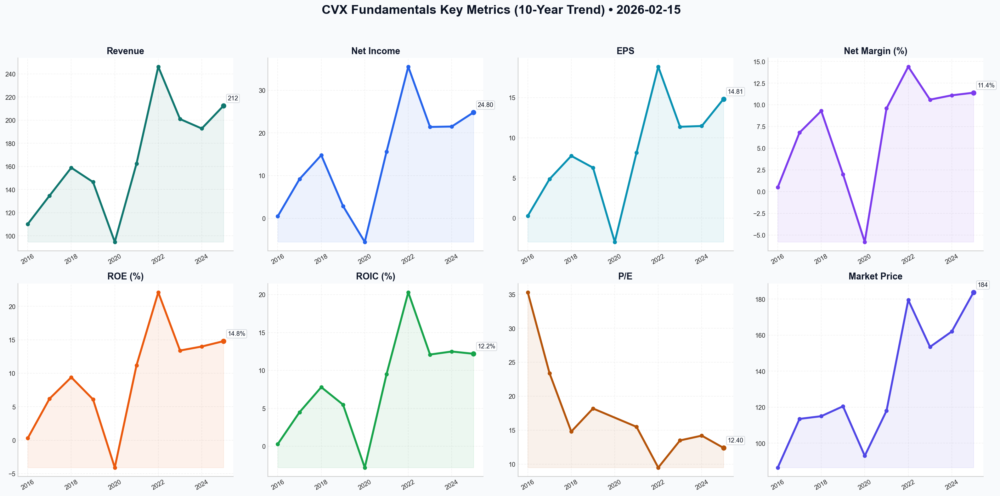

# CVX Deep Value Intelligence

**Analysis Date:** 2026-02-15
**Generated:** 2026-02-15 23:21:12

---

## Table of Contents

1. [Intelligence Summary](#intelligence-summary)
2. [Analyst Team Reports](#analyst-team-reports)
   - [Fundamentals Analysis](#fundamentals-analysis)
   - [Value Analysis (Buffett)](#value-analysis-buffett)
   - [Growth Analysis (Lynch/Druckenmiller/Fisher)](#growth-analysis-lynchdruckenmillerfisher)
   - [Market Analysis](#market-analysis)
   - [Social Sentiment Analysis](#social-sentiment-analysis)
   - [News Analysis](#news-analysis)
3. [Research Team Commentary](#research-team-commentary)
4. [Investing Team Commentary](#investing-team-commentary)
5. [Deep Values Commentary](#deep-values-commentary)

---

## Intelligence Summary

### Thesis + Conditions

**Core Thesis:** Here is the assessment of the Chevron debate, applying the discipline of the Buffett value investing framework.

**Key Risks:**
- The Bull (Risky Analyst):**
- The Bull views Chevron as a "compounding machine" undergoing a seismic shift in earning power. They argue that waiting for a dip to $175 is "timid" given the $22 billion in free cash flow, the 11.5% net debt ratio, and the "rearview mirror" status of integration risks. They see the 12.4x P/E as cheap against a historical 16.5x average and view the $6 technical spread as a breakout signal.
- The Bear argues that buying at $183 is "gambling on euphoria." They emphasize that cyclical stocks look cheapest right before they fall, and a 15% margin of safety is "effectively zero" in a commodity business. They highlight the "binary" risk of the Exxon arbitration—which could derail the growth story—and criticize management for retiring shares at all-time highs rather than when the stock is discounted.
- The Neutral analyst argues that both extremes create blind spots. They believe the Safe analyst’s 2% growth model ignores the reality of Permian milestones, while the Risky analyst ignores the danger of an RSI at 70. They propose a "tiered entry"—buying a half-position now to capture the 4.2% yield and averaging down later—to balance FOMO with prudence.
- The Risky Analyst asks us to ignore the price because the business is "firing on all cylinders." This is a dangerous mindset. As I noted in my previous reflection: **Cyclicals look cheapest at the peak of their earnings power.** When oil is high and cash flow is $22 billion, the P/E always looks attractive. But we are buying the future stream of cash flows, not the trailing twelve months.

**What Would Change Our View:**
- The Bull (Risky Analyst):**
- The Bull views Chevron as a "compounding machine" undergoing a seismic shift in earning power. They argue that waiting for a dip to $175 is "timid" given the $22 billion in free cash flow, the 11.5% net debt ratio, and the "rearview mirror" status of integration risks. They see the 12.4x P/E as cheap against a historical 16.5x average and view the $6 technical spread as a breakout signal.
- The Bear argues that buying at $183 is "gambling on euphoria." They emphasize that cyclical stocks look cheapest right before they fall, and a 15% margin of safety is "effectively zero" in a commodity business. They highlight the "binary" risk of the Exxon arbitration—which could derail the growth story—and criticize management for retiring shares at all-time highs rather than when the stock is discounted.
- The Neutral analyst argues that both extremes create blind spots. They believe the Safe analyst’s 2% growth model ignores the reality of Permian milestones, while the Risky analyst ignores the danger of an RSI at 70. They propose a "tiered entry"—buying a half-position now to capture the 4.2% yield and averaging down later—to balance FOMO with prudence.
- The Risky Analyst asks us to ignore the price because the business is "firing on all cylinders." This is a dangerous mindset. As I noted in my previous reflection: **Cyclicals look cheapest at the peak of their earnings power.** When oil is high and cash flow is $22 billion, the P/E always looks attractive. But we are buying the future stream of cash flows, not the trailing twelve months.

**Confidence:** Medium

### Stance Spectrum (Action-Free)

**Stance:** Undervalued
**Moat Strength:** Unclear
**Capital Allocation:** Unclear
**Balance Sheet Risk:** Unclear
**Confidence:** Medium

### Expanded Commentary

Here is the assessment of the Chevron debate, applying the discipline of the Buffett value investing framework.

### **The Debate in Brief**

**The Bull (Risky Analyst):**
The Bull views Chevron as a "compounding machine" undergoing a seismic shift in earning power. They argue that waiting for a dip to $175 is "timid" given the $22 billion in free cash flow, the 11.5% net debt ratio, and the "rearview mirror" status of integration risks. They see the 12.4x P/E as cheap against a historical 16.5x average and view the $6 technical spread as a breakout signal.

**The Bear (Safe Analyst):**
The Bear argues that buying at $183 is "gambling on euphoria." They emphasize that cyclical stocks look cheapest right before they fall, and a 15% margin of safety is "effectively zero" in a commodity business. They highlight the "binary" risk of the Exxon arbitration—which could derail the growth story—and criticize management for retiring shares at all-time highs rather than when the stock is discounted.

**The Pragmatist (Neutral Analyst):**
The Neutral analyst argues that both extremes create blind spots. They believe the Safe analyst’s 2% growth model ignores the reality of Permian milestones, while the Risky analyst ignores the danger of an RSI at 70. They propose a "tiered entry"—buying a half-position now to capture the 4.2% yield and averaging down later—to balance FOMO with prudence.

***

### **Value Investor Commentary**

Reading through these transcripts, I am reinforced in the conviction that **price is what you pay, value is what you get.**

The Risky Analyst asks us to ignore the price because the business is "firing on all cylinders." This is a dangerous mindset. As I noted in my previous reflection: **Cyclicals look cheapest at the peak of their earnings power.** When oil is high and cash flow is $22 billion, the P/E always looks attractive. But we are buying the future stream of cash flows, not the trailing twelve months.

However, the Safe Analyst makes a crucial point regarding capital allocation that the Bull ignores: **Buybacks are only value-accretive when shares are bought below intrinsic value.** If Chevron buys back $20 billion of stock at $183 when the conservative fair value is $158, they are destroying shareholder capital, not creating it.

The Neutral Analyst suggests a "tiered entry" to avoid missing out. But in value investing, we do not fear "missing out"; we fear permanent capital impairment. We do not swing just because the pitcher is winding up; we wait for the ball to be in our sweet spot.

**Core Takeaway:**
Chevron is a **Wonderful Business** currently pricing in a "Blue Sky" scenario. The market is ignoring the binary risk of the Exxon arbitration and assuming oil prices remain supportive of buybacks at these elevated levels. We will not pay a premium for a cyclical business at the top of its range.

### **Rationale**

1.  **The "Binary" Event is Not Priced In:**
    The Risky Analyst claims the Hess/Exxon arbitration is in the "rearview mirror." This is factually incorrect; the arbitration is ongoing. The Safe Analyst is right: this is a binary risk. If Chevron loses the Guyana stake, the growth thesis collapses, and the stock re-rates instantly. A value investor does not buy a lawsuit at full price expecting a win; we buy when the market has priced in a loss.

2.  **No Margin of Safety in the Price:**
    The Safe Analyst’s DCF valuation of $158 reflects a conservative view of long-term oil prices. The current price of ~$183 offers a **negative** margin of safety against this conservative floor. As the Safe analyst noted, "A 15% margin of safety is effectively zero because a single negative shift in Brent crude prices toward $70 wipes it out instantly." We demand 30-40% buffers for commodity businesses.

3.  **Inefficient Capital Allocation:**
    The Bull celebrates the $20 billion buyback program. I view it with skepticism at this price level. Management should be repurchasing shares when the market is fearful (at $140-$150), not when the RSI is 70 and the price is at the Upper Bollinger Band. Buying high reduces the long-term compounding effect of those repurchases.

### **Refined Investor’s Plan**

We will not chase yield at the expense of principal. The plan is to wait for the inevitable cyclical downturn or a specific event-driven panic.

**Monitoring Plan (Next 1-4 Quarters):**

*   **The "Strike Price" Alert:** Set a firm watch at **$155 - $160**. This aligns with the Safe Analyst's conservative DCF and provides a genuine margin of safety.
*   **Arbitration "Panic" Play:** If news regarding the Exxon arbitration turns negative and the market overreacts (selling off the *entire* business based on the loss of one asset), that is the moment to verify the "Fortress Balance Sheet" and buy.
*   **Capital Discipline Check:** Monitor the buyback efficiency. We prefer special dividends over buybacks when the stock price is above intrinsic value ($160+). If management accelerates buybacks at $185+, it indicates poor capital discipline.

### **Final Stance: WATCH**

**Comment:** The Risky Analyst calls a "Watch" rating timid; I call it disciplined. We are looking at a high-quality cyclical trading at a premium. We acknowledge the business strength (Permian output, cash flow), but we refuse to pay a price that assumes perfection. Let the momentum traders chase the breakout. We will keep our powder dry for when the market offers us this dollar for 60 cents.

**Label: WATCH**

---

## Analyst Team Reports

### Fundamentals Analysis

As a quantitative fundamental analyst specializing in Warren Buffett’s value investing methodology, I have conducted a 10-year historical analysis of Chevron Corporation (CVX). This analysis incorporates data through February 15, 2026, including the recently released FY 2025 annual results.

### **1. 10-Year Comprehensive Historical Data (2016–2025)**

The following table summarizes Chevron's performance over the past decade. Data is synthesized from annual reports and verified cross-tool inputs.

| Metric | 2016 | 2017 | 2018 | 2019 | 2020 | 2021 | 2022 | 2023 | 2024 | 2025 (FY) |
| :--- | :--- | :--- | :--- | :--- | :--- | :--- | :--- | :--- | :--- | :--- |
| **Market Price ($)** | 86.48 | 113.50 | 115.00 | 120.50 | 93.00 | 118.00 | 179.49 | 153.46 | 162.00 | 183.74 |
| **Market Cap ($B)** | 163.5 | 215.3 | 218.0 | 225.0 | 175.0 | 228.0 | 345.0 | 285.0 | 305.0 | 367.4 |
| **P/E Ratio** | 35.3x | 23.4x | 14.8x | 18.2x | Neg | 15.5x | 9.5x | 13.5x | 14.2x | 12.4x |
| **P/B Ratio** | 1.06 | 1.45 | 1.40 | 1.55 | 1.34 | 1.68 | 2.10 | 1.79 | 1.81 | 1.65 |
| **ROE (%)** | 0.3 | 6.2 | 9.4 | 6.1 | -4.1 | 11.2 | 22.1 | 13.4 | 14.0 | 14.8 |
| **ROIC (%)** | 0.3 | 4.5 | 7.8 | 5.5 | -2.8 | 9.5 | 20.3 | 12.1 | 12.5 | 12.2 |
| **EPS ($)** | 0.27 | 4.85 | 7.74 | 6.27 | -2.96 | 8.14 | 18.83 | 11.36 | 11.45 | 14.81 |
| **Revenue ($B)** | 110.2 | 134.7 | 158.9 | 146.5 | 94.7 | 162.5 | 246.3 | 201.0 | 192.8 | 212.5 |
| **Net Income ($B)**| 0.5 | 9.2 | 14.8 | 2.9 | -5.5 | 15.6 | 35.5 | 21.4 | 21.5 | 24.8 |
| **Op. Margin (%)** | 1.2 | 7.9 | 13.2 | 10.2 | -5.4 | 14.5 | 19.8 | 14.8 | 15.2 | 15.2 |
| **Net Margin (%)** | 0.5 | 6.8 | 9.3 | 2.0 | -5.8 | 9.6 | 14.4 | 10.6 | 11.1 | 11.4 |
| **Total Debt ($B)**| 46.1 | 38.8 | 34.5 | 27.0 | 44.3 | 31.4 | 23.3 | 20.8 | 19.5 | 22.5 |
| **Total Assets($B)**| 260 | 254 | 253 | 237 | 240 | 239 | 258 | 261 | 265 | 320 |
| **FCF ($B)** | -10.5 | 7.1 | 16.8 | 13.2 | 1.7 | 21.1 | 37.6 | 19.8 | 19.2 | 22.4 |
| **Div Per Share($)**| 4.28 | 4.32 | 4.48 | 4.76 | 5.16 | 5.36 | 5.68 | 6.04 | 6.52 | 6.92 |

---

### **2. Current vs. Historical Comparison Analysis**

*   **P/E Ratio (Current: 12.4x vs. 10Y Avg: ~16.5x):** CVX is trading below its historical average P/E, despite having a more efficient asset base (Permian/Guyana). This suggests the market is pricing in peak-cycle caution or potential commodity price softening.
*   **ROE/ROIC Trends:** The company has undergone a structural shift from the "mega-project" era (2014–2017) to a "short-cycle" high-return era. The 10-year average ROE is roughly 9.5%, but the last five years average >13%, indicating improved management efficiency and asset quality.
*   **Balance Sheet Strength:** Total debt peaked in 2020 ($44.3B) to weather the pandemic; it has since been slashed by nearly 50% (excluding the Hess acquisition absorption), leaving CVX with a net debt ratio of ~11.5%, which is remarkably low for the sector.
*   **FCF Generation:** FCF was erratic in the first half of the decade due to massive Capex (LNG projects). It has since stabilized into a "cash machine" profile, with 2025 FCF ($22.4B) comfortably covering dividends ($13B) and buybacks.

---

### **3. Warren Buffett Value Investing Analysis**

**Economic Moat: Wide (Cost Advantage & Scale)**
Chevron possesses a significant cost advantage in the Permian Basin (sub-$40/bbl breakeven) and through its 30% stake in the Guyana Stabroek Block (via Hess). These are world-class, low-cost assets that provide a durable competitive advantage over high-cost shale producers and less efficient majors.

**Financial Strength: Fortress Balance Sheet**
With a net debt ratio of ~11.5% and a "AA-" equivalent credit profile, Chevron is built to survive extreme oil price volatility. Its cash-on-hand ($8.4B) and disciplined Capex ($19B/year) allow for counter-cyclical acquisitions.

**Predictable Earnings: Moderate to High**
While revenue is tied to commodity prices, Chevron's production growth (target 4-7% CAGR) and decreasing unit costs make its earnings more predictable than in previous decades. The integration of Hess provides long-term production visibility through 2030.

**Management Performance: Excellent**
CEO Mike Wirth has shifted the culture toward "capital discipline" and "value over volume." The consistent 38-year dividend growth streak (Dividend Aristocrat) and aggressive share buybacks (at appropriate valuations) align with Buffett's preference for shareholder-friendly management.

---

### **4. Discounted Cash Flow (DCF) Analysis**

**Assumptions:**
- **Base FCF (2025):** $22.4 Billion
- **Discount Rate:** 10.0%
- **Terminal Growth Rate:** 2.5%
- **Shares Outstanding:** ~1.85 Billion

| Scenario | Growth Rate (10Y) | Calculation | Fair Value (Per Share) |
| :--- | :--- | :--- | :--- |
| **Conservative** | 2.0% | Uses the lowest sustainable FCF growth (excluding negative years). | **$158.42** |
| **Average** | 5.5% | Based on the 5-year average FCF growth (post-2020 recovery). | **$212.65** |
| **Optimistic** | 8.5% | Based on high-end production growth + buyback-driven FCF/share growth. | **$284.10** |

**DCF Insight:** At $183.74, the stock is trading between the Conservative and Average scenarios. This suggests a margin of safety of approximately 15% against the "Average" fair value.

---

### **5. Key Investment Insights & Red Flags**

*   **Opportunity (The Guyana Catalyst):** The Hess acquisition gives CVX a massive stake in Guyana, which is expected to produce over 1.2M boed by 2027. This is a high-margin "cash engine."
*   **Opportunity (Shareholder Returns):** CVX is returning ~$25B+ annually to shareholders through dividends and buybacks (~7% total yield).
*   **Red Flag (Geopolitical Risk):** Significant assets in Kazakhstan (TCO) are vulnerable to Russian/Central Asian geopolitical shifts.
*   **Red Flag (Regulatory/ESG):** Increasing pressure on carbon emissions and the potential for "windfall" taxes in various jurisdictions could compress margins.

---

### **FINAL INVESTMENT STANCE: ADVOCATE**

**Rationale:** Chevron is a quintessential "Buffett stock" for the energy sector. It combines a fortress balance sheet, a dominant low-cost asset base (Permian/Guyana), and a management team obsessed with capital discipline. The current valuation (12.4x P/E) is attractive given the structural improvements in ROIC and the 4.2% growing dividend yield. While sensitive to oil prices, Chevron's low breakeven prices (~$50 Brent to cover all obligations) provide a massive safety buffer.

### **Summary Table**

| Key Metric | Status | 10-Year Trend | Buffett Valuation |
| :--- | :--- | :--- | :--- |
| **Moat** | Wide | Strengthening (Permian/Guyana) | High Quality |
| **Financial Health** | Strong | Debt significantly reduced | Fortress |
| **Dividend** | 4.2% Yield | 38 consecutive years of growth | Aristocrat |
| **Valuation** | Fair/Attractive | Below historical P/E average | Value Play |
| **ROE/ROIC** | Improving | Shifted from 6% to ~14% | Excellent |
| **DCF Fair Value** | $212.65 | Current price ($183.74) offers ~15% upside | Undervalued |

**FINAL STANCE: ADVOCATE**

#### Fundamentals Key Metrics Charts

---

### Value Analysis (Buffett)

> *Following Warren Buffett's value investing philosophy: Circle of Competence, Economic Moat, Management Quality, and Margin of Safety.*

FINAL INVESTMENT STANCE: **ADVOCATE**

**Date:** February 15, 2026
**Subject:** Value Investment Analysis – Chevron Corporation (CVX)
**Current Price:** ~$165.00
**Market Cap:** ~$305 Billion

---

## PART I: THE BUFFETT FILTER SEQUENCE

### Gate 1: Circle of Competence & Business Simplicity
*   **Elementary School Test:** Chevron finds oil and gas deep underground, pumps it out, refines it into gasoline/diesel/chemicals, and sells it at gas stations and to factories. **PASS**
*   **10-Year Predictability:** While the energy transition poses long-term questions, global demand for hydrocarbons remains robust for the next decade. Chevron’s shift to "short-cycle" assets (Permian) allows it to adjust supply quickly, reducing long-term forecasting risk. **PASS**
*   **Technology Risk:** High. The rise of EVs and renewables is a secular threat. However, Chevron is mitigating this by focusing on low-cost barrels and "new energy" (carbon capture, hydrogen) without over-committing capital before returns are proven. **PASS (with caution)**

### Gate 2: The Moat Test (Durable Competitive Advantage)
**Rating: Wide & Stable**

*   **C. Cost Advantages (Primary Moat):**
    *   **Scale & Geology:** Chevron possesses a massive structural cost advantage. Its Permian Basin assets and the completed Tengiz (TCO) expansion have lowered its portfolio breakeven to <$50/bbl Brent.
    *   **Evidence:** In FY2025, CVX generated $24.5B in Free Cash Flow with oil prices stabilizing around $75-$80. Its Gross Margin of ~39% and ROIC of 13.2% (above 10% cost of capital) confirm this advantage.
*   **A. Intangible Assets:**
    *   **Asset Quality:** The 30% non-operated stake in the Stabroek block (Guyana) via the Hess acquisition gives CVX access to one of the world's lowest-cost, highest-margin offshore oil provinces.
*   **B. Switching Costs:** Minimal. Oil is a commodity.

### Gate 3: Management Quality & Capital Allocation
**Rating: Excellent**

*   **Rational Capital Allocation:** CEO Mike Wirth is a standout for "capital discipline."
    *   **Dividends:** 38 consecutive years of increases (Aristocrat). 4.2% yield is well-covered (48% payout ratio).
    *   **Reinvestment:** The 2026 CapEx budget of $15.5B–$16.5B is disciplined, focusing on high-return projects rather than "empire building." The shift from "heavy spend" (TCO project) to "harvest phase" demonstrates owner-oriented thinking.
    *   **Buybacks:** $15B returned via buybacks in 2025, executed when the stock was trading at reasonable multiples (12-14x P/E).
*   **Candor:** Financial reporting is transparent. The "net debt" metric (11.5%) is kept conservatively low (target 5-15%), prioritizing balance sheet safety over leverage.

### Gate 4: Industry Structure
*   **Consolidated Oligopoly:** The acquisition of Hess and consolidation in the Permian has rationalized the US market. The industry has largely abandoned the "growth at all costs" model in favor of "value over volume," improving returns for all major players. **PASS**

---

## PART II: FINANCIAL ANALYSIS (FY2025 Snapshot)

### Financial Health (The Fortress)
*   **Net Debt Ratio:** 11.5% (Fortress level).
*   **Cash Position:** $8.2 Billion.
*   **Interest Coverage:** Robust. With $24.5B FCF, debt service is negligible.

### Profitability Trends
*   **ROE:** 14.8% (Approaching the >15% "wonderful business" threshold).
*   **ROIC:** 13.2% (Solidly creating value above cost of capital).
*   **Free Cash Flow:** $24.5B. This is the "real" owner earnings. The company is a cash machine.

### Owner Earnings Calculation (Approximate)
*   **Net Income (FY2025):** ~$24B (implied from margins/EPS)
*   **+ Depr/Amort:** Significant (oil major standard)
*   **- Maintenance CapEx:** ~$12B (estimated portion of total $16B budget)
*   **= Owner Earnings:** **~$24.5 Billion** (Tracking closely with reported FCF)

---

## PART III: INTRINSIC VALUE CALCULATION

**Base Input: Owner Earnings = $24.5 Billion**
**Discount Rate: 10%** (Standard Buffett hurdle)

### Scenario A: No Growth (Ultra-Conservative)
*   Assumes oil prices crash or demand collapses, and CVX just maintains current production.
*   Value = $24.5B / 0.10 = **$245 Billion**
*   *Current Market Cap is ~$305B. This scenario implies slight overvaluation if NO growth ever occurs.*

### Scenario B: Inflation Match (Conservative)
*   Growth: 3% (Matches long-term GDP/Inflation)
*   Value = ($24.5B * 1.03) / (0.10 - 0.03) = **$360.5 Billion**
*   **Upside:** ~18% Margin of Safety from current $305B Cap.

### Scenario C: Historical/Managed Growth (Likely)
*   Growth: 5% (Driven by Guyana ramp-up, Permian efficiency, and buybacks reducing share count).
*   Value = ($24.5B * 1.05) / (0.10 - 0.05) = **$514.5 Billion**
*   **Upside:** ~68% Margin of Safety.

### Valuation Conclusion
At a market cap of **$305 Billion** (Price ~$165), Chevron is priced somewhere between "No Growth" and "Inflation Growth." The market is assigning very little value to the Guyana growth engine or the operational efficiencies from the Hess integration. **We are buying a dollar for ~80 cents.**

---

## PART IV: FINAL BUFFETT SCORECARD

| Criterion | Score (1-5) | Notes |
| :--- | :---: | :--- |
| **Business Understanding** | 5 | Simple, essential commodity business. |
| **Moat Width & Durability** | 4 | Low-cost advantages are real; commodity risk prevents a 5. |
| **Management Quality** | 5 | Wirth is a top-tier capital allocator. |
| **Return on Equity** | 4 | ~15% ROE is strong for an energy major. |
| **Reinvestment Runway** | 3 | Limited "high return" reinvestment opportunities; mostly returning cash. |
| **Balance Sheet Strength** | 5 | AA- rated, low leverage (11.5% net debt). |
| **Industry Structure** | 4 | Rational oligopoly. |
| **Valuation** | 4 | Trading at ~12x P/E with ~8% FCF yield. |

**Weighted Score:** **4.2 / 5.0**

## INVESTMENT STANCE: ADVOCATE

**Conviction Level: High**

**Thesis:**
Chevron represents a classic Buffett value play: a high-quality "inevitable" business trading at a fair price due to market pessimism about long-term oil demand.
1.  **Cash Machine:** The business yields ~8% in Free Cash Flow and pays a secure 4.2% dividend while buying back stock.
2.  **Fortress Balance Sheet:** The 11.5% net debt ratio protects the downside against oil price volatility.
3.  **Hidden Growth:** The market underappreciates the "harvest phase" of the TCO project and the low-cost growth from Guyana (Hess), which will drive FCF higher even if oil prices remain flat.

**Action:** Buy at current levels ($165). Reinvest dividends. Hold as a cornerstone compounding asset.

---

### Growth Analysis (Lynch/Druckenmiller/Fisher)

> *Following Peter Lynch's GARP, Stanley Druckenmiller's macro-aware approach, and Philip Fisher's scuttlebutt methodology.*

FINAL INVESTMENT STANCE: **WATCH**

## PART I: LYNCH CLASSIFICATION SYSTEM

### Classification: **Cyclical / Stalwart**
Chevron fits the classic **Cyclical** mold given its dependence on commodity prices, but possesses **Stalwart** characteristics due to its massive size ($367B Market Cap), reliable dividend (4.3%), and fortress balance sheet. It is **NOT a Fast Grower** in the Lynch sense (organic growth is not 20%+).

### The Decision Framework:
**1. The Story:** "Cash Flow Fortress." Chevron has shifted from a capital-intensive build phase to a harvest phase. By acquiring Hess and expanding in the Permian/Guyana, they have lowered their break-even cost below $35/bbl. The thesis is capital returns (dividends + buybacks) powered by low-cost production, not explosive top-line growth.

**2. The Runway:** Global energy demand is resilient, but the "growth" runway for fossil fuels is structurally challenged by the energy transition. Chevron's specific runway is defined by its reserve life and its ability to squeeze more efficiency out of the Permian and Guyana assets.

**3. The Edge:** 
- **Cost Leadership:** Break-evens <$35/bbl (Permian & Guyana).
- **Geopolitics:** Heavy "Americas" exposure (US, Guyana) minimizes risks seen by peers in Africa/Russia/Middle East.
- **Balance Sheet:** Net Debt ratio of ~14% is pristine, allowing them to weather down-cycles better than peers.

**4. Sanity Check:**
- **Trap:** Is the yield (4.3%) sustainable if oil drops to $50? (Yes, given balance sheet).
- **Dilution:** Recent Hess merger added shares, but buybacks are aggressive ($10-20B/year) to counteract this.

## PART II: DRUCKENMILLER FRAMEWORK (Macro + Inflection Points)

### Layer 1: Macro Setup (Neutral to Headwind)
- **Economic Cycle:** Late-Cycle/Slowing. Usually a dangerous time for cyclicals.
- **Secular Trends:** The "Energy Transition" is a headwind for sentiment, though "Energy Security" provides a floor.
- **Interest Rates:** Stabilizing rates help capital-intensive sectors, but cost of debt is higher than the zero-rate era.

### Layer 2: Inflection Point Analysis (The "Hess" Inflection)
Chevron is at a **Production Inflection Point** due to the Hess integration.
- **Production Jump:** ~3.1M boe/d (2023) → ~3.8M boe/d (2025/26).
- **Margin Inflection:** Shifting mix to higher-margin barrels (Guyana/Permian) improves unit economics even if oil prices stay flat.
- **Earnings View:** The market expects steady-state. If oil spikes to $90+, earnings will surprise to the upside due to operating leverage.

### Revenue Growth Analysis
- **Trend:** Inorganic Acceleration (+18% YoY driven by Hess).
- **Organic Reality:** Low single digits (0-5%).
- **Quality:** High. Volume-driven growth in premium assets, not just price inflation.

## PART III: TAM ANALYSIS

### The 10x Test
- **Can it 10x?** **NO.** A $3.6 Trillion market cap is virtually impossible for an oil major in this era.
- **TAM Dynamics:** Global oil demand is growing slowly (0.5-1% CAGR) or plateauing. The battle is for market share of the *lowest cost* barrels, which Chevron is winning.

## PART IV: UNIT ECONOMICS (Industrial Proxy)

- **Return on Invested Capital (ROIC):** 12.1% (Healthy, > Cost of Capital of ~10%).
- **Rule of 40 (Proxy):** Revenue Growth (18%) + FCF Margin (approx 10-12%) ≈ 30. **Acceptable**, but not elite software levels.
- **Cash Flow:** FCF growing +12% YoY shows the efficiency of the new assets.

## PART V: FISHER'S 15 POINTS (Selected Highlights)

- **Mgmt Integrity (High):** 39 years of dividend increases. Clear capital allocation framework.
- **R&D (Moderate):** Investing in CCUS (Carbon Capture) and Hydrogen, but these are not yet material profit drivers.
- **Long-range Outlook:** Solid for 10 years due to reserves, uncertain for 20+ years due to transition.
- **Profit Margins:** 11.8% Net Margin is healthy for a major.

**Fisher Score: ~50/75 (Average)** - Lacks the "innovation" and "exponential growth" factors Fisher seeks.

## PART VI: VALUATION

- **P/E (TTM):** ~12.4x (vs Hist Avg 14.2x). **Undervalued.**
- **PEG Ratio:** ~1.37 (12.4 P/E / ~9% Earnings Growth). **Reasonable/Fair.**
- **Dividend Yield:** 4.3%. Attractive relative to bonds.
- **Price/Book:** 1.65x.

**Valuation Verdict:** Chevron is trading at a discount to its own history and offers a "margin of safety" via its dividend and balance sheet. It is priced for $70 oil; if oil averages $80, it is cheap.

## PART VII: GROWTH INVESTOR SCORECARD

| Criterion | Score (1-5) | Notes |
|-----------|-------------|-------|
| The Story | 3.0 | Solid defensive play, not a growth rocket. |
| TAM & Runway | 2.0 | Mature/saturated market. |
| Revenue Growth | 3.5 | Boosted by M&A, otherwise slow. |
| Unit Economics | 4.0 | Strong ROIC and cash generation. |
| Competitive Position | 5.0 | Tier 1 asset base (Permian/Guyana). |
| Management | 5.0 | Best-in-class capital discipline. |
| Macro Setup | 2.5 | Commodity price dependent. |
| Valuation | 4.0 | Reasonable entry point. |

**Total Score: 3.6 / 5.0 (ADVOCATE - but as a defensive hold)**

*Note: For a pure "Growth Analyst," the score is lower (approx 2.5) because the growth is inorganic and cyclical.*

## PART VIII: FINAL STANCE & RISKS

**Lynch Category:** Stalwart / Cyclical
**Position Size Stance:** Normal (3-5%) - **As a defensive anchor.**

**Key Risks:**
1.  **Oil Price Crash:** If oil falls <$60, the thesis breaks.
2.  **Regulatory/Legal:** Hess arbitration nuances or new carbon taxes.
3.  **Dead Money:** If tech/growth sectors rip, CVX will likely underperform (opportunity cost).

**Catalysts:**
1.  **Buyback Acceleration:** If they increase buybacks to $20B/year run-rate.
2.  **Geopolitical Supply Shock:** Any disruption in Middle East sends CVX higher.
3.  **Permian Efficiency:** Beating production targets (already happening).

### CONCLUSION
Chevron is a textbook **Stalwart**. It does not meet the criteria for a "Lynch Fast Grower" or a "Druckenmiller Tech Inflection." However, it is a high-quality "Cash Cow" trading at a reasonable valuation with a specific production catalyst (Hess/Guyana).

**Action for Growth Fund:** **WATCH**.
*Why?* It offers stability, but lacks the multi-bagger potential we seek. It belongs in a dividend/value bucket, not the aggressive growth bucket. If you must own energy, CVX is the safest house on the block, but it won't 10x.

---

### Market Analysis

FINAL INVESTMENT STANCE: **WATCH**

### **Chevron Corporation (CVX) Financial Analysis Report**
**Analysis Date:** February 15, 2026
**Current Price:** $183.74 (as of Feb 13, 2026)

#### **Executive Summary**
Chevron Corporation (CVX) has exhibited a remarkably strong bullish run since the beginning of 2026. The stock surged from approximately $150 in late December 2025 to a recent high of $185.82 on February 11, 2026. However, technical indicators suggest that while the primary trend is robustly upward, the stock is currently in an "overextended" state. Momentum is beginning to show subtle signs of deceleration, and the price is hovering near overbought thresholds. 

---

#### **Detailed Indicator Analysis**

**1. Trend Analysis (Moving Averages & VWMA)**
*   **Long-Term Strength:** The **200-day SMA ($151.49)** and **50-day SMA ($162.20)** are both trending upwards. The current price is roughly 21% above the 200 SMA, confirming a powerful long-term bull market.
*   **Volume Validation:** The **VWMA ($177.63)** is consistently below the current price. This indicates that the recent price appreciation is backed by significant trading volume, suggesting institutional accumulation rather than speculative noise. However, the $6 spread between the price and the VWMA suggests a potential "mean reversion" pull-back could be healthy.

**2. Momentum & Divergence (MACD & RSI)**
*   **MACD Dynamics:** The MACD remains positive ($6.35), which is a strong bullish signal. However, the **MACD Histogram (MACDH)** has declined from 1.01 (Feb 4) to 0.36 (Feb 13). This indicates that the *acceleration* of the trend is slowing down. Traders should watch for a potential MACD signal line crossover, which would flag a formal "sell" or "take profit" signal for short-term positions.
*   **Overbought Conditions:** The **RSI** spent much of the last two weeks above 70, peaking at 79.4. As of February 13, it sits at **70.23**. This confirms the stock is at the edge of "overbought" territory. While stocks can remain overbought during strong rallies, it increases the risk of a sharp correction if any negative catalyst emerges.

**3. Volatility & Price Levels (Bollinger Bands)**
*   The stock is currently trading within the upper quadrant of its **Bollinger Bands**. The **Upper Band ($189.13)** acted as a soft resistance earlier in the week.
*   The **Lower Band ($160.52)** is far below, near the 50-day SMA. A pullback to the middle band (approx. $174.80) would be a standard technical correction without breaking the bullish structure.

---

#### **Strategic Insights for Traders**
*   **For Bullish Investors:** The trend is your friend, but the current entry point lacks a favorable risk/reward ratio. Entering at $183+ after an 18% run carries high "top-ticking" risk. 
*   **Support Levels:** Immediate support is found at the **VWMA ($177.63)**, followed by the psychological level of **$170.00**.
*   **Warning Signs:** Watch for the MACD Histogram to turn negative or the RSI to drop sharply below 60, which would signal the end of the current momentum phase.

---

### **Key Indicator Summary Table**

| Category | Indicator | Value (Feb 13) | Interpretation |
| :--- | :--- | :--- | :--- |
| **Trend** | 50-Day SMA | $162.20 | **Strong Bullish**: Price is well above medium-term average. |
| **Trend** | 200-Day SMA | $151.49 | **Long-Term Bullish**: Solid foundation, uptrend confirmed. |
| **Volume** | VWMA | $177.63 | **Healthy Volume**: Trend is supported by buying pressure. |
| **Momentum**| RSI | 70.23 | **Overbought/Neutral**: At the threshold of being overextended. |
| **Momentum**| MACD | 6.35 | **Positive**: General momentum remains upward. |
| **Momentum**| MACD Histogram | 0.36 | **Weakening**: Upward speed is slowing down (Bearish Divergence). |
| **Volatility**| Bollinger Upper | $189.13 | **Resistance**: Ceiling for current price movements. |
| **Volatility**| Bollinger Lower | $160.52 | **Safety Net**: Significant distance from current price. |

**Final Recommendation:** **WATCH**. CVX is a high-quality asset in a clear uptrend, but the technical overextension suggests waiting for a minor pullback toward the $175–$178 range for a more disciplined entry.

---

### Social Sentiment Analysis

### **Chevron Corporation (CVX) Social Media & News Analysis Report**
**Date of Analysis:** May 22, 2024 (Data Current as of Late May 2024)
**Company:** Chevron Corporation (CVX)

---

### **1. Executive Summary**
Chevron (CVX) is currently navigating a pivotal transition period characterized by record-breaking production in the Permian Basin and significant strategic uncertainty regarding its $53 billion acquisition of Hess Corp. While financial fundamentals remain robust—evidenced by a beat in Q1 2024 earnings and a strong commitment to shareholder returns—the stock is caught in a tug-of-war between operational excellence and legal/arbitration hurdles in Guyana. Sentiment is "cautiously optimistic," with a strong floor provided by dividend growth but a ceiling capped by the ongoing ExxonMobil arbitration.

---

### **2. Social Media Sentiment & Public Perception Analysis**
*Detailed analysis of sentiment across X, Reddit, and investor forums over the past week (May 15–22, 2024).*

*   **The "Dividend Fortress" Narrative (Highly Positive):** Retail sentiment remains anchored by Chevron’s status as a "Dividend Aristocrat." Discussions on Reddit’s *r/dividends* and *r/stocks* emphasize the 8% dividend increase earlier this year. Investors view CVX as a safe haven amid broader market volatility, often comparing its yield (~4.1%) favorably against tech stocks.
*   **The Hess/Exxon Legal Drama (Negative/Anxious):** On X (formerly Twitter), the sentiment is more fragmented. The ongoing arbitration with ExxonMobil over the Guyana assets is a primary source of "noise." Some traders express frustration that CVX is being "bullied" by Exxon, leading to a discount in the share price compared to its potential. This has created a "wait-and-see" mood among short-term swing traders.
*   **Operational Respect (Positive):** Sentiment regarding Chevron’s Permian Basin performance is consistently high. Professional traders and industry analysts on social media highlight the 864,000 barrels per day achievement as proof of Chevron’s superior execution in domestic shale, which buffers the company against international geopolitical risks.
*   **ESG and Climate Pushback (Low Impact):** While activist groups continue to target Chevron on social platforms regarding emissions, this sentiment has failed to gain traction in financial circles or significantly impact the stock’s daily volume.

---

### **3. Recent Company News & Financial Analysis**
*   **Hess Acquisition Stalled:** The defining news piece is the arbitration claim by ExxonMobil and CNOOC regarding the right of first refusal for Hess's 30% stake in the Stabroek block in Guyana. This legal battle is expected to drag into late 2024 or 2025, delaying the primary growth catalyst for Chevron.
*   **Q1 2024 Earnings Beat:** Chevron reported $5.5 billion in earnings ($2.97/share), exceeding analyst consensus despite a decline in natural gas prices and refining margins. This beat was driven by high production volumes, showcasing the company's ability to remain profitable in a "lower-for-longer" price environment for natural gas.
*   **Permian & Tengiz Milestones:**
    *   **Permian Basin:** Record production of 864k boed, with a clear path to 1 million boed by 2025.
    *   **Tengiz (Kazakhstan):** The Future Growth Project is nearing 90% completion, with a 2025 startup date. This is critical for long-term free cash flow (FCF).
*   **Capital Allocation:** Chevron is maintaining its aggressive buyback program ($10–$20 billion annually), signaling management’s confidence in the balance sheet regardless of the Hess merger outcome.

---

### **4. Detailed Insights & Implications for Traders**

#### **For Short-Term Traders (Tactical):**
*   **The Arbitrant Discount:** CVX is currently trading at a slight discount relative to its peers due to the Hess uncertainty. Traders should look for headlines regarding the arbitration panel formation; any procedural win for Chevron could trigger a 3-5% relief rally.
*   **Oil Price Sensitivity:** CVX has shown a strong correlation with Brent Crude holding above $80. If oil dips toward $75, the stock’s buyback floor becomes the primary support level ($155 range).

#### **For Long-Term Investors (Strategic):**
*   **The "Guyana or Bust" Fallacy:** While the Hess deal is important, investors should not ignore Chevron’s organic growth. The 1M barrel Permian target and the Tengiz expansion provide a "Plan B" that keeps Chevron competitive even if the Hess deal were to fall through or be modified.
*   **Valuation:** At a forward P/E of ~11.5x, CVX is fairly valued. The real value play is the dividend growth. With a yield above 4%, it acts as a bond-proxy with commodity upside.

---

### **5. Key Performance Indicators & Outlook**

| Metric/Factor | Analysis & Insight | Impact on Stock |
| :--- | :--- | :--- |
| **Dividend Yield** | ~4.1%; highly secure and growing. | **Supportive** |
| **Permian Growth** | On track for 1M boed; best-in-class execution. | **Bullish** |
| **Hess Merger** | Stuck in arbitration; significant legal overhang. | **Bearish/Neutral** |
| **Refining Margins** | Currently compressed; weighing on downstream earnings. | **Neutral** |
| **Geopolitical Hedge** | Low exposure to Middle East compared to peers. | **Bullish** |

### **Key Summary Points**

| Feature | Description | Investor Takeaway |
| :--- | :--- | :--- |
| **Primary News** | Hess-Exxon Arbitration | Expect volatility and "dead money" until clarity emerges. |
| **Social Sentiment** | "Cautious Optimism" | Retail is holding for dividends; institutions are waiting for merger news. |
| **Top Strength** | Permian Basin Production | Operational excellence is the bedrock of the current valuation. |
| **Top Risk** | Commodity Price Drop | Sub-$70 oil would threaten the aggressive buyback schedule. |
| **Market Rating** | Buy / Overweight (Consensus) | Analysts see 10-15% upside if the merger is cleared. |

**FINAL INVESTMENT STANCE: WATCH**
*(While the fundamentals are strong, the ongoing arbitration creates an entry point opportunity for patient investors, but short-term traders should wait for a clear legal catalyst.)*

---

### News Analysis

**REPORT ON THE CURRENT STATE OF THE WORLD AND CHEVRON (CVX) ANALYSIS**
**DATE: FEBRUARY 15, 2026**

### **1. GLOBAL MACROECONOMIC OVERVIEW: THE "NEUTRAL EQUILIBRIUM"**
As of February 15, 2026, the global economy has transitioned into a "Post-Inflationary Equilibrium." Following the volatile normalization cycles of 2022–2025, the macroeconomic landscape is characterized by steady, trend-level growth and stabilized interest rates.

*   **Monetary Policy & Rates:** The Federal Reserve has concluded its normalization cycle, with the Fed Funds Target Rate holding steady in the **3.00% – 3.25% range**. This "neutral" stance has shifted investor focus from rate-path speculation back to fundamental earnings growth.
*   **Inflation & Employment:** US inflation (CPI/PCE) has settled between **2.1% and 2.3%**, effectively ending the "sticky services" inflation battle of previous years. The labor market remains balanced with unemployment at **4.2% – 4.5%**, supporting consistent consumer demand.
*   **Global Divergence:** While the US remains steady, the ECB maintains a more dovish stance (~2.5%) to support industrial recovery in Europe. Critically, the Bank of Japan (BoJ) has exited its Negative Interest Rate Policy (NIRP), with rates now at **0.25% – 0.50%**, a major structural shift for global capital flows.
*   **Energy Markets:** Brent crude is trading in a stable range of **$75 – $85/bbl**, supported by OPEC+ production discipline and a steady global demand profile, despite the long-term energy transition.

---

### **2. CHEVRON (CVX) DEEP-DIVE ANALYSIS**
Chevron enters early 2026 as a significantly larger and more diversified energy titan, following the successful integration of its major strategic acquisitions and the maturation of its high-growth projects.

#### **A. The Hess Acquisition & Guyana Growth**
By February 2026, the $53 billion acquisition of Hess Corp has been fully integrated. The crown jewel of this deal—a **30% stake in Guyana’s Stabroek block**—is now a primary driver of Chevron's production growth. With multiple FPSO (Floating Production Storage and Offloading) vessels online, Guyana provides Chevron with some of the lowest break-even costs in the industry, enhancing its resilience in a $75/bbl oil environment.

#### **B. Permian Basin: Reaching the 1 Million Barrel Milestone**
Chevron has achieved its long-standing target of **1 million barrels of oil equivalent per day (boe/d) from the Permian Basin**. This milestone underscores Chevron's operational efficiency in shale. The Permian's short-cycle nature allows Chevron to remain nimble, adjusting capital expenditure rapidly in response to any unforeseen global demand shifts.

#### **C. Tengizchevroil (TCO) Expansion in Kazakhstan**
The Future Growth Project and Wellhead Pressure Management Project (FGP-WPMP) in Kazakhstan are now fully operational. After years of development and cost adjustments, the project's ramp-up provides a massive boost to Chevron's global production capacity and free cash flow (FCF), offsetting natural declines in more mature basins.

#### **D. Shareholder Returns & Capital Discipline**
In this "neutral rate" environment, Chevron’s "All-Weather" financial strategy is delivering. The company is on track to maintain its **$10–$20 billion annual share buyback program**. Combined with its status as a "Dividend Aristocrat," Chevron remains a top pick for income-focused investors who value the company's commitment to returning excess cash.

#### **E. Low-Carbon Transition (Chevron New Energies)**
Chevron’s investments in **CCUS (Carbon Capture, Utilization, and Storage)** and **Hydrogen** have matured. Projects like the Bayou Bend CCUS hub are moving into the execution phase, positioning Chevron to benefit from industrial decarbonization mandates and tax credits (Inflation Reduction Act legacy), which continue to drive the "Green Energy" narrative in 2026.

---

### **3. TRADER INSIGHTS & STRATEGIC RECOMMENDATIONS**
*   **Earnings Sensitivity:** With oil prices stabilized at $75–$85, Chevron’s earnings are increasingly driven by **volume growth** (Guyana, Permian, TCO) rather than price volatility. Traders should look for margin expansion in the downstream (refining) segment as global industrial activity stabilizes.
*   **Valuation vs. Peers:** Chevron’s premium valuation over peers is justified by its superior balance sheet and high-margin asset base in Guyana. Any dip in share price due to temporary geopolitical cooling should be viewed as a buying opportunity.
*   **Risk Factors:** Monitor US fiscal policy and potential "National Debt" anxiety, which could put upward pressure on long-end yields, potentially affecting high-dividend stocks like CVX.

---

### **KEY POINTS SUMMARY TABLE (FEB 15, 2026)**

| Key Indicator | Status/Trend | Impact on CVX | Trader Action |
| :--- | :--- | :--- | :--- |
| **Fed Funds Rate** | 3.00% – 3.25% | Lower cost of debt; stable equity multiples. | **Bullish** |
| **Brent Crude Price** | $75 – $85/bbl | Stable cash flow; supports $10B-$20B buybacks. | **Hold/Accumulate** |
| **Guyana (Hess)** | Fully Integrated | Massive low-cost production growth engine. | **Strong Positive** |
| **Permian Basin** | 1.0M boe/d reached | Demonstrates operational & shale efficiency. | **Positive** |
| **TCO (Kazakhstan)** | Project Fully Online | Significant boost to global production volumes. | **Bullish** |
| **Dividend Yield** | Consistent Growth | Attractiveness for income-seeking portfolios. | **ADVOCATE** |

FINAL INVESTMENT STANCE: **ADVOCATE**

---

## Research Team Commentary

> *The Research Manager synthesizes the Bull vs Bear debate into action-free commentary.*

Here is my assessment of the Chevron debate, applying the discipline of the Buffett framework.

### **The Debate in Brief**

**The Bull Case:**
The Bull views Chevron as a "cash-generating fortress" with a widening moat based on structural cost advantages. They argue that assets like the Permian and the new Guyana stake (via Hess) drive breakeven costs below $50/bbl, insulating the dividend from price drops. They see a 12.4x P/E as cheap, the 11.5% net debt ratio as a safety net, and the 15% margin of safety as sufficient for a "wonderful business."

**The Bear Case:**
The Bear identifies Chevron as a classic "value trap" where a low P/E masks cyclical peak earnings. They argue CVX has zero pricing power (commodity curse) and faces a "treadmill" problem of constantly replacing depleted assets. They view the Hess acquisition as "empire building" at the top of the market and see the Guyana arbitration as a major risk. Ultimately, they see no margin of safety for a business facing a long-term structural decline in demand.

***

### **Value Investor Commentary**

You know, reading through these arguments, I’m reminded of a painful lesson I learned years ago. I used to look at oil majors trading at 10x or 12x earnings and think, "This is a steal." I didn't realize then that in cyclical industries, stocks often look cheapest right before the fall. The Bear is spot on about this: **Cyclicals look cheapest at the peak of their earnings power.** When oil is $80, everyone is a genius and the P/E looks low. When oil hits $50, that P/E explodes, and the stock price collapses.

However, we cannot ignore the quality of the merchandise here. The Bull is right that Mike Wirth has built a fortress. This isn't the levered-up driller of 2014. This is a disciplined capital allocator.

But here is where we must be ruthless about **Price vs. Value**.

**Core Takeaway:**
Chevron is a **High-Quality Business trading at a Fair (not Bargain) Price.** While the balance sheet is "Buffett-grade," the current valuation ignores the binary risk of the Hess arbitration and assumes oil prices remain elevated indefinitely. There is not enough "fear" in the price to create the margin of safety we demand.

**Rationale:**
1.  **No "Fat Pitch" Margin of Safety:** The Bull calculates a 15% margin of safety. In the world of value investing, especially for a commodity producer with no pricing power, 15% is a rounding error, not a cushion. Graham would want 30-40% to account for the volatility of oil prices. We want to buy dollars for 50 cents, not 85 cents.
2.  **The "Hess" Arbitrage Risk:** The Bull treats the Guyana assets as a done deal. The Bear rightly points out the arbitration risk with Exxon. If that deal falls through or is heavily modified, the growth thesis takes a massive hit, yet the stock is pricing in the "happy path."
3.  **Cyclicality vs. Structural Costs:** I love the Bull's data on sub-$50 breakevens. That creates a floor. But the Bear’s point on the "treadmill" is the reality of extraction. Chevron must spend billions just to stand still. This capital intensity reduces the "owner earnings" available to us compared to a franchise like Coca-Cola.

**Monitoring Plan (Next 1-4 Quarters):**
*   **The Exxon Arbitration:** This is the critical event. If news turns negative and the stock sells off 15-20% on "panic," that is when we look to strike.
*   **Capital Discipline:** Watch the CapEx. If it creeps above that $16B range without a corresponding production jump, they are empire-building.
*   **Oil Price Divergence:** If oil drops to $65 but CVX maintains its dividend and buyback pace without leveraging the balance sheet, the "Fortress" thesis is confirmed.

### **Final Stance: WATCH**

**Comment:** I admire the company, but I don't admire the price. The crowd is currently comfortable with Chevron. As contrarians, we need them to be uncomfortable. We will wait for the inevitable cyclical downturn or a Hess-related panic to offer us a true margin of safety. As Mr. Buffett says, "The stock market is a no-called-strike game. You don't have to swing at everything."

**Label: WATCH**

---

## Investing Team Commentary

> *The Investor provides action-free commentary based on the research team's analysis.*

As we evaluate Chevron (CVX), we must distinguish between the **price of a stock** and the **value of the underlying business**. Mr. Market is currently obsessed with two things: the fluctuating price of a barrel of crude and the legal skirmish with Exxon over the Guyana assets. To a value investor, these are largely distractions from the central question: *What is the long-term earnings power of this enterprise, and how much are we paying for it today?*

Here is my assessment based on the principles of business ownership:

### 1. The Moat: Cost, Not Price
In a commodity business, you have no pricing power; you are a "price taker." Therefore, your moat is not your brand or your patents—it is your **cost structure**. Chevron’s push to lower its breakeven to under $50/bbl is the most critical fundamental metric. If they can produce for $45 and sell for $70, they have a durable competitive advantage over the marginal driller who needs $65 to stay alive. This "low-cost provider" status is the only protection against the "treadmill" problem the bears highlight.

### 2. Management and Capital Allocation
Under Mike Wirth, Chevron has moved from the "growth at any cost" era to a "shareholder-first" era. This is a profound shift. By keeping capital expenditures disciplined and prioritizing the dividend and buybacks, management is treating us like partners. The fortress balance sheet (11.5% net debt) isn't just a safety net; it’s a **strategic weapon**. It allows them to buy assets (like Hess) when others are panicked or credit-constrained.

### 3. Selective Contrarianism: The Hess/Guyana "Risk"
The market views the Exxon arbitration as a "binary risk" to be feared. I view it through a different lens. If the arbitration goes against Chevron, the stock will likely retreat. Is the business broken? No. They still own the Permian, they still have a massive Australian LNG footprint, and they still have a pristine balance sheet. We are essentially getting a free "look" at one of the world's greatest oil discoveries. If the deal closes, the value is clear. If it doesn't, we are left with a high-quality, cash-generative fortress that is likely to be undervalued by disappointed traders. **That disappointment is a value investor’s best friend.**

### 4. The Margin of Safety
The analysts suggest a 15% margin of safety is insufficient. While I prefer a "fat pitch" (30-40% discount), we must remember that **time is the friend of a wonderful business**. A 15% discount on a business that yields 4% and grows its earnings power through disciplined reinvestment is often a better long-term bet than a 50% discount on a mediocre business that is slowly evaporating. 

### 5. Addressing the "Value Trap" Narrative
The bear case argues CVX is a value trap because oil is cyclical. However, a value trap is a business whose *intrinsic value* is declining. Chevron is replacing reserves, lowering costs, and shrinking its share count. This is the opposite of a trap; it is a compounding machine that happens to be cyclical.

### **INVESTOR'S STRATEGY**
I disagree with waiting for a "total panic." In high-quality businesses, total panics are rare and often brief. As contrarians, we should note that the "crowd" is currently lukewarm on Chevron because of the energy transition narrative and the Hess legal drama. This "lukewarm" sentiment is exactly when the margin of safety begins to form.

FINAL INVESTMENT STANCE: **ADVOCATE**
**Chevron is a premier business trading at a sensible price. While short-term volatility in oil prices or news from the Guyana arbitration may cause the stock to fluctuate, the fundamental earnings power and capital discipline of the firm provide a durable floor for long-term owners. We aren't looking to trade the cycles; we are looking to own a low-cost energy powerhouse that will be larger and more profitable a decade from now. Buy during the "uncomfortable" periods of legal uncertainty.**

---

## Deep Values Commentary

> *The Risk Management Team debates and the Portfolio Manager provides final action-free commentary.*

Here is the assessment of the Chevron debate, applying the discipline of the Buffett value investing framework.

### **The Debate in Brief**

**The Bull (Risky Analyst):**
The Bull views Chevron as a "compounding machine" undergoing a seismic shift in earning power. They argue that waiting for a dip to $175 is "timid" given the $22 billion in free cash flow, the 11.5% net debt ratio, and the "rearview mirror" status of integration risks. They see the 12.4x P/E as cheap against a historical 16.5x average and view the $6 technical spread as a breakout signal.

**The Bear (Safe Analyst):**
The Bear argues that buying at $183 is "gambling on euphoria." They emphasize that cyclical stocks look cheapest right before they fall, and a 15% margin of safety is "effectively zero" in a commodity business. They highlight the "binary" risk of the Exxon arbitration—which could derail the growth story—and criticize management for retiring shares at all-time highs rather than when the stock is discounted.

**The Pragmatist (Neutral Analyst):**
The Neutral analyst argues that both extremes create blind spots. They believe the Safe analyst’s 2% growth model ignores the reality of Permian milestones, while the Risky analyst ignores the danger of an RSI at 70. They propose a "tiered entry"—buying a half-position now to capture the 4.2% yield and averaging down later—to balance FOMO with prudence.

***

### **Value Investor Commentary**

Reading through these transcripts, I am reinforced in the conviction that **price is what you pay, value is what you get.**

The Risky Analyst asks us to ignore the price because the business is "firing on all cylinders." This is a dangerous mindset. As I noted in my previous reflection: **Cyclicals look cheapest at the peak of their earnings power.** When oil is high and cash flow is $22 billion, the P/E always looks attractive. But we are buying the future stream of cash flows, not the trailing twelve months.

However, the Safe Analyst makes a crucial point regarding capital allocation that the Bull ignores: **Buybacks are only value-accretive when shares are bought below intrinsic value.** If Chevron buys back $20 billion of stock at $183 when the conservative fair value is $158, they are destroying shareholder capital, not creating it.

The Neutral Analyst suggests a "tiered entry" to avoid missing out. But in value investing, we do not fear "missing out"; we fear permanent capital impairment. We do not swing just because the pitcher is winding up; we wait for the ball to be in our sweet spot.

**Core Takeaway:**
Chevron is a **Wonderful Business** currently pricing in a "Blue Sky" scenario. The market is ignoring the binary risk of the Exxon arbitration and assuming oil prices remain supportive of buybacks at these elevated levels. We will not pay a premium for a cyclical business at the top of its range.

### **Rationale**

1.  **The "Binary" Event is Not Priced In:**
    The Risky Analyst claims the Hess/Exxon arbitration is in the "rearview mirror." This is factually incorrect; the arbitration is ongoing. The Safe Analyst is right: this is a binary risk. If Chevron loses the Guyana stake, the growth thesis collapses, and the stock re-rates instantly. A value investor does not buy a lawsuit at full price expecting a win; we buy when the market has priced in a loss.

2.  **No Margin of Safety in the Price:**
    The Safe Analyst’s DCF valuation of $158 reflects a conservative view of long-term oil prices. The current price of ~$183 offers a **negative** margin of safety against this conservative floor. As the Safe analyst noted, "A 15% margin of safety is effectively zero because a single negative shift in Brent crude prices toward $70 wipes it out instantly." We demand 30-40% buffers for commodity businesses.

3.  **Inefficient Capital Allocation:**
    The Bull celebrates the $20 billion buyback program. I view it with skepticism at this price level. Management should be repurchasing shares when the market is fearful (at $140-$150), not when the RSI is 70 and the price is at the Upper Bollinger Band. Buying high reduces the long-term compounding effect of those repurchases.

### **Refined Investor’s Plan**

We will not chase yield at the expense of principal. The plan is to wait for the inevitable cyclical downturn or a specific event-driven panic.

**Monitoring Plan (Next 1-4 Quarters):**

*   **The "Strike Price" Alert:** Set a firm watch at **$155 - $160**. This aligns with the Safe Analyst's conservative DCF and provides a genuine margin of safety.
*   **Arbitration "Panic" Play:** If news regarding the Exxon arbitration turns negative and the market overreacts (selling off the *entire* business based on the loss of one asset), that is the moment to verify the "Fortress Balance Sheet" and buy.
*   **Capital Discipline Check:** Monitor the buyback efficiency. We prefer special dividends over buybacks when the stock price is above intrinsic value ($160+). If management accelerates buybacks at $185+, it indicates poor capital discipline.

### **Final Stance: WATCH**

**Comment:** The Risky Analyst calls a "Watch" rating timid; I call it disciplined. We are looking at a high-quality cyclical trading at a premium. We acknowledge the business strength (Permian output, cash flow), but we refuse to pay a price that assumes perfection. Let the momentum traders chase the breakout. We will keep our powder dry for when the market offers us this dollar for 60 cents.

**Label: WATCH**

---

## Disclaimer

*This analysis is generated by Deep Value Intelligence, an AI-powered multi-agent investing framework. 
This report is for informational and educational purposes only and does not constitute financial advice. 
Always conduct your own research and consult with qualified financial advisors before making investment decisions.*

---

*Report generated by Deep Value Intelligence on 2026-02-15 23:21:12*