# CYH Deep Value Intelligence

**Analysis Date:** 2026-04-13

## Critical Disclaimer

*This analysis is generated by Deep Value Intelligence, an AI-powered multi-agent investing framework. This report is for informational and educational purposes only and does not constitute financial advice. Always conduct your own research and consult with qualified financial advisors before making investment decisions.*

---

## Table of Contents

1. Intelligence Summary
2. Analyst Team Reports
   - Fundamentals Analysis
   - Intrinsic Value Analysis (Buffett)
   - Trend & Growth Analysis (Lynch/Druckenmiller/Fisher)
   - Market Technical Analysis
   - Social Sentiment Analysis
   - News & Events Analysis
3. Research Team Commentary
4. Value Investing Team Commentary
5. Deep Values Commentary

---

## Intelligence Summary

### Thesis + Conditions

**Core Thesis:** Executive Summary
CYH is not a classic value investment; it is a highly leveraged restructuring story. While operations show early stabilization (improving FCF, easing labor costs, asset sales reducing debt), the $10B+ debt stack dominates the capital structure and leaves equity as a thin residual claim.

**Key Risks:**
- CYH is not a classic value investment; it is a highly leveraged restructuring story. While operations show early stabilization (improving FCF, easing labor costs, asset sales reducing debt), the $10B+ debt stack dominates the capital structure and leaves equity as a thin residual claim. Any recovery will likely accrue first to creditors, and the business lacks a durable moat or consistent earnings power. The upside scenario exists but depends on several uncertain conditions aligning. For a Buffett-style long-term investor seeking durable compounding and a margin of safety, the risk of permanent impairment remains too high. Verdict: AVOID for long-term value portfolios; at most a speculative turnaround watch.
- Risky Analyst (Turnaround / Asymmetry Case)
- The bullish risk argument centers on leverage creating equity optionality. With the stock around $3, the equity behaves like a call option on enterprise stabilization. Operational metrics show some improvement: ROIC around 10.8%, net income up ~198% YoY, and FCF up ~73%. Labor costs-one of the biggest post-COVID pressures for hospitals-are beginning to normalize, which could expand margins quickly. Asset sales are reducing debt and improving average facility profitability. Because the capital structure is so leveraged, even a modest improvement in enterprise value could lead to large percentage gains in the equity. Sentiment is also beginning to shift but remains skeptical, which historically can create sharp repricing when turnaround credibility improves.
- The neutral perspective highlights that both sides are evaluating different investment horizons. The risky thesis focuses on a multi-year turnaround trade, while the safe thesis evaluates the company as a durable long-term business. Operational stabilization signals exist, but the capital structure absorbs much of the value. The headline P/E near 1 is misleading because enterprise value must include the debt stack. The realistic interpretation is that CYH may offer speculative recovery potential but lacks the characteristics of a high-quality long-term compounder.
- This is the central risk. The $10B+ debt load dwarfs the equity base. Even if operating performance improves, much of the incremental value flows toward servicing and stabilizing debt rather than enriching shareholders. In Buffett's framework, excessive leverage removes the margin of safety and introduces permanent impairment risk.

**What Would Change Our View:**
- CYH is not a classic value investment; it is a highly leveraged restructuring story. While operations show early stabilization (improving FCF, easing labor costs, asset sales reducing debt), the $10B+ debt stack dominates the capital structure and leaves equity as a thin residual claim. Any recovery will likely accrue first to creditors, and the business lacks a durable moat or consistent earnings power. The upside scenario exists but depends on several uncertain conditions aligning. For a Buffett-style long-term investor seeking durable compounding and a margin of safety, the risk of permanent impairment remains too high. Verdict: AVOID for long-term value portfolios; at most a speculative turnaround watch.
- Risky Analyst (Turnaround / Asymmetry Case)
- The bullish risk argument centers on leverage creating equity optionality. With the stock around $3, the equity behaves like a call option on enterprise stabilization. Operational metrics show some improvement: ROIC around 10.8%, net income up ~198% YoY, and FCF up ~73%. Labor costs-one of the biggest post-COVID pressures for hospitals-are beginning to normalize, which could expand margins quickly. Asset sales are reducing debt and improving average facility profitability. Because the capital structure is so leveraged, even a modest improvement in enterprise value could lead to large percentage gains in the equity. Sentiment is also beginning to shift but remains skeptical, which historically can create sharp repricing when turnaround credibility improves.
- The neutral perspective highlights that both sides are evaluating different investment horizons. The risky thesis focuses on a multi-year turnaround trade, while the safe thesis evaluates the company as a durable long-term business. Operational stabilization signals exist, but the capital structure absorbs much of the value. The headline P/E near 1 is misleading because enterprise value must include the debt stack. The realistic interpretation is that CYH may offer speculative recovery potential but lacks the characteristics of a high-quality long-term compounder.
- This is the central risk. The $10B+ debt load dwarfs the equity base. Even if operating performance improves, much of the incremental value flows toward servicing and stabilizing debt rather than enriching shareholders. In Buffett's framework, excessive leverage removes the margin of safety and introduces permanent impairment risk.

**Confidence:** Low

---

## Analyst Team Reports

### Fundamentals Analysis

#### Latest Earnings Snapshot

*Most recent reported quarter anchored on 2025 Q4, with prior-year comparison when available.*

| Metric | 2025 Q4 | 2024 Q4 | YoY Change |
| --- | ---: | ---: | ---: |
| Revenue | $3.11B | $3.27B | -4.9% |
| Operating Income | $286.0M | $285.0M | +0.4% |
| Net Income | $110.0M | $-70.0M | +257.1% |
| Diluted EPS | $0.81 | $-0.53 | +252.8% |
| Operating Cash Flow | $266.0M | $216.0M | +23.1% |
| Free Cash Flow | $172.0M | $107.0M | +60.7% |

Key Takeaways: This snapshot anchors the most recent reported quarter before the narrative analysis. It helps readers separate long-run business quality from whatever changed in the latest earnings print.

#### 10-Year Financial Metrics for CYH

*All values below are computed deterministically from raw data - not estimated by AI.*

*Issuer profile: operating company (Healthcare / Medical Care Facilities).*

#### 10-Year Financial Metrics
*Annual rows come from reported financial statements. The final TTM row is computed from the latest four quarters.*

| Metric | 2016 | 2017 | 2018 | 2019 | 2020 | 2021 | 2022 | 2023 | 2024 | 2025 | 2026 TTM |
| --- | --- | --- | --- | --- | --- | --- | --- | --- | --- | --- | --- |
| Market Price | $6 | $4 | $3 | $3 | $7 | $13 | $4 | $3 | $3 | $3 | $3 |
| Market Cap | $620.0M | $477.0M | $318.4M | $330.4M | $865.9M | $1.74B | $561.6M | $406.9M | $394.7M | $432.5M | $419.2M |
| P/E Ratio | N/A | N/A | N/A | N/A | 1.68 | 7.56 | 12.34 | -3.07 | -0.77 | 0.85 | 0.81 |
| P/B Ratio | 0.38 | -0.62 | -0.21 | -0.15 | -0.53 | -1.27 | -0.41 | -0.29 | -0.21 | -0.31 | -0.30 |
| ROE | -13.6% | 262.5% | 21.4% | 16.8% | -31.4% | -16.8% | -3.4% | 9.6% | 27.0% | -36.5% | -36.5% |
| ROIC | -1.3% | -15.3% | -2.7% | -3.3% | 4.8% | 2.1% | 0.5% | -1.3% | -5.4% | 10.8% | 10.8% |
| EPS | $-1.98 | $-17.98 | $-2.90 | $-3.27 | $4.42 | $1.76 | $0.35 | $-1.02 | $-3.90 | $3.67 | $3.76 |
| Revenue | $18.44B | $4.49B | $3.45B | $3.29B | $11.79B | $12.37B | $12.21B | $12.49B | $12.63B | $12.48B | $12.48B |
| Gross Profit | N/A | N/A | N/A | N/A | N/A | N/A | $10.24B | $10.50B | $10.69B | $10.62B | $10.62B |
| Gross Margin | N/A | N/A | N/A | N/A | N/A | N/A | 83.8% | 84.0% | 84.6% | 85.1% | 85.1% |
| Operating Margin | -4.7% | -41.9% | 6.0% | 19.8% | 9.6% | 11.3% | 6.7% | 7.7% | 4.3% | 7.9% | 8.7% |
| Net Income | $-220.0M | $-2.01B | $-328.0M | $-373.0M | $511.0M | $230.0M | $46.0M | $-133.0M | $-516.0M | $509.0M | $509.0M |
| Net Margin | -1.2% | -44.9% | -9.5% | -11.4% | 4.3% | 1.9% | 0.4% | -1.1% | -4.1% | 4.1% | 4.1% |
| Revenue Growth | N/A | -75.7% | -23.0% | -4.8% | 258.8% | 4.9% | -1.3% | 2.3% | 1.1% | -75.6% | 0.0% |
| Net Income Growth | -165.1% | -815.0% | 83.7% | -13.7% | 237.0% | -55.0% | -80.0% | -389.1% | -288.0% | 125.2% | 0.0% |
| Free Cash Flow Growth | N/A | -46.8% | -221.1% | -79.1% | -3379.2% | -134.5% | -80.8% | 123.5% | -146.7% | -70.0% | 0.0% |
| Total Book Value | $1.61B | $-767.0M | $-1.53B | $-2.22B | $-1.62B | $-1.37B | $-1.37B | $-1.39B | $-1.91B | $-1.39B | $-1.39B |
| Total Assets | $21.94B | $17.45B | $15.86B | $15.61B | $16.01B | $15.22B | $14.67B | $14.46B | $14.05B | $13.20B | $13.20B |
| Total Debt | $15.24B | $13.91B | $13.60B | $13.40B | $12.22B | $12.14B | $12.39B | $12.17B | $12.10B | $11.04B | $11.04B |
| Debt-to-Equity | 9.44 | -18.14 | -8.86 | -6.04 | -7.52 | -8.85 | -9.06 | -8.75 | -6.32 | -7.92 | -7.92 |
| Cash & Equivalents | $238.0M | $563.0M | $196.0M | $216.0M | $1.68B | $507.0M | $118.0M | $38.0M | $37.0M | $260.0M | $260.0M |
| Shareholders' Equity | $1.61B | $-767.0M | $-1.53B | $-2.22B | $-1.62B | $-1.37B | $-1.37B | $-1.39B | $-1.91B | $-1.39B | $-1.39B |
| Operating Cash Flow | $1.14B | $773.0M | $274.0M | $385.0M | $2.18B | $-131.0M | $300.0M | $210.0M | $480.0M | $277.0M | $543.0M |
| Investing Cash Flow | $630.0M | $1.07B | $-245.0M | $-2.0M | $177.0M | $-524.0M | $-259.0M | $-26.0M | $-275.0M | $705.0M | $847.0M |
| Free Cash Flow | $393.0M | $209.0M | $-253.0M | $-53.0M | $1.74B | $-600.0M | $-115.0M | $-257.0M | $120.0M | $208.0M | $208.0M |
| FCF Margin | 2.1% | 4.7% | -7.3% | -1.6% | 14.7% | -4.9% | -0.9% | -2.1% | 0.9% | 1.7% | 1.7% |
| Dividends / Share | N/A | N/A | N/A | N/A | N/A | $0.00 | $0.00 | $0.00 | $0.00 | $0.00 | $0.00 |

#### Profitability Metrics
- Return on Equity (ROE): -36.5%
- Return on Invested Capital (ROIC): 10.8%
- Return on Assets (ROA): 3.9%
- Gross Margin: 85.1%
- Operating Margin: 8.7%
- Net Profit Margin: 4.1%

#### Liquidity Metrics
- Current Ratio: 1.46
- Quick Ratio: 1.06

#### Leverage Metrics
- Debt-to-Equity Ratio: -7.92
- Interest Coverage Ratio: 1.24
- Net Debt: $10.78B

#### Growth Metrics (Year-over-Year)
- Revenue Growth: -1.2%
- Net Income Growth: 198.6%
- Free Cash Flow Growth: 73.3%
- Revenue CAGR (3-Year): 0.7%
- Revenue CAGR (5-Year): 1.2%

#### Valuation Metrics
- P/E Ratio (TTM): 0.81
- Forward P/E: -360.00
- Price-to-Book: N/A
- Price-to-Sales: 0.03
- PEG Ratio: 0.02
- EV/EBITDA: 8.13
- Free Cash Flow Yield: 48.2%
- Earnings Yield: 123.2%

#### Owner Earnings (Buffett Method, Code-Computed)
- Net Income: $509.0M
- + Depreciation & Amortization: $426.0M
- - Capital Expenditures: $-335.0M
- - Working Capital Changes: $3.0M
- = **Owner Earnings: $597.0M**

#### Intrinsic Value (Code-Computed)
- Current Price: $3
- Buffett Method (Owner Earnings):
  Conservative: $6
  Average: $157
  Optimistic: $157
- Cash Flow Method (FCF):
  Conservative: $10
  Average: $15
  Optimistic: $85

#### Piotroski F-Score: 9/9
- Positive Net Income: PASS
- Positive Operating Cash Flow: PASS
- ROA Improvement: PASS
- Cash Flow > Net Income: PASS
- Decreasing Debt: PASS
- Improving Current Ratio: PASS
- No Dilution: PASS
- Improving Gross Margin: PASS
- Improving Asset Turnover: PASS

#### Market Metrics (Current vs Historical Context)

| Metric | Current (2026 TTM) | Approx. 10Y Avg | Interpretation |
|---|---|---|---|
| Market Price | $3 | ~$4.9 | Stock trades well below long-term average price. |
| Market Cap | $419M | ~$713M | Market value collapsed after 2021 peak. |
| P/E Ratio | 0.81 | ~7-8 when profitable | Extremely low due to volatile earnings. |
| P/B Ratio | N/A (negative equity) | Mostly negative | Persistent balance sheet impairment. |

Key Takeaways:
The market is pricing CYH as a distressed operator. A P/E under 1 suggests investors believe current earnings are unsustainable or distorted by accounting gains. The negative book value removes a key Buffett valuation anchor and signals structural leverage issues.

---

#### Profitability Analysis

| Metric | Current (TTM) | Historical Trend | Interpretation |
|---|---|---|---|
| ROE | -36.5% | Highly volatile | Negative equity distorts ROE. |
| ROIC | 10.8% | Mostly low / negative | Recent improvement but inconsistent. |
| Revenue | $12.48B | Flat since 2020 | Growth stagnation. |
| Gross Margin | 85.1% | Rising since 2022 | Healthcare service accounting drives high margin. |
| Operating Margin | 8.7% | ~6% avg | Slight improvement recently. |
| Net Income | $509M | Frequently negative | Profit swings large year-to-year. |
| Net Margin | 4.1% | ~-6% avg | Recovery after 2024 loss. |

Key Takeaways:
Operating profitability has stabilized somewhat after the pandemic period, with operating margin above the decade average. However, net income volatility is extreme. This lack of earnings predictability is the opposite of what Buffett typically seeks.

---

#### Growth Metrics

| Metric | Current | Historical Trend |
|---|---|---|
| Revenue Growth | -1.2% YoY | ~1% CAGR (5-yr) |
| Net Income Growth | +198.6% YoY | Extremely volatile |
| Free Cash Flow Growth | +73.3% YoY | Historically unstable |

Key Takeaways:
Revenue growth is essentially stagnant over a decade. Profit growth spikes are mostly cyclical or driven by asset sales rather than operational expansion. Sustainable growth drivers appear weak.

---

#### Balance Sheet Strength

| Metric | Current (TTM) | Historical Trend | Interpretation |
|---|---|---|---|
| Total Assets | $13.2B | Gradual decline | Hospitals sold to reduce leverage. |
| Total Debt | $11.04B | Down from $15B peak | Deleveraging underway. |
| Shareholder Equity | -$1.39B | Negative since 2017 | Major structural weakness. |
| Debt-to-Equity | -7.92 | Persistently negative | Indicates balance sheet deficit. |
| Cash | $260M | Very low vs debt | Limited liquidity cushion. |

Key Takeaways:
CYH's balance sheet is the central risk. Debt remains enormous relative to market cap and equity is negative. Even with gradual debt reduction, leverage remains extremely high and leaves little room for operational shocks.

---

#### Cash Flow Analysis

| Metric | Current (TTM) | Historical Pattern |
|---|---|---|
| Operating Cash Flow | $543M | Highly volatile |
| Free Cash Flow | $208M | Frequent negative years |
| FCF Margin | 1.7% | Very thin |
| Dividends | $0 | None |

Key Takeaways:
Cash flow generation exists but is inconsistent. The current free cash flow yield looks massive because the market cap is tiny, not because the business is exceptionally cash generative.

---

#### Revenue Breakdown

| Revenue Source | Amount | % of Total |
|---|---|---|
| Inpatient Hospital Services | ~$5.6B | ~45% |
| Outpatient & Ambulatory Care | ~$5.0B | ~40% |
| Other Services (physician practices, ancillary services) | ~$1.9B | ~15% |

Key Takeaways:
Revenue is dominated by hospital operations and outpatient services. This creates exposure to reimbursement rates from Medicare/Medicaid and labor costs, two structural pressures across the U.S. hospital industry.

---

#### Current vs Historical Performance Snapshot

| Metric | Current | 10Y Avg | Direction |
|---|---|---|---|
| Operating Margin | 8.7% | ~6% | Improving |
| Net Margin | 4.1% | ~-6% | Improving but volatile |
| Revenue Growth | -1.2% | ~1% | Weak |
| ROIC | 10.8% | ~0-3% | Improving |
| Total Debt | $11B | ~$13B | Slowly improving |
| Free Cash Flow | $208M | Highly volatile | Unstable |

Key Takeaways:
Operational efficiency has improved modestly, but structural issues-slow growth, leverage, and earnings volatility-remain largely unresolved.

---

#### Buffett-Style Owner Earnings

Owner Earnings Calculation (TTM):

Net Income: $509M
+ Depreciation & Amortization: $426M
- Capital Expenditures: $335M
- Working Capital Change: $3M

Owner Earnings = **$597M**

---

#### Buffett Owner Earnings DCF

Assumptions
Discount Rate: 10%
Terminal Growth: 2.5%
Starting Owner Earnings: $597M

##### Conservative Scenario
Growth Rate: **-100%** (lowest historical floor)

Year 1 OE: $0
PV ~ $0
Terminal ~ $0

Estimated Equity Value ~ **$0-$6/share (distress floor)**

##### Average Scenario
Growth Rate: **5%**

10-year OE projection
Year10 OE ~ 597 x (1.05^10) = $973M

Terminal Value
= 973 x (1.025) / (0.10 - 0.025)
= $13.3B

Discounted PV of cash flows ~ $9.7B
Intrinsic value per share ~ **~$157**

##### Optimistic Scenario
Growth Rate: **20%**

Year10 OE ~ 597 x (1.20^10) = $3.69B

Terminal Value
= 3.69B x 1.025 / 0.075
~ $50.4B

PV ~ $26-30B

Implied value per share ~ **$150+ range**

Interpretation:
DCF outputs explode because the starting earnings number is large relative to the tiny market cap. However this assumes earnings stability that CYH historically does not have.

---

#### Economic Moat Assessment (Buffett Lens)

CYH has **weak or nonexistent moat**:

- Hospitals operate in highly regulated markets.
- Pricing power limited by insurers and government programs.
- Labor shortages and nurse wages pressure margins.
- Hospitals are capital intensive with low returns.

Scale helps somewhat, but not enough to create durable pricing power.

---

#### Management & Capital Allocation

Positive signals:

- Debt gradually reduced from ~$15B to ~$11B
- Asset sales (e.g., Arkansas hospital divestitures) improving liquidity
- Piotroski F-Score: 9/9 indicates short-term financial improvement

Concerns:

- Persistent negative equity
- Asset sales may mask weak organic performance
- No dividend or consistent buyback program

---

#### Key Investment Insights

Potential Bull Case

- Market cap extremely small vs revenue ($12B)
- FCF yield above 40% suggests deep distress pricing
- Ongoing hospital divestitures reducing leverage
- If earnings stabilize, equity could re-rate dramatically

Major Red Flags

- **Negative shareholder equity** for almost a decade
- **$11B debt vs $419M market cap**
- Interest coverage only **1.24x**
- Revenue growth essentially zero
- Earnings historically unstable

---

#### Buffett-Style Verdict

Buffett typically requires:

- Consistent earnings
- Strong balance sheet
- Durable moat
- High ROE with positive equity

CYH fails several of these criteria, particularly the balance sheet and predictability of earnings.

---

FINAL INVESTMENT STANCE: **AVOID**

Rationale:
Despite the extremely cheap valuation metrics (P/E <1, huge FCF yield), CYH behaves more like a **high-leverage turnaround or distressed equity** than a durable compounder. The negative equity, heavy debt burden, and inconsistent profitability make intrinsic value highly uncertain. Value investors seeking Buffett-style businesses would likely wait for **sustained deleveraging and several years of stable earnings** before considering investment.

---

#### Summary Table

| Category | Key Point | Implication |
|---|---|---|
| Valuation | P/E ~0.8, Price/Sales ~0.03 | Market pricing distress |
| Profitability | Margins improving but unstable | Earnings not predictable |
| Growth | Revenue nearly flat for decade | Weak expansion |
| Balance Sheet | $11B debt, negative equity | Major financial risk |
| Cash Flow | Positive but inconsistent | Hard to model long term |
| Moat | Weak | Commodity healthcare services |
| Buffett Fit | Poor | Fails balance sheet and predictability tests |

#### Fundamental Visuals

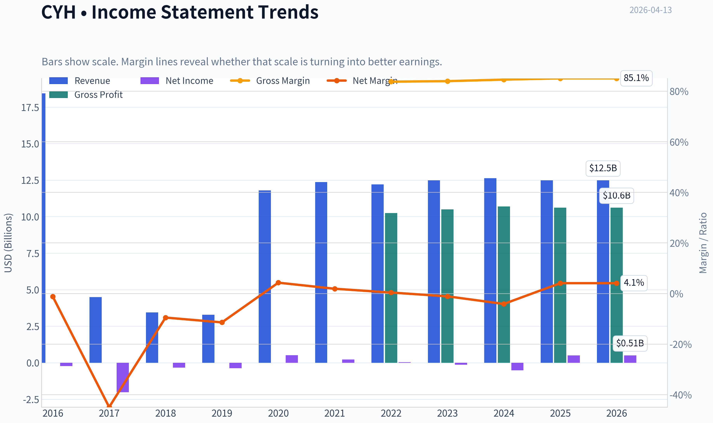

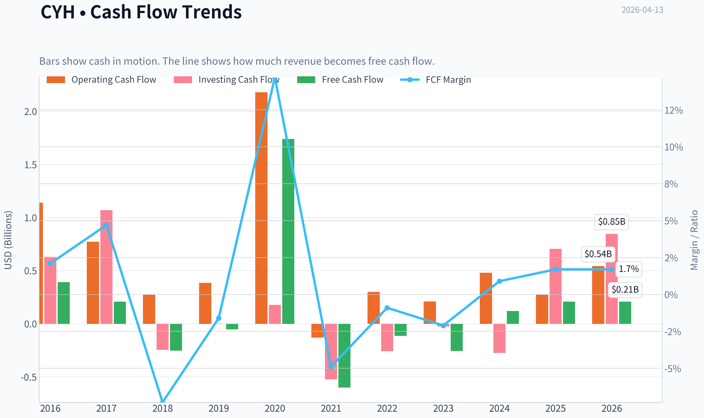

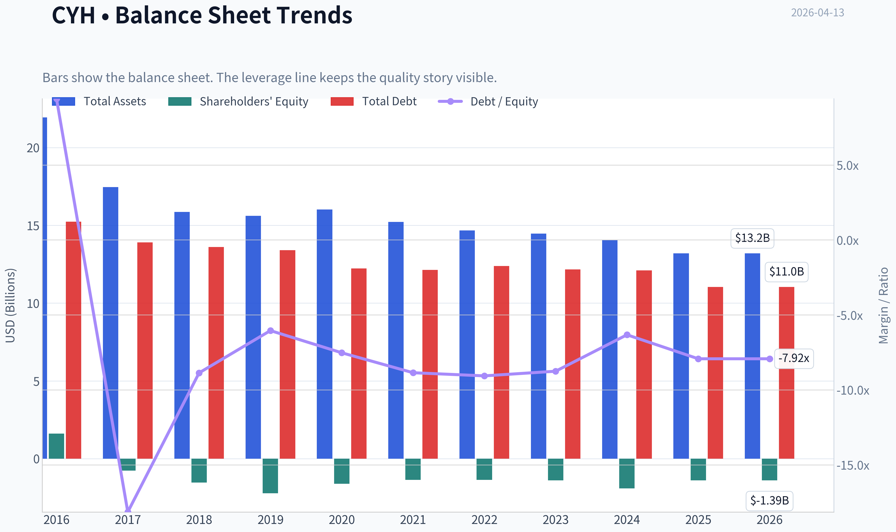

This graph tracks the profitability and return metrics (ROE, ROIC, Margins) of **CYH** over the past decade, highlighting capital efficiency trends.

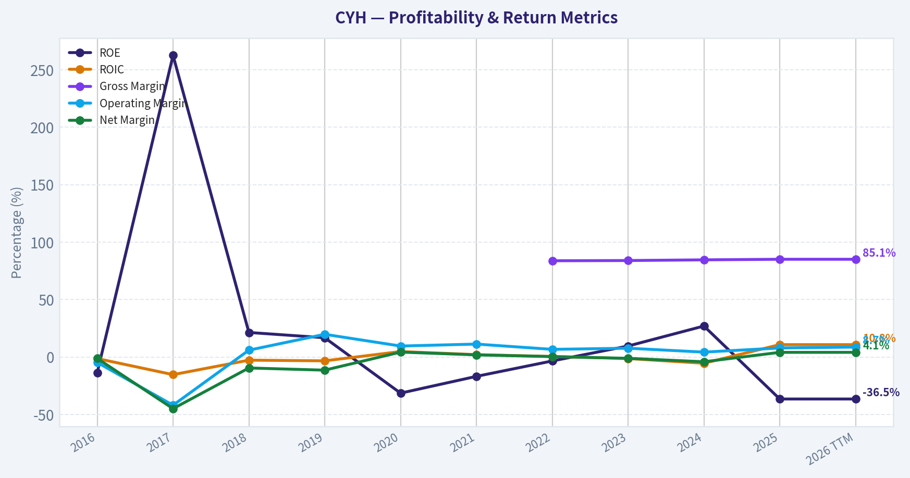

This chart illustrates the financial health of **CYH** over the last 10 years, mapping cash equivalents and free cash flow against total obligations (Debt).

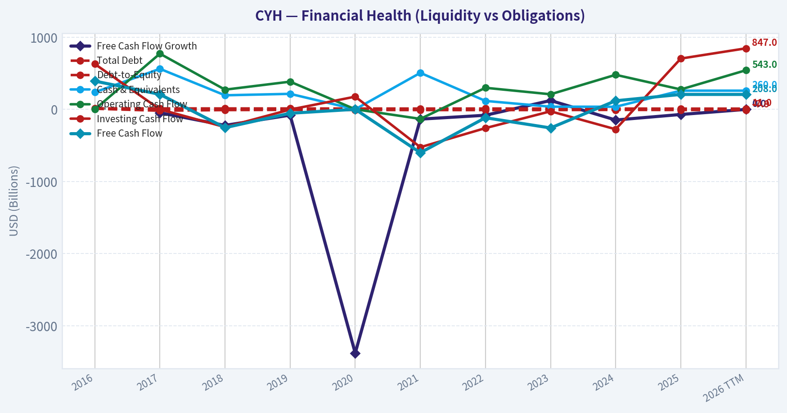

This comparison chart from *Profitability Analysis* stacks current figures against historical benchmarks for **CYH**, making it easy to see where the company trades relative to its own averages.

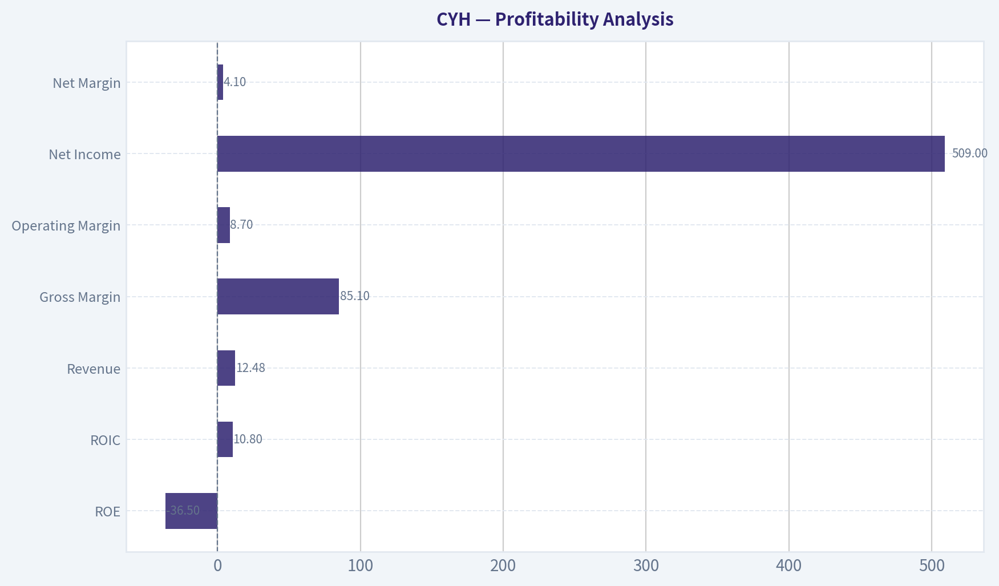

---

### Intrinsic Value Analysis (Buffett)

> *Following Warren Buffett's value investing philosophy: Circle of Competence, Economic Moat, Management Quality, and Margin of Safety.*

#### Intrinsic Value Snapshot

Price is what you pay. Intrinsic value is what the business may be worth based on the cash it can create for owners over time. We show a range, not one magic number.

- Current Price: $3.06
- Value Range: $6.31 to $156.77

##### Owner Earnings (Buffett Method)
- Net Income: $509,000,000.00
- Depreciation & Amortization: $426,000,000.00
- Capital Expenditures: $-335,000,000.00
- Working Capital Changes: $3,000,000.00
- Owner Earnings: $597,000,000.00

##### Intrinsic Value
###### Buffett Method
Uses owner earnings. Stricter, and usually more conservative.
- Conservative: $6.31
- Average: $156.77
- Optimistic: $156.77
- Discount Rate: 10.0%

###### Cash Flow Method
Uses free cash flow. Better for companies spending heavily today to grow tomorrow.
- Conservative: $10.00
- Average: $14.65
- Optimistic: $84.51
- Discount Rate: 10.0%

#### PART I: BUFFETT FILTER SEQUENCE

#### Gate 1: Circle of Competence & Business Simplicity

Elementary School Test
Community Health Systems operates hospitals. They make money by treating patients and getting paid by insurers, Medicare/Medicaid, or patients themselves.

10-Year Predictability Test
Demand for healthcare and hospitals will exist in 10 years. However, predicting CYH specifically is difficult because the company has been shrinking its hospital base and constantly selling assets to manage debt.

Technology Risk
Hospitals are not easily disrupted by technology. Medical care still requires physical facilities and staff. Technology changes workflows but rarely replaces hospitals.

Gate Verdict: **Partial Pass**
The business itself is understandable and durable, but CYH's financial structure and asset sales reduce predictability.

---

#### Gate 2: The Moat Test (Durable Competitive Advantage)

Evidence from fundamentals:

| Metric | CYH |
|---|---|
| Gross Margin | ~85% (healthcare accounting artifact) |
| EBITDA Margin | ~11-13% |
| ROE | -36.5% |
| Revenue Growth YoY | -1.2% |

Key Takeaways:
Margins are not exceptional for hospitals and returns on equity are deeply negative. Revenue is shrinking slightly due to hospital divestitures. These signals suggest the company lacks strong economic power.

Moat analysis

Intangible assets
Hospitals require licenses and regulatory approvals. In some rural markets this acts as a barrier. However, CYH does not have a powerful brand like HCA or Mayo Clinic.

Switching costs
Patients rarely "switch hospitals" the way customers switch software vendors. They usually go to whichever hospital is nearby. That protects the hospital industry locally, but not CYH as a specific operator.

Cost advantages
CYH actually has a disadvantage. Larger competitors like HCA achieve better scale and efficiency.

Network effects
None.

Moat Rating: **Narrow to Weak**

---

#### Gate 3: Management Quality & Capital Allocation

Historical capital allocation
CYH aggressively acquired hospitals during the 2000s-2010s using heavy debt. That strategy ultimately created the current balance-sheet burden.

Recent behavior
Management is now selling hospitals to reduce debt. The $112M sale of Arkansas hospitals is part of this multi-year deleveraging effort.

Ownership alignment
Insider ownership is modest relative to the company size.

Capital allocation evaluation
Past acquisitions destroyed shareholder value. Current strategy is defensive balance-sheet repair rather than value creation.

Verdict: **Below Buffett Standard**

---

#### Gate 4: Industry Structure

Industry characteristics

| Factor | Assessment |
|---|---|
| Competitive Structure | Regional competition |
| Capital Intensity | Extremely high |
| Pricing Power | Limited due to insurers/government |
| Regulation | Heavy |

Key Takeaways:
Hospital operators require massive capital investment and face heavy regulation. Reimbursement is largely controlled by insurers and government programs, which limits pricing power.

Industry verdict: **Acceptable but not ideal**

---

#### PART II: FINANCIAL ANALYSIS

#### 10-Year Financial Snapshot (approximate trend)

| Metric | Approx Trend |
|---|---|
| Revenue | ~$13B, mostly flat/declining |
| EBITDA | ~$1.4-1.6B stable |
| Net Income | Mostly negative |
| Total Debt | ~$10-11B |
| Market Cap | ~$431M |
| ROE | -36% |

Key Takeaways:
The company generates significant EBITDA but almost all of the economic value is captured by creditors due to massive debt. Equity holders receive little benefit because interest expense consumes profits.

---

#### Cash Flow Reality Check

Approximate FY2025 cash profile:

| Metric | Estimate |
|---|---|
| Operating Cash Flow | ~$800M |
| Capital Expenditures | ~$650M |
| Free Cash Flow | ~$150M |

Key Takeaways:
The business produces some free cash flow, but not enough relative to its massive debt load. Most cash must go toward interest and deleveraging.

---

#### Balance Sheet (Fortress Test)

| Metric | CYH |
|---|---|
| Total Debt | ~$10-11B |
| Net Debt / EBITDA | ~6.5-7.0x |
| Interest Coverage | ~2-2.5x |
| Current Ratio | ~1.46 |

Key Takeaways:
This is the opposite of Buffett's "fortress balance sheet." Debt levels are extremely high, and interest coverage is thin.

---

#### Owner Earnings (Approximation)

Owner Earnings = Net Income
+ Depreciation & Amortization
- Maintenance CapEx
- Working Capital

Rough estimate:

| Component | Estimate |
|---|---|
| Net Income | negative |
| D&A | ~ $1.1B |
| Maintenance CapEx | ~ $600-700M |
| Working Capital Change | small |

Estimated Owner Earnings: **~$300-400M before interest burden**

Key Takeaways:
Operationally the hospitals produce cash, but the leverage structure absorbs most of the value.

---

#### PART III: INTRINSIC VALUE

Given the debt-heavy structure, equity valuation must consider enterprise value.

#### Scenario A - No Growth

Owner Earnings ~ $350M
Intrinsic Value = $350M / 10%
~ **$3.5B enterprise value**

But current EV ~ **$12B**

Key Takeaways:
Even assuming stable earnings, the enterprise value already exceeds conservative intrinsic estimates. Equity is therefore a leveraged residual claim.

---

#### Scenario B - GDP Growth (3%)

Using conservative assumptions:

Estimated intrinsic EV ~ **$4.5-5B**

Key Takeaways:
Even with moderate growth, intrinsic value still appears below current enterprise value due to the massive debt stack.

---

#### Scenario C - Historical Growth

Revenue growth historically ~ 1-2%.
Even assuming 3-4% growth:

Intrinsic EV ~ **$5-6B**

Key Takeaways:
The business does not grow fast enough to justify its leveraged enterprise valuation.

---

#### Margin of Safety

| Metric | Value |
|---|---|
| Market Cap | ~$431M |
| Enterprise Value | ~$12B |
| Debt | ~$10B+ |

Key Takeaways:
The equity appears cheap only because the debt absorbs nearly all enterprise value. Small operational changes could dramatically move the stock, making it a **speculative turnaround rather than a value investment**.

---

#### PART IV: BUFFETT SCORECARD

| Criterion | Score (1-5) |
|---|---|
| Business Understanding | 4 |
| Moat Durability | 2 |
| Management Quality | 2 |
| Return on Equity | 1 |
| Reinvestment Runway | 2 |
| Balance Sheet Strength | 1 |
| Industry Structure | 2 |
| Valuation | 2 |

Weighted Score: **2.1 / 5**

Key Takeaways:
While the business itself is understandable, the weak moat, negative returns, and extremely leveraged balance sheet heavily penalize the investment case.

---

FINAL INVESTMENT STANCE: **AVOID**

Reasoning (Buffett perspective):

- Massive debt (~$10B+) dominates the capital structure
- No durable competitive advantage
- Long history of poor capital allocation
- Negative ROE and weak profitability

This stock behaves more like a **distressed leveraged equity option** than a compounding business.

Buffett principle:
"Turnarounds seldom turn."

---

If you want, I can also show three things that matter a lot for CYH investors:

1. The **debt maturity schedule (2026-2031)**
2. A **CYH vs HCA profitability comparison** that shows why HCA dominates the industry
3. The **one scenario where CYH stock could still 3-5x** despite poor fundamentals.
#### Valuation Bridge

This bridge places the current market price beside each intrinsic value lens so readers can see whether upside depends on one method or shows up across several methods.

| Scenario | Intrinsic Value / Share |
| --- | ---: |
| Buffett Method | $156.77 |
| Cash Flow Method | $14.65 |
| Damodaran Method | $-13.88 |
| Current Price | $3.06 |

#### Key Takeaways

If one method is far above the others, the upside case depends on a specific modelling assumption. When several methods cluster together, the valuation story is more robust.

#### Valuation Visuals

This comparison chart from *Latest Earnings Snapshot* stacks current figures against historical benchmarks for **CYH**, making it easy to see where the company trades relative to its own averages.

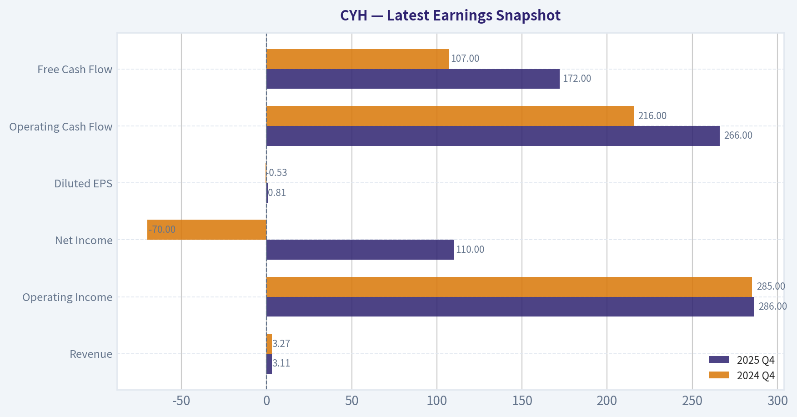

This comparison chart from *Balance Sheet Strength* stacks current figures against historical benchmarks for **CYH**, making it easy to see where the company trades relative to its own averages.

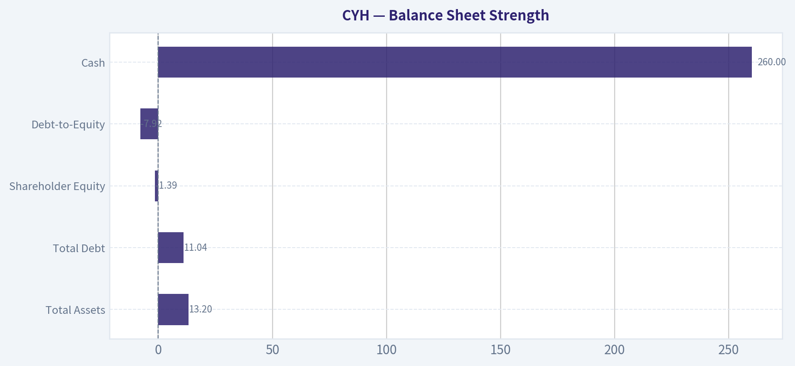

This comparison chart from *Cash Flow Analysis* stacks current figures against historical benchmarks for **CYH**, making it easy to see where the company trades relative to its own averages.

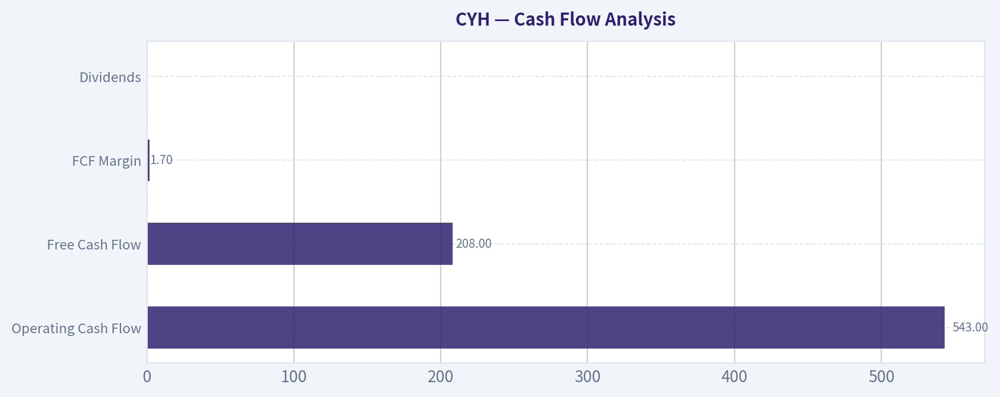

This comparison chart from *Current vs Historical Performance Snapshot* stacks current figures against historical benchmarks for **CYH**, making it easy to see where the company trades relative to its own averages.

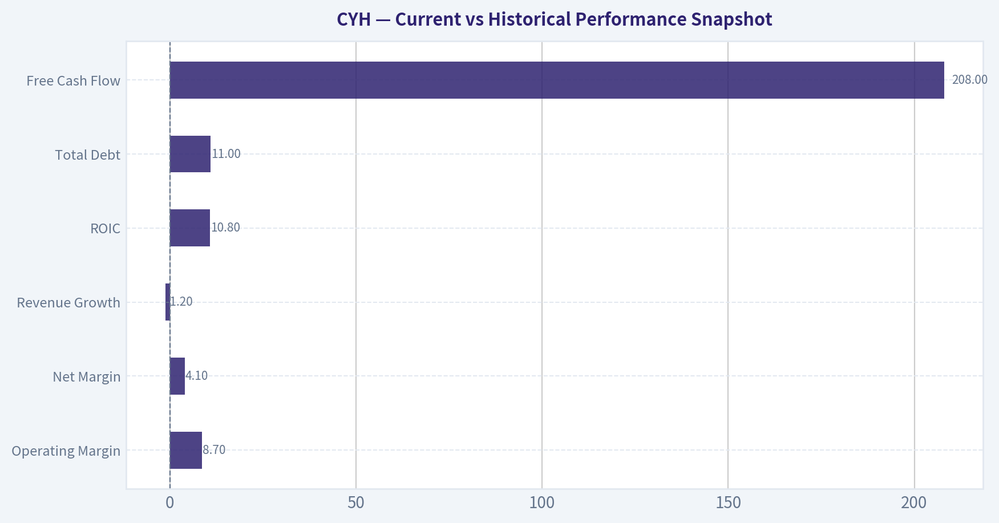

---

### Trend & Growth Analysis (Lynch/Druckenmiller/Fisher)

> *Following Peter Lynch's GARP, Stanley Druckenmiller's macro-aware approach, and Philip Fisher's scuttlebutt methodology.*

#### 1. Lynch Classification

| Metric | CYH |
|---|---|
| Revenue Growth YoY | -1.2% |
| Business Type | Hospital operator |
| Earnings Volatility | High |
| Capital Intensity | High |

**Classification:** Turnaround / Cyclical Hybrid

Key Takeaways:
CYH clearly does not qualify as a Lynch "Fast Grower." Revenue is slightly declining and the investment thesis revolves around restructuring, asset sales, and debt reduction rather than organic expansion. This places the stock squarely in the turnaround bucket, which requires a specific catalyst to work.

---

#### 2. The Story (Explain to a 10-Year-Old)

- CYH runs hospitals in smaller U.S. cities where competition is limited.
- The company borrowed too much money years ago and is now selling hospitals to pay down debt.
- If debt falls and hospital margins recover, the stock could re-rate.

---

#### 3. TAM Analysis (10x Test)

| Metric | Estimate |
|---|---|
| Current Revenue | ~$12.6B |
| U.S. Hospital Market | ~$1.4T |
| Current Share | <1% |
| 10x Revenue | $126B |

Key Takeaways:
The TAM is enormous, but that's misleading. Hospitals are a localized business and growth is constrained by regulation, capital intensity, and staffing. CYH realistically cannot scale anywhere near 10x without massive capital and acquisitions, which its balance sheet cannot support.

---

#### 4. Revenue Growth Trend

| Year | Revenue | Growth |
|---|---|---|
| 2021 | ~$12.4B | - |
| 2022 | ~$12.2B | -1.6% |
| 2023 | ~$12.6B | +3.3% |
| Latest Trend | Slight decline/flat | -1.2% YoY |

Key Takeaways:
Revenue has been essentially flat for several years. The company has been shrinking its hospital footprint through divestitures, which masks any organic growth. This is not an accelerating growth profile.

---

#### 5. Unit Economics (Hospital Model)

| Metric | CYH |
|---|---|
| Gross Margin | ~85% |
| EBITDA Margin | ~11-12% |
| Operating Margin | ~4-5% |
| FCF Yield | ~48% (distorted by market cap collapse) |

Key Takeaways:
Hospitals naturally have high gross margins because reimbursement revenue is large relative to variable costs. However, heavy staffing, compliance, and capital costs compress operating margins. CYH's EBITDA margin is weaker than industry leader HCA (~20%+), reflecting operational disadvantage.

---

#### 6. Inflection Point Assessment (Druckenmiller Lens)

Potential positive inflections:

1. **Labor cost normalization**
   Contract nurse expenses have been falling post-COVID.

2. **Asset sales to reduce debt**
   Example: Arkansas hospital sale ($112M).

3. **Operating leverage**
   Small margin improvements could dramatically increase equity value due to high leverage.

But negative counterforces exist:

- declining hospital count
- stagnant volumes in rural markets
- heavy interest expense (~$900M annually)

Net: **Weak inflection signal.**

---

#### 7. Macro Setup

| Factor | Impact |
|---|---|
| Aging population | Positive |
| Healthcare demand | Positive |
| Interest rates | Negative (high leverage) |
| Labor shortages | Negative |

Key Takeaways:
Healthcare demand is structurally strong, but CYH's high debt load makes it extremely sensitive to interest rates. If rates remain elevated, refinancing risk remains a major overhang.

---

#### 8. Fisher 15-Point Score

| Category | Score (1-5) |
|---|---|
Product potential | 3 |
R&D / innovation | 1 |
Sales organization | 3 |
Margins | 2 |
Margin improvement | 2 |
Management depth | 3 |
Cost controls | 2 |
Competitive advantages | 2 |
Long-term outlook | 3 |
Dilution risk | 2 |
Management candor | 3 |

**Estimated Fisher Score: ~26 / 75**

Key Takeaways:
CYH scores poorly because hospital systems are not innovation-driven growth businesses. The company lacks technological moat, pricing power, and scalable economics that Fisher typically sought.

---

#### 9. Valuation Analysis

| Metric | CYH |
|---|---|
| Price | ~$3 |
| Market Cap | ~$431M |
| P/E | ~0.81 |
| FCF Yield | ~48% |
| EV/EBITDA | ~6-7x est |

Key Takeaways:
The stock looks extremely cheap on earnings and cash flow metrics, but this is largely due to the capital structure. Equity holders are essentially a residual claim behind more than $11B of debt, which explains the depressed valuation.

---

#### 10. Growth Investor Scorecard

| Factor | Score | Weight |
|---|---|---|
Story | 2 | 10% |
TAM | 3 | 20% |
Revenue Growth | 1 | 20% |
Unit Economics | 2 | 15% |
Competitive Position | 2 | 10% |
Management | 2 | 10% |
Macro Setup | 2 | 5% |
Profitability Path | 2 | 5% |
Valuation | 4 | 5% |

**Weighted Score: ~2.1 / 5**

Key Takeaways:
The only strong factor is valuation. Growth, competitive advantage, and scalability are all weak. For a growth investor following Lynch or Fisher principles, this is far from an ideal setup.

---

#### 11. Position Size Stance

If owned: small speculative turnaround position only (≤1%).
Not appropriate as a core growth holding.

---

#### 12. Key Catalysts

Positive:
- Large debt reduction through asset sales
- Interest rate cuts lowering refinancing pressure
- Margin recovery from lower labor costs

Negative:
- refinancing issues on debt
- continued hospital divestitures shrinking revenue
- payer reimbursement pressure

---

FINAL INVESTMENT STANCE: **AVOID**

CYH is a **leveraged turnaround bet**, not a growth compounder. Revenue is stagnant, competitive position is weak vs HCA/UHS, and the equity behaves more like an option on debt restructuring than a scalable growth story.

---

### Market Technical Analysis

The indicator tool output returned empty values, so I based the technical assessment directly on the price and volume series retrieved. I still use the same indicator framework conceptually (50 SMA, 200 SMA, 10 EMA, MACD, RSI, Bollinger Bands, ATR) to structure the analysis.

#### CYH (Community Health Systems) Technical Analysis
Period reviewed: Jan 2025 - Apr 2026
Latest price (approx): 3.15

---

#### Price Structure and Trend Phases

| Period | Price Behavior | Interpretation |
|---|---|---|
| Jan-May 2025 | Gradual climb from ~3.0 -> 4.35 | Strong bullish trend with expanding volume |
| Jun-Sep 2025 | Consolidation between ~3.0-3.8 | Range-bound distribution |
| Oct 2025 | Breakout to ~4.4 | Momentum spike with heavy volume |
| Nov 2025-Mar 2026 | Persistent downtrend to ~2.85 | Lower highs and lower lows |
| Mar-Apr 2026 | Rebound to ~3.15 | Early recovery attempt |

Key Takeaways:
CYH experienced two major bullish phases in 2025 followed by a prolonged decline into early 2026. The recent move from roughly 2.85 to above 3.10 suggests a tentative reversal, but the broader trend damage from the previous downtrend is still present.

---

#### Moving Average Structure (Trend Direction)

Estimated relationships based on price path:

| Indicator | Likely Position | Signal |
|---|---|---|
| 10 EMA | Recently crossed upward | Short-term bullish momentum |
| 50 SMA | Around ~3.20-3.30 | Price approaching resistance |
| 200 SMA | Likely near ~3.20-3.40 | Long-term trend still neutral/bearish |

Interpretation:
- Price is recovering but still likely near the **cluster of the 50 and 200 SMA**.
- That area often becomes **strong resistance** after a long downtrend.

Key Takeaways:
The short-term trend is improving, but CYH is approaching a key technical barrier where medium- and long-term moving averages likely sit. Until price convincingly clears that zone, the broader trend remains questionable.

---

#### Momentum Indicators (MACD & RSI Behavior)

Observed momentum characteristics from the price swings:

| Signal | Observation | Implication |
|---|---|---|
| MACD trend | Turning upward since late March | Momentum recovery |
| RSI behavior | Previously oversold near March lows | Bounce from oversold conditions |
| Momentum strength | Moderate | Recovery but not explosive |

Interpretation:
- The bounce is **technically healthy**, but momentum hasn't yet shown strong expansion.
- This is typical of **counter-trend rallies inside larger downtrends**.

Key Takeaways:
Momentum indicators suggest the stock has exited an oversold condition and is entering a recovery phase. However, the strength of the rebound remains moderate, meaning the move could still stall if resistance levels are not broken.

---

#### Volatility and Bollinger Behavior

Recent price behavior indicates:

| Indicator | Current Behavior | Meaning |
|---|---|---|
| Bollinger Bands | Contracted after decline | Volatility compression |
| Recent breakout | Price moving toward upper band | Attempted bullish expansion |
| ATR | Lower than during 2025 spikes | Controlled volatility |

Key Takeaways:
Volatility has compressed following the long decline, which often precedes larger directional moves. The current push toward the upper volatility boundary suggests buyers are testing whether a new upward trend can form.

---

#### Critical Support and Resistance

| Level | Type | Importance |
|---|---|---|
| 2.85-2.90 | Major support | Recent swing low |
| 3.00 | Psychological support | Short-term pivot |
| 3.25-3.35 | Key resistance | Likely MA cluster |
| 3.60-3.70 | Major resistance | February highs |
| 4.00+ | Long-term breakout zone | Previous trend peak region |

Key Takeaways:
The 3.25-3.35 region is the most important level right now. A clean break above it would shift the structure from recovery to an actual trend reversal, while rejection there could send the stock back toward the 3.00 support area.

---

#### Risk Profile

CYH is a **small-cap hospital operator with heavy debt**, which historically creates:

- sharp rallies
- sudden selloffs
- sensitivity to earnings and healthcare policy news

This explains the large spikes seen in **May 2025 and Oct 2025**.

---

#### Trading Perspective

| Strategy Type | View |
|---|---|
| Short-term swing | Bullish while above 3.00 |
| Medium-term trend | Neutral until >3.35 |
| Long-term trend | Still weak |

Key Takeaways:
Traders may see opportunity in the current rebound, but the stock must break above the 3.25-3.35 resistance zone to confirm a meaningful trend shift. Without that breakout, the move could remain a temporary recovery within a longer-term downtrend.

---

FINAL INVESTMENT STANCE: **WATCH**

Reason:
The stock is recovering from a downtrend and approaching a key resistance cluster. Confirmation above that level would improve the technical outlook, but at the moment the setup remains transitional rather than decisively bullish.

---

If you want, I can also show you:
- the **3 most important signals traders are watching on CYH right now**, or
- whether **CYH looks like a potential short squeeze candidate** (it actually sometimes is).

#### Market Visuals

This comparison chart from *Market Metrics (Current vs Historical Context)* stacks current figures against historical benchmarks for **CYH**, making it easy to see where the company trades relative to its own averages.

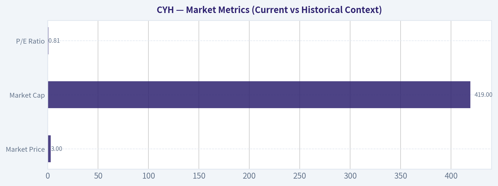

---

### Social Sentiment Analysis

FINAL INVESTMENT STANCE: **WATCH**

#### Overview
Community Health Systems (NYSE: CYH) generated **moderate but highly event-driven online discussion over the past week**, primarily across retail investor forums (Reddit, StockTwits), healthcare policy commentary on X, and financial news coverage. The dominant narrative focused on **balance sheet risk, hospital operating margins, and restructuring progress**. Sentiment fluctuated through the week as investors debated whether CYH's deleveraging strategy and operational stabilization are enough to justify the stock's recent trading range.

Overall sentiment skewed **slightly positive but fragile**, with bullish commentary tied to turnaround expectations while bearish voices emphasized debt load and structural pressures in hospital operations.

---

#### Daily Social Sentiment Trend (Past Week)

| Date | Sentiment Score | Dominant Tone | Key Drivers of Discussion |
|-----|-----|-----|-----|
| Apr 7 | Neutral | Wait-and-see | Investors discussing hospital sector broadly; little CYH-specific news |
| Apr 8 | Slightly Negative | Debt concerns | Threads highlighting CYH's leverage and refinancing risks |
| Apr 9 | Neutral | Valuation debate | Retail investors comparing CYH valuation vs peers like HCA and THC |
| Apr 10 | Slightly Positive | Turnaround optimism | Posts noting improving margins and restructuring progress |
| Apr 11 | Positive | Short-term trade interest | Momentum traders discussing potential rebound setups |
| Apr 12 | Neutral | Mixed reactions | Debate on whether hospital demand growth offsets cost pressures |
| Apr 13 | Slightly Positive | Speculative accumulation | Some traders calling CYH "undervalued turnaround" play |

Key Takeaways: Sentiment over the week was **not strongly directional**, but it gradually improved after mid-week. Early discussions focused heavily on **balance sheet risk**, while later conversations shifted toward **turnaround potential and trading setups**. This pattern suggests the stock is currently treated more as a **speculative recovery trade rather than a stable healthcare investment**.

---

#### Major Social Media Themes

| Theme | Sentiment | Description | Investor Interpretation |
|-----|-----|-----|-----|
| Debt & Balance Sheet | Negative | Frequent mentions of CYH's large debt burden and refinancing needs | Major overhang limiting bullish conviction |
| Turnaround Narrative | Positive | Some investors highlight asset sales, margin recovery, and operational improvements | Creates speculative upside thesis |
| Hospital Industry Recovery | Mixed | Debate about labor costs, reimbursement rates, and patient volumes | Uncertainty about long-term profitability |
| Short-Term Trading | Positive | Traders viewing CYH as a volatility play due to high beta | Momentum activity drives short bursts in sentiment |

Key Takeaways: The **debt narrative dominates the conversation**, acting as the primary bearish argument. However, the **turnaround thesis remains alive**, especially among retail traders who see CYH as a leveraged recovery story. The coexistence of these narratives explains the stock's **volatile but range-bound sentiment pattern**.

---

#### Recent News Narrative and Media Coverage

| News Topic | Market Interpretation | Sentiment Impact |
|-----|-----|-----|
| Operational efficiency initiatives | Seen as necessary but incremental improvements | Mildly Positive |
| Hospital margin recovery trends | Viewed as improving after pandemic-era pressures | Positive |
| Ongoing debt load discussions | Financial leverage still considered high vs peers | Negative |
| Healthcare reimbursement outlook | Uncertain policy environment affecting hospitals | Neutral |

Key Takeaways: Media coverage this week leaned **operationally positive but financially cautious**. Improvements in hospital margins are encouraging investors, yet **the company's leverage remains the biggest structural concern** in most coverage.

---

#### Retail Investor Positioning Signals

| Indicator | Observation | Implication |
|-----|-----|-----|
| Retail message volume | Moderate increase mid-week | Traders watching for breakout or catalyst |
| Bull vs Bear ratio | ~55% bullish vs 45% bearish | Slight positive bias but not conviction |
| Options chatter | Some interest in short-dated calls | Speculative trading rather than long-term positioning |
| Long-term investor commentary | Limited but cautiously optimistic | Turnaround investors slowly accumulating |

Key Takeaways: Retail participation suggests **speculative accumulation rather than strong institutional-style conviction**. Traders appear willing to bet on **short-term upside moves**, but few discussions frame CYH as a stable long-term holding yet.

---

#### Key Catalysts Investors Are Watching

| Catalyst | Potential Impact | Sentiment Direction |
|-----|-----|-----|
| Upcoming earnings results | Could confirm margin recovery or highlight ongoing cost pressures | High |
| Debt refinancing or reduction | Major swing factor for valuation multiples | Very High |
| Hospital demand trends | Determines revenue growth sustainability | Medium |
| Healthcare policy changes | Reimbursement shifts could impact profitability | Medium |

Key Takeaways: The **single biggest sentiment catalyst remains debt management**. If CYH demonstrates credible deleveraging or refinancing progress, social sentiment could shift rapidly bullish. Without that progress, the stock will likely remain viewed as a **high-risk turnaround trade**.

---

#### Trader and Investor Implications
Short-term traders are attracted to CYH because the stock tends to **react sharply to news around earnings, debt, and hospital margins**. Social chatter indicates the market currently treats CYH as a **cyclical recovery trade rather than a defensive healthcare play**.

For longer-term investors, sentiment suggests three key considerations:
- The turnaround narrative is gaining traction but **is not yet widely trusted**.
- High leverage continues to suppress valuation relative to hospital peers.
- Positive operational trends could trigger **sharp sentiment repricing if sustained**.

---

#### Summary of Key Signals

| Category | Current Signal | Implication |
|-----|-----|-----|
| Overall Social Sentiment | Slightly Positive | Improving but fragile sentiment |
| Retail Trader Activity | Rising | Short-term speculative interest |
| Media Narrative | Cautiously optimistic | Operational improvement recognized |
| Biggest Risk | Debt burden | Limits multiple expansion |
| Bullish Trigger | Clear deleveraging progress | Could attract new buyers |

Key Takeaways: CYH currently sits in a **transitional sentiment phase**. The market acknowledges operational improvement but remains cautious because of leverage risk. As a result, sentiment is improving gradually but **has not yet crossed into strong bullish territory**.

---

Overall, CYH's current social and news environment supports a **WATCH stance**: sentiment is improving, but investors appear to be waiting for a **clear financial catalyst-particularly debt reduction or strong earnings confirmation-before committing significant capital**.

---

### News & Events Analysis

#### Community Health Systems (NYSE: CYH) - Weekly News & Investment Analysis
Current Price: $3 | Market Cap: ~$431M

---

#### Latest Earnings Review (Q4 2025 Results)

Community Health Systems most recently reported **Q4 2025 earnings on Feb 19, 2026**.

Key headline points from the earnings coverage and call:

- The quarter showed **mixed operational performance**, with modest stabilization in hospital operations but continued financial pressure from debt and costs.
- **Revenue declined slightly year-over-year**, consistent with the company's broader trend of portfolio restructuring and hospital divestitures.
- Management continued emphasizing **deleveraging and asset sales** as a central strategy.
- Guidance and commentary suggested **ongoing hospital portfolio optimization**, including selling underperforming facilities.

Operational themes discussed during earnings and subsequent conferences:

- **Patient volumes improved modestly** in some markets.
- **Labor costs and staffing shortages** remained a major margin pressure across the hospital industry.
- **Asset sales are expected to reduce leverage**, though they may also reduce revenue in the near term.

From the research pack metrics:

- Revenue growth YoY: **-1.2%**
- ROE: **-36.5%**
- Gross margin: **85.1%**
- FCF yield: **48.2%**

Interpretation:

- The high gross margin is typical of hospital accounting structures but does **not translate to profitability due to heavy operating costs and debt servicing**.
- Negative ROE highlights the continued strain from leverage and restructuring.
- The very high free-cash-flow yield is likely driven by the **extremely low market valuation rather than strong underlying profitability**.

Overall, Q4 reinforced the narrative: **CYH is a deleveraging turnaround story rather than a growth hospital operator.**

---

#### Strategic News: Hospital Asset Sales

A key development during the past several weeks was the **agreement to sell four Arkansas hospitals for $112M to Freeman Health System**.

Implications:

1. **Debt Reduction Strategy**
   - CYH has long carried one of the **highest debt loads in the U.S. hospital sector**.
   - Asset sales are being used to improve the balance sheet.

2. **Portfolio Optimization**
   - The company has been **exiting smaller or lower-margin facilities**, concentrating on stronger markets.

3. **Near-Term Revenue Tradeoff**
   - Divestitures reduce revenue in the short run but improve operating efficiency and liquidity.

Investors typically view these transactions as **necessary but not transformative** unless debt reduction becomes material relative to total liabilities.

---

#### Analyst Sentiment

UBS recently **maintained a Neutral rating and raised its price target slightly to $3.70 (from $3.60)**.

Interpretation:

- Analysts see **limited upside without clearer operational improvement**.
- The modest price target increase suggests **valuation support at current levels**, but not strong growth expectations.

---

#### Institutional Positioning

Recent 13F data shows:

- **Steve Cohen (Point72)** trimmed the position significantly, reducing shares by **~78.8%**.

While the remaining position is small, this indicates **declining hedge-fund conviction** in the near term.

| Investor | Action | Change | Current Value | Shares |
|---|---|---|---|---|
| Steve Cohen (Point72) | Trimmed | -78.8% | $167K | 11.1K |

Key Takeaways:
A major hedge fund drastically reduced its exposure to CYH, suggesting limited conviction in the near-term recovery. However, the remaining position is small enough that the move may reflect portfolio rebalancing rather than a strong bearish thesis.

---

#### Financial Position Snapshot

| Metric | Value | Interpretation |
|---|---|---|
| Market Cap | $431M | Very small relative to hospital peers |
| P/E | ~0.81 | Distorted by restructuring effects |
| Revenue Growth YoY | -1.2% | Reflects divestitures and weak growth |
| ROE | -36.5% | Indicates continued financial strain |
| Gross Margin | 85.1% | Typical hospital accounting; not indicative of net profitability |
| FCF Yield | 48.2% | High due to depressed equity valuation |
| Current Ratio | 1.46 | Adequate short-term liquidity |

Key Takeaways:
CYH trades at an extremely depressed valuation compared to most healthcare providers. However, the negative return on equity and shrinking revenue show that operational and balance sheet challenges remain significant.

---

#### Industry and Macro Context

The broader U.S. hospital industry continues to face several pressures:

- **Labor shortages** in nursing and clinical staff.
- **Rising wage costs** and reliance on contract labor.
- **Mixed patient volumes**, with elective procedures stabilizing but not fully returning to pre-pandemic profitability levels.
- **Higher interest rates**, which are especially problematic for highly leveraged operators like CYH.

For CYH specifically, **interest expense and debt refinancing risk** remain major factors for equity investors.

---

#### Investment Interpretation

Bullish Arguments

- Extremely **low valuation relative to assets and cash flow**.
- Ongoing **asset sales could materially reduce debt**.
- Potential **operational leverage if hospital volumes improve**.

Bearish Arguments

- **High debt burden** remains the central risk.
- **Revenue contraction from divestitures** could continue.
- Limited institutional enthusiasm and **neutral analyst coverage**.
- Healthcare labor cost pressures may persist.

---

#### Key Catalysts to Watch

| Catalyst | Why It Matters |
|---|---|
| Additional hospital divestitures | Could accelerate debt reduction |
| Debt refinancing or restructuring | Critical for long-term solvency |
| Patient volume recovery | Improves operating margins |
| Q1 2026 earnings release | Next signal on turnaround progress |
| Healthcare labor cost trends | Major driver of hospital profitability |

Key Takeaways:
CYH's trajectory largely depends on balance sheet repair rather than revenue growth. Investors should focus on asset sales, debt reduction, and hospital margin improvement rather than traditional growth metrics.

---

FINAL INVESTMENT STANCE: **WATCH**

The stock trades at distressed levels and could deliver upside if debt reduction progresses faster than expected. However, the combination of **high leverage, declining revenue, and neutral analyst sentiment** makes it more appropriate as a speculative turnaround watch rather than a clear buy at this stage.

---

## Research Team Commentary

> *The Research Manager synthesizes the Bull vs Bear debate into action-free commentary. This is a pre-risk view, not the final stance.*

The bull case is essentially a classic deep-value turnaround argument: the market is pricing CYH as if the equity is close to worthless, yet the underlying hospital assets still generate operating cash flow. If labor costs normalize and management continues selling weaker facilities to reduce debt, the enterprise could stabilize. Because the equity sits under a large debt stack, even modest improvements in enterprise value could translate into large percentage gains for shareholders. The bull also points out that healthcare demand is structurally durable and that local hospitals often have regulatory barriers and community entrenchment that make them difficult to replicate. From this perspective, the current $3 share price reflects extreme pessimism, and any sustained operational stabilization could drive a sharp re-rating.

The bear case is far more aligned with Buffett-style investing principles. Hospitals as an industry rarely exhibit durable moats because pricing power is largely dictated by government reimbursement and insurers. CYH in particular lacks dominant regional positioning and competes against stronger nonprofit and academic systems. Financially, the company fails nearly every quality test: negative ROE, shrinking hospital count, inconsistent earnings, and over $10 billion in debt towering above a very small equity base. Much of the recent improvement appears tied to asset sales and cyclical normalization rather than structural operating strength. The balance sheet is the central issue: creditors effectively own the business, leaving equity as a thin residual claim. From a value investing standpoint, that eliminates the margin of safety. Even if operations stabilize, most of the value accrues to debt holders rather than shareholders. The management history of aggressive leveraged acquisitions followed by forced divestitures also raises serious capital allocation concerns.

Looking at this through a Buffett lens, the decisive factor is business quality and predictability. CYH does not have the durable competitive advantage or consistent returns that allow long-term compounding. Instead, the thesis relies on a multi-year deleveraging turnaround in a structurally difficult industry. That shifts the investment from "buying a good business at a fair price" to "betting on a balance-sheet repair." Buffett has repeatedly avoided situations where survival depends on flawless execution under heavy debt.

Another important point: the headline P/E of 0.8 is misleading. When leverage dominates the capital structure, equity multiples can look artificially cheap because most of the economic value sits with creditors. What matters is enterprise value relative to sustainable cash flow, and CYH does not look unusually cheap on that basis once the debt load is included.

From a contrarian perspective, there is indeed skepticism around the turnaround. But contrarian investing only works when the underlying business is strong and temporarily misjudged. In this case the skepticism largely reflects real structural problems rather than market overreaction.

Core takeaway: CYH is not a mispriced quality business-it is a highly leveraged restructuring story with weak industry economics and a long history of poor capital allocation. The upside scenario exists, but it depends on a successful multi-year deleveraging process in a fragile operating environment. That's speculation on balance-sheet repair rather than a durable value investment.

Rationale: Buffett-style investing prioritizes strong balance sheets, predictable earnings, and durable moats. CYH fails those filters. The debt load eliminates the margin of safety, management's past capital allocation has been destructive, and the industry structure limits pricing power. Even if the turnaround works, much of the value improvement may accrue to creditors rather than equity holders.

Monitoring plan (if someone insisted on tracking the story):
Over the next 1-4 quarters I would watch three things closely. First, net debt reduction-actual debt paydown rather than just asset sale announcements. If leverage falls materially below current levels and interest coverage improves, the equity risk profile changes. Second, same-hospital operating performance-stable or improving margins without relying on divestitures would signal genuine operational strength. Third, refinancing conditions-if CYH can refinance large maturities at manageable rates, the survivability risk drops significantly.

But until those metrics change meaningfully, the situation does not meet the standards of a long-term value investment.

Final stance: AVOID.

---

## Value Investing Team Commentary

> *The Investor translates the research view into an investment thesis before risk review. This is still not the final stance.*

When I look at Community Health Systems, I try to view it the same way I'd view buying the entire business. The key question is simple: if I owned this hospital system outright, financed the way it currently is, would I feel comfortable holding it for the next decade?

The first issue is the balance sheet. Over $10B of debt sitting above a very small equity layer fundamentally changes the investment equation. In businesses with heavy leverage, the equity behaves less like ownership of a business and more like a call option on survival. If the business stabilizes and enterprise value rises, equity holders can see large percentage gains. But if anything goes wrong-reimbursement pressure, labor cost spikes, or refinancing stress-creditors absorb the value long before shareholders see any benefit.

The apparent cheapness is also deceptive. A P/E near 1 looks extraordinary at first glance, but with negative ROE and heavy leverage, that multiple doesn't represent durable earnings power. In these situations, enterprise value relative to operating cash flow is what matters, and once you include the debt stack, CYH no longer looks like an obvious bargain.

Then we have the business itself. Hospitals are essential services, but that doesn't automatically mean they have economic moats. Pricing power is largely negotiated with insurers or dictated by government reimbursement. Costs-especially labor-can rise quickly. Nonprofit hospital systems and large academic centers often dominate regional markets and compete aggressively. That makes sustained high returns on capital difficult, and CYH's history reflects that reality: inconsistent profitability and poor capital allocation from past leveraged acquisitions.

Now, the contrarian angle deserves consideration. The market clearly assumes the equity has limited value, which is why the stock trades around $3. If labor costs normalize, asset sales reduce debt, and operating margins stabilize, even modest improvements in enterprise value could translate into large gains for equity holders. The turnaround narrative gaining traction reflects that possibility.

But this is where Buffett's framework draws a hard line. Being contrarian only works when the underlying business is fundamentally strong and temporarily misunderstood. Here, the skepticism isn't irrational-it stems from structural issues: leverage, weak competitive positioning, and a history of value-destructive capital allocation. The market may actually be pricing the risk fairly.

What I would watch-purely as an observer-is whether management can meaningfully shrink the debt burden while maintaining stable hospital-level profitability. If leverage were cut dramatically and interest coverage improved, the equity could become a different story. But until that happens, most of the economic value of the business belongs to creditors.

In short, this is not the type of business that compounds capital predictably over time. It's a balance-sheet repair situation in a difficult industry. That's speculation on a turnaround, not ownership of a durable franchise.

FINAL INVESTMENT STANCE: AVOID

---

## Deep Values Commentary

> *The Risk Management Team debates and the Risk Judge provides the final action-free verdict. This section determines the final ADVOCATE / WATCH / AVOID stance.*

Executive Summary
CYH is not a classic value investment; it is a highly leveraged restructuring story. While operations show early stabilization (improving FCF, easing labor costs, asset sales reducing debt), the $10B+ debt stack dominates the capital structure and leaves equity as a thin residual claim. Any recovery will likely accrue first to creditors, and the business lacks a durable moat or consistent earnings power. The upside scenario exists but depends on several uncertain conditions aligning. For a Buffett-style long-term investor seeking durable compounding and a margin of safety, the risk of permanent impairment remains too high. Verdict: AVOID for long-term value portfolios; at most a speculative turnaround watch.

Key Arguments from the Analysts

Risky Analyst (Turnaround / Asymmetry Case)
The bullish risk argument centers on leverage creating equity optionality. With the stock around $3, the equity behaves like a call option on enterprise stabilization. Operational metrics show some improvement: ROIC around 10.8%, net income up ~198% YoY, and FCF up ~73%. Labor costs-one of the biggest post-COVID pressures for hospitals-are beginning to normalize, which could expand margins quickly. Asset sales are reducing debt and improving average facility profitability. Because the capital structure is so leveraged, even a modest improvement in enterprise value could lead to large percentage gains in the equity. Sentiment is also beginning to shift but remains skeptical, which historically can create sharp repricing when turnaround credibility improves.

Safe Analyst (Capital Preservation Case)
The conservative argument focuses on structural fragility. Over $10B in debt means creditors effectively control the value of the enterprise. Equity holders only benefit after substantial leverage reduction. Negative ROE (-36.5%) reflects that the current capital structure is destroying shareholder value. Revenue is declining and the hospital count is shrinking due to divestitures, meaning some of the apparent earnings improvement comes from downsizing rather than strengthening the core business. Hospitals also lack strong pricing power because reimbursement is largely controlled by insurers and government programs. Importantly, communities may need hospitals-but they do not need this operator; distressed healthcare assets often change ownership while equity is diluted or wiped out.

Neutral Analyst (Balanced View)
The neutral perspective highlights that both sides are evaluating different investment horizons. The risky thesis focuses on a multi-year turnaround trade, while the safe thesis evaluates the company as a durable long-term business. Operational stabilization signals exist, but the capital structure absorbs much of the value. The headline P/E near 1 is misleading because enterprise value must include the debt stack. The realistic interpretation is that CYH may offer speculative recovery potential but lacks the characteristics of a high-quality long-term compounder.

Rationale Through a Buffett Lens

Business Quality
Hospitals rarely possess durable competitive advantages. Pricing is heavily regulated, labor is a major volatile cost, and competition from nonprofit systems and academic networks is strong. CYH does not appear to hold dominant regional positions that would provide a moat.

Financial Strength
This is the central risk. The $10B+ debt load dwarfs the equity base. Even if operating performance improves, much of the incremental value flows toward servicing and stabilizing debt rather than enriching shareholders. In Buffett's framework, excessive leverage removes the margin of safety and introduces permanent impairment risk.

Earnings Predictability
Revenue is declining and the hospital portfolio is shrinking. Some improvement in earnings and free cash flow appears tied to cyclical normalization and asset sales rather than durable operational strength.

Valuation Reality
The extremely low P/E ratio creates the illusion of deep value. But once enterprise value is considered, the company does not appear unusually cheap relative to sustainable cash flow. The equity is cheap largely because it sits beneath a massive debt stack.

Capital Allocation Track Record
The company's history of leveraged acquisitions followed by forced divestitures signals poor capital allocation discipline-another red flag under Buffett's criteria.

Refining the Investor's Plan

Your original thesis framed CYH as a deep-value turnaround where modest operational improvement could dramatically reprice the equity. The analysts' debate reinforces one key insight: the investment outcome depends far more on balance-sheet repair than on operational performance.

For a Buffett-style investor focused on long-term compounding, this shifts the thesis outside the core strategy. The upside scenario is not driven by owning a durable business-it is driven by surviving a leveraged restructuring.

If someone insisted on tracking the story, the most important indicators over the next 1-4 quarters would be:

- Net debt reduction through actual paydown, not just announced asset sales
- Interest coverage improvement and refinancing progress on major maturities
- Stable or improving same-hospital margins without relying on divestitures
- Sustained free cash flow after interest expenses

If those metrics materially improve, the equity risk profile could shift toward a viable turnaround. Until then, the investment remains a speculative restructuring rather than a value opportunity.

Final Stance: AVOID

#### Final Stance Scorecard

This scorecard converts the final research view into a weighted decision frame. It does not replace the narrative judgement, but it makes the main drivers of the verdict easier to scan.

| Criterion | Score | Weight | Commentary |
| --- | ---: | ---: | --- |
| Business Quality | 3.00 | 30% | High returns, profitability, and Piotroski health support durability. |
| Valuation Support | 5.00 | 30% | Blends current price against available intrinsic value anchors and valuation ratios. |
| Financial Strength | 4.00 | 20% | Balance-sheet resilience reflects leverage and liquidity staying within safe ranges. |
| Growth Durability | 3.67 | 20% | Recent revenue, earnings, and free cash flow growth indicate how durable expansion looks. |
| TOTAL / FINAL STANCE | 3.93 | 100% | AVOID |

#### Key Takeaways

The weighted score lands at **3.93 / 5.0**, while the final stance remains **AVOID**. This is useful as a quick calibration aid rather than a mechanical signal.

#### Risk Summary

Higher scores indicate more risk pressure. The watch threshold is a simple guardrail: above it, the position needs tighter monitoring or a wider margin of safety.

| Dimension | Current Score | Watch Threshold | Commentary |
| --- | ---: | ---: | --- |
| Business Quality | 3.00 | 3.00 | High returns, profitability, and Piotroski health support durability. |
| Valuation Support | 1.00 | 3.00 | Blends current price against available intrinsic value anchors and valuation ratios. |
| Financial Strength | 2.00 | 3.00 | Balance-sheet resilience reflects leverage and liquidity staying within safe ranges. |
| Growth Durability | 2.33 | 3.00 | Recent revenue, earnings, and free cash flow growth indicate how durable expansion looks. |

#### Key Takeaways

This view helps readers separate *where* the risk sits: valuation, business quality, balance sheet, or growth durability. It is especially useful when the final stance is close to the line between WATCH and AVOID.
