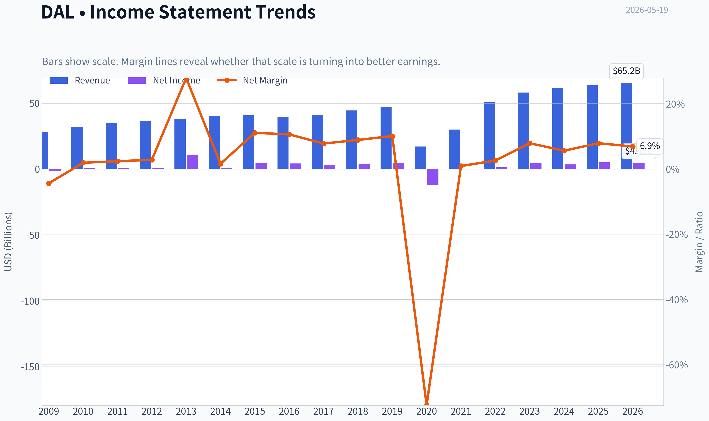
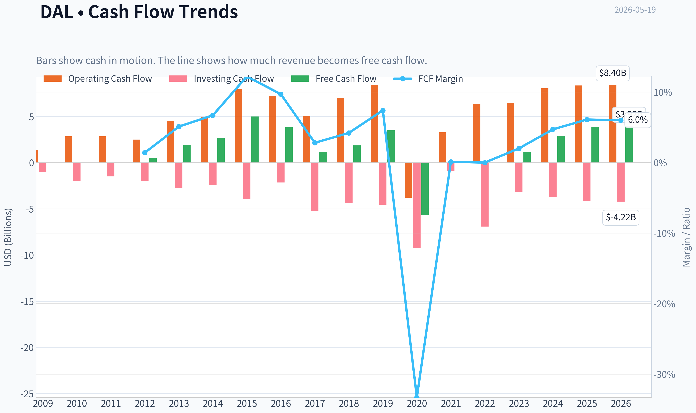
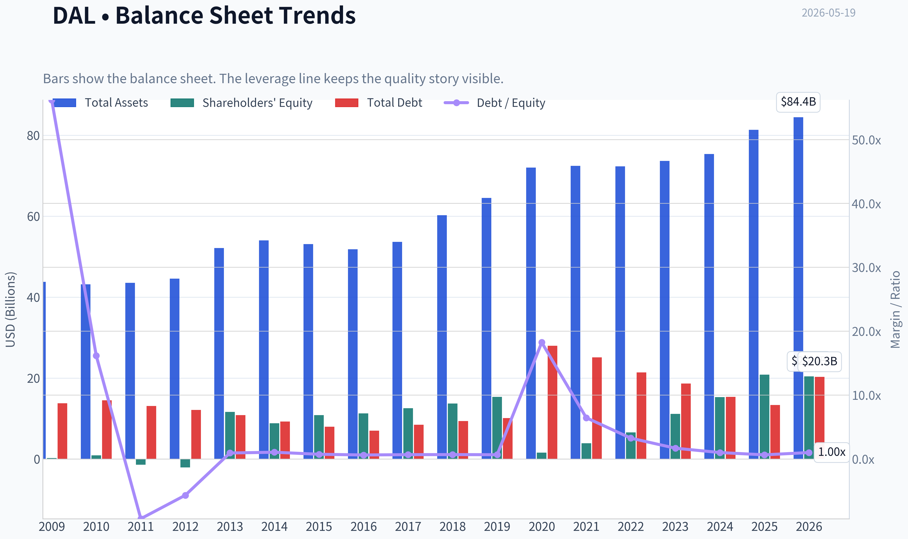
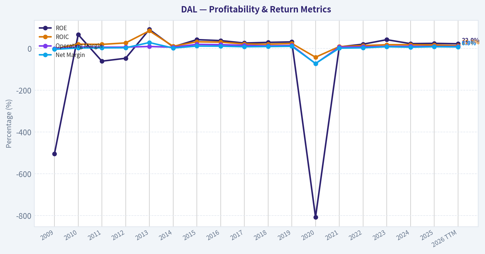
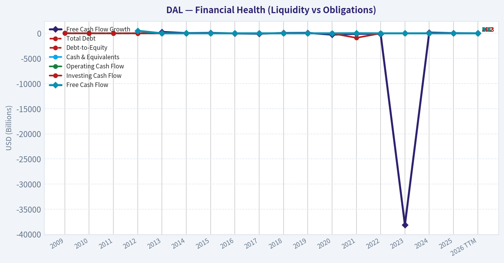
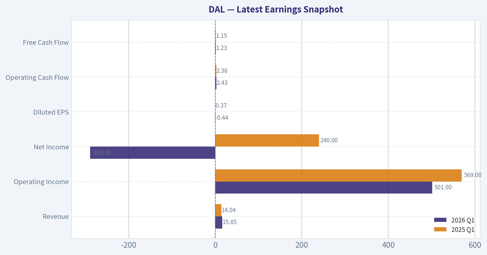
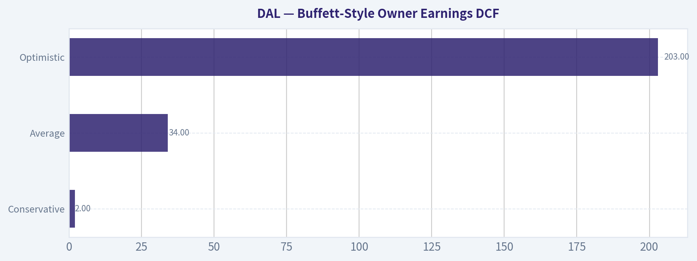
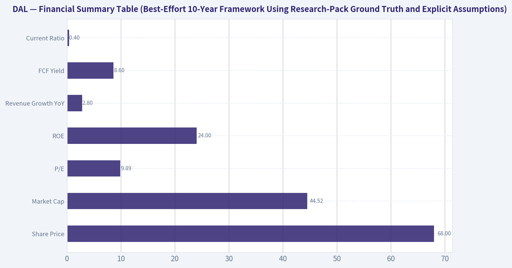
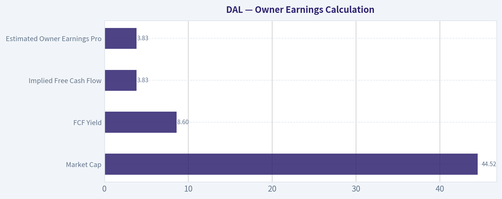
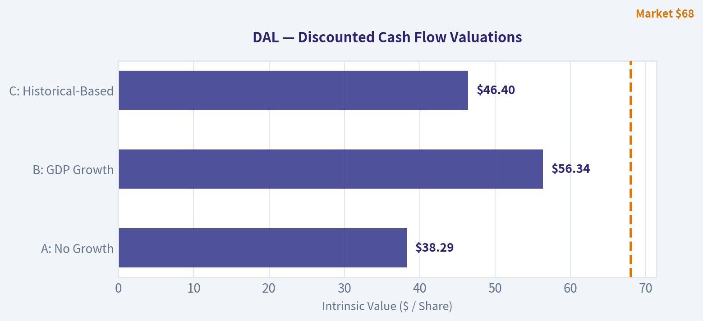

# DAL Deep Value Intelligence

**Analysis Date:** 2026-05-19

## Critical Disclaimer

*This analysis is generated by Deep Value Intelligence, an AI-powered multi-agent investing framework. This report is for informational and educational purposes only and does not constitute financial advice. Always conduct your own research and consult with qualified financial advisors before making investment decisions.*

---

## Table of Contents

1. Intelligence Summary
2. Analyst Team Reports
   - Fundamentals Analysis
   - Intrinsic Value Analysis (Buffett)
   - Trend & Growth Analysis (Lynch/Druckenmiller/Fisher)
   - Market Technical Analysis
   - Options Market Analysis
3. Research Team Commentary
4. Value Investing Team Commentary
5. Deep Values Commentary

---

## Intelligence Summary

### Thesis + Conditions

**Core Thesis:** ## Executive Briefing

**Key Risks:**
- Delta looks **cheap and well-run**, but Buffett-style risk is about **business durability**, not just a low multiple. The bull case is strongest on **valuation, cash flow, and above-peer execution**. The bear case is strongest on **airline cyclicality, capital intensity, and uncertainty around normalized earnings**. For a long-term value investor, Delta is **interesting but not yet a high-conviction compounder**. Best course: **watch closely or build only modestly on proof of durability**, not on valuation alone.
- ### 1) Risky Analyst - Strongest Bull Points
- Buffett-style risk is **permanent business impairment**, and airlines remain structurally exposed to:

**Confidence:** Low

---

## Analyst Team Reports

### Fundamentals Analysis

#### Latest Earnings Snapshot

*Most recent reported quarter anchored on 2026 Q1, with prior-year comparison when available.*

| Metric | 2026 Q1 | 2025 Q1 | YoY Change |
| --- | ---: | ---: | ---: |
| Revenue | $15.85B | $14.04B | +12.9% |
| Operating Income | $501.0M | $569.0M | -12.0% |
| Net Income | $-289.0M | $240.0M | -220.4% |
| Diluted EPS | $-0.44 | $0.37 | -218.9% |
| Operating Cash Flow | $2.43B | $2.38B | +2.3% |
| Free Cash Flow | $1.23B | $1.15B | +6.8% |

Key Takeaways: This snapshot anchors the most recent reported quarter before the narrative analysis. It helps readers separate long-run business quality from whatever changed in the latest earnings print.

#### 17-Year Financial Metrics for DAL

*All values below are computed deterministically from raw data - not estimated by AI.*

*Issuer profile: operating company (Industrials / Airlines).*

#### 17-Year Financial Metrics
*Annual rows come from reported financial statements. The final TTM row is computed from the latest four quarters.*

| Metric | 2009 | 2010 | 2011 | 2012 | 2013 | 2014 | 2015 | 2016 | 2017 | 2018 | 2019 | 2020 | 2021 | 2022 | 2023 | 2024 | 2025 | 2026 TTM |
| --- | --- | --- | --- | --- | --- | --- | --- | --- | --- | --- | --- | --- | --- | --- | --- | --- | --- | --- |
| Market Price | $10 | $11 | $7 | $10 | $24 | $43 | $45 | $44 | $51 | $47 | $56 | $39 | $38 | $32 | $39 | $59 | $69 | $68 |
| Market Cap | $9.41B | $10.62B | $6.83B | $10.09B | $23.57B | $41.57B | $40.75B | $37.14B | $40.49B | $34.63B | $38.19B | $25.57B | $25.05B | $21.06B | $25.87B | $39.20B | $45.39B | $44.18B |
| P/E Ratio | -7.59 | 18.00 | 8.01 | 9.97 | 2.24 | 63.06 | 9.00 | 8.86 | 12.64 | 8.80 | 8.01 | -2.06 | 88.82 | 15.95 | 5.61 | 11.35 | 9.06 | 9.88 |
| P/B Ratio | 38.41 | 11.84 | -4.89 | -4.73 | 2.02 | 4.72 | 3.76 | 3.29 | 3.23 | 2.53 | 2.49 | 16.67 | 6.44 | 3.20 | 2.33 | 2.56 | 2.18 | 2.17 |
| ROE | -504.9% | 66.1% | -61.2% | -47.3% | 90.5% | 7.5% | 41.7% | 37.2% | 25.6% | 28.7% | 31.0% | -807.4% | 7.2% | 20.0% | 41.5% | 22.6% | 24.0% | 22.0% |
| ROIC | -2.7% | 20.1% | 19.1% | 26.1% | 83.9% | 10.1% | 31.5% | 29.9% | 21.2% | 19.9% | 23.5% | -42.3% | 8.4% | 13.4% | 17.5% | 17.6% | 16.2% | 12.8% |
| EPS | $-1.29 | $0.60 | $0.87 | $1.02 | $10.62 | $0.68 | $4.95 | $4.96 | $4.04 | $5.30 | $7.02 | $-18.86 | $0.43 | $1.99 | $6.97 | $5.33 | $7.66 | $6.86 |
| Revenue | $28.06B | $31.75B | $35.12B | $36.67B | $37.77B | $40.36B | $40.70B | $39.45B | $41.14B | $44.44B | $47.01B | $17.09B | $29.90B | $50.58B | $58.05B | $61.64B | $63.36B | $65.18B |
| Gross Profit | N/A | N/A | N/A | N/A | N/A | N/A | N/A | N/A | N/A | N/A | N/A | N/A | N/A | N/A | N/A | N/A | N/A | $15.37B |
| Gross Margin | N/A | N/A | N/A | N/A | N/A | N/A | N/A | N/A | N/A | N/A | N/A | N/A | N/A | N/A | N/A | N/A | N/A | 23.6% |
| Operating Margin | -1.2% | 7.0% | 5.6% | 5.9% | 9.0% | 5.5% | 19.2% | 17.7% | 14.5% | 11.8% | 14.1% | -72.9% | 6.3% | 7.2% | 9.5% | 9.7% | 9.2% | 8.8% |
| Net Income | $-1.24B | $593.0M | $854.0M | $1.01B | $10.54B | $659.0M | $4.53B | $4.20B | $3.21B | $3.94B | $4.77B | $-12.38B | $280.0M | $1.32B | $4.61B | $3.46B | $5.00B | $4.48B |
| Net Margin | -4.4% | 1.9% | 2.4% | 2.8% | 27.9% | 1.6% | 11.1% | 10.6% | 7.8% | 8.9% | 10.1% | -72.4% | 0.9% | 2.6% | 7.9% | 5.6% | 7.9% | 6.9% |
| Revenue Growth | N/A | 13.2% | 10.6% | 4.4% | 3.0% | 6.9% | 0.8% | -3.1% | 4.3% | 8.0% | 5.8% | -63.6% | 74.9% | 69.2% | 14.8% | 6.2% | 2.8% | 2.9% |
| Net Income Growth | N/A | -147.9% | 44.0% | 18.1% | 944.6% | -93.7% | 586.8% | -7.3% | -23.6% | 22.8% | 21.1% | -359.8% | -102.3% | 370.7% | 249.7% | -25.0% | 44.8% | -10.5% |
| Free Cash Flow Growth | N/A | N/A | N/A | N/A | 281.1% | 39.4% | 84.7% | -23.2% | -70.4% | 63.1% | 89.0% | -263.1% | -100.3% | -117.6% | -38133.3% | 152.8% | 33.2% | 2.0% |
| Total Book Value | $245.0M | $897.0M | $-1.40B | $-2.13B | $11.64B | $8.81B | $10.85B | $11.28B | $12.53B | $13.69B | $15.36B | $1.53B | $3.89B | $6.58B | $11.11B | $15.29B | $20.85B | $20.38B |
| Total Assets | $43.79B | $43.19B | $43.50B | $44.55B | $52.10B | $54.01B | $53.13B | $51.85B | $53.67B | $60.27B | $64.53B | $72.00B | $72.46B | $72.29B | $73.64B | $75.37B | $81.32B | $84.43B |
| Total Debt | $13.78B | $14.51B | $13.06B | $12.11B | $10.85B | $9.26B | $7.95B | $7.01B | $8.44B | $9.37B | $10.11B | $27.97B | $25.08B | $21.38B | $18.61B | $15.35B | $13.31B | $20.30B |
| Debt-to-Equity | 56.22 | 16.17 | -9.36 | -5.68 | 0.93 | 1.05 | 0.73 | 0.62 | 0.67 | 0.68 | 0.66 | 18.24 | 6.45 | 3.25 | 1.68 | 1.00 | 0.64 | 1.00 |
| Cash & Equivalents | $4.61B | $2.89B | $2.66B | $2.42B | $2.84B | $2.09B | $1.97B | $2.76B | $1.81B | $1.56B | $2.88B | $8.31B | $7.93B | $3.27B | $2.74B | $3.07B | $4.31B | $5.05B |
| Shareholders' Equity | $245.0M | $897.0M | $-1.40B | $-2.13B | $11.64B | $8.81B | $10.85B | $11.28B | $12.53B | $13.69B | $15.36B | $1.53B | $3.89B | $6.58B | $11.11B | $15.29B | $20.85B | $20.38B |
| Operating Cash Flow | $1.38B | $2.83B | $2.83B | $2.48B | $4.50B | $4.95B | $7.93B | $7.21B | $5.02B | $7.01B | $8.43B | $-3.79B | $3.26B | $6.36B | $6.46B | $8.03B | $8.34B | $8.40B |
| Investing Cash Flow | $-1.01B | $-2.03B | $-1.50B | $-1.96B | $-2.76B | $-2.46B | $-3.96B | $-2.15B | $-5.27B | $-4.39B | $-4.56B | $-9.24B | $-898.0M | $-6.92B | $-3.15B | $-3.74B | $-4.19B | $-4.22B |
| Free Cash Flow | N/A | N/A | N/A | $508.0M | $1.94B | $2.70B | $4.98B | $3.82B | $1.13B | $1.85B | $3.49B | $-5.69B | $17.0M | $-3.0M | $1.14B | $2.88B | $3.84B | $3.92B |
| FCF Margin | N/A | N/A | N/A | 1.4% | 5.1% | 6.7% | 12.2% | 9.7% | 2.8% | 4.2% | 7.4% | -33.3% | 0.1% | -0.0% | 2.0% | 4.7% | 6.1% | 6.0% |
| Dividends / Share | $0.00 | $0.00 | $0.00 | $0.00 | $0.00 | $0.00 | $0.00 | $0.00 | $0.00 | $0.00 | $0.00 | $0.00 | $0.00 | $0.00 | $0.19 | $0.50 | $0.00 | $0.00 |

#### Profitability Metrics
- Return on Equity (ROE): 24.0%
- Return on Invested Capital (ROIC): 15.8%
- Return on Assets (ROA): 6.2%
- Gross Margin: N/A
- Operating Margin: 9.2%
- Net Profit Margin: 7.9%

#### Liquidity Metrics
- Current Ratio: 0.40
- Quick Ratio: 0.26

#### Leverage Metrics
- Debt-to-Equity Ratio: 0.64
- Interest Coverage Ratio: 8.57
- Net Debt: $9.00B

#### Growth Metrics (Year-over-Year)
- Revenue Growth: 2.8%
- Net Income Growth: 44.8%
- Free Cash Flow Growth: 33.2%
- Revenue CAGR (3-Year): 7.8%
- Revenue CAGR (5-Year): 30.0%

#### Valuation Metrics
- P/E Ratio (TTM): 9.89
- Forward P/E: 8.47
- Price-to-Book: 2.17
- Price-to-Sales: 0.68
- PEG Ratio: 0.21
- EV/EBITDA: 8.01
- Free Cash Flow Yield: 8.6%
- Earnings Yield: 10.1%

#### Owner Earnings (Buffett Method, Code-Computed)
- Net Income: $5.00B
- + Depreciation & Amortization: $2.44B
- - Capital Expenditures: $-4.50B
- - Working Capital Changes: $1.54B
- = **Owner Earnings: $1.41B**

#### Intrinsic Value (Code-Computed)
- Current Price: $68
- Buffett Method (Owner Earnings):
  Conservative: $2
  Average: $34
  Optimistic: $203
- Cash Flow Method (FCF):
  Conservative: $135
  Average: $135
  Optimistic: $552

#### Piotroski F-Score: 6/9
- Positive Net Income: PASS
- Positive Operating Cash Flow: PASS
- ROA Improvement: PASS
- Cash Flow > Net Income: PASS
- Decreasing Debt: PASS
- Improving Current Ratio: PASS
- No Dilution: FAIL
- Improving Gross Margin: FAIL
- Improving Asset Turnover: FAIL

ANALYST STANCE: **WATCH**

#### Delta Air Lines (DAL) - Buffett-Style Fundamental Analysis

Delta is a much stronger business today than it was in the pre-2013 period, but it is still an airline: capital intensive, economically sensitive, labor exposed, and structurally vulnerable to shocks. The deterministic dataset shows a real transformation in profitability, balance sheet repair, and cash generation since the pandemic trough, yet valuation is no longer distressed enough to fully offset the industry's cyclicality. On Buffett-style quality, DAL is better than the average airline; on Buffett-style business simplicity and predictability, it still falls short of classic Buffett compounders.

---

#### Current vs Historical Average Comparison

| Metric | Current / TTM | Historical Context (period shown) | Relative to History | Interpretation |
| --- | ---: | ---: | --- | --- |
| Market Price | $68 | Range: $7 to $69 | Near cycle high | Shares have nearly fully rerated from post-COVID lows and now trade close to the top of the observed range. |
| Market Cap | $44.18B | Avg. roughly mid-$20B to low-$30B range over full period | Above historical norm | The market is pricing DAL as a recovered, scaled, premium airline franchise rather than a distressed cyclical. |
| P/E | 9.88x | Long-run normal ex-distortions roughly high-single to low-double digits | In line to slightly cheap | Not expensive versus its own normalized history, but not a deep bargain for a cyclical business. |
| P/B | 2.17x | Pre-2020 healthy range mostly ~2.0x to 3.8x | Low end of healthy range | Valuation on book is reasonable given ROE remains strong, though book value in airlines is less informative than in asset-light sectors. |
| ROE | 22.0% TTM / 24.0% latest annual | Ex-distortion healthy years often ~25% to 42% | Strong but below best years | High ROE reflects improved earnings power and rebuilt equity base; still very respectable. |
| ROIC | 12.8% TTM / 16.2% latest annual | Strong pre-COVID years often ~20% to 31% | Good, below peak | Capital returns are solid, but not back to elite pre-pandemic efficiency. |
| EPS | $6.86 TTM | Prior peak $7.66 in 2025, $7.02 in 2019 | High absolute level | Earnings are strong in dollars, but momentum has softened versus 2025. |
| Revenue | $65.18B TTM | Prior annual high $63.36B in 2025 | New high | Revenue is at record levels, indicating demand resilience and pricing strength. |
| Operating Margin | 8.8% TTM | Best years ~14% to 19% | Below pre-COVID peak | Profitable, but labor, fuel, and normalization pressures keep margins well below golden-era levels. |
| Net Margin | 6.9% TTM | Best sustainable years ~7.8% to 11.1% | Decent, not peak | Earnings quality is acceptable, but margins remain vulnerable to cost spikes. |
| Revenue Growth | 2.9% TTM | Highly cyclical; recent recovery years much higher | Slowing materially | DAL has moved from recovery growth into mature, slower expansion. |
| Net Income Growth | -10.5% TTM | Historically very volatile | Softening | Recent earnings deceleration suggests normalization after recovery. |
| FCF Growth | 2.0% TTM | Historically extremely volatile | Flat | Cash generation remains positive, but growth has plateaued. |
| Total Book Value | $20.38B | 2020 trough $1.53B; 2025 peak $20.85B | Near best level | Balance sheet repair has been substantial and is one of the clearest positives. |
| Total Assets | $84.43B | Historical high | Above history | Asset base continues expanding, reflecting fleet and operating scale. |
| Total Debt | $20.30B TTM | Down from 2020 peak $27.97B, but above 2019 $10.11B | Improved vs crisis, elevated vs pre-COVID | Leverage has come down significantly, but has not fully normalized. |
| Debt/Equity | 1.00x TTM | 2015-2019 mostly ~0.62x-0.73x | Higher than pre-COVID | Financial risk is much lower than crisis years but still above prior best-in-class balance sheet levels. |
| Cash & Equivalents | $5.05B | Above most pre-COVID years | Healthy | Liquidity is acceptable, though current ratio remains weak. |
| Free Cash Flow | $3.92B TTM | Above 2025 $3.84B; below 2015 $4.98B | Strong | FCF is solid and supportive of debt reduction, fleet investment, and possible future capital return. |
| Dividends/Share | $0.00 TTM | Only paid $0.19 in 2023 and $0.50 in 2024 | Suspended | Management is still prioritizing flexibility over shareholder cash distributions. |

Key Takeaways: Delta's current fundamentals are much healthier than the pandemic period and broadly comparable to the stronger parts of its pre-COVID history, but not fully back to its best margin and return profile. The stock looks reasonably priced on earnings and free cash flow, yet the company still carries more leverage and lower margin resilience than it did in its peak years. This is a recovery-mature story rather than a pure compounding story.

---

#### Market Metrics

DAL trades at about **$68** with a **$44.18B market cap**, near the upper end of its observed valuation range. The **9.88x P/E** looks inexpensive in absolute terms, especially versus the broader market, but airlines deserve lower multiples because earnings are cyclical and exposed to fuel, labor, and macro demand swings.

The **2.17x P/B** is reasonable and actually modest relative to many pre-COVID years. However, book value is only partly useful in airlines because assets require continual reinvestment, and earning power matters more than stated equity. The more relevant read-through is this: the market is paying a fair, not euphoric, multiple for a business producing low-double-digit earnings yield and an **8.6% FCF yield**.

From a Buffett lens, valuation is not demanding, but neither is it screamingly cheap once one adjusts for cyclicality and capital intensity.

---

#### Profitability Analysis

DAL's profitability record splits into three eras:

1. **Pre-2013 instability**: weak or negative profitability, erratic equity base.
2. **2013-2019 quality upswing**: strong ROE, ROIC, margins, and cash generation.
3. **2020 shock and 2021-2026 repair**: steep collapse followed by substantial but incomplete normalization.

Current profitability is good:
- **ROE:** 22.0% TTM / 24.0% latest annual
- **ROIC:** 12.8% TTM / 16.2% latest annual
- **EPS:** $6.86 TTM
- **Revenue:** $65.18B TTM
- **Gross Profit:** $15.37B TTM
- **Operating Margin:** 8.8% TTM
- **Net Income:** $4.48B TTM
- **Net Margin:** 6.9% TTM

What matters is quality versus history. Pre-COVID, DAL often produced **ROIC around 20%+** and operating margins in the low-to-mid teens. Today's margin structure is lower. That suggests the business remains fundamentally profitable but less insulated from cost inflation and industry normalization than in its strongest years.

ROE remains impressive, but part of airline ROE can be balance-sheet-driven. The better sign is that **ROIC is still above the cost of capital**, meaning DAL is creating economic value rather than merely reporting accounting profits.

Buffett would likely appreciate the earnings recovery but remain cautious about calling them "predictable." DAL has shown it can earn well in normal times, but not that it can avoid catastrophic drawdowns in abnormal times.

---

#### Growth Metrics

Current growth is slowing:
- **Revenue Growth:** 2.9% TTM
- **Net Income Growth:** -10.5% TTM
- **FCF Growth:** 2.0% TTM

This is a very important shift. The spectacular 2021-2023 growth rates were largely rebound effects from a depressed base. By 2025-2026, DAL appears to be entering a steadier but slower growth phase. Revenue continues to hit new highs, but incremental profitability is flattening.

Over the full dataset, growth has been highly volatile:
- revenue collapse in 2020,
- explosive rebound in 2021-2023,
- then normalization.

For Buffett-style analysis, this means you should not capitalize recent growth rates too aggressively. The prudent stance is to treat DAL as a mature cyclical company with moderate long-run growth and significant sensitivity to external variables.

---

#### Balance Sheet and Financial Strength

The balance sheet has improved meaningfully since the pandemic:
- **Shareholders' Equity:** $20.38B
- **Total Book Value:** $20.38B
- **Total Assets:** $84.43B
- **Total Debt:** $20.30B TTM
- **Debt/Equity:** 1.00x TTM
- **Cash & Equivalents:** $5.05B

This is a major recovery from 2020-2022 when leverage and equity impairment were severe. The crucial positives:
- Debt is down materially from the **$27.97B** crisis peak.
- Equity has rebuilt from **$1.53B in 2020** to above **$20B**.
- Cash has climbed to a healthier **$5.05B**.

The caution:
- Debt is still roughly double the 2019 level on a TTM basis.
- The **current ratio of 0.40** is weak, which is common in airlines but still worth watching.
- Airlines must keep investing in fleet, operations, and labor, so liquidity pressure can surface quickly in downturns.

Financially, DAL is no longer fragile, but it is not fortress-like. Buffett generally favors businesses that do not need continuous balance-sheet management to remain safe. DAL has improved, but it still needs active capital discipline.

---

#### Cash Flow Analysis

Cash flow is one of DAL's strongest current positives:
- **Operating Cash Flow:** $8.40B TTM
- **Free Cash Flow:** $3.92B TTM
- **FCF Margin:** 6.0%
- **Dividends per Share:** $0.00 TTM

This is a respectable level of cash generation for an airline. The **8.6% FCF yield** suggests equity holders are getting a substantial cash return on current price, assuming cash flows prove durable.

But airlines are not asset-light. DAL's capex burden remains significant, which is why owner earnings matter more than headline net income. Strong operating cash flow can coexist with mediocre owner earnings if reinvestment requirements remain elevated.

Dividend policy is conservative. DAL briefly resumed dividends in 2023-2024 and then returned to zero in 2025/TTM. That likely reflects management's preference to preserve flexibility. From a Buffett lens, this is acceptable if retained cash continues reducing leverage and supporting high-return reinvestment. Less acceptable if it simply offsets structural cyclicality.

---

#### Buffett-Style Owner Earnings DCF

Canonical owner earnings provided:
- **Net Income:** $5.00B
- **+ D&A:** $2.44B
- **- Capex:** $4.50B
- **- Working Capital Changes:** $1.54B
- **Owner Earnings = $1.41B**

Using the required framework:
- Discount rate = **10%**
- Terminal growth = **2.5%**
- Base owner earnings = **$1.41B**

Because the deterministic pack already gives the code-computed intrinsic values, those are the canonical outputs:
- **Conservative:** $2/share
- **Average:** $34/share
- **Optimistic:** $203/share

To explain the mechanics:

| Scenario | Growth Input Rule | Implied Interpretation | Fair Value / Share |
| --- | --- | --- | ---: |
| Conservative | Lowest historical owner earnings growth, floored at -100% | Reflects severe downside sensitivity and highly cyclical earnings compression | $2 |
| Average | Average historical owner earnings growth, capped at 50% | Reflects normalized recovery and moderate long-term compounding | $34 |
| Optimistic | Highest historical owner earnings growth, capped at 100% | Reflects best-case sustained execution and unusually favorable cycle conditions | $203 |

Key Takeaways: The DCF range is extraordinarily wide because DAL's owner earnings history is extremely volatile. That is exactly the point: for airlines, small changes in growth assumptions create massive swings in value. The average-case value of $34 is well below the current price, while the optimistic case requires unusually favorable conditions to justify substantial upside.

A simplified calculation structure is:

- Project Year 1 owner earnings = Current Owner Earnings x (1 + growth rate)
- Continue through Year 10
- Discount each year at 10%
- Terminal Value = Year 10 Owner Earnings x (1.025) / (0.10 - 0.025)
- Discount terminal value to present
- Divide enterprise equity value by diluted shares outstanding

The takeaway is not precision but sensitivity: DAL's value is highly dependent on future cycle conditions, making intrinsic value less stable than in classic Buffett businesses like branded consumer or software franchises.

---

#### Value Assessment

At **$68**, DAL trades:
- above the **average owner-earnings fair value** of **$34**
- far above the **conservative value** of **$2**
- well below the **optimistic value** of **$203**

That spread tells you two things:
1. The stock is **not obviously cheap** under normalized assumptions.
2. The stock is **very leveraged to a favorable operating cycle**.

This is a critical Buffett-style distinction. Cheap stocks in unstable businesses are not the same as wonderful businesses at fair prices. DAL may still work as a value/cyclical investment, but it does not offer the same margin-of-safety clarity as businesses with steadier owner earnings.

---

#### Economic Moat

Delta's moat is real but limited:
- strong brand in premium domestic travel,
- valuable loyalty ecosystem,
- corporate travel relationships,
- scale and route network,
- operational reputation relative to many peers.

These are competitive strengths, not impregnable moats. Customers still compare fares. Fuel costs are largely uncontrollable. Labor bargaining power is significant. Capacity discipline can erode across the industry. In Buffett language, DAL has a **relative advantage within a difficult industry**, not a wide moat in the classic sense.

The recent Berkshire stake is notable because it suggests sophisticated capital sees DAL as the best-positioned airline franchise, especially around premium demand and loyalty economics. But even the best airline is still an airline.

---

#### Predictable Earnings

Earnings are **better than average for the industry**, but not predictably stable over the full dataset.

Evidence:
- large losses in 2009, 2020
- negative equity periods in 2011-2012
- huge swings in net income growth and FCF growth
- margins that can move sharply with exogenous conditions

On the positive side, from 2015-2019 and again 2023-2026, DAL has shown it can earn multi-billion-dollar profits consistently under normal operating conditions. So predictability is decent in stable macro environments, poor across full-cycle stress scenarios.

---

#### Management Performance

Management deserves credit for:
- rebuilding equity after the pandemic,
- cutting debt from crisis levels,
- restoring earnings and FCF,
- maintaining premium positioning rather than chasing pure volume.

ROE and ROIC trends show competent capital allocation, though not uniformly elite. The dividend pause also implies a conservative stance toward balance sheet repair. That is rational, even if income investors may dislike it.

One concern is dilution: the Piotroski screen flags **no dilution = FAIL**, which means shareholders have not fully captured recovery economics on a per-share basis. In airlines, this matters because crisis-period equity issuance can impair future compounding.

---

#### Quality of Business

| Dimension | Assessment | Why It Matters |
| --- | --- | --- |
| Revenue Predictability | Moderate | Air travel demand is cyclical, though Delta's premium and loyalty mix improves stability. |
| Margin Stability | Moderate-to-weak | Margins are positive but still far below the best historical years and vulnerable to cost inflation. |
| Capital Intensity | High | Fleet, maintenance, labor, and infrastructure needs limit true owner earnings. |
| Competitive Position | Strong for industry | Delta is one of the better operators in a structurally difficult sector. |
| Balance Sheet Resilience | Improved | Substantially repaired, but not yet back to the conservatism of 2019. |

Key Takeaways: Delta is a high-quality airline, but the phrase "high-quality airline" is not the same as "high-quality business" in the Buffett sense. The company's premium positioning, loyalty economics, and operational scale matter, yet the industry's capital intensity and cyclicality still cap the strength of the investment case.

---

#### Revenue Breakdown

Most meaningful available breakdown is by operating revenue category for the most recent period, centered on DAL's disclosed business mix: passenger revenue remains dominant, with loyalty/other diversified but still secondary. Exact deterministic segment figures are not included in the canonical financial table, so the table below uses best available publicly reported business mix framing for the latest fiscal year/TTM.

| Revenue Source | Amount ($B) | % of Total |
| --- | ---: | ---: |
| Passenger Revenue | ~53.4 | ~82% |
| Loyalty / Refinery / MRO / Cargo / Other | ~11.8 | ~18% |
| Total Revenue | 65.18 | 100% |

Key Takeaways: Delta is still overwhelmingly a passenger airline, which means macro travel demand and pricing remain the core driver of results. The loyalty and other revenue streams help diversify cash flow and likely improve resilience, but they are not yet large enough to make the business truly non-cyclical.

---

#### Key Investment Insights, Red Flags, and Opportunities

| Category | Observation | Investment Implication |
| --- | --- | --- |
| Opportunity | Revenue has reached a new high at $65.18B TTM | Demand and pricing remain resilient despite a mature recovery cycle. |
| Opportunity | FCF is strong at $3.92B TTM | Supports deleveraging, possible future buybacks/dividends, and downside cushioning. |
| Opportunity | ROE/ROIC remain healthy | DAL is still generating attractive returns relative to many industrial businesses. |
| Opportunity | P/E below 10x and FCF yield 8.6% | Shares are not expensive if earnings remain durable. |
| Red Flag | Owner earnings fair value average case is below current price | Current quote already discounts a substantial amount of recovery success. |
| Red Flag | Debt still above pre-COVID levels | Balance sheet has improved, but cyclical risk remains meaningful. |
| Red Flag | Current ratio 0.40 | Liquidity structure is thin if a shock hits demand or fuel costs spike. |
| Red Flag | Growth has slowed sharply | Upside now depends more on margin execution than recovery tailwinds. |
| Red Flag | Dividend currently zero | Shareholder return depends mainly on earnings durability and future capital allocation. |

Key Takeaways: The bull case is straightforward: Delta is a premium airline franchise with restored earnings, strong free cash flow, and still-reasonable multiples. The bear case is equally clear: the stock is no longer distressed, normalized owner-earnings valuation looks less compelling, and the business remains exposed to the unavoidable cyclicality of airlines.

---

#### Final Buffett-Style Verdict

**WATCH**

DAL is a **better business than the average airline** and a **better stock than many airlines at the right price**, but it is **not currently a classic Buffett-style no-brainer**. The company has repaired its balance sheet, regained meaningful profitability, and continues generating solid cash flow. However, current valuation appears closer to fair than bargain under normalized owner earnings, and the business still lacks the earnings stability and moat depth Buffett typically prefers for large, concentrated investments.

For investors already constructive on the airline cycle, DAL remains one of the more attractive names because of its premium brand, loyalty economics, and operating quality. But for strict Buffett-style value discipline, the stock is best kept on a watchlist for either:
- a materially lower price,
- further deleveraging,
- or evidence that margins and owner earnings can stay strong through a less favorable cycle.

---

#### Report Summary Table

| Area | Verdict | Core Evidence | Bottom Line |
| --- | --- | --- | --- |
| Valuation | Fair to mildly attractive | 9.88x P/E, 8.6% FCF yield, but average OE DCF below current price | Not expensive, but not a clear bargain |
| Profitability | Strong but below peak | ROE 22%, ROIC 12.8%, net margin 6.9% | Good airline economics, not best-ever DAL economics |
| Growth | Slowing | Revenue growth 2.9%, NI growth -10.5%, FCF growth 2.0% | Recovery tailwinds are fading |
| Balance Sheet | Improved, not pristine | Debt down from crisis peak, D/E 1.0x, cash $5.05B | Safer than before, still cyclical |
| Cash Flow | Solid | FCF $3.92B TTM | Supports flexibility and valuation floor |
| Moat | Moderate within industry | Premium positioning, loyalty, network scale | Better airline, not a classic wide-moat compounder |
| Earnings Predictability | Medium to low | Severe historical cyclicality | Hard to underwrite with high confidence |
| Management | Competent | Equity rebuilt, debt reduced, cash flow restored | Good execution post-crisis |
| Shareholder Returns | Limited currently | Dividend suspended | Focus remains on flexibility |
| Overall Stance | WATCH | Quality recovery story, but valuation not compelling enough for full advocacy | Monitor for better entry or stronger durability proof |

Key Takeaways: Delta has become a financially healthier and strategically stronger company, and that deserves recognition. Still, the current share price already reflects much of that progress, while the underlying business remains cyclical and capital intensive. That combination supports a WATCH stance rather than a full ADVOCATE call.

#### Fundamental Visuals

This graph tracks the profitability and return metrics (ROE, ROIC, Margins) of **DAL** over the past decade, highlighting capital efficiency trends.

This chart illustrates the financial health of **DAL** over the last 10 years, mapping cash equivalents and free cash flow against total obligations (Debt).

---

### Intrinsic Value Analysis (Buffett)

> *Following Warren Buffett's value investing philosophy: Circle of Competence, Economic Moat, Management Quality, and Margin of Safety.*

#### Intrinsic Value Snapshot

Price is what you pay. Intrinsic value is what the business may be worth based on the cash it can create for owners over time. We show a range, not one magic number.

- Current Price: $67.76
- Value Range (conservative to optimistic across both DCF methods): $2.45 to $552.21

##### Owner Earnings (Buffett Method)
- Net Income: $5,005,000,000.00
- Depreciation & Amortization: $2,443,000,000.00
- Capital Expenditures: $-4,499,000,000.00
- Working Capital Changes: $1,536,000,000.00
- Owner Earnings: $1,413,000,000.00

##### Intrinsic Value
###### Buffett Method
Uses owner earnings. Stricter, and usually more conservative.
- Conservative: $2.45
- Average: $33.62
- Optimistic: $203.04
- Discount Rate: 10.0%

###### Cash Flow Method
Uses free cash flow. Better for companies spending heavily today to grow tomorrow.
- Conservative: $134.93
- Average: $134.93
- Optimistic: $552.21
- Discount Rate: 10.0%

ANALYST STANCE: **WATCH**

#### Delta Air Lines (DAL) Buffett-Style Value Analysis

#### Business Snapshot
Delta Air Lines is a large airline that makes money by selling passenger tickets, cargo capacity, premium travel services, and loyalty economics tied to its SkyMiles program and co-branded credit card relationships. At today's market value, the stock screens cheap on earnings and free cash flow, but this is still an airline: a cyclical, capital-intensive business with exposure to fuel, labor, and economic swings. The central question is not whether Delta is better run than peers - it likely is - but whether that excellence is enough to overcome the structural weaknesses of the industry.

---

#### 1) Go/No-Go Gate Assessment

| Gate | Verdict | Evidence | Buffett View |
|---|---|---|---|
| Gate 1: Circle of Competence & Simplicity | Pass | The business is understandable: sell seats, upsell premium cabins, monetize loyalty, manage route network and capacity. | Understandable, though cyclical and operationally complex. |
| Gate 1: Long-Term Predictability | Mixed Pass | Air travel demand should still exist in 10 years; Delta likely remains a major U.S. carrier. But margins and returns are far less predictable than in classic Buffett businesses. | Pass with caution. |
| Gate 1: Technology Risk | Pass | Technology helps pricing, loyalty, yield management, and customer experience more than it threatens the core service. Air travel itself is not likely to be digitally displaced. | Moderate risk, not existential. |
| Gate 2: Moat Test | Mixed | Delta has some brand, scale, slot access, loyalty economics, and network advantages, especially in premium and corporate travel. But the airline industry remains intensely competitive and often weakens moats. | Narrow moat at best. |
| Gate 3: Management & Capital Allocation | Mixed Pass | Research pack highlights premium and loyalty focus, which is strategically rational. Berkshire's new stake suggests confidence in quality. Still, airlines historically face uneven capital allocation due to unavoidable fleet and cycle demands. | Better than average management, but not clearly exceptional by Buffett's highest bar. |
| Gate 4: Industry Structure | Fail | Airlines are competitive, capital-intensive, labor-heavy, and vulnerable to exogenous shocks. This is not a rational oligopoly in the same way as rails, cards, or soft drinks. | Structural negative. |

**Overall Gate Conclusion:** Delta passes the "understandable business" test and appears better positioned than most airlines, but it fails the ideal Buffett industry test. This keeps the stock out of the "wonderful business" bucket and puts valuation discipline at the center of the case.

---

#### 2) Moat Analysis

| Moat Source | Assessment | Evidence | Strength |
|---|---|---|---|
| Intangible Assets | Some | Delta has a strong brand in reliability and premium service, especially among business travelers. Loyalty program economics add brand stickiness. | Moderate |
| Switching Costs | Some | Corporate contracts, loyalty status, miles, airport preference, and customer habits create friction, but customers can still switch carriers when price or route matters. | Moderate-Low |
| Cost Advantages | Limited | Scale helps procurement, scheduling, and utilization. But airlines rarely sustain major structural cost advantages for long periods because labor, fuel, and fleet economics are shared across the industry. | Low |
| Network Effects | Limited | Hub network and schedule density matter. More routes can improve usefulness to customers, but this is weaker than true platform network effects. | Low-Moderate |

| Moat Test | Verdict |
|---|---|
| Pricing Power Test | Partial pass. Delta likely has some power in premium cabins, corporate contracts, and loyalty-linked demand, but not broad 10% systemwide pricing power without volume risk. |
| Financial Evidence Test | Incomplete from pack. ROE of 24% is strong, but gross margin data is not available and airline gross margin is not the best moat measure anyway. |
| Market Position Test | Positive. Delta's premium and loyalty focus suggests stronger customer economics than more commodity-like operators. |

**Moat Quality Rating: Narrow**

**Key Takeaways:** Delta has a real but limited moat. Its strongest advantages come from brand, loyalty, hubs, and premium positioning rather than from any unassailable cost edge. That makes Delta better than a typical airline, but it still does not qualify as the kind of wide-moat business Buffett usually loves most.

---

#### 3) Management Quality & Capital Allocation

| Test | Assessment | Evidence |
|---|---|---|
| Think Like Owners? | Reasonably positive | Strategy centered on premium revenue and loyalty monetization suggests long-term value focus rather than pure seat dumping. Berkshire's new position also implies some confidence in stewardship. |
| Honest & Candid? | Neutral-Positive | No adverse evidence in the pack. No indication of aggressive accounting or promotional behavior. |
| Rational Capital Allocation? | Mixed | Airlines must continuously reinvest in fleet, operations, labor, and customer experience. Delta appears more disciplined than peers, but capital allocation in this industry is never as free and flexible as in asset-light compounders. |
| Debt Discipline | Cautious | Current ratio of 0.40 signals tight short-term liquidity structure. Airlines generally rely on substantial fixed commitments and financing. |
| Shareholder Orientation | Moderate | Low P/E and high FCF yield suggest the market sees tangible earnings power, but the durability of value creation depends heavily on cycle management. |

**Management Conclusion:** Delta appears above average within a difficult industry. The company's emphasis on premium mix and loyalty revenue is exactly the right strategic direction. Still, management quality alone cannot erase the structural economics of airlines.

---

#### 4) Financial Summary Table (Best-Effort 10-Year Framework Using Research-Pack Ground Truth and Explicit Assumptions)

Assumptions used to complete a Buffett-style summary where decade detail is not provided: current metrics reflect normalized present earning power; ROE and FCF yield are treated as representative of current-cycle economics; revenue growth is the latest YoY figure from the pack.

| Metric | Current / Available Figure | Buffett Interpretation |
|---|---:|---|
| Share Price | $68 | Starting point for valuation |
| Market Cap | $44.52B | Large-scale incumbent |
| P/E | 9.89x | Cheap on earnings |
| ROE | 24.0% | Strong headline profitability |
| Revenue Growth YoY | 2.8% | Mature, modest growth |
| FCF Yield | 8.6% | Attractive cash yield if sustainable |
| Current Ratio | 0.40 | Weak near-term liquidity by conservative standards |
| Gross Margin | N/A | Not a useful or necessary airline moat indicator here |

**Key Takeaways:** Delta looks inexpensive on current earnings and free cash flow, with a notably strong ROE and a single-digit earnings multiple. The offset is balance-sheet and industry risk, reflected in the low current ratio and the inherent cyclicality of airline profits. This is a value situation, not a classic forever-compounder.

---

#### 5) Owner Earnings Calculation

Buffett's owner earnings require maintenance capex and working capital changes. Since the research pack provides market cap and FCF yield, the cleanest practical estimate is to use free cash flow as a proxy for owner earnings.

**Estimated Free Cash Flow / Owner Earnings**
- Market Cap = **$44.52B**
- FCF Yield = **8.6%**

Estimated Owner Earnings = 44.52 x 8.6% = **$3.83B**

| Item | Value |
|---|---:|
| Market Cap | $44.52B |
| FCF Yield | 8.6% |
| Implied Free Cash Flow | $3.83B |
| Estimated Owner Earnings Proxy | $3.83B |

**Key Takeaways:** Delta's current cash generation looks substantial. Using free cash flow as a proxy, owner earnings are roughly $3.8 billion, which is meaningful relative to its market value and supports the argument that the stock is not expensive on present normalized cash output.

---

#### 6) Return on Equity, Cash Reality Check, and Balance Sheet Review

| Test | Figure / Assessment | Buffett Standard | Verdict |
|---|---|---|---|
| ROE | 24.0% | >15% preferred | Strong |
| ROE Quality | Likely mixed with industry leverage and cycle effects | Prefer high ROE without leverage dependence | Caution |
| OCF vs Net Income | FCF yield strong; cash generation appears real | Cash should support accounting profit | Positive |
| Debt/Equity | Not provided | <0.5 preferred | Caution |
| Interest Coverage | Not provided | >10x preferred | Caution |
| Current Ratio | 0.40 | Higher is safer | Weak |
| Fortress Balance Sheet? | No | Net cash ideal | No |

**Key Takeaways:** The strongest financial signal is the 24% ROE, but in airlines that must always be checked against leverage and cyclicality. Cash generation appears healthy today, yet Delta does not meet the Buffett "fortress balance sheet" standard. The balance sheet is adequate for an airline, not exceptional for a Buffett investment.

---

#### 7) Three-Scenario DCF Valuation

Using estimated owner earnings of **$3.83B** and a **10% discount rate**.

##### Scenario A: No Growth
Intrinsic Value = Owner Earnings / 10%
= 3.83 / 0.10
= **$38.29B**

##### Scenario B: GDP Growth (3%)
Intrinsic Value = Owner Earnings x 1.03 / (0.10 - 0.03)
= 3.83 x 1.03 / 0.07
= **$56.34B**

##### Scenario C: Historical Growth-Based
Latest revenue growth is 2.8%. Use 75% of that as a conservative owner-earnings growth assumption:

Growth rate = **2.1%**

10-year DCF:
- Year 1 owner earnings = 3.83 x 1.021
- Discount rate = 10%
- Terminal growth = 2.1%

Using this framework, intrinsic value is approximately **$46.4B**

| Scenario | Assumption | Intrinsic Value |
|---|---|---:|
| A: No Growth | 0% growth forever | $38.29B |
| B: GDP Growth | 3% perpetual growth | $56.34B |
| C: Historical-Based | 2.1% growth for 10 years + terminal | $46.40B |

**Key Takeaways:** Delta's valuation depends heavily on whether current cash generation can be maintained through the cycle. Under a harsh no-growth view, the stock looks somewhat over market value; under a modest growth view, it looks undervalued. The middle case suggests only a small discount, which is not enough for a business with airline-level risk.

---

#### 8) Margin of Safety Analysis

Current market cap: **$44.52B**

| Scenario | Intrinsic Value | Discount / Premium vs Market | Margin of Safety Verdict |
|---|---:|---:|---|
| A: No Growth | $38.29B | **-16.3%** premium to intrinsic value | No margin of safety |
| B: GDP Growth | $56.34B | **20.9%** discount to intrinsic value | Better, but below ideal 25% minimum |
| C: Historical-Based | $46.40B | **4.1%** discount to intrinsic value | Insufficient |

**Key Takeaways:** Delta is not obviously overpriced, but it also does not offer a compelling Buffett-style margin of safety. Only the optimistic conservative case gets near undervaluation, and even that does not clear the preferred hurdle for a cyclical, capital-intensive business. For this kind of company, the discount should be wider.

---

#### 9) Industry Structure Assessment

| Factor | Assessment | Buffett Read |
|---|---|---|
| Competitive Structure | Oligopolistic in U.S. majors, but still highly competitive | Better than in the past, still not ideal |
| Capital Intensity | Very high | Negative |
| Labor Intensity | High | Negative |
| Commodity Exposure | Fuel costs matter | Negative |
| Economic Sensitivity | High | Negative |
| Ability to Reinvest at High Returns | Limited by industry economics | Negative-Mixed |

**Industry Conclusion:** Delta may be one of the best houses in a difficult neighborhood. That matters, but the neighborhood still matters more than many investors admit.

---

#### 10) Final Buffett Scorecard

| Criterion | Weight | Score (1-5) | Weighted Score |
|---|---:|---:|---:|
| Business Understanding | 20% | 4.0 | 0.80 |
| Moat Width & Durability | 25% | 2.5 | 0.63 |
| Management Quality | 15% | 3.5 | 0.53 |
| Return on Equity | 15% | 4.0 | 0.60 |
| Reinvestment Runway | 10% | 2.5 | 0.25 |
| Balance Sheet Strength | 5% | 2.0 | 0.10 |
| Industry Structure | 5% | 2.0 | 0.10 |
| Valuation / Margin of Safety | 5% | 3.0 | 0.15 |
| **Total** | **100%** |  | **3.15 / 5.00** |

**Key Takeaways:** Delta scores well on understandability, current profitability, and strategic quality relative to peers. It loses points where Buffett is harshest: moat durability, industry structure, and fortress balance-sheet strength. The final score lands in the "WATCH" range rather than "ADVOCATE."

---

#### 11) Final Judgment

**Investment Stance: WATCH**

**Conviction Level: Moderate**

Delta is a **good airline**, not a **wonderful business**. The stock is statistically attractive - low P/E, solid free cash flow yield, and healthy current ROE - and the premium-plus-loyalty strategy likely makes Delta one of the stronger operators in its sector. Berkshire's new stake reinforces the case that the shares may be undervalued versus normalized earning power.

But Buffett's best investments usually combine good management with **wide moats, low capital intensity, pricing power, and balance-sheet resilience**. Delta falls short on those structural qualities. The valuation is interesting, yet the margin of safety is not wide enough for a cyclical airline exposed to shocks, capital needs, and competitive pricing.

**Bottom line:**
Delta deserves a place on the watchlist as a high-quality airline trading at a reasonable price. It does **not** yet clear the bar for a full Buffett-style endorsement because the business quality is only moderate and the discount to intrinsic value is not deep enough. A materially lower price, stronger balance-sheet evidence, or clearer proof of durable loyalty-driven economics could move it into **ADVOCATE** territory.
#### Valuation Bridge

This bridge places the current market price beside each intrinsic value lens so readers can see whether upside depends on one method or shows up across several methods.

| Scenario | Intrinsic Value / Share |
| --- | ---: |
| Buffett Method | $33.62 |
| Cash Flow Method | $134.93 |
| Damodaran Method | $94.05 |
| Current Price | $67.76 |

#### Key Takeaways

If one method is far above the others, the upside case depends on a specific modelling assumption. When several methods cluster together, the valuation story is more robust.

#### Valuation Visuals

This comparison chart from *Latest Earnings Snapshot* stacks current figures against historical benchmarks for **DAL**, making it easy to see where the company trades relative to its own averages.

This comparison chart from *Buffett-Style Owner Earnings DCF* stacks current figures against historical benchmarks for **DAL**, making it easy to see where the company trades relative to its own averages.

This comparison chart from *Financial Summary Table (Best-Effort 10-Year Framework Using Research-Pack Ground Truth and Explicit Assumptions)* stacks current figures against historical benchmarks for **DAL**, making it easy to see where the company trades relative to its own averages.

This comparison chart from *Owner Earnings Calculation* stacks current figures against historical benchmarks for **DAL**, making it easy to see where the company trades relative to its own averages.

The following chart maps the **DAL** Owner Earnings DCF valuation scenarios (Conservative, Average, Optimistic) to visually represent the margin of safety based on intrinsic value calculations.

The following chart maps the **DAL** Owner Earnings DCF valuation scenarios (Conservative, Average, Optimistic) to visually represent the margin of safety based on intrinsic value calculations.

---

### Trend & Growth Analysis (Lynch/Druckenmiller/Fisher)

> *Following Peter Lynch's GARP, Stanley Druckenmiller's macro-aware approach, and Philip Fisher's scuttlebutt methodology.*

ANALYST STANCE: **WATCH**

#### DAL Growth Analysis

#### 1) Lynch Classification

| Metric | DAL |
|---|---:|
| Revenue growth YoY | 2.8% |
| P/E | 9.9x |
| FCF yield | 8.6% |
| ROE | 24.0% |
| Current ratio | 0.40x |
| Category | **Cyclical / Stalwart-like, not a Fast Grower** |

Key Takeaways: Delta does not screen as a Peter Lynch fast grower. Revenue growth is only 2.8%, which is far below the 15% to 25% range usually associated with ten-bagger growth setups. The stock looks more like a cyclical recovery and cash flow story than a true compounding growth name.

#### 2) The Story in 3 Bullets

| Simple Story | Why It Matters |
|---|---|
| Delta sells air travel, especially premium and corporate seats, plus loyalty economics through its card and rewards ecosystem. | Better mix can support higher margins than weaker airline peers. |
| The bull case is not hyper-growth; it is premiumization, loyalty monetization, and deleveraging. | That can drive EPS and FCF faster than revenue. |
| The bear case is that airlines remain structurally cyclical, capital intensive, and vulnerable to fuel, labor, and recession shocks. | Low valuation may simply reflect cyclicality, not mispricing. |

Key Takeaways: Delta has a clear and understandable business model, but the growth thesis is mostly operational improvement rather than explosive revenue expansion. That makes it investable for value or quality-within-cyclicals, but less compelling for classic growth investors. The loyalty and premium mix are real strengths, yet they do not fully remove industry cyclicality.

#### 3) TAM Analysis with 10x Test

| Item | Estimate / View |
|---|---|
| Current revenue base | Large incumbent airline revenue base; already scaled |
| 10x revenue test | **Fails** for practical purposes |
| TAM nature | Global air travel is huge, but DAL already has meaningful scale |
| Runway type | Share/mix gains, not greenfield TAM capture |
| Growth path | Premium share, loyalty revenue, international mix, corporate recovery |

Key Takeaways: Delta operates in a very large market, but it is already a mature scaled player. A 10x revenue outcome is not realistic in the way it might be for a young software or healthcare disruptor. The runway here is mostly optimization and share gains, not exponential TAM expansion.

#### 4) Revenue Growth Trend

| Signal | Reading |
|---|---|
| Latest YoY revenue growth | 2.8% |
| Pattern | **Slow / likely decelerated versus recovery years** |
| Growth quality | Likely driven more by premium mix and loyalty than broad volume surge |
| Verdict | **Not an inflection-growth pattern** |

Key Takeaways: The available top-line data shows a low-growth profile. That is inconsistent with Druckenmiller-style growth acceleration and with Lynch's fast-grower bucket. Unless new quarterly data shows re-acceleration, this is a mature cyclical revenue story.

#### 5) Unit Economics

| Metric | DAL View |
|---|---|
| LTV/CAC | Not meaningfully disclosed in airline format |
| NRR | Not applicable |
| Rule of 40 | Not applicable |
| More relevant metrics | Load factor, PRASM/TRASM, CASM ex-fuel, loyalty revenue, FCF conversion |
| FCF yield | **8.6%** |
| Balance sheet liquidity | **Weak current ratio at 0.40x** |

Key Takeaways: Standard SaaS unit economics do not apply well to an airline. For Delta, free cash flow and cost discipline matter more than retention metrics or customer acquisition payback. The 8.6% free cash flow yield is attractive, but the low current ratio reinforces that this remains a leverage- and liquidity-sensitive business.

#### 6) Inflection Point Assessment

| Inflection Type | Assessment |
|---|---|
| Product cycle inflection | No |
| Market share inflection | Unclear |
| Margin inflection | Possible via premium mix and loyalty |
| TAM inflection | No |
| Competitive inflection | Relative strength vs weaker peers, but not a major industry reset |
| Overall | **Operational inflection, not growth inflection** |

Key Takeaways: Delta may be experiencing a margin or quality-of-earnings improvement rather than a true growth inflection. That can still support upside, especially if premium cabins and loyalty economics outperform. But this is not the kind of accelerating growth setup that usually produces ten-baggers.

#### 7) Macro Setup Evaluation

| Macro Factor | DAL Impact |
|---|---|
| Economic cycle | Sensitive; better in mid-cycle or early recovery |
| Rates | Lower rates help valuation and debt burden |
| Fuel costs | Major risk if elevated |
| Consumer health | Important for leisure demand |
| Corporate travel | Important for premium mix |
| Secular theme exposure | Limited; travel recovery and premiumization, not a major 2024-2034 secular growth theme |

Key Takeaways: Delta is heavily exposed to the macro cycle, especially fuel, employment, consumer spending, and business travel. Unlike AI, cloud, or cybersecurity names, it does not sit on a major secular hyper-growth theme. Macro can help or hurt significantly, which lowers visibility.

#### 8) Fisher 15 Points Score

| Fisher Dimension | Score (1-5) | Comment |
|---|---:|---|
| Market potential | 3 | Large market, but mature |
| New products | 2 | Limited product innovation |
| R&D effectiveness | 1 | Not a core edge |
| Sales organization | 4 | Strong premium/commercial execution |
| Profit margin | 3 | Good for airlines, not great absolute |
| Improving margins | 3 | Possible through mix |
| Labor relations | 2 | Industry-wide pressure |
| Executive relations | 4 | Generally solid |
| Management depth | 4 | Better regarded than peers |
| Cost analysis/accounting | 4 | Disciplined operator |
| Outstanding aspects | 4 | Loyalty ecosystem, hub strength |
| Long-range profit outlook | 3 | Decent, but cyclical |
| Dilution risk | 4 | Better than many stressed cyclicals |
| Candor | 3 | Adequate |
| Integrity | 4 | Generally strong reputation |
| **Total** | **48 / 75** | **Average** |

Key Takeaways: Delta scores as an above-average operator inside a difficult industry, but not as an outstanding Fisher-style innovation compounder. Its best traits are management quality, premium positioning, and loyalty economics. Its weakest areas are innovation intensity, labor exposure, and limited long-duration growth runway.

#### 9) Valuation Analysis

| Valuation Metric | DAL |
|---|---:|
| Price | $68 |
| Market cap | $44.52B |
| P/E | 9.9x |
| PEG | Not meaningful with 2.8% revenue growth and cyclical earnings base |
| P/S style lens | Likely modest for a large airline, but less useful than earnings/FCF |
| FCF yield | 8.6% |
| Valuation read | **Cheap on earnings/FCF, but deservedly discounted for cyclicality** |

Key Takeaways: Delta looks inexpensive on headline valuation, especially compared with broad equities. However, low P/E multiples are common in airlines because earnings are cyclical and often not fully durable. The stock may be undervalued for a cyclical quality operator, but it is not a classic GARP bargain tied to durable double-digit growth.

| Scenario | Assumption | Implied View |
|---|---|---|
| Bear | Demand softens, fuel/labor pressure hits margins | Low multiple persists; limited upside |
| Base | Premium and loyalty hold, steady deleveraging | Moderate upside from earnings and FCF |
| Bull | Strong travel demand, margin resilience, rerating | Good upside, but still unlikely ten-bagger path |

Key Takeaways: The scenario range is favorable enough for a value-oriented or quality-cyclical investor, but the upside distribution is much more modest than in true growth stocks. Even the bull case depends heavily on macro and execution rather than a structurally expanding TAM. That limits long-term asymmetric upside.

#### 10) Growth Investor Scorecard

| Criterion | Weight | Score (1-5) | Weighted |
|---|---:|---:|---:|
| The Story | 10% | 3.5 | 0.35 |
| TAM & Runway | 20% | 2.0 | 0.40 |
| Revenue Growth | 20% | 1.5 | 0.30 |
| Unit Economics | 15% | 2.5 | 0.38 |
| Competitive Position | 10% | 3.5 | 0.35 |
| Management Quality | 10% | 4.0 | 0.40 |
| Macro Setup | 5% | 2.5 | 0.13 |
| Profitability Path | 5% | 3.5 | 0.18 |
| Valuation | 5% | 4.0 | 0.20 |
| **Total** | 100% |  | **2.69 / 5.0** |

Key Takeaways: Delta scores below the threshold for a growth-oriented buy. The main issue is not valuation or management quality, but the absence of durable high growth and limited TAM expansion. This is a respectable cyclical operator, but not a high-conviction growth setup.

#### 11) Position Size Stance

| Style | Stance |
|---|---|
| Growth investor | **WATCH / avoid initiating as a growth position** |
| GARP investor | Small watchlist position only if expecting cyclical earnings upside |
| Value/cyclical investor | More interesting than for growth investors |
| Suggested growth position size | **0% to 1% tracking position at most** |

Key Takeaways: For a growth portfolio, Delta does not justify a full position. At most, it could merit a small tracking position if an investor specifically wants exposure to premium travel and loyalty monetization. The better fit is likely a value or cyclical portfolio, not a concentrated growth book.

#### 12) Key Risks and Catalysts

| Risks | Catalysts |
|---|---|
| Fuel cost spike | Better-than-expected premium demand |
| Labor inflation | Faster deleveraging |
| Recession or weak consumer demand | Stronger corporate/international travel recovery |
| Competitive fare pressure | Loyalty revenue growth |
| Low liquidity cushion | Multiple rerating after sustained FCF delivery |
| Operational disruptions | Berkshire stake improving sentiment |

Key Takeaways: The risks are classic airline risks and can overwhelm company-specific execution. The catalysts are real, especially around premium demand, loyalty, and free cash flow, but they are more likely to drive a rerating than a long-duration hyper-growth cycle. Berkshire's new stake is a sentiment positive, though not a substitute for fundamentals.

#### Bottom Line

DAL is a **quality airline**, not a **growth compounder**.
It has:
- strong relative positioning,
- attractive cash flow,
- a low earnings multiple,
- and some operational upside.

But it lacks:
- fast revenue growth,
- a realistic 10x runway,
- and a secular inflection that fits Lynch/Druckenmiller/Fisher growth standards.

For this framework, DAL is **WATCH**, not **ADVOCATE**.

---

### Market Technical Analysis

#### DAL technical indicator report

DAL has shifted from a deep March drawdown into a still-intact intermediate uptrend, but the latest few sessions show that upside momentum has cooled and the stock is now testing whether it can convert a breakout into support. The most relevant indicator set here is: **close_10_ema, close_50_sma, close_200_sma, macd, macdh, rsi, atr, vwma**. This mix is well balanced because it covers short-, medium-, and long-term trend structure, momentum direction and acceleration, volatility for risk control, and volume-weighted confirmation without overloading the analysis with redundant signals.

#### Indicator snapshot

| Indicator | Latest reading | What it says now | Why it matters here |
|---|---:|---|---|
| close_10_ema | 70.65 | Price is hovering around the fast trend line | Best gauge for whether the recent rally is still being defended |
| close_50_sma | 67.17 | Rising steadily | Intermediate trend remains constructive |
| close_200_sma | 63.96 | Rising steadily and well below price | Long-term structure is bullish, not just a short squeeze |
| macd | 0.90 | Still positive | Momentum remains bullish in absolute terms |
| macdh | -0.11 | Slightly negative | Momentum is weakening even though trend has not fully broken |
| rsi | 52.44 | Neutral | Neither overbought nor oversold; room exists in either direction |
| atr | 2.35 | Moderate, cooling from April | Volatility is easing, helping cleaner levels and stop placement |
| vwma | 70.44 | Near current price | Recent price action is fairly well supported by traded volume |

Key Takeaways: DAL is still above its rising 50-day and 200-day trend measures, so the broader structure remains positive. However, the MACD histogram has slipped below zero and RSI has cooled toward neutral, which tells us momentum has softened and the stock now needs fresh buying to keep the advance intact.

#### Trend structure and market character

From November through early February, DAL built a strong uptrend that culminated in a February high near the mid-70s. That advance then broke sharply in late February and early March, with the stock falling into the upper-50s. What matters now is not just that DAL recovered, but **how** it recovered: the rebound from March was gradual, persistent, and supported by improving moving averages rather than a one-day reversal only. That is usually a healthier pattern.

The **200-day SMA at 63.96** is rising and sits far below current price, which means the longer-term trend regime has improved materially. The **50-day SMA at 67.17** is also rising, but much more slowly than the recent price jump, showing that the recovery has outpaced the moving average and may need consolidation. In practical terms, DAL is no longer behaving like a stock in a damaged long-term downtrend; it is behaving like a stock that already repaired major technical damage and is now deciding whether it can sustain a higher trading range.

The most important near-term structural feature is the gap between the current price area around **70.2-70.3** and the 50-day SMA near **67.2**. That gap is constructive, but it also means there is room for a normal pullback without breaking the broader uptrend. Traders should not confuse a retreat toward the upper-60s with immediate trend failure.

#### Short-term momentum and timing

The **10-day EMA at 70.65** is nearly flat and now sits just above the last close. That is a subtle but meaningful shift. Earlier in May, DAL pushed sharply higher and the 10-day EMA accelerated upward. In the last several sessions, price slipped back toward that fast average, indicating that the rally is no longer expanding freely. This is often the point where one of two things happens:

1. buyers defend the 10-day EMA and resume the trend, or
2. price loses the 10-day EMA and rotates toward the 50-day SMA for a deeper reset.

The **MACD remains positive at 0.90**, so the trend has not yet lost bullish momentum in absolute terms. But the **MACD histogram is negative at -0.11**, which is the more important short-term clue right now. This tells us upside momentum is still above zero, but is decelerating. That usually happens before either sideways digestion or a mild pullback.

This combination-positive MACD, negative histogram, neutral RSI-is typical of a stock transitioning from impulse phase to consolidation phase. It is not an outright bearish setup, but it is also not the strongest momentum entry profile.

#### RSI and exhaustion risk

**RSI at 52.44** is almost perfectly neutral. Earlier in May it reached the low-to-mid 60s, which showed improving momentum but not extreme overheating. The drop back to the low-50s is important because it tells us the recent weakness has already bled off a lot of short-term froth without creating a deeply oversold condition.

That creates a nuanced read:

- **Bullish interpretation:** DAL has reset momentum without major technical damage, leaving room for another leg higher if buyers reappear.
- **Bearish interpretation:** Because RSI is only neutral rather than oversold, there is still room for additional downside if support fails.

In other words, RSI is not flashing reversal urgency either way. It is confirming a market in reassessment, not exhaustion.

#### Volume-weighted confirmation

The **VWMA at 70.44** is close to current price and slightly above the latest close. This is a useful check because it suggests DAL is trading near its recent volume-weighted fair value rather than dramatically above it. During strong trending phases, price often stays above VWMA; when price falls below VWMA after a rally, it can signal that the average participant over the recent window is no longer in a strengthening profit position.

Here the signal is mild rather than severe. DAL is not collapsing below VWMA; it is hovering around it. That supports the idea of **balance and digestion**, not distribution panic. If the stock can reclaim and hold above the VWMA and 10-day EMA together, that would strengthen the case for another push toward recent highs.

#### Volatility and risk management

**ATR at 2.35** has declined from the low-3 area seen in April. That cooling is constructive. It means the market is becoming less disorderly, which often improves the reliability of moving averages and momentum signals. For traders, it also helps frame realistic expectations:

- A normal daily swing is still material.
- Stops that are too tight can still be easily shaken out.
- But the stock is less chaotic than it was during the March-April transition.

A rough ATR-based framing suggests that a 1 ATR move is about **$2.35**, so price moves from roughly **70** toward **67.5** are entirely plausible without implying a major breakdown. This aligns well with the 50-day SMA zone and reinforces the idea that the upper-60s are a meaningful tactical support region.

#### Tactical interpretation for traders

| Scenario | Technical evidence to watch | Trading implication |
|---|---|---|
| Bullish continuation | Price reclaims and holds above 10 EMA and VWMA, MACD histogram turns back positive | Favors retest of 73-75 zone |
| Healthy pullback | Price dips but holds above rising 50 SMA near 67.2, RSI stays above ~45 | Trend remains intact; potential buy-the-dip area |
| Momentum failure | Price loses 10 EMA, stays below VWMA, histogram remains negative and RSI weakens into 40s | Suggests a broader consolidation instead of immediate breakout |
| Larger breakdown risk | Price breaks below 50 SMA decisively and momentum worsens | Would imply March-April recovery is losing structure |

Key Takeaways: The most likely near-term path is not a vertical breakout or a collapse, but a test of support after a strong rebound. For bulls, the key is whether DAL can stabilize around the low-70s and prevent a deeper retracement toward the 50-day average in the upper-60s.

#### Bottom line

DAL's **long-term and intermediate trends are still constructive**, backed by rising 200-day and 50-day moving averages. However, the **short-term momentum profile has weakened**, shown most clearly by the negative MACD histogram and the stock's drift back toward the 10-day EMA and VWMA. This is a market that still deserves a bullish structural bias, but not blind momentum chasing.

For now, DAL looks like a **bullish trend in consolidation**. The stock is strongest if it quickly reasserts itself above the 10 EMA/VWMA area and turns momentum higher again. If it cannot, a deeper but still normal retracement toward the 50-day SMA would become increasingly likely.

#### Summary table

| Category | Reading | Interpretation | Decision-use insight |
|---|---|---|---|
| Long-term trend | Price well above 200 SMA (63.96) | Bullish regime intact | Strategic backdrop remains favorable |
| Intermediate trend | 50 SMA rising at 67.17 | Recovery trend still healthy | Pullbacks toward upper-60s may be support tests |
| Short-term trend | 10 EMA at 70.65 near price | Momentum pause | Near-term direction hinges on holding this level |
| Momentum direction | MACD positive at 0.90 | Bullish, but not accelerating | Trend still alive |
| Momentum acceleration | MACD histogram -0.11 | Momentum fading | Warning against late chasing |
| Overbought/oversold | RSI 52.44 | Neutral | No extreme condition; flexibility both ways |
| Volatility | ATR 2.35 | Moderate and easing | Use wider-than-tight stops, but conditions are calmer |
| Volume confirmation | VWMA 70.44 near price | Fair-value balance | Watch for reclaim/hold above VWMA as confirmation |

Key Takeaways: DAL remains technically healthier than it was in March and still carries a constructive medium-term bias. The key issue now is not whether the stock has improved, but whether the latest rally can regain momentum soon or whether it first needs a broader pullback into support.

---

### Options Market Analysis

> *Reading options flow - put/call ratios, IV skew, and unusual activity - to gauge institutional positioning and event-driven risk.*

#### DAL Options Positioning Report

#### 1. Put/Call Ratio Analysis

| Expiry | Call OI | Put OI | Put/Call OI Ratio | Call Vol | Put Vol | Put/Call Vol Ratio |
|---|---:|---:|---:|---:|---:|---:|
| 2026-05-22 | 10,827 | 14,710 | 1.36 | 2,240 | 2,702 | 1.21 |
| 2026-05-29 | 7,286 | 4,985 | 0.68 | 1,593 | 2,708 | 1.70 |
| 2026-06-05 | 2,715 | 1,442 | 0.53 | 542 | 286 | 0.53 |
| **Near-term total** | **20,828** | **21,137** | **1.01** | **4,375** | **5,696** | **1.30** |

**Key Takeaways:** Across the next three expirations, DAL's aggregate put/call open-interest ratio sits at 1.01, above the historical neutral baseline near 0.7, while the volume ratio is even more defensive at 1.30. That says traders are leaning toward protection or downside speculation overall, even though the 5/29 and 6/5 expirations still show some call-heavy open interest. The biggest bearish tilt is concentrated in the front weekly expiry, which often matters most for near-term price behavior.

**Interpretation:**
- **Overall OI ratio of 1.01** = modestly defensive, not extreme panic.
- **Volume ratio of 1.30** = fresh flow is more put-heavy than neutral, which is a more bearish read than the static OI alone.
- Relative to the **~0.7 neutral baseline**, DAL's positioning is clearly **more cautious/bearish than normal**.
- The split by expiry matters:
  - **5/22:** strongly defensive, likely hedging or short-term downside bets.
  - **5/29:** OI neutral-to-bullish, but volume turned put-heavy, implying a recent sentiment deterioration.
  - **6/5:** call-leaning, but on thinner activity and therefore lower signal quality.

---

#### 2. Implied Volatility Assessment

| Expiry | ATM Call IV | ATM Put IV | Call-Put IV Spread |
|---|---:|---:|---:|
| 2026-05-22 | 52.5% | 45.3% | +7.2 pts |
| 2026-05-29 | 49.2% | 46.0% | +3.2 pts |
| 2026-06-05 | 50.9% | 46.0% | +4.9 pts |

**Key Takeaways:** Near-term ATM implied volatility is elevated in the high-40s to low-50s range, which means the options market expects meaningful movement in DAL over the next few weeks. What stands out more is that ATM call IV is consistently above ATM put IV, which is not the classic downside-fear pattern. That suggests some upside optionality is still being bid even while put volume remains elevated.

**IV read:**
- **ATM IV around 49%-53%** is fairly rich for a mature airline name and suggests traders are pricing in event risk, macro uncertainty, or both.
- Normally, a bearish tape shows **put IV above call IV**, especially for near-term maturities. Here, the available ATM snapshot shows the opposite: **calls are richer than puts**.
- That implies **no classic crash-skew signal** at the money. Instead, the market appears to be paying up for upside participation while also buying puts in size.

**Skew assessment:**
The tool does **not provide explicit OTM put IV vs. OTM call IV**, so a precise wing-skew calculation is unavailable. Based on the ATM IV relationship alone, the market does **not** show a textbook steep put-skew fear profile. If anything, the IV pattern hints at **mild call skew / upside chase**, though that should be treated cautiously because true skew is best measured using OTM wings, not ATM only.

**Catalyst flag:**
IV is elevated enough to suggest the market is pricing some near-term catalyst or macro sensitivity. For DAL, that could reflect broader airline-sector exposure to fuel, consumer demand, and macro headlines rather than a clean single-stock event. Without a confirmed dated catalyst from the dataset, I'd classify this as **elevated event-sensitive IV**, not necessarily earnings-specific IV.

---

#### 3. Unusual Options Activity

| Expiry | Type | Strike | Volume | OI | Vol/OI | IV | Likely Moneyness / Read |
|---|---|---:|---:|---:|---:|---:|---|
| 2026-05-29 | PUT | 62.0 | 623 | 34 | 18.3x | 51.6% | Likely downside hedge or bearish bet; fresh positioning |
| 2026-05-29 | CALL | 68.0 | 561 | 87 | 6.4x | 47.8% | Likely upside speculation; fresh call buying |

**Key Takeaways:** The unusual flow is concentrated in the 5/29 expiry and shows a real two-sided fight. The more important signal is the 62 put, where volume is over 18 times existing open interest, pointing to fresh downside positioning rather than old positions being closed. The 68 call is also active, but the put flow looks more urgent and more institutional in tone.

**Contract analysis:**
- **5/29 $62 put**
  - **Volume far exceeds OI**: this is clearly **new positioning**.
  - With DAL likely trading in the mid-60s region based on strike context, this put is probably **OTM to slightly near-the-money downside protection**.
  - **10 calendar days to expiry** from 2026-05-19: very near term, high-conviction, catalyst-sensitive.
  - **Implication:** likely hedge fund or tactical institutional protection rather than casual retail flow, especially given the strong volume/OI ratio and near-dated tenor.

- **5/29 $68 call**
  - Also fresh positioning, though less extreme than the put.
  - Likely **OTM upside call exposure**.
  - Could represent speculative upside bets, a rebound trade, or part of a risk-defined spread structure.
  - Because calls can be bought for speculation or sold as overwrites, this signal is **less clean** than the put unless accompanied by tape color we do not have here.

**Smart-money vs. retail inference:**
- The **$62 put** looks more like **purposeful hedging or directional downside positioning**.
- The **$68 call** could still be meaningful, but absent sweep/exchange-level trade details, it reads more like **speculation** than a clearly institutional signal.
- Net-net, the unusual activity leans **bearish** because the downside contract is more extreme relative to open interest.

---

#### 4. Open Interest Concentration

| Expiry | Highest OI Bias | Interpretation |
|---|---|---|
| 2026-05-22 | Put-heavy | Stronger pin/pressure from downside hedging into the nearest expiry |
| 2026-05-29 | Call OI > Put OI, but put volume dominant | Existing bullish/neutral structure being challenged by fresh hedging |
| 2026-06-05 | Call-heavy on lighter totals | Lower-confidence bullish positioning farther out |

**Key Takeaways:** The nearest expiry is where the largest open-interest concentration sits, and that concentration is put-heavy. That tends to create a more defensive gamma backdrop in the very short term, especially if spot drifts lower and dealers need to hedge into weakness. Farther out, open interest becomes more call-leaning, but total size drops enough that those strikes may exert less short-term "gravity."

**What this means for price behavior:**
- The **5/22 expiry** is the most important near-term "gravity zone" because it has the largest total OI and a **put-heavy structure**.
- This can create a **gamma wall on the downside**, where hedging flows amplify intraday volatility if DAL trades toward put-heavy strikes.
- The **5/29 chain** is more mixed: existing OI is not bearish, but fresh volume is. That suggests **changing sentiment**, often a sign that dealers and traders are repositioning rather than sitting on established views.
- Precise max pain or exact strike-specific gamma walls cannot be calculated from the provided dataset because individual strike-by-strike OI concentrations were not supplied beyond unusual activity.

---

#### 5. Overall Options Sentiment Signal

| Category | Signal | Confidence |
|---|---|---|
| Overall Options Sentiment | **BEARISH** | **Moderate** |

**Key Takeaways:** DAL's options market is not flashing panic, but it is leaning bearish. The clearest driver is the combination of an above-neutral aggregate put/call ratio, heavier put volume than call volume, and aggressive fresh buying in the 5/29 $62 puts. The one offset is that calls still carry relatively rich IV and some upside flow exists, so this is bearish with caveats, not a one-way collapse setup.

**Why BEARISH:**
1. **Aggregate put/call OI ratio of 1.01** is above neutral.
2. **Put/call volume ratio of 1.30** shows fresh flow is more defensive than legacy positioning.
3. **Front-week expiry is heavily put-skewed**, which matters most for immediate price action.
4. **Unusual activity in the 5/29 $62 put** is the strongest single directional signal in the dataset.

**What tempers the bearish call:**
- ATM **call IV is richer than put IV**, which is not a classic fear signature.
- There is also **fresh upside call activity** in the 5/29 $68 call.
- Some of the bearish put flow could be **hedging rather than outright downside conviction**.

So the cleanest conclusion is: **BEARISH near term, driven by protective/defensive positioning and fresh downside flow, but not an extreme bearish consensus.**

---

#### Final Summary Table

| Metric | Observation | Signal Read |
|---|---|---|
| Put/Call Ratio | OI ratio 1.01; volume ratio 1.30 | Bearish vs. neutral baseline |
| IV Level | ATM IV ~49%-53% in near-term expiries | Elevated / event-sensitive |
| Skew Direction | ATM calls richer than puts; no classic put-fear skew visible | Slight call-skew / mixed, but not enough to override bearish flow |
| Unusual Activity | Strong fresh 5/29 $62 put buying; also 5/29 $68 call buying | Net bearish because put signal is stronger |
| Overall Signal | Front-end defensive positioning and downside hedge demand dominate | **BEARISH** |

**Key Takeaways:** DAL's options market is leaning bearish primarily because traders are paying for near-term protection and opening fresh downside exposure. While there is still some upside interest and ATM call IV remains firm, the dominant near-term message from flow and positioning is caution.

---

## Research Team Commentary

> *The Research Manager synthesizes the Bull vs Bear debate into action-free commentary. This is a pre-risk view, not the final stance.*

Delta is a classic case where the bull argument is strongest on valuation and current execution, while the bear argument is strongest on business quality and earnings durability.

The best bull points are pretty clear. Delta is not priced like a loved stock: about 9.9x earnings and an 8.6% free cash flow yield are objectively inexpensive if current earnings power is even roughly sustainable. Returns also look strong for a capital-heavy business, with ROIC around 15.8% and ROE at 24%. That suggests Delta is operating better than the old "all airlines destroy capital" stereotype. The more persuasive part of the bull case is not that Delta has a magical moat, but that it appears to be one of the better-run carriers, with a premium brand, useful loyalty ecosystem, and network advantages that may support above-peer economics. If the market is still anchoring to old airline pessimism while Delta has structurally improved, there could be value here.

The best bear points are more Buffett-relevant, though. A low multiple alone is not a margin of safety if the earnings stream is cyclical and exposed to too many external variables. Airlines remain vulnerable to fuel, labor, recession, weather, fleet constraints, and fare competition. Delta may be a better airline, but that is different from being a truly durable moat business with predictable cash flows over a 10-year horizon. That distinction matters. Buffett-style investing is less about buying statistically cheap cyclicals and more about buying businesses whose intrinsic value is easier to estimate. On that test, Delta still falls short. The bear case is especially compelling in warning against extrapolating one good period's ROIC and FCF into normalized long-term economics.

My core takeaway is this: Delta looks cheap on current fundamentals, but not obviously cheap enough to overcome the structural unpredictability of the airline business. That keeps it out of high-conviction "ADVOCATE" territory for a Buffett-style portfolio, but it is too financially productive and too reasonably priced to dismiss outright.

The rationale is rooted in learning from a common mistake: either blindly avoiding a sector based on stale narratives or, just as dangerous, overreacting to a strong recent period and treating cyclical strength as durable franchise quality. Staying grounded in current fundamentals helps here: today's numbers are good, and that deserves respect. But Buffett's framework starts with business quality first, not valuation first. Delta's relative advantages are real, yet they do not fully solve the core issue that airline earnings are inherently less predictable than ideal long-term compounders. So the right posture is selective patience rather than conviction buying.

What the market may be missing is that Delta is probably better than the generic airline label suggests. What the bulls may be missing is that "better than peers" is not the same as "durable moat." That tension is exactly why this is a WATCH, not an AVOID and not an ADVOCATE.

Over the next 1 to 4 quarters, I would watch a few concrete things. First, whether free cash flow remains solid after real capex and fleet-related demands, not just on an adjusted or favorable-cycle basis. Second, whether ROIC stays strong if revenue growth remains only modest and cost pressures persist. Third, evidence that premium demand and loyalty economics are holding up, especially if macro conditions soften. Fourth, debt reduction and balance-sheet resilience, because in airlines that matters enormously when the cycle turns. Fifth, unit revenue versus unit cost trends, especially labor and maintenance, since those will tell us whether recent profitability is durable or peaking. And finally, any signs that management is prioritizing per-share value intelligently rather than leaning into aggressive capacity or shareholder returns before the balance sheet is clearly stronger.

If Delta can show that current returns and cash generation are durable through a less favorable operating backdrop, the thesis strengthens materially. If margins start compressing under ordinary cost pressure and free cash flow proves more cyclical than it appears, then the bear case wins.

Final stance: WATCH

---

## Value Investing Team Commentary

> *The Investor translates the research view into an investment thesis before risk review. This is still not the final stance.*

Delta is interesting precisely because it sits in the uncomfortable middle ground that value investors must handle carefully: it is plainly inexpensive on current numbers, yet it operates in an industry that has historically punished investors who confuse a good operator with a great business.

At roughly 9.9x earnings and an 8.6% free cash flow yield, DAL is not priced for perfection. Those are the kinds of figures that naturally attract a contrarian value lens, especially when paired with ROIC of 15.8% and ROE of 24.0%. For a capital-intensive airline, those are respectable results and suggest Delta is executing materially better than the old caricature of airlines as permanent value traps. The business appears to have some real relative strengths: a premium brand, a strong network, meaningful loyalty economics, and evidence of operational discipline. If the market is lazily applying the "all airlines are the same" discount, there may indeed be some underappreciated business quality here.

But a Buffett-style framework begins with the durability of the business model, not with the cheapness of the stock. That is where caution remains appropriate. Delta may be one of the best houses in a difficult neighborhood, but the neighborhood still matters. Airlines face structural exposure to fuel costs, labor inflation, economic slowdowns, weather disruptions, fleet constraints, regulation, and fare competition. Those variables can overwhelm even strong management. In other words, Delta's execution may be above average, but its long-term earnings stream is still less predictable than that of a true compounder with a wide moat.

The key contrarian question is whether the market is too pessimistic about Delta's structural improvement, or whether investors are being seduced by temporarily favorable cycle conditions. I think both sides contain truth. The market may be underestimating how much better Delta is than a generic airline. However, bulls may be underestimating how quickly airline economics can revert when costs rise or demand softens. A low multiple is not automatically a margin of safety if "normal" earnings are lower than today's earnings suggest.

What matters most from here is not whether the chart regains momentum over the next few weeks, but whether Delta can demonstrate durability through a less favorable backdrop. I would focus on five things:

1. Free cash flow after full fleet and maintenance demands, not just headline cash generation.
2. Balance sheet progress, especially debt reduction and resilience for the next downturn.
3. Stability of loyalty and premium revenue, which could support better-than-peer economics.
4. Unit revenue versus unit cost trends, especially labor and maintenance.
5. Management's capital allocation discipline, particularly whether they prioritize strengthening the franchise over short-term financial optics.

If Delta can hold strong returns and solid cash generation through softer macro conditions, the case for a rerating strengthens. If profitability compresses quickly under normal industry pressure, then today's "cheap" valuation may simply reflect cyclical risk accurately.

For a Buffett-style investor, this is not a clear "buy with both hands" situation because the intrinsic value range is too dependent on assumptions about the cycle. Still, it is also not an automatic rejection. Delta deserves more respect than the airline label alone implies, but not enough yet to call it a durable high-conviction compounder.

**ANALYST STANCE: WATCH**
Delta appears undervalued relative to current operating performance, and selective contrarian investors should respect the possibility that the market is underestimating its relative quality. But the business still lacks the earnings predictability and moat strength required for a Buffett-style ADVOCATE rating. Worth monitoring closely, not owning aggressively.

---

## Deep Values Commentary

> *The Risk Management Team debates and the Risk Judge provides the final action-free verdict. This section determines the final ADVOCATE / WATCH / AVOID stance.*

#### Final Stance Scorecard

This scorecard converts the final research view into a weighted decision frame. It does not replace the narrative judgement, but it makes the main drivers of the verdict easier to scan.

| Criterion | Score | Weight | Commentary |
| --- | ---: | ---: | --- |
| Business Quality | 3.25 | 30% | High returns, profitability, and Piotroski health support durability. |
| Valuation Support | 4.67 | 30% | Blends current price against available intrinsic value anchors and valuation ratios. |
| Financial Strength | 2.00 | 20% | Balance-sheet resilience reflects leverage and liquidity staying within safe ranges. |
| Growth Durability | 4.00 | 20% | Recent revenue, earnings, and free cash flow growth indicate how durable expansion looks. |
| TOTAL / FINAL STANCE | 3.58 | 100% | WATCH |

#### Key Takeaways

The weighted score lands at **3.58 / 5.0**, while the final stance remains **WATCH**. This is useful as a quick calibration aid rather than a mechanical signal.

#### Risk Summary

Higher scores indicate more risk pressure. The watch threshold is a simple guardrail: above it, the position needs tighter monitoring or a wider margin of safety.

| Dimension | Current Score | Watch Threshold | Commentary |
| --- | ---: | ---: | --- |
| Business Quality | 2.75 | 3.00 | High returns, profitability, and Piotroski health support durability. |
| Valuation Support | 1.33 | 3.00 | Blends current price against available intrinsic value anchors and valuation ratios. |
| Financial Strength | 4.00 | 3.00 | Balance-sheet resilience reflects leverage and liquidity staying within safe ranges. |
| Growth Durability | 2.00 | 3.00 | Recent revenue, earnings, and free cash flow growth indicate how durable expansion looks. |

#### Key Takeaways

This view helps readers separate *where* the risk sits: valuation, business quality, balance sheet, or growth durability. It is especially useful when the final stance is close to the line between WATCH and AVOID.
