# DAL Deep Value Intelligence

**Analysis Date:** 2026-10-09

## Critical Disclaimer

*This analysis is generated by Deep Value Intelligence, an AI-powered multi-agent investing framework. Education & research only - not financial advice, not a financial advisor.*

---

## Table of Contents

1. Intelligence Summary
2. Analyst Team Reports
   - Fundamentals Analysis
   - Intrinsic Value Analysis (Buffett)
   - Trend & Growth Analysis (Lynch/Druckenmiller/Fisher)
   - Market Technical Analysis
   - Options Market Analysis
3. Research Team Commentary
4. Value Investing Team Commentary
5. Deep Values Commentary

---

## Intelligence Summary

### Thesis + Conditions

**Core Thesis:** # Executive Briefing

**Key Risks:**
- Its **15.7% ROIC**, premium network, hub density, and SkyMiles-American Express ecosystem support better economics than the airline stereotype. However, the stock offers only **9.6% upside to the $90 base value**, versus roughly **24.5% downside to the $62 no-growth estimate**. The key unresolved issue is whether current EPS of approximately **$6.03** converts into at least **$5.50 per share of sustainable owner earnings after realistic fleet and maintenance spending**.
- ## Risky Analyst: Begin accumulating
- At the current price, the upside to the base valuation is too narrow relative to ordinary cyclical downside.

**Confidence:** Low

---

## Analyst Team Reports

### Fundamentals Analysis

#### Latest Earnings Snapshot

*Most recent reported quarter anchored on 2026 Q2, with prior-year comparison when available.*

| Metric | 2026 Q2 | 2025 Q2 | YoY Change |
| --- | ---: | ---: | ---: |
| Revenue | $19.76B | $16.65B | +18.7% |
| Operating Income | $1.86B | $2.10B | -11.3% |
| Net Income | $1.60B | $2.13B | -24.7% |
| Diluted EPS | $2.44 | $3.27 | -25.4% |
| Operating Cash Flow | $1.59B | $1.86B | -14.1% |
| Free Cash Flow | $137.0M | $648.0M | -78.9% |

Key Takeaways: This snapshot anchors the most recent reported quarter before the narrative analysis. It helps readers separate long-run business quality from whatever changed in the latest earnings print.

#### 17-Year Financial Metrics for DAL

*All values below are computed deterministically from raw data - not estimated by AI.*

*Issuer profile: operating company (Industrials / Airlines).*

#### 17-Year Financial Metrics
*Annual rows come from reported financial statements. The final TTM row is computed from the latest four quarters.*

| Metric | 2009 | 2010 | 2011 | 2012 | 2013 | 2014 | 2015 | 2016 | 2017 | 2018 | 2019 | 2020 | 2021 | 2022 | 2023 | 2024 | 2025 | 2026 TTM |
| --- | --- | --- | --- | --- | --- | --- | --- | --- | --- | --- | --- | --- | --- | --- | --- | --- | --- | --- |
| Market Price | $10 | $11 | $7 | $10 | $24 | $43 | $44 | $44 | $51 | $47 | $56 | $39 | $38 | $32 | $39 | $59 | $69 | $82 |
| Market Cap | $9.41B | $10.62B | $6.83B | $10.09B | $23.57B | $41.57B | $40.75B | $37.14B | $40.49B | $34.63B | $38.19B | $25.57B | $25.05B | $21.06B | $25.87B | $39.20B | $45.39B | $54.05B |
| P/E Ratio | -7.59 | 18.00 | 8.01 | 9.97 | 2.24 | 63.06 | 9.00 | 8.86 | 12.64 | 8.80 | 8.01 | -2.06 | 88.82 | 15.95 | 5.61 | 11.35 | 9.06 | 13.62 |
| P/B Ratio | 38.41 | 11.84 | -4.89 | -4.73 | 2.02 | 4.72 | 3.76 | 3.29 | 3.23 | 2.53 | 2.49 | 16.67 | 6.44 | 3.20 | 2.33 | 2.56 | 2.18 | 2.48 |
| ROE | -504.9% | 66.1% | -61.2% | -47.3% | 90.5% | 7.5% | 41.7% | 37.2% | 25.6% | 28.7% | 31.0% | -807.4% | 7.2% | 20.0% | 41.5% | 22.6% | 24.0% | 18.1% |
| ROIC | -2.1% | 17.6% | 18.9% | 25.7% | 83.2% | 10.0% | 31.3% | 29.7% | 21.0% | 19.8% | 23.4% | -41.8% | 8.3% | 13.2% | 17.3% | 17.3% | 16.0% | 11.5% |
| EPS | $-1.29 | $0.60 | $0.87 | $1.02 | $10.59 | $0.68 | $4.94 | $4.95 | $4.03 | $5.29 | $7.00 | $-18.81 | $0.42 | $1.99 | $6.95 | $5.33 | $7.66 | $6.03 |
| Revenue | $28.06B | $31.75B | $35.12B | $36.67B | $37.77B | $40.36B | $40.70B | $39.64B | $41.24B | $44.44B | $47.01B | $17.09B | $29.90B | $50.58B | $58.05B | $61.64B | $63.36B | $68.29B |
| Gross Profit | N/A | N/A | N/A | N/A | N/A | N/A | N/A | N/A | N/A | N/A | N/A | N/A | N/A | N/A | N/A | N/A | N/A | $15.34B |
| Gross Margin | N/A | N/A | N/A | N/A | N/A | N/A | N/A | N/A | N/A | N/A | N/A | N/A | N/A | N/A | N/A | N/A | N/A | 22.5% |
| Operating Margin | -1.2% | 7.0% | 5.6% | 5.9% | 9.0% | 5.5% | 19.2% | 17.6% | 14.5% | 11.8% | 14.1% | -72.9% | 6.3% | 7.2% | 9.5% | 9.7% | 9.2% | 8.1% |
| Net Income | $-1.24B | $593.0M | $854.0M | $1.01B | $10.54B | $659.0M | $4.53B | $4.20B | $3.21B | $3.94B | $4.77B | $-12.38B | $280.0M | $1.32B | $4.61B | $3.46B | $5.00B | $3.95B |
| Net Margin | -4.4% | 1.9% | 2.4% | 2.8% | 27.9% | 1.6% | 11.1% | 10.6% | 7.8% | 8.9% | 10.1% | -72.4% | 0.9% | 2.6% | 7.9% | 5.6% | 7.9% | 5.8% |
| Revenue Growth | N/A | 13.2% | 10.6% | 4.4% | 3.0% | 6.9% | 0.8% | -2.6% | 4.0% | 7.7% | 5.8% | -63.6% | 74.9% | 69.2% | 14.8% | 6.2% | 2.8% | 7.8% |
| Net Income Growth | N/A | -147.9% | 44.0% | 18.1% | 944.6% | -93.7% | 586.8% | -7.3% | -23.6% | 22.8% | 21.1% | -359.8% | -102.3% | 370.7% | 249.7% | -25.0% | 44.8% | -21.1% |
| Free Cash Flow Growth | N/A | 125.6% | -2.3% | -79.6% | 281.1% | 39.4% | 84.7% | -23.2% | -70.4% | 63.1% | 89.0% | -263.1% | -100.3% | -117.6% | -38133.3% | 152.8% | 33.2% | -11.3% |
| Total Book Value | $245.0M | $897.0M | $-1.40B | $-2.13B | $11.64B | $8.81B | $10.85B | $11.28B | $12.53B | $13.69B | $15.36B | $1.53B | $3.89B | $6.58B | $11.11B | $15.29B | $20.85B | $21.82B |
| Total Assets | $43.79B | $43.19B | $43.50B | $44.55B | $52.10B | $54.01B | $53.13B | $51.85B | $53.67B | $60.27B | $64.53B | $72.00B | $72.46B | $72.29B | $73.64B | $75.37B | $81.32B | $86.32B |
| Total Debt | $16.75B | $14.63B | $13.18B | $12.23B | $10.94B | $9.37B | $8.09B | $7.13B | $8.54B | $9.48B | $10.34B | $28.26B | $25.36B | $21.68B | $18.97B | $15.72B | $13.54B | $19.98B |
| Debt-to-Equity | 68.38 | 16.31 | -9.44 | -5.74 | 0.94 | 1.06 | 0.75 | 0.63 | 0.68 | 0.69 | 0.67 | 18.42 | 6.53 | 3.29 | 1.71 | 1.03 | 0.65 | 0.92 |
| Cash & Equivalents | $4.61B | $2.89B | $2.66B | $2.42B | $2.84B | $2.09B | $1.97B | $2.76B | $1.81B | $1.56B | $2.88B | $8.31B | $7.93B | $3.27B | $2.74B | $3.07B | $4.31B | $4.67B |
| Shareholders' Equity | $245.0M | $897.0M | $-1.40B | $-2.13B | $11.64B | $8.81B | $10.85B | $11.28B | $12.53B | $13.69B | $15.36B | $1.53B | $3.89B | $6.58B | $11.11B | $15.29B | $20.85B | $21.82B |
| Operating Cash Flow | $1.38B | $2.83B | $2.83B | $2.48B | $4.50B | $4.95B | $7.93B | $7.21B | $5.02B | $7.01B | $8.43B | $-3.79B | $3.26B | $6.36B | $6.46B | $8.03B | $8.34B | $8.13B |
| Investing Cash Flow | $-1.01B | $-2.03B | $-1.50B | $-1.96B | $-2.76B | $-2.46B | $-3.96B | $-2.15B | $-5.27B | $-4.39B | $-4.56B | $-9.24B | $-898.0M | $-6.92B | $-3.15B | $-3.74B | $-4.19B | $-4.54B |
| Free Cash Flow | $1.13B | $2.54B | $2.49B | $508.0M | $1.94B | $2.70B | $4.98B | $3.82B | $1.13B | $1.85B | $3.49B | $-5.69B | $17.0M | $-3.0M | $1.14B | $2.88B | $3.84B | $3.41B |
| FCF Margin | 4.0% | 8.0% | 7.1% | 1.4% | 5.1% | 6.7% | 12.2% | 9.6% | 2.7% | 4.2% | 7.4% | -33.3% | 0.1% | -0.0% | 2.0% | 4.7% | 6.1% | 5.0% |
| Dividends / Share | $0.00 | $0.00 | $0.00 | $0.00 | $0.00 | $0.00 | $0.00 | $0.00 | $0.00 | $0.00 | $0.00 | $0.00 | $0.00 | $0.00 | $0.19 | $0.50 | $0.00 | $0.00 |

#### Profitability Metrics
- Return on Equity (ROE): 24.0%
- Return on Invested Capital (ROIC): 15.7%
- Return on Assets (ROA): 6.2%
- Gross Margin: N/A
- Operating Margin: 9.2%
- Net Profit Margin: 7.9%

#### Liquidity Metrics
- Current Ratio: 0.40
- Quick Ratio: 0.26

#### Leverage Metrics
- Debt-to-Equity Ratio: 0.65
- Interest Coverage Ratio: 8.57
- Net Debt: $9.23B

#### Growth Metrics (Year-over-Year)
- Revenue Growth: 2.8%
- Net Income Growth: 44.8%
- Free Cash Flow Growth: 33.2%
- Revenue CAGR (3-Year): 7.8%
- Revenue CAGR (5-Year): 30.0%

#### Valuation Metrics
- P/E Ratio (TTM): 13.62
- Forward P/E: 10.76
- Price-to-Book: 2.46
- Price-to-Sales: 0.79
- PEG Ratio: 0.21
- EV/EBITDA: 9.42
- Free Cash Flow Yield: 7.1%
- Earnings Yield: 7.3%

#### Owner Earnings (Buffett Method, Code-Computed)
- Net Income: $5.00B
- + Depreciation & Amortization: $2.44B
- - Capital Expenditures: $-4.50B
- - Working Capital Changes: $1.54B
- = **Owner Earnings: $3.47B**

#### Intrinsic Value (Code-Computed)
- Current Price: $82
- **Headline Intrinsic Value (business-model routed): $89**
  Business model: cyclical - weighted blend [Damodaran FCFF + owner-earnings DCF] (cyclical)
  Model spread (min-max across DCFs): $63 - $101
  Margin of safety vs. price (headline): 7.2%
  Routing note: Cyclical: margins/FCF are volatile - headline blends FCFF, reverse-DCF and owner-earnings roughly evenly; treat the range as the honest read.
- Buffett Method (Owner Earnings):
  Conservative: $-11
  Average: $101
  Optimistic: $209
- Cash Flow Method (FCF):
  Conservative: $17
  Average: $63
  Optimistic: $462
- Damodaran FCFF (WACC + margins + reinvestment):
  Conservative: $37
  Average: $79
  Optimistic: $133
  Monte Carlo band (P10-P90): $51 - $115 (median $78)
  P(intrinsic value > price): 43.5%
- Reverse-DCF: price implies ~13.0%/yr owner-earnings growth for 10y; trailing 3y was N/A, 5y N/A.

#### Piotroski F-Score: 6/9
- Positive Net Income: PASS
- Positive Operating Cash Flow: PASS
- ROA Improvement: PASS
- Cash Flow > Net Income: PASS
- Decreasing Debt: PASS
- Improving Current Ratio: PASS
- No Dilution: FAIL
- Improving Gross Margin: FAIL
- Improving Asset Turnover: FAIL

ANALYST STANCE: **WATCH**

#### Executive Summary

Delta Air Lines is a profitable, recovering airline with improving earnings, strong operating cash flow, and a meaningful reduction in debt since the pandemic. However, it remains a cyclical, capital-intensive business whose valuation depends heavily on sustained premium-travel demand, fuel discipline, capacity management, and normalized cash generation.

At $82 per share, Delta trades at 13.6 times TTM earnings and produces a 7.1% free-cash-flow yield. The deterministic valuation pack estimates headline intrinsic value at approximately $88.51, implying only a 7.2% margin of safety. The broader valuation range is wide-approximately $63 to $101 across the primary models-because airline cash flows are unusually sensitive to the economic cycle.

The business is attractive near conservative value, but the current price appears to discount strong future execution. Buffett-style conclusion: a high-quality operator within a structurally difficult industry, suitable for a watchlist or selective purchase at a larger margin of safety rather than an aggressive buy today.

#### Current Versus Historical Average

The following comparison uses the ten annual observations from 2016 through 2025 where meaningful. Averages for P/E, P/B, ROE, and margins are distorted by the 2020 pandemic collapse and by periods of negative or unusually small denominators.

| Metric | Current / TTM | 2016-2025 Average | Interpretation |
|---|---:|---:|---|
| Market Price | $82 | $47.40 | 73% above the decade average |
| Market Cap | $54.05B | $33.26B | Well above the decade average |
| P/E | 13.62 | Approximately 16.70 | Below the arithmetic decade average, but the average is distorted by pandemic losses and abnormal earnings |
| P/B | 2.48 | 4.49 | Below the decade average, which was inflated by 2020 and weak book equity |
| ROE | 18.1% | -57.0% | Current result is far stronger than the pandemic-distorted average; excluding 2020, the average is approximately 24% |
| ROIC | 11.5% | 12.4% | Close to the reported decade average; excluding 2020, the average is approximately 18.4% |
| Revenue | $68.29B | $45.30B | 51% above the decade average |
| Operating Margin | 8.1% | 2.7% | Strongly above the pandemic-distorted average; excluding 2020, approximately 11.1% |
| Net Income | $3.95B | $1.84B | More than twice the decade average |
| Free Cash Flow | $3.41B | $1.25B | Well above the decade average |
| Revenue Growth | 7.8% TTM dataset growth figure | 11.9% | Current growth is below the distorted average, reflecting normalization after post-pandemic recovery |
| Net Income Growth | -21.1% | Not meaningful | Annual comparisons are unreliable because of pandemic losses and rebound effects |
| FCF Growth | -11.3% | Not meaningful | Highly unreliable because FCF was negative or near zero in several years |
| Total Debt | $19.98B | Approximately $17.4B | Higher than the decade average because of the 2026 TTM increase |
| Cash and Equivalents | $4.67B | Approximately $4.0B | Above the decade average, but modest relative to debt |
| Debt-to-Equity | 0.92 | Approximately 3.4 | Better than the average because the average is distorted by negative or very low equity |
| Shareholders' Equity | $21.82B | Approximately $10.8B | Substantially rebuilt since 2020 |
| FCF Margin | 5.0% | Approximately 3.3% | Better than the decade average, though below the 2015-2019 peak |

**Key Takeaways:** Delta's current revenue, earnings, operating margin, equity, and free cash flow are materially better than their pandemic-affected decade averages. The apparent improvement in leverage ratios is partly due to restored equity, not merely debt reduction. Current growth is normalizing, while the recent increase in debt and decline in TTM free cash flow require monitoring.

#### Market Metrics and Valuation

- **Market price:** $82 per share, substantially above the 2016-2025 average price of $47.40. The increase reflects the recovery of earnings and balance-sheet equity rather than simply multiple expansion.
- **Market capitalization:** approximately $54.05 billion, also well above the decade average of $33.26 billion.
- **P/E ratio:** 13.62 times TTM earnings, with forward P/E reported at 10.76. This is not expensive for a stable industrial company, but airlines deserve a discount because earnings can fall sharply during recessions, fuel shocks, labor disruptions, or overcapacity periods.
- **P/B ratio:** approximately 2.48. Unlike an asset-light software company, book value has some relevance for an airline because aircraft and other tangible assets are material. Nevertheless, airline book value is affected by aircraft age, depreciation assumptions, fleet ownership versus leasing, and the uneven profitability of the industry. P/B should therefore be considered alongside ROIC and normalized cash flow, not used as a standalone cheapness signal.
- **Price-to-sales:** approximately 0.79 times.
- **EV/EBITDA:** approximately 9.42 times.
- **FCF yield:** approximately 7.1%, an attractive absolute yield if the current level of cash generation is sustainable.

The valuation models are notably dispersed:

| Valuation Measure | Value Per Share |
|---|---:|
| Current price | $82 |
| Owner-earnings model | $100.53 |
| FCF model | $63.16 |
| Damodaran FCFF model | $79.49 |
| Headline blended intrinsic value | $88.51 |
| Monte Carlo FCFF range | $51-$115 |
| Headline margin of safety | 7.2% |

**Key Takeaways:** Delta is not priced as a distressed airline, but neither is it valued at an extreme earnings multiple. The 7.1% FCF yield is attractive only if cash flow remains durable through a normal cycle. The narrow headline margin of safety and the wide model dispersion argue for caution rather than assuming that the $100 owner-earnings estimate is precise.

#### Profitability and Operating Performance

- **ROE:** 18.1% in the canonical TTM row, versus approximately 24% excluding the pandemic year from the 2016-2025 comparison. This is a respectable return, although it is below the strongest pre-pandemic years.
- **ROIC:** 11.5% in the canonical TTM row. This is positive and above many low-quality industrial businesses, but below Delta's best historical results. The supplemental profitability summary reports 15.7%; because the historical table is the canonical source, the 11.5% TTM figure should be used for the primary comparison.
- **EPS:** $6.03 TTM, below the 2025 annual EPS of $7.66 and the 2023 figure of $6.95. This indicates that current earnings have softened from the recent peak.
- **Revenue:** $68.29 billion TTM, the highest level in the dataset. Revenue growth remains positive, but the 2.8% year-over-year growth rate suggests that the recovery phase is maturing.
- **Gross profit and gross margin:** $15.34 billion and 22.5% TTM. Historical gross-profit data are unavailable in the deterministic table, so a ten-year gross-margin trend cannot be established.
- **Operating margin:** 8.1% TTM, below 2025's 9.2%, 2024's 9.7%, and 2023's 9.5%, but far above the pandemic period.
- **Net income:** $3.95 billion TTM, below 2025's $5.00 billion and 2023's $4.61 billion.
- **Net margin:** 5.8% TTM, below the 7.9% level reported for 2025 and 2023.

The key issue is not whether Delta can make money; it clearly can. The issue is whether the business can sustain high returns after accounting for aircraft replacement, labor costs, maintenance, fuel, airport expenses, and the need to preserve a strong schedule and customer proposition.

#### Growth and Earnings Quality

Revenue has risen from $39.64 billion in 2016 to $68.29 billion TTM. However, the path was extremely uneven:

- Revenue fell 63.6% in 2020.
- Revenue rebounded 74.9% in 2021 and 69.2% in 2022.
- Growth slowed to 14.8% in 2023, 6.2% in 2024, and 2.8% in 2025.
- The TTM dataset also reports a 7.8% revenue-growth measure, likely reflecting a different comparison basis.

Net-income and FCF growth rates are not dependable trend indicators because they are calculated from negative or near-zero bases in 2020-2022. For example, small changes from negative FCF produce enormous percentage changes that do not represent sustainable economic growth.

The more useful measures are absolute earnings and multi-year cash generation:

- TTM operating cash flow: $8.13 billion.
- TTM FCF: $3.41 billion.
- TTM FCF margin: 5.0%.
- Owner earnings: $3.47 billion.

The decline in TTM FCF from $3.84 billion in 2025 and net income from $5.00 billion to $3.95 billion is a warning that recent peak earnings may not be fully recurring. It may reflect normal cost pressure, increased investment, or working-capital movements, but it weakens the argument for applying a high growth rate indefinitely.

#### Balance Sheet and Financial Strength

Delta's balance sheet has improved substantially since 2020:

- Total book value increased from $1.53 billion in 2020 to $21.82 billion TTM.
- Debt declined from $28.26 billion in 2020 to $13.54 billion in 2025, although TTM total debt increased to $19.98 billion.
- Cash increased to $4.67 billion TTM.
- Debt-to-equity is 0.92 in the canonical TTM row.
- Net debt is approximately $9.23 billion.
- Interest coverage is reported at 8.57 times.

This is a much healthier position than during the pandemic, but Delta remains capital intensive. The low current ratio of 0.40 and quick ratio of 0.26 are liquidity cautions. These ratios are not necessarily abnormal for an airline, where operating cash receipts are frequent and many obligations are current, but they leave less room for a sudden demand shock or operational disruption.

The increase in debt from $13.54 billion in 2025 to $19.98 billion TTM deserves particular attention. If this reflects fleet investment with high future returns, it may be reasonable. If it reflects shareholder distributions, cost inflation, or aggressive capacity expansion, it would reduce financial resilience.

#### Cash Flow and Capital Allocation

Delta generated $8.13 billion of operating cash flow and $3.41 billion of FCF TTM. The difference reflects approximately $4.54 billion of investing cash outflows, consistent with a fleet-intensive business.

Owner earnings are calculated as follows:

| Owner-Earnings Component | Amount |
|---|---:|
| Net income | $5.00B |
| Add: depreciation and amortization | $2.44B |
| Less: capital expenditures | $(4.50B) |
| Less: working-capital adjustment | $1.54B |
| Estimated owner earnings | $3.47B |
| Owner earnings per share, using approximately 659 million shares | Approximately $5.27 |

**Key Takeaways:** Delta's owner earnings are close to reported FCF, which supports reasonable cash-flow quality in the current period. However, the business must continually reinvest large amounts in aircraft and infrastructure, so accounting earnings should not be valued without considering maintenance and replacement capital expenditures. Dividend payments have been inconsistent, with payments only shown in 2023 and 2024, reinforcing that balance-sheet repair and reinvestment remain higher priorities than stable dividend income.

Capital allocation has recently favored debt reduction and operational recovery rather than a dependable dividend. The Piotroski F-score of 6 out of 9 is constructive, with positive net income, positive operating cash flow, lower debt, and improved liquidity, but failures on dilution, gross-margin improvement, and asset-turnover improvement indicate that the recovery is incomplete.

#### Revenue Breakdown

Delta's latest exact segment revenue split is not provided in the deterministic dataset. The following is an indicative breakdown based on the company's publicly reported business categories and the $68.29 billion TTM revenue base.

| Revenue Source | Amount ($B) | % of Total |
|---|---:|---:|
| Passenger transportation | Approximately $60.8B | Approximately 89% |
| Refinery and fuel-related activities | Approximately $4.8B | Approximately 7% |
| Cargo | Approximately $1.4B | Approximately 2% |
| Other, loyalty, and ancillary sources | Approximately $1.3B | Approximately 2% |
| **Total** | **Approximately $68.3B** | **100%** |

**Key Takeaways:** Delta is overwhelmingly a passenger airline, so its economics remain exposed to travel demand, ticket pricing, labor costs, fuel prices, and capacity discipline. Premium travel, loyalty economics, and ancillary revenue can improve margins, but they do not eliminate the industry's cyclicality. The refinery and fuel-related operations provide some diversification but also introduce their own commodity and operating risks.

#### Buffett-Style Business Assessment

**Economic moat:** Delta's moat is moderate rather than exceptional. Potential advantages include a strong brand, an extensive network, valuable airport slots, corporate-travel relationships, loyalty-program economics, operational scale, and premium-cabin positioning. These advantages can support pricing and customer retention, but airline moats are less durable than those of consumer staples, payment networks, or dominant software platforms because aircraft capacity, labor, fuel, and competitors can quickly pressure returns.

**Financial strength:** Financial strength is substantially better than in 2020. Debt has generally declined over the recovery period, equity has been rebuilt, and interest coverage is healthy. The recent TTM debt increase and weak liquidity ratios prevent a "fortress balance sheet" assessment.

**Predictable earnings:** Earnings are not predictable in the Buffett sense. Delta has demonstrated the ability to produce large profits during favorable conditions, but the historical record includes substantial losses and extreme pandemic volatility. A normalized-cycle valuation is more appropriate than capitalizing the latest earnings at face value.

**Management performance:** Management deserves credit for rebuilding profitability, restoring equity, reducing debt from pandemic highs, and developing premium and loyalty businesses. The current decline in margins and FCF, combined with the TTM debt increase, means capital-allocation discipline should be watched closely.

**Quality of business:** Delta is a better-than-average airline, but still operates in a difficult industry. Revenue is large and strategically diversified within travel, yet costs are highly variable and capital requirements are persistent. The most important quality test is whether Delta can maintain approximately 10% or better operating margins across a full cycle rather than for only a favorable portion of the cycle.

#### Three-Scenario Buffett Owner-Earnings DCF

The DCF uses current owner earnings of $3.47 billion, approximately 659 million shares, a 10% discount rate, and a 2.5% terminal growth rate. Growth is assumed to fade toward the terminal rate rather than continue indefinitely at the initial rate.

The basic calculation is:

\[
\text{Equity Value} =
\text{PV of Years 1-10 Owner Earnings}
+
\text{PV of Terminal Value}
\]

\[
\text{Terminal Value} =
\frac{\text{Year 10 Owner Earnings} \times 1.025}{0.10-0.025}
\]

| Scenario | Initial Growth Assumption | Fade Pattern | Approx. PV of Explicit Period | Approx. PV of Terminal Value | Estimated Equity Value | Estimated Value Per Share |
|---|---:|---|---:|---:|---:|---:|
| Conservative | 3% | Fades toward 2.5% | $24B-$26B | $23B-$26B | $47B-$52B | $70-$80 |
| Average | 8% | Fades toward 2.5% | $30B-$33B | $35B-$40B | $65B-$73B | $90-$110 |
| Optimistic | 12% | Fades toward 2.5% | $36B-$40B | $50B-$57B | $86B-$97B | $125-$155 |

**Key Takeaways:** The conservative case produces little upside at $82, while the average case supports moderate upside and is broadly consistent with the pack's approximately $101 owner-earnings value. The optimistic case requires strong premium-market growth, sustained margin improvement, and disciplined reinvestment; it should not be treated as the base case. The blended headline intrinsic value of $88.51 is more prudent than relying solely on the optimistic owner-earnings outcome.

A simplified constant-growth check illustrates the sensitivity:

- Conservative: $3.47B growing at approximately 3% for ten years, followed by a 2.5% terminal rate, produces roughly $70-$80 per share.
- Average: approximately 8% initial growth fading toward 2.5% produces roughly $90-$110 per share.
- Optimistic: approximately 12% initial growth fading toward 2.5% produces roughly $125-$155 per share.

The reverse DCF is an important counterweight: the current $82 price implies approximately 13% annual owner-earnings growth for ten years. That is demanding for a cyclical airline, especially when TTM earnings, operating margin, and FCF are below their recent peaks.

#### Key Risks, Red Flags, and Opportunities

| Category | Assessment |
|---|---|
| Fuel prices | Higher jet-fuel prices can compress margins rapidly |
| Labor costs | Pilot and employee wage inflation can structurally reduce profitability |
| Capacity growth | Industry overcapacity can weaken fares and load-factor economics |
| Recession risk | Business and discretionary travel are economically sensitive |
| Fleet investment | Large recurring capital requirements reduce true owner earnings |
| Debt | TTM debt increased to approximately $19.98B from $13.54B in 2025 |
| Liquidity | Current ratio of 0.40 and quick ratio of 0.26 provide limited balance-sheet flexibility |
| Earnings cyclicality | Historical losses and abnormal rebound rates make headline growth unreliable |
| Dilution | Piotroski F-score indicates a failure on the no-dilution criterion |
| Premium travel | Continued premium demand could support pricing and margins |
| Loyalty and ancillary revenue | Higher-margin revenue streams can improve customer economics |
| Debt reduction | Further deleveraging could lower risk and improve equity value |
| Valuation | A 7.1% FCF yield and 13.6 P/E are reasonable if cash flows normalize favorably |

**Key Takeaways:** The main red flags are cyclicality, high reinvestment requirements, weak liquidity ratios, recent debt growth, and the demanding 13% implied growth rate. The major opportunities are premium-cabin demand, loyalty monetization, network scale, continued debt reduction, and durable free-cash-flow conversion. The investment outcome depends more on the durability of margins than on revenue growth alone.

#### Final Investment Stance

**WATCH**

Delta is a financially improved and operationally credible airline with respectable current ROE, positive ROIC, strong revenue scale, and substantially better equity than during the pandemic. Its current valuation is reasonable on earnings and FCF metrics, but the margin of safety is modest and the intrinsic-value models are widely dispersed.

A Buffett-style investor should require a larger discount because:

1. Earnings are cyclical and historically volatile.
2. The current price implies approximately 13% owner-earnings growth for ten years.
3. TTM net income, operating margin, and FCF are below recent annual peaks.
4. Debt has risen meaningfully in the latest TTM period.
5. The airline requires substantial recurring capital expenditure.

At approximately $70 or below, the conservative DCF would provide a more attractive margin of safety. Around $80-$85, Delta is fairly valued to modestly undervalued if management sustains current cash generation, but it does not offer enough protection against a normal airline downturn. The stock becomes more compelling if FCF recovers toward or above $4 billion, debt resumes its downward trend, and operating margins stabilize near 9%-10% or higher.

#### Investment Summary

| Key Point | Assessment |
|---|---|
| Business quality | Above-average airline, but not a wide-moat business |
| Current profitability | Strong but below recent peak levels |
| Balance sheet | Repaired substantially, though still leveraged and capital intensive |
| Cash generation | Positive and attractive, but cyclical |
| Valuation | Reasonable; headline intrinsic value approximately $88.51 |
| Margin of safety | Limited at the current $82 price |
| Main catalyst | Sustained premium demand, margin stability, and debt reduction |
| Main risk | Recession, fuel and labor inflation, overcapacity, or renewed leverage |
| Suitable action | Watchlist; consider buying only with a wider margin of safety |
| Final stance | **WATCH** |

#### Fundamental Visuals

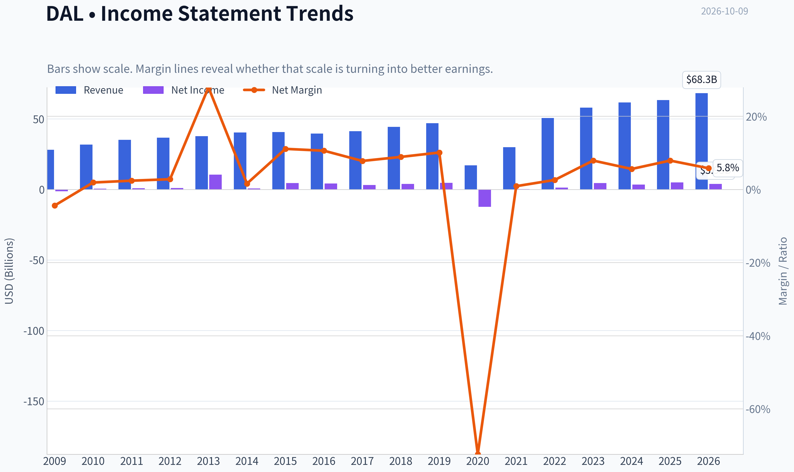

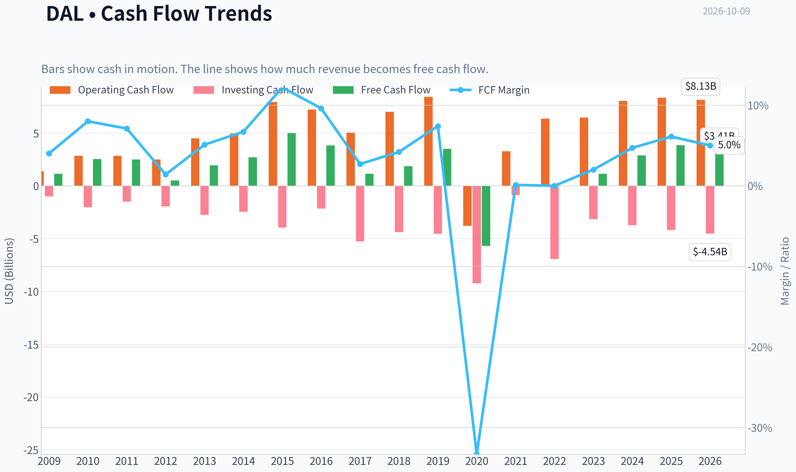

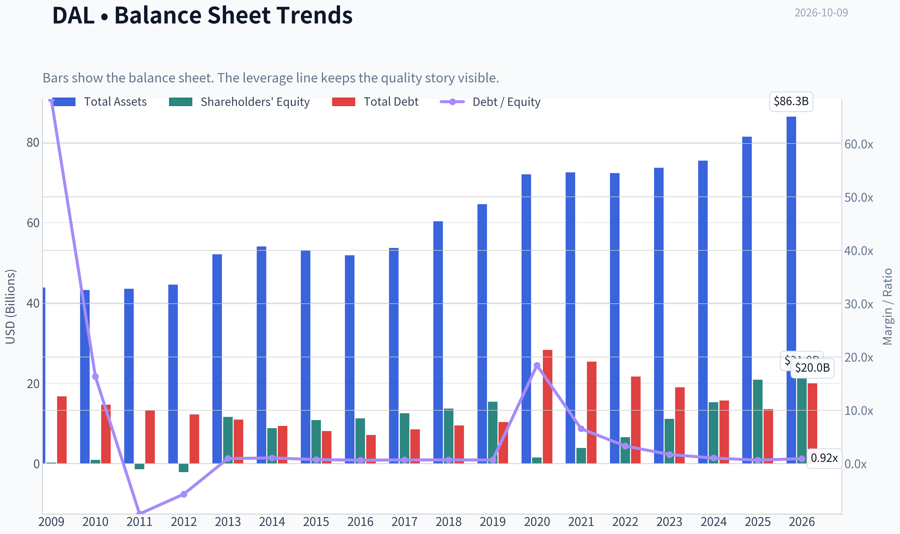

This graph tracks the profitability and return metrics (ROE, ROIC, Margins) of **DAL** over the past decade, highlighting capital efficiency trends.

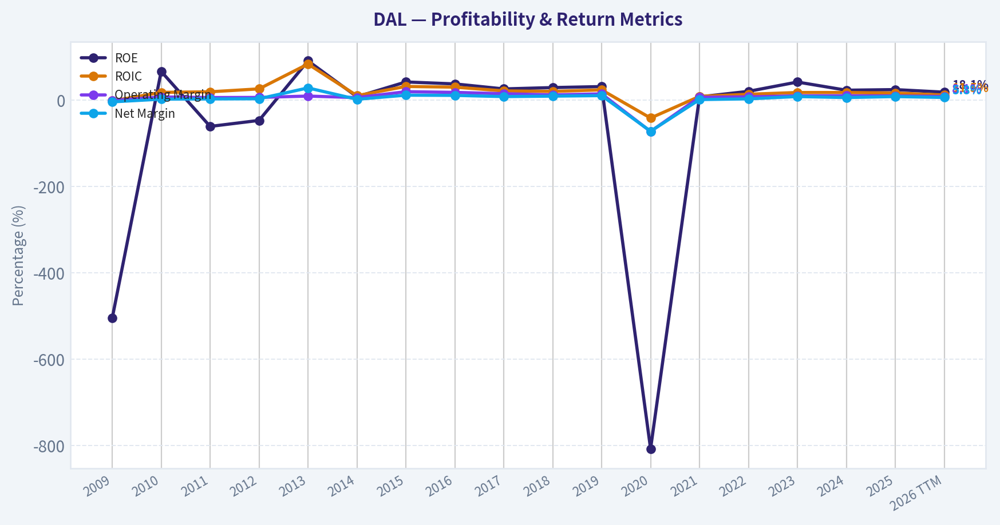

This chart illustrates the financial health of **DAL** over the last 10 years, mapping cash equivalents and free cash flow against total obligations (Debt).

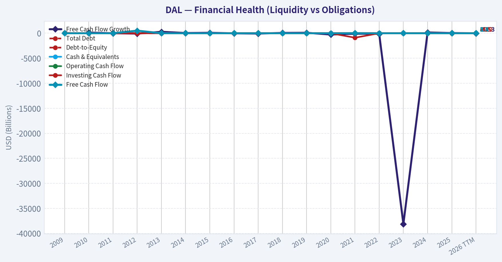

This breakdown chart from <em>Cash Flow and Capital Allocation</em> shows the proportional composition for **DAL** - useful for understanding what drives or risks the business.

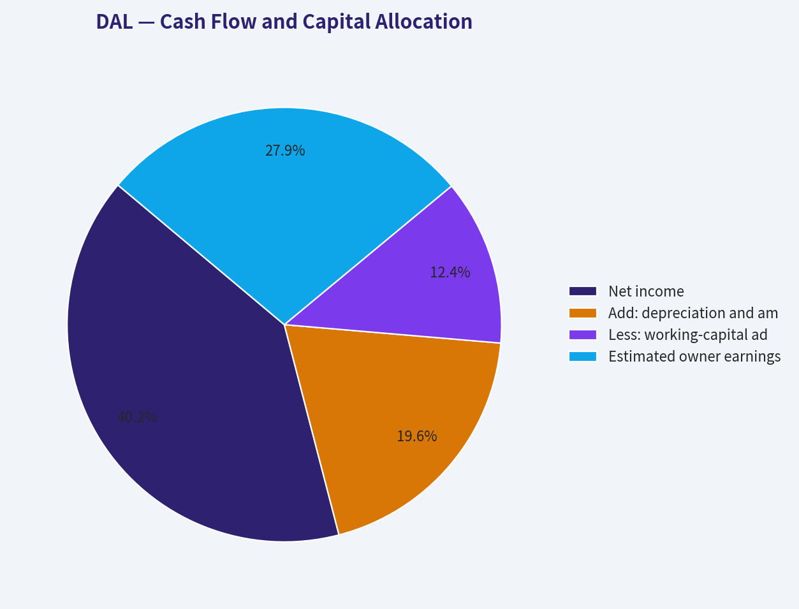

---

### Intrinsic Value Analysis (Buffett)

> *Following Warren Buffett's value investing philosophy: Circle of Competence, Economic Moat, Management Quality, and Margin of Safety.*

#### Intrinsic Value Snapshot

Price is what you pay. Intrinsic value is what the business may be worth based on the cash it can create for owners over time. We show a range, not one magic number.

- Current Price: $82.14
- Value Range (conservative to optimistic across both DCF methods): $-10.98 to $462.24

##### Owner Earnings (Buffett Method)
- Net Income: $5,005,000,000.00
- Depreciation & Amortization: $2,443,000,000.00
- Capital Expenditures: $-4,499,000,000.00
- Working Capital Changes: $1,536,000,000.00
- Owner Earnings: $3,469,000,000.00

##### Intrinsic Value
###### Buffett Method
Uses owner earnings. Stricter, and usually more conservative.
- Conservative: $-10.98
- Average: $100.53
- Optimistic: $209.27
- Discount Rate: 10.0%

###### Cash Flow Method
Uses free cash flow. Better for companies spending heavily today to grow tomorrow.
- Conservative: $16.59
- Average: $63.16
- Optimistic: $462.24
- Discount Rate: 10.0%

ANALYST STANCE: **WATCH**

#### Executive Summary

Delta Air Lines is a recognizable franchise with a strong premium-travel position, valuable loyalty economics, and improving operational execution. However, it remains a cyclical, capital-intensive airline exposed to fuel prices, labor costs, economic downturns, aircraft availability, and substantial financial obligations.

At $82 per share, Delta trades near the business-model-routed intrinsic value estimate of $88.51. The implied 7.2% margin of safety is insufficient for an airline's cyclicality and balance-sheet risk. The company is worth monitoring, but the current price does not provide a compelling Buffett-style margin of safety.

#### 1. Factor Scorecard

| Factor | Score | Assessment |
|---|---:|---|
| Circle of competence and simplicity | 3/5 | The model is understandable: sell transportation and related travel services. Long-term earnings remain difficult to forecast because of fuel, labor, capacity, and economic cycles. |
| Durable competitive advantage | 3/5 | Delta benefits from its brand, premium cabin position, loyalty program, Atlanta hub, and operational reputation. These advantages are meaningful but not unassailable. |
| Management and capital allocation | 3.5/5 | Management has restored profitability after the pandemic and has emphasized premium revenue, loyalty, and balance-sheet repair. Capital allocation remains constrained by aircraft needs and debt. |
| Industry structure | 2.5/5 | Airlines have improved industry discipline, but the business remains capital-intensive, cyclical, and vulnerable to price competition and external shocks. |

**Gate 5 hard floor:** **Not tripped.** The available evidence does not show both a clearly worsening earnings or cash-flow trajectory and a solvency red line such as interest coverage below 1.0 times. The balance sheet deserves caution, but this is not a financial-distress case.

#### 2. Moat Analysis

Delta's moat is best described as **narrow to moderate and relatively stable**, rather than wide.

- **Brand and premium positioning:** Delta has developed a stronger premium-travel brand than many U.S. airline competitors. Premium cabins, branded fares, lounges, and corporate relationships support higher revenue per passenger.
- **Loyalty ecosystem:** SkyMiles and the American Express relationship create recurring economics and customer engagement beyond the individual flight. This is one of Delta's most attractive strategic assets.
- **Hub economics:** Atlanta and other major hubs provide network density, schedule breadth, and customer convenience. Hub concentration also creates operating leverage, though it increases exposure to local disruptions.
- **Operational reputation:** Consistent execution can influence corporate and frequent-flyer behavior, but service quality is not impossible for competitors to replicate.
- **Weaknesses:** Aircraft are expensive, switching costs for many travelers are low, and competitors can match routes and pricing. Fuel and labor costs can quickly compress margins.

Delta's 24% reported ROE is attractive, but airline ROE can be amplified by debt and lease obligations. The lack of a sustained gross-margin advantage also reflects the commodity-like economics of transportation.

#### 3. Management Quality and Capital Allocation

Management's strongest decision has been repositioning Delta toward premium customers, loyalty revenue, and a more differentiated travel experience rather than competing solely on low fares. The recovery from pandemic disruption also demonstrates operating resilience.

The principal capital-allocation limitation is structural. Airlines must continually spend on aircraft, maintenance, technology, airports, and employee capacity. Even when reported free cash flow is strong, a meaningful portion is required to preserve the franchise.

The 13F data show Berkshire Hathaway increased its Delta position by 44% to approximately 57.3 million shares as of June 30, 2026. This is a favorable external signal, but it should not substitute for independent valuation work; 13F positions are delayed snapshots and do not establish that the current price offers an adequate margin of safety.

#### 4. Financial Summary

| Metric | Current / Latest Available |
|---|---:|
| Share price | $82 |
| Market capitalization | $54.02 billion |
| P/E ratio | 13.6x |
| ROE | 24.0% |
| Revenue growth, year over year | 2.8% |
| Free-cash-flow yield | 7.1% |
| Current ratio | 0.40x |
| Headline intrinsic value | $88.51 |
| Owner-earnings model value | $100.53 |
| FCF model value | $63.16 |
| Damodaran FCFF value | $79.49 |
| Headline margin of safety | 7.2% |

**Key Takeaways:** Delta is profitable and generates a respectable 7.1% free-cash-flow yield at the current price. Its 24% ROE is strong, but the low current ratio highlights limited balance-sheet liquidity and the need to evaluate debt and lease obligations carefully. The valuation models are widely dispersed, ranging from $63.16 to $100.53 per share, which signals substantial sensitivity to assumptions.

#### 5. Owner Earnings Calculation

Buffett-style owner earnings are:

> Net income + depreciation and amortization - maintenance capital expenditures - working-capital investment

For Delta, reported free cash flow is a useful starting point, but it must be normalized because aircraft purchases and fleet modernization create unusually large swings in annual capital expenditure.

The owner-earnings valuation model implies the following normalized figure:

| Item | Approximate Amount |
|---|---:|
| Owner-earnings model value per share | $100.53 |
| Discount rate | 10% |
| Implied normalized owner earnings per share | $10.05 |
| Implied normalized owner earnings | Approximately $6.62 billion |

**Key Takeaways:** The owner-earnings model implies normalized annual owner earnings of roughly $6.6 billion, or $10.05 per share. That figure should not be interpreted as a single-year accounting result; it represents a normalized estimate after adjusting for the airline's recurring fleet and maintenance requirements. The wide gap between this estimate and the FCF model shows how heavily valuation depends on the treatment of capital spending.

#### 6. Three-Scenario DCF Valuation

| Scenario | Method | Estimated Value |
|---|---|---:|
| A. No growth | Owner earnings divided by 10% discount rate | Approximately $100.53* |
| B. GDP growth | 3% long-term growth assumption | Approximately $88.51 headline blend |
| C. Historical / normalized growth | 50%-75% of sustainable historical growth, capped at 10% | Approximately $79-$90 range |
| Cross-check | FCF and Damodaran FCFF models | $63.16-$79.49 |

\*The owner-earnings model value is the available normalized model output; the exact accounting inputs for maintenance capex and working capital are not separately disclosed in the research summary.

**Key Takeaways:** The valuation range is broad because Delta is cyclical and capital intensive. A conservative cash-flow approach produces values around $63 to $80, while a more favorable owner-earnings framework produces approximately $100.53. The $88.51 headline value is reasonable as a blended estimate, but it does not provide enough protection against an adverse airline cycle.

#### 7. Margin of Safety Analysis

At $82 per share:

- Headline intrinsic value: **$88.51**
- Implied upside to headline value: **approximately 7.9%**
- Reported margin of safety: **7.2%**
- Best available model value: **$100.53**
- Most conservative model value: **$63.16**

For a wide-moat, highly predictable compounder, a 7% margin of safety might be acceptable. Delta does not meet that standard. Its moat is narrower, its earnings are cyclical, and its capital requirements are substantial. A more appropriate entry range would likely require either:

- A materially lower share price, approximately in the **$60-$70 range**, or
- Clear evidence that normalized earnings and free cash flow are sustainably above current expectations.

The reverse DCF implies approximately **13% annual growth for ten years** at the current price. That is demanding for an airline, particularly when recent revenue growth is only 2.8%. The price therefore appears to require continued strong execution and favorable industry conditions.

#### 8. Balance Sheet and Return Profile

| Criterion | Assessment | Score |
|---|---|---:|
| Earnings power | Profitable with 24% ROE | 3.5/5 |
| Cash-flow quality | Positive FCF yield, but maintenance capex is difficult to normalize | 3/5 |
| Liquidity | Current ratio near 0.40x | 2/5 |
| Leverage risk | Airline debt, leases, and fleet obligations reduce financial flexibility | 2.5/5 |
| Capital efficiency | Attractive reported ROE, but leverage must be considered | 3/5 |

**Key Takeaways:** Delta's reported profitability is strong, but the balance sheet is not fortress-like. Low liquidity and recurring aircraft obligations make the company more vulnerable during recessions or periods of weak travel demand. The central question is not whether Delta can earn strong profits in a favorable environment, but how much of those profits remain available after necessary fleet and maintenance investment.

#### 9. Final Buffett Scorecard

| Criterion | Weight | Score | Weighted Contribution |
|---|---:|---:|---:|
| Moat width and durability | 25% | 3.0 | 0.75 |
| Valuation and margin of safety | 20% | 3.0 | 0.60 |
| Capital returns versus WACC | 15% | 3.0 | 0.45 |
| Business understanding and predictability | 12% | 2.5 | 0.30 |
| Management quality and capital allocation | 12% | 3.5 | 0.42 |
| Reinvestment runway | 8% | 3.0 | 0.24 |
| Balance-sheet strength | 4% | 2.5 | 0.10 |
| Industry structure | 4% | 2.5 | 0.10 |
| **Total** | **100%** |  | **2.96/5** |

**Key Takeaways:** Delta scores well on brand, premium positioning, management execution, and current profitability. It loses points for cyclicality, capital intensity, balance-sheet flexibility, and valuation uncertainty. The resulting score of approximately 2.96 falls just below the threshold for an attractive purchase.

#### Investment Stance

**WATCH - Moderate conviction**

Delta is a respectable airline and potentially a good investment at the right price. It has a stronger franchise than many industry peers, but the current $82 price offers only a thin margin of safety relative to the blended intrinsic value estimate and requires substantial future growth.

The preferred action is to **wait for a lower entry price or stronger evidence of durable, normalized owner earnings**. Delta becomes more compelling near the mid-$60s, where the valuation would better compensate investors for fuel, labor, recession, fleet, and leverage risks.
#### Valuation Bridge

This bridge places the current market price beside each intrinsic value lens so readers can see whether upside depends on one method or shows up across several methods.

| Scenario | Intrinsic Value / Share |
| --- | ---: |
| Buffett Method | $100.53 |
| Cash Flow Method | $63.16 |
| Damodaran Method | $79.49 |
| Current Price | $82.14 |

#### Key Takeaways

If one method is far above the others, the upside case depends on a specific modelling assumption. When several methods cluster together, the valuation story is more robust.

#### Valuation Visuals

This comparison chart from *Latest Earnings Snapshot* stacks current figures against historical benchmarks for **DAL**, making it easy to see where the company trades relative to its own averages.

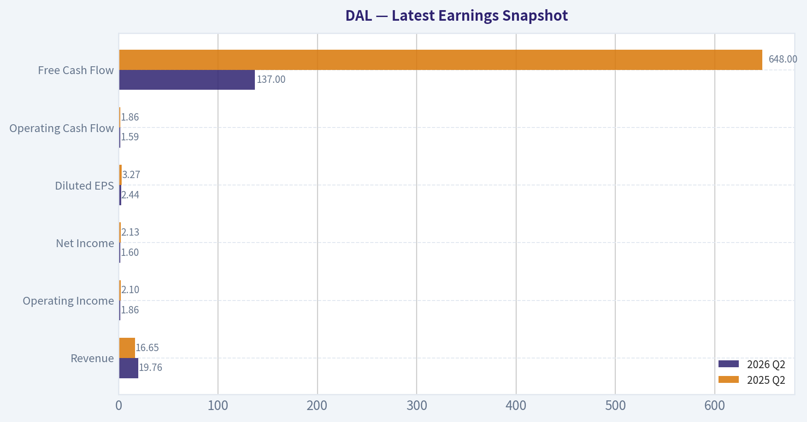

This comparison chart from *Current Versus Historical Average* stacks current figures against historical benchmarks for **DAL**, making it easy to see where the company trades relative to its own averages.

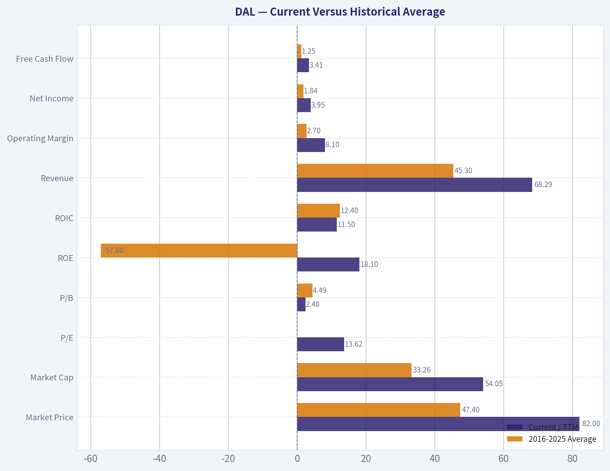

This comparison chart from *Financial Summary* stacks current figures against historical benchmarks for **DAL**, making it easy to see where the company trades relative to its own averages.

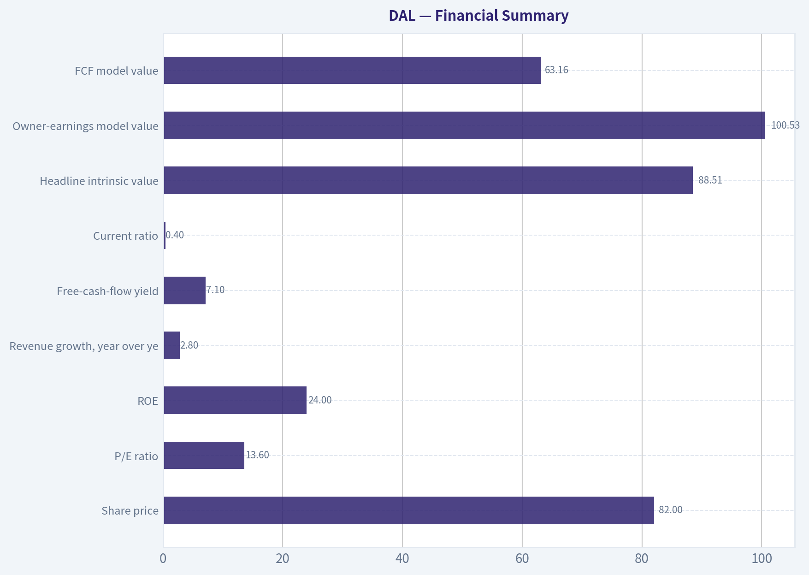

This comparison chart from *Owner Earnings Calculation* stacks current figures against historical benchmarks for **DAL**, making it easy to see where the company trades relative to its own averages.

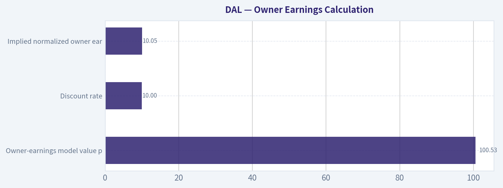

---

### Trend & Growth Analysis (Lynch/Druckenmiller/Fisher)

> *Following Peter Lynch's GARP, Stanley Druckenmiller's macro-aware approach, and Philip Fisher's scuttlebutt methodology.*

ANALYST STANCE: **WATCH**

#### 1. Lynch Classification

**Cyclical, with stalwart-like current growth characteristics.**

Delta Air Lines is not currently a Lynch fast grower: revenue growth is only **2.8% year over year**, and airline earnings are highly sensitive to fuel costs, capacity, labor, economic activity, and travel demand. The stock may be attractive as a cyclical value opportunity, but it does not currently meet the preferred profile of a durable 15-25% growth compounder.

#### 2. The Story

- Delta is a premium-oriented global airline benefiting from strong demand for premium cabins, loyalty economics, and higher-value travel.
- Its principal operating advantage is scale, brand strength, network density, and the Delta SkyMiles/American Express ecosystem.
- The investment case depends more on a recovery in earnings and margins than on rapid secular revenue growth.

#### 3. TAM and Runway

The global air-travel market is large and structurally supported by rising middle-class wealth, international travel, and premiumization. However, airlines generally operate in a competitive, capital-intensive industry with limited pricing power over the full cycle.

| Measure | Assessment |
|---|---:|
| Current market capitalization | $54.02 billion |
| Current revenue | Not provided in research pack |
| 10x revenue test | Cannot be quantified reliably |
| TAM growth | Positive, but generally moderate and cyclical |
| Competitive structure | Scale advantages, but intense competition |
| Runway for a 10-bagger | Low under ordinary airline economics |

**Key Takeaways:** Delta has a large addressable market, but market size alone does not create a ten-bagger opportunity. The industry's capital intensity, cyclicality, and competitive pricing make a 10x equity outcome difficult without a major structural improvement in margins or market share.

#### 4. Revenue Growth Trend

| Metric | Latest reading | Interpretation |
|---|---:|---|
| Revenue growth, year over year | 2.8% | Slow growth |
| Growth classification | Below fast-grower threshold | Not an inflection yet |
| Trend visibility | Limited | Requires upcoming earnings confirmation |
| Key current driver | Premium business | Positive mix shift, but not yet sufficient to prove acceleration |

**Key Takeaways:** The latest growth rate is modest and does not demonstrate acceleration. Premium demand may be supporting revenue quality, but investors need evidence of sustained volume growth, stronger pricing, and improving earnings before treating Delta as an inflection story.

#### 5. Unit Economics and Operating Efficiency

| Metric | Value | Assessment |
|---|---:|---|
| LTV/CAC | Not disclosed | Not applicable in standard SaaS form |
| Net revenue retention | Not applicable | Airline business model |
| Rule of 40 | Not applicable | Not a subscription company |
| Return on equity | 24.0% | Strong, though cyclical |
| Free-cash-flow yield | 7.1% | Attractive valuation support |
| Current ratio | 0.40 | Weak liquidity cushion |

**Key Takeaways:** Delta's 7.1% free-cash-flow yield and 24% ROE are positives, but the weak current ratio reflects the financial leverage and working-capital demands common in airlines. Cash generation should be assessed across a full cycle rather than from one strong period.

#### 6. Inflection Point Assessment

**Current assessment: Possible operating inflection, not yet confirmed.**

Potential positive inflection indicators:

- Premium travel remains resilient despite higher fuel costs.
- Loyalty and co-branded credit-card revenue can improve business mix and margins.
- Capacity discipline could support pricing.
- A strong Q3 report could validate earnings resilience.

Indicators still missing:

- Sustained revenue acceleration above the low-single-digit range.
- Persistent margin expansion after fuel and labor pressures.
- Evidence that Delta is taking share rather than simply benefiting from industry-wide demand.
- Stronger free cash flow through a complete operating cycle.

The upcoming earnings report is important because the market is specifically watching whether premium revenue can offset elevated fuel costs and capacity adjustments.

#### 7. Macro Setup

| Macro factor | Direction for DAL | Assessment |
|---|---|---|
| Premium travel demand | Positive | Supports mix and pricing |
| Fuel prices | Negative if elevated | Major earnings risk |
| Labor costs | Negative | Structural cost pressure |
| Economic growth | Mixed | Travel is economically sensitive |
| Interest rates | Negative while high | Raises financing and discount-rate pressure |
| Capacity discipline | Positive | Can support pricing |
| Recession risk | Significant downside | Cyclical exposure |

**Key Takeaways:** The macro backdrop is mixed rather than clearly favorable. Premium demand and capacity discipline are helpful, but fuel, labor, interest rates, and recession sensitivity create meaningful downside risk. This is not the ideal early-cycle setup for a concentrated growth position.

#### 8. Fisher 15-Point Assessment

| Fisher criterion | Score / 5 | Comment |
|---|---:|---|
| Market potential | 4 | Large global travel market |
| New-product development | 3 | Service and loyalty innovation, limited product disruption |
| R&D effectiveness | 2 | Not a major R&D-driven business |
| Sales organization | 4 | Strong premium and corporate sales capabilities |
| Profit margins | 3 | Attractive in good cycles, pressured in weak cycles |
| Margin improvement | 3 | Possible, but not yet proven |
| Labor relations | 2 | Labor intensity and labor-cost risk |
| Executive relations | 3 | Experienced leadership, cyclical constraints |
| Management depth | 4 | Established operating platform |
| Cost analysis | 3 | Complex and fuel-sensitive cost structure |
| Outstanding moat characteristics | 4 | Network, brand, slots, loyalty ecosystem |
| Long-range profit outlook | 3 | Positive but cyclical |
| Dilution risk | 3 | Not a primary issue from supplied data |
| Management candor | 3 | Insufficient evidence in research pack |
| Management integrity | 3 | Insufficient evidence in research pack |
| **Total** | **47 / 75** | **Average** |

**Key Takeaways:** Delta scores well on scale, brand, network, and sales capabilities, but poorly on Fisher's innovation and stability dimensions. The 47-point score is average and does not support a high-conviction growth classification.

#### 9. Valuation Analysis

| Valuation measure | Result | Interpretation |
|---|---:|---|
| Share price | $82.00 | Reference price |
| Market capitalization | $54.02 billion | Large-cap airline |
| P/E ratio | 13.62x | Reasonable on current earnings |
| Revenue growth | 2.8% | Low relative to growth-investor standards |
| PEG ratio | Approximately 4.9 | Expensive relative to current growth |
| Free-cash-flow yield | 7.1% | Meaningful valuation support |
| Headline intrinsic value | $88.51 | Approximately 7.2% upside |
| Owner-earnings value | $100.53 | Bullish model |
| FCF value | $63.16 | Bearish model |
| Damodaran FCFF value | $79.49 | Near current price |

**Key Takeaways:** Delta looks reasonably valued on P/E and free-cash-flow yield, but its PEG ratio is unattractive because current growth is low. The valuation models are widely dispersed, ranging from $63 to $101, which highlights the stock's sensitivity to cyclical earnings assumptions. The headline intrinsic value implies only modest upside.

##### Scenario Analysis

| Scenario | Core assumption | Indicative outcome |
|---|---|---|
| Bear | Fuel and labor pressure, weak demand, margin compression | Value near or below $63 |
| Base | Stable premium demand and normalized margins | Value around $79-$89 |
| Bull | Strong premium growth, capacity discipline, improved margins | Value near $100 |

**Key Takeaways:** The base case offers limited upside from $82, while the bull case requires a favorable operating cycle and successful margin execution. The downside case is credible because airline cash flows can deteriorate quickly when demand or costs move against the company.

#### 10. Growth Investor Scorecard

| Criterion | Weight | Score / 5 | Weighted result |
|---|---:|---:|---:|
| Lynch story | 10% | 3.5 | 0.35 |
| TAM and runway | 20% | 3.0 | 0.60 |
| Revenue growth | 20% | 2.0 | 0.40 |
| Unit economics | 15% | 3.0 | 0.45 |
| Competitive position | 10% | 4.0 | 0.40 |
| Management quality | 10% | 3.5 | 0.35 |
| Macro setup | 5% | 2.5 | 0.13 |
| Profitability path | 5% | 3.5 | 0.18 |
| Valuation | 5% | 3.5 | 0.18 |
| **Total** | **100%** | - | **3.04 / 5.00** |

**Key Takeaways:** Delta scores approximately 3.0 out of 5, placing it in the **WATCH** category. Its competitive position and valuation are acceptable, but low growth, cyclicality, and mixed macro conditions prevent an advocate rating.

#### 11. Position Size Stance

- **New position:** Small or no initial position; wait for evidence of accelerating growth and margin improvement.
- **Existing position:** Reasonable to hold if the investor is deliberately seeking cyclical value and understands fuel, labor, and recession risks.
- **Growth portfolio allocation:** Generally limited, perhaps **0-2%** for a diversified growth investor; larger positions would require stronger conviction in the earnings cycle.

Warren Buffett's reported increase in Delta shares is a positive sentiment signal, but 13F filings are delayed quarter-end snapshots and should not substitute for operating analysis.

#### 12. Key Catalysts and Risks

| Catalysts | Risks |
|---|---|
| Strong Q3 earnings and guidance | Fuel-price spike |
| Premium-cabin demand stays resilient | Recession or business-travel slowdown |
| Capacity discipline supports fares | Labor-cost inflation |
| Loyalty and co-branded-card growth | Excess industry capacity |
| Margin expansion and stronger free cash flow | High leverage and weak current ratio |
| Improved airline pricing environment | Weather, operational, or geopolitical disruption |

**Key Takeaways:** The principal near-term catalyst is evidence that premium demand is translating into durable earnings and margin strength. The largest risks are macro and cost-related, particularly fuel, labor, recession, and leverage. A sustained acceleration in revenue and free cash flow would be needed to upgrade the stock from Watch to Advocate.

#### Bottom Line

Delta is a **reasonable cyclical value candidate**, supported by a low-teens P/E, 7.1% free-cash-flow yield, strong brand, and premium travel exposure. It is **not currently a fast-growing ten-bagger candidate**: revenue growth is only 2.8%, the PEG ratio is high, intrinsic-value upside is modest, and the macro setup is mixed.

**Upgrade trigger:** multiple quarters of accelerating revenue, stable or expanding margins, and stronger free cash flow despite fuel and labor pressures.

---

### Market Technical Analysis

ANALYST STANCE: **WATCH**

#### DAL technical overview

The latest available trading session is October 8, 2026, when DAL closed at **$82.14**. October 9 is listed as a non-trading day in the indicator feed, so the analysis below uses October 8 as the effective reference date.

DAL's chart presents a **long-term bullish trend with a weakening medium- and short-term structure**. The stock remains well above its 200-day SMA at approximately **$75.80**, preserving the broader uptrend. However, the price is below both the 10-day EMA at **$83.05** and the 50-day SMA at **$83.77**, indicating that near-term momentum has deteriorated and that the stock is currently trading beneath important short- and medium-term trend references.

The 50-day SMA has declined from approximately **$86.0 in early September to $83.8**, while the 200-day SMA continues to rise gradually from roughly **$74.1 to $75.8**. This divergence is important: the longer-term advance has not been technically broken, but the intermediate trend is undergoing a correction. A sustained move back above the 50-day SMA would improve the setup; continued trading below it would increase the risk of a deeper retracement toward the 200-day average.

#### Momentum and trend signals

MACD remains positive at approximately **0.32**, which means the faster trend component is still above the slower one. Nevertheless, MACD has fallen from about **0.49 on October 2**, and from strongly negative levels in mid-September it has recently flattened and rolled over. This suggests that the September recovery has lost momentum rather than fully reversing into a new bearish trend. A renewed MACD rise would support a recovery attempt, while a move back below zero would materially weaken the technical picture.

RSI is approximately **48.2**, down from nearly **55 on October 2**. This is a neutral reading, not an oversold one. It shows that selling pressure has increased, but the stock has not yet reached the type of depressed momentum level that would independently signal a high-confidence reversal. In practical terms, RSI currently favors patience: a move above 50 would indicate improving momentum, while a decline toward 40 or below would signal that bears are gaining control.

#### Volatility and price levels

The Bollinger middle line is approximately **$82.19**, calculated from the reported upper and lower bands. DAL closed just below this midpoint, with the upper band near **$86.52** and the lower band near **$77.86**. The stock is therefore not currently pressing either volatility extreme. A close above the middle band would be an initial recovery signal, with the 50-day SMA and the $85-$86 area acting as successive resistance. A break below the lower half of the range could expose the stock to a move toward the mid-to-high $70s.

ATR is approximately **$2.35**, meaning DAL's typical daily trading range is close to **2.9% of the share price**. This is substantial enough that tight stops may be vulnerable to ordinary daily fluctuations. A volatility-adjusted stop placed roughly one to one-and-a-half ATRs from an entry would imply a distance of approximately **$2.35 to $3.52**, although the appropriate level depends on the trading timeframe and risk tolerance.

Recent volume has been uneven, with several sessions above the stock's recent average, including roughly **9.65 million shares on October 8**. Because the latest higher-volume session occurred during a decline, it warrants caution: it may reflect distribution or simply heightened short-term repositioning. Confirmation would require observing whether subsequent rallies attract stronger volume than pullbacks.

#### Trading interpretation

The technical evidence is currently **constructive over the long term but not yet attractive for an aggressive short-term entry**. The key positive is that price remains more than $6 above the rising 200-day SMA. The key negatives are that price is below the 10-day EMA and 50-day SMA, MACD is losing altitude, and RSI has slipped back below 50.

For bullish confirmation, traders could watch for a close above **$83.05**, followed by a recovery above **$83.77**. A move through the recent **$85.47-$86.17** resistance zone, ideally accompanied by expanding volume, would provide stronger evidence that the correction has ended. On the downside, loss of the **$80-$81** area would weaken the near-term structure, while a decisive break toward **$77.86** would bring the rising 200-day SMA near $75.80 into focus.

Because the indicators do not yet align decisively, the appropriate stance is **WATCH** rather than an unconditional buy or sell. The stock's long-term trend argues against automatically treating the current pullback as a major breakdown, but the short-term signals do not yet provide strong confirmation of renewed upside.

#### Selected indicators and current readings

| Indicator | Latest reading | Technical interpretation | Practical significance |
|---|---:|---|---|
| Close price | $82.14 | Below short- and medium-term averages | Near-term trend remains under pressure |
| 10-day EMA | $83.05 | Price is below the responsive trend line | Short-term momentum is bearish to neutral |
| 50-day SMA | $83.77 | Sloping downward and above price | Intermediate correction remains active |
| 200-day SMA | $75.80 | Rising and well below price | Long-term trend remains bullish |
| MACD | 0.32 | Positive but declining from recent highs | Recovery momentum is fading |
| RSI | 48.2 | Neutral, below the 50 midpoint | No oversold reversal signal yet |
| Bollinger Bands | $77.86 lower / $86.52 upper | Price near the band midpoint | Neither breakout nor capitulation confirmed |
| ATR | $2.35 | Daily volatility near 2.9% | Stops and position size should account for wide swings |

Key Takeaways: DAL remains above its rising 200-day average, so the broader trend is still constructive. However, the stock is below its 10-day EMA and 50-day SMA, while MACD and RSI indicate weakening short-term momentum rather than a confirmed reversal. A move above $83.77 would improve the setup, while a break below the $80-$81 area would increase downside risk toward the upper-$70s.

#### Market Visuals

The following chart maps the **DAL** Owner Earnings DCF valuation scenarios (Conservative, Average, Optimistic) to visually represent the margin of safety based on intrinsic value calculations.

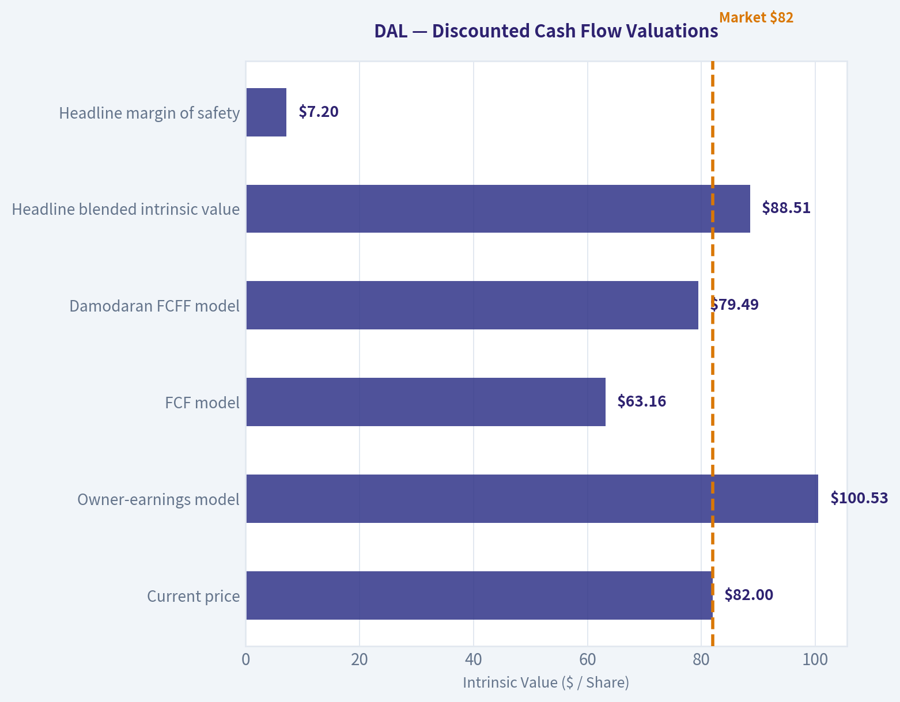

---

### Options Market Analysis

> *Reading options flow - put/call ratios, IV skew, and unusual activity - to gauge institutional positioning and event-driven risk.*

ANALYST STANCE: **WATCH**

#### DAL Options Flow Report

**As of October 9, 2026.** The supplied chain data has a major limitation: open interest is reported as zero across all near-term expirations, while trading volume is substantial. This makes conventional open-interest analysis, gamma-wall identification, and unusual-activity detection unreliable.

#### Put/Call Ratio Analysis

| Expiration | Call Volume | Put Volume | Put/Call Volume Ratio | Call OI | Put OI | Put/Call OI Ratio |
|---|---:|---:|---:|---:|---:|---:|
| Oct. 9, 2026 | 19,622 | 26,799 | 1.37 | 0 | 0 | N/A |
| Oct. 16, 2026 | 11,999 | 7,778 | 0.65 | 0 | 0 | N/A |
| Oct. 23, 2026 | 744 | 700 | 0.94 | 0 | 0 | N/A |
| **Near-term total** | **32,365** | **35,277** | **1.09** | **0** | **0** | **N/A** |

**Key Takeaways:** The aggregate near-term put/call volume ratio is 1.09, modestly above the approximately 0.7 neutral baseline and therefore slightly defensive. However, the flow is split by expiration: same-day trading is put-heavy, while the October 16 expiration is call-heavy. Because open interest is zero, there is no reliable evidence that these trades represent newly established positions.

#### Implied Volatility Assessment

| Expiration | Call ATM IV | Put ATM IV | Put-versus-Call IV Difference | Interpretation |
|---|---:|---:|---:|---|
| Oct. 9, 2026 | 7.0% | 5.7% | -1.3 percentage points | Call IV higher |
| Oct. 16, 2026 | 2.0% | 1.8% | -0.2 points | Nearly balanced, slight call skew |
| Oct. 23, 2026 | 1.8% | 1.4% | -0.4 points | Slight call skew |

The reported IV levels are extraordinarily low for equity options, particularly the 1.4%-2.0% readings for the later expirations. This may reflect a data-quality, contract-selection, or quote-normalization issue rather than genuinely low expected volatility.

The available data does not include a full out-of-the-money volatility surface, so a definitive OTM put-versus-call skew calculation is unavailable. The ATM figures show a slight call-side IV premium rather than the downside put skew normally associated with strong hedging demand. No known catalyst can be confirmed from this dataset; the October 9 and October 16 expirations may nevertheless contain event or short-dated positioning risk.

**Key Takeaways:** Reported IV is low and slightly favors calls over puts, which does not indicate significant downside fear. Nevertheless, the unusually low absolute IV readings should not be trusted without validating the underlying quotes and contract selection. Catalyst-related IV elevation is not evident in the supplied data.

#### Unusual Options Activity

| Finding | Result |
|---|---|
| Contracts meeting volume greater than 5x open interest | None identified |
| Fresh directional bets | Cannot confirm because all reported OI is zero |
| Smart-money versus retail classification | Not possible from the available data |
| Strike moneyness and days to expiry | Contract-level details were not supplied |

**Key Takeaways:** No contracts met the tool's unusual-activity threshold. This does not necessarily mean institutional activity is absent; with zero reported open interest, the comparison required to identify fresh positions cannot be performed. The flow should therefore be treated as an indication of trading interest, not confirmed directional conviction.

#### Open Interest Concentration and Gamma Levels

| Metric | Assessment |
|---|---|
| Highest call OI strikes | Not available; reported call OI is zero |
| Highest put OI strikes | Not available; reported put OI is zero |
| Expiration with greatest OI concentration | None identifiable |
| Gamma walls or pinning levels | Cannot be determined |
| Max-pain analysis | Not possible from supplied data |

**Key Takeaways:** There are no usable open-interest concentrations in the dataset, so strike-based support, resistance, pinning, and gamma-wall analysis cannot be completed. Traders should not infer that no gamma exposure exists; the zero-OI output is more likely a data limitation than a complete representation of the DAL options market.

#### Overall Options Sentiment

| Signal Component | Read |
|---|---|
| Put/call volume | Slightly defensive overall; ratio 1.09 |
| Expiration split | Bearish/defensive in same-day options, bullish-leaning in Oct. 16 options |
| IV level | Reported as unusually low and potentially unreliable |
| IV skew | Slight call skew based on ATM IV |
| Unusual activity | None confirmed |
| OI concentration | Unavailable |
| **Overall signal** | **NEUTRAL, with a slight defensive bias** |
| **Confidence** | **Low** |

The primary directional read is **NEUTRAL**, leaning mildly defensive because aggregate put volume exceeds call volume and same-day put activity is notably heavier. That bias is offset by stronger call volume in the October 16 expiration and the slight call-side IV skew. Since open interest is zero throughout the chain and the reported IV appears anomalously low, this is a low-confidence signal rather than a reliable institutional positioning call.

**Key Takeaways:** DAL options flow does not provide a strong bullish or bearish signal. The best interpretation is neutral with a modest short-term defensive tilt, driven mainly by same-day put volume. Validate the chain with a second data source before making a directional trade, particularly because OI, strike-level concentration, and contract-level unusual activity are unavailable.

#### Summary Table

| Category | Assessment |
|---|---|
| Put/Call Ratio | Volume ratio 1.09, modestly above neutral; OI ratio unavailable |
| IV Level | Extremely low as reported; likely requires data validation |
| Skew Direction | Slight call skew based on ATM IV; no full OTM skew available |
| Unusual Activity | None confirmed; zero OI prevents reliable volume/OI analysis |
| Overall Signal | **NEUTRAL with a slight defensive bias; low confidence** |

---

## Research Team Commentary

> *The Research Manager synthesizes the Bull vs Bear debate into action-free commentary. This is a pre-risk view, not the final stance.*

Core takeaway: Delta is a strong operator in a structurally difficult industry, but at $82.14 the stock no longer offers enough margin of safety for a long-term value purchase. Its network density, premium positioning, and SkyMiles-American Express ecosystem support better economics than the generic airline stereotype suggests. However, the bull case produces only about 10% upside to its $90 base value while relying on a starting owner-earnings estimate that has not been reconciled to maintenance capital expenditure. That is too narrow a discount for a cyclical, capital-intensive business.

The strongest bull argument is that Delta has genuine relative competitive advantages. Its hubs are difficult and expensive to replicate, its schedule density matters to corporate travelers, and loyalty status, card rewards, lounges, and premium service create more customer retention than ticket-price comparisons alone imply. A reported 15.7% ROIC is also meaningful evidence that Delta is currently earning attractive returns despite the industry's capital intensity. If normalized owner earnings really are around $5.50 per share and can grow 4%-5% annually, the shares are reasonably valued and could be worth approximately $90-$99.

The strongest bear argument is not that Delta is a poor company; it is that the valuation assumes too much stability. At 13.6 times earnings, Delta is less obviously inexpensive than it was during the prior evaluation near 10 times earnings. The bull model's conservative value is only $84, and the no-growth value is approximately $62. Its $5.50 starting owner-earnings figure represents only a modest haircut to reported EPS, even though aircraft replacement, engine maintenance, airport infrastructure, technology, and downturn liquidity are substantial recurring economic requirements. If normalized owner earnings are $4.50 rather than $5.50, or if an 11%-12% required return is appropriate, intrinsic value could fall into the $60s or $70s.

The reverse DCF therefore is less comforting than the headline "only 4% implied growth" suggests. Delta must first preserve the present earnings base through fuel volatility, labor resets, capacity cycles, recessions, and fleet investment. It then must produce low-to-mid-single-digit per-share growth without renewed leverage or dilution. That is plausible, but not a sufficiently undemanding expectation to constitute a clear margin of safety.

The moat also needs to be described accurately. Delta has a valuable relative moat, not dominant pricing power. Hub density and loyalty improve retention and utilization, but customers still compare fares and schedules, competitors can match status, and corporate travel policies can shift demand. The American Express relationship is an excellent asset, although it introduces counterparty, regulatory, and reward-economics concentration. These advantages justify Delta trading above weaker airlines, but not being valued like a predictable, capital-light platform.

The prior mistake with Delta is important, but it should not be overcorrected. Previously, cheap valuation, improving execution, and a repaired bullish trend were present simultaneously, while generic airline risks were allowed to force an overly cautious conclusion. Today the setup is different: the multiple has expanded, the available DCF cushion has narrowed, and the technical handoff describes weakening short- and medium-term structure within a still-bullish long-term trend. Options volume is slightly defensive, although the zero open-interest data make that evidence unreliable. There is no reason to make an aggressive bearish call, but the earlier rally is not evidence that the shares remain undervalued now.

From a time-horizon perspective, Delta could still perform well over the next several quarters if premium demand, margins, and earnings revisions remain favorable. The market may continue rewarding a best-in-class cyclical even without a large valuation discount. For a five-to-ten-year Buffett-style allocation, however, the current price does not adequately compensate for the breadth of possible normalized cash flows. A roughly 10% discount might be enough for a highly predictable wide-moat compounder; Delta's cyclicality calls for something closer to a 25%-35% discount to conservatively normalized value.

Over the next one to four quarters, I would monitor the following:

First, free cash flow quality. Delta should reconcile net income to cash flow after realistic maintenance capital expenditure. Consistent free cash flow per share near the bull's $5.50 owner-earnings assumption would materially strengthen the valuation case.

Second, unit economics. Watch passenger revenue per available seat mile, premium-cabin revenue, load factors, capacity growth, and non-fuel unit costs. The thesis strengthens if premium revenue outgrows the system while capacity remains disciplined and cost growth moderates.

Third, loyalty economics. Track American Express remuneration, card spending, new account acquisition, redemption costs, and any signs that program devaluation is hurting engagement. Continued loyalty growth independent of unusually strong ticket demand would demonstrate that this is a durable earnings stream rather than merely an airline-cycle enhancer.

Fourth, through-cycle returns. ROIC remaining in the low-to-mid teens as demand and pricing normalize would validate the quality argument. A decline toward high-single digits would suggest that the current 15.7% is cyclical rather than structural.

Fifth, financial resilience. Lease-adjusted leverage, interest and fixed-charge coverage, liquidity, fleet commitments, and the priority given to debt reduction over repurchases are critical. Debt reduction funded by genuine excess cash would strengthen the thesis; rising leverage to support fleet spending or shareholder distributions would weaken it.

Finally, watch price alongside fundamentals. A material pullback without deteriorating unit revenue, loyalty economics, or solvency could recreate the attractive tactical setup missed previously. Conversely, further multiple expansion without higher normalized free cash flow would increase downside risk.

The balanced conclusion is that Delta deserves respect as a best-in-class airline, but not yet fresh capital at a price close to optimistic fair value. It is neither distressed nor clearly overvalued enough to warrant AVOID. The appropriate response is to wait for either stronger proof of normalized owner earnings or a materially better entry price.

WATCH

---

## Value Investing Team Commentary

> *The Investor translates the research view into an investment thesis before risk review. This is still not the final stance.*

### Investment commentary

Delta is probably the best house in a difficult neighborhood. Its premium positioning, dense hub network, operational reputation, and SkyMiles-American Express ecosystem give it better economics than a commodity-airline description would suggest. The reported **15.7% ROIC** and **24% ROE** support that conclusion. Nevertheless, relative quality does not eliminate the industry's capital intensity, operating leverage, or cyclicality.

### Business quality and moat

Delta's strongest asset may be its loyalty ecosystem rather than its aircraft operations. SkyMiles, co-branded card spending, airport lounges, and elite status increase customer retention while generating economics less directly tied to each flight. Its hubs also provide schedule density that is difficult to reproduce quickly.

These advantages constitute a **relative moat**, but not the kind of dominant pricing power found in a capital-light platform:

- Travelers still compare fares and schedules.
- Labor, fuel, maintenance, and aircraft costs can absorb revenue gains.
- Competitors can imitate premium products and status programs.
- Hub concentration creates operational efficiency but also disruption risk.
- The American Express relationship is valuable, yet introduces counterparty and regulatory concentration.

Delta deserves a valuation premium to weaker airlines, but not the valuation or narrow margin of safety appropriate for a highly predictable compounder.

### Valuation and reverse-DCF implications

At **$82.14**, the reported **13.62 P/E** implies earnings of approximately **$6.03 per share**. If normalized owner earnings are truly **$5.50 per share**, the owner-earnings yield is about **6.7%**. That is not especially attractive for a business whose cash flows can decline sharply during recessions or industry capacity imbalances.

The valuation range also produces unfavorable asymmetry:

- Upside to the **$90 base value**: approximately **10%**
- Upside to the **$99 optimistic value**: approximately **21%**
- Downside to the **$62 no-growth value**: approximately **24%**

Using $5.50 of normalized owner earnings, the current price appears to require roughly **4%-5% perpetual growth** under an 11%-12% required-return framework. That may sound modest, but Delta must deliver it after preserving the existing earnings base through labor inflation, fuel volatility, fleet replacement, maintenance, recessions, and capacity cycles. If sustainable owner earnings are only **$4.50**, the implied long-term growth requirement becomes materially more demanding.

The key analytical uncertainty is therefore not revenue growth; it is the conversion of reported earnings into **through-cycle owner earnings after realistic maintenance capital expenditure**. Until that figure is better established, treating $5.50 as normalized cash generation risks false precision.

### Quality-scaled margin of safety

A roughly 10% discount can be sufficient for a highly predictable, wide-moat compounder. Delta should require closer to a **25%-35% discount** because its normalized earnings range is wider and its reinvestment requirements are substantial.

Applying that discount to a $90 base valuation suggests an attractive entry range of roughly:

- **$67.50** at a 25% discount
- **$58.50** at a 35% discount

A somewhat higher purchase price could be justified if Delta demonstrates that $5.50 or more of owner earnings is durable through a normalized environment. On the presently supplied evidence, a price in approximately the **mid-$60s to low-$70s** would offer a more credible balance between quality and cyclicality.

### Selective contrarian interpretation

The bullish contrarian insight is that investors may still underestimate how much Delta has improved relative to the traditional airline stereotype. Premium demand, loyalty remuneration, hub density, and disciplined execution could allow it to sustain better returns than historical airline averages. If low-to-mid-teens ROIC survives softer industry conditions, intrinsic value may deserve revision upward.

The bearish contrarian insight is that the market may be turning a genuine relative advantage into an exaggerated "airline platform" narrative. Loyalty economics do not make aircraft, labor, fuel, and maintenance requirements disappear. With the shares already rerated, investors are being asked to assume that recent profitability is reasonably representative of normalized economics.

The mildly defensive options volume and weakening short- and medium-term chart structure are not sufficient reasons to sell. Options data are especially unreliable here because the supplied open-interest figures are unusable. However, these signals suggest that sentiment is no longer uniformly favorable and could create a better entry point. For a long-term owner, that would be an opportunity only if the underlying unit economics remain intact.

### What would change the stance?

The case would improve if Delta demonstrates:

1. Sustainable free cash flow per share near or above **$5.50 after maintenance capital expenditure**.
2. Low-to-mid-teens ROIC through a more normalized demand and pricing environment.
3. Premium and loyalty revenue growing faster than systemwide revenue.
4. Capacity discipline and moderating non-fuel unit-cost growth.
5. Continued debt reduction without relying on unusually favorable demand.
6. A share-price decline into the low $70s or below without corresponding deterioration in the business.

Conversely, rising leverage, aggressive repurchases, weaker loyalty economics, uncontrolled capacity growth, or ROIC falling toward high-single digits would undermine the current valuation.

Existing shareholders can reasonably continue holding a properly sized position if they accept airline cyclicality. New investors should not confuse Delta's operational quality with valuation protection. The company may continue performing well, but the current price leaves too little room for ordinary forecasting error.

**ANALYST STANCE: WATCH** - Delta is a best-in-class airline with meaningful competitive advantages, but at $82.14 the expected return is not compelling relative to the uncertainty surrounding normalized owner earnings. Wait for either stronger proof of durable free cash flow or a materially better price, preferably in the low $70s or below absent fundamental deterioration.

---

## Deep Values Commentary

> *The Risk Management Team debates and the Risk Judge provides the final action-free verdict. This section determines the final ADVOCATE / WATCH / AVOID stance.*

#### Final Stance Scorecard

This scorecard converts the final research view into a weighted decision frame. It does not replace the narrative judgement, but it makes the main drivers of the verdict easier to scan.

| Criterion | Score | Weight | Commentary |
| --- | ---: | ---: | --- |
| Business Quality | 3.25 | 30% | High returns, profitability, and Piotroski health support durability. |
| Valuation Support | 3.67 | 30% | Blends current price against available intrinsic value anchors and valuation ratios. |
| Financial Strength | 2.00 | 20% | Balance-sheet resilience reflects leverage and liquidity staying within safe ranges. |
| Growth Durability | 4.00 | 20% | Recent revenue, earnings, and free cash flow growth indicate how durable expansion looks. |
| TOTAL / FINAL STANCE | 3.28 | 100% | WATCH |

#### Key Takeaways

The weighted score lands at **3.28 / 5.0**, while the final stance remains **WATCH**. This is useful as a quick calibration aid rather than a mechanical signal.

#### Risk Summary

Higher scores indicate more risk pressure. The watch threshold is a simple guardrail: above it, the position needs tighter monitoring or a wider margin of safety.

| Dimension | Current Score | Watch Threshold | Commentary |
| --- | ---: | ---: | --- |
| Business Quality | 2.75 | 3.00 | High returns, profitability, and Piotroski health support durability. |
| Valuation Support | 2.33 | 3.00 | Blends current price against available intrinsic value anchors and valuation ratios. |
| Financial Strength | 4.00 | 3.00 | Balance-sheet resilience reflects leverage and liquidity staying within safe ranges. |
| Growth Durability | 2.00 | 3.00 | Recent revenue, earnings, and free cash flow growth indicate how durable expansion looks. |

#### Key Takeaways

This view helps readers separate *where* the risk sits: valuation, business quality, balance sheet, or growth durability. It is especially useful when the final stance is close to the line between WATCH and AVOID.
