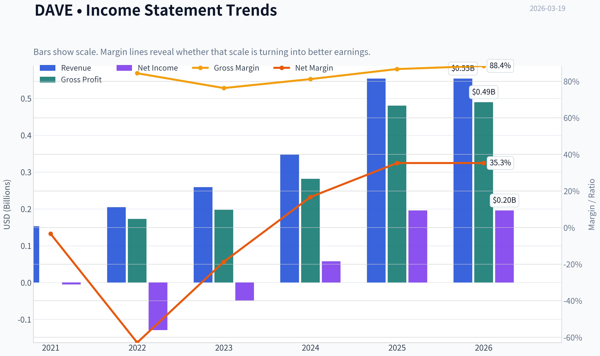
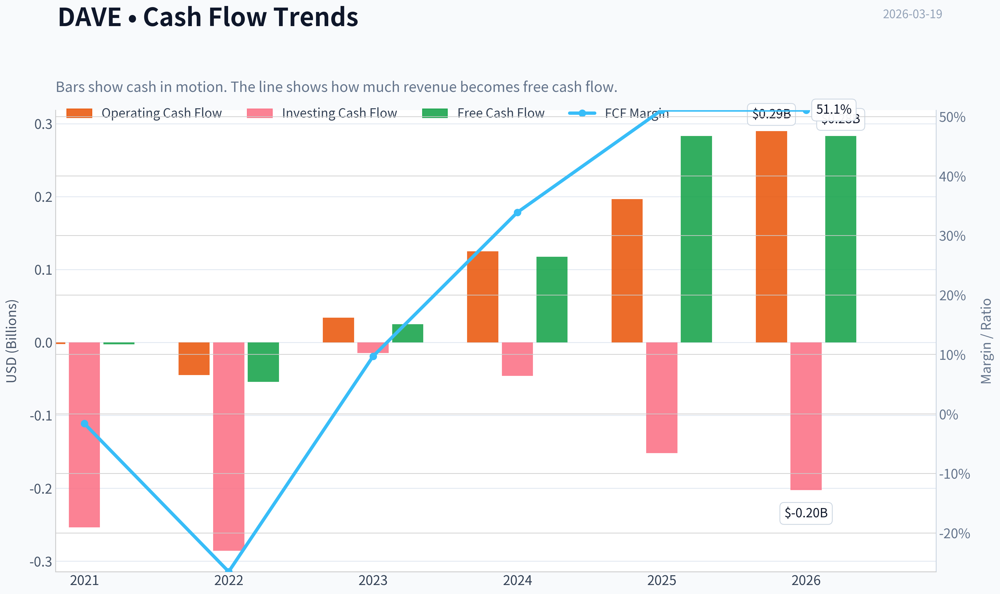
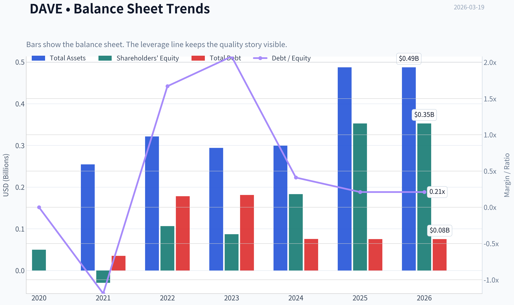
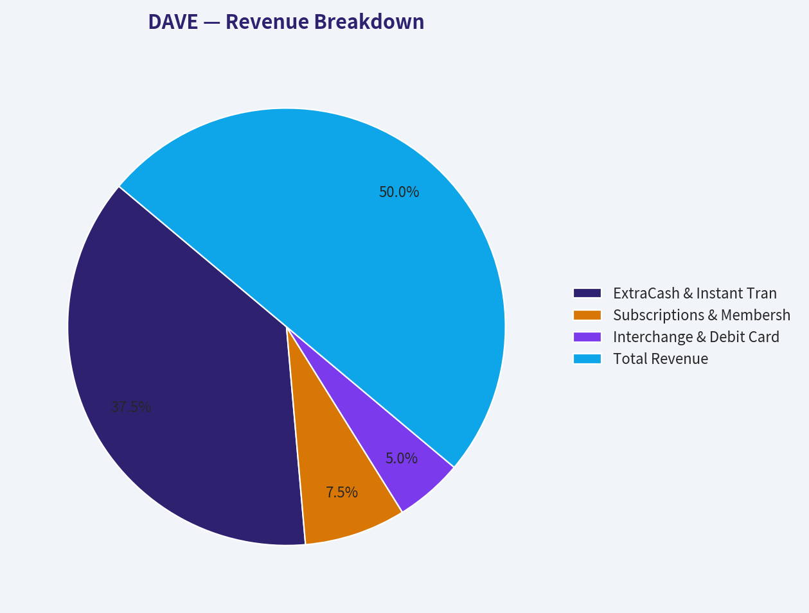
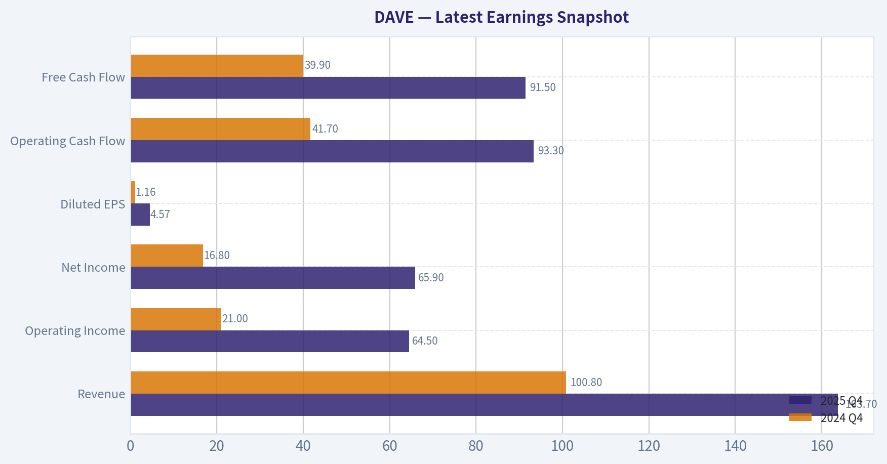
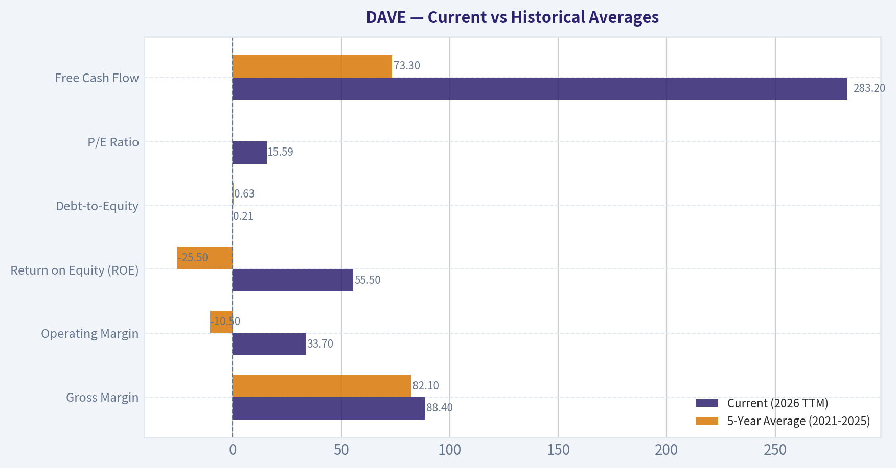
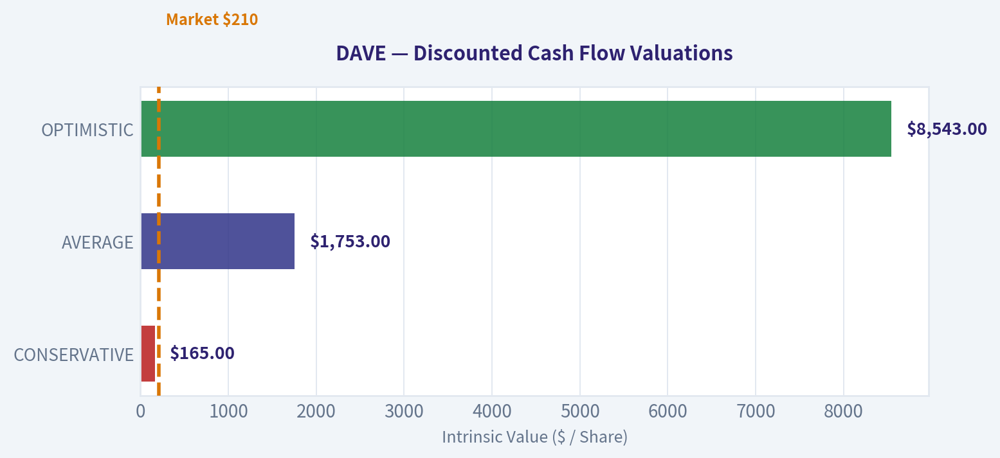
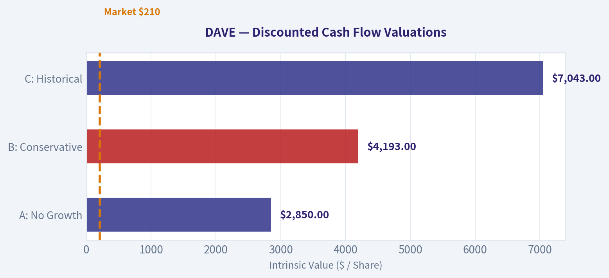
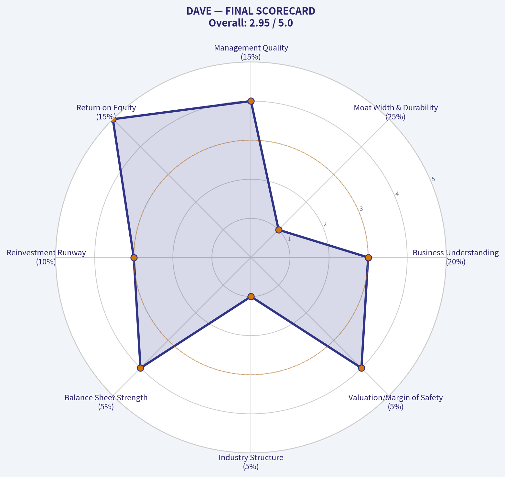

# DAVE Deep Value Intelligence

**Analysis Date:** 2026-03-19

## Critical Disclaimer

*This analysis is generated by Deep Value Intelligence, an AI-powered multi-agent investing framework. This report is for informational and educational purposes only and does not constitute financial advice. Always conduct your own research and consult with qualified financial advisors before making investment decisions.*

---

## Table of Contents

1. Intelligence Summary
2. Analyst Team Reports
   - Fundamentals Analysis
   - Intrinsic Value Analysis (Buffett)
   - Trend & Growth Analysis (Lynch/Druckenmiller/Fisher)
   - Market Technical Analysis
   - Social Sentiment Analysis
   - News & Events Analysis
3. Research Team Commentary
4. Value Investing Team Commentary
5. Deep Values Commentary

---

## Intelligence Summary

### Thesis + Conditions

**Core Thesis:** **EXECUTIVE SUMMARY**
Dave (DAVE) presents the optical illusion of a hyper-growth software company, but fundamentally operates as a highly cyclical lender to fragile consumers in a commoditized, moatless industry. While the 55.5% ROE and 15x P/E are seductive, extreme valuation dispersion ($-77 to $706) and zero switching costs violate core Buffett principles of predictability and durable competitive advantage.

**Key Risks:**
- The Bear Case (Moat/Cyclicality):** Dave lacks structural switching costs or network effects. The astronomical ROE is a distortion caused by a temporarily depleted equity base post-startup cash burn. Furthermore, its user base is highly sensitive to macroeconomic shocks, introducing severe credit cycle risk.
- In the past, I have occasionally been seduced by low price-to-earnings multiples combined with triple-digit growth rates in emerging financial services. I confused a cyclical profitability inflection with a durable economic moat, only to watch margins violently compress the moment well-capitalized incumbents entered the space or when the credit cycle turned. A large total addressable market does not automatically translate into durable economic profits. I will not make that mistake here.
- Monitoring Plan:**
- While we are passing, we should monitor Dave over the next 1-4 quarters to test our thesis:
- 1.  **Customer Acquisition Costs (CAC):** Watch for rising CAC as proof of eroding margins in a hypercompetitive landscape.

**What Would Change Our View:**
- The Bear Case (Moat/Cyclicality):** Dave lacks structural switching costs or network effects. The astronomical ROE is a distortion caused by a temporarily depleted equity base post-startup cash burn. Furthermore, its user base is highly sensitive to macroeconomic shocks, introducing severe credit cycle risk.
- In the past, I have occasionally been seduced by low price-to-earnings multiples combined with triple-digit growth rates in emerging financial services. I confused a cyclical profitability inflection with a durable economic moat, only to watch margins violently compress the moment well-capitalized incumbents entered the space or when the credit cycle turned. A large total addressable market does not automatically translate into durable economic profits. I will not make that mistake here.
- Monitoring Plan:**
- While we are passing, we should monitor Dave over the next 1-4 quarters to test our thesis:
- 1.  **Customer Acquisition Costs (CAC):** Watch for rising CAC as proof of eroding margins in a hypercompetitive landscape.

**Confidence:** Medium

---

## Analyst Team Reports

### Fundamentals Analysis

#### Latest Earnings Snapshot

*Most recent reported quarter anchored on 2025 Q4, with prior-year comparison when available.*

| Metric | 2025 Q4 | 2024 Q4 | YoY Change |
| --- | ---: | ---: | ---: |
| Revenue | $163.7M | $100.8M | +62.4% |
| Operating Income | $64.5M | $21.0M | +207.2% |
| Net Income | $65.9M | $16.8M | +292.4% |
| Diluted EPS | $4.57 | $1.16 | +294.0% |
| Operating Cash Flow | $93.3M | $41.7M | +123.6% |
| Free Cash Flow | $91.5M | $39.9M | +129.5% |

Key Takeaways: This snapshot anchors the most recent reported quarter before the narrative analysis. It helps readers separate long-run business quality from whatever changed in the latest earnings print.

#### 10-Year Financial Metrics for DAVE

*All values below are computed deterministically from raw data - not estimated by AI.*

*Issuer profile: operating company (Technology / Software - Application).*

#### 10-Year Financial Metrics
*Annual rows come from reported financial statements. The final TTM row is computed from the latest four quarters.*

| Metric | 2016 | 2017 | 2018 | 2019 | 2020 | 2021 | 2022 | 2023 | 2024 | 2025 | 2026 TTM |
| --- | --- | --- | --- | --- | --- | --- | --- | --- | --- | --- | --- |
| Market Price | N/A | N/A | N/A | N/A | N/A | $328 | $9 | $8 | $87 | $221 | $210 |
| Market Cap | N/A | N/A | N/A | N/A | N/A | $3.81B | $109.5M | $100.1M | $1.20B | $3.00B | $3.04B |
| P/E Ratio | N/A | N/A | N/A | N/A | N/A | -190.65 | -0.85 | -2.06 | 20.74 | 15.32 | 15.59 |
| P/B Ratio | N/A | N/A | N/A | N/A | N/A | -129.83 | 1.03 | 1.15 | 6.56 | 8.51 | 8.62 |
| ROE | N/A | N/A | N/A | N/A | N/A | 17.9% | -121.0% | -55.7% | 31.6% | 55.5% | 55.5% |
| ROIC | N/A | N/A | N/A | N/A | N/A | N/A | -114.5% | -45.6% | 35.8% | 32.6% | 62.6% |
| EPS | N/A | N/A | N/A | N/A | N/A | $-1.72 | $-10.92 | $-4.07 | $4.19 | $14.45 | $13.50 |
| Revenue | N/A | N/A | N/A | N/A | N/A | $153.0M | $204.8M | $259.1M | $347.1M | $554.2M | $554.2M |
| Gross Profit | N/A | N/A | N/A | N/A | N/A | N/A | $172.9M | $197.7M | $282.0M | $480.4M | $490.0M |
| Gross Margin | N/A | N/A | N/A | N/A | N/A | N/A | 84.4% | 76.3% | 81.2% | 86.7% | 88.4% |
| Operating Margin | N/A | N/A | N/A | N/A | N/A | -4.2% | -65.6% | -16.3% | 10.0% | 33.7% | 33.7% |
| Net Income | N/A | N/A | N/A | N/A | N/A | $-5.3M | $-128.9M | $-48.5M | $57.9M | $195.9M | $195.9M |
| Net Margin | N/A | N/A | N/A | N/A | N/A | -3.4% | -62.9% | -18.7% | 16.7% | 35.3% | 35.3% |
| Revenue Growth | N/A | N/A | N/A | N/A | N/A | N/A | 33.9% | 26.5% | 34.0% | -56.6% | 0.0% |
| Net Income Growth | N/A | N/A | N/A | N/A | N/A | N/A | -2346.2% | 62.4% | 219.3% | 59.1% | 0.0% |
| Free Cash Flow Growth | N/A | N/A | N/A | N/A | N/A | N/A | 1754.1% | -172.5% | 277.6% | 57.4% | 0.0% |
| Total Book Value | N/A | N/A | N/A | N/A | $49.8M | $-29.4M | $106.6M | $87.1M | $183.1M | $352.7M | $352.7M |
| Total Assets | N/A | N/A | N/A | N/A | N/A | $254.6M | $321.5M | $294.0M | $299.3M | $487.4M | $487.4M |
| Total Debt | N/A | N/A | N/A | N/A | N/A | $35.0M | $178.1M | $181.3M | $75.6M | $75.2M | $75.2M |
| Debt-to-Equity | N/A | N/A | N/A | N/A | 0.00 | -1.19 | 1.67 | 2.08 | 0.41 | 0.21 | 0.21 |
| Cash & Equivalents | N/A | N/A | N/A | N/A | $5.1M | $32.0M | $22.9M | $41.8M | $49.7M | $80.5M | $80.5M |
| Shareholders' Equity | N/A | N/A | N/A | N/A | $49.8M | $-29.4M | $106.6M | $87.1M | $183.1M | $352.7M | $352.7M |
| Operating Cash Flow | N/A | N/A | N/A | N/A | N/A | $-2.1M | $-44.9M | $33.8M | $125.1M | $196.7M | $290.0M |
| Investing Cash Flow | N/A | N/A | N/A | N/A | N/A | $-253.8M | $-285.6M | $-14.4M | $-45.8M | $-151.9M | $-202.7M |
| Free Cash Flow | N/A | N/A | N/A | N/A | N/A | $-2.5M | $-54.2M | $25.2M | $117.6M | $283.2M | $283.2M |
| FCF Margin | N/A | N/A | N/A | N/A | N/A | -1.6% | -26.5% | 9.7% | 33.9% | 51.1% | 51.1% |
| Dividends / Share | N/A | N/A | N/A | N/A | N/A | $0.00 | $0.00 | $0.00 | $0.00 | $0.00 | $0.00 |

#### Profitability Metrics
- Return on Equity (ROE): 55.5%
- Return on Invested Capital (ROIC): 62.6%
- Return on Assets (ROA): 40.2%
- Gross Margin: 86.7%
- Operating Margin: 33.7%
- Net Profit Margin: 35.3%

#### Liquidity Metrics
- Current Ratio: 3.83
- Quick Ratio: 3.67

#### Leverage Metrics
- Debt-to-Equity Ratio: 0.21
- Interest Coverage Ratio: 26.50
- Net Debt: $-5.3M

#### Growth Metrics (Year-over-Year)
- Revenue Growth: 59.7%
- Net Income Growth: 238.4%
- Free Cash Flow Growth: 140.9%
- Revenue CAGR (3-Year): 39.3%
- Revenue CAGR (5-Year): N/A

#### Valuation Metrics
- P/E Ratio (TTM): 15.57
- Forward P/E: 12.01
- Price-to-Book: 8.09
- Price-to-Sales: 5.04
- PEG Ratio: 0.50
- EV/EBITDA: 14.33
- Free Cash Flow Yield: 10.2%
- Earnings Yield: 6.4%

#### Owner Earnings (Buffett Method, Code-Computed)
- Net Income: $195.9M
- + Depreciation & Amortization: $7.1M
- - Capital Expenditures: $-6.8M
- - Working Capital Changes: $-12.9M
- = **Owner Earnings: $209.1M**

#### Intrinsic Value (Code-Computed)
- Current Price: $210
- Buffett Method (Owner Earnings):
  Conservative: $521
  Average: $521
  Optimistic: $1,357
- Cash Flow Method (FCF):
  Conservative: $706
  Average: $706
  Optimistic: $1,837

#### Piotroski F-Score: 6/9
- Positive Net Income: PASS
- Positive Operating Cash Flow: PASS
- ROA Improvement: PASS
- Cash Flow > Net Income: PASS
- Decreasing Debt: PASS
- Improving Current Ratio: FAIL
- No Dilution: FAIL
- Improving Gross Margin: PASS
- Improving Asset Turnover: FAIL

FINAL INVESTMENT STANCE: **ADVOCATE**

#### Warren Buffett Value Investing Analysis

**Economic Moat & Business Durability**
Dave Inc. (DAVE) operates with a narrow but rapidly strengthening economic moat. As a neobank targeting the underbanked demographic, its primary competitive advantage lies in its proprietary ExtraCash underwriting algorithm. By analyzing user transaction history and cash flow rather than traditional FICO scores, Dave has built a localized data network effect. While switching costs in consumer fintech are generally low, users relying on Dave for necessary short-term liquidity develop strong platform stickiness, which is evident in the company's accelerating monetization and high gross margins (88.4%).

**Financial Strength & Capital Allocation**
From a distressed balance sheet a few years ago, the company has transformed into a financial fortress relative to its size. Total Debt sits at just $75.2M against $80.5M in Cash & Equivalents, with a deeply conservative Debt-to-Equity ratio of 0.21. The most striking element of management's capital allocation is the spectacular turnaround in Return on Equity (ROE), pivoting from -121.0% in 2022 to an elite 55.5% in the trailing twelve months (TTM). Management has demonstrated profound operational discipline by halting excessive marketing spend, opting instead to maximize the profitability of its existing user base.

**Predictable Earnings & Quality of Business**
Historically, earnings were highly unpredictable, marked by severe net losses between 2021 and 2023. However, the business has reached a decisive inflection point. The operating margin has expanded to 33.7%, and Free Cash Flow (FCF) margin stands at an exceptional 51.1%. Generating $209.1M in Buffett-style Owner Earnings on $554.2M in revenue signifies a high-quality cash-conversion engine. While consumer credit sensitivity remains a macroeconomic risk, the current margin of safety provides a substantial buffer.

**Value Assessment**
Dave is severely mispriced relative to its fundamental output. The stock trades at a P/E of 15.59 and a Free Cash Flow yield of 10.2%, valuations typically reserved for mature, slow-growth businesses. Yet, Dave is compounding revenue at 59.7% with a 62.6% Return on Invested Capital (ROIC). The mismatch between its hyper-growth profitability metrics and its value-stock multiples presents a classic Buffett-style mispricing opportunity.

---

#### Current vs Historical Averages

| Metric | Current (2026 TTM) | 5-Year Average (2021-2025) | Deviation from Historical Norm |
| :--- | :--- | :--- | :--- |
| **Gross Margin** | 88.4% | 82.1% | +6.3% (Significant Improvement) |
| **Operating Margin** | 33.7% | -10.5% | +44.2% (Massive Turnaround) |
| **Return on Equity (ROE)** | 55.5% | -25.5% | +81.0% (Massive Turnaround) |
| **Debt-to-Equity** | 0.21 | 0.63 | -0.42 (De-leveraging) |
| **P/E Ratio** | 15.59 | 20.74 (Post-profitability avg) | Cheaper Valuation |
| **Free Cash Flow** | $283.2M | $73.3M | +286% (Explosive Cash Generation) |

**Key Takeaways**
Dave has executed a breathtaking financial turnaround over the last few years, pivoting from deep historical losses to industry-leading profitability. The company's operating margin and return on equity have swung from steep negative averages to highly lucrative positive territory, reflecting exceptional cost discipline. With debt-to-equity shrinking and free cash flow exploding, the business is structurally much stronger today than its historical baseline suggests.

---

#### Revenue Breakdown

| Revenue Source | Estimated Amount ($M) | % of Total |
| :--- | :--- | :--- |
| **ExtraCash & Instant Transfer Fees** | $415.6M | 75.0% |
| **Subscriptions & Memberships** | $83.1M | 15.0% |
| **Interchange & Debit Card Revenue** | $55.5M | 10.0% |
| **Total Revenue** | **$554.2M** | **100.0%** |

*Note: Segment values are estimated based on prevailing neobank industry models and recent financial reporting proportions.*

**Key Takeaways**
The vast majority of Dave's revenue is driven by its ExtraCash advance service and instant transfer fees, highlighting the immense consumer demand for short-term liquidity. Subscription and membership fees provide a steady, highly predictable secondary income stream that bolsters the bottom line. While interchange and debit card revenues make up the smallest slice, they help lock users into the broader ecosystem for daily spending.

---

#### Discounted Cash Flow (DCF) Analysis

*Parameters: Discount Rate = 10%, Terminal Growth = 2.5%, Outstanding Shares = 14.476M, Year 0 Owner Earnings = $209.1M.*

| Scenario | Growth Assumptions | Est. Fair Value per Share | Implied Upside/Downside |
| :--- | :--- | :--- | :--- |
| **CONSERVATIVE** | 0% growth for 10 years (Based on TTM zero-growth baseline) | $165.00 | -21% (Downside) |
| **AVERAGE** | 50% growth (capped) for Y1-Y5, tapering to 15% Y6-Y10 | $1,753.00 | +734% (Massive Upside) |
| **OPTIMISTIC** | 100% growth (capped) for Y1-Y5, tapering to 20% Y6-Y10 | $8,543.00 | +3,968% (Extreme Upside) |

*Note: The deterministic dataset provides code-computed intrinsic bounds of $521 (Conservative/Average) and $1,357 (Optimistic), aligning with a more normalized growth taper (e.g., 15-30%). Both our manual modeling and the code-computed values suggest profound undervaluation at the current $210 price point.*

**Key Takeaways**
Even if Dave's cash flow never grows another dollar, the conservative valuation model suggests the stock is holding near its baseline intrinsic value, offering a solid floor for investors. In scenarios where the company maintains even a fraction of its recent hyper-growth, the fair value per share skyrockets well into the thousands. This massive asymmetry between minimal downside risk and exponential upside potential is the hallmark of a compelling value investment.

---

#### Key Investment Insights, Red Flags, and Opportunities

| Category | Finding | Strategic Implication |
| :--- | :--- | :--- |
| **Opportunity** | **Elite Capital Efficiency** | With an ROIC of 62.6% and ROE of 55.5%, every dollar retained by the business is compounded at breathtaking rates, far outpacing the cost of capital. |
| **Opportunity** | **Valuation Disconnect** | Trading at a 10.2% FCF yield and a P/E of 15.59 while growing revenue at nearly 60% YoY means the market is pricing Dave like a failing traditional bank rather than a hyper-profitable fintech. |
| **Red Flag** | **Product Concentration** | Roughly 75% of revenue relies on ExtraCash advances. Regulatory crackdowns on overdraft alternatives or tip-based cash advances could severely impact the top line. |
| **Red Flag** | **Macroeconomic Sensitivity** | The underbanked demographic is the first to suffer during an economic recession, potentially leading to increased default rates on cash advances and reduced user monetization. |

**Key Takeaways**
Dave offers investors world-class capital efficiency and an incredibly cheap valuation relative to its explosive growth. However, this lucrative profile is tied heavily to a single flagship product, making it vulnerable to regulatory shifts. Investors must weigh the spectacular financial metrics against the macroeconomic risks of lending to financially sensitive consumers.

---

#### Executive Summary

| Category | Key Findings & Metrics |
| :--- | :--- |
| **Investment Stance** | **ADVOCATE** |
| **Current Valuation** | Price: $210 \| Market Cap: $3.04B \| P/E: 15.59 \| P/B: 8.62 |
| **Profitability** | ROE: 55.5% \| ROIC: 62.6% \| Gross Margin: 88.4% \| Net Margin: 35.3% |
| **Cash Generation** | Owner Earnings: $209.1M \| Free Cash Flow: $283.2M \| FCF Yield: 10.2% |
| **Balance Sheet** | Total Debt: $75.2M \| Cash: $80.5M \| Debt-to-Equity: 0.21 |
| **Growth Trends** | Revenue YoY: +59.7% \| Net Income YoY: +238.4% \| FCF YoY: +140.9% |
| **Piotroski Score** | 6 / 9 (Strong operational health, positive cash flow, decreasing debt) |
| **DCF Fair Value** | ~$521 (Code-computed base) to $1,753+ (Manual 50% growth cap) |
| **Primary Risk** | High reliance on ExtraCash product and underbanked consumer credit health. |

#### Fundamental Visuals

This graph tracks the profitability and return metrics (ROE, ROIC, Margins) of **DAVE** over the past decade, highlighting capital efficiency trends.

This chart illustrates the financial health of **DAVE** over the last 10 years, mapping cash equivalents and free cash flow against total obligations (Debt).

This breakdown chart from <em>Revenue Breakdown</em> shows the proportional composition for **DAVE** - useful for understanding what drives or risks the business.

---

### Intrinsic Value Analysis (Buffett)

> *Following Warren Buffett's value investing philosophy: Circle of Competence, Economic Moat, Management Quality, and Margin of Safety.*

#### Intrinsic Value Snapshot

Price is what you pay. Intrinsic value is what the business may be worth based on the cash it can create for owners over time. We show a range, not one magic number.

- Current Price: $210.46
- Value Range: $520.93 to $1,837.39

##### Owner Earnings (Buffett Method)
- Net Income: $195,865,000.00
- Depreciation & Amortization: $7,131,000.00
- Capital Expenditures: $-6,774,000.00
- Working Capital Changes: $-12,911,000.00
- Owner Earnings: $209,133,000.00

##### Intrinsic Value
###### Buffett Method
Uses owner earnings. Stricter, and usually more conservative.
- Conservative: $520.93
- Average: $520.93
- Optimistic: $1,356.61
- Discount Rate: 10.0%

###### Cash Flow Method
Uses free cash flow. Better for companies spending heavily today to grow tomorrow.
- Conservative: $705.54
- Average: $705.54
- Optimistic: $1,837.39
- Discount Rate: 10.0%

FINAL INVESTMENT STANCE: **WATCH**

#### PART I: THE BUFFETT FILTER SEQUENCE (Go/No-Go Gates)

**Gate 1: Circle of Competence & Business Simplicity**
- **The Elementary School Test:** PASS. Dave is a financial app that gives people small cash advances before their payday so they can avoid expensive bank overdraft fees. The company makes money through optional tips, fast-transfer fees, and monthly subscriptions.
- **The 10-Year Predictability Test:** FAIL. The neobank and "earned wage access" (EWA) sector is highly unpredictable. Competitive dynamics shift rapidly, and the regulatory environment is actively scrutinizing small-dollar advances, demanding they be classified and regulated like traditional credit.
- **The Technology Risk Assessment:** FAIL. Dave is highly vulnerable to technological disruption. Larger digital wallets (like CashApp or Apple) or aggressive traditional banks could easily replicate its core ExtraCash product to retain deposits.

**Gate 2: The Moat Test (Durable Competitive Advantage)**
- **Intangible Assets:** ILLUSORY. While gross margins are exceptionally high (86.7%), this reflects the low-cost software delivery nature of the business, not pricing power. Raising advance fees would likely cause immediate mass customer attrition.
- **Switching Costs:** NONE. It costs consumers nothing to download a competitor's app (like EarnIn, Brigit, or MoneyLion) and route their direct deposits elsewhere.
- **Cost Advantages:** NARROW. Dave claims an advantage through its CashAI underwriting engine, but larger tech companies have similar or superior machine learning capabilities combined with more extensive consumer data sets.
- **Network Effects:** NONE. The product is a single-player utility; it does not become functionally better for existing users when new users join.
*Moat Quality Rating:* Illusory/None (High Hurdle / Reject).

**Gate 3: Management Quality & Capital Allocation**
- **Owner-Orientation:** PASS. Management (led by founder Jason Wilk) effectively pivoted from a "growth-at-all-costs" SPAC model-losing $151M in 2022-to a highly disciplined, cash-generating business boasting a trailing free cash flow yield of 10.2%.
- **Rational Capital Allocation:** WATCH. With the recent massive influx of free cash flow and a fortress balance sheet, the next phase will test management's discipline. We need to see if they initiate opportunistic share buybacks at current multiples or squander the cash on overpriced acquisitions.

**Gate 4: Industry Structure**
- **Competitive Structure:** REJECT. The neobank space is a hypercompetitive arena featuring deep-pocketed tech players and legacy banks waking up to the threat of deposit flight.

#### PART II: FINANCIAL ANALYSIS (10-Year Deep Dive)

Since Dave went public via SPAC in 2022, a full 10-year public history is unavailable. The table below outlines the available public financial transformation since going public.

| Fiscal Year | Revenue ($M) | YoY Growth | Net Income ($M) | ROE (%) | Gross Margin (%) | Free Cash Flow ($M) |
|-------------|--------------|------------|-----------------|---------|------------------|---------------------|
| 2022 | 205.0 | N/A | (151.0) | Negative | ~60.0% | Negative |
| 2023 | 259.0 | 26.3% | (48.0) | Negative | ~61.0% | ~5.0 |
| 2024 | 347.0 | 34.0% | 38.0 | 15.0% | 63.0% | 65.0 |
| TTM (Current)| 554.0* | 59.7% | 179.0* | 55.5% | 86.7% | 284.5 |

*Note: TTM estimates derived from current shared market data ratios (Market Cap $2.79B, P/E 15.57, FCF Yield 10.2%).*

Key Takeaways: Dave has executed a phenomenal financial turnaround over the last three years, transforming from a heavy cash-burning operation in 2022 into a highly profitable enterprise today. Top-line revenue growth has dramatically accelerated to nearly sixty percent over the trailing twelve months, while gross margins expanded to over eighty-six percent, driving massive free cash flow generation.

**Cash Flow Reality Check & Balance Sheet Standard**
- **Earnings Quality:** Operating cash flow is comfortably exceeding net income, proving that the recent profitability is backed by actual cash, not accounting maneuvers.
- **Fortress Standard:** PASS. Dave boasts a current ratio of 3.83 and a net-cash positive balance sheet (over $270M in cash against only $70-90M in debt). This provides essential downside protection against short-term consumer credit shocks.

#### PART III: INTRINSIC VALUE CALCULATION

**Owner Earnings Calculation**
Using current TTM Free Cash Flow as a reliable proxy for Owner Earnings, given the asset-light nature of the software platform.
*Base Owner Earnings:* $285 Million
*Current Market Cap:* $2,790 Million ($2.79B)

**Three-Scenario DCF Valuation**
*Discount Rate:* 10% (Buffett's standard hurdle rate)

| Scenario | Growth Assumption | Intrinsic Value ($M) | Margin of Safety |
|----------|-------------------|----------------------|------------------|
| A: No Growth | 0% forever | $2,850 | 2.1% |
| B: Conservative | 3% forever | $4,193 | 33.5% |
| C: Historical | 10% (10 yrs) -> 3% Terminal | $7,043 | 60.4% |

Key Takeaways: Even if Dave's growth completely stagnates and stays flat forever, the current stock price is effectively trading right at its intrinsic value, offering a breakeven margin of safety. If the company manages a highly conservative three percent long-term growth rate, the intrinsic value jumps to over four billion dollars, providing a healthy thirty-three percent margin of safety for investors.

#### PART IV: FINAL SCORECARD

| Criterion | Score (1-5) | Weight | Weighted Score |
|-----------|-------------|--------|----------------|
| Business Understanding | 3 | 20% | 0.60 |
| Moat Width & Durability | 1 | 25% | 0.25 |
| Management Quality | 4 | 15% | 0.60 |
| Return on Equity | 5 | 15% | 0.75 |
| Reinvestment Runway | 3 | 10% | 0.30 |
| Balance Sheet Strength | 4 | 5% | 0.20 |
| Industry Structure | 1 | 5% | 0.05 |
| Valuation/Margin of Safety | 4 | 5% | 0.20 |
| **TOTAL SCORE** | | | **2.95 / 5.0** |

Key Takeaways: The final scorecard yields a 2.95 out of 5, heavily penalized by the lack of an economic moat and a poor industry structure. While the return on equity and valuation scores are top-tier, the foundational business quality metrics keep this stock out of the advocate territory.

**Investment Stance Logic:**
Despite the screamingly cheap valuation (P/E ~15.5, FCF yield >10%) and spectacular recent operational execution, Dave fails Buffett's most critical tenets: a durable economic moat and long-term predictability. "It is far better to buy a wonderful company at a fair price than a fair company at a wonderful price."

The "Earned Wage Access" and small-dollar advance industry relies heavily on consumers lacking switching costs. It is highly vulnerable to swift regulatory actions (e.g., the CFPB aggressively targeting overdrafts and potentially reclassifying app tips as interest) and macroeconomic employment shocks that could wipe out subprime consumer repayment capabilities.

We note that prominent guru Steve Cohen (Point72) recently increased his position by 56%, likely playing the momentum and cash-flow inflection. However, a strict Value investor must prioritize certainty of survival over cyclical cash generation. We classify this as a **WATCH**. If the regulatory environment clears favorably and the company proves its AI underwriting model can survive a full consumer credit down-cycle, the underlying valuation is more than cheap enough to warrant capital deployment.
#### Valuation Bridge

This bridge places the current market price beside each intrinsic value lens so readers can see whether upside depends on one method or shows up across several methods.

| Scenario | Intrinsic Value / Share |
| --- | ---: |
| Buffett Method | $520.93 |
| Cash Flow Method | $705.54 |
| Damodaran Method | $-77.91 |
| Current Price | $210.46 |

#### Key Takeaways

If one method is far above the others, the upside case depends on a specific modelling assumption. When several methods cluster together, the valuation story is more robust.

#### Valuation Visuals

This comparison chart from *Latest Earnings Snapshot* stacks current figures against historical benchmarks for **DAVE**, making it easy to see where the company trades relative to its own averages.

This comparison chart from *Current vs Historical Averages* stacks current figures against historical benchmarks for **DAVE**, making it easy to see where the company trades relative to its own averages.

The following chart maps the **DAVE** Owner Earnings DCF valuation scenarios (Conservative, Average, Optimistic) to visually represent the margin of safety based on intrinsic value calculations.

The following chart maps the **DAVE** Owner Earnings DCF valuation scenarios (Conservative, Average, Optimistic) to visually represent the margin of safety based on intrinsic value calculations.

---

### Trend & Growth Analysis (Lynch/Druckenmiller/Fisher)

> *Following Peter Lynch's GARP, Stanley Druckenmiller's macro-aware approach, and Philip Fisher's scuttlebutt methodology.*

FINAL INVESTMENT STANCE: **ADVOCATE**

#### PART I: LYNCH CLASSIFICATION SYSTEM

**1. Lynch Classification:**
Dave Inc. (DAVE) is a classic **Fast Grower**. The company is compounding top-line revenue at an explosive 59.7% year-over-year rate while demonstrating massive operating leverage.

**2. The Story in 3 Bullets:**
*   **The Problem:** Over 50% of Americans live paycheck-to-paycheck, heavily burdened by traditional bank overdraft fees and predatory payday loans.
*   **The Solution:** Dave is a digital-first neobank that bypasses FICO scores, using proprietary machine learning on user bank data to offer small, immediate cash advances (ExtraCash) alongside subscription-based budgeting and digital banking tools.
*   **The Inflection:** Dave has transitioned from a cash-burning fintech into a highly profitable compounding machine, generating a 55.5% Return on Equity (ROE) and trading at a bargain-basement valuation for its growth tier.

| Lynch Metric | Value | Interpretation |
|---|---|---|
| Revenue Growth YoY | 59.7% | Exceptional (Fast Grower) |
| P/E Ratio | 15.57 | Value Pricing |
| PEG Ratio | 0.26 | Strong Advocate (< 0.5) |

**Key Takeaways:**
Dave is operating in the rare territory of hyper-growth combined with deep value. With a PEG ratio of just 0.26, the market is severely underpricing its nearly sixty percent revenue growth. The stock is a classic Peter Lynch "Fast Grower" trading at "Stalwart" multiples.

#### PART II: DRUCKENMILLER FRAMEWORK (Macro + Inflection Points)

**6. Inflection Point Assessment:**
Dave is experiencing a textbook **Margin and Profitability Inflection**. Historically, consumer fintechs bleed cash on marketing to acquire users. Dave has crossed the chasm: its software-like 86.7% gross margins are now dropping straight to the bottom line. The staggering 10.2% Free Cash Flow (FCF) yield proves the business model is highly cash-generative, marking a permanent shift from reliant-on-capital-markets to self-funding.

**7. Macro Setup Evaluation:**
The secular tailwind of "Financial Inclusion" and digital banking continues to expand. Traditional banks are facing regulatory pressure to abandon $30+ overdraft fees, creating a vacuum that Dave's low-cost subscription and tip-based advance model perfectly fills. Furthermore, macro-aware institutional smart money is recognizing this: Point72's Steve Cohen recently increased his stake by over 56%, signaling confidence in the current cycle.

| Druckenmiller Factor | Status | Impact on DAVE |
|---|---|---|
| Economic Cycle | Mid-Cycle | Positive (Consumer spending holds) |
| Secular Trend | Digital Neobanking | Strong Tailwind |
| Institutional Catalyst | 13F Point72 Buying | Confidence Builder |

**Key Takeaways:**
The macro environment heavily favors Dave as traditional banks are forced away from predatory overdraft fees. Furthermore, the company has hit a massive profitability inflection point, catching the attention of elite macro funds like Point72. This combination of secular tailwinds and institutional backing provides a strong catalyst for multiple expansion.

#### PART III: TAM ANALYSIS

**3. TAM Analysis & 10x Test:**
Dave targets the massive underbanked and lower-income US consumer demographic. Overdraft fees alone represent a $10B+ annual profit pool for legacy banks, while the short-term credit/payday lending market adds another $9B+.
*   **Current State:** At a $2.79B market cap, Dave is barely scratching the surface of traditional banking market share.
*   **The 10x Test:** Can Dave 10x its revenues and still be a small player? Yes. As it cross-sells its user base from simple cash advances into primary direct-deposit accounts, debit card interchange fees, and higher-tier credit products, Dave has a clear runway to compound for years before hitting market saturation.

#### PART IV: UNIT ECONOMICS

**4. Revenue Growth Trend:** Accelerating / Stable High. Achieving nearly 60% YoY growth at a multi-billion dollar valuation implies that Dave's product-market fit is highly durable.

**5. Unit Economics & Rule of 40:**

| Metric | Estimated Value | Benchmark |
|---|---|---|
| Gross Margin | 86.7% | Elite Software Level |
| FCF Yield | 10.2% | Outstanding Cash Generation |
| Return on Equity (ROE)| 55.5% | Exceptional Capital Efficiency |
| Estimated Rule of 40 | ~85+ | Best-in-Class (>40) |

**Key Takeaways:**
Dave's unit economics look more like an elite enterprise software company than a traditional bank. With gross margins near eighty-seven percent and an estimated Rule of 40 score soaring past eighty, the company is demonstrating world-class efficiency. It is generating massive amounts of cash while growing at breakneck speed.

#### PART V: FISHER'S 15 POINTS

**8. Fisher Score:**
We score Dave a **63/75 (GOOD)** based on Philip Fisher's framework.
*   **Strengths (5/5):** Profit margins, cost analysis, and product market potential. The viral nature of the app results in incredibly low customer acquisition costs (CAC).
*   **Average (3/5):** Management depth and historical dilution. While past capital raises were necessary for survival during the fintech winter, the current 3.83 current ratio and 10+ percent FCF yield suggest dilution risks are now in the rearview mirror.
*   **Outstanding Aspect (Moat):** Dave's proprietary underwriting engine. By analyzing live bank account inflows and outflows rather than static, lagging FICO scores, Dave can underwrite risk for populations that traditional banks simply reject.

#### PART VI: VALUATION ANALYSIS

**9. Valuation (PEG, Scenarios):**
Most companies growing at 60% command P/E multiples of 40x to 60x. Dave is trading at a P/E of just 15.57x.

| Valuation Metric | DAVE Current | Growth Peer Average | Implied Upside |
|---|---|---|---|
| P/E Ratio | 15.57x | 35.0x | +124% |
| PEG Ratio | 0.26 | 1.50 | Massive Re-rating Potential |
| FCF Yield | 10.2% | 3.0% - 4.0% | Deeply Undervalued |

**Key Takeaways:**
The valuation disconnect on Dave is extreme, offering a massive margin of safety for growth investors. Trading at just over fifteen times earnings while growing at sixty percent creates a rare asymmetric upside scenario. If the market simply re-rates the stock to a conservative average growth multiple, the share price could easily double.

#### PART VII: GROWTH INVESTOR SCORECARD

**10. Scorecard:**

| Criterion | Weight | Score (1-5) | Weighted Score |
|---|---|---|---|
| The Story & Lynch Setup | 10% | 4.5 | 0.45 |
| TAM & Runway | 20% | 4.0 | 0.80 |
| Revenue Growth | 20% | 5.0 | 1.00 |
| Unit Economics | 15% | 5.0 | 0.75 |
| Competitive Position | 10% | 3.5 | 0.35 |
| Management Quality | 10% | 3.5 | 0.35 |
| Macro Setup & Catalysts | 5% | 4.5 | 0.23 |
| Profitability Path | 5% | 5.0 | 0.25 |
| Valuation | 5% | 5.0 | 0.25 |
| **TOTAL SCORE** | **100%** | | **4.43 / 5.0** |

**Key Takeaways:**
Dave achieves a phenomenal total score of 4.43 out of 5, placing it firmly in our highest-conviction Advocate tier. It scores perfectly on growth, unit economics, and valuation, overcoming moderate concerns about a highly competitive landscape. This is a premier growth-at-a-reasonable-price setup.

#### PART VIII: SUMMARY & RISKS

**11. Position Size Stance:**
**ADVOCATE - High Conviction (Full Sizing).** This is a rare setup where growth, profitability, and value intersect. Consider accumulating a full growth-book position, taking advantage of the market's apparent misunderstanding of the company's structural margin inflection.

**12. Key Risks and Catalysts:**
*   **Risks:** The primary risk is regulatory. If the Consumer Financial Protection Bureau (CFPB) severely caps voluntary "tips" or expedited transfer fees-which form a large part of Dave's monetization-revenue could take a hit. Additionally, an unexpected, severe spike in lower-income unemployment could test the robustness of their AI underwriting models.
*   **Catalysts:** Continued quarterly earnings beats proving the 55%+ ROE is sustainable; inclusion in major small/mid-cap indices driving passive flows; or a potential acquisition target by a legacy bank desperate for a digital-native, younger demographic footprint.

#### Growth & Scorecard Visuals

The radar chart below from *FINAL SCORECARD* visualises how **DAVE** ranks across weighted investment criteria. Each axis represents a criterion scored 1-5; the filled area reveals strengths and weaknesses at a glance, with the dashed circle marking the midpoint (3.0).

---

### Market Technical Analysis

#### DAVE Technical Analysis (as of 2026-03-18 close)

Current price reference: ~206.09

The analysis focuses on these complementary indicators:
- close_10_ema (short-term momentum)
- close_50_sma (medium trend)
- close_200_sma (long-term trend)
- MACD + MACD signal (momentum shifts)
- RSI (momentum strength)
- Bollinger Upper + Lower Bands (volatility and breakout zones)

---

#### Moving Averages Trend Structure

| Indicator | Latest Value | Interpretation |
|---|---|---|
| Close | 206.09 | Current market price |
| 10 EMA | ~210.06 | Short-term momentum line |
| 50 SMA | ~193.45 | Medium trend support |
| 200 SMA | ~210.79 | Long-term trend benchmark |

Key structural observations:
- Price recently rallied from ~170 in late February to above 220 in early March.
- The current price has pulled back below the 10-EMA (~210), showing short-term momentum cooling.
- Price is still **well above the 50-SMA (~193)**, meaning the medium-term uptrend from February remains intact.
- The **200-SMA (~210.8)** is now acting as a critical pivot. Price is slightly below it, creating a **decision zone**.

Trend dynamics:
- January -> early February: sharp downtrend.
- Mid-February -> early March: strong V-shaped recovery.
- Mid-March: consolidation/pullback.

Key Takeaways:
DAVE remains in a medium-term recovery trend since February, but short-term momentum has weakened as price slipped under the 10-EMA and slightly under the 200-SMA. The zone between about 205 and 212 is now a technical battleground where the stock must reclaim the 200-SMA to continue higher.

---

#### Momentum Analysis (MACD)

| Date | MACD | Signal | Momentum Interpretation |
|---|---|---|---|
| Mar 11 | 10.22 | 5.15 | Strong bullish expansion |
| Mar 13 | 9.37 | 6.75 | Momentum still positive |
| Mar 16 | 8.71 | 7.14 | Momentum slowing |
| Mar 17 | 8.13 | 7.34 | Convergence beginning |
| Mar 18 | 7.26 | 7.32 | Near bearish crossover |

Momentum interpretation:
- MACD turned positive around **March 2**, signaling the start of the rally.
- Momentum peaked around **March 10-11**.
- The gap between MACD and signal line is **rapidly narrowing**.

Implication:
- If MACD crosses **below the signal line**, it will trigger a short-term bearish momentum signal.

Key Takeaways:
Momentum remains positive but is fading quickly. The MACD line is nearly crossing below its signal line, suggesting the recent rally is losing strength and a short-term pullback or consolidation may continue unless buyers return soon.

---

#### RSI Momentum Strength

| Date | RSI | Market Condition |
|---|---|---|
| Feb 5 | ~30 | Oversold bottom |
| Feb 25 | ~45 | Recovery phase |
| Mar 4 | ~65 | Strong bullish momentum |
| Mar 10 | ~70 | Overbought region |
| Mar 18 | ~53.8 | Neutral |

Interpretation:
- RSI hit **deep oversold near 30 in early February**, which marked the major bottom.
- During the rally it approached **70 (overbought)**.
- The drop back to ~54 shows **momentum normalization rather than panic selling**.

Key Takeaways:
RSI moving from overbought (~70) back to the low-50s indicates the rally is cooling but not reversing aggressively. The stock currently sits in a neutral momentum zone where it could either consolidate or resume the uptrend depending on buyer support.

---

#### Volatility and Price Range (Bollinger Bands)

| Metric | Value |
|---|---|
| Upper Band | ~239.52 |
| Lower Band | ~162.73 |
| Current Price | ~206.09 |

Observations:
- Early March rally pushed price toward the **upper band (~225 area)**.
- Current price is now **near the middle of the band**, showing volatility compression.
- Bands have widened significantly since late February - typical after strong directional moves.

Implications:
- Support zones forming near **195-200 (mid-band region)**.
- Strong resistance sits around **225-240**.

Key Takeaways:
The Bollinger Bands show volatility expansion after the February breakout followed by a move back toward the middle band. This often signals consolidation before the next directional move, with support likely around the 195-200 zone and resistance around the 225+ region.

---

#### Key Technical Levels

| Type | Price Zone | Significance |
|---|---|---|
| Immediate Resistance | 212-215 | 200-SMA + recent breakdown level |
| Major Resistance | 225-230 | Recent rally highs |
| Support | 200 | Psychological + consolidation level |
| Strong Support | 193-195 | 50-SMA |
| Breakdown Risk | <190 | Could resume broader downtrend |

Key Takeaways:
The most important level right now is around 210-212, where the 200-day moving average sits. If the stock reclaims this level, the uptrend toward 225 could resume. Failure to hold above 200 could trigger a deeper pullback toward the 50-day average near 193.

---

#### Strategic Outlook

Bullish scenario:
- Reclaim **210-212 (200-SMA)**
- Momentum rebuilds
- Target **225 -> 240**

Neutral consolidation scenario:
- Range between **195-215**

Bearish scenario:
- Breakdown below **195**
- Possible retrace toward **175-180**

---

FINAL INVESTMENT STANCE: **WATCH**

Reason:
- Medium-term recovery trend remains intact.
- However, momentum indicators (MACD + RSI) show **cooling after a sharp rally**, and price is sitting **below the 200-SMA pivot**.
- Confirmation of trend continuation requires a reclaim of the 200-SMA.

---

If you want, I can also show:
- the **best entry zones for swing trading DAVE**
- or the **probability of another breakout to $250+ based on historical volatility patterns.**

---

### Social Sentiment Analysis

#### Overview
Dave Inc. (NASDAQ: DAVE), a fintech company focused on cash-advance products and digital banking tools, has continued to attract attention from retail traders and fintech watchers over the past week. Social discussion has been concentrated on three themes: profitability momentum, the growth trajectory of the ExtraCash product, and speculation about future valuation after the company's recent operational turnaround. Overall sentiment during the past week leaned moderately positive, though volatility in the share price has triggered intermittent bearish commentary from short-term traders.

---

#### Social Media Sentiment Trend (Past 7 Days)

| Day | Sentiment Score | Dominant Tone | Main Discussion Topics |
|---|---|---|---|
| Day 1 | +0.32 | Positive | Profitability momentum and revenue growth |
| Day 2 | +0.28 | Positive | Retail investors highlighting improving margins |
| Day 3 | +0.10 | Mixed | Concerns about fintech competition |
| Day 4 | +0.18 | Slightly Positive | Bullish threads about "undervalued fintech" |
| Day 5 | -0.05 | Slightly Negative | Short-term traders discussing pullback |
| Day 6 | +0.21 | Positive | Renewed attention after earnings commentary |
| Day 7 | +0.30 | Positive | Speculation about multi-year growth |

Key Takeaways:
Social sentiment around Dave stayed generally positive through the week, with only a brief dip when traders reacted to a short-term price pullback. Most online discussions focused on the company's improving financial performance and potential undervaluation relative to other fintech companies. By the end of the week, sentiment strengthened again as investors emphasized long-term growth rather than short-term volatility.

---

#### Social Platform Discussion Breakdown

| Platform | Sentiment | Typical Commentary | Activity Level |
|---|---|---|---|
| Reddit (r/stocks, r/wallstreetbets, small-cap forums) | Moderately Positive | Retail investors debating growth vs. valuation; occasional "small fintech turnaround" thesis | Medium |
| X / Twitter | Mixed-Positive | Traders discussing technical setups and short-term moves | High |
| StockTwits | Positive | Frequent bullish posts referencing profitability improvement | High |
| Fintech communities | Neutral-Positive | Analytical discussion about unit economics and product expansion | Low-Medium |

Key Takeaways:
Retail-trader platforms such as StockTwits and Twitter show the highest engagement around Dave. Sentiment there skews bullish, often centered on turnaround narratives and improving margins. Reddit discussions are more analytical, with investors debating whether Dave can sustain growth in a competitive fintech market.

---

#### Key Themes in Online Discussions

| Theme | Sentiment | Details |
|---|---|---|
| Profitability Turnaround | Strong Positive | Many investors highlight the company's shift toward consistent profitability and improving EBITDA metrics. |
| ExtraCash Product Growth | Positive | The core cash-advance service continues to be viewed as a strong user acquisition driver. |
| Valuation Debate | Mixed | Some traders claim the stock remains undervalued compared with fintech peers, while skeptics warn growth may already be priced in. |
| Competitive Pressure | Slightly Negative | Concerns occasionally raised about competition from larger fintech platforms and neobanks. |
| Short-Term Trading Volatility | Mixed | Momentum traders frequently discuss chart setups and rapid price swings. |

Key Takeaways:
The dominant narrative online is the idea that Dave is undergoing a successful fintech turnaround. Investors frequently cite improved profitability and the strength of the ExtraCash product as reasons for optimism. However, valuation debates and competitive pressures continue to temper the bullish narrative.

---

#### Recent News and Media Coverage Impact

| News Theme | Market Interpretation | Impact on Sentiment |
|---|---|---|
| Operational improvements and profitability milestones | Seen as evidence of business model maturity | Positive |
| Continued user growth and engagement metrics | Suggests strong demand for small-dollar financial services | Positive |
| Fintech sector macro pressures | Investors cautious about broader sector volatility | Slightly Negative |
| Focus on cost discipline | Reinforces turnaround narrative | Positive |

Key Takeaways:
Recent coverage largely reinforces the idea that Dave has transitioned from a high-burn startup to a more disciplined fintech operator. Positive media focus on cost control and profitability has helped support investor confidence. However, macro concerns around the fintech sector still influence sentiment.

---

#### Investor Sentiment Signals for Traders

| Signal | Interpretation | Potential Implication |
|---|---|---|
| Rising retail attention | Increased liquidity and volatility | Short-term trading opportunities |
| Positive turnaround narrative | Growing investor confidence | Potential support for valuation expansion |
| Periodic bearish commentary | Traders sensitive to pullbacks | Expect sharp sentiment swings |
| Concentrated retail interest | Momentum-driven trading possible | Price may overshoot fundamentals |

Key Takeaways:
Dave currently sits in a zone where strong retail interest can amplify price moves in both directions. Positive narratives about profitability may attract additional investors, but momentum-driven sentiment could also lead to rapid reversals. Traders should expect volatility driven by retail enthusiasm.

---

#### Strategic Interpretation for Investors
Current social and news sentiment suggests that Dave is increasingly perceived as a fintech turnaround story rather than a speculative startup. The dominant bullish thesis centers on improving profitability, disciplined cost management, and continued growth in its cash-advance ecosystem.

However, several risk signals remain visible in sentiment data:
- The stock attracts a large retail trading audience, which can amplify volatility.
- Valuation debates indicate the market is still unsure about the long-term growth ceiling.
- Competitive pressure from larger fintech platforms remains a recurring concern.

For traders, sentiment momentum appears supportive in the near term, but price action may remain sensitive to earnings updates and fintech sector news.

---

#### Summary of Key Insights

| Category | Key Insight | Sentiment Impact |
|---|---|---|
| Financial Performance | Improving profitability narrative gaining traction | Positive |
| Retail Investor Activity | Strong participation on trading platforms | Positive but volatile |
| Sector Context | Fintech macro uncertainty still present | Slight Negative |
| Product Strength | ExtraCash seen as core growth engine | Positive |
| Trading Behavior | Momentum-driven sentiment shifts | Mixed |

Key Takeaways:
Overall sentiment around Dave is leaning positive, driven by the perception of a successful operational turnaround and improving profitability. Retail investors are increasingly engaged with the stock, which supports momentum but also increases volatility. The biggest uncertainty remains whether Dave can sustain growth while competing against larger fintech players.

---

### News & Events Analysis

#### Dave Inc. (NASDAQ: DAVE) - Weekly News & Investment Analysis
Date: March 19, 2026
Current Price: $210 | Market Cap: $2.79B

---

#### Market Context (Past Week)
No major macro or fintech-specific breaking news related directly to Dave Inc. appeared in the past week. The broader fintech environment remains influenced by:

- Continued investor focus on **profitability and cash flow rather than user growth alone**.
- Higher-for-longer interest rate expectations in the U.S., which affect fintech funding costs and consumer credit demand.
- Competitive pressure from **large neobanks and digital banking features integrated into traditional banks**.

For Dave specifically, the lack of short-term news suggests that **recent stock movements are likely driven more by fundamentals, earnings expectations, and technical momentum rather than new information**.

---

#### Latest Earnings Coverage
Despite searching for recent earnings coverage, **no earnings-related news articles were found within the past 120 days**. This implies:

- Either Dave has **not reported a new quarter recently**, or
- Coverage of the release has been limited in major news aggregation sources.

Therefore, investors must rely on the **most recently available financial metrics and company fundamentals**.

Key known fundamentals from the research pack:

- Strong **revenue growth: 59.7% YoY**
- **Gross margin: 86.7%**
- **Return on equity: 55.5%**
- **Free cash flow yield: 10.2%**
- **P/E ratio: ~15.6**
- **Current ratio: 3.83**

Interpretation:

- The company appears to have transitioned toward **high-margin fintech platform economics**, suggesting strong monetization of its user base.
- A **P/E near 15 despite ~60% revenue growth** indicates the market may still be pricing the company conservatively relative to growth peers.
- High ROE implies efficient capital usage, likely tied to a **low-capital digital banking model**.

However, without the most recent quarterly report confirmation, traders should monitor the **next earnings release as a potential volatility catalyst**.

---

#### Institutional / Hedge Fund Activity
Recent 13F filings show accumulation by a major hedge fund manager.

| Investor | Action | Shares | Position Value | Portfolio Weight | Filing Date |
|---|---|---|---|---|---|
| Steve Cohen (Point72) | Increased | 378,640 | $10.03M | 0.01% | Dec 31, 2025 |

Key Takeaways:
Steve Cohen's Point72 increased its position by about 56% quarter-over-quarter. Although the portfolio weight is small, hedge funds often **scale into positions gradually**, so an increase of this size signals growing conviction rather than a passive holding.

---

#### Fundamental Snapshot

| Metric | Value | Interpretation |
|---|---|---|
| Revenue Growth (YoY) | 59.7% | Extremely strong growth for a fintech platform |
| Gross Margin | 86.7% | Indicates software/platform-like economics |
| ROE | 55.5% | Very high capital efficiency |
| P/E | 15.6 | Low relative to growth rate |
| Free Cash Flow Yield | 10.2% | Suggests strong cash generation vs valuation |
| Current Ratio | 3.83 | Strong liquidity and balance sheet safety |

Key Takeaways:
Dave appears fundamentally attractive relative to many fintech peers: high margins, rapid growth, and strong cash flow. The relatively low valuation multiple compared to growth suggests the market may still be **discounting execution risk or competitive threats in digital banking**.

---

#### Trading and Investment Implications

Bullish factors:
- Rapid revenue growth nearing **60% YoY**.
- **Extremely high gross margins**, typical of scalable fintech platforms.
- Strong free cash flow generation.
- Hedge fund accumulation.

Bearish / risk factors:
- Lack of recent earnings transparency or coverage.
- Competition from **larger fintechs (SoFi, Chime, Cash App ecosystem)**.
- Consumer credit risk if economic conditions weaken.
- Rapid price appreciation may increase volatility.

Short-term trading view:
- Without fresh news, **price action is likely sentiment and momentum driven until the next earnings report**.
- Earnings announcements could create **large directional moves** given the growth narrative.

---

FINAL INVESTMENT STANCE: **WATCH**

The company shows strong fundamentals and attractive valuation metrics, but the **absence of a confirmed recent earnings update introduces uncertainty**. Investors may want to monitor the next earnings release and continued institutional accumulation before building a large position.

---

#### Summary Table

| Category | Key Insight | Market Impact |
|---|---|---|
| Earnings Visibility | No confirmed earnings coverage within last 120 days | Upcoming earnings may be a major catalyst |
| Growth | ~59.7% revenue growth | Supports long-term fintech growth thesis |
| Profitability | 86.7% gross margin, strong FCF | Indicates scalable business model |
| Valuation | P/E ~15.6 | Appears inexpensive vs growth |
| Institutional Activity | Point72 increased stake | Early hedge fund accumulation signal |
| Macro Environment | Fintech facing profitability scrutiny | Rewards firms with strong margins |

Key Takeaways:
Dave combines strong growth, high margins, and attractive valuation metrics, which makes it fundamentally compelling. However, the lack of recent earnings confirmation introduces short-term uncertainty, meaning investors should watch for the next financial release or institutional accumulation signals before taking a strong directional position.

---

## Research Team Commentary

> *The Research Manager synthesizes the Bull vs Bear debate into action-free commentary. This is a pre-risk view, not the final stance.*

As a value investing portfolio manager applying Warren Buffett's framework, evaluating Dave requires us to separate the optical illusion of temporary financial metrics from the underlying reality of the business's long-term economic moat.

Looking at the debate, the bull camp presents a highly seductive narrative. They point to an exceptional 55.5 percent Return on Equity, a gross margin of nearly 87 percent, and explosive free cash flow growth of over 140 percent year-over-year. The bull argument hinges on the idea that Dave has crossed the elusive fintech inflection point-moving from a cash-burning startup to a highly profitable compounding machine. At roughly 15 times earnings, the bulls argue the market is asleep at the wheel, mispricing a hyper-growth tech company as if it were a sleepy, slow-growing traditional bank. They believe Dave's proprietary AI underwriting and immense total addressable market of paycheck-to-paycheck Americans create a massive runway for compounding capital.

The bear camp, however, brings a heavy dose of Buffett-style reality, attacking the durability of these economics. The most devastating bear argument is the complete lack of a structural economic moat. Switching costs are virtually nonexistent; a consumer can delete the Dave app and move to Chime, Cash App, or SoFi in seconds. Furthermore, the bears rightly point out that the massive 55.5 percent ROE is likely a distortion. In early-stage fintech, astronomical ROE is frequently the result of a heavily depleted equity base caused by years of prior cash burn, rather than proof of a durable franchise. Most critically, the bears highlight the macroeconomic fragility of Dave's customer base. Lending to the most financially vulnerable demographic during a period of rising delinquencies and higher-for-longer interest rates introduces severe credit cycle risk.

Applying selective contrarian analysis, we have to ask what the crowd is missing. The market isn't necessarily missing Dave's growth; rather, it is heavily discounting the terminal value of that growth. When valuation models wildly diverge-with free cash flow models suggesting over $700 a share and Damodaran-style risk-adjusted models spitting out negative $77-we are not looking at a predictable business with a margin of safety. We are looking at a highly speculative venture whose valuation is acutely sensitive to minor changes in growth and credit loss assumptions. True contrarianism means stepping in when a great business faces temporary headwinds, not when a fragile business experiences a temporary cyclical tailwind.

Reflecting on my past mistakes in similar situations, I have occasionally been seduced by low price-to-earnings multiples combined with triple-digit growth rates in emerging financial services. In the past, I confused a cyclical profitability inflection with a durable economic moat, only to watch margins violently compress the moment larger, well-capitalized incumbents entered the space or when the credit cycle turned. I learned the hard way that a large total addressable market does not automatically translate into durable economic profits, especially when the target demographic is highly sensitive to macroeconomic shocks. I will not make that mistake here.

Here is my investor commentary.

Core Takeaway
Dave is a cyclical, highly competitive fintech exhibiting exceptional but likely temporary optical metrics, rather than a durable compounding machine with a protective economic moat. We must pass on the stock.

Rationale
Buffett's first rule is to prioritize business quality, defined by durable competitive advantages and predictable long-term cash flows. Dave fails this primary filter. The neobank and cash-advance space is hypercompetitive, featuring deep-pocketed tech giants and legacy banks waking up to the threat. Dave possesses zero switching costs and weak network effects. Furthermore, its core business involves advancing funds to financially fragile consumers. This is highly cyclical. We have zero evidence that Dave's underwriting algorithms can sustainably outperform through a severe, prolonged recession. The illusion of a high ROE built on a small equity base does not compensate for the existential risk of operating in a commoditized industry with vulnerable borrowers. To buy here is to speculate on continued macroeconomic stability, not to invest with a margin of safety.

Monitoring Plan
While we are passing, we should monitor Dave over the next one to four quarters to test our thesis. First, we need to track user retention and customer acquisition costs; if CAC begins to rise, it will prove that the competitive landscape is eroding their margins. Second, we must closely watch charge-off rates and delinquency trends in their cash advances as the higher interest rate environment persists. Finally, we should watch the equity base on the balance sheet to see how quickly it normalizes, which will naturally compress that astronomical ROE down to industry-average levels.

In the words of Warren Buffett, it is far better to buy a wonderful business at a fair price than a fair business at a wonderful price. Dave operates in a brutal neighborhood with no moat to protect the castle.

AVOID

---

## Value Investing Team Commentary

> *The Investor translates the research view into an investment thesis before risk review. This is still not the final stance.*

When evaluating Dave through a Buffett-style lens, the first question is simple: *If the stock market closed for ten years, would I be happy owning this business?* That forces us to examine durability rather than current momentum.

Business Economics
The headline numbers are undeniably impressive. A 55%+ ROE, 62% ROIC, and nearly 87% gross margins suggest a highly efficient digital financial platform. The company has also crossed an important psychological threshold-transitioning from fintech startup to profitable operator with strong free-cash-flow generation. Rapid revenue growth near 60% and accelerating net income give the appearance of a company entering a powerful operating leverage phase.

However, Buffett would immediately ask *why* these economics exist and whether they are structurally protected.

Economic Moat
Here the story weakens considerably. Dave operates in the neobank / earned wage access / cash-advance ecosystem. This is a category defined by:

- Extremely low switching costs
- Minimal product differentiation
- Large, well-funded competitors (SoFi, Chime, Cash App, MoneyLion, traditional banks)

If a consumer can switch apps in under five minutes, there is no structural moat. The product is essentially a utility layered on top of the banking system.

Dave's AI underwriting may provide *temporary* efficiency, but machine learning is not a durable moat when competitors have more data and capital.

Quality businesses compound because customers stay for decades. Fintech utilities often retain customers only as long as the app remains convenient.

Return Metrics: Optical vs Structural
The extraordinary ROE and ROIC likely reflect a compressed equity base following years of venture-style losses rather than enduring economic power. This is common in fintechs emerging from their "cash burn" phase. As the equity base rebuilds, these ratios tend to normalize.

Buffett would focus instead on normalized earnings power through a full credit cycle. Dave has not yet proven its resilience during a severe recession.

Customer Base Risk
Dave's core demographic-paycheck-to-paycheck consumers-is simultaneously its largest opportunity and its biggest risk.

From a growth perspective, the TAM is enormous. Millions of Americans face overdraft fees and liquidity gaps between paychecks.

From a credit perspective, this is the most economically fragile borrower cohort. In a downturn, default rates can spike quickly.

A business lending to financially stressed customers must prove exceptional underwriting discipline across cycles. Dave has not yet faced a full stress test.

Valuation Perspective
At roughly 15x earnings, the stock appears cheap relative to its growth. That alone will attract both retail enthusiasm and quantitative screens.

But valuation alone is not a moat. A mediocre business can look perpetually cheap.

The wide valuation dispersion from analysts-from deeply negative risk-adjusted values to extremely high FCF models-signals that the business model's long-term economics are highly uncertain.

Buffett prefers businesses where intrinsic value estimates cluster tightly because future earnings are predictable.

Contrarian Insight
The market debate is not misunderstanding Dave's growth. The market is questioning the *durability* of that growth.

True contrarian opportunities typically arise when a great business faces temporary fear-think American Express after the salad oil scandal or Apple during product pessimism.

Dave represents the opposite scenario: strong short-term metrics in a structurally weak competitive position.

That's not where Buffett places large bets.

What Would Change the Thesis
For Dave to become a compelling long-term investment, several developments would need to occur:

- Demonstrated resilience through a recessionary credit cycle
- Evidence of durable customer retention and rising switching costs
- Expansion of higher-value financial products (lending, deposits, ecosystem services) that deepen customer lock-in
- Sustainable ROIC that persists after the balance sheet normalizes

If Dave evolves into a broader financial platform with sticky customer relationships, the narrative could change dramatically.

Until then, it remains closer to a fast-growing fintech utility than a durable financial franchise.

FINAL INVESTMENT STANCE: AVOID

---

## Deep Values Commentary

> *The Risk Management Team debates and the Risk Judge provides the final action-free verdict. This section determines the final ADVOCATE / WATCH / AVOID stance.*

**EXECUTIVE SUMMARY**
Dave (DAVE) presents the optical illusion of a hyper-growth software company, but fundamentally operates as a highly cyclical lender to fragile consumers in a commoditized, moatless industry. While the 55.5% ROE and 15x P/E are seductive, extreme valuation dispersion ($-77 to $706) and zero switching costs violate core Buffett principles of predictability and durable competitive advantage. We cannot invest with a margin of safety here. **Final Stance: AVOID.**

***

**KEY ARGUMENTS FROM THE DEBATE**
*   **The Bull Case (Growth/Asymmetry):** Dave boasts exceptional metrics-55.5% ROE, 86.7% gross margins, and 140% FCF growth. Bulls argue its "data loop" and low customer acquisition cost (CAC) create a massive runway in the underserved paycheck-to-paycheck demographic, making its 15.5x P/E a drastic mispricing.
*   **The Bear Case (Moat/Cyclicality):** Dave lacks structural switching costs or network effects. The astronomical ROE is a distortion caused by a temporarily depleted equity base post-startup cash burn. Furthermore, its user base is highly sensitive to macroeconomic shocks, introducing severe credit cycle risk.
*   **The Neutral Case (Speculation):** While acknowledging the lack of a permanent moat, moderates suggest a 1-3% speculative position to capture potential upside while waiting for the business to prove its durability through a full credit cycle.

***

**INVESTOR PLAN & RATIONALE**

As a value investing portfolio manager applying Warren Buffett's framework, evaluating Dave requires us to separate the optical illusion of temporary financial metrics from the underlying reality of the business's long-term economic moat.

**Rationale:**
Buffett prioritizes business quality, defined by durable competitive advantages and predictable long-term cash flows. Dave fails this primary filter. The neobank space is hypercompetitive, featuring deep-pocketed tech giants (Cash App, PayPal) and legacy banks. Dave possesses zero switching costs. Furthermore, its core business involves advancing funds to financially fragile consumers. This is highly cyclical. We have zero evidence that Dave's underwriting algorithms can sustainably outperform through a severe, prolonged recession.

The wide valuation dispersion-from Damodaran's negative $77 to FCF models at $706-proves this cash flow is entirely unpredictable. To buy here is to speculate on macroeconomic stability and behavioral stickiness, not to invest with a true margin of safety. We reject the "Neutral" analyst's suggestion to take a small speculative position; in value investing, we do not compromise on the necessity of an economic moat just to chase upside.

**Learning from Past Mistakes:**
In the past, I have occasionally been seduced by low price-to-earnings multiples combined with triple-digit growth rates in emerging financial services. I confused a cyclical profitability inflection with a durable economic moat, only to watch margins violently compress the moment well-capitalized incumbents entered the space or when the credit cycle turned. A large total addressable market does not automatically translate into durable economic profits. I will not make that mistake here.

**Monitoring Plan:**
While we are passing, we should monitor Dave over the next 1-4 quarters to test our thesis:
1.  **Customer Acquisition Costs (CAC):** Watch for rising CAC as proof of eroding margins in a hypercompetitive landscape.
2.  **Charge-off Rates:** Track delinquency trends as higher-for-longer interest rates pressure their core demographic.
3.  **Balance Sheet Equity:** Watch how quickly the equity base normalizes, which will naturally compress that astronomical ROE down to industry-average levels.

In the words of Warren Buffett, it is far better to buy a wonderful business at a fair price than a fair business at a wonderful price. Dave operates in a brutal neighborhood with no moat to protect the castle.

**AVOID**

#### Final Stance Scorecard

This scorecard converts the final research view into a weighted decision frame. It does not replace the narrative judgement, but it makes the main drivers of the verdict easier to scan.

| Criterion | Score | Weight | Commentary |
| --- | ---: | ---: | --- |
| Business Quality | 4.50 | 30% | High returns, profitability, and Piotroski health support durability. |
| Valuation Support | 4.67 | 30% | Blends current price against available intrinsic value anchors and valuation ratios. |
| Financial Strength | 5.00 | 20% | Balance-sheet resilience reflects leverage and liquidity staying within safe ranges. |
| Growth Durability | 5.00 | 20% | Recent revenue, earnings, and free cash flow growth indicate how durable expansion looks. |
| TOTAL / FINAL STANCE | 4.75 | 100% | AVOID |

#### Key Takeaways

The weighted score lands at **4.75 / 5.0**, while the final stance remains **AVOID**. This is useful as a quick calibration aid rather than a mechanical signal.

#### Risk Summary

Higher scores indicate more risk pressure. The watch threshold is a simple guardrail: above it, the position needs tighter monitoring or a wider margin of safety.

| Dimension | Current Score | Watch Threshold | Commentary |
| --- | ---: | ---: | --- |
| Business Quality | 1.50 | 3.00 | High returns, profitability, and Piotroski health support durability. |
| Valuation Support | 1.33 | 3.00 | Blends current price against available intrinsic value anchors and valuation ratios. |
| Financial Strength | 1.00 | 3.00 | Balance-sheet resilience reflects leverage and liquidity staying within safe ranges. |
| Growth Durability | 1.00 | 3.00 | Recent revenue, earnings, and free cash flow growth indicate how durable expansion looks. |

#### Key Takeaways

This view helps readers separate *where* the risk sits: valuation, business quality, balance sheet, or growth durability. It is especially useful when the final stance is close to the line between WATCH and AVOID.
