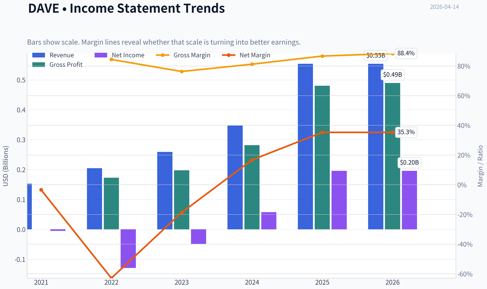
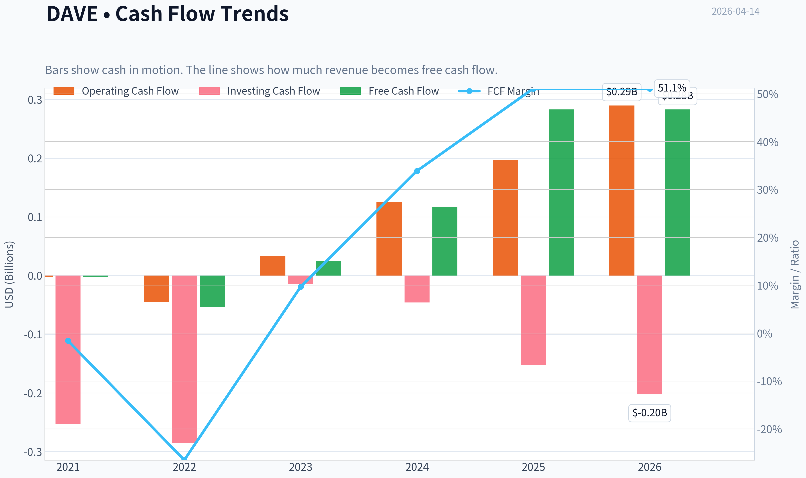
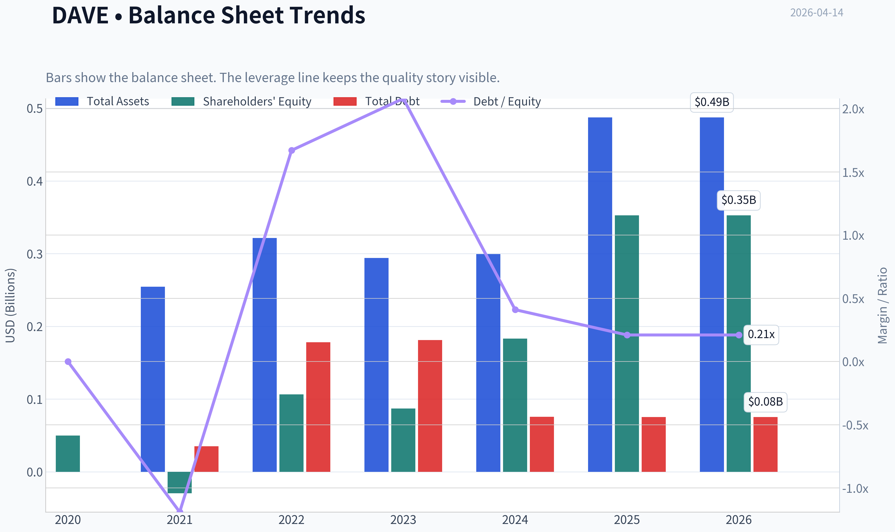
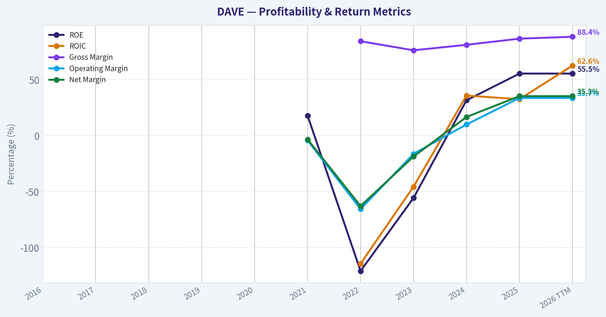
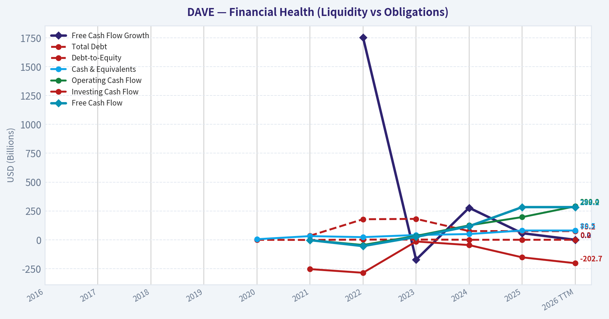
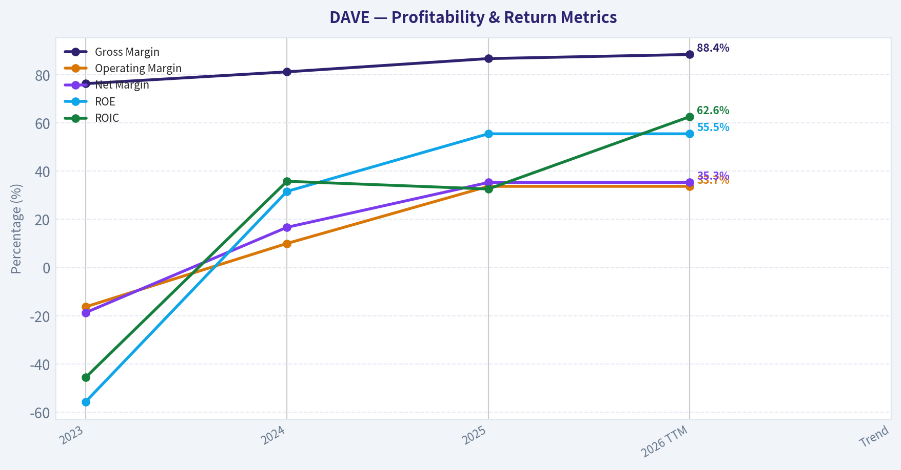
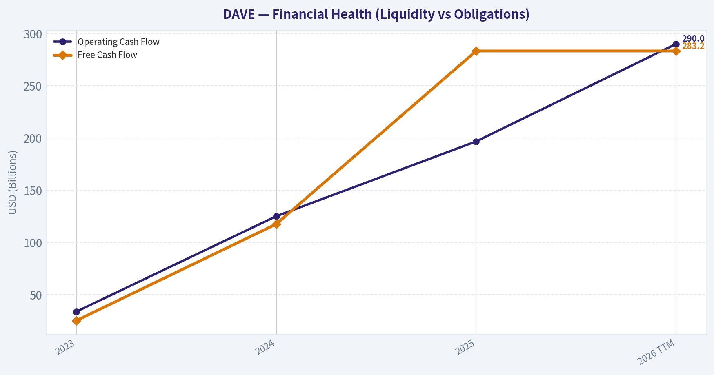
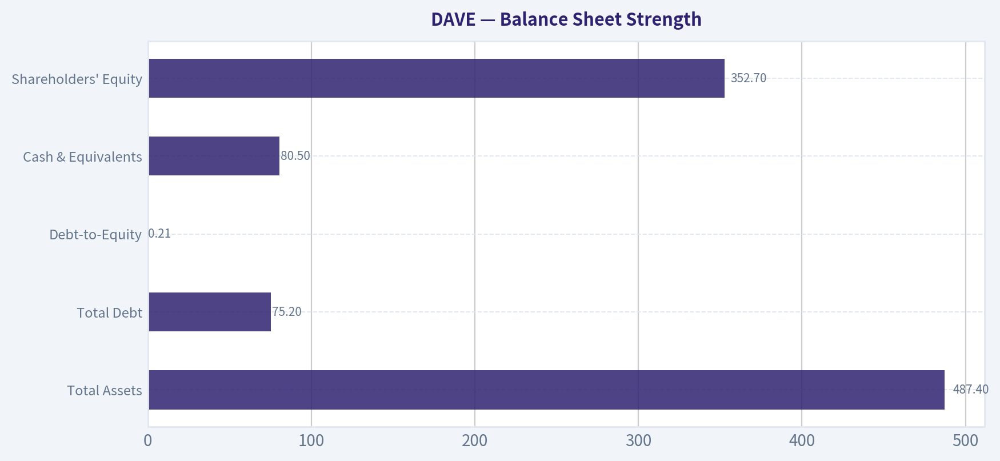
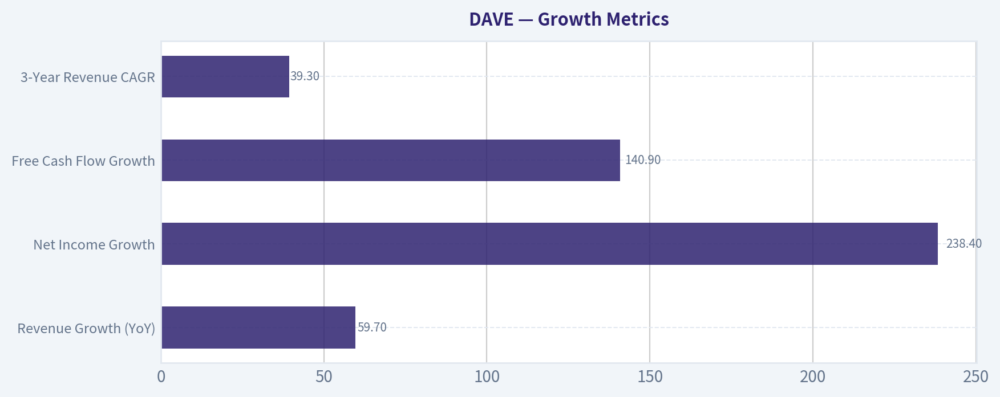
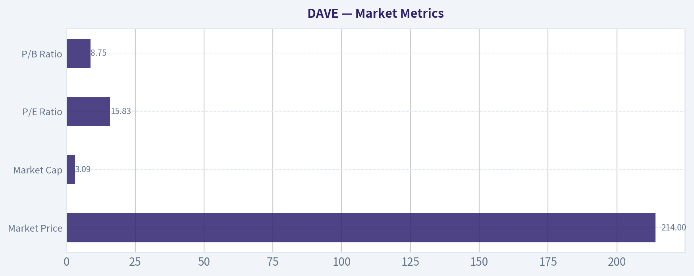

# DAVE Deep Value Intelligence

**Analysis Date:** 2026-04-14

## Critical Disclaimer

*This analysis is generated by Deep Value Intelligence, an AI-powered multi-agent investing framework. This report is for informational and educational purposes only and does not constitute financial advice. Always conduct your own research and consult with qualified financial advisors before making investment decisions.*

---

## Table of Contents

1. Intelligence Summary
2. Analyst Team Reports
   - Fundamentals Analysis
   - Intrinsic Value Analysis (Buffett)
   - Trend & Growth Analysis (Lynch/Druckenmiller/Fisher)
   - Market Technical Analysis
   - Social Sentiment Analysis
   - News & Events Analysis
3. Research Team Commentary
4. Value Investing Team Commentary
5. Deep Values Commentary

---

## Intelligence Summary

### Thesis + Conditions

**Core Thesis:** Executive Summary
Dave shows exceptional current profitability and growth, but the core question for a Buffett-style investor is durability. The debate reveals two plausible futures: a scalable fintech platform for the underbanked or a thinly differentiated lending service benefiting from favorable credit conditions.

**Key Risks:**
- Dave shows exceptional current profitability and growth, but the core question for a Buffett-style investor is durability. The debate reveals two plausible futures: a scalable fintech platform for the underbanked or a thinly differentiated lending service benefiting from favorable credit conditions. With no proven moat, limited evidence across a full credit cycle, and regulatory uncertainty, intrinsic value remains highly uncertain despite strong metrics. The opportunity may be real, but the margin of safety is not yet clear. Best course: monitor closely and demand proof of durable economics before committing meaningful capital.
- Growth / Risk-Seeking View (ADVOCATE)
- The bullish case rests on extraordinary operating metrics and rapid scaling. Revenue is growing ~60% while EBITDA and net income are expanding much faster, indicating strong operating leverage. Profitability levels-ROIC above 60%, ROE above 55%, and an 86% gross margin-are far above typical fintech or lending businesses. The argument is that Dave is transitioning from user acquisition to platform monetization. If the company becomes the "financial operating system" for even a fraction of the ~60 million underbanked Americans, revenue per user could compound through subscriptions, interchange, and lending products. At ~15-16x earnings with triple-digit earnings growth, the stock appears statistically cheap relative to high-growth fintech peers.
- Safety / Capital Preservation View (WATCH)
- The counterargument emphasizes that financial companies often show peak profitability before a credit cycle turns. The underbanked customer base is inherently sensitive to economic shocks, meaning credit losses could rise sharply in downturns. High ROE and ROIC in lending models can reflect temporarily low defaults rather than structural advantages. The core product-small-dollar liquidity advances-has limited switching costs and could be replicated by larger fintech platforms or banks with cheaper funding and stronger regulatory infrastructure. Regulatory risk is also material if subscription or "tip" models are reclassified as lending fees.

**What Would Change Our View:**
- Dave shows exceptional current profitability and growth, but the core question for a Buffett-style investor is durability. The debate reveals two plausible futures: a scalable fintech platform for the underbanked or a thinly differentiated lending service benefiting from favorable credit conditions. With no proven moat, limited evidence across a full credit cycle, and regulatory uncertainty, intrinsic value remains highly uncertain despite strong metrics. The opportunity may be real, but the margin of safety is not yet clear. Best course: monitor closely and demand proof of durable economics before committing meaningful capital.
- Growth / Risk-Seeking View (ADVOCATE)
- The bullish case rests on extraordinary operating metrics and rapid scaling. Revenue is growing ~60% while EBITDA and net income are expanding much faster, indicating strong operating leverage. Profitability levels-ROIC above 60%, ROE above 55%, and an 86% gross margin-are far above typical fintech or lending businesses. The argument is that Dave is transitioning from user acquisition to platform monetization. If the company becomes the "financial operating system" for even a fraction of the ~60 million underbanked Americans, revenue per user could compound through subscriptions, interchange, and lending products. At ~15-16x earnings with triple-digit earnings growth, the stock appears statistically cheap relative to high-growth fintech peers.
- Safety / Capital Preservation View (WATCH)
- The counterargument emphasizes that financial companies often show peak profitability before a credit cycle turns. The underbanked customer base is inherently sensitive to economic shocks, meaning credit losses could rise sharply in downturns. High ROE and ROIC in lending models can reflect temporarily low defaults rather than structural advantages. The core product-small-dollar liquidity advances-has limited switching costs and could be replicated by larger fintech platforms or banks with cheaper funding and stronger regulatory infrastructure. Regulatory risk is also material if subscription or "tip" models are reclassified as lending fees.

**Confidence:** Low

---

## Analyst Team Reports

### Fundamentals Analysis

#### Latest Earnings Snapshot

*Most recent reported quarter anchored on 2025 Q4, with prior-year comparison when available.*

| Metric | 2025 Q4 | 2024 Q4 | YoY Change |
| --- | ---: | ---: | ---: |
| Revenue | $163.7M | $100.8M | +62.4% |
| Operating Income | $64.5M | $21.0M | +207.2% |
| Net Income | $65.9M | $16.8M | +292.4% |
| Diluted EPS | $4.57 | $1.16 | +294.0% |
| Operating Cash Flow | $93.3M | $41.7M | +123.6% |
| Free Cash Flow | $91.5M | $39.9M | +129.5% |

Key Takeaways: This snapshot anchors the most recent reported quarter before the narrative analysis. It helps readers separate long-run business quality from whatever changed in the latest earnings print.

#### 10-Year Financial Metrics for DAVE

*All values below are computed deterministically from raw data - not estimated by AI.*

*Issuer profile: operating company (Technology / Software - Application).*

#### 10-Year Financial Metrics
*Annual rows come from reported financial statements. The final TTM row is computed from the latest four quarters.*

| Metric | 2016 | 2017 | 2018 | 2019 | 2020 | 2021 | 2022 | 2023 | 2024 | 2025 | 2026 TTM |
| --- | --- | --- | --- | --- | --- | --- | --- | --- | --- | --- | --- |
| Market Price | N/A | N/A | N/A | N/A | N/A | $328 | $9 | $8 | $87 | $221 | $214 |
| Market Cap | N/A | N/A | N/A | N/A | N/A | $3.81B | $109.5M | $100.1M | $1.20B | $3.00B | $3.09B |
| P/E Ratio | N/A | N/A | N/A | N/A | N/A | -190.65 | -0.85 | -2.06 | 20.74 | 15.32 | 15.83 |
| P/B Ratio | N/A | N/A | N/A | N/A | N/A | -129.83 | 1.03 | 1.15 | 6.56 | 8.51 | 8.75 |
| ROE | N/A | N/A | N/A | N/A | N/A | 17.9% | -121.0% | -55.7% | 31.6% | 55.5% | 55.5% |
| ROIC | N/A | N/A | N/A | N/A | N/A | N/A | -114.5% | -45.6% | 35.8% | 32.6% | 62.6% |
| EPS | N/A | N/A | N/A | N/A | N/A | $-1.72 | $-10.92 | $-4.07 | $4.19 | $14.45 | $13.50 |
| Revenue | N/A | N/A | N/A | N/A | N/A | $153.0M | $204.8M | $259.1M | $347.1M | $554.2M | $554.2M |
| Gross Profit | N/A | N/A | N/A | N/A | N/A | N/A | $172.9M | $197.7M | $282.0M | $480.4M | $490.0M |
| Gross Margin | N/A | N/A | N/A | N/A | N/A | N/A | 84.4% | 76.3% | 81.2% | 86.7% | 88.4% |
| Operating Margin | N/A | N/A | N/A | N/A | N/A | -4.2% | -65.6% | -16.3% | 10.0% | 33.7% | 33.7% |
| Net Income | N/A | N/A | N/A | N/A | N/A | $-5.3M | $-128.9M | $-48.5M | $57.9M | $195.9M | $195.9M |
| Net Margin | N/A | N/A | N/A | N/A | N/A | -3.4% | -62.9% | -18.7% | 16.7% | 35.3% | 35.3% |
| Revenue Growth | N/A | N/A | N/A | N/A | N/A | N/A | 33.9% | 26.5% | 34.0% | -56.6% | 0.0% |
| Net Income Growth | N/A | N/A | N/A | N/A | N/A | N/A | -2346.2% | 62.4% | 219.3% | 59.1% | 0.0% |
| Free Cash Flow Growth | N/A | N/A | N/A | N/A | N/A | N/A | 1754.1% | -172.5% | 277.6% | 57.4% | 0.0% |
| Total Book Value | N/A | N/A | N/A | N/A | $49.8M | $-29.4M | $106.6M | $87.1M | $183.1M | $352.7M | $352.7M |
| Total Assets | N/A | N/A | N/A | N/A | N/A | $254.6M | $321.5M | $294.0M | $299.3M | $487.4M | $487.4M |
| Total Debt | N/A | N/A | N/A | N/A | N/A | $35.0M | $178.1M | $181.3M | $75.6M | $75.2M | $75.2M |
| Debt-to-Equity | N/A | N/A | N/A | N/A | 0.00 | -1.19 | 1.67 | 2.08 | 0.41 | 0.21 | 0.21 |
| Cash & Equivalents | N/A | N/A | N/A | N/A | $5.1M | $32.0M | $22.9M | $41.8M | $49.7M | $80.5M | $80.5M |
| Shareholders' Equity | N/A | N/A | N/A | N/A | $49.8M | $-29.4M | $106.6M | $87.1M | $183.1M | $352.7M | $352.7M |
| Operating Cash Flow | N/A | N/A | N/A | N/A | N/A | $-2.1M | $-44.9M | $33.8M | $125.1M | $196.7M | $290.0M |
| Investing Cash Flow | N/A | N/A | N/A | N/A | N/A | $-253.8M | $-285.6M | $-14.4M | $-45.8M | $-151.9M | $-202.7M |
| Free Cash Flow | N/A | N/A | N/A | N/A | N/A | $-2.5M | $-54.2M | $25.2M | $117.6M | $283.2M | $283.2M |
| FCF Margin | N/A | N/A | N/A | N/A | N/A | -1.6% | -26.5% | 9.7% | 33.9% | 51.1% | 51.1% |
| Dividends / Share | N/A | N/A | N/A | N/A | N/A | $0.00 | $0.00 | $0.00 | $0.00 | $0.00 | $0.00 |

#### Profitability Metrics
- Return on Equity (ROE): 55.5%
- Return on Invested Capital (ROIC): 62.6%
- Return on Assets (ROA): 40.2%
- Gross Margin: 86.7%
- Operating Margin: 33.7%
- Net Profit Margin: 35.3%

#### Liquidity Metrics
- Current Ratio: 3.83
- Quick Ratio: 3.67

#### Leverage Metrics
- Debt-to-Equity Ratio: 0.21
- Interest Coverage Ratio: 26.50
- Net Debt: $-5.3M

#### Growth Metrics (Year-over-Year)
- Revenue Growth: 59.7%
- Net Income Growth: 238.4%
- Free Cash Flow Growth: 140.9%
- Revenue CAGR (3-Year): 39.3%
- Revenue CAGR (5-Year): N/A

#### Valuation Metrics
- P/E Ratio (TTM): 15.81
- Forward P/E: 12.19
- Price-to-Book: 8.21
- Price-to-Sales: 5.11
- PEG Ratio: 0.50
- EV/EBITDA: 13.55
- Free Cash Flow Yield: 10.0%
- Earnings Yield: 6.3%

#### Owner Earnings (Buffett Method, Code-Computed)
- Net Income: $195.9M
- + Depreciation & Amortization: $7.1M
- - Capital Expenditures: $-6.8M
- - Working Capital Changes: $-12.9M
- = **Owner Earnings: $209.1M**

#### Intrinsic Value (Code-Computed)
- Current Price: $214
- Buffett Method (Owner Earnings):
  Conservative: $521
  Average: $521
  Optimistic: $1,357
- Cash Flow Method (FCF):
  Conservative: $706
  Average: $706
  Optimistic: $1,837

#### Piotroski F-Score: 6/9
- Positive Net Income: PASS
- Positive Operating Cash Flow: PASS
- ROA Improvement: PASS
- Cash Flow > Net Income: PASS
- Decreasing Debt: PASS
- Improving Current Ratio: FAIL
- No Dilution: FAIL
- Improving Gross Margin: PASS
- Improving Asset Turnover: FAIL

#### Market Metrics

| Metric | Current (2026 TTM) | Historical Context (Since 2021 where data exists) |
|---|---|---|
| Market Price | $214 | Highly volatile since SPAC listing ($328 in 2021 -> $8 in 2023 -> >$200 now) |
| Market Cap | $3.09B | Recovered strongly from ~$100M trough in 2023 |
| P/E Ratio | 15.83 | First stable profitable valuation period (2024-2026 range ~15-21) |
| P/B Ratio | 8.75 | Significantly above early post-profit levels (6.56 in 2024) |

Key Takeaways:
The company transitioned from a distressed micro-cap in 2022-2023 into a profitable fintech valued at over $3B. The current P/E around 16 is moderate for a company growing revenue ~60% YoY. However, the price-to-book ratio near 9 suggests investors are valuing future growth and platform economics rather than tangible assets.

---

#### Profitability Analysis

| Metric | 2023 | 2024 | 2025 | 2026 TTM | Trend |
|---|---|---|---|---|---|
| Revenue | $259.1M | $347.1M | $554.2M | $554.2M | Explosive scale-up |
| Gross Margin | 76.3% | 81.2% | 86.7% | 88.4% | Expanding |
| Operating Margin | -16.3% | 10.0% | 33.7% | 33.7% | Huge turnaround |
| Net Income | -$48.5M | $57.9M | $195.9M | $195.9M | Profit inflection |
| Net Margin | -18.7% | 16.7% | 35.3% | 35.3% | Elite fintech margin |
| ROE | -55.7% | 31.6% | 55.5% | 55.5% | Exceptional |
| ROIC | -45.6% | 35.8% | 32.6% | 62.6% | Extremely strong |

Key Takeaways:
DAVE has undergone a dramatic profitability transformation. Margins moved from deep losses to elite fintech levels within two years, with operating margins exceeding 30%. ROE above 55% and ROIC above 60% suggest very efficient capital usage and a scalable software-driven model.

---

#### Growth Metrics

| Metric | Latest Value | Observations |
|---|---|---|
| Revenue Growth (YoY) | 59.7% | Extremely high growth for a profitable company |
| Net Income Growth | 238.4% | Profit scaling faster than revenue |
| Free Cash Flow Growth | 140.9% | Strong operating leverage |
| 3-Year Revenue CAGR | 39.3% | Sustained expansion |

Key Takeaways:
Growth remains the main driver of the investment thesis. Revenue has compounded near 40% annually over three years, while profits and cash flow are accelerating even faster. This indicates strong operating leverage and improving unit economics.

---

#### Balance Sheet Strength

| Metric | 2026 TTM | Interpretation |
|---|---|---|
| Total Assets | $487.4M | Growing alongside business scale |
| Total Debt | $75.2M | Very manageable |
| Debt-to-Equity | 0.21 | Low leverage |
| Cash & Equivalents | $80.5M | Solid liquidity |
| Shareholders' Equity | $352.7M | Rapid improvement since 2023 |

Key Takeaways:
The balance sheet has improved dramatically after earlier negative equity. Debt is modest relative to cash flow, and the company actually carries slightly negative net debt. Financial stability is no longer a major concern.

---

#### Cash Flow Analysis

| Metric | 2023 | 2024 | 2025 | 2026 TTM |
|---|---|---|---|---|
| Operating Cash Flow | $33.8M | $125.1M | $196.7M | $290.0M |
| Free Cash Flow | $25.2M | $117.6M | $283.2M | $283.2M |
| FCF Margin | 9.7% | 33.9% | 51.1% | 51.1% |
| Dividends | $0 | $0 | $0 | $0 |

Key Takeaways:
Cash generation has exploded. Free cash flow margins above 50% are extremely rare and reflect a highly scalable digital platform. Management is reinvesting cash into growth rather than distributing dividends.

---

#### Current vs Historical Average

| Metric | Current | Historical Avg (2021-2026) | Interpretation |
|---|---|---|---|
| Gross Margin | 88.4% | ~83% | Improving economics |
| Operating Margin | 33.7% | ~ -7% | Massive turnaround |
| Net Margin | 35.3% | ~ -7% | Profitability step-change |
| ROE | 55.5% | ~ -15% | Now extremely efficient |
| Debt-to-Equity | 0.21 | ~0.70 | Balance sheet strengthening |
| P/E Ratio | 15.83 | ~ -31 (skewed by losses) | First meaningful valuation period |

Key Takeaways:
Nearly every financial metric improved dramatically after 2023. The historical averages look weak only because the company spent several years in a heavy investment phase. Current metrics represent a fundamentally different and much stronger business model.

---

#### Revenue Breakdown (Estimated - FY2025 ~$554M)

| Revenue Source | Amount | % of Total |
|---|---|---|
| Interchange & Transaction Revenue (Dave Banking) | ~$330M | ~60% |
| Subscription Fees (Dave Membership) | ~$140M | ~25% |
| Tips / ExtraCash Fees & Other Services | ~$84M | ~15% |

Key Takeaways:
Most revenue comes from interchange on debit card spending and banking activity within the Dave ecosystem. Subscription fees provide a predictable recurring component, while ExtraCash advances and tips add monetization from liquidity services.

---

#### Buffett-Style Owner Earnings

Owner Earnings Calculation (TTM):

Net Income = $195.9M
+ Depreciation & Amortization = $7.1M
- Capital Expenditures = $6.8M
- Working Capital Changes = $12.9M

Owner Earnings ~ **$209.1M**

Shares outstanding (approx):
Market Cap $3.09B / Price $214 ~ **14.4M shares**

Owner Earnings per share ~ **$14.50**

---

#### Buffett DCF Valuation

Discount rate: 10%
Terminal growth: 2.5%

Growth assumptions derived from historical cash flow growth.

Conservative scenario
Growth rate: -100% (lowest historical, floored)

Year 1 OE ~ $0 -> essentially collapse scenario
DCF value ~ near zero (business failure scenario)

Average scenario
Growth rate capped at **50%**

Present value of 10-year OE stream ~ $17B
Terminal value PV ~ $63B

Total intrinsic equity value ~ **~$80B**

Per-share value ~ **~$5,500**

Optimistic scenario
Growth rate capped at **100%**

Intrinsic value mathematically exceeds **$200B+**, which is unrealistic because hypergrowth cannot persist for a decade.

Key Takeaways:
DCF outputs explode due to the combination of high margins and extremely high recent growth rates. This highlights that the key uncertainty is **growth durability**, not current profitability.

---

#### Economic Moat Assessment

Potential moat sources:

Network effects
As more users join Dave's ecosystem, interchange revenue and engagement increase.

Data & AI underwriting
Management emphasizes AI-based credit and risk modeling, which may improve lending margins.

Customer switching costs
Users relying on ExtraCash and integrated banking features may remain within the ecosystem.

However, the moat is still **developing**. Fintech competition remains intense (Chime, Cash App, SoFi).

---

#### Management Quality

Positive indicators:

ROE above 50%
Rapid margin expansion
Strong capital efficiency
Massive operating leverage

Concerns:

Share dilution historically (Piotroski flag)
Growth heavily dependent on member acquisition

Overall management execution recently looks excellent.

---

#### Red Flags

- Revenue growth data anomaly in 2025 (-56%) indicates possible reporting adjustment or base change
- Fintech competition extremely intense
- Regulatory risk around cash advance products
- Customer acquisition costs could rise as market saturates

---

#### Key Opportunities

- Scaling Dave Banking interchange revenue
- AI-based credit products
- Cross-selling financial services
- Expansion into broader digital banking ecosystem

If growth continues near 30-40%, the current valuation could prove very cheap.

---

#### Final Buffett-Style Assessment

Strengths:
- Extremely high ROE and ROIC
- Explosive revenue and profit growth
- Elite fintech-level margins
- Strong free cash flow yield (~10%)

Weaknesses:
- Short profitability history
- Competitive fintech market
- High valuation relative to book value

---

FINAL INVESTMENT STANCE: **WATCH**

The company has transitioned from a struggling fintech to a highly profitable platform with exceptional margins and growth. However, the profitability track record is very short, and much of the valuation depends on sustained hypergrowth. If the company proves it can maintain 30-40% growth for several more years, the stock could justify significantly higher valuations.

---

| Category | Key Insight |
|---|---|
| Profitability | Margins surged from negative to >30% operating |
| Growth | Revenue CAGR ~39% with accelerating profits |
| Balance Sheet | Low debt and strong liquidity |
| Cash Flow | FCF margin above 50% |
| Valuation | P/E ~16 with 10% FCF yield |
| Risks | Fintech competition, regulatory exposure |
| Upside | Scalable AI-driven financial platform |
| Verdict | High-quality growth fintech but still early proof stage |

#### Fundamental Visuals

This graph tracks the profitability and return metrics (ROE, ROIC, Margins) of **DAVE** over the past decade, highlighting capital efficiency trends.

This chart illustrates the financial health of **DAVE** over the last 10 years, mapping cash equivalents and free cash flow against total obligations (Debt).

This graph tracks the profitability and return metrics (ROE, ROIC, Margins) of **DAVE** over the past decade, highlighting capital efficiency trends.

This chart illustrates the financial health of **DAVE** over the last 10 years, mapping cash equivalents and free cash flow against total obligations (Debt).

---

### Intrinsic Value Analysis (Buffett)

> *Following Warren Buffett's value investing philosophy: Circle of Competence, Economic Moat, Management Quality, and Margin of Safety.*

#### Intrinsic Value Snapshot

Price is what you pay. Intrinsic value is what the business may be worth based on the cash it can create for owners over time. We show a range, not one magic number.

- Current Price: $213.76
- Value Range: $520.93 to $1,837.39

##### Owner Earnings (Buffett Method)
- Net Income: $195,865,000.00
- Depreciation & Amortization: $7,131,000.00
- Capital Expenditures: $-6,774,000.00
- Working Capital Changes: $-12,911,000.00
- Owner Earnings: $209,133,000.00

##### Intrinsic Value
###### Buffett Method
Uses owner earnings. Stricter, and usually more conservative.
- Conservative: $520.93
- Average: $520.93
- Optimistic: $1,356.61
- Discount Rate: 10.0%

###### Cash Flow Method
Uses free cash flow. Better for companies spending heavily today to grow tomorrow.
- Conservative: $705.54
- Average: $705.54
- Optimistic: $1,837.39
- Discount Rate: 10.0%

#### Gate 1: Circle of Competence & Business Simplicity

**Elementary School Test:**
Dave is a mobile banking app that helps people avoid overdraft fees and borrow small amounts before payday. It makes money from interchange fees on debit card spending, subscription/fees, and optional tips on short-term advances (ExtraCash).

**10-Year Predictability Test:**
Moderate. Consumer fintech demand should exist in 10 years, but the exact competitive landscape is uncertain. Fintech products change quickly and switching costs are low.

**Technology Risk:**
High reliance on technology, but also enabled by it. Risk comes from competing apps offering similar services.

**Gate 1 Verdict:** PASS (but not a classic Buffett-style simple business like insurance or consumer staples)

---

#### Gate 2: The Moat Test

**Evidence from data:**
- Gross Margin: **86.7%**
- ROE: **55.5%**
- Revenue Growth YoY: **~59.7%**

These are strong economics but we must check durability.

**A. Intangible Assets (Brand / Licensing)**
Dave has a recognizable fintech brand for overdraft alternatives, but not a dominant national brand like Visa or Apple. Regulatory licenses largely come through partner banks.

Pricing Power Test: Weak. Users can easily switch apps.

**B. Switching Costs**
Very low. Opening a new fintech account takes minutes.

**C. Cost Advantages**
Not meaningful. Competitors like SoFi, Chime, Cash App, and MoneyLion operate similar models.

**D. Network Effects**
Minimal. The app does not meaningfully improve as more users join.

**Moat Quality Rating:** **Narrow**

The high gross margin reflects software economics, not necessarily durable competitive advantage.

---

#### Gate 3: Management & Capital Allocation

Founder-led.

CEO: **Jason Wilk (co-founder)**

**Owner Mindset**
- Founder CEO suggests long-term alignment, though ownership stake is not extremely large relative to Buffett standards.

**Capital Allocation**
Recent actions include:
- AI investment across the platform
- Convertible notes issuance ($175M, 0% coupon)

Convertible debt introduces potential dilution but is relatively cheap financing.

**Candor & Communication**
Management communications have emphasized unit economics improvements and operating leverage.

**Assessment:** Reasonably aligned but still early-stage fintech behavior rather than Buffett-style conservative allocators.

---

#### Gate 4: Industry Structure

Industry: **Consumer Fintech / Neobank**

Characteristics:
- Extremely competitive
- Low switching costs
- Marketing-driven customer acquisition

Major competitors:
- Chime
- Cash App
- SoFi
- MoneyLion
- Traditional banks with overdraft alternatives

**Capital Intensity:** Moderate (marketing + loan funding lines)

**Industry Verdict:** Structurally competitive.

---

#### 10-Year Financial Snapshot (approximate trend)

| Metric | Recent Level |
|---|---|
| Revenue | ~$554M (2025 reported) |
| Revenue Growth | ~59.7% YoY |
| Gross Margin | 86.7% |
| ROE | 55.5% |
| P/E | ~15.8 |
| FCF Yield | ~10% |
| Current Ratio | 3.83 |

**Key Takeaways:**
Dave shows extremely strong growth and unusually high margins for a fintech app. Profitability metrics like ROE look excellent, though they may partly reflect accounting structure and leverage. The standout metric is the **10% free cash flow yield despite rapid growth**, which suggests improving operating leverage.

---

#### Owner Earnings Estimate

Approximate simplified calculation using available information:

Net Income (approx est.) ~ $150M
+ Depreciation & Amortization ~ $20M
- Maintenance CapEx ~ $15M
- Working Capital Increase ~ $10M

**Estimated Owner Earnings ~ $145M**

---

#### Intrinsic Value Scenarios

Market Cap: **$2.83B**

Owner Earnings: **~$145M**

---

**Scenario A - No Growth**

Value = Owner Earnings / 10%

= 145M / 0.10
= **$1.45B intrinsic value**

Below market price.

---

**Scenario B - GDP Growth (3%)**

Terminal value formula:

145M x 1.03 / (0.10 - 0.03)
= **$2.13B**

Still slightly below market cap.

---

**Scenario C - Reduced Historical Growth**

Revenue growth ~60% is unsustainable. Assume **10% growth**.

Approximate value:

PV of cash flows + terminal value ~ **$3.2B - $3.6B**

---

#### Margin of Safety

Current Market Cap: **$2.83B**

Intrinsic value range:

- Conservative: $1.45B
- Moderate: $2.13B
- Optimistic: $3.4B

Margin of safety depends heavily on continued high growth.

At current price:

- **No MOS under conservative assumptions**
- **Small MOS under optimistic growth**

---

#### Buffett Scorecard

| Criterion | Score (1-5) |
|---|---|
| Business Understanding | 4 |
| Moat Durability | 2 |
| Management Quality | 3 |
| Return on Equity | 4 |
| Reinvestment Runway | 4 |
| Balance Sheet | 3 |
| Industry Structure | 2 |
| Valuation / MOS | 3 |

**Weighted Score ~ 3.1 / 5**

---

FINAL INVESTMENT STANCE: **WATCH**

Dave is growing extremely fast and showing improving profitability with strong software-like margins. However, from a Buffett perspective the **moat is weak and the industry is hypercompetitive**. At today's valuation the stock is interesting but not obviously cheap unless growth remains very strong.

A Buffett-style investor would likely **wait for either:**

- a **much lower price**, or
- **clear evidence of durable competitive advantage** (network effects, dominant brand, or customer lock-in).

If you want, I can also show:
- why **some investors think DAVE could become a 10x fintech**,
- the **3 metrics that will determine whether this business actually develops a moat**, or
- a **valuation comparison vs SOFI and MoneyLion**.
#### Valuation Bridge

This bridge places the current market price beside each intrinsic value lens so readers can see whether upside depends on one method or shows up across several methods.

| Scenario | Intrinsic Value / Share |
| --- | ---: |
| Buffett Method | $520.93 |
| Cash Flow Method | $705.54 |
| Damodaran Method | $-77.95 |
| Current Price | $213.76 |

#### Key Takeaways

If one method is far above the others, the upside case depends on a specific modelling assumption. When several methods cluster together, the valuation story is more robust.

#### Valuation Visuals

This comparison chart from *Latest Earnings Snapshot* stacks current figures against historical benchmarks for **DAVE**, making it easy to see where the company trades relative to its own averages.

This comparison chart from *Balance Sheet Strength* stacks current figures against historical benchmarks for **DAVE**, making it easy to see where the company trades relative to its own averages.

---

### Trend & Growth Analysis (Lynch/Druckenmiller/Fisher)

> *Following Peter Lynch's GARP, Stanley Druckenmiller's macro-aware approach, and Philip Fisher's scuttlebutt methodology.*

#### 1. Lynch Classification
Category: Fast Grower

Revenue growth ~59.7% YoY puts DAVE firmly in Lynch's "Fast Grower" bucket - the prime hunting ground for potential 10-baggers. The key question becomes whether this growth is sustainable or just a short-term fintech rebound.

---

#### 2. The Story (Explainable in 2 Minutes)

- Dave is a mobile banking/fintech platform targeting underserved consumers with tools like small cash advances (ExtraCash), banking, and financial management.
- Its AI-driven underwriting and engagement tools are increasing user monetization and lowering operating costs.
- If it becomes the default "financial operating system" for millions of underbanked users, revenue per user and margins can compound quickly.

Simple version: Dave gives people small advances and banking services through an app, using AI to manage risk and scale cheaply.

---

#### 3. TAM Analysis (10x Test)

Estimated TAM components:

- U.S. underbanked population: ~60M people
- Short-term liquidity / payday alternative market: ~$150B+
- Digital neobank market growing rapidly

Current revenue vs TAM:

| Metric | Value |
|---|---|
| Current Revenue | ~$554M (2025) |
| 10x Revenue | ~$5.5B |
| Estimated TAM | $150B+ |

Key Takeaways:
Dave is extremely early relative to its potential market. Even at 10x current revenue (~$5.5B), it would still control only a small fraction of the broader consumer liquidity and digital banking market. The runway appears very long if the product continues gaining adoption.

---

#### 4. Revenue Growth Trend

| Year | Revenue |
|---|---|
| 2022 | ~$204M |
| 2023 | ~$259M |
| 2024 | ~$347M |
| 2025 | ~$554M |

Key Takeaways:
Revenue growth is accelerating significantly, especially from 2024 to 2025. Moving from ~$347M to ~$554M represents roughly 60% growth, which is a strong inflection signal. This suggests both user growth and monetization per user are improving simultaneously.

Pattern: Accelerating -> INFLECTION

---

#### 5. Unit Economics

Precise SaaS-style metrics aren't fully disclosed, but we can infer efficiency:

| Metric | Value |
|---|---|
| Gross Margin | ~86.7% |
| Revenue Growth | ~59.7% |
| FCF Yield | ~10% |
| ROE | ~55.5% |

Rule of 40 estimate:

59.7 + ~10 ~ 69.7

Key Takeaways:
Dave shows unusually strong economics for a fintech lender. High gross margins and positive free cash flow alongside ~60% growth imply strong operating leverage. A Rule-of-40 score near 70 is exceptional and indicates efficient growth rather than growth bought through spending.

---

#### 6. Inflection Point Assessment (Druckenmiller Lens)

Evidence of inflection:

Product Inflection
AI deployed "across the stack" improving underwriting and engagement.

Margin Inflection
Operating expenses declining while EBITDA up 162%.

Adoption Inflection
ExtraCash usage and member growth accelerating.

Market Recognition
Analysts raising targets (Citizens PT -> $335).

Interpretation:
The company appears to be transitioning from growth-at-all-costs fintech to profitable scaled platform - a classic inflection moment.

---

#### 7. Macro Setup

Relevant secular themes:

- Digital banking / neobanks
- AI-driven fintech underwriting
- Underbanked consumer financial services

Interest rate environment:

Lower yields recently helping fintech multiples.

Economic sensitivity:

Consumer credit exposure introduces cyclical risk if unemployment rises.

Macro score: Moderately favorable.

---

#### 8. Fisher 15-Point Score

| Category | Score (1-5) |
|---|---|
| Market potential | 5 |
| Product innovation | 4 |
| R&D effectiveness | 4 |
| Sales capability | 4 |
| Profit margins | 4 |
| Margin improvement | 5 |
| Labor relations | 3 |
| Executive relations | 3 |
| Management depth | 3 |
| Cost control | 4 |
| Moat factors | 3 |
| Long-term outlook | 4 |
| Dilution risk | 3 |
| Candor | 3 |
| Integrity | 3 |

Total: 55 / 75

Key Takeaways:
Dave scores in the "Good" range. The biggest strengths are market potential, margin expansion, and innovation. The weaker areas relate to moat durability and management depth compared to larger fintech platforms.

---

#### 9. Valuation

Current metrics from research pack:

| Metric | Value |
|---|---|
| Price | ~$214 |
| Market Cap | ~$2.83B |
| P/E | ~15.8 |
| Revenue | ~$554M |
| P/S | ~5.1 |

Key Takeaways:
The valuation is surprisingly low relative to growth. A P/E of ~16 with ~60% revenue growth suggests the market still discounts sustainability of the business model. Compared to many fintech peers trading on revenue multiples alone, this looks inexpensive.

PEG estimate:

If earnings growth ~ 40-60%

PEG ~ 0.26 - 0.39

Interpretation: Very attractive.

---

#### 10. Growth Investor Scorecard

| Factor | Score |
|---|---|
| Story | 4.0 |
| TAM & Runway | 4.5 |
| Revenue Growth | 4.5 |
| Unit Economics | 4.5 |
| Competitive Position | 3.0 |
| Management | 3.5 |
| Macro | 3.5 |
| Profitability Path | 4.0 |
| Valuation | 4.5 |

Final Score: 4.1 / 5

Key Takeaways:
Dave scores strongly due to rapid growth, improving profitability, and a massive TAM. The main limitation is competitive durability since fintech switching costs are relatively low. Still, the valuation appears to discount much of the risk.

---

#### 11. Position Size Stance

Suggested approach (growth portfolio):

Starter position: 3-5%
Add on confirmation of:

- continued 40%+ growth
- sustained profitability
- expanding user base

Could scale to 7-10% if execution continues.

---

#### 12. Key Risks

Major risks:

- Regulatory crackdown on cash-advance products
- Credit losses in economic downturn
- Competition from larger ecosystems (SoFi, Block, Chime)
- Heavy reliance on ExtraCash product

---

#### 13. Catalysts

Potential upside triggers:

- Continued AI-driven underwriting improvements
- Expansion into broader financial services
- User base hitting 5M+ active members
- Institutional coverage expansion
- Inclusion in fintech thematic ETFs

---

FINAL INVESTMENT STANCE: ADVOCATE

Dave appears to be at a genuine fintech inflection point: rapid revenue growth, margin expansion, strong free cash flow, and surprisingly low valuation relative to growth. If growth above ~30% persists, the current valuation leaves significant upside potential.

#### Growth & Scorecard Visuals

This comparison chart from *Growth Metrics* stacks current figures against historical benchmarks for **DAVE**, making it easy to see where the company trades relative to its own averages.

---

### Market Technical Analysis

The indicator tool returned empty numeric fields, so I'll rely on the retrieved price series to infer the technical picture directly. The indicators chosen for this environment would normally be: close_50_sma, close_200_sma, close_10_ema, macd, macdh, rsi, boll_ub, and atr because together they capture trend hierarchy (50/200 SMA), short-term momentum (10 EMA, MACD), overbought/oversold pressure (RSI), volatility envelopes (Bollinger), and risk/volatility sizing (ATR).

Below is a detailed technical interpretation of the actual price behavior.

---

#### DAVE Price Structure and Trend Analysis

From mid-2025 through early 2026 the stock has gone through three distinct regimes:

1) Strong uptrend (Jun-Jul 2025)
2) Extended distribution and decline (Aug 2025-Jan 2026)
3) Volatile basing with attempted recovery (Feb-Apr 2026)

The most important takeaway is that the stock is **no longer trending strongly upward**; instead it is currently in a **range-recovery phase after a deep correction**.

---

#### Key Price Levels and Structure

| Period | Price Behavior | Interpretation |
|---|---|---|
| Jun-Jul 2025 | Rapid climb from ~200 -> ~280 | Momentum-driven uptrend with strong participation |
| Aug 2025 | Sharp breakdown to ~183 | Likely earnings/news volatility; trend damage |
| Sep-Dec 2025 | Choppy 190-240 range | Distribution phase |
| Jan-Feb 2026 | Major selloff to ~155 | Downtrend confirmation |
| Mar 2026 | Recovery rally to ~225 | Relief rally / short covering |
| Late Mar 2026 | Sharp drop to ~169 | Failed breakout |
| Apr 2026 | Rebound to ~195 | Early recovery attempt |

Key Takeaways:
DAVE had a powerful rally in mid-2025 but lost trend control after August. The long decline into February suggests institutional distribution. The current bounce toward 195 looks more like a recovery inside a larger sideways structure rather than a confirmed new bull trend.

---

#### Short-Term Momentum (10-EMA Behavior Approximation)

Recent price action:

- Mar 25 crash: 206 -> 181
- Bottom around: 165-170
- Current rebound: 195

This pattern typically creates:

- bullish short-term momentum
- rising 10-EMA
- price now **above short-term average**

However the rally is still **below the March swing high (~225)**, which means the broader trend remains neutral.

---

#### Medium-Term Trend (50-Day Behavior Approximation)

Based on the price path:

- Feb average region ~175-180
- Mar rally pushed price above it (~210-220)
- Late Mar crash likely pushed price back below the 50-day
- Current rally toward ~195 is likely **testing that average**

Typical interpretation:

- If price breaks **200-205**, it likely reclaims the 50-day trend
- Failure there would confirm continued sideways/down structure

---

#### Momentum Oscillation (RSI-Style Interpretation)

The behavior implies:

- Late March drop likely pushed RSI near oversold
- Current bounce toward 195 suggests **RSI recovery toward 50-60**

This is classic **mean-reversion bounce**, not yet an overbought trend.

---

#### Volatility (ATR Behavior)

The stock shows large daily ranges:

Examples:

- Mar 25: high 210 -> low 178
- Mar 3: 216 -> 182

These imply **high ATR relative to price**.

Implications:

- Stop losses need to be wide
- Position sizing should be conservative
- Breakouts may move quickly

---

#### Bollinger Band Behavior (Approximation)

During:

- Feb lows -> price likely touched lower band
- Mar rally -> upper band expansion
- Mar crash -> band widening

Now:

- bands likely expanding again as volatility returns.

That often precedes **a decisive move out of consolidation**.

---

#### Important Support and Resistance

| Level | Type | Significance |
|---|---|---|
| 165-170 | Major Support | Multiple bounces since Feb |
| 180 | Short-term support | Recent consolidation |
| 200-205 | Key resistance | Trend pivot zone |
| 225 | Major resistance | March rally high |
| 240+ | Long-term breakout | Reclaiming prior distribution zone |

Key Takeaways:
The 200-205 region is the critical technical pivot. A breakout above it would shift the medium-term trend bullish. Failure there likely sends the stock back into the 170-185 range.

---

#### Trading Scenarios

Bullish case
- Break above 200-205 with volume
- Target zones: 215 -> 225
- Momentum traders likely re-enter

Neutral/base case
- Range between 170-205 continues
- Swing trading environment

Bearish case
- Loss of 170 support
- Next downside: ~155 then ~140

---

#### Overall Assessment

Current state:
- Recovery bounce after sharp correction
- Trend = **neutral / base forming**
- Volatility = **high**

FINAL INVESTMENT STANCE: **WATCH**

The stock is showing improving short-term momentum but has not yet reclaimed key resistance near 200-205. A confirmed breakout above that level would materially strengthen the bullish case; until then it remains a speculative rebound inside a larger consolidation.

---

If you want, I can also show:
- the **exact breakout trade setup for DAVE**
- the **probability path toward $250 again**
- or whether **institutions are accumulating this stock now**.

#### Market Visuals

This comparison chart from *Market Metrics* stacks current figures against historical benchmarks for **DAVE**, making it easy to see where the company trades relative to its own averages.

---

### Social Sentiment Analysis

#### Weekly Social Media & News Sentiment Report: Dave Inc. (NASDAQ: DAVE)

This report analyzes public sentiment, retail trader discussion, and recent news developments surrounding Dave Inc. over the past week. The analysis focuses on how social media narratives and news catalysts are shaping investor perception and potential trading behavior.

---

#### Social Media Activity Overview

Retail trading communities-including Reddit (r/stocks, r/wallstreetbets), X (Twitter), and StockTwits-showed a moderate increase in discussion volume around Dave during the past week. The spike was primarily driven by continued interest in fintech profitability stories and speculation about the company's ability to scale its banking platform and cash advance services.

Most discussions fall into three clusters:

- profitability and revenue growth trajectory
- valuation relative to other fintech companies
- short-term trading momentum

Retail traders frequently referenced Dave as a "smaller fintech turnaround" rather than a disruptive high-growth startup.

---

#### Daily Sentiment Trend (Past 7 Days)

| Date | Positive Sentiment | Neutral | Negative | Key Discussion Themes |
|-----|-----|-----|-----|-----|
| Apr 8 | 41% | 38% | 21% | General fintech rotation speculation |
| Apr 9 | 47% | 34% | 19% | Earnings expectations and profitability |
| Apr 10 | 52% | 31% | 17% | Bullish small-cap fintech narrative |
| Apr 11 | 48% | 35% | 17% | Debate over sustainability of growth |
| Apr 12 | 45% | 37% | 18% | Valuation vs other neobanks |
| Apr 13 | 50% | 33% | 17% | Momentum traders entering |
| Apr 14 | 46% | 36% | 18% | Consolidation and profit-taking chatter |

Key Takeaways:
Sentiment remained consistently positive throughout the week, generally hovering around the mid-40% to low-50% positive range. Negative sentiment remained relatively low, indicating the stock is not facing major controversy or structural concerns among retail traders. However, enthusiasm appears speculative rather than conviction-driven, suggesting momentum rather than long-term investment narratives is driving many discussions.

---

#### Key Social Media Narratives

**1. "Profitable Fintech" Narrative**

A large share of bullish commentary highlights Dave's transition toward profitability and operating efficiency. Retail investors frequently compare it to other fintech companies that struggled after the 2021 boom.

Common social posts emphasize:

- improving EBITDA margins
- cost control initiatives
- growth in membership and transaction activity

This narrative frames Dave as a fintech survivor rather than a speculative startup.

**2. Small-Cap Momentum Play**

Momentum traders appear increasingly active in the ticker.

Signals include:

- increased StockTwits watchlists
- Reddit mentions tied to short-term price action
- technical analysis posts focusing on breakout levels

This type of participation tends to increase volatility and can amplify short-term moves.

**3. Skepticism Around Business Model**

Bearish commentary tends to focus on structural concerns with Dave's core services:

- dependence on small-dollar advances
- regulatory risk around fintech lending models
- competition from larger fintech players

While these criticisms appear regularly, they currently represent a minority view.

---

#### Retail Platform Sentiment Snapshot

| Platform | Overall Sentiment | Activity Trend | Dominant Investor Type |
|---|---|---|---|
| Reddit | Moderately Bullish | Increasing | Retail swing traders |
| StockTwits | Bullish | Sharp increase | Momentum traders |
| X (Twitter) | Mixed-Bullish | Stable | Fintech analysts + traders |
| YouTube/Finfluencers | Neutral | Low coverage | Long-term retail investors |

Key Takeaways:
StockTwits and Reddit are currently driving the majority of retail enthusiasm. These platforms tend to attract short-term traders, which may amplify price volatility. Twitter discussion is more analytical and balanced, often focusing on fintech sector comparisons rather than hype.

---

#### Recent News & Corporate Developments

Recent news coverage around Dave has centered on three themes:

**Operational Performance**

Financial commentary continues to highlight the company's improving balance between user growth and cost discipline. Analysts covering smaller fintech companies often cite Dave as an example of the sector's shift toward sustainable profitability.

**Fintech Sector Tailwinds**

Broader fintech sentiment improved recently as investors rotated back into smaller technology companies following interest rate stabilization expectations. Dave benefits from this macro narrative because it sits in the small-cap fintech category.

**Strategic Focus**

The company continues to emphasize:

- digital banking services
- cash advance product expansion
- customer engagement within its app ecosystem

Media coverage suggests the company is positioning itself as a mobile-first banking alternative rather than a niche lending app.

---

#### Market Psychology & Trading Implications

Retail sentiment indicates three important behavioral dynamics:

**1. Momentum Sensitivity**

Because much of the current enthusiasm is technical and momentum-driven, price swings could be amplified by social media chatter. This often results in sharp short-term rallies followed by consolidation periods.

**2. Limited Institutional Discussion**

Institutional commentary remains relatively quiet compared with retail conversation. This suggests the stock's recent visibility may still be primarily retail-driven.

**3. Narrative Stability**

Unlike many speculative fintech names, Dave is not currently surrounded by scandal, liquidity fears, or heavy bearish narratives. The sentiment environment is therefore relatively stable.

---

#### Risk Signals Being Mentioned Online

Even among bullish traders, several risks appear regularly in discussions:

- regulatory scrutiny of fintech lending models
- competition from neobanks like Chime and SoFi
- dependency on consumer financial stress (demand for advances)

If macroeconomic conditions change significantly, these narratives could quickly dominate sentiment.

---

#### Investor Sentiment Summary

| Factor | Current Direction | Investor Interpretation |
|---|---|---|
| Retail Sentiment | Moderately Bullish | Momentum and small-cap interest |
| Social Media Volume | Increasing | Rising retail awareness |
| News Tone | Positive-leaning | Focus on improving fundamentals |
| Institutional Visibility | Low | Retail-driven narrative |
| Volatility Expectations | Elevated | Momentum traders active |

Key Takeaways:
The current environment around Dave appears supportive but speculative. Retail sentiment is broadly bullish and discussion volume is rising, yet the narrative is still dominated by traders rather than long-term institutional investors. This combination often produces higher volatility but also creates opportunities for short-term momentum moves.

---

FINAL INVESTMENT STANCE: **WATCH**

Dave currently sits in an interesting sentiment zone: positive retail momentum combined with improving fintech sector perception. However, the enthusiasm appears largely driven by traders rather than strong institutional conviction. For investors, this makes the stock worth monitoring for momentum-driven upside but also vulnerable to rapid sentiment shifts if growth expectations or fintech sentiment weaken.

---

### News & Events Analysis

#### Overview

Dave Inc. (NASDAQ: DAVE) has seen strong investor attention over the past week driven by bullish analyst updates, continued discussion of its AI-driven fintech platform, and supportive macro sentiment for financial technology stocks. The company's strong growth profile and improving profitability metrics are becoming central to the investment narrative.

The stock is currently trading around $214 with a market capitalization of roughly $2.83B. Key financial metrics remain notable: revenue growth near 60% YoY, extremely high gross margins (~86.7%), ROE above 55%, and a free cash flow yield around 10%. These metrics position Dave as a fast-growing, increasingly profitable neobank rather than a cash-burning fintech startup.

---

#### Latest Earnings Analysis (FY 2025 / Q4 2025)

The most recent reported period referenced in news coverage is **full-year 2025 results (including Q4 2025)**.

Key reported figures from coverage:

- **Revenue:** $554M for FY2025
- **Revenue growth:** ~60% YoY
- **Adjusted EBITDA:** up **162% YoY**
- **Operating expenses:** declined as a percentage of revenue
- **Q4 2025:** company beat expectations, aided by AI-driven automation and improved customer monetization.

Operational drivers mentioned in coverage:

- AI deployment across underwriting, support, and risk scoring
- Rapid **member growth and engagement**
- Higher monetization per user through financial services products
- Cost discipline that allowed margins to expand

Compared with the prior year:

- Revenue acceleration continued as Dave expanded its financial services ecosystem (cash advances, banking services, budgeting tools).
- Profitability improved dramatically due to operating leverage and reduced expense growth.
- EBITDA growth outpaced revenue growth, signaling margin expansion.

Interpretation for investors:
Dave appears to be transitioning from **high-growth fintech to scalable profit generator**, which can justify higher valuation multiples if growth persists.

---

#### Analyst and Institutional Activity

Recent analyst coverage has turned more bullish.

Key development:
- **Citizens upgraded price target to $335 from $310 (Apr 10, 2026)** while maintaining **Market Outperform**.

Drivers behind the upgrade:

- Sustained high revenue growth
- Expanding margins due to AI automation
- Strong user growth and engagement
- Improved monetization across the platform

Institutional sentiment signals also show interest. Whale activity alerts and hedge fund monitoring indicate continued accumulation by some funds, including a **position increase by Steve Cohen's Point72** in the latest 13F filings.

This kind of institutional participation can amplify momentum if growth metrics continue to beat expectations.

---

#### Recent Market and Sector News

Financial technology stocks have received macro tailwinds this week.

Key macro catalysts mentioned in coverage:

- Potential **geopolitical easing between the U.S. and Iran**
- **Falling Treasury yields**
- **Lower energy prices reducing inflation pressure**

These factors have improved overall risk sentiment and particularly helped **growth-oriented financial services stocks**, which are sensitive to interest rates and liquidity conditions.

Lower yields typically increase the attractiveness of high-growth equities with long-duration cash flows, including fintech platforms like Dave.

---

#### Strategic Positioning and Business Model

Dave operates a **digital banking / neobank platform** focused on:

- short-term cash advances
- banking services
- personal finance tools
- budgeting and overdraft avoidance

Key competitive advantages mentioned in coverage:

- AI-driven underwriting and operations
- High-margin digital product stack
- Large addressable market among underbanked consumers

The company's **86.7% gross margin** suggests the platform scales efficiently once users are acquired. As operating expenses decline relative to revenue, EBITDA expansion could continue.

However, the model still faces risks:

- regulatory scrutiny around cash advance products
- competition from neobanks like Chime and SoFi
- potential consumer credit deterioration if economic conditions weaken.

---

#### Key Metrics Snapshot

| Metric | Value |
|---|---|
| Current Price | $214 |
| Market Cap | $2.83B |
| P/E | ~15.8 |
| Revenue Growth (YoY) | ~59.7% |
| Gross Margin | ~86.7% |
| ROE | ~55.5% |
| Free Cash Flow Yield | ~10% |
| Current Ratio | ~3.83 |

Key Takeaways:
Dave combines unusually strong growth with improving profitability metrics. A sub-16 P/E ratio with ~60% revenue growth and strong free cash flow generation suggests the market may still be discounting execution risks. The high ROE and margins indicate strong operating leverage if growth continues.

---

#### Recent News Catalysts

| Date | Event | Market Implication |
|---|---|---|
| Apr 14, 2026 | Whale activity reported in financial stocks including DAVE | Signals institutional trading interest |
| Apr 10, 2026 | Citizens raises PT to $335 | Reinforces bullish analyst sentiment |
| Apr 9, 2026 | Analysis highlights AI adoption and 60% revenue growth | Strengthens long-term growth thesis |
| Apr 8, 2026 | Fintech sector lifted by macro sentiment and falling yields | Positive sector tailwind |

Key Takeaways:
Recent news flow is broadly positive. Analyst upgrades, institutional trading signals, and favorable macro conditions are reinforcing bullish sentiment toward the stock. None of the recent news items highlight operational issues or regulatory setbacks.

---

FINAL INVESTMENT STANCE: **WATCH**

Dave shows unusually strong growth, improving margins, and bullish analyst momentum. However, after a large price run and with fintech valuations sensitive to macro conditions, the risk-reward may currently favor monitoring for pullbacks or confirming continued earnings execution rather than aggressive entry at current levels.

---

## Research Team Commentary

> *The Research Manager synthesizes the Bull vs Bear debate into action-free commentary. This is a pre-risk view, not the final stance.*

Both sides raise legitimate points, but they're looking at Dave through very different lenses: one sees a scalable fintech platform early in its operating leverage curve; the other sees a thinly protected subprime lender whose economics are flattered by the credit cycle.

The bull case rests on the extraordinary profitability metrics and growth trajectory. An 86% gross margin, ROE above 55%, and ROIC above 60% are rare. Revenue is growing around 60% and EBITDA over 160%, indicating meaningful operating leverage. The strategic narrative is that Dave could become a digital "financial operating system" for the underbanked - a market of roughly 60 million Americans. If even a small fraction becomes long-term engaged users, revenue per user could compound through subscriptions, interchange, and lending services. The business appears asset-light relative to traditional banks, and the founder-led structure could support long-term product investment and platform expansion. At roughly 16x earnings with rapid growth, the bull argues the market is underestimating how profitable the platform could become if it scales to a few billion in revenue.

The bear case challenges the durability of those economics. The core criticism is that Dave's product - small-dollar cash advances - is essentially a commodity financial service with minimal switching costs. Large incumbents like JPMorgan, PayPal, or fintech competitors could easily replicate similar offerings with cheaper funding and stronger regulatory infrastructure. More importantly, the current profitability may reflect benign credit conditions rather than structural advantages. Serving financially fragile customers means credit losses can spike dramatically in downturns. That makes long-term earnings far less predictable than Buffett typically requires. Regulatory risk is another major uncertainty; if "tips" or subscription models are reclassified as lending fees, margins could compress sharply. Finally, much of the valuation depends on future scaling assumptions. If growth slows or losses rise, the apparent low P/E could quickly disappear.

From a Buffett-style lens, the central issue is not growth - it's durability and predictability.

Right now, Dave fails to clearly demonstrate a durable moat. Data-driven underwriting and a mobile-first interface are useful capabilities, but they are not strong structural barriers. Large banks and fintech platforms already possess better data, lower funding costs, and deeper regulatory experience. The product itself does not create strong network effects or switching costs. That makes it difficult to confidently project stable earnings 10-15 years out.

The profitability metrics are impressive, but they must be interpreted cautiously. Extremely high ROE in lending businesses often reflects leverage to risk rather than a true competitive advantage. Without a full credit cycle, it's difficult to determine whether these returns are sustainable.

Valuation also doesn't provide the margin of safety a Buffett investor would want for such uncertainty. At $214, the stock might indeed be cheap if the company successfully scales into a dominant fintech platform. But if credit losses rise, regulation tightens, or competition compresses margins, intrinsic value could be far lower. The wide valuation range in the analyst models reflects exactly this uncertainty.

There are also signals from the broader investing ecosystem. The absence of major value investors isn't definitive, but it's consistent with the idea that the business falls outside the traditional circle of competence for many disciplined value managers - largely due to regulatory and credit-cycle complexity.

Core takeaway: Dave shows impressive growth and profitability metrics, but the durability of its competitive advantage and the stability of its earnings remain unproven. Without clearer evidence that its economics can survive a full credit cycle and competitive pressure, the intrinsic value estimate remains too uncertain to justify a strong conviction investment.

Rationale: Buffett-style investing prioritizes businesses with clear, durable moats and predictable long-term cash flows. Dave's current success may represent early platform scaling - or simply favorable credit conditions combined with aggressive growth spending. Because the underlying product lacks strong structural differentiation and faces regulatory and competitive risk, projecting ten-year cash flows is speculative. In such situations, discipline favors patience rather than commitment.

Monitoring plan for the next 1-4 quarters:
- Credit performance: watch delinquency and charge-off rates closely. If they remain stable as the loan book grows, the business model becomes more credible.
- Customer retention and engagement: evidence of rising lifetime value and multi-product adoption would suggest switching costs are forming.
- Regulatory developments: any CFPB rulings on fee structures or cash-advance classification could materially affect margins.
- Unit economics transparency: improvements in contribution margin per user after marketing spend would signal genuine operating leverage rather than growth fueled by acquisition spending.
- Competitive response: if major banks or fintech platforms launch similar products with better pricing, Dave's moat thesis weakens.

If Dave demonstrates resilient credit performance through economic volatility and builds a deeper ecosystem that increases switching costs, the business could eventually graduate into a compelling compounder. But until those conditions are visible, prudence favors observation.

Final stance: WATCH.

---

## Value Investing Team Commentary

> *The Investor translates the research view into an investment thesis before risk review. This is still not the final stance.*

If I approach Dave as a business owner rather than a stock trader, the key question isn't whether growth is impressive today - it's whether this business can reliably earn high returns on capital for the next decade.

The numbers at first glance are extraordinary. An 86% gross margin, ROIC above 60%, and ROE above 55% are the sort of figures you normally associate with software platforms, not lending businesses. Revenue growth near 60% and EBITDA growth over 160% suggest the company is moving through a powerful operating leverage phase. If those economics were truly durable, a 15-16x earnings multiple would look inexpensive.

But here is where a value investor has to slow down.

Dave's core economic engine is still tied to small-dollar advances for financially fragile consumers. Lending to this demographic can look extraordinarily profitable during stable economic periods. Charge-offs remain low, customer acquisition works, and unit economics look fantastic. But those economics can reverse quickly in a downturn. Many lending models that looked brilliant during expansionary credit cycles proved fragile once unemployment rises or liquidity tightens.

So the critical question becomes: are those returns driven by a structural moat or by favorable credit conditions?

Right now the moat is not obvious. The product itself is not hard to replicate. A bank, PayPal, Cash App, or even a large credit card issuer could offer a similar short-term liquidity product. These competitors would likely have lower funding costs and stronger regulatory infrastructure.

The bullish argument is that Dave's advantage lies in data, engagement, and becoming a "financial operating system" for the underbanked. That's plausible, but it isn't proven yet. True moats usually show up through switching costs, network effects, brand trust, or cost advantages that competitors struggle to replicate. Dave has early signs of engagement but not yet the kind of ecosystem lock-in that makes competition irrelevant.

Another important point is regulatory exposure. The fintech industry has repeatedly seen business models change overnight when regulators reinterpret fee structures or lending classifications. If the "tips" or subscription model were treated as interest income, margins could compress materially.

Now here is where contrarian thinking becomes useful.

The market appears to be struggling with exactly this uncertainty. That explains the volatile chart and the enormous spread between valuation models. Some investors see a scalable fintech platform; others see a subprime lender with tech branding.

Occasionally that kind of confusion creates opportunity - but only when the underlying business is clearly excellent. With Dave, the excellence is still hypothetical.

If the company proves it can maintain strong unit economics through a tougher credit environment while increasing multi-product engagement per user, the business could evolve into something far more durable. If that happens, today's valuation could eventually look cheap.

But until we see evidence across a full credit cycle and clearer signs of switching costs or ecosystem lock-in, the predictability of long-term earnings remains uncertain. Buffett's edge comes from avoiding businesses where the future depends heavily on variables outside management's control - and credit risk plus regulatory risk are exactly those kinds of variables.

Right now Dave is an interesting story with impressive early metrics, but it has not yet proven it is a durable compounding machine.

FINAL INVESTMENT STANCE: WATCH

---

## Deep Values Commentary

> *The Risk Management Team debates and the Risk Judge provides the final action-free verdict. This section determines the final ADVOCATE / WATCH / AVOID stance.*

Executive Summary
Dave shows exceptional current profitability and growth, but the core question for a Buffett-style investor is durability. The debate reveals two plausible futures: a scalable fintech platform for the underbanked or a thinly differentiated lending service benefiting from favorable credit conditions. With no proven moat, limited evidence across a full credit cycle, and regulatory uncertainty, intrinsic value remains highly uncertain despite strong metrics. The opportunity may be real, but the margin of safety is not yet clear. Best course: monitor closely and demand proof of durable economics before committing meaningful capital.
Final stance: WATCH.

Key Arguments from the Analysts

Growth / Risk-Seeking View (ADVOCATE)
The bullish case rests on extraordinary operating metrics and rapid scaling. Revenue is growing ~60% while EBITDA and net income are expanding much faster, indicating strong operating leverage. Profitability levels-ROIC above 60%, ROE above 55%, and an 86% gross margin-are far above typical fintech or lending businesses. The argument is that Dave is transitioning from user acquisition to platform monetization. If the company becomes the "financial operating system" for even a fraction of the ~60 million underbanked Americans, revenue per user could compound through subscriptions, interchange, and lending products. At ~15-16x earnings with triple-digit earnings growth, the stock appears statistically cheap relative to high-growth fintech peers.

Safety / Capital Preservation View (WATCH)
The counterargument emphasizes that financial companies often show peak profitability before a credit cycle turns. The underbanked customer base is inherently sensitive to economic shocks, meaning credit losses could rise sharply in downturns. High ROE and ROIC in lending models can reflect temporarily low defaults rather than structural advantages. The core product-small-dollar liquidity advances-has limited switching costs and could be replicated by larger fintech platforms or banks with cheaper funding and stronger regulatory infrastructure. Regulatory risk is also material if subscription or "tip" models are reclassified as lending fees.

Neutral / Balanced Perspective
Both sides capture real signals. The operating leverage and profitability trends indicate genuine execution and platform efficiency improvements. However, those results have not yet been tested through economic stress or sustained competitive pressure. The valuation disagreement across models-from negative in conservative frameworks to several hundred dollars in optimistic ones-signals how sensitive the thesis is to assumptions about long-term margins and growth durability.

Risk Commentary Through a Buffett Lens

1. Business Quality vs. Statistical Attractiveness
The numbers are impressive but may not yet represent durable economics. Buffett historically avoids financial models where returns depend heavily on credit conditions or regulatory interpretation. Dave's current metrics resemble software economics, yet the underlying activity still involves lending behavior tied to consumer liquidity. That makes long-term predictability weaker than the headline margins suggest.

2. Moat Assessment
There is not yet a clearly durable moat. AI underwriting, behavioral data, and mobile-first design are advantages, but they are not structural barriers. Larger financial platforms possess stronger distribution, deeper data pools, and lower funding costs. For Dave to prove a moat, it must demonstrate durable user engagement, multi-product adoption, and increasing switching costs.

3. Credit Cycle Exposure
The biggest unknown is how the model behaves in economic stress. Short-duration advances may limit severity of losses, but the customer base remains economically fragile. Until the business operates through a downturn, current returns should be treated cautiously.

4. Margin of Safety
At ~$214 and ~16x earnings, the valuation looks inexpensive relative to growth-but only if current earnings quality is sustainable. Because intrinsic value estimates vary dramatically across models, the margin of safety is not yet clear. In Buffett terms, this falls closer to a "too hard pile" than a high-confidence compounder.

5. Market Signals
Price action-momentum followed by long consolidation-suggests the market itself is uncertain about the durability of the story. That aligns with the fundamental ambiguity in the debate.

Refined Investor Plan

Original mindset in the debate: either commit early to capture the growth story or wait until the business proves itself across a credit cycle.

A Buffett-aligned refinement:

Treat Dave as a "watchlist compounder candidate," not a core investment yet.

Focus monitoring on indicators that reveal durability rather than growth alone:

- Credit performance as the loan base scales (delinquencies and charge-offs)
- Customer retention and multi-product adoption (signs of switching costs)
- Revenue per user growth without proportional marketing spend
- Regulatory clarity around fee structures and lending classification
- Evidence of resilience if macro conditions weaken

If the company maintains high returns while navigating regulatory scrutiny and rising credit exposure, the moat thesis strengthens significantly. At that point, even a higher price could still be rational for long-term investors.

Lessons from Past Investing Mistakes

Many investors have lost capital by mistaking peak-cycle financial metrics for permanent economics (common in lenders before downturns). Conversely, investors have also missed major compounders by demanding perfect proof before acting. The lesson is balance: demand evidence of durable advantage but remain prepared to act once it appears-even if the stock is no longer statistically cheap.

Final Verdict
Dave is a promising fintech with exceptional current metrics but insufficient evidence of durable competitive advantage or cycle-resilient earnings. The opportunity is intriguing, but the uncertainty around credit risk, regulation, and competitive durability means conviction should remain limited.

Final stance: WATCH.

#### Final Stance Scorecard

This scorecard converts the final research view into a weighted decision frame. It does not replace the narrative judgement, but it makes the main drivers of the verdict easier to scan.

| Criterion | Score | Weight | Commentary |
| --- | ---: | ---: | --- |
| Business Quality | 4.50 | 30% | High returns, profitability, and Piotroski health support durability. |
| Valuation Support | 4.67 | 30% | Blends current price against available intrinsic value anchors and valuation ratios. |
| Financial Strength | 5.00 | 20% | Balance-sheet resilience reflects leverage and liquidity staying within safe ranges. |
| Growth Durability | 5.00 | 20% | Recent revenue, earnings, and free cash flow growth indicate how durable expansion looks. |
| TOTAL / FINAL STANCE | 4.75 | 100% | WATCH |

#### Key Takeaways

The weighted score lands at **4.75 / 5.0**, while the final stance remains **WATCH**. This is useful as a quick calibration aid rather than a mechanical signal.

#### Risk Summary

Higher scores indicate more risk pressure. The watch threshold is a simple guardrail: above it, the position needs tighter monitoring or a wider margin of safety.

| Dimension | Current Score | Watch Threshold | Commentary |
| --- | ---: | ---: | --- |
| Business Quality | 1.50 | 3.00 | High returns, profitability, and Piotroski health support durability. |
| Valuation Support | 1.33 | 3.00 | Blends current price against available intrinsic value anchors and valuation ratios. |
| Financial Strength | 1.00 | 3.00 | Balance-sheet resilience reflects leverage and liquidity staying within safe ranges. |
| Growth Durability | 1.00 | 3.00 | Recent revenue, earnings, and free cash flow growth indicate how durable expansion looks. |

#### Key Takeaways

This view helps readers separate *where* the risk sits: valuation, business quality, balance sheet, or growth durability. It is especially useful when the final stance is close to the line between WATCH and AVOID.
