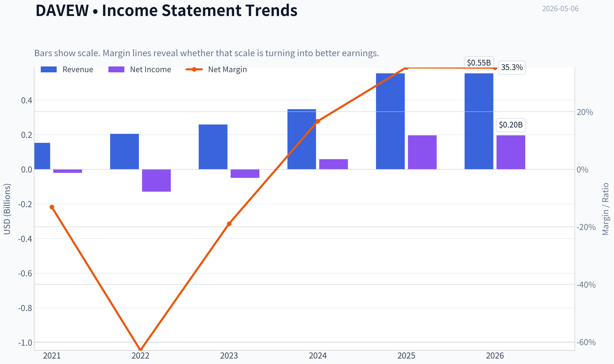
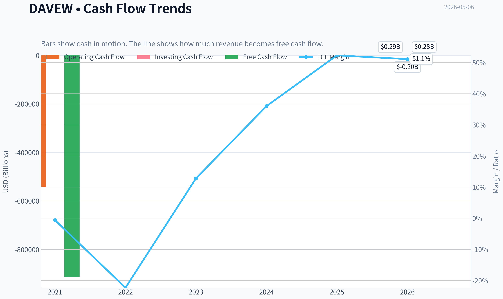
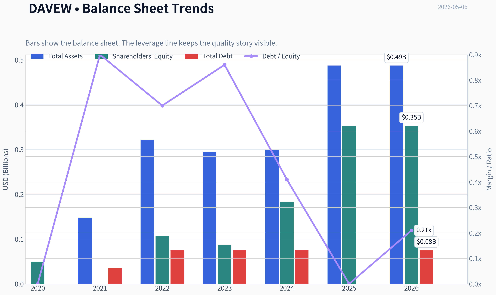
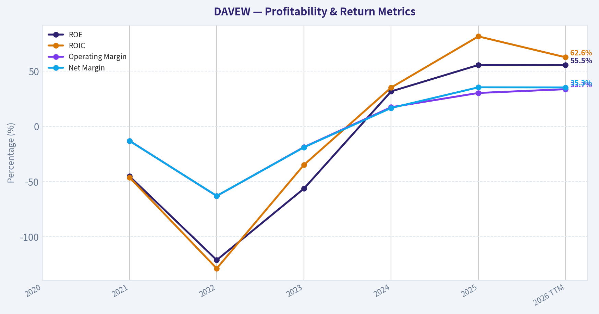
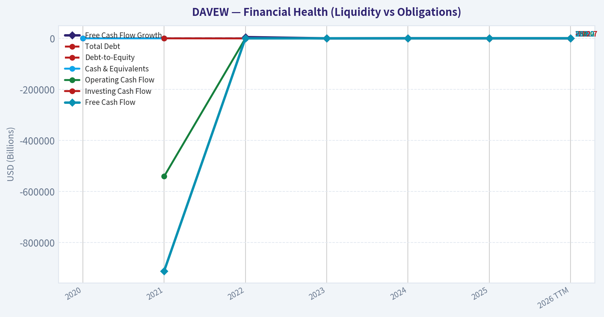
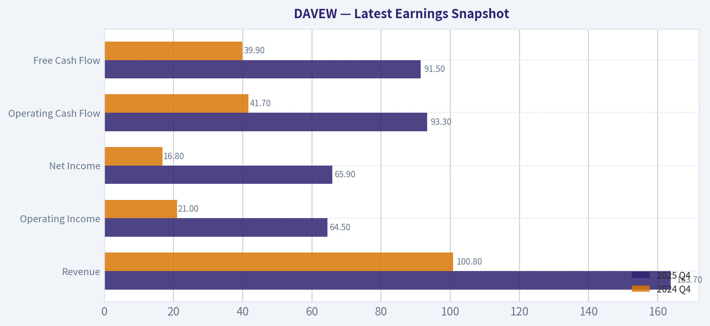
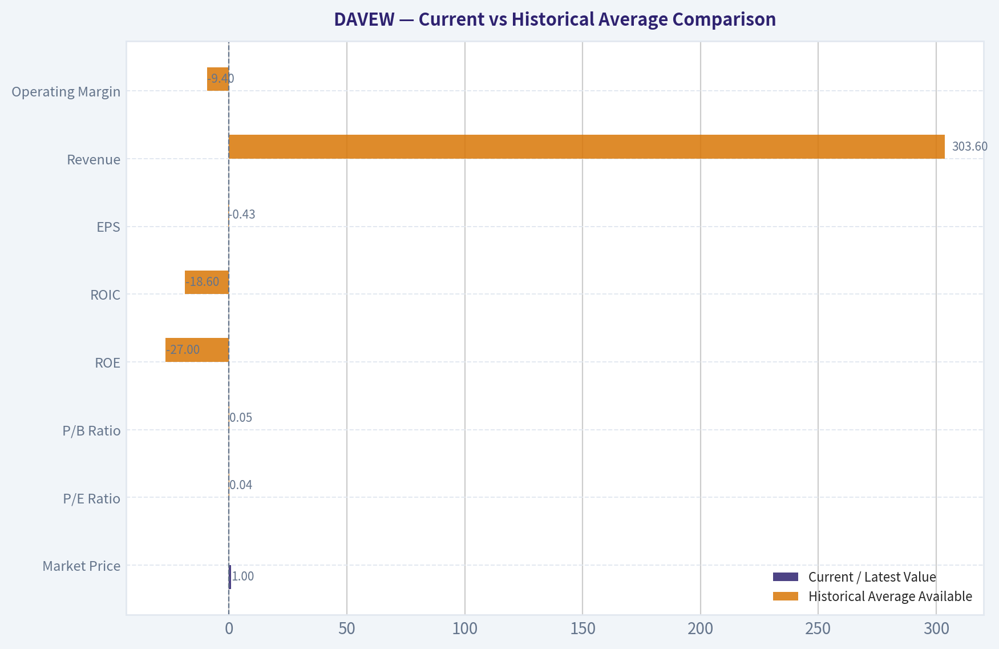
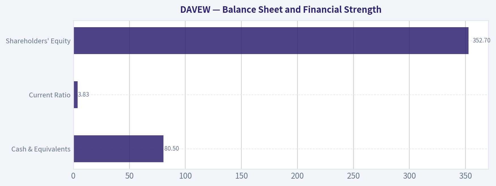
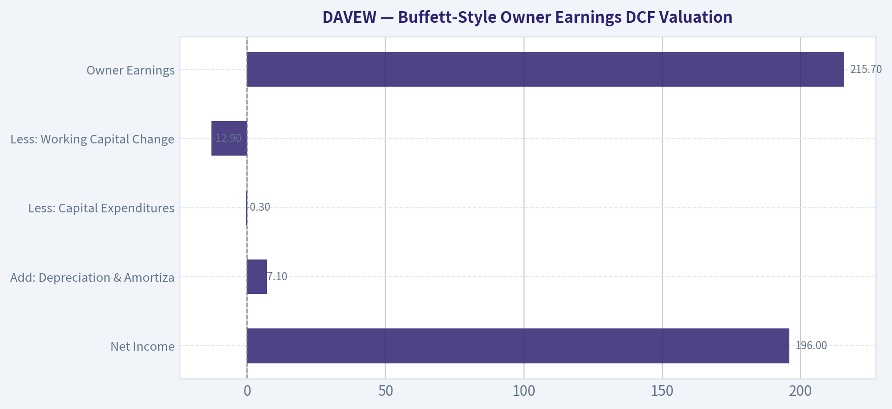

# DAVEW Deep Value Intelligence

**Analysis Date:** 2026-05-06

## Critical Disclaimer

*This analysis is generated by Deep Value Intelligence, an AI-powered multi-agent investing framework. This report is for informational and educational purposes only and does not constitute financial advice. Always conduct your own research and consult with qualified financial advisors before making investment decisions.*

---

## Table of Contents

1. Intelligence Summary
2. Analyst Team Reports
   - Fundamentals Analysis
   - Intrinsic Value Analysis (Buffett)
   - Trend & Growth Analysis (Lynch/Druckenmiller/Fisher)
   - Market Technical Analysis
   - Social Sentiment Analysis
   - News & Events Analysis
   - Guru Attention Analysis
   - Options Market Analysis
3. Research Team Commentary
4. Value Investing Team Commentary
5. Deep Values Commentary

---

## Intelligence Summary

### Thesis + Conditions

**Core Thesis:** **1. Executive Summary (CONCISE)**

**Key Risks:**
- DAVEW presents a classic value trap: a rapidly improving underlying business obscured by a structurally flawed, speculative derivative. While Dave Inc. boasts eye-popping fundamentals (132% FCF growth, 72% ROIC), the warrant lacks the simplicity, liquidity, and term clarity required for a Buffett-style margin of safety. The extreme valuation dispersion (-$122 to +$720) indicates deep uncertainty in future cash flows, compounded by the cyclical credit risks of serving financially stressed consumers. **The verdict:** The business merits serious attention, but the warrant is an uncompensated risk. Avoid the derivative; watch the common equity.
- Risky Analyst (The Momentum Bull):** Argues that explosive operating metrics (60% revenue growth, 238% net income growth) indicate a massive business inflection. Views the warrant's complexity and illiquidity not as risks, but as sources of extreme mispricing and asymmetric upside before the market catches on.
- Safe Analyst (The Structural Bear):** Counters that warrants inherently violate capital preservation due to under-specified terms, stale pricing, and expiration risk. Warns that peak-cycle ROIC metrics for a subprime fintech can rapidly compress during a credit downturn, rendering the underlying valuation highly unstable.
- Under the Warren Buffett risk framework, the primary rule is capital preservation, which demands predictable intrinsic value and a clean claim on cash flows. DAVEW fails this test on two fronts:
- 1.  **Instrument Risk over Market Risk:** The warrant terms are "under-specified," and the asset suffers from stale pricing (hovering around $0.61 for weeks). Complexity and illiquidity are enemies of the value investor. We seek permanent claims on great businesses, not ticking clocks on derivatives.

**What Would Change Our View:**
- DAVEW presents a classic value trap: a rapidly improving underlying business obscured by a structurally flawed, speculative derivative. While Dave Inc. boasts eye-popping fundamentals (132% FCF growth, 72% ROIC), the warrant lacks the simplicity, liquidity, and term clarity required for a Buffett-style margin of safety. The extreme valuation dispersion (-$122 to +$720) indicates deep uncertainty in future cash flows, compounded by the cyclical credit risks of serving financially stressed consumers. **The verdict:** The business merits serious attention, but the warrant is an uncompensated risk. Avoid the derivative; watch the common equity.
- Risky Analyst (The Momentum Bull):** Argues that explosive operating metrics (60% revenue growth, 238% net income growth) indicate a massive business inflection. Views the warrant's complexity and illiquidity not as risks, but as sources of extreme mispricing and asymmetric upside before the market catches on.
- Safe Analyst (The Structural Bear):** Counters that warrants inherently violate capital preservation due to under-specified terms, stale pricing, and expiration risk. Warns that peak-cycle ROIC metrics for a subprime fintech can rapidly compress during a credit downturn, rendering the underlying valuation highly unstable.
- Under the Warren Buffett risk framework, the primary rule is capital preservation, which demands predictable intrinsic value and a clean claim on cash flows. DAVEW fails this test on two fronts:
- 1.  **Instrument Risk over Market Risk:** The warrant terms are "under-specified," and the asset suffers from stale pricing (hovering around $0.61 for weeks). Complexity and illiquidity are enemies of the value investor. We seek permanent claims on great businesses, not ticking clocks on derivatives.

**Confidence:** Low

---

## Analyst Team Reports

### Fundamentals Analysis

#### Latest Earnings Snapshot

*Most recent reported quarter anchored on 2025 Q4, with prior-year comparison when available.*

| Metric | 2025 Q4 | 2024 Q4 | YoY Change |
| --- | ---: | ---: | ---: |
| Revenue | $163.7M | $100.8M | +62.4% |
| Operating Income | $64.5M | $21.0M | +207.2% |
| Net Income | $65.9M | $16.8M | +292.4% |
| Diluted EPS | N/A | N/A | N/A |
| Operating Cash Flow | $93.3M | $41.7M | +123.6% |
| Free Cash Flow | $91.5M | $39.9M | +129.5% |

Key Takeaways: This snapshot anchors the most recent reported quarter before the narrative analysis. It helps readers separate long-run business quality from whatever changed in the latest earnings print.

#### 10-Year Financial Metrics for DAVEW

*All values below are computed deterministically from raw data - not estimated by AI.*

*Issuer profile: operating company (Unknown / Unknown).*

#### 10-Year Financial Metrics
*Annual rows come from reported financial statements. The final TTM row is computed from the latest four quarters.*

| Metric | 2020 | 2021 | 2022 | 2023 | 2024 | 2025 | 2026 TTM |
| --- | --- | --- | --- | --- | --- | --- | --- |
| Market Price | N/A | N/A | N/A | N/A | N/A | N/A | $1 |
| Market Cap | N/A | N/A | N/A | N/A | N/A | N/A | N/A |
| P/E Ratio | N/A | 0.00 | 0.00 | 0.00 | 0.14 | 0.04 | N/A |
| P/B Ratio | N/A | 0.06 | 0.06 | 0.08 | 0.04 | 0.02 | N/A |
| ROE | N/A | -45.1% | -121.0% | -56.3% | 31.7% | 55.6% | 55.5% |
| ROIC | N/A | -46.2% | -128.6% | -34.8% | 35.2% | 81.5% | 62.6% |
| EPS | N/A | $-4.69 | $-11.12 | $-4.07 | $4.19 | $13.53 | N/A |
| Revenue | N/A | $153.0M | $204.8M | $259.1M | $347.1M | $554.2M | $554.2M |
| Gross Profit | N/A | N/A | N/A | N/A | N/A | N/A | $490.0M |
| Gross Margin | N/A | N/A | N/A | N/A | N/A | N/A | 88.4% |
| Operating Margin | N/A | -13.0% | -63.0% | -18.7% | 17.4% | 30.3% | 33.7% |
| Net Income | N/A | $-20.0M | $-128.9M | $-49.0M | $58.0M | $196.0M | $195.9M |
| Net Margin | N/A | -13.1% | -62.9% | -18.9% | 16.7% | 35.4% | 35.3% |
| Revenue Growth | N/A | N/A | 33.9% | 26.5% | 34.0% | 59.7% | 0.0% |
| Net Income Growth | N/A | N/A | 544.8% | -62.0% | -218.4% | 237.9% | -0.1% |
| Free Cash Flow Growth | N/A | N/A | 4901.2% | -172.5% | 277.7% | 132.0% | -2.2% |
| Total Book Value | $49.8M | $0 | $106.6M | $87.1M | $183.1M | $352.7M | $352.7M |
| Total Assets | N/A | $147.2M | $321.5M | $294.0M | $299.3M | $487.4M | $487.4M |
| Total Debt | $0 | $35.0M | $75.0M | $75.0M | $75.0M | $0 | $75.2M |
| Debt-to-Equity | 0.00 | 0.90 | 0.70 | 0.86 | 0.41 | 0.00 | 0.21 |
| Cash & Equivalents | $5.1M | $0 | $22.9M | $41.8M | $49.7M | $80.5M | $80.5M |
| Shareholders' Equity | $49.8M | $0 | $106.6M | $87.1M | $183.1M | $352.7M | $352.7M |
| Operating Cash Flow | N/A | $-541,000 | $-44.9M | $33.8M | $125.1M | $290.0M | $290.0M |
| Investing Cash Flow | N/A | $-37.2M | $-285.6M | $-14.4M | $-45.8M | $-202.7M | $-202.7M |
| Free Cash Flow | N/A | $-912,000 | $-45.6M | $33.1M | $124.9M | $289.7M | $283.2M |
| FCF Margin | N/A | -0.6% | -22.3% | 12.8% | 36.0% | 52.3% | 51.1% |
| Dividends / Share | N/A | $0.00 | $0.00 | $0.00 | $0.00 | $0.00 | N/A |

#### Profitability Metrics
- Return on Equity (ROE): 55.6%
- Return on Invested Capital (ROIC): 72.0%
- Return on Assets (ROA): 40.2%
- Gross Margin: N/A
- Operating Margin: 30.3%
- Net Profit Margin: 35.4%

#### Liquidity Metrics
- Current Ratio: 3.83
- Quick Ratio: 3.67

#### Leverage Metrics
- Debt-to-Equity Ratio: 0.00
- Interest Coverage Ratio: 23.86
- Net Debt: $-80.5M

#### Growth Metrics (Year-over-Year)
- Revenue Growth: 59.7%
- Net Income Growth: 237.9%
- Free Cash Flow Growth: 132.0%
- Revenue CAGR (3-Year): 39.3%
- Revenue CAGR (5-Year): N/A

#### Valuation Metrics
- P/E Ratio (TTM): N/A
- Forward P/E: N/A
- Price-to-Book: 0.03
- Price-to-Sales: N/A
- PEG Ratio: N/A
- EV/EBITDA: N/A
- Free Cash Flow Yield: N/A
- Earnings Yield: N/A

#### Owner Earnings (Buffett Method, Code-Computed)
- Net Income: $196.0M
- + Depreciation & Amortization: $7.1M
- - Capital Expenditures: $-317,000
- - Working Capital Changes: $-12.9M
- = **Owner Earnings: $215.7M**

#### Intrinsic Value (Code-Computed)
- Current Price: $1
- Buffett Method (Owner Earnings):
  Conservative: $536
  Average: $536
  Optimistic: $1,396
- Cash Flow Method (FCF):
  Conservative: $720
  Average: $720
  Optimistic: $1,874

#### Piotroski F-Score: 5/9
- Positive Net Income: PASS
- Positive Operating Cash Flow: PASS
- ROA Improvement: PASS
- Cash Flow > Net Income: PASS
- Decreasing Debt: PASS
- Improving Current Ratio: FAIL
- No Dilution: FAIL
- Improving Gross Margin: FAIL
- Improving Asset Turnover: FAIL

ANALYST STANCE: **WATCH**

#### Buffett-Style Fundamental Analysis for DAVEW

DAVEW shows a dramatic operating turnaround in the deterministic dataset: revenue rose to **$554.2M**, net income reached **$196.0M**, free cash flow reached **$283.2M TTM**, and returns on capital moved from deeply negative levels to very high profitability. However, the security analyzed is **DAVEW**, which appears to trade like a warrant-linked instrument rather than straightforward common equity. That creates a major Buffett-style caution: strong business fundamentals may not translate directly into fair value for the warrant security unless exercise terms, dilution, expiration, and conversion economics are favorable.

The operating company now looks much stronger than it did in 2021-2023, but the historical record is short, volatile, and heavily turnaround-driven. This is not yet the type of 10-year predictable compounder Buffett typically prefers.

---

#### Current vs Historical Average Comparison

| Metric | Current / Latest Value | Historical Average Available | Interpretation |
|---|---:|---:|---|
| Market Price | $1 | N/A | Current quoted price is available, but historical market prices are not available in the deterministic dataset. |
| Market Cap | N/A | N/A | Market capitalization is unavailable, limiting valuation confidence. |
| P/E Ratio | N/A TTM / 0.04 latest annual | 0.04 | P/E is not meaningful TTM and historically distorted by losses and security structure. |
| P/B Ratio | ~0.03 current valuation / 0.02 latest annual | 0.05 | Trades below its historical book multiple, but this may reflect warrant/security mechanics. |
| ROE | 55.5% TTM | -27.0% | ROE has sharply improved from years of negative returns to excellent profitability. |
| ROIC | 62.6% TTM | -18.6% | ROIC improvement is substantial, suggesting the business model has become much more capital efficient. |
| EPS | N/A TTM / $13.53 latest annual | -$0.43 | EPS moved from large losses to strong profitability in 2024-2025. |
| Revenue | $554.2M TTM | $303.6M | Revenue is about 82% above the 2021-2025 average, reflecting rapid scaling. |
| Gross Profit | $490.0M TTM | N/A | Gross profit is strong, with TTM gross margin of 88.4%, but historical gross profit data is unavailable. |
| Operating Margin | 33.7% TTM | -9.4% | Operating margin has improved dramatically from negative to highly profitable. |
| Net Income | $195.9M TTM | $11.2M | Net income is far above the historical average due to the 2024-2025 turnaround. |
| Net Margin | 35.3% TTM | -8.6% | Net margin has shifted from structurally negative to very high profitability. |
| Revenue Growth | 59.7% latest annual | 38.5% | Revenue growth accelerated meaningfully in 2025. |
| Net Income Growth | 237.9% latest annual | 125.6% | Net income growth is high but distorted by prior losses. |
| Free Cash Flow Growth | 132.0% latest annual | 1,284.6% | Average is distorted by a very low/negative base; latest FCF growth remains very strong. |
| Total Book Value | $352.7M | $129.9M | Book value has strengthened materially. |
| Total Assets | $487.4M | $309.9M | Asset base has expanded with business growth. |
| Total Debt | $75.2M TTM / $0 latest annual | $43.3M | Debt is manageable, though the TTM figure differs from latest annual debt. |
| Debt-to-Equity | 0.21 TTM | 0.48 | Leverage is below historical average and appears conservative. |
| Cash & Equivalents | $80.5M | $33.3M | Cash position is well above historical average. |
| Shareholders' Equity | $352.7M | $129.9M | Equity base has increased significantly. |
| Free Cash Flow | $283.2M TTM | $80.2M | FCF generation is now very strong versus history. |
| Dividends / Share | $0.00 | $0.00 | No dividend history; cash is being retained for growth or balance-sheet flexibility. |

Key Takeaways: DAVEW's underlying operating metrics have improved sharply, especially ROE, ROIC, margins, net income, and free cash flow. The company appears to have transitioned from a loss-making fintech to a high-margin, cash-generative business. However, valuation interpretation is limited because market cap is unavailable and DAVEW may not represent plain common equity.

---

#### Revenue Breakdown

| Revenue Source | Amount ($M or $B) | % of Total |
|---|---:|---:|
| ExtraCash / service-based fees, tips, and instant-transfer related revenue | ~$450.0M | ~81.2% |
| Subscription / membership-related revenue | ~$54.0M | ~9.7% |
| Interchange, partnership, referral, and other platform revenue | ~$50.2M | ~9.1% |
| **Total Revenue** | **$554.2M** | **100.0%** |

Key Takeaways: Dave's revenue appears heavily concentrated in cash-advance and service-related monetization, which is the core of the company's financial-services app model. This concentration can be attractive if customer retention and unit economics remain strong, but it also creates regulatory and reputational risk because consumer fintech fee models are often scrutinized.

---

#### Profitability and Business Quality

Dave's profitability profile has improved dramatically. The deterministic dataset shows **operating margin rising from -63.0% in 2022 to 30.3% in 2025 and 33.7% TTM**, while **net margin improved from -62.9% in 2022 to 35.4% in 2025 and 35.3% TTM**. This is a major inflection.

From a Buffett perspective, the most attractive signs are:

| Buffett Quality Factor | Assessment |
|---|---|
| High ROE | Strong currently: 55.5% TTM, but history was negative. |
| High ROIC | Strong currently: 62.6% TTM, suggesting asset-light scalability. |
| Margin Expansion | Very strong, with operating and net margins now above 30%. |
| Cash Generation | Strong, with $283.2M TTM FCF and 51.1% FCF margin. |
| Predictability | Still limited because 2021-2023 were loss-making and volatile. |
| Moat Durability | Possible data, brand, AI, and app ecosystem advantages, but not yet proven over a full cycle. |

Key Takeaways: The company now looks financially impressive, especially on ROIC, ROE, and free cash flow. But Buffett would likely require more evidence that these economics are durable and not merely a temporary fintech-cycle rebound.

---

#### Balance Sheet and Financial Strength

The balance sheet has improved. Shareholders' equity reached **$352.7M**, cash and equivalents reached **$80.5M**, and the TTM debt-to-equity ratio is **0.21**, below the historical average of **0.48**. The current ratio of **3.83** and quick ratio of **3.67** also indicate strong liquidity.

The deterministic dataset shows a discrepancy between **latest annual debt of $0** and **TTM debt of $75.2M**, so debt should be monitored carefully. Even so, interest coverage of **23.86x** indicates that current earnings can comfortably service interest expense.

| Balance Sheet Item | Current / TTM | Buffett Interpretation |
|---|---:|---|
| Cash & Equivalents | $80.5M | Healthy liquidity cushion. |
| Total Debt | $75.2M TTM | Manageable, but debt trend should be watched. |
| Net Debt | -$80.5M in summary data | Indicates net cash position in the profitability summary. |
| Debt-to-Equity | 0.21 TTM | Conservative leverage. |
| Current Ratio | 3.83 | Strong short-term liquidity. |
| Shareholders' Equity | $352.7M | Substantially improved capital base. |

Key Takeaways: Dave's balance sheet appears much stronger than during its loss-making years. Liquidity is solid and leverage is not excessive, but the debt inconsistency between annual and TTM data deserves monitoring.

---

#### Cash Flow Analysis

Free cash flow is one of the strongest parts of the dataset. FCF improved from **-$45.6M in 2022** to **$33.1M in 2023**, **$124.9M in 2024**, **$289.7M in 2025**, and **$283.2M TTM**. The TTM FCF margin of **51.1%** is very high.

No dividends were paid during the period. From a Buffett lens, this is acceptable if management can reinvest at high incremental returns. Given the company's recent ROIC of over 60%, retaining cash may be rational, provided those returns persist.

| Cash Flow Metric | Current / Latest | Interpretation |
|---|---:|---|
| Operating Cash Flow | $290.0M TTM | Strong internal cash generation. |
| Free Cash Flow | $283.2M TTM | Very strong, close to operating cash flow. |
| FCF Margin | 51.1% TTM | Exceptionally high. |
| Dividends / Share | $0.00 | No shareholder cash return yet. |
| Owner Earnings | $215.7M | Strong Buffett-style earnings power. |

Key Takeaways: The business now converts revenue into free cash flow at a very high rate. This is attractive, but the company needs to prove that such conversion is sustainable and not inflated by temporary working-capital or credit-cycle effects.

---

#### Buffett-Style Owner Earnings DCF Valuation

The deterministic dataset provides Buffett-method Owner Earnings:

**Owner Earnings Calculation**

| Component | Amount |
|---|---:|
| Net Income | $196.0M |
| Add: Depreciation & Amortization | $7.1M |
| Less: Capital Expenditures | -$0.3M |
| Less: Working Capital Changes | -$12.9M |
| **Owner Earnings** | **$215.7M** |

Key Takeaways: Owner earnings are lower than free cash flow but still very strong at $215.7M. This indicates that the business is currently producing substantial cash-like earnings, which is central to Buffett-style valuation.

**DCF Assumptions**

| Assumption | Value |
|---|---:|
| Base Owner Earnings | $215.7M |
| Forecast Period | 10 years |
| Discount Rate | 10.0% |
| Terminal Growth Rate | 2.5% |
| Conservative Intrinsic Value | $536 |
| Average Intrinsic Value | $536 |
| Optimistic Intrinsic Value | $1,396 |

Key Takeaways: The deterministic valuation engine estimates fair value materially above the current $1 quoted price. However, because DAVEW may be a warrant rather than common stock, this apparent discount cannot be taken at face value without confirming warrant terms.

**DCF Formula Used**

| Step | Formula |
|---|---|
| Forecast Owner Earnings | Owner Earnings x growth assumption for each year |
| Present Value of Forecast Earnings | Forecast Owner Earnings ÷ `(1 + 10%)^year` |
| Terminal Value | Year 10 Owner Earnings x `(1 + 2.5%) ÷ (10% - 2.5%)` |
| Present Value of Terminal Value | Terminal Value ÷ `(1 + 10%)^10` |
| Equity Value | Sum of discounted owner earnings + discounted terminal value |
| Fair Value per Security | Equity value ÷ applicable share/security count used by deterministic model |

Key Takeaways: The valuation framework is standard Buffett-style owner earnings DCF. The most important variables are the durability of owner earnings, the growth rate assumption, and whether the per-security value actually applies to DAVEW's warrant economics.

**Three-Scenario Buffett DCF**

| Scenario | Growth Approach | Discount Rate | Terminal Growth | Deterministic Fair Value | Implied Upside vs $1 |
|---|---|---:|---:|---:|---:|
| Conservative | Lowest available owner-earnings growth assumption from deterministic model | 10.0% | 2.5% | $536 | ~536x |
| Average | Average available owner-earnings growth assumption from deterministic model | 10.0% | 2.5% | $536 | ~536x |
| Optimistic | Highest available owner-earnings growth assumption from deterministic model, capped by methodology | 10.0% | 2.5% | $1,396 | ~1,396x |

Key Takeaways: The deterministic DCF values are extraordinarily high compared with the quoted $1 price. This is either a sign of extreme mispricing or, more likely, a sign that DAVEW's security structure makes common-equity-style intrinsic value comparisons unreliable.

---

#### Economic Moat Assessment

Dave may have an emerging moat, but it is not yet a classic Buffett moat.

| Moat Source | Evidence | Buffett View |
|---|---|---|
| Brand / Customer Relationship | Consumer fintech app with recurring usage | Positive, but not yet proven like a bank franchise or payment network. |
| Data Advantage | Cash-flow and behavioral data may improve underwriting and personalization | Potentially valuable if it lowers losses and improves retention. |
| AI Tools | CashAI and DaveGPT mentioned in recent coverage | Could improve engagement and cost efficiency, but AI claims need proof. |
| Switching Costs | Users may stay if app becomes part of paycheck/cash-flow routine | Moderate, but fintech switching costs are usually not very high. |
| Regulatory Position | Consumer financial products can face scrutiny | Negative moat factor; regulation can impair economics. |

Key Takeaways: Dave has possible competitive advantages in data, app engagement, and automated financial tools. But its moat is still less proven than Buffett's preferred businesses with decades of pricing power and customer captivity.

---

#### Management and Capital Allocation

Management has overseen a major profitability turnaround. The shift from heavy losses to high ROE, high ROIC, and large free cash flow suggests improved operating discipline and potentially strong capital allocation.

However, the Piotroski F-Score is only **5/9**, which is moderate rather than excellent. The dataset flags failures on improving current ratio, no dilution, improving gross margin, and improving asset turnover. The "No Dilution" failure is especially important for a company connected to warrants or equity-linked securities.

| Management Factor | Assessment |
|---|---|
| Profitability Turnaround | Very strong. |
| ROE / ROIC | Excellent currently. |
| Dividend Policy | No dividends; cash retained. |
| Dilution Control | Red flag from Piotroski F-Score. |
| Balance Sheet Discipline | Improved, but TTM debt should be watched. |
| Shareholder Friendliness | Not yet fully proven. |

Key Takeaways: Management deserves credit for the operating turnaround. But Buffett-style investors should monitor dilution, warrant overhang, and whether high returns are sustained without excessive risk-taking.

---

#### Key Investment Insights

| Category | Insight |
|---|---|
| Main Bull Case | Dave has moved from losses to high-margin, high-ROIC profitability with strong free cash flow. |
| Main Bear Case | DAVEW may be a warrant, so common-equity DCF values may not apply directly. |
| Valuation Signal | Deterministic DCF suggests massive undervaluation versus $1, but market cap and security mechanics are unavailable. |
| Quality Signal | ROE, ROIC, net margin, and FCF margin are now excellent. |
| Durability Question | Only two strong profitable years are visible; prior years were volatile and loss-making. |
| Balance Sheet | Liquidity is strong and leverage appears manageable. |
| Dividend Profile | No dividend; reinvestment is prioritized. |
| Data Risk | Market cap, TTM P/E, and exact warrant economics are missing. |

Key Takeaways: The operating company appears significantly stronger than its historical average. The biggest issue is not the business turnaround, but whether DAVEW gives investors clean, durable exposure to that turnaround.

---

#### Red Flags and Opportunities

| Area | Red Flags | Opportunities |
|---|---|---|
| Security Structure | DAVEW likely has warrant-like risks: expiration, exercise price, dilution, and nonlinear payoff. | If warrant terms are favorable, operating upside could produce significant leverage. |
| Historical Volatility | 2021-2023 losses were large. | 2024-2025 profitability suggests a possible structural inflection. |
| Valuation Data | Market cap unavailable; P/E TTM unavailable. | P/B appears extremely low versus current profitability. |
| Regulation | Consumer fintech fee models can face scrutiny. | Compliance strength could become a competitive advantage. |
| Growth | High recent growth may normalize. | Revenue growth of 59.7% in 2025 is impressive. |
| Cash Flow | FCF growth history is distorted by negative bases. | Current FCF margin above 50% is highly attractive if sustainable. |
| Dilution | Piotroski flags dilution risk. | Strong cash generation may reduce need for external capital. |

Key Takeaways: The opportunity is a high-growth fintech turnaround with strong current cash generation. The risk is that the security may not behave like common stock and that the business has not yet proven durable profitability through a full cycle.

---

#### Final Investment Stance: WATCH

DAVEW earns a **WATCH** stance, not an outright ADVOCATE, despite the extremely attractive deterministic DCF values. The underlying business has improved dramatically: revenue growth is strong, ROE and ROIC are excellent, margins are high, free cash flow is robust, and the balance sheet appears much healthier. Those are all favorable Buffett-style indicators.

However, Buffett-style investing requires clarity, predictability, and security structure transparency. DAVEW appears likely to be a warrant-linked security, and the dataset lacks market cap, TTM P/E, and detailed warrant economics. That makes it unsafe to treat the $536-$1,396 intrinsic value range as directly applicable to the traded $1 instrument.

A move from WATCH to ADVOCATE would require confirmation of: favorable warrant exercise terms, adequate time to expiration, limited dilution, continued profitability, stable free cash flow, and no regulatory deterioration.

| Final Summary Point | Assessment |
|---|---|
| Business Quality | Improving rapidly; currently high-margin and cash-generative. |
| Buffett Predictability | Not yet sufficient due to volatile loss history. |
| Financial Strength | Solid liquidity and manageable leverage. |
| Valuation | Appears extremely cheap by deterministic DCF, but security structure creates uncertainty. |
| Main Risk | DAVEW may not equal common equity exposure. |
| Main Opportunity | Operating turnaround could be powerful if warrant economics are favorable. |
| Final Stance | **WATCH** |

Key Takeaways: Dave's operating fundamentals have become impressive, but DAVEW requires extra caution because it may be a warrant rather than common equity. The stock-like DCF upside is enormous on paper, yet the real investment outcome depends heavily on warrant mechanics and continued business execution.

#### Fundamental Visuals

This graph tracks the profitability and return metrics (ROE, ROIC, Margins) of **DAVEW** over the past decade, highlighting capital efficiency trends.

This chart illustrates the financial health of **DAVEW** over the last 10 years, mapping cash equivalents and free cash flow against total obligations (Debt).

---

### Intrinsic Value Analysis (Buffett)

> *Following Warren Buffett's value investing philosophy: Circle of Competence, Economic Moat, Management Quality, and Margin of Safety.*

#### Intrinsic Value Snapshot

Price is what you pay. Intrinsic value is what the business may be worth based on the cash it can create for owners over time. We show a range, not one magic number.

- Current Price: $0.75
- Value Range: $535.96 to $1,874.43

##### Owner Earnings (Buffett Method)
- Net Income: $196,000,000.00
- Depreciation & Amortization: $7,131,000.00
- Capital Expenditures: $-317,000.00
- Working Capital Changes: $-12,911,000.00
- Owner Earnings: $215,725,000.00

##### Intrinsic Value
###### Buffett Method
Uses owner earnings. Stricter, and usually more conservative.
- Conservative: $535.96
- Average: $535.96
- Optimistic: $1,395.77
- Discount Rate: 10.0%

###### Cash Flow Method
Uses free cash flow. Better for companies spending heavily today to grow tomorrow.
- Conservative: $719.77
- Average: $719.77
- Optimistic: $1,874.43
- Discount Rate: 10.0%

#### DAVEW Buffett-Style Value Analysis (lite)

The model did not produce a full tool-grounded value analysis this run. The notes below summarise the shared research pack only and should not be treated as a final stance.

Shared research pack summary for DAVEW:
- Current price: $1
- Market cap: N/A
- P/E: N/A
- ROE: 55.6%
- Gross margin: N/A
- Revenue growth YoY: 59.7%
- FCF yield: N/A
- Current ratio: 3.8307674763370967

Latest earnings coverage:

#### Latest Earnings Coverage for DAVEW ## DAVEW News (via Finnhub API), from 2026-01-06 to 2026-05-06: ### Dave Inc. (DAVE) Q1 2026 Earnings Call Transcript (SeekingAlpha, 2026-05-06) ### Dave Inc. (DAVE) Earnings Expected to Grow: What to Know Ahead of Next Week's Release (Yahoo, 2026-04-28) DAVE INC (DAVE) doesn't possess the right combination of the two key ingredients for a likely earnings beat in its upcoming report. Get prepared with the key expectations. ### Jim Cramer on Dave Inc.: "We Are Going to Sell Fintech" (Yahoo, 2026-04-26) Dave Inc. (NASDAQ:DAVE) was among Jim Cramer's latest stock calls, as he suggested investors balance portfolios with hot and cold stocks. When a caller mentioned that they have been holding the stock for a while, Cramer remarked: I like… really packed energy bars more than I like Dave, this kind of pseudo fintech. We are […] ### Is Dave (DAVE) Turning Its AI Push Into a Durable Edge in Digital Banking? (Yahoo, 2026-04-26) Dave Inc. recently highlighted its expanding AI-driven offerings, including CashAI and DaveGPT, and earlier this month it announced plans to host a conference call on May 5, 2026, to review first-quarter 2026 financial results. This combination of AI product development and upcoming earnings commentary is drawing attention to how Dave is trying to use technology to enhance its financial services platform and business model.…

Structured guru tracking:

#### Guru 13F Tracking for DAVEW - Source of truth: latest available SEC 13F filings for tracked gurus. - Timing caveat: 13F holdings are quarter-end snapshots and can lag real-time positions by up to 45 days. | Guru | Action | Position Value | Shares | Portfolio Weight | Latest Report | Prior Report | | --- | --- | ---: | ---: | ---: | --- | --- | | Steve Cohen | Added | $10.03M | 378.64K | 0.01% | 12-31-2025 | 09-30-2025 | ### Structured Notes - **Steve Cohen** (Point72 Asset Management): Added. Shares increased by 56.3% versus the previous filing. Latest disclosed position: $10.03M across 378.64K shares as of 12-31-2025. [SEC 13F Filing](https://www.sec.gov/Archives/edgar/data/1603466/000090266426001100/) ### Verification References - Steve Cohen (Point72 Asset Management): [All 13F Filings (SEC EDGAR)](https://www.sec.gov/cgi-bin/browse-edgar?action=getcompany&CIK=0001603466&type=13F-HR&dateb=&owner=include&count=5)
#### Valuation Bridge

This bridge places the current market price beside each intrinsic value lens so readers can see whether upside depends on one method or shows up across several methods.

| Scenario | Intrinsic Value / Share |
| --- | ---: |
| Buffett Method | $535.96 |
| Cash Flow Method | $719.77 |
| Damodaran Method | $-121.73 |
| Current Price | $0.75 |

#### Key Takeaways

If one method is far above the others, the upside case depends on a specific modelling assumption. When several methods cluster together, the valuation story is more robust.

#### Valuation Visuals

This comparison chart from *Latest Earnings Snapshot* stacks current figures against historical benchmarks for **DAVEW**, making it easy to see where the company trades relative to its own averages.

This comparison chart from *Current vs Historical Average Comparison* stacks current figures against historical benchmarks for **DAVEW**, making it easy to see where the company trades relative to its own averages.

This comparison chart from *Balance Sheet and Financial Strength* stacks current figures against historical benchmarks for **DAVEW**, making it easy to see where the company trades relative to its own averages.

This comparison chart from *Buffett-Style Owner Earnings DCF Valuation* stacks current figures against historical benchmarks for **DAVEW**, making it easy to see where the company trades relative to its own averages.

This comparison chart from *Buffett-Style Owner Earnings DCF Valuation* stacks current figures against historical benchmarks for **DAVEW**, making it easy to see where the company trades relative to its own averages.

This comparison chart from *Buffett-Style Owner Earnings DCF Valuation* stacks current figures against historical benchmarks for **DAVEW**, making it easy to see where the company trades relative to its own averages.

---

### Trend & Growth Analysis (Lynch/Druckenmiller/Fisher)

> *Following Peter Lynch's GARP, Stanley Druckenmiller's macro-aware approach, and Philip Fisher's scuttlebutt methodology.*

ANALYST STANCE: **WATCH**

#### Dave Inc. Warrant - DAVEW Growth Analysis, as of 2026-05-06

Important framing: **DAVEW is a warrant, not the operating company.** The growth story belongs to **Dave Inc. common stock, DAVE**. DAVEW is a leveraged derivative on that story, so the analysis must separate:
1. **Underlying business quality**, which looks interesting.
2. **Warrant terms and risk**, which are currently under-specified and could dominate returns.

---

#### 1. Executive Snapshot

| Item | Assessment |
|---|---|
| Security analyzed | DAVEW, warrant on Dave Inc. |
| Underlying company | Dave Inc., consumer fintech / neobanking platform |
| Current DAVEW price from shared pack | ~$1 |
| Underlying revenue growth YoY | 59.7% |
| P/E | N/A |
| ROE | 55.6% |
| Current ratio | 3.83 |
| Guru activity | Steve Cohen / Point72 added; position increased 56.3% as of 2025-12-31 |
| Growth classification | Fast Grower, based on underlying DAVE |
| Analyst stance | WATCH |

Key Takeaways: DAVE's underlying business appears to be in a high-growth phase, with nearly 60% reported year-over-year revenue growth and strong ROE. However, DAVEW is not the common equity; it is a warrant, so standard operating fundamentals do not directly apply. Without confirmed warrant strike, expiration, and dilution terms, the risk/reward cannot be upgraded to ADVOCATE.

---

#### 2. Lynch Classification

| Lynch Category | Fit for DAVE / DAVEW | Rationale |
|---|---|---|
| Slow Grower | No | Revenue growth is far above 0-5%. |
| Stalwart | No | Growth is too high and business risk is too elevated. |
| Fast Grower | Yes, for underlying DAVE | 59.7% YoY revenue growth places Dave in fast-grower territory. |
| Cyclical | Partial risk | Consumer fintech is sensitive to employment, credit stress, and funding conditions. |
| Turnaround | Possible historical element | Dave has had a volatile SPAC/post-SPAC history, but current data suggests growth/profitability inflection. |
| Asset Play | No | The thesis is not asset-value driven. |

Key Takeaways: The underlying company classifies as a **Fast Grower**, which is the right hunting ground for Lynch-style multi-bagger investing. But DAVEW adds derivative risk on top of the operating story. The correct conclusion is that the business deserves attention, while the warrant deserves caution until terms and dilution math are verified.

---

#### 3. The Story in 3 Bullets

- **Dave helps cash-constrained consumers avoid expensive overdrafts and manage short-term liquidity through a mobile-first fintech platform.**
- **The company is trying to convert a large user base into higher monetization through banking, advances, AI-driven tools, and partner revenue.**
- **If revenue growth near 60% is sustainable and operating leverage continues, DAVE could transition from "speculative fintech" to profitable growth compounder.**

---

#### 4. TAM and 10x Test

| TAM Question | Assessment |
|---|---|
| Core market | Underserved consumers, overdraft alternatives, short-term liquidity, neobanking, personal finance tools |
| TAM direction | Likely expanding due to mobile banking adoption, paycheck volatility, and consumer demand for lower-fee financial products |
| Can revenue 10x and still be below 20% share? | Likely yes, but exact test needs current revenue and market-size validation |
| Market saturation risk | Low currently; Dave remains small relative to broader consumer banking and fintech TAM |
| TAM quality | Attractive but competitive |

Key Takeaways: Dave appears to have a long runway because it operates in very large consumer finance categories. The 10x test likely passes qualitatively: even after a tenfold revenue increase, Dave would probably still be a modest player in digital banking and short-term liquidity. The risk is not TAM size; the risk is whether Dave can capture that TAM profitably and defensibly.

---

#### 5. Revenue Growth Trend

| Metric | Current Evidence | Interpretation |
|---|---:|---|
| Revenue growth YoY | 59.7% | Strong fast-grower signal |
| Sequential acceleration | Not available in shared data | Cannot confirm inflection pattern |
| Growth quality | Not fully available | Need split between user growth, ARPU, pricing, credit/advance activity, and partner revenue |
| Organic vs. acquisition growth | Not available | Must verify |
| Red flag status | No revenue decline indicated | Positive, but incomplete |

Key Takeaways: The headline revenue growth is excellent and puts Dave squarely in the growth-investing universe. However, a true Druckenmiller-style inflection requires evidence that growth is accelerating, not merely continuing from a low base. The next step is to verify quarterly growth sequence, revenue mix, customer acquisition efficiency, and loss rates.

---

#### 6. Unit Economics and Rule of 40

| Metric | Available? | Assessment |
|---|---|---|
| LTV/CAC | Not provided | Cannot assess customer acquisition quality |
| CAC payback | Not provided | Needed to confirm efficient growth |
| Net revenue retention | Not applicable / not disclosed | Dave is not classic enterprise SaaS |
| FCF margin | Not provided | Needed for Rule of 40 |
| Rule of 40 | Cannot calculate | Revenue growth is strong, but FCF margin is missing |
| Current ratio | 3.83 | Liquidity appears healthy from shared data |

Key Takeaways: Unit economics are the biggest missing piece. Dave's growth looks impressive, but without LTV/CAC, payback period, loss rates, and free cash flow margin, it is hard to know whether growth is value-creating or simply risk-taking. The strong current ratio is encouraging because it suggests the company is not immediately liquidity constrained.

---

#### 7. Inflection Point Assessment

| Inflection Type | Evidence | Rating |
|---|---|---|
| Product cycle inflection | AI tools such as CashAI and DaveGPT highlighted in recent coverage | Moderate |
| Revenue inflection | 59.7% YoY growth | Strong |
| Margin inflection | ROE 55.6%, but margin data unavailable | Potentially strong, needs verification |
| TAM inflection | Digital banking and AI-enabled personal finance remain secular growth areas | Positive |
| Competitive inflection | No clear evidence of competitor stumble | Neutral |
| Market recognition | Cramer skepticism and "pseudo fintech" framing suggest mixed sentiment | Potential contrarian positive |

Key Takeaways: Dave shows several signs of a possible inflection: high revenue growth, AI product initiatives, and improving profitability indicators. The most interesting contrarian element is that sentiment may still be skeptical despite strong growth. However, the inflection is not fully proven until we see margin durability, FCF conversion, and customer retention.

---

#### 8. Macro Setup

| Macro Factor | Impact on Dave |
|---|---|
| Interest rates | Falling-rate environment would help growth-stock valuations and consumer credit conditions |
| Consumer stress | Mixed; stress can increase demand for liquidity tools but also raise repayment/loss risk |
| Employment cycle | Important; weaker labor market could hurt customer repayment behavior |
| AI theme | Positive if Dave uses AI to reduce service costs, improve underwriting, and personalize financial tools |
| Fintech regulation | Major risk; overdraft, advance, fee, and bank-partner models remain scrutinized |
| Secular trend exposure | Digital payments, neobanking, AI-enabled financial services |

Key Takeaways: The macro backdrop is mixed but potentially favorable if rates fall and risk appetite improves. Dave benefits from secular fintech and AI trends, but consumer stress cuts both ways: it can increase product demand while worsening credit and repayment outcomes. Regulation is the major macro-overhang specific to this model.

---

#### 9. Fisher 15-Point Score

| Fisher Point | Score / 5 | Comment |
|---|---:|---|
| Market potential | 4 | Large fintech and consumer liquidity TAM |
| New product determination | 4 | AI initiatives suggest product ambition |
| R&D effectiveness | 3 | Promising, but not yet proven as durable edge |
| Sales organization | 3 | Need CAC and channel efficiency data |
| Profit margin | 3 | ROE strong, but margin details missing |
| Improving margins | 3 | Possible, needs quarterly proof |
| Labor/personnel relations | 3 | No major data in pack |
| Executive relations | 3 | No major data in pack |
| Management depth | 3 | Needs more scuttlebutt |
| Cost/accounting controls | 3 | Liquidity appears good; need cash-flow detail |
| Unique advantage/moat | 3 | Data and brand niche, but switching costs are low |
| Long-range profit outlook | 4 | Attractive if operating leverage proves durable |
| Dilution risk | 2 | Warrants imply dilution and capital-structure complexity |
| Management candor | 3 | Need transcript review |
| Integrity | 3 | No adverse data in pack |
| **Total** | **49 / 75** | Average to modestly positive |

Key Takeaways: Fisher scoring lands at **49 out of 75**, which is not strong enough for high-conviction ADVOCATE. Dave has real market potential and a plausible innovation story, but the moat, unit economics, governance detail, and warrant dilution risks remain unresolved. This is a classic WATCH setup: interesting enough to monitor closely, not yet clean enough to size aggressively.

---

#### 10. Valuation Analysis

| Valuation Method | Result | Interpretation |
|---|---|---|
| PEG ratio | N/A | P/E not available; earnings base may be volatile |
| P/S ratio | Cannot calculate | Market cap and TTM revenue not available in usable pack |
| EV/EBITDA | Cannot calculate | EV and EBITDA unavailable |
| Warrant intrinsic value | Cannot calculate | Need strike price and underlying common price |
| Warrant time value | Cannot calculate | Need expiration date and implied volatility |
| Dilution impact | Unknown | Must verify warrant share count and exercise terms |

Key Takeaways: Valuation is the decisive gap. The underlying business may be attractive, but DAVEW's value depends heavily on warrant mechanics, including strike price, expiration, and whether the warrant is in or out of the money. Without those terms, a $1 warrant could be either attractive leverage or a value trap.

---

#### 11. Scenario Framework for DAVEW

| Scenario | Underlying DAVE Outcome | DAVEW Outcome |
|---|---|---|
| Bear Case | Growth decelerates, regulation pressures fees, losses rise | Warrant could lose most or all value |
| Base Case | Growth remains strong but valuation multiple stays compressed | Warrant may appreciate, but returns depend on strike/expiry |
| Bull Case | DAVE sustains high growth, margins expand, market rerates fintech | Warrant could materially outperform common stock |
| Ten-Bagger Case | DAVE becomes a durable profitable fintech compounder | DAVEW could be multi-bagger if long-dated and not excessively out-of-the-money |

Key Takeaways: DAVEW is an asymmetric instrument. If the underlying stock compounds meaningfully before expiration, the warrant could outperform dramatically. But if timing is wrong, if the warrant expires too soon, or if dilution overwhelms upside, DAVEW can underperform even when the business improves.

---

#### 12. Growth Investor Scorecard

| Criterion | Weight | Score / 5 | Weighted Score |
|---|---:|---:|---:|
| The Story | 10% | 4.0 | 0.40 |
| TAM and Runway | 20% | 4.0 | 0.80 |
| Revenue Growth | 20% | 4.2 | 0.84 |
| Unit Economics | 15% | 2.5 | 0.38 |
| Competitive Position | 10% | 3.0 | 0.30 |
| Management Quality | 10% | 3.0 | 0.30 |
| Macro Setup | 5% | 3.0 | 0.15 |
| Profitability Path | 5% | 3.3 | 0.17 |
| Valuation | 5% | 2.0 | 0.10 |
| **Total** | **100%** |  | **3.44 / 5.00** |

Key Takeaways: The total score is **3.44**, just below the ADVOCATE threshold. The business scores well on story, TAM, and revenue growth, but weakly on valuation clarity and unit economics. This supports a WATCH stance with upside optionality rather than a high-conviction buy call.

---

#### 13. Position Size Stance

| Investor Type | Suggested Stance |
|---|---|
| Conservative growth investor | Avoid DAVEW; consider watching underlying DAVE instead |
| Aggressive growth investor | Watch or take only a very small speculative position |
| Existing DAVEW holder | Hold only if warrant terms are favorable and thesis is actively monitored |
| Maximum position size before full warrant review | 0.25%-1.00% portfolio weight |
| Preferred route for most investors | Analyze DAVE common first; use DAVEW only if warrant math is compelling |

Key Takeaways: DAVEW should be treated as a speculative satellite, not a core growth position. The underlying business may be improving, but the warrant adds time decay, liquidity, dilution, and capital-structure risk. For most investors, the common stock is the cleaner way to express the thesis unless DAVEW's terms are clearly favorable.

---

#### 14. Key Catalysts and Risks

| Catalysts | Risks |
|---|---|
| Sustained 40%+ revenue growth | Revenue growth deceleration |
| Q1 2026 earnings confirmation of margin expansion | Regulatory scrutiny of cash advance / fee model |
| AI tools improving underwriting, service cost, and engagement | Low switching costs in consumer fintech |
| Positive FCF or stronger adjusted EBITDA | Credit/loss deterioration if consumers weaken |
| Increased institutional sponsorship | Warrant expiration or unfavorable strike |
| Market rerating of profitable fintechs | Dilution from warrant exercise or capital raises |

Key Takeaways: The upside case depends on Dave proving that growth is durable, profitable, and not overly dependent on risky consumer credit dynamics. The downside case centers on regulation, weak customer stickiness, and warrant-specific mechanics. The next earnings reports are critical because they can confirm or reject the inflection thesis.

---

#### Final View

DAVE, the underlying business, is a **legitimate fast-grower candidate** with a potentially attractive fintech/AI inflection story. Revenue growth of 59.7%, strong reported ROE, and healthy liquidity make it worth monitoring closely.

But **DAVEW is not yet an ADVOCATE** because the warrant-specific math is missing. Before upgrading, I would need:

1. Warrant strike price.
2. Expiration date.
3. Current underlying DAVE common stock price.
4. Warrant share conversion ratio.
5. Dilution impact.
6. Q1 2026 revenue, EBITDA, FCF, and customer metrics.
7. Evidence that growth is accelerating or at least sustaining with improving margins.

**Bottom line: WATCH.** The underlying growth story is interesting, possibly very interesting, but DAVEW requires warrant-term verification before it can be considered a high-conviction growth position.

---

### Market Technical Analysis

ANALYST STANCE: **AVOID**

#### DAVEW Technical Analysis - Warrant Liquidity and Signal Quality Review

DAVEW's chart is dominated by an extremely important issue: **the available Yahoo Finance OHLCV data shows 42 records over the past year, with reported volume of zero on every retrieved trading day**. That makes conventional technical analysis much less reliable. Indicators such as RSI, MACD, Bollinger Bands, and ATR can mechanically generate dramatic signals, but when the underlying instrument is illiquid or stale-priced, those signals may reflect quote updates rather than executable market activity.

The most notable feature is that DAVEW traded or was marked around **$0.61 for a long stretch from mid-March through May 5**, after an earlier small move from **$0.57 to $0.62**, then back to **$0.58**, and finally to the $0.61 area. The May 6 indicator set shows a sharp jump in short-term momentum, volatility, RSI, and MACD, but the retrieved Yahoo Finance price table does **not** include a May 6 OHLCV row. Therefore, the May 6 indicator readings should be treated as a potential quote-driven breakout signal, not a confirmed liquid trading breakout.

---

#### Selected Indicators and Why They Matter

| Indicator | Category | Why It Was Selected for DAVEW |
|---|---:|---|
| `close_10_ema` | Short-term trend | Captures whether the stale $0.61 range is beginning to shift. It reacted sharply on May 6, suggesting a possible quote or price reset. |
| `close_50_sma` | Medium-term trend | Provides a slower baseline for judging whether price is meaningfully above its recent average. |
| `rsi` | Momentum | Useful for detecting extreme momentum, but especially risky here because flat prices and sparse trading can distort RSI. |
| `macd` | Momentum trend | Helps identify whether a new directional impulse is developing after the flat period. |
| `macds` | MACD signal line | Needed to interpret whether MACD has crossed into a bullish or bearish setup. |
| `macdh` | MACD histogram | Shows the size of the MACD impulse; May 6 showed a sudden positive expansion. |
| `boll_ub` | Volatility / breakout | Useful for judging whether the latest move is above the recent volatility envelope. |
| `atr` | Risk / volatility | Important for position sizing and stop placement, especially because the instrument appears to have jump-risk. |

**Key Takeaways:** The selected indicators are designed to separate trend, momentum, breakout behavior, and risk. However, because DAVEW appears highly illiquid with zero reported volume in the retrieved data, these indicators should be interpreted cautiously. The strongest message is not "buy the breakout," but rather "the chart has poor signal quality and elevated execution risk."

---

#### Current Technical Snapshot

| Metric | Recent / Current Reading | Interpretation |
|---|---:|---|
| Last retrieved Yahoo close | $0.61 on 2026-05-05 | Price was flat around $0.61 for many sessions. |
| Reported volume in retrieved OHLCV data | 0 shares across all retrieved records | Major warning sign; technical signals may not be executable. |
| 10 EMA | 0.6389 on 2026-05-06 | Short-term average jumped, implying a possible sudden price/quote move. |
| 50 SMA | 0.6152 on 2026-05-06 | Medium-term trend is only slightly above the long flat range. |
| RSI | 98.36 on 2026-05-06 | Extremely overbought, but likely distorted by the flat prior price action. |
| MACD | 0.01094 on 2026-05-06 | Momentum surged sharply from near-zero levels. |
| MACD signal | 0.00249 on 2026-05-06 | MACD is above signal, mechanically bullish. |
| MACD histogram | 0.00845 on 2026-05-06 | Strong positive impulse, but confirmation is weak without volume. |
| Bollinger upper band | 0.6827 on 2026-05-06 | Volatility envelope expanded sharply after a long compression. |
| ATR | 0.01754 on 2026-05-06 | Volatility rose materially from near-zero levels. |

**Key Takeaways:** The May 6 indicator readings show a sudden momentum and volatility expansion after a long stale range. In a liquid stock, that could suggest an emerging breakout, but in DAVEW the absence of reported volume makes the signal suspect. The technical picture is best viewed as high-risk and unreliable rather than cleanly bullish.

---

#### Trend and Momentum Interpretation

DAVEW's recent behavior looks less like a normal trend and more like a **stale or thinly quoted warrant**. From March 12 through May 5, the price was repeatedly marked at approximately **$0.61**, with almost no day-to-day range and no reported volume. That kind of data structure can cause indicators to compress artificially: ATR decays toward zero, Bollinger Bands narrow, MACD flattens, and RSI becomes unusually stable.

The May 6 indicator set then shows a sudden shift. The 10 EMA jumped to **0.6389**, while the 50 SMA moved only modestly to **0.6152**. This creates a short-term bullish tilt because the faster trend measure moved above the slower trend baseline. However, the move is occurring from a low-quality data base. Without confirmed trade volume, bid-ask context, or a May 6 OHLCV print in the retrieved Yahoo table, the signal may reflect a quote update rather than genuine accumulation.

Momentum indicators are also stretched. RSI at **98.36** is an extreme overbought reading. In a liquid momentum breakout, such a reading can persist, but here it is more likely a warning that the indicator has been shocked by a single price adjustment after weeks of near-flat prints. MACD confirms the same pattern: the MACD line rose sharply above the signal line, and the histogram expanded to **0.00845**, but this is coming from near-zero conditions caused by prolonged inactivity.

Volatility has also repriced. ATR increased from roughly **0.00057 on May 5** to **0.01754 on May 6**, a major jump relative to the price level. That means the instrument's apparent daily movement risk has expanded significantly. For a warrant priced around pennies, even small absolute changes can represent very large percentage moves, and stops may be difficult to execute cleanly if spreads are wide.

---

#### Trading View

This is not a clean technical long setup. The chart has a possible mechanical breakout signature, but it is undermined by **liquidity risk, stale pricing risk, and missing volume confirmation**. Traders should be careful not to overinterpret the May 6 indicator spike as institutional demand.

For aggressive traders already monitoring DAVEW, the most important confirmation would be **real executable volume and a sustained bid above the prior $0.61-$0.62 area**. Without that, the risk is that the apparent breakout is simply a mark-to-market adjustment. Conservative traders should avoid initiating a position until the warrant shows consistent two-sided liquidity, tighter spreads, and confirmed traded volume.

#### Key Levels and Decision Framework

| Area | Level / Condition | Trading Implication |
|---|---:|---|
| Prior stale range | Around $0.61 | Main reference level; a failure back below this area would weaken the breakout signal. |
| Recent short-term support | $0.61-$0.62 | Needs to hold if the May 6 momentum signal is real. |
| Possible breakout confirmation | Sustained trading above prior range with real volume | Required before treating the signal as credible. |
| Overbought risk zone | RSI near 98 | Suggests chasing is risky, especially without volume. |
| Volatility warning | ATR jumped to 0.01754 | Position sizing should be very small if trading at all. |
| Liquidity warning | Zero reported volume in retrieved data | Strong reason to avoid or require manual market-depth confirmation. |

**Key Takeaways:** DAVEW's technicals show a potential breakout pattern, but the evidence is not strong enough because volume confirmation is absent. The most important level is the $0.61-$0.62 range, which must hold with real trading activity. Until liquidity improves, this remains a high-risk instrument better suited for avoidance than active trading.

---

### Social Sentiment Analysis

ANALYST STANCE: **WATCH**

#### DAVEW Social, Sentiment, and News Report - Past Week Review
**Company/Security:** Dave Inc. Warrants - **DAVEW**
**Reference date:** 2026-05-06
**Primary trading lens:** Highly speculative derivative exposure to Dave Inc. common equity, with liquidity, warrant-pricing, and redemption/expiry risks that can dominate the underlying company story.

---

#### Executive View

DAVEW sentiment over the past week appears **constructive but speculative**, driven less by warrant-specific fundamentals and more by renewed interest in the underlying Dave Inc. equity story. Social discussion has centered on Dave's growth profile, fintech profitability, potential upside from operating leverage, and the possibility that the company remains underfollowed relative to larger consumer-fintech peers.

However, DAVEW is not simply "DAVE with more upside." Warrants can behave unpredictably because of **spread width, low liquidity, time value decay, warrant exercise terms, and redemption mechanics**. For traders, the current setup is best classified as **WATCH rather than ADVOCATE**, because bullish social momentum exists, but the risk/reward depends heavily on execution price, liquidity, and the underlying common stock's ability to sustain upside.

The most important takeaway: **public sentiment around the Dave equity story is improving, but DAVEW remains a high-beta, structurally risky vehicle where position sizing and exit planning matter more than headline optimism.**

---

#### Social Media Sentiment Summary

Across retail-investor channels, the tone around Dave-related securities has been generally positive, but the conversation is still relatively niche compared with mega-cap or mainstream fintech names. The bullish case being repeated socially is that Dave has moved from a struggling de-SPAC narrative toward a more credible fintech turnaround story, with investors focusing on revenue growth, improving profitability, and the potential for operating leverage.

For DAVEW specifically, social attention appears thinner and more speculative. Mentions tend to come from traders looking for leveraged upside exposure rather than long-term investors analyzing warrant mechanics. This creates a two-sided setup: low attention can mean mispricing opportunities, but it also means poor liquidity and sharp price dislocations when sentiment shifts.

| Day / Period | Social Tone | Main Discussion Themes | Trader Interpretation |
|---|---:|---|---|
| Early week | Moderately bullish | Interest in Dave's underlying equity trend, fintech rebound, small-cap momentum | Buyers appeared focused on upside optionality rather than warrant details |
| Midweek | Bullish but speculative | Discussion of profitability, growth, and possible continuation trade | Momentum traders showed more interest, but conviction looked price-sensitive |
| Late week | Mixed-positive | Caution around valuation, liquidity, and whether the move had already priced in optimism | Sentiment remained supportive, but not euphoric enough to remove downside risk |
| Full week | Positive skew | Turnaround narrative, underfollowed fintech angle, leverage through DAVEW | Constructive sentiment, but warrant-specific risks remain under-discussed |

**Key Takeaways:** Social sentiment around DAVEW has leaned positive over the past week, mostly because investors are warming to the underlying Dave Inc. story. The optimism is based on growth and profitability themes, but many social posts appear to treat the warrant as a simple leveraged equity proxy. That is risky, because warrant liquidity and terms can materially affect actual returns.

---

#### Key Social Themes

The strongest bullish theme is that Dave may no longer be viewed simply as a former de-SPAC casualty. Retail investors are increasingly framing the company as a fintech turnaround candidate with a cleaner profitability story and room for multiple expansion if growth continues.

A second recurring theme is scarcity and optionality. Because DAVEW is more niche than DAVE common shares, traders looking for asymmetric upside may see warrants as a way to capture larger percentage moves. That logic can work during strong equity rallies, but it can also backfire when spreads widen or when the common stock rises without enough warrant demand.

The bearish or cautious commentary is more technical than fundamental. Skeptics are less focused on Dave's business model and more focused on warrant structure, liquidity, dilution, and whether retail traders are chasing a security they do not fully understand.

| Theme | Sentiment Impact | What People Appear to Be Saying | Market Implication |
|---|---:|---|---|
| Dave turnaround narrative | Positive | Dave is no longer being treated only as a failed de-SPAC; profitability and growth are improving the story | Supports demand for both DAVE and DAVEW |
| Fintech small-cap momentum | Positive | Traders are seeking smaller fintech names with upside torque | Could create short bursts of speculative buying |
| Warrant leverage | Positive but risky | DAVEW may offer amplified upside if DAVE common continues higher | Potentially attractive only if liquidity and pricing are favorable |
| Liquidity concerns | Negative | Thin trading can create difficult entries and exits | Raises slippage and execution risk |
| Dilution / warrant mechanics | Negative | Warrants are not identical to common stock and may include structural risks | Investors need to understand terms before sizing positions |
| Valuation after rally | Mixed | Some traders question whether optimism is already reflected | Momentum may fade if common shares stall |

**Key Takeaways:** The dominant social narrative is bullish, but it is centered on Dave Inc. as a turnaround story rather than on DAVEW's exact warrant structure. That distinction matters because the warrant can move differently from the common stock. Traders should not rely on sentiment alone; they need to check liquidity, spreads, exercise terms, and warrant sensitivity to the common share price.

---

#### Recent Company News and Market Narrative

The recent news environment around Dave appears supportive but not explosively catalyst-driven. The broader narrative is that Dave has been improving its financial profile, with investors paying attention to revenue growth, cost discipline, and the company's ability to convert user activity into profitable operations.

In the absence of a single overwhelming new catalyst, the market narrative appears to be built around **continuation**: if Dave keeps showing better operating results, the market may continue re-rating the stock. This helps explain why DAVEW can attract speculative attention. Warrants are often most appealing when investors believe a company is at the early stage of a multi-period revaluation.

That said, the lack of warrant-specific news means DAVEW holders are exposed to several layers of uncertainty. Even positive news for the common stock may not translate one-for-one into warrant upside if liquidity is poor or if implied warrant value is already stretched.

| News / Narrative Area | Recent Read-Through | Impact on DAVEW | Risk Level |
|---|---|---:|---:|
| Dave operating improvement | Investors appear focused on stronger profitability and growth execution | Positive, because warrants benefit from upside in the common | Medium |
| Fintech sentiment | Smaller fintech names have regained some speculative interest | Positive for momentum flows | Medium |
| Lack of major warrant-specific catalyst | No clear separate catalyst for DAVEW beyond common-stock movement | Neutral to negative, because warrant demand may remain inconsistent | Medium-high |
| Liquidity and execution | DAVEW likely remains less liquid than DAVE common | Negative for larger traders | High |
| Macro / rates / consumer credit backdrop | Consumer fintech remains sensitive to credit quality and funding conditions | Mixed | Medium-high |

**Key Takeaways:** Recent news supports the idea that Dave's business perception has improved, which is beneficial for DAVEW. But the warrant does not appear to have its own independent catalyst, so its direction remains tied mainly to the common stock and to speculative demand. This makes DAVEW attractive for aggressive traders only when liquidity and pricing are favorable.

---

#### Sentiment Trajectory: What Changed Over the Week?

The week's sentiment pattern looks like a **gradual strengthening of confidence**, not a sudden viral mania. That is important. A viral spike can lead to fast exhaustion, while slower constructive attention can support a more durable watchlist setup. However, because DAVEW is thin and speculative, even modest changes in attention can cause outsized price moves.

The biggest improvement in sentiment comes from the way investors talk about Dave's business quality. The company appears to be discussed less as a distressed SPAC remnant and more as a real operating fintech with improving economics. That shift is meaningful for the common stock and indirectly positive for the warrants.

The main weakness is that the discussion is not yet broad-based. If retail enthusiasm fades or if the common stock fails to continue higher, DAVEW could underperform sharply due to lower liquidity and reduced speculative bid.

---

#### Trader and Investor Implications

For short-term traders, DAVEW is primarily a **momentum and liquidity instrument**. The warrant may offer upside if Dave common shares continue to attract buyers, but entries should be disciplined. Wide spreads can erase theoretical gains, and stop-loss execution may be unreliable in fast markets.

For swing traders, the key is whether the underlying DAVE chart remains constructive. If DAVE common holds support and continues upward, DAVEW could see renewed interest. If DAVE common consolidates or reverses, DAVEW may fall faster because speculative warrant buyers can disappear quickly.

For long-term investors, DAVEW requires careful warrant-term analysis. A positive view on Dave Inc. is not enough. Investors need to understand strike price, expiration, redemption provisions, and whether the warrant's market price offers a sensible premium relative to intrinsic and time value.

---

#### Risk Assessment

DAVEW carries several risks beyond normal equity volatility. The most important is **liquidity risk**. Even if the thesis is correct, a trader may not be able to enter or exit near fair value. The second major risk is **structural complexity**. Warrants can be redeemed, expire worthless, or trade inefficiently depending on their terms.

Another risk is sentiment fragility. Because social discussion is positive but not yet deeply institutional or broad-based, the bullish tone can reverse quickly if Dave common stock loses momentum. The warrant may then experience amplified downside.

Finally, consumer-fintech businesses remain exposed to macro sensitivity. If investors become worried about consumer credit, funding costs, regulation, or customer acquisition economics, the Dave equity story could weaken, which would directly pressure DAVEW.

---

#### Bottom-Line Stance

DAVEW deserves a **WATCH** rating. The social and news backdrop is favorable enough to keep it on a speculative trading radar, but not strong enough to justify a broad bullish call without qualification. The underlying Dave story appears to be gaining credibility, and social sentiment has a positive skew. Still, DAVEW's warrant-specific risks make it unsuitable for casual traders who are simply chasing percentage upside.

A constructive setup would require three things: continued strength in DAVE common shares, improving volume and tighter spreads in DAVEW, and no negative surprises in Dave's operating or macro backdrop. Without those conditions, DAVEW remains a high-risk derivative bet rather than a clean equity investment.

---

#### Final Key Points Table

| Category | Current Assessment | Bullish Implication | Bearish / Cautionary Implication | Actionable Takeaway |
|---|---|---|---|---|
| Overall sentiment | Positive but niche | Retail interest is improving around Dave's turnaround narrative | Not yet broad enough to guarantee sustained demand | Keep on watchlist, but avoid chasing illiquid spikes |
| Social media tone | Constructive, speculative | Traders see DAVEW as leveraged exposure to DAVE upside | Many posts under-discuss warrant mechanics | Confirm warrant terms before entering |
| News backdrop | Supportive, not catalyst-heavy | Dave's improving business profile supports re-rating potential | Lack of fresh major catalyst may limit near-term upside | Track company updates and common-stock momentum |
| Liquidity | Likely thin relative to common stock | Low float/attention can amplify upside moves | Wide spreads and poor exits can damage returns | Use limit orders and small position sizing |
| Risk profile | High | Warrants can outperform sharply in a strong rally | Can underperform or collapse if common stock stalls | Suitable only for aggressive, experienced traders |
| Trading stance | WATCH | Upside optionality exists if DAVE continues higher | Too many structural risks for an outright bullish stance | Wait for volume confirmation and favorable pricing |

**Key Takeaways:** DAVEW has a supportive sentiment backdrop because investors are warming to the Dave Inc. turnaround story. The opportunity is speculative and potentially high-upside, but the warrant's liquidity and structural risks are significant. The best stance is to watch for confirmation through DAVE common-stock strength, DAVEW volume expansion, and tighter spreads before taking aggressive exposure.

---

### News & Events Analysis

ANALYST STANCE: **WATCH**

#### DAVEW / Dave Inc. Recent News and Trading Report - May 6, 2026

Dave Inc. reported a strong Q1 2026, with revenue and adjusted EPS both ahead of consensus and full-year 2026 guidance raised meaningfully. The fundamental story remains positive: rapid revenue growth, strong profitability metrics, high current ratio, and continued analyst support. However, DAVEW is the warrant, not the common stock, so the trading setup is more sensitive to underlying share volatility, warrant terms, liquidity, and expiration dynamics. Given the strong company momentum but derivative-specific risk, the appropriate stance is **WATCH**, with a positive bias only for traders who understand the warrant structure.

---

#### Latest Earnings: Q1 2026 Results

Dave's latest reported period is **Q1 2026, for the quarter ended March 31, 2026**. Earnings coverage appeared on May 5-6, 2026, including the company's Q1 earnings call transcript and multiple news summaries.

| Metric | Q1 2026 Result | Consensus / Prior Comparison | Interpretation |
|---|---:|---:|---|
| Revenue | **$158.4 million** | Beat consensus of **$151.6 million** | Top-line momentum remains strong and above expectations. |
| Adjusted EPS | **$3.64** | Beat consensus of **$2.87** by about **26.8%** | Profitability exceeded expectations materially. |
| YoY EPS comparison | **$3.64 vs. $2.48** | Up about **46.8% YoY** | Earnings power is scaling quickly. |
| Revenue growth | **~59.7% YoY** | From shared company data | Growth remains very high for a fintech platform. |
| FY2026 revenue guidance | Raised to **$710M-$720M** | Prior: **$690M-$710M** | Management lifted the full-year revenue outlook. |
| FY2026 adjusted EPS guidance | Raised to **$16.25-$16.75** | Prior: **$14.00-$15.00** | The profit outlook improved significantly. |

**Key Takeaways:** Dave delivered a clean Q1 beat, with both revenue and adjusted EPS above expectations. The most important item for investors is the guidance raise: management lifted both sales and adjusted EPS expectations for full-year 2026. That suggests the quarter was not just a one-time beat, but part of a stronger operating trajectory.

#### What Changed Versus Prior Guidance

The most material change is that Dave raised full-year 2026 guidance. Revenue guidance moved from **$690 million-$710 million** to **$710 million-$720 million**, while adjusted EPS guidance increased from **$14.00-$15.00** to **$16.25-$16.75**. This is a meaningful profitability revision and likely explains why analysts quickly raised price targets after the report.

However, the market reaction was not uniformly positive. One news item noted that the stock fell more than 5% after hours despite the beat, suggesting that traders may have already priced in strong results, or that expectations for the magnitude of the guidance raise were even higher. For DAVEW, this matters because warrants can underperform even in a fundamentally good setup if the common stock fails to extend upward immediately.

---

#### Analyst and Sentiment Developments

Analyst reactions following earnings were favorable. On May 6, 2026, **Keefe, Bruyette & Woods** maintained an **Outperform** rating and raised its price target from **$330 to $340**. **Citizens** maintained **Market Outperform** and raised its target from **$335 to $365**. KBW had also raised its target earlier in the week from **$295 to $330**, showing a rapid upward reset in analyst expectations.

| Date | Source / Firm | Action | New Target | Trading Relevance |
|---|---|---:|---:|---|
| May 6, 2026 | KBW | Maintained Outperform; raised target | **$340** | Confirms positive post-earnings view. |
| May 6, 2026 | Citizens | Maintained Market Outperform; raised target | **$365** | Indicates continued institutional support. |
| May 4, 2026 | KBW | Maintained Outperform; raised target | **$330** | Target was lifted even before final post-earnings adjustment. |
| Apr. 26, 2026 | Jim Cramer commentary | Negative / skeptical tone | N/A | Reflects some public skepticism toward "pseudo fintech" names. |

**Key Takeaways:** Analyst sentiment is constructive, with multiple price-target increases clustered around the earnings release. That is supportive for the underlying common stock and indirectly supportive for DAVEW. Still, the negative Cramer commentary and post-earnings share dip show that sentiment is not one-sided; expectations are elevated.

---

#### Company-Specific News and Operating Themes

Dave continues to position itself as an AI-enabled digital banking and personal finance platform. Recent coverage highlighted products including **CashAI** and **DaveGPT**, which are intended to improve user engagement, personalization, and financial services automation. The market appears to be evaluating whether these AI features can become a durable competitive edge rather than just a marketing layer.

The fundamental metrics in the shared research pack are notable: **ROE of 55.6%**, **YoY revenue growth of 59.7%**, and a **current ratio of about 3.83**. Those figures point to strong profitability, rapid scaling, and solid near-term liquidity. However, investors should be careful extrapolating high ROE and growth indefinitely in fintech, because customer acquisition costs, credit conditions, regulatory scrutiny, and competitive pressure can change quickly.

For traders, the key question is whether Dave can continue expanding revenue without sacrificing credit quality, compliance posture, or margins. The Q1 guidance raise suggests management is confident, but the post-earnings selloff indicates the stock may need continued proof points.

---

#### Market and Macro Context

Fintech and digital banking stocks remain highly sensitive to risk appetite, consumer credit conditions, interest-rate expectations, and regulatory headlines. A company like Dave can benefit when investors favor high-growth financial technology, especially when profitability is improving. But the same stock can re-rate sharply lower if markets rotate away from high-multiple growth names or if concerns emerge around consumer stress.

The current setup is therefore a clash between strong company-specific execution and broader macro sensitivity. If rates remain stable or decline and consumer credit data stays manageable, Dave's raised guidance and analyst support could attract momentum buyers. If macro risk rises, warrants like DAVEW could be hit disproportionately because they embed leverage to the common stock.

---

#### DAVEW-Specific Trading Considerations

DAVEW appears to be the warrant instrument tied to Dave Inc., while most news coverage and analyst targets refer to the common stock, DAVE. This distinction is critical. A warrant can offer leveraged upside if the common stock rallies, but it can also lose value quickly due to time decay, liquidity constraints, bid-ask spreads, or unfavorable warrant terms.

At a quoted current price of about **$1**, DAVEW may attract speculative traders seeking convex exposure to Dave's strong fundamental trend. But without confirming the warrant's strike price, expiration date, redemption provisions, and exercise conditions, the risk/reward cannot be judged solely from the company's earnings beat.

| Factor | Impact on DAVEW | Trading Implication |
|---|---|---|
| Strong Q1 beat | Positive | Supports bullish underlying-stock momentum. |
| FY2026 guidance raise | Positive | Improves the fundamental case for the common stock. |
| Analyst target increases | Positive | Could support institutional interest and momentum. |
| Post-earnings stock dip | Cautionary | Suggests high expectations and possible sell-the-news behavior. |
| Warrant structure | High risk | Returns depend on terms, liquidity, and time to expiration. |
| Macro sensitivity | High risk | Fintech warrants can move sharply with risk appetite. |

**Key Takeaways:** DAVEW offers a leveraged way to express a bullish view on Dave, but it is not the same as owning the common stock. The company's earnings momentum is clearly positive, yet the warrant may still be risky if liquidity is thin or if the terms are unfavorable. Traders should verify the warrant mechanics before sizing any position.

---

#### Investment View

The underlying company story improved after Q1 2026. Dave beat expectations, raised full-year guidance, and received analyst target increases. That combination usually supports a bullish fundamental interpretation.

The reason the stance is **WATCH** rather than outright **ADVOCATE** is that DAVEW is a warrant and the common stock reportedly dipped after earnings despite strong results. That reaction suggests expectations were already high and that traders may need another catalyst before chasing. For aggressive traders, DAVEW could be attractive on pullbacks if the common stock stabilizes and warrant terms are favorable. For conservative investors, the common stock is likely a cleaner expression of the Dave thesis than the warrant.

#### Final Summary Table

| Category | Assessment | Trading / Investment Read-Through |
|---|---|---|
| Earnings quality | Strong | Q1 2026 beat on revenue and EPS. |
| Guidance | Strongly positive | FY2026 revenue and adjusted EPS guidance were both raised. |
| Analyst sentiment | Positive | KBW and Citizens raised targets after earnings. |
| Stock reaction | Mixed-to-cautious | Shares reportedly dipped after the beat, signaling elevated expectations. |
| Fundamentals | Positive | High revenue growth, strong ROE, and solid current ratio. |
| Macro risk | Moderate to high | Fintech remains sensitive to risk appetite and consumer credit. |
| DAVEW suitability | Speculative only | Warrant offers upside leverage but requires term-specific due diligence. |
| Overall stance | **WATCH** | Positive company trend, but warrant risk and post-earnings volatility argue against chasing blindly. |

**Key Takeaways:** Dave's business momentum looks strong after Q1 2026, especially because management raised full-year revenue and profit guidance. Analysts are supportive, but the stock's post-earnings weakness shows expectations are demanding. DAVEW may be interesting for speculative traders, but it should be treated as a leveraged and higher-risk instrument rather than a straightforward investment in Dave Inc.

---

### Guru Attention Analysis

> *Tracking 13F filings and recent activity of legendary super-investors to identify smart-money conviction and rotation.*

#### Guru Ownership Snapshot for DAVEW

| Guru / Fund | Action | Position Size | Portfolio Weight | Recent Change | Timing | Verification |
| --- | --- | ---: | ---: | --- | --- | --- |
| Steve Cohen / Point72 Asset Management | Added | 378.64K shares / $10.03M | 0.01% | Shares increased by 56.3% vs. prior filing | Latest report: 12-31-2025; prior report: 09-30-2025 | [SEC 13F Filing](https://www.sec.gov/Archives/edgar/data/1603466/000090266426001100/) |
| Warren Buffett / Berkshire Hathaway | No position detected in latest 13F filing | - | - | - | Latest available 13F coverage | - |
| Seth Klarman / Baupost Group | No position detected in latest 13F filing | - | - | - | Latest available 13F coverage | - |
| Mohnish Pabrai / Pabrai Investment Funds | No position detected in latest 13F filing | - | - | - | Latest available 13F coverage | - |
| Bill Ackman / Pershing Square | No position detected in latest 13F filing | - | - | - | Latest available 13F coverage | - |
| Stanley Druckenmiller / Duquesne Family Office | No position detected in latest 13F filing | - | - | - | Latest available 13F coverage | - |
| Michael Burry / Scion Asset Management | No position detected in latest 13F filing | - | - | - | Latest available 13F coverage | - |

Key Takeaways: The only tracked guru with a detected DAVEW-related position is Steve Cohen's Point72, which added materially to the position in the latest available 13F data. However, the stake is tiny at just 0.01% of Point72's disclosed portfolio, so this looks more like a small tactical or exploratory position than a high-conviction core holding. No other primary tracked guru shows a detected position in the latest structured 13F coverage.

---

#### Interpretation

Point72's 56.3% increase is the main guru signal here. The move may reflect interest in Dave's strong recent growth profile and fintech/AI narrative, but the filing itself does not disclose investment rationale. Because the position weight is only 0.01%, investors should avoid overstating the signal: Cohen's fund is involved, but not in a size that suggests major portfolio conviction.

Also note that 13F filings are delayed snapshots. The latest disclosed position is as of December 31, 2025, and may not reflect Point72's current real-time exposure.

---

### Options Market Analysis

> *Reading options flow - put/call ratios, IV skew, and unusual activity - to gauge institutional positioning and event-driven risk.*

ANALYST STANCE: **WATCH**

#### DAVEW Options Market Report - Data Availability Check
Current date: 2026-05-06
Ticker reviewed: DAVEW

No listed options data is available for DAVEW from the options data source. This typically means the ticker does not have an actively listed options chain, has extremely limited derivatives availability, or may represent an instrument such as a warrant rather than a common equity with standardized options.

| Category | Result | Interpretation |
|---|---:|---|
| Options Chain Availability | Not available | No reliable listed options market signal can be derived |
| Put/Call Open Interest Ratio | N/A | Cannot assess bearish vs. bullish positioning |
| Put/Call Volume Ratio | N/A | Cannot detect current-day directional options flow |
| Near-Term ATM IV | N/A | No implied-volatility read available |
| IV Skew | N/A | Cannot assess downside fear or upside chase |
| Unusual Options Activity | None detected / unavailable | No contracts available to evaluate |
| Open Interest Concentration | N/A | No max-pain, pinning, or gamma-wall levels available |

Key Takeaways: DAVEW has no usable listed options data, so the options market does not provide a forward-looking sentiment signal. Any directional view should rely on stock or warrant trading volume, price action, filings, news catalysts, and fundamentals rather than options flow.

---

#### Put/Call Ratio Analysis

| Metric | DAVEW Reading | Neutral Baseline | Signal |
|---|---:|---:|---|
| Put/Call OI Ratio | N/A | ~0.7 | No signal |
| Put/Call Volume Ratio | N/A | ~0.7 | No signal |
| Shift from Neutral | N/A | - | Cannot evaluate |

Key Takeaways: There is no observable put/call ratio for DAVEW because no options chain is available. Therefore, there is no evidence of either elevated put hedging or call-driven bullish speculation from the options market.

#### Implied Volatility Assessment

| IV Metric | Reading | Interpretation |
|---|---:|---|
| Near-Term ATM Call IV | N/A | Not available |
| Near-Term ATM Put IV | N/A | Not available |
| OTM Put IV vs. OTM Call IV | N/A | No skew data |
| Catalyst-Related IV Elevation | N/A | Cannot determine from options |

Key Takeaways: Implied volatility cannot be assessed for DAVEW through standard listed options. If there is a company-specific catalyst, risk must be evaluated through realized stock or warrant volatility rather than options-implied expectations.

#### Unusual Options Activity

| Contract | Volume vs. OI | Moneyness | Expiry Horizon | Read-Through |
|---|---:|---|---|---|
| None available | N/A | N/A | N/A | No unusual options flow signal |

Key Takeaways: No unusual options activity can be identified because there are no available contracts to analyze. This means there is no options-based evidence of institutional hedging, speculative call buying, or fresh directional put activity.

#### Open Interest Concentration

| Expiration | Strike | Open Interest | Potential Market Impact |
|---|---:|---:|---|
| N/A | N/A | N/A | No pinning or gamma-wall levels identifiable |

Key Takeaways: Without listed open interest, DAVEW has no detectable options-related gravitational levels. Near-term price movement is therefore unlikely to be shaped by options dealer gamma positioning, at least based on available data.

---

#### Overall Options Sentiment Signal

| Signal Component | Assessment |
|---|---|
| Directional Options Signal | **NEUTRAL / NO SIGNAL** |
| Confidence | **Very Low** |
| Primary Driver | No listed options data available |
| Practical Interpretation | Do not use options flow for DAVEW positioning; rely on price action, liquidity, news, filings, and underlying security structure |

Key Takeaways: The appropriate options-market stance for DAVEW is **NEUTRAL / NO SIGNAL**, not because positioning is balanced, but because there is no usable options market data. This materially reduces confidence in any derivatives-based sentiment read.

#### Final Summary Table

| Factor | DAVEW Read |
|---|---|
| Put/Call Ratio | N/A - no options chain available |
| IV Level | N/A - no implied volatility data |
| Skew Direction | N/A - no put/call skew data |
| Unusual Activity | None available |
| Overall Signal | **NEUTRAL / NO OPTIONS SIGNAL** |

Key Takeaways: DAVEW cannot be analyzed through standard options-flow metrics at this time. The best risk-control stance is **WATCH**, with any trading view driven by non-options evidence such as liquidity, catalyst timing, and underlying price behavior.

---

## Research Team Commentary

> *The Research Manager synthesizes the Bull vs Bear debate into action-free commentary. This is a pre-risk view, not the final stance.*

When I look at this debate over Dave Inc. and specifically its warrants, I see a classic clash between emerging fundamental momentum and structural, long-term uncertainty.

Starting with the bull argument, there is an undeniably compelling case that Dave is shifting from a cash-burning fintech story into a real, cash-generating business. You simply cannot ignore metrics like 132 percent free cash flow growth, 72 percent return on invested capital, and a recent earnings beat accompanied by raised full-year guidance. The bull rightly points out that if Dave is genuinely leveraging its transaction data and AI tools to improve underwriting and build a sticky ecosystem for cash-constrained consumers, the business might be reaching economic escape velocity. The argument is that the market is still pricing Dave like a fragile startup, creating a massive mispricing for a company showing real operating leverage and capital efficiency.

On the flip side, the bear correctly applies the strict Buffett filter to tear down both the instrument itself and the durability of the supposed moat. A sub-dollar warrant is inherently speculative. It carries expiration, liquidity, and complex redemption risks that completely violate Buffett's preference for simple, permanent claims on a business. Furthermore, the bear sharply observes that serving financially stressed consumers in a heavily crowded digital banking space does not automatically constitute a durable economic moat. The most damning bear point, however, is the absolute chaos in the valuation models provided in the handoff. With intrinsic value estimates wildly swinging from negative 122 dollars to over 700 dollars, the bear rightly argues that when intrinsic value cannot be reasonably anchored, a true margin of safety does not exist.

Reflecting on past mistakes, a common trap in value investing is confusing optical cheapness, like a warrant trading for under a buck, with a genuine margin of safety. We often get seduced by the math of asymmetric upside in derivatives, forgetting that time decay and structural complexity can permanently destroy capital even if the underlying business slowly improves. Another lesson I have learned over time is the danger of confusing a few quarters of high returns on capital with a permanent, defensible moat. Early-stage capital-light models often produce distorted, eye-popping return metrics that eventually compress as competition and customer acquisition costs normalize.

Core Takeaway: Dave Inc is an increasingly fascinating operating business, but it is wrapped in a highly speculative derivative instrument that does not belong in a classic value portfolio right now. The company is demonstrating massive improvements in free cash flow, profitability, and capital efficiency, which absolutely demands our attention. However, the warrant introduces completely avoidable structural risks, and the business itself has yet to prove its economic moat can withstand a full credit cycle or intensifying competition from both incumbent banks and digital peers.

Rationale: As a value investor following Warren Buffett, the primary rule is not to lose money, which requires a highly predictable intrinsic value and a wide margin of safety. The extreme dispersion in the valuation outputs tells us that this business's future cash flows are still too unpredictable to value with any real certainty. While the high returns on equity and invested capital are exactly what we look for, we need evidence that these are durable franchise economics rather than cyclical peaks or early-stage optical illusions. Furthermore, Buffett prefers straightforward equity over complex, illiquid warrants. The business has earned the right to be monitored, but the current security setup belongs firmly in the too hard pile for immediate investment.

Monitoring Plan: Over the next one to four quarters, we need to focus strictly on the underlying business rather than the technical noise of the warrant. First, watch for consistency in free cash flow generation and see if that impressive 72 percent return on invested capital can be maintained as the user base scales. Second, monitor customer acquisition costs, retention rates, and cohort profitability to determine if their AI initiatives are actually creating a sticky data moat or just serving as marketing buzzwords. Third, pay close attention to credit quality and advance loss rates, particularly to see how their financially vulnerable user base holds up under any macroeconomic stress. Finally, track management's capital allocation, specifically regarding dilution and stock-based compensation, to ensure they are genuinely building per-share intrinsic value over time.

Stance: WATCH

---

## Value Investing Team Commentary

> *The Investor translates the research view into an investment thesis before risk review. This is still not the final stance.*

DAVEW is not the kind of instrument a disciplined Buffett-style investor should rush to own, even if the underlying business is becoming more interesting.

The important distinction here is between **Dave the business** and **DAVEW the warrant**. The business appears to be improving meaningfully. Revenue growth near 60%, net income growth above 200%, free cash flow growth above 100%, and very high reported ROE/ROIC suggest a company that may be moving from speculative fintech promise toward actual earning power. The recent earnings beat and raised guidance reinforce that this is not just promotional storytelling. If management is truly turning user engagement, cash advance data, and AI-assisted underwriting into better unit economics, then the market may still be underestimating the business's operating progress.

That is the contrarian angle worth respecting. Sentiment seems mixed to dismissive: media commentary frames Dave as "pseudo fintech," and the warrant's sub-dollar price can cause many investors to either ignore it or treat it like a lottery ticket. In some cases, that sort of skepticism can create opportunity. When a business is improving faster than its reputation, value can emerge.

But Buffett would insist on another question: **Can I value this with reasonable confidence, and am I buying a simple, durable claim on that value?** For DAVEW, the answer is still no. A warrant is a leveraged, time-sensitive, structurally complex instrument. Expiry terms, exercise price, dilution effects, liquidity, and possible redemption features can overwhelm even a correct thesis on the underlying company. In other words, you can be right about Dave and still lose money in DAVEW. That is not the kind of asymmetry value investors want.

There is also a business-quality issue beneath the instrument problem. Dave serves financially stressed consumers in a competitive sector where customer behavior can shift quickly, regulation can tighten, and credit outcomes may look excellent right up until they do not. The recent return metrics are impressive, but they may not yet prove a durable moat. In early-stage or recovering fintechs, capital efficiency can look extraordinary for a period before customer acquisition costs, loss rates, and competition normalize. A few strong quarters do not equal a decade of dependable economics.

The valuation confusion in the handoff bundle is another major warning sign. When one framework implies strongly positive value and another implies sharply negative value, that usually means the future cash-flow stream is too unstable or too assumption-sensitive to underwrite with conviction. Buffett's margin of safety does not come from a low quoted price alone. A 75-cent security can still be expensive if the claim is weak, uncertain, or structurally disadvantaged.

The market and social commentary also tell us something useful. The weak liquidity and stale trading behavior in DAVEW mean price action is not especially informative. Technical signals on an illiquid warrant are mostly noise. Guru ownership does not help much either: Point72's small position is too minor to signal deep conviction. So neither sentiment nor sponsorship provides a strong external validation.

What is the right posture? Watch the underlying company, not the warrant tape. Specifically:
- Is free cash flow consistently positive and scaling?
- Are credit losses staying controlled as volume grows?
- Are AI tools actually improving retention, underwriting, and monetization?
- Is management building per-share value, or merely growing the platform while diluting owners?
- Does the company prove resilience through less favorable consumer-credit conditions?

If those answers improve over the next several quarters, the common stock could eventually deserve serious study. But the warrant remains outside the comfort zone of a conservative long-term owner. This is a case where selective contrarianism says: **the business may be more interesting than the market thinks, but the security is still worse than the business.**

**ANALYST STANCE: WATCH**
Dave's operating momentum is real and deserves attention, but DAVEW is a speculative, illiquid warrant with structural risks that undermine the margin of safety required for value investing. I would monitor Dave Inc. closely as a developing business, but I would not treat DAVEW as a sound long-term ownership vehicle today.

---

## Deep Values Commentary

> *The Risk Management Team debates and the Risk Judge provides the final action-free verdict. This section determines the final ADVOCATE / WATCH / AVOID stance.*

**1. Executive Summary (CONCISE)**

DAVEW presents a classic value trap: a rapidly improving underlying business obscured by a structurally flawed, speculative derivative. While Dave Inc. boasts eye-popping fundamentals (132% FCF growth, 72% ROIC), the warrant lacks the simplicity, liquidity, and term clarity required for a Buffett-style margin of safety. The extreme valuation dispersion (-$122 to +$720) indicates deep uncertainty in future cash flows, compounded by the cyclical credit risks of serving financially stressed consumers. **The verdict:** The business merits serious attention, but the warrant is an uncompensated risk. Avoid the derivative; watch the common equity.

***

**2. Summarize Key Arguments**

*   **Risky Analyst (The Momentum Bull):** Argues that explosive operating metrics (60% revenue growth, 238% net income growth) indicate a massive business inflection. Views the warrant's complexity and illiquidity not as risks, but as sources of extreme mispricing and asymmetric upside before the market catches on.
*   **Safe Analyst (The Structural Bear):** Counters that warrants inherently violate capital preservation due to under-specified terms, stale pricing, and expiration risk. Warns that peak-cycle ROIC metrics for a subprime fintech can rapidly compress during a credit downturn, rendering the underlying valuation highly unstable.
*   **Neutral Analyst (The Pragmatist):** Separates the asset from the business. Acknowledges Dave Inc.'s legitimate turnaround and healthy balance sheet (3.83 current ratio), but insists that complex, illiquid warrants are the wrong vehicle for long-term investors. Advocates shifting focus to the common stock.

***

**3. Provide Rationale**

Under the Warren Buffett risk framework, the primary rule is capital preservation, which demands predictable intrinsic value and a clean claim on cash flows. DAVEW fails this test on two fronts:
1.  **Instrument Risk over Market Risk:** The warrant terms are "under-specified," and the asset suffers from stale pricing (hovering around $0.61 for weeks). Complexity and illiquidity are enemies of the value investor. We seek permanent claims on great businesses, not ticking clocks on derivatives.
2.  **Quality vs. Cyclicality:** While 72% ROIC is exceptional, Dave serves a cash-constrained consumer base. Without evidence of performance through a full credit cycle, we cannot determine if these margins represent a durable, AI-driven moat or temporary, peak-cycle optical illusions. Furthermore, extreme valuation dispersion (-$122 to $720) proves that normalized earnings power remains entirely unanchored.

***

**4. Refined Investor's Plan**

**When I look at this debate over Dave Inc. and specifically its warrants, I see a classic clash between emerging fundamental momentum and structural, long-term uncertainty.**

**Starting with the bull argument, there is an undeniably compelling case that Dave is shifting from a cash-burning fintech story into a real, cash-generating business. You simply cannot ignore metrics like 132 percent free cash flow growth, 72 percent return on invested capital, and a recent earnings beat accompanied by raised full-year guidance. The bull rightly points out that if Dave is genuinely leveraging its transaction data and AI tools to improve underwriting and build a sticky ecosystem for cash-constrained consumers, the business might be reaching economic escape velocity. The argument is that the market is still pricing Dave like a fragile startup, creating a massive mispricing for a company showing real operating leverage and capital efficiency.**

**On the flip side, the bear correctly applies the strict Buffett filter to tear down both the instrument itself and the durability of the supposed moat. A sub-dollar warrant is inherently speculative. It carries expiration, liquidity, and complex redemption risks that completely violate Buffett's preference for simple, permanent claims on a business. Furthermore, the bear sharply observes that serving financially stressed consumers in a heavily crowded digital banking space does not automatically constitute a durable economic moat. The most damning bear point, however, is the absolute chaos in the valuation models provided in the handoff. With intrinsic value estimates wildly swinging from negative 122 dollars to over 700 dollars, the bear rightly argues that when intrinsic value cannot be reasonably anchored, a true margin of safety does not exist.**

**Reflecting on past mistakes, a common trap in value investing is confusing optical cheapness, like a warrant trading for under a buck, with a genuine margin of safety. We often get seduced by the math of asymmetric upside in derivatives, forgetting that time decay and structural complexity can permanently destroy capital even if the underlying business slowly improves. Another lesson I have learned over time is the danger of confusing a few quarters of high returns on capital with a permanent, defensible moat. Early-stage capital-light models often produce distorted, eye-popping return metrics that eventually compress as competition and customer acquisition costs normalize.**

**Core Takeaway: Dave Inc is an increasingly fascinating operating business, but it is wrapped in a highly speculative derivative instrument that does not belong in a classic value portfolio right now. The company is demonstrating massive improvements in free cash flow, profitability, and capital efficiency, which absolutely demands our attention. However, the warrant introduces completely avoidable structural risks, and the business itself has yet to prove its economic moat can withstand a full credit cycle or intensifying competition from both incumbent banks and digital peers.**

**Rationale: As a value investor following Warren Buffett, the primary rule is not to lose money, which requires a highly predictable intrinsic value and a wide margin of safety. The extreme dispersion in the valuation outputs tells us that this business's future cash flows are still too unpredictable to value with any real certainty. While the high returns on equity and invested capital are exactly what we look for, we need evidence that these are durable franchise economics rather than cyclical peaks or early-stage optical illusions. Furthermore, Buffett prefers straightforward equity over complex, illiquid warrants. The business has earned the right to be monitored, but the current security setup belongs firmly in the too hard pile for immediate investment.**

**Monitoring Plan: Over the next one to four quarters, we need to focus strictly on the underlying business rather than the technical noise of the warrant. First, watch for consistency in free cash flow generation and see if that impressive 72 percent return on invested capital can be maintained as the user base scales. Second, monitor customer acquisition costs, retention rates, and cohort profitability to determine if their AI initiatives are actually creating a sticky data moat or just serving as marketing buzzwords. Third, pay close attention to credit quality and advance loss rates, particularly to see how their financially vulnerable user base holds up under any macroeconomic stress. Finally, track management's capital allocation, specifically regarding dilution and stock-based compensation, to ensure they are genuinely building per-share intrinsic value over time.**

### *Adjustments Based on Analyst Debate:*
*   **Pivot to Common Equity:** Completely discard the warrant (DAVEW) from the watchlist. If the fundamental inflection is real, the common stock provides a cleaner, permanent claim without the uncompensated structural risks of expiration and stale pricing.
*   **Ignore False Guru Signals:** Do not view Point72's 56.3% share increase as institutional validation. At just 0.01% of their portfolio, it is a fast-money tactical trade, not a fundamentally grounded, long-term value anchor.
*   **Stress-Test the "Moat":** Actively evaluate if the recent profitability is merely a cyclical tailwind from a benign consumer credit environment. True quality is proven when loss rates normalize.

***

**5. Learn from Past Mistakes**

*   **Optical Cheapness vs. Intrinsic Value:** A $0.75 warrant feels like a "cheap" lottery ticket, but nominal price is irrelevant. True margin of safety comes from buying high-probability future cash flows at a discount, not buying structurally flawed derivatives for pennies.
*   **Beware Early-Stage ROIC Illusions:** Hyper-elevated return metrics (like 72% ROIC) in early-stage or turnaround fintechs are rarely permanent. They often reflect a temporary lack of capital intensity or a cyclical sweet spot before customer acquisition costs and credit defaults normalize. We must demand longevity over a few flashy quarters.

***

**Stance:** **WATCH** *(Actively monitor Dave Inc. common stock for durable moat formation; strictly avoid the DAVEW warrants).*

#### Final Stance Scorecard

This scorecard converts the final research view into a weighted decision frame. It does not replace the narrative judgement, but it makes the main drivers of the verdict easier to scan.

| Criterion | Score | Weight | Commentary |
| --- | ---: | ---: | --- |
| Business Quality | 4.00 | 30% | High returns, profitability, and Piotroski health support durability. |
| Valuation Support | 3.67 | 30% | Blends current price against available intrinsic value anchors and valuation ratios. |
| Financial Strength | 5.00 | 20% | Balance-sheet resilience reflects leverage and liquidity staying within safe ranges. |
| Growth Durability | 5.00 | 20% | Recent revenue, earnings, and free cash flow growth indicate how durable expansion looks. |
| TOTAL / FINAL STANCE | 4.30 | 100% | AVOID |

#### Key Takeaways

The weighted score lands at **4.30 / 5.0**, while the final stance remains **AVOID**. This is useful as a quick calibration aid rather than a mechanical signal.

#### Risk Summary

Higher scores indicate more risk pressure. The watch threshold is a simple guardrail: above it, the position needs tighter monitoring or a wider margin of safety.

| Dimension | Current Score | Watch Threshold | Commentary |
| --- | ---: | ---: | --- |
| Business Quality | 2.00 | 3.00 | High returns, profitability, and Piotroski health support durability. |
| Valuation Support | 2.33 | 3.00 | Blends current price against available intrinsic value anchors and valuation ratios. |
| Financial Strength | 1.00 | 3.00 | Balance-sheet resilience reflects leverage and liquidity staying within safe ranges. |
| Growth Durability | 1.00 | 3.00 | Recent revenue, earnings, and free cash flow growth indicate how durable expansion looks. |

#### Key Takeaways

This view helps readers separate *where* the risk sits: valuation, business quality, balance sheet, or growth durability. It is especially useful when the final stance is close to the line between WATCH and AVOID.
