# DB Deep Value Intelligence

**Analysis Date:** 2026-09-18

## Critical Disclaimer

*This analysis is generated by Deep Value Intelligence, an AI-powered multi-agent investing framework. Nur Bildung & Forschung - keine Finanzberatung, kein Finanzberater.*

---

## Table of Contents

1. Intelligence Summary
2. Analyst Team Reports
   - Fundamentals Analysis
   - Intrinsic Value Analysis (Buffett)
   - Trend & Growth Analysis (Lynch/Druckenmiller/Fisher)
   - Market Technical Analysis
   - Options Market Analysis
3. Research Team Commentary
4. Value Investing Team Commentary
5. Deep Values Commentary

---

## Intelligence Summary

### Thesis + Conditions

**Core Thesis:** ## Executive Briefing

**Key Risks:**
- Retain **WATCH**. A small starter position could become reasonable only after verifying capital strength and credit quality; otherwise wait for either demonstrable improvement in tangible economics or a materially better price.
- If CET1 capital, tangible book value and credit quality are satisfactory, a **one-quarter normal position** could be considered.
- This balances the Risky Analyst's valid opportunity-cost concern with the Safe Analyst's emphasis on capital preservation.

**Confidence:** Low

---

## Analyst Team Reports

### Fundamentals Analysis

#### Latest Earnings Snapshot

*Most recent reported quarter anchored on 2026 Q2, with prior-year comparison when available.*

| Metric | 2026 Q2 | 2025 Q2 | YoY Change |
| --- | ---: | ---: | ---: |
| Revenue | $8.47B | $7.82B | +8.4% |
| Operating Income | N/A | N/A | N/A |
| Net Income | $1.85B | $1.69B | +9.7% |
| Diluted EPS | $0.85 | $0.74 | +14.5% |
| Operating Cash Flow | N/A | N/A | N/A |
| Free Cash Flow | N/A | N/A | N/A |

Key Takeaways: This snapshot anchors the most recent reported quarter before the narrative analysis. It helps readers separate long-run business quality from whatever changed in the latest earnings print.

#### 11-Year Financial Metrics for DB

*All values below are computed deterministically from raw data - not estimated by AI.*

*Issuer profile: bank (Financial Services / Banks - Regional).*

#### 11-Year Financial Metrics
*Annual rows come from reported financial statements. The final TTM row is computed from the latest four quarters.*

| Metric | 2015 | 2016 | 2017 | 2018 | 2019 | 2020 | 2021 | 2022 | 2023 | 2024 | 2025 | 2026 TTM |
| --- | --- | --- | --- | --- | --- | --- | --- | --- | --- | --- | --- | --- |
| Market Price | $18 | $13 | $16 | $7 | $7 | $9 | $11 | $10 | $12 | $16 | $37 | $38 |
| Market Cap | N/A | N/A | $39.32B | $16.83B | $16.07B | $22.51B | $25.83B | $23.48B | $26.99B | $33.16B | $73.37B | $73.51B |
| P/E Ratio | -4.30 | -13.47 | -31.72 | -815.00 | -2.57 | 155.71 | 10.87 | 4.70 | 4.52 | 11.88 | 11.89 | 11.59 |
| P/B Ratio | N/A | N/A | 0.52 | 0.24 | 0.26 | 0.33 | 0.39 | 0.36 | 0.37 | 0.46 | 0.76 | 0.93 |
| ROE | -10.2% | -2.5% | -1.1% | 0.4% | -9.6% | 0.8% | 4.4% | 8.7% | 9.4% | 3.9% | 6.4% | 9.2% |
| ROIC | N/A | N/A | N/A | N/A | N/A | N/A | N/A | N/A | N/A | N/A | 8.4% | N/A |
| EPS | $-4.18 | $-1.00 | $-0.51 | $-0.01 | $-2.62 | $0.06 | $1.00 | $2.17 | $2.74 | $1.35 | $3.13 | $3.28 |
| Revenue | $37.24B | $33.24B | $29.88B | $29.90B | $25.94B | $27.41B | $30.22B | $28.53B | $33.70B | $34.10B | $35.52B | $32.88B |
| Gross Profit | N/A | N/A | N/A | N/A | N/A | N/A | N/A | N/A | N/A | N/A | N/A | N/A |
| Gross Margin | N/A | N/A | N/A | N/A | N/A | N/A | N/A | N/A | N/A | N/A | N/A | N/A |
| Operating Margin | -18.2% | -2.7% | 4.6% | 5.3% | -11.4% | 4.2% | 13.8% | 20.1% | 25.5% | 21.3% | 28.9% | N/A |
| Net Income | $-7.55B | $-1.55B | $-848.4M | $315.4M | $-6.04B | $551.4M | $2.90B | $5.71B | $6.85B | $2.79B | $6.17B | $7.24B |
| Net Margin | -20.3% | -4.7% | -2.8% | 1.1% | -23.3% | 2.0% | 9.6% | 20.0% | 20.3% | 8.2% | 17.4% | 22.0% |
| Revenue Growth | N/A | -10.7% | -10.1% | 0.1% | -13.3% | 5.7% | 10.3% | -5.6% | 18.1% | 1.2% | 4.2% | -7.5% |
| Net Income Growth | N/A | -79.4% | -45.4% | -137.2% | -2013.6% | -109.1% | 426.1% | 97.0% | 19.9% | -59.2% | 121.0% | 17.4% |
| Free Cash Flow Growth | N/A | 5.1% | -42.7% | -240.2% | -29.2% | -179.4% | -111.6% | -37.7% | -317.1% | N/A | N/A | N/A |
| Total Book Value | $73.94B | $63.28B | $75.44B | $71.49B | $62.57B | $67.37B | $65.79B | $65.85B | $73.05B | $71.50B | $96.66B | $78.82B |
| Total Assets | $1.78T | $1.68T | $1.76T | $1.54T | $1.45T | $1.63T | $1.50T | $1.43T | $1.46T | $1.45T | $1.69T | $1.52T |
| Total Debt | N/A | N/A | N/A | N/A | N/A | N/A | N/A | N/A | N/A | N/A | N/A | $136.20B |
| Debt-to-Equity | N/A | N/A | N/A | N/A | N/A | N/A | N/A | N/A | N/A | N/A | N/A | 1.73 |
| Cash & Equivalents | $115.33B | $196.33B | $273.50B | $206.86B | $144.36B | $192.28B | $203.79B | $176.57B | $181.26B | $135.97B | N/A | $140.44B |
| Shareholders' Equity | $73.94B | $63.28B | $75.44B | $71.49B | $62.57B | $67.37B | $65.79B | $65.85B | $73.05B | $71.50B | $96.66B | $78.82B |
| Operating Cash Flow | $74.70B | $78.19B | $44.71B | $-63.99B | $-45.29B | $35.08B | $-3.49B | $-2.23B | $6.06B | $-28.58B | $47.06B | N/A |
| Investing Cash Flow | $-9.15B | $12.45B | $2.75B | $9.02B | $-11.51B | $-2.16B | $27.92B | $-18.10B | $-2.79B | $-6.78B | $-26.31B | N/A |
| Free Cash Flow | $75.18B | $78.99B | $45.25B | $-63.44B | $-44.92B | $35.67B | $-4.14B | $-2.58B | $5.61B | N/A | N/A | N/A |
| FCF Margin | 201.9% | 237.7% | 151.5% | -212.1% | -173.2% | 130.1% | -13.7% | -9.1% | 16.6% | N/A | N/A | N/A |
| Dividends / Share | N/A | N/A | $0.00 | $0.00 | $0.00 | $0.00 | $0.00 | $0.18 | $0.28 | $0.43 | $0.67 | $0.00 |

#### Profitability Metrics
- Return on Equity (ROE): 6.4%
- Return on Invested Capital (ROIC): N/A
- Return on Assets (ROA): 0.4%
- Gross Margin: Not meaningful
- Operating Margin: 28.9%
- Net Profit Margin: 17.4%

#### Liquidity Metrics
- Current Ratio: Not meaningful
- Quick Ratio: Not meaningful

#### Leverage Metrics
- Debt-to-Equity Ratio: N/A
- Interest Coverage Ratio: Not meaningful
- Net Debt: N/A

#### Growth Metrics (Year-over-Year)
- Revenue Growth: 4.2%
- Net Income Growth: 121.0%
- Free Cash Flow Growth: N/A
- Revenue CAGR (3-Year): 7.6%
- Revenue CAGR (5-Year): 5.3%

#### Valuation Metrics
- P/E Ratio (TTM): 10.02
- Forward P/E: 7.94
- Price-to-Book: 0.78
- Price-to-Sales: 2.34
- PEG Ratio: 1.61
- EV/EBITDA: Not meaningful
- Free Cash Flow Yield: N/A
- Earnings Yield: 10.0%

#### Owner Earnings (Buffett Method, Code-Computed)
- Net Income: $6.17B
- + Depreciation & Amortization: N/A
- - Capital Expenditures: N/A
- - Working Capital Changes: $34.65B
- = **Owner Earnings: $-28.48B**

#### Intrinsic Value (Code-Computed)
- Current Price: $38
- Headline Intrinsic Value: not meaningful (financial issuer - DCF/FCFF is not the right primary frame; use sector-specific book/earnings metrics)
- Buffett Method (Owner Earnings):
  Conservative: $137
  Average: $137
  Optimistic: $353
- Cash Flow Method (FCF):
  Conservative: $13
  Average: $15
  Optimistic: $30
- Reverse-DCF: price implies ~-7.1%/yr owner-earnings growth for 10y; trailing 3y was N/A, 5y N/A.

#### Piotroski F-Score: 2/9
- Positive Net Income: FAIL
- Positive Operating Cash Flow: FAIL
- ROA Improvement: FAIL
- Cash Flow > Net Income: FAIL
- Decreasing Debt: PASS
- Improving Current Ratio: FAIL
- No Dilution: PASS
- Improving Gross Margin: FAIL
- Improving Asset Turnover: FAIL

ANALYST STANCE: **WATCH**

#### Zusammenfassung

Deutsche Bank (DB) hat sich operativ deutlich von der Krisenphase 2015-2020 entfernt. Die aktuelle TTM-Entwicklung zeigt einen ROE von 9,2 %, einen Nettogewinn von 7,24 Mrd. USD und eine Nettomarge von 22,0 %. Gleichzeitig bleibt die langfristige Ertragsqualität ungleichmäßig, der Piotroski-F-Score liegt nur bei 2/9, und die aktuelle Bewertung von rund 11,6x Gewinn beziehungsweise 0,93x Buchwert lässt nur begrenzte Sicherheitsmarge gegenüber einer normalisierten Bankrendite erkennen.

Für Banken sind Free Cash Flow, Current Ratio, EV/EBITDA und ein mechanischer DCF nur eingeschränkt aussagekräftig. Entscheidend sind vor allem nachhaltiger ROE, Kapitalausstattung, Kreditqualität, Ertragsmix und der Abstand zwischen Aktienkurs und wirtschaftlichem Buchwert. Die Aktie ist nicht offensichtlich teuer, aber nach dem starken Kursanstieg von 7 USD im Jahr 2018 auf 38 USD aktuell auch kein klassischer Krisen-Schnäppchenkauf mehr.

#### Marktmetriken und Bewertung

| Kennzahl | Aktuell, 2026 TTM | Historischer Vergleich | Interpretation |
|---|---:|---:|---|
| Marktpreis | 38 USD | 10-Jahres-/2015-2025-Mittel: ca. 14,18 USD | Deutlich über dem langfristigen Niveau; vor allem durch die Neubewertung seit 2024/2025 |
| Marktkapitalisierung | 73,51 Mrd. USD | 2017-2025-Mittel: ca. 34,18 Mrd. USD | Rund doppelt so hoch wie der Durchschnitt der verfügbaren Jahre |
| P/E | 11,59x | Positive, nicht durch 2020 verzerrte Jahre 2021-2025: ca. 8,77x | Moderater Aufschlag gegenüber der jüngeren Normalbewertung |
| P/B | 0,93x | 2017-2025: ca. 0,41x | Deutlich höher als früher; bei Banken aber primär im Verhältnis zu ROE zu beurteilen |
| Earnings Yield | ca. 8,6 % | Nicht im historischen Datensatz vollständig verfügbar | Solide, aber nicht außergewöhnlich hoch angesichts der Ertrags- und Kapitalrisiken |

**Key Takeaways:** DB wird weiterhin unter dem Buchwert gehandelt, aber der Abschlag ist gegenüber früher stark geschrumpft. Ein P/B von 0,93x wäre nur dann attraktiv, wenn die Bank nachhaltig mindestens eine zweistellige Eigenkapitalrendite erzielt und der Buchwert nicht durch künftige Abschreibungen belastet wird. Die aktuelle Bewertung preist eine deutliche Verbesserung gegenüber der historischen Krisenprofitabilität bereits teilweise ein.

*Hinweis: Der deterministische Datensatz weist eine Marktkapitalisierung von 73,51 Mrd. USD aus; eine separate Pack-Zusammenfassung nennt 71,36 Mrd. USD. Für diese Analyse gilt der deterministische Wert als maßgebliche Quelle.*

#### Profitabilität und Ertragsentwicklung

| Kennzahl | Aktuell | Historischer Durchschnitt bzw. Referenz | Bewertung |
|---|---:|---:|---|
| ROE | 9,2 % TTM; 6,4 % im letzten Jahreswert | 2015-2025: ca. 1,0 % | Große Verbesserung, aber noch keine durchgehend bewiesene Spitzenrendite |
| ROIC | Nicht verfügbar im TTM | Nur 8,4 % für 2025 verfügbar | Für Banken weniger aussagekräftig als ROE und regulatorisches Kapital |
| EPS | 3,28 USD TTM | 2015-2025 stark volatil, mehrfach negativ | Erholung ist real, aber die Historie zeigt geringe Prognosesicherheit |
| Umsatz | 32,88 Mrd. USD TTM | 2015-2025: ca. 31,43 Mrd. USD | Nur moderat über dem historischen Mittel |
| Bruttogewinn/-marge | Nicht sinnvoll ausgewiesen | Nicht verfügbar | Für einen Finanzkonzern keine geeignete Steuerungsgröße |
| Operative Marge | 28,9 % im letzten Jahreswert | 2015-2025: ca. 8,3 % | Stark verbessert, allerdings durch banktypische Ertrags- und Kostenabgrenzung beeinflusst |
| Nettogewinn | 7,24 Mrd. USD TTM | 2015-2025: ca. 0,85 Mrd. USD | Sehr deutlich über dem historischen Mittel |
| Nettomarge | 22,0 % TTM; 17,4 % im letzten Jahreswert | 2015-2025: ca. 2,5 % | Ertragsniveau nahe dem oberen Ende der Historie |

**Key Takeaways:** Die wichtigste positive Veränderung ist die Rückkehr zu einem substanziellen ROE und dauerhaft positiven Gewinnen seit 2021. Der aktuelle Gewinn liegt jedoch weit über dem historischen Durchschnitt, während der Umsatz nur moderat gewachsen ist. Das deutet auf bessere Margen, niedrigere Problemkosten und günstigere Geschäftsbedingungen hin, aber auch auf ein mögliches Normalisierungsrisiko.

#### Wachstum

| Kennzahl | Aktueller Wert | Historisches Muster | Bedeutung |
|---|---:|---|---|
| Umsatzwachstum | -7,5 % TTM laut Jahresvergleich; Pack-Zusammenfassung: +4,2 % YoY | Unregelmäßig; 3-Jahres-CAGR 7,6 %, 5-Jahres-CAGR 5,3 % | Datenabweichung und schwankende Quartals-/TTM-Basis beachten |
| Nettogewinnwachstum | +17,4 % TTM | Stark verzerrt durch Krisenverluste und Erholungsjahre | Positives Momentum, aber keine robuste langfristige Wachstumsreihe |
| FCF-Wachstum | Nicht verfügbar | Historisch extrem volatil und häufig negativ | Für Banken kein belastbarer Wachstumsindikator |

**Key Takeaways:** DB ist derzeit eher ein Turnaround- und Effizienzfall als ein klassischer struktureller Wachstumscompounder. Das Umsatzwachstum ist nur mittelmäßig, während der Gewinn überproportional durch Margen- und Normalisierungseffekte gestiegen ist. Die widersprüchlichen Umsatzangaben sollten vor einer Investitionsentscheidung anhand des Geschäftsberichts geprüft werden.

#### Bilanz, Kapital und finanzielle Stärke

| Kennzahl | Aktuell | Historischer Durchschnitt bzw. Referenz | Interpretation |
|---|---:|---:|---|
| Buchwert/Eigenkapital | 78,82 Mrd. USD | 2015-2025: ca. 71,54 Mrd. USD | Über dem historischen Mittel, trotz Rückgangs gegenüber 2025 |
| Gesamtvermögen | 1,52 Bio. USD | 2015-2025: ca. 1,58 Bio. USD | Bilanzgröße relativ stabil |
| Gesamtverschuldung | 136,20 Mrd. USD | Historische Vergleichswerte nicht verfügbar | Für Banken ist die absolute Verschuldung ohne Kapitalstrukturkontext wenig aussagekräftig |
| Debt-to-Equity | 1,73x | Historische Werte nicht verfügbar | Nicht mit Industrieunternehmen vergleichbar; regulatorisches Kapital ist wichtiger |
| Zahlungsmittel und Äquivalente | 140,44 Mrd. USD | Verfügbare Jahre 2015-2024: ca. 182,63 Mrd. USD | Hohe Liquidität, aber unter dem historischen Mittel |
| Aktionärsvermögen | 78,82 Mrd. USD | Entspricht dem Buchwert | Kapitalbasis ist erheblich größer als in den Krisenjahren |

**Key Takeaways:** Die Bilanz ist groß und liquiditätsstark, doch die Daten erlauben keine vollständige Beurteilung von CET1-Quote, Liquiditätsdeckungsgrad, notleidenden Krediten oder Stresstestreserven. Der niedrigere Cash-Bestand gegenüber dem historischen Mittel ist nicht automatisch negativ, da Bankliquidität eng mit Einlagen, Zentralbankguthaben und Wertpapierbeständen zusammenhängt. Der Debt-to-Equity-Wert darf nicht wie bei einem Industrieunternehmen interpretiert werden.

#### Cashflow und Dividenden

| Kennzahl | Aktuell | Historischer Verlauf | Aussagekraft |
|---|---:|---|---|
| Free Cash Flow | TTM nicht verfügbar | 2015-2023 zwischen -63,44 Mrd. USD und +78,99 Mrd. USD | Für Banken stark durch Einlagen- und Working-Capital-Bewegungen verzerrt |
| Owner Earnings | -28,48 Mrd. USD laut Code-Modell | Nicht durchgängig vergleichbar | Für Banken wegen Working-Capital- und Bilanzbewegungen nicht belastbar |
| Dividende je Aktie | 0,00 USD TTM | 0,67 USD 2025; 0,43 USD 2024; 0,28 USD 2023; 0,18 USD 2022 | Aktuelle Ausschüttungslücke trotz hoher Gewinne |
| Piotroski-F-Score | 2/9 | Aktueller Score | Deutliches Warnsignal für Cashflow-, ROA-, Margen- und Asset-Turnover-Kriterien |

**Key Takeaways:** Der Cashflow-Datensatz ist für eine Bank methodisch schwer interpretierbar und enthält keine belastbare TTM-FCF-Zahl. Besonders relevant ist, dass die Dividende im TTM bei null liegt, obwohl der Gewinn hoch ist; dies kann regulatorische, zeitliche oder kapitalplanerische Gründe haben, muss aber geklärt werden. Der Piotroski-Score von 2/9 spricht gegen eine uneingeschränkt defensive Buffett-Qualität.

#### Revenue Breakdown

Eine präzise Segmentaufteilung ist im deterministischen Datensatz nicht enthalten. Die bekannten Deutsche-Bank-Geschäftsbereiche sind Corporate Bank, Investment Bank, Private Bank und Asset Management; belastbare aktuelle Beträge und Prozentanteile für das hier verwendete Geschäftsjahr wurden jedoch nicht mitgeliefert. Um keine Segmentzahlen zu erfinden, wird nur der ausgewiesene Gesamtumsatz dargestellt.

| Revenue Source | Amount | % of Total |
|---|---:|---:|
| Deutsche Bank - Gesamtumsatz TTM | 32,88 Mrd. USD | 100,0 % |
| Corporate Bank | Nicht im Datensatz | Nicht verfügbar |
| Investment Bank | Nicht im Datensatz | Nicht verfügbar |
| Private Bank | Nicht im Datensatz | Nicht verfügbar |
| Asset Management | Nicht im Datensatz | Nicht verfügbar |

**Key Takeaways:** Der Gesamtumsatz beträgt laut deterministischem Datensatz 32,88 Mrd. USD TTM. Die fehlende Segmentquantifizierung verhindert eine genaue Beurteilung der Stabilität von Einlagen- und Zahlungsverkehrserträgen gegenüber volatileren Investment-Banking-Erlösen. Für eine endgültige Investmententscheidung sollte die Segmentrechnung des jüngsten Geschäftsberichts ergänzt werden.

#### Buffett-orientierte qualitative Analyse

**Wirtschaftlicher Burggraben:**
Der Burggraben ist bei DB eher institutionell als markengetrieben. Vorteile bestehen durch regulatorische Lizenzen, Kundenbeziehungen, Einlagenbasis, Zahlungsverkehrsinfrastruktur, Kapitalmarktkompetenz und hohe Wechselkosten im Firmenkundengeschäft. Diese Vorteile sind real, aber Banken besitzen typischerweise keinen so starken und dauerhaften Burggraben wie dominante Software-, Konsum- oder Versicherungsplattformen.

**Finanzielle Stärke:**
Die hohe Bilanzsumme und 140,44 Mrd. USD an Zahlungsmitteln zeigen erhebliche Liquiditätsressourcen. Die verfügbaren Daten enthalten jedoch keine CET1-Quote, Risikovorsorge, notleidenden Kredite oder Duration der Wertpapierbestände. Genau diese Kennzahlen sind für die Beurteilung der Krisenfestigkeit wichtiger als die absolute Verschuldung.

**Vorhersehbarkeit der Gewinne:**
Die Gewinnhistorie ist schwach vorhersehbar. DB verzeichnete 2015, 2016, 2017, 2019 und teilweise 2020 Verluste oder nahezu keine Gewinne. Erst ab 2021 entstand eine deutlich bessere Serie, wobei 2024 der Gewinn erneut auf 2,79 Mrd. USD zurückfiel. Das ist eine klare Verbesserung, aber noch keine jahrzehntelang bewiesene Stabilität.

**Management und Kapitalallokation:**
Die Steigerung des ROE von negativen Werten auf 9,2 % TTM spricht für eine bessere operative Führung und eine erfolgreichere Restrukturierung. Positiv sind die verbesserte Profitabilität und die Rückkehr zu Ausschüttungen bis 2025. Negativ ist die aktuelle Dividendenunterbrechung beziehungsweise der TTM-Wert von null sowie die geringe Transparenz des FCF-Modells.

**Geschäftsqualität:**
Die Geschäftsentwicklung ist stärker von Zinsen, Kreditzyklen, Handelsaktivität, Regulierung und Kapitalmärkten abhängig als bei einem nichtzyklischen Konsumunternehmen. Das Investment-Banking-Geschäft kann hohe Margen liefern, erzeugt aber volatilere Erträge. Ein nachhaltiger ROE von über 10-12 % wäre nötig, um eine Bewertung nahe dem Buchwert überzeugend zu rechtfertigen.

#### Buffett-Style Owner-Earnings-DCF

Bei Banken ist ein klassischer Owner-Earnings-DCF problematisch. Einzahlungen, Kreditvergabe, Wertpapierkäufe und regulatorische Kapitalbewegungen erscheinen in Cashflow-Rechnungen teilweise wie Working-Capital-Veränderungen, sind aber operative Bestandteile des Bankgeschäfts. Das Modell weist für DB daher Owner Earnings von **-28,48 Mrd. USD** aus:

\[
\text{Owner Earnings}
= \text{Net Income} + D\&A - Capex - \Delta Working Capital
\]

\[
= 6{,}17 - 0 - 0 - 34{,}65
= -28{,}48\ \text{Mrd. USD}
\]

Mit einem negativen Ausgangswert wäre ein gewöhnlicher DCF mathematisch zwar berechenbar, wirtschaftlich aber nicht sinnvoll: Bei beispielsweise 3 % Wachstum wäre das nächste Jahr:

\[
OE_1 = -28{,}48 \times 1{,}03 = -29{,}33\ \text{Mrd. USD}
\]

Bei 7 %:

\[
OE_1 = -28{,}48 \times 1{,}07 = -30{,}47\ \text{Mrd. USD}
\]

Bei 12 %:

\[
OE_1 = -28{,}48 \times 1{,}12 = -31{,}90\ \text{Mrd. USD}
\]

Auch der Terminalwert

\[
TV = \frac{OE_{n+1}}{r-g}
\]

bliebe bei einem negativen Owner-Earnings-Wert negativ. Deshalb wird der handgerechnete DCF hier nicht als primäre Bewertung verwendet. Maßgeblicher sind bei DB normalisierte Gewinne, Buchwert, ROE und regulatorisches Kapital.

Das im Research-Pack enthaltene modellbasierte Ergebnis liefert folgende Orientierungswerte:

| Szenario | Modellannahme | Modellwert je Aktie | Abstand zum Kurs von 38 USD |
|---|---|---:|---:|
| Konservativ | Niedrige beziehungsweise normalisierte Ertragsannahme | 137 USD | +260 % |
| Durchschnitt | Mittlere Ertragsannahme | 137 USD | +260 % |
| Optimistisch | Höhere Ertragskraft und längere Erholung | 353 USD | +829 % |
| FCF-Modell, konservativ | Bank-inkompatible FCF-Basis | 13 USD | -66 % |
| FCF-Modell, durchschnittlich | Bank-inkompatible FCF-Basis | 15 USD | -61 % |
| FCF-Modell, optimistisch | Bank-inkompatible FCF-Basis | 30 USD | -21 % |

**Key Takeaways:** Die Owner-Earnings-Werte von 137 bis 353 USD sind wegen der banktypischen Working-Capital-Verzerrung nicht als belastbare Zielkurse zu verstehen. Das separate FCF-Modell liegt zwischen 13 und 30 USD und zeigt, wie stark die Bewertung von der Methodik abhängt. Der Reverse-DCF weist sogar auf impliziertes Owner-Earnings-Wachstum von etwa -7,1 % jährlich über zehn Jahre hin; das bestätigt, dass ein konventioneller DCF für DB keine stabile Entscheidungsgrundlage ist.

#### Bewertung im Verhältnis zur historischen Entwicklung

| Kennzahl | Aktuell | Historischer Referenzwert | Abweichung und Bedeutung |
|---|---:|---:|---|
| Marktpreis | 38 USD | ca. 14,18 USD | Rund 168 % über dem Mittel; starke Neubewertung |
| P/E | 11,59x | ca. 8,77x bereinigt um das extreme 2020er-Multiple | Etwa 32 % höher; weniger Sicherheitsmarge |
| P/B | 0,93x | ca. 0,41x für 2017-2025 | Mehr als doppelt so hoch; nur durch deutlich besseren ROE gerechtfertigt |
| ROE | 9,2 % TTM | ca. 1,0 % 2015-2025 | Fundamentale Verbesserung, aber noch nicht dauerhaft bewiesen |
| Nettogewinn | 7,24 Mrd. USD TTM | ca. 0,85 Mrd. USD | Mehrfach über dem Mittel; Normalisierungsrisiko |
| Nettomarge | 22,0 % TTM | ca. 2,5 % | Sehr starke Verbesserung, teilweise zyklisch |
| Eigenkapital | 78,82 Mrd. USD | ca. 71,54 Mrd. USD | Kapitalbasis über dem Mittel |
| Dividende je Aktie | 0,00 USD TTM | ca. 0,20 USD für 2017-2025 | Ausschüttung aktuell schwächer als die jüngere Historie |

**Key Takeaways:** Operativ steht DB klar besser da als im Durchschnitt der letzten zehn Jahre. An der Börse ist diese Verbesserung jedoch bereits sichtbar: Preis, P/E und P/B liegen deutlich über ihren historischen Referenzen. Die zentrale Frage lautet daher nicht mehr, ob die Bank die Krise überwunden hat, sondern ob ein ROE von mindestens etwa 10 % nachhaltig gehalten werden kann.

#### Risiken, Chancen und rote Flaggen

| Bereich | Chancen | Risiken und rote Flaggen |
|---|---|---|
| Profitabilität | Weitere Effizienzgewinne und stabile Zinsen könnten den ROE verbessern | Gewinnanstieg kann durch Zyklus, Rückstellungen und Einmaleffekte überzeichnet sein |
| Bewertung | Kurs unter Buchwert bietet theoretischen Substanzschutz | Abschlag zum Buchwert ist fast verschwunden |
| Geschäftsmodell | Starke Position im Firmenkunden- und Kapitalmarktgeschäft | Investment Banking und Handelsaktivitäten sind volatil |
| Kapitalallokation | Dividenden könnten bei stabiler Kapitalbasis wieder steigen | TTM-Dividende bei null; regulatorische Einschränkungen möglich |
| Bilanz | Hohe Liquidität und große Kapitalbasis | Fehlende CET1-, Kreditqualitäts- und Stresstestdaten |
| Datenqualität | Gewinn- und ROE-Trend klar verbessert | FCF- und Owner-Earnings-Daten für Banken methodisch wenig belastbar |
| Marktumfeld | Höhere Zinsen können Nettozinserträge unterstützen | Rezession, Kreditverluste, Zinswende und Regulierung können Erträge drücken |

**Key Takeaways:** Die größte Chance liegt in einer nachhaltigen Eigenkapitalrendite von über 10 % bei gleichzeitiger Rückkehr zu verlässlichen Ausschüttungen. Die größten Risiken sind eine Rückkehr höherer Kreditkosten, schwächere Kapitalmarktaktivität und eine Gewinnnormalisierung unter das aktuelle Niveau. Der niedrige Piotroski-Score und die fehlende TTM-Dividende verhindern eine Einstufung als klar defensiver Qualitätswert.

#### Schlussurteil

**Finale Einstufung: BEOBACHTEN - WATCH**

DB ist ein deutlich verbesserter, aber weiterhin zyklischer Bank-Turnaround. Die Bewertung von etwa 11,6x Gewinn und 0,93x Buchwert ist bei einem nachhaltig zweistelligen ROE vertretbar, bietet bei einem TTM-ROE von 9,2 % jedoch keine außergewöhnlich große Sicherheitsmarge. Ein Einstieg wäre aus Buffett-Sicht überzeugender, wenn sich drei Bedingungen bestätigen:

1. ROE dauerhaft über etwa 10-12 %,
2. stabile oder steigende regulatorische Kapitalquoten,
3. Wiederaufnahme verlässlicher Dividenden und bessere Cashflow-Qualität.

Bis dahin ist DB eher eine Beobachtungsposition für Anleger, die eine europäische Banken-Erholung suchen, nicht aber ein eindeutig attraktiver „dollar for fifty cents"-Kauf.

#### Zentrale Punkte

| Thema | Urteil |
|---|---|
| Operative Erholung | Deutlich und substanziell |
| Langfristige Gewinnstabilität | Noch nicht ausreichend bewiesen |
| ROE | Stark verbessert, aber nur moderat über der Kapitalkostenhürde |
| Bewertung | Nicht teuer, jedoch deutlich höher als historisch |
| Buchwert | Für Banken relevant; aktueller Abschlag nur noch gering |
| FCF/Owner Earnings | Wegen Bankbilanzmechanik nicht belastbar |
| Finanzielle Stärke | Liquiditätsstark, aber wichtige Kapitaldaten fehlen |
| Dividendenpolitik | Historisch verbessert, aktuell durch TTM-Nullwert problematisch |
| Moat | Vorhanden, aber weniger dauerhaft als bei echten Compoundern |
| Hauptrisiko | Gewinn- und ROE-Normalisierung |
| Haupchance | Nachhaltige zweistellige Rendite auf das Eigenkapital |
| Investment stance | **BEOBACHTEN / WATCH** |

#### Fundamental Visuals

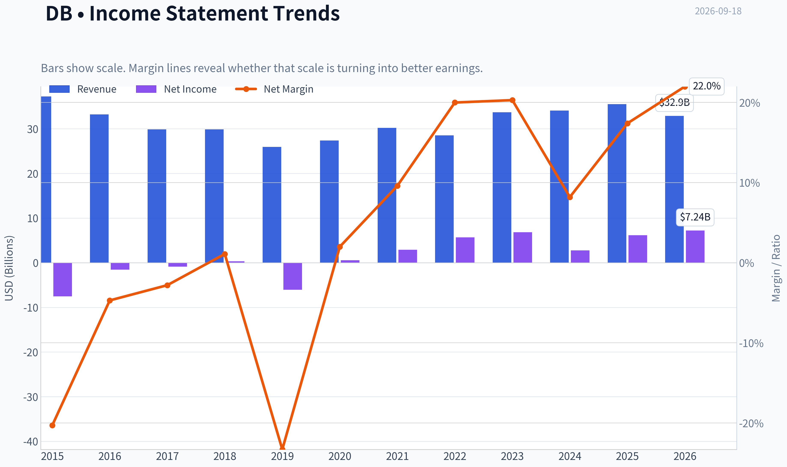

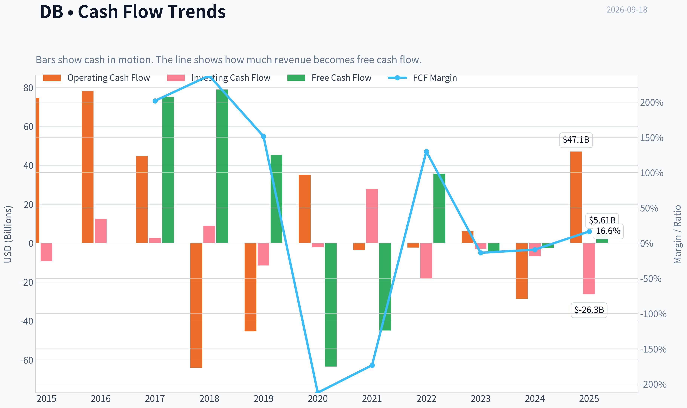

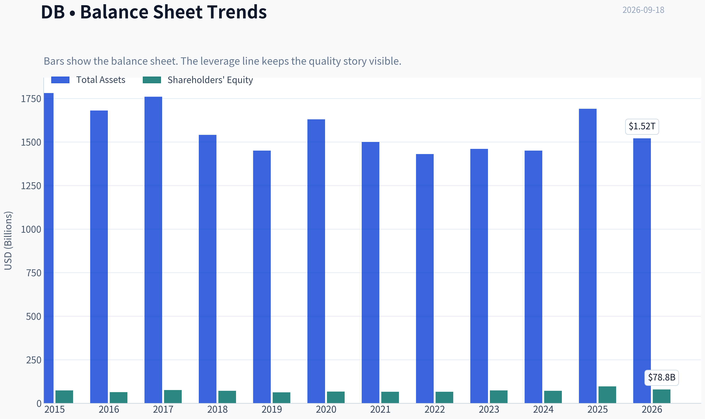

This graph tracks the profitability and return metrics (ROE, ROIC, Margins) of **DB** over the past decade, highlighting capital efficiency trends.

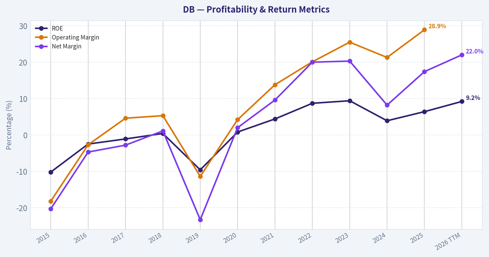

This chart illustrates the financial health of **DB** over the last 10 years, mapping cash equivalents and free cash flow against total obligations (Debt).

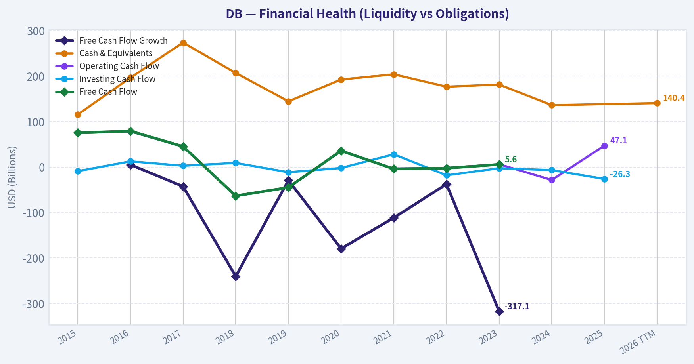

---

### Intrinsic Value Analysis (Buffett)

> *Following Warren Buffett's value investing philosophy: Circle of Competence, Economic Moat, Management Quality, and Margin of Safety.*

#### Intrinsic Value Snapshot

Price is what you pay. Intrinsic value is what the business may be worth based on the cash it can create for owners over time. We show a range, not one magic number.

- Current Price: $37.98
- Value Range (conservative to optimistic across both DCF methods): $13.17 to $352.81

##### Owner Earnings (Buffett Method)
- Net Income: $6,171,000,000.00
- Depreciation & Amortization: N/A
- Capital Expenditures: N/A
- Working Capital Changes: $34,648,000,000.00
- Owner Earnings: $-28,477,000,000.00

##### Intrinsic Value
###### Buffett Method
Uses owner earnings. Stricter, and usually more conservative.
- Conservative: $136.82
- Average: $136.82
- Optimistic: $352.81
- Discount Rate: 10.0%

###### Cash Flow Method
Uses free cash flow. Better for companies spending heavily today to grow tomorrow.
- Conservative: $13.17
- Average: $14.60
- Optimistic: $30.10
- Discount Rate: 10.0%

ANALYST STANCE: **AVOID**

#### Kurzfazit

Deutsche Bank ist eine verständliche, systemrelevante Universalbank mit einer attraktiven Bewertung von etwa 10x PE. Der entscheidende Schwachpunkt ist jedoch die geringe Profitabilität: Eine ROE von nur 6,4% liegt deutlich unter einem überzeugenden langfristigen Kapitalkostenniveau. Bei 38 US-Dollar erscheint die Aktie auf Basis einer vereinfachten Gewinnbewertung nicht eindeutig unterbewertet. Daher lautet das Urteil **AVOID**, obwohl kein finanzieller Notfall vorliegt.

#### 1. Faktor-Scorecard

| Faktor | Bewertung | Begründung |
|---|---:|---|
| Geschäft verstehen und Vorhersagbarkeit | 3,0/5 | Das Geschäftsmodell - Einlagen aufnehmen, Kredite vergeben und Finanzdienstleistungen anbieten - ist grundsätzlich verständlich. Erträge hängen jedoch stark von Zinsen, Kreditzyklen, Regulierung und Kapitalmärkten ab. |
| Wettbewerbsvorteil / Moat | 2,5/5 | Größe, Marke, Kundenbeziehungen und regulatorische Eintrittsbarrieren schaffen einen gewissen Schutz. Die Differenzierung gegenüber anderen Großbanken ist jedoch begrenzt. |
| Management und Kapitalallokation | 3,0/5 | Die Bank hat ihre Strategie und Effizienz über mehrere Jahre verbessert. Die langfristige Erfolgsbilanz bei der Erzielung hoher Renditen bleibt dennoch uneinheitlich. |
| Branchenstruktur | 3,5/5 | Der europäische Bankensektor besitzt hohe regulatorische Eintrittsbarrieren und ist teilweise oligopolistisch. Gleichzeitig bestehen erhebliche Zyklik, politische Eingriffe und intensiver Wettbewerb. |

**Key Takeaways:** Deutsche Bank ist kein unverständliches oder offensichtlich schwaches Unternehmen. Der zentrale Nachteil liegt in der niedrigen Rendite auf das Eigenkapital und der begrenzten strukturellen Differenzierung gegenüber anderen Großbanken. Der harte Solvenz-Boden ist nicht ausgelöst: Es gibt keinen vorliegenden Hinweis auf gleichzeitig stark fallende Erträge und akute finanzielle Notlage.

#### 2. Moat-Analyse

| Moat-Quelle | Einschätzung | Konkrete Evidenz |
|---|---|---|
| Immaterielle Werte | Mittel | Die Marke Deutsche Bank und die regulatorische Zulassung sind wertvoll, erzeugen aber keine uneingeschränkte Preissetzungsmacht. |
| Wechselkosten | Mittel | Firmenkunden, institutionelle Kunden und Zahlungsinfrastrukturen sind teilweise eingebunden. Ein Wechsel ist jedoch bei vielen Bankprodukten möglich. |
| Kostenvorteile | Mittel | Die globale Größe erlaubt Skaleneffekte, wird aber durch hohe regulatorische, Personal- und Compliance-Kosten teilweise aufgezehrt. |
| Netzwerkeffekte | Gering bis mittel | Zahlungs- und Kapitalmarktaktivitäten profitieren von Größe und Liquidität, echte selbstverstärkende Netzwerkeffekte wie bei Plattformunternehmen sind jedoch begrenzt. |

**Moat-Qualität: Schmal bis mittelbreit, etwa 2,5/5.**

**Key Takeaways:** Die wichtigsten Vorteile von Deutsche Bank sind Größe, Regulierung und bestehende Kundenbeziehungen. Diese Vorteile schützen das Geschäft, führen aber nicht automatisch zu dauerhaft hohen Renditen. Der Moat ist daher eher stabilisierend als außergewöhnlich wertschaffend.

#### 3. Finanzielle Zusammenfassung

| Kennzahl | Wert |
|---|---:|
| Aktienkurs | 38,00 US-Dollar |
| Marktkapitalisierung | 71,36 Mrd. US-Dollar |
| PE | 10,0x |
| Impliziter Gewinn je Aktie | ca. 3,79 US-Dollar |
| ROE | 6,4% |
| Umsatzwachstum gegenüber Vorjahr | 4,2% |
| Bruttomarge | Für Banken nicht aussagekräftig |
| FCFF-DCF | Für Finanzinstitute nicht sinnvoll |
| Current Ratio / Quick Ratio | Für Banken nicht aussagekräftig |
| Intrinsischer Wert auf FCFF-Basis | Nicht sinnvoll; bankenspezifische Gewinn- und Buchwertmethoden sind geeigneter |

**Key Takeaways:** Die Aktie wirkt anhand des PE günstig, aber der niedrige PE allein reicht bei einer Bank nicht aus. Eine ROE von 6,4% zeigt, dass die Ertragskraft bislang nur mäßig ist. Bruttomargen, Current Ratio und klassische FCFF-Kennzahlen sollten bei einer Bank nicht wie bei einem Industrieunternehmen interpretiert werden.

#### 4. Owner Earnings und Cashflow-Realität

Bei Banken ist die klassische Buffett-Formel für Owner Earnings nur eingeschränkt anwendbar. Kreditvergabe und Einlagen sind zugleich operative Bestandteile und Finanzierung des Geschäfts; deshalb lassen sich Maintenance CapEx und Working-Capital-Veränderungen nicht sauber wie bei einem Industrieunternehmen isolieren.

Als konservative Näherung wird daher der Gewinn je Aktie verwendet:

| Berechnung | Wert je Aktie |
|---|---:|
| Marktkapitalisierung geteilt durch PE ergibt geschätzten Jahresgewinn | ca. 7,12 Mrd. US-Dollar |
| Geschätzter Gewinn je Aktie | ca. 3,79 US-Dollar |
| Vereinfachter Owner-Earnings-Proxy | ca. 3,79 US-Dollar |
| Owner-Earnings-Rendite zum Kurs von 38 US-Dollar | ca. 10,0% |

**Key Takeaways:** Die Gewinnrendite von rund 10% sieht zunächst attraktiv aus. Sie muss jedoch um die Qualität und Stabilität der Bankgewinne bereinigt werden. Bei einer ROE von nur 6,4% ist der Gewinn-Proxy weniger überzeugend als bei einem Unternehmen, das dauerhaft 15 bis 25% auf das eingesetzte Kapital verdient.

#### 5. Drei-Szenarien-Bewertung

Die folgende Rechnung verwendet den Gewinn je Aktie als bankenspezifischen Ersatz für Owner Earnings. Sie ist deshalb eine Näherung und kein klassischer Industrie-DCF.

| Szenario | Annahme | Ermittelter Wert je Aktie | Verhältnis zum Kurs |
|---|---|---:|---:|
| A: Kein Wachstum | 3,79 US-Dollar / 10% Diskontsatz | 37,90 US-Dollar | praktisch fair bewertet |
| B: GDP-Wachstum | 3% jährliches Wachstum, 10 Jahre, danach Terminalwert | ca. 56,30 US-Dollar | ca. 48% Aufwärtspotenzial |
| C: Historisch angepasst | ca. 3,15% Wachstum, 10 Jahre, danach Terminalwert | ca. 57,00 US-Dollar | ca. 50% Aufwärtspotenzial |

**Key Takeaways:** Die Bewertung reicht von ungefähr fairem Wert im Nullwachstumsszenario bis zu deutlichem Aufwärtspotenzial bei dauerhaftem Wachstum. Das Problem ist, dass die optimistischeren Szenarien eine nachhaltige Verbesserung der Ertragskraft voraussetzen. Bei einer ROE von 6,4% ist diese Verbesserung möglich, aber noch nicht ausreichend bewiesen.

#### 6. Margin of Safety

| Bewertungsmaßstab | Ergebnis |
|---|---:|
| Gegen Szenario A | Keine Sicherheitsmarge |
| Gegen Szenario B | ca. 32% Sicherheitsmarge |
| Gegen Szenario C | ca. 33% Sicherheitsmarge |
| Qualitätsskala | Für eine durchschnittliche, zyklische Bank wären eher 25 bis 35% erforderlich |
| Reverse-DCF-Einschätzung | Der Kurs verlangt kein heroisches Wachstum, kompensiert aber die mäßige Kapitalrendite nicht vollständig |

**Key Takeaways:** Gegen eine wachstumsbasierte Bewertung besteht eine ausreichende Sicherheitsmarge, gegen die konservativste Bewertung jedoch nicht. Da Deutsche Bank keine nachgewiesene Hochrenditebank ist, sollte der Investor eine größere Sicherheitsmarge verlangen als bei einem außergewöhnlichen Compounder. Der aktuelle Kurs ist deshalb eher eine Beobachtungsposition als ein überzeugender Kauf.

#### 7. Management und Kapitalallokation

Die Bank hat in den vergangenen Jahren versucht, die Kostenbasis zu verbessern, das Geschäftsportfolio zu fokussieren und die Kapitalmarktaktivitäten disziplinierter zu steuern. Das spricht für eine gewisse strategische Rationalität.

Für eine höhere Bewertung fehlen jedoch klare Belege für:

- dauerhaft hohe Renditen auf das Eigenkapital,
- eine überdurchschnittlich erfolgreiche Reinvestition einbehaltener Gewinne,
- dauerhaft geringe operative und regulatorische Risiken,
- eine eindeutig überlegene Kapitalallokation gegenüber europäischen Wettbewerbern.

Die jüngste Reduzierung der gemeldeten DB-Position durch Steve Cohen ist kein fundamentaler Beweis, aber ein leicht negatives Sentimentsignal. 13F-Daten sind allerdings zeitverzögerte Momentaufnahmen und für die langfristige Investmentthese nur von begrenzter Bedeutung.

#### 8. Buffett-Final-Scorecard

| Kriterium | Gewicht | Bewertung | Gewichteter Beitrag |
|---|---:|---:|---:|
| Breite und Dauerhaftigkeit des Moats | 25% | 2,5/5 | 0,63 |
| Bewertung und Sicherheitsmarge | 20% | 3,0/5 | 0,60 |
| Kapitalrendite gegenüber WACC | 15% | 2,5/5 | 0,38 |
| Verständnis und Vorhersagbarkeit | 12% | 3,0/5 | 0,36 |
| Management und Kapitalallokation | 12% | 3,0/5 | 0,36 |
| Reinvestitionspotenzial | 8% | 3,0/5 | 0,24 |
| Bilanz- und Solvenzstärke | 4% | 3,0/5 | 0,12 |
| Branchenstruktur | 4% | 3,5/5 | 0,14 |
| **Gesamtergebnis** | **100%** |  | **2,82/5** |

**Key Takeaways:** Deutsche Bank erreicht eine solide, aber nicht überzeugende Punktzahl. Die niedrige ROE belastet sowohl die Kapitalrendite als auch die Qualität des Geschäftsmodells, während der günstige PE nur teilweise ausgleicht. Ein Gesamtergebnis von 2,82 liegt unter der Schwelle für eine attraktive Buffett-Investition.

#### Investment-Stance

**AVOID - Überzeugungsgrad: mittel**

Deutsche Bank ist nicht wegen akuter Insolvenzgefahr abzulehnen, sondern wegen der Kombination aus mäßiger Kapitalrendite, zyklischer Ertragsqualität und fehlender klarer Sicherheitsmarge im konservativen Bewertungsfall. Die Aktie könnte bei einer nachhaltigen Verbesserung der ROE deutlich attraktiver werden. Für einen langfristigen Qualitätsinvestor wäre ein deutlich niedrigerer Einstiegskurs oder ein überzeugender Nachweis dauerhaft höherer Renditen erforderlich.
#### Valuation Bridge

This bridge places the current market price beside each intrinsic value lens so readers can see whether upside depends on one method or shows up across several methods.

| Scenario | Intrinsic Value / Share |
| --- | ---: |
| Buffett Method | $136.82 |
| Cash Flow Method | $14.60 |
| Current Price | $37.98 |

#### Key Takeaways

If one method is far above the others, the upside case depends on a specific modelling assumption. When several methods cluster together, the valuation story is more robust.

#### Valuation Visuals

This comparison chart from *Latest Earnings Snapshot* stacks current figures against historical benchmarks for **DB**, making it easy to see where the company trades relative to its own averages.

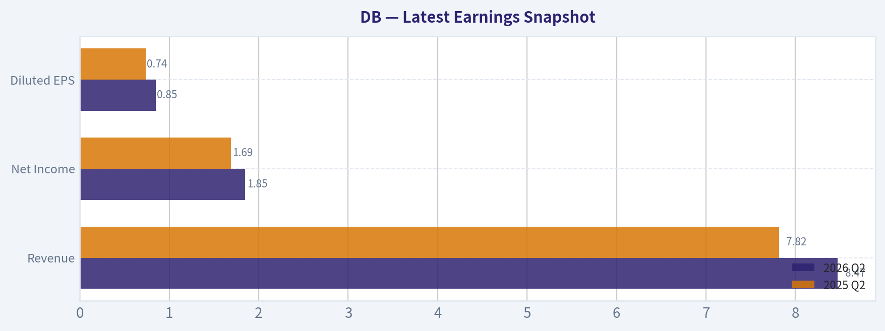

This comparison chart from *Buffett-Style Owner-Earnings-DCF* stacks current figures against historical benchmarks for **DB**, making it easy to see where the company trades relative to its own averages.

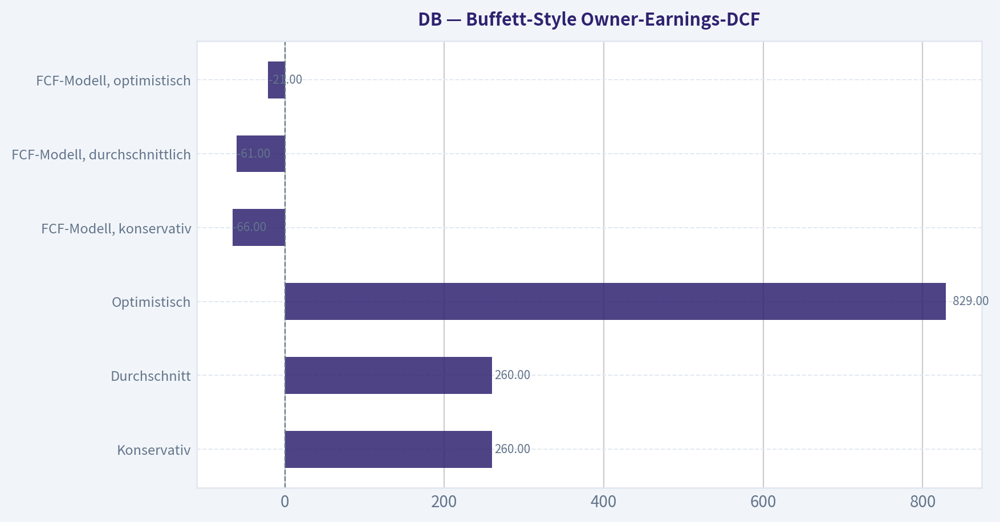

This comparison chart from *Finanzielle Zusammenfassung* stacks current figures against historical benchmarks for **DB**, making it easy to see where the company trades relative to its own averages.

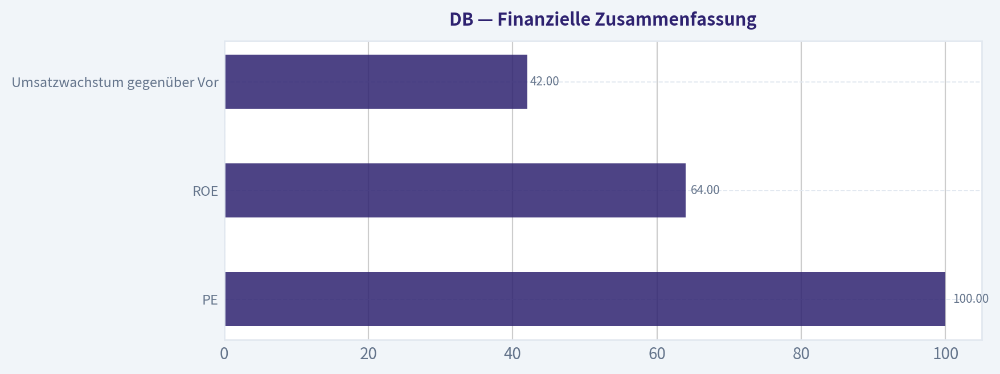

The following chart maps the **DB** Owner Earnings DCF valuation scenarios (Conservative, Average, Optimistic) to visually represent the margin of safety based on intrinsic value calculations.

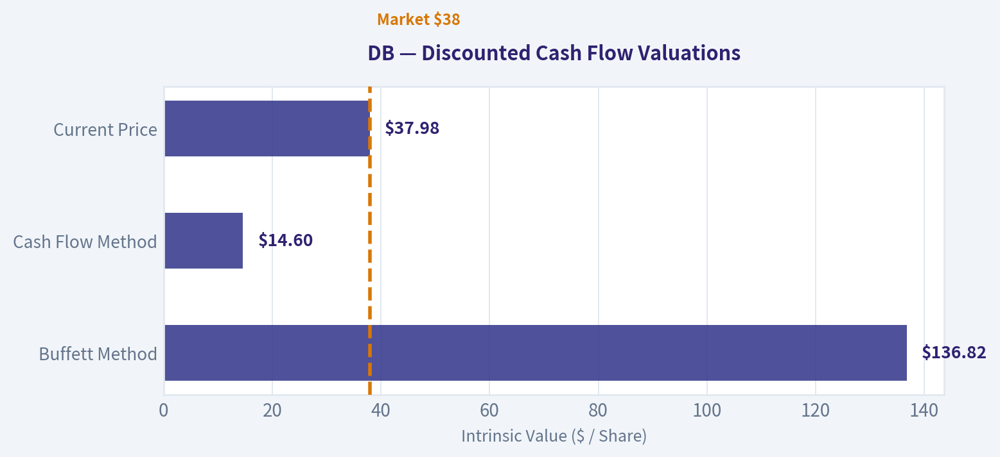

This comparison chart from *Lynch-Klassifikation* stacks current figures against historical benchmarks for **DB**, making it easy to see where the company trades relative to its own averages.

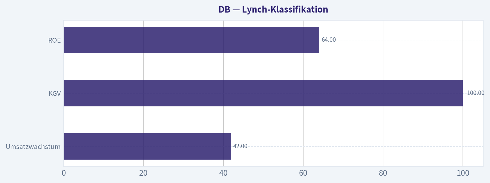

---

### Trend & Growth Analysis (Lynch/Druckenmiller/Fisher)

> *Following Peter Lynch's GARP, Stanley Druckenmiller's macro-aware approach, and Philip Fisher's scuttlebutt methodology.*

ANALYST STANCE: **WATCH**

#### Kurzfazit

Deutsche Bank ist ein **Stalwart beziehungsweise zyklischer Finanzwert**, kein klassischer Fast Grower. Das Unternehmen ist profitabel und mit einem KGV von rund 10 moderat bewertet, aber das Umsatzwachstum von 4,2 % liegt deutlich unter der für einen möglichen Tenbagger nötigen Größenordnung. Für eine überzeugende Neubewertung fehlen derzeit sichtbare Beschleunigung bei Erträgen, Kapitalrendite und Marktanteilen.

#### 1. Lynch-Klassifikation

| Kriterium | Einschätzung |
|---|---:|
| Kategorie | Stalwart / zyklischer Finanzwert |
| Umsatzwachstum | 4,2 % |
| KGV | 10,0 |
| ROE | 6,4 % |
| Tenbagger-Potenzial | Derzeit begrenzt |
| Primäre Investmentthese | Günstige Bewertung plus mögliche operative Verbesserung |

**Wichtigste Erkenntnisse:** Deutsche Bank wächst derzeit langsam und erfüllt damit nicht Lynchs Fast-Grower-Kriterium von etwa 15-25 % oder mehr. Die niedrige Bewertung bietet einen gewissen Schutz, ist aber allein kein Beweis für einen bevorstehenden Wachstumsschub.

#### 2. Die Geschichte in drei Punkten

1. Deutsche Bank ist ein global diversifizierter Bankkonzern mit starkem Firmenkunden-, Investmentbanking- und Asset-Management-Geschäft.
2. Ein höheres Zinsniveau kann die Zinserträge stützen, während eine bessere Kostenkontrolle die Profitabilität steigern könnte.
3. Die Aktie erscheint günstig, doch die aktuelle Wachstumsrate und ein ROE von nur 6,4 % zeigen noch keine überzeugende operative Inflektion.

#### 3. TAM und 10x-Test

Bei Banken ist der adressierbare Markt kein einzelner schnell wachsender Produktmarkt, sondern das Volumen von Unternehmenskrediten, Kapitalmarktgeschäften, Zahlungsverkehr, Vermögensverwaltung und Privatkundengeschäft.

| Aspekt | Einschätzung |
|---|---|
| Marktgröße | Sehr groß und global |
| Marktwachstum | Typischerweise niedrig bis moderat, abhängig von Wirtschaft und Kreditzyklus |
| 10x-Umsatztest | Formal bestanden: Der globale Finanzmarkt ist groß genug |
| Praktische Begrenzung | Regulierung, Kapitalanforderungen und intensiver Wettbewerb |
| TAM-Inflektion | Nicht nachgewiesen |

**Wichtigste Erkenntnisse:** Deutsche Bank könnte theoretisch den Umsatz vervielfachen, ohne einen großen Teil des globalen Finanzmarktes zu kontrollieren. Das Problem ist nicht die Marktgröße, sondern dass Bankenwachstum kapitalintensiv, zyklisch und meist deutlich langsamer als Software- oder Technologiewachstum ist.

#### 4. Umsatz- und Wachstumstrend

| Kennzahl | Wert | Interpretation |
|---|---:|---|
| Umsatzwachstum gegenüber Vorjahr | 4,2 % | Stalwart-Niveau |
| Beschleunigung | Nicht belegt | Keine erkennbare Inflektion |
| Profitabilität | Positiv | KGV von etwa 10 |
| ROE | 6,4 % | Für eine starke Bank eher niedrig |
| Umsatzqualität | Nicht ausreichend aufgeschlüsselt | Segment- und zyklusabhängig |

**Wichtigste Erkenntnisse:** Das Wachstum ist positiv, aber langsam. Ohne mehrere Quartale mit steigenden Erträgen, höherem ROE und besserer Kosteneffizienz bleibt die These eine mögliche operative Erholung und kein bestätigter Wachstumstrend.

#### 5. Unit Economics und Effizienz

| Kennzahl | Einschätzung |
|---|---|
| LTV/CAC | Nicht sinnvoll verfügbar; kein klassisches SaaS-Modell |
| NRR | Nicht anwendbar |
| Rule of 40 | Nicht anwendbar |
| Relevante Bankkennzahlen | ROE, Aufwand-Ertrag-Verhältnis, CET1-Kapitalquote, Kreditqualität |
| ROE | 6,4 % |
| Kapitalintensität | Hoch |

**Wichtigste Erkenntnisse:** Für Deutsche Bank sind ROE, Kostenquote, Kreditverluste und Kapitalausstattung wichtiger als LTV/CAC oder NRR. Der ROE von 6,4 % signalisiert, dass die Bank ihr Kapital aktuell nicht außergewöhnlich produktiv einsetzt.

#### 6. Inflektionspunkt-Analyse

| Potenzieller Katalysator | Status | Bedeutung |
|---|---|---|
| Höhere Zinsen | Teilweise vorhanden | Kann Nettozinserträge unterstützen |
| Operativer Hebel | Möglich, aber nicht bestätigt | Würde ROE und Gewinn stärker erhöhen |
| Marktanteilsgewinne | Nicht belegt | Erforderlich für nachhaltige Neubewertung |
| Investmentbanking-Zyklus | Zyklisch | Kann Gewinne sprunghaft verändern |
| Digitale Vermögensverwaltung / Krypto-Verwahrung | Frühes Stadium | Interessant, aber noch kein materieller Wachstumstreiber |
| Kapitalrückführungen | Potenziell positiv | Unterstützen den Gewinn je Aktie |

**Wichtigste Erkenntnisse:** Der wichtigste mögliche Wendepunkt wäre eine Kombination aus steigenden Erträgen und sinkender Kostenbasis. Die geplante institutionelle Krypto-Verwahrung ist strategisch interessant, aber aktuell zu klein, um die Gesamtthese zu verändern.

#### 7. Makro-Setup

Das Makrobild ist gemischt. Ein höheres Zinsniveau kann Banken bei der Zinsmarge helfen, erhöht aber zugleich Refinanzierungsrisiken, Kreditausfälle und Bewertungsdruck auf Anleihen. Ein schwächeres Wirtschaftswachstum würde besonders das Firmenkundengeschäft und Investmentbanking belasten.

| Makrofaktor | Wirkung auf Deutsche Bank |
|---|---|
| Höhere Zinsen | Kurzfristig positiv für Zinserträge, langfristig gemischt |
| Konjunkturabschwächung | Negativ für Kredite und Investmentbanking |
| Kapitalmarktaktivität | Positiv bei höherem Emissions- und M&A-Volumen |
| Regulierung | Struktureller Gegenwind |
| Inflation | Gemischt: höhere Zinsen, aber höhere Kosten |
| Makro-Wind | Neutral bis leicht positiv |

**Wichtigste Erkenntnisse:** Das Makro liefert keinen klaren Rückenwind wie bei einem frühen Konjunkturaufschwung. Die Aktie bleibt stark vom Zins-, Kredit- und Kapitalmarktzyklus abhängig.

#### 8. Fisher-Analyse

| Fisher-Punkt | Bewertung von 1-5 |
|---|---:|
| Marktpotenzial | 4 |
| Entwicklung neuer Produkte | 3 |
| R&D / Technologie | 3 |
| Vertriebsorganisation | 4 |
| Gewinnmargen | 3 |
| Margenverbesserung | 3 |
| Mitarbeiterbeziehungen | 3 |
| Beziehungen der Führungsebene | 3 |
| Managementtiefe | 4 |
| Kostenrechnung und Kontrolle | 3 |
| Wettbewerbsvorteile | 3 |
| Langfristige Gewinnaussichten | 3 |
| Verwässerungsrisiko | 4 |
| Offenheit bei Problemen | 3 |
| Integrität des Managements | 3 |
| **Gesamt** | **49/75** |

**Wichtigste Erkenntnisse:** Die Bank verfügt über Größe, Kundenbeziehungen und Managementtiefe, aber die strukturellen Wettbewerbsvorteile sind weniger stark als bei einem hochwertigen Technologieunternehmen. Mit 49 von 75 Punkten liegt Deutsche Bank im durchschnittlichen Bereich und nicht in Fishers Kategorie eines herausragenden Wachstumsunternehmens.

#### 9. Bewertung

**PEG:**
KGV 10,0 geteilt durch ein Wachstum von 4,2 % ergibt einen PEG von ungefähr **2,4**. Das ist nach Lynchs Maßstab teuer relativ zum tatsächlichen Wachstum, obwohl das absolute KGV niedrig aussieht.

| Szenario | Annahme | Bewertungseinschätzung |
|---|---|---|
| Bärisch | Erträge stagnieren, ROE bleibt niedrig | KGV bleibt niedrig oder sinkt |
| Basis | Niedriges einstelliges Wachstum, moderate Margenverbesserung | Faire bis leicht günstige Bewertung |
| Bullisch | Ertragsbeschleunigung, höherer ROE, stabile Kreditqualität | Deutliches Aufwärtspotenzial durch Neubewertung |
| Tenbagger-Szenario | Mehrjährige sehr hohe Gewinnsteigerungen | Für eine reife Großbank wenig wahrscheinlich |

**Wichtigste Erkenntnisse:** Die Aktie ist auf absoluter KGV-Basis günstig, aber nicht offensichtlich günstig im Verhältnis zum Wachstum. Das Aufwärtspotenzial hängt primär von einer Verbesserung des ROE und einer nachhaltigen Gewinnbeschleunigung ab, nicht von starkem Umsatzwachstum.

#### 10. Wachstum-Investoren-Scorecard

| Kriterium | Gewicht | Bewertung |
|---|---:|---:|
| Verständlichkeit der Story | 10 % | 3,0 |
| TAM und Wachstumsspielraum | 20 % | 3,5 |
| Umsatzwachstum | 20 % | 2,0 |
| Unit Economics / Effizienz | 15 % | 2,5 |
| Wettbewerbsposition | 10 % | 3,0 |
| Managementqualität | 10 % | 3,0 |
| Makro-Setup | 5 % | 3,0 |
| Profitabilitätspfad | 5 % | 3,0 |
| Bewertung | 5 % | 3,5 |
| **Gesamtergebnis** | **100 %** | **2,9/5,0** |

**Wichtigste Erkenntnisse:** Die günstige Bewertung und die große Marktposition werden durch langsames Wachstum, niedrigen ROE und zyklische Risiken ausgeglichen. Mit 2,9 von 5,0 Punkten gehört Deutsche Bank in die Kategorie **WATCH**, nicht in eine hochkonzentrierte Wachstumsposition.

#### 11. Positionsgröße

- **Neue Position:** keine aggressive Eröffnung; höchstens eine kleine Beobachtungsposition.
- **Orientierungsgröße:** etwa **0-1 %** eines wachstumsorientierten Portfolios, bis eine operative Inflektion bestätigt ist.
- **Bestehende Position:** Halten ist vertretbar, sofern die ursprüngliche These auf Erholung, Bewertung und Kapitalrückführung beruht.
- **Nicht geeignet für:** eine reine Tenbagger- oder Fast-Grower-Strategie.

#### 12. Risiken und Katalysatoren

| Risiken | Katalysatoren |
|---|---|
| Schwache europäische Konjunktur | Steigende Erträge über mehrere Quartale |
| Kreditausfälle und höhere Risikovorsorge | ROE-Anstieg deutlich über 10 % |
| Regulierung und höhere Kapitalanforderungen | Sinkende Aufwand-Ertrag-Quote |
| Rückgang der Investmentbanking-Aktivität | Höhere Kapitalrückführungen |
| Stagnierendes Umsatzwachstum | Marktanteilsgewinne in Firmenkunden- und Vermögensverwaltung |
| Zinswende nach unten | Erfolgreicher Ausbau digitaler und institutioneller Angebote |

**Wichtigste Erkenntnisse:** Der entscheidende Katalysator wäre nicht ein einzelnes gutes Quartal, sondern eine nachhaltige Verbesserung von ROE, Kostenquote und Ertragswachstum. Die größten Risiken liegen in einer konjunkturellen Verschlechterung, steigenden Kreditverlusten und dem Ausbleiben dieser operativen Verbesserung.

#### Schlussurteil

Deutsche Bank ist derzeit eine **günstig bewertete, aber nur langsam wachsende zyklische Bank**. Sie kann bei einer erfolgreichen operativen Verbesserung eine solide Neubewertung erfahren, erfüllt jedoch weder die Wachstums- noch die Innovationskriterien für einen überzeugenden Tenbagger. Die richtige Haltung lautet daher: **beobachten und auf eine bestätigte Ertrags- und ROE-Inflektion warten**.

#### Growth & Scorecard Visuals

This comparison chart from *Buffett-Final-Scorecard* stacks current figures against historical benchmarks for **DB**, making it easy to see where the company trades relative to its own averages.

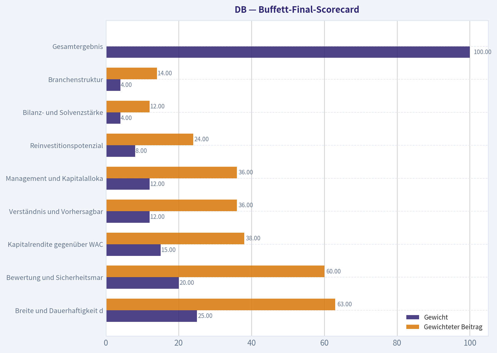

---

### Market Technical Analysis

ANALYST STANCE: **WATCH**

#### Deutsche Bank - technische Einschätzung

Die Analyse basiert auf den verfügbaren Kursdaten bis **17. September 2026**; der 18. September ist in den abgerufenen Daten kein Handelstag. Der Schlusskurs lag zuletzt bei **39,05 USD**. Das technische Bild ist klar zweigeteilt: Der übergeordnete Trend bleibt konstruktiv, während die kurzfristige Dynamik nach dem Rückgang vom September-Hoch deutlich abgekühlt ist.

#### Trendstruktur und gleitende Durchschnitte

Der langfristige Trend ist weiterhin positiv. Der Kurs liegt mit 39,05 USD deutlich über der **200-Tage-SMA bei 34,55 USD**. Diese Differenz von rund 13 Prozent signalisiert, dass die mehrmonatige Aufwärtsbewegung trotz der jüngsten Korrektur noch nicht gebrochen ist. Zudem steigt die 200-Tage-SMA langsam weiter an, was den strukturellen Aufwärtstrend bestätigt.

Auch die mittelfristige Trendstruktur bleibt grundsätzlich bullish: Die **50-Tage-SMA liegt bei 37,87 USD**, und der Kurs befindet sich noch rund 3,1 Prozent darüber. Die 50-Tage-SMA steigt ebenfalls, allerdings ist der Abstand zum Kurs deutlich kleiner als zuvor. Dadurch wird diese Durchschnittslinie zu einer wichtigen kurzfristigen Unterstützungszone. Ein nachhaltiger Schlusskurs darunter würde das mittelfristige Bild merklich eintrüben.

Die **10-Tage-EMA bei 39,54 USD** liegt hingegen über dem aktuellen Kurs. Das zeigt, dass der kurzfristige Impuls nach unten gerichtet ist. Besonders relevant ist der Verlauf: Die 10-Tage-EMA fiel von über 40,21 USD am 14. September auf 39,54 USD am 17. September. Der Kurs notiert damit unter seinem kurzfristigen Trendfilter, aber weiterhin über den mittleren und langfristigen Filtern. Das spricht eher für eine laufende Korrektur innerhalb eines übergeordneten Aufwärtstrends als für einen bereits bestätigten langfristigen Trendwechsel.

#### Momentum: MACD und RSI

Der **MACD liegt mit 0,397 weiterhin im positiven Bereich**. Das bedeutet, dass die mittelfristige EMA-Struktur noch zugunsten der Käufer ausgerichtet ist. Allerdings ist der MACD deutlich von 1,147 Anfang September zurückgegangen. Das positive Momentum verliert also an Stärke.

Noch aussagekräftiger ist das **MACD-Histogramm**, das zuletzt bei **minus 0,348** lag. Es ist seit dem 9. September unter null gefallen und hat sich zuletzt weiter verschlechtert. Damit liegt die MACD-Linie unter ihrer Signallinie; kurzfristig dominieren folglich die Verkäufer. Solange der MACD selbst über null bleibt, ist dies zunächst als nachlassendes Momentum innerhalb eines noch positiven mittelfristigen Trends zu interpretieren. Ein Fall des MACD unter die Nulllinie würde die technische Lage deutlich schwächer machen.

Der **RSI liegt bei 49,4** und damit praktisch im neutralen Bereich. Anfang September war der RSI mit über 72 klar überkauft, worauf die aktuelle Abkühlung folgte. Der Rückgang auf knapp 49 zeigt, dass die überhitzte Situation vollständig abgebaut wurde. Positiv ist, dass der RSI noch nicht im überverkauften Bereich unter 30 liegt; negativ ist jedoch, dass er von einem starken Aufwärtsmomentum in eine neutrale beziehungsweise leicht schwache Zone gefallen ist. Für einen neuen belastbaren Aufwärtsimpuls müsste der RSI zunächst wieder über 50 steigen und idealerweise anschließend den Bereich von 60 zurückerobern.

#### Volatilität und Risikomanagement

Der **ATR liegt bei etwa 0,76 USD**. Bezogen auf den Kurs entspricht das einer durchschnittlichen täglichen Handelsspanne von knapp 2 Prozent. Die Volatilität ist gegenüber Anfang September gestiegen, als der ATR noch etwa 0,65 bis 0,70 USD betrug. Dies passt zum jüngsten Rückgang von 41,56 USD auf zwischenzeitlich 38,36 USD.

Für das Risikomanagement bedeutet dies, dass enge Stop-Loss-Marken anfällig für kurzfristiges Ausstoppen sind. Ein Abstand von beispielsweise nur 0,30 oder 0,40 USD wäre angesichts eines ATR von 0,76 USD relativ knapp. Positionsgrößen sollten daher eher reduziert oder Stopps volatilitätsangepasst gesetzt werden.

Der **Bollinger-Mittelwert liegt bei 39,73 USD**. Der aktuelle Kurs befindet sich knapp darunter. Das ist ein kurzfristig leicht negatives Signal, weil der Kurs seine 20-Tage-Benchmark verloren hat. Gleichzeitig liegt der Kurs nicht deutlich unter diesem Mittelwert. Es handelt sich daher eher um eine moderate Schwäche als um einen bestätigten Ausbruch nach unten. Die Bollinger-Bänder selbst wurden nicht separat abgerufen; deshalb lässt sich kein verlässliches Urteil über eine mögliche Bandbreitenverengung oder einen Extremkontakt treffen.

#### Entscheidungszonen und mögliche Szenarien

Auf der Oberseite ist zunächst die Zone um **39,50 bis 39,75 USD** entscheidend. Sie umfasst die 10-Tage-EMA und den Bollinger-Mittelwert. Eine Rückeroberung dieser Zone würde anzeigen, dass die kurzfristigen Käufer wieder Kontrolle gewinnen. Ein anschließender Anstieg über **40,50 bis 41,00 USD** wäre ein stärkeres Bestätigungssignal; das September-Hoch bei etwa **41,56 USD** bildet den nächsten markanten Widerstand.

Auf der Unterseite ist die **50-Tage-SMA bei rund 37,87 USD** die wichtigste mittelfristige Unterstützung. Solange diese Linie hält, bleibt die Interpretation „Korrektur innerhalb eines Aufwärtstrends" plausibel. Ein Tagesschluss deutlich unter 37,87 USD, insbesondere begleitet von hohem Volumen, würde hingegen das Risiko eines Rücklaufs in Richtung **36 bis 35 USD** erhöhen. Die 200-Tage-SMA bei etwa 34,55 USD bleibt die strategische Trendgrenze und liegt deutlich tiefer.

Das bevorzugte technische Urteil lautet daher **WATCH**: Kein überzeugendes neues Kaufsignal, aber auch noch kein bestätigter langfristiger Ausstieg. Für trendfolgende Anleger wäre eine Rückkehr über 39,50 bis 39,75 USD mit verbessertem MACD-Histogramm ein sinnvolleres Bestätigungssignal. Defensivere Anleger sollten vor einer Positionierung den Test der 50-Tage-SMA abwarten und auf eine Stabilisierung des RSI achten.

#### Ausgewählte Indikatoren

Verwendet wurden acht komplementäre Indikatoren: **10-Tage-EMA, 50-Tage-SMA, 200-Tage-SMA, MACD, MACD-Histogramm, RSI, ATR und Bollinger-Mittelwert**. Die gleitenden Durchschnitte messen drei Zeithorizonte, MACD und Histogramm trennen Trendmomentum von dessen Beschleunigung, RSI ergänzt die Überhitzungsanalyse, während ATR das Risiko quantifiziert. Der Bollinger-Mittelwert liefert zusätzlich einen kurzfristigen Referenzwert, ohne die Analyse durch die drei stark miteinander verbundenen Bollinger-Komponenten unnötig zu überladen.

| Bereich | Aktueller Wert | Technische Aussage | Relevanz für Händler |
|---|---:|---|---|
| Schlusskurs | 39,05 USD | Unter kurzfristigen Referenzwerten, aber über 50- und 200-Tage-SMA | Korrektur, langfristiger Aufwärtstrend noch intakt |
| 10-Tage-EMA | 39,54 USD | Kurs liegt darunter; kurzfristiger Trend schwach | Rückeroberung wäre erstes Erholungssignal |
| 50-Tage-SMA | 37,87 USD | Steigend und noch unter dem Kurs | Zentrale mittelfristige Unterstützung |
| 200-Tage-SMA | 34,55 USD | Steigend und weit unter dem Kurs | Strategischer Aufwärtstrend bleibt bestätigt |
| MACD | 0,397 | Positiv, aber stark rückläufig | Mittelfristig noch konstruktiv, Momentum verliert Kraft |
| MACD-Histogramm | -0,348 | Unter null und zuletzt schwächer | Kurzfristige Verkäuferkontrolle bestätigt |
| RSI | 49,4 | Neutral, nach Überkauftheit deutlich abgekühlt | Noch kein überverkauftes Erholungssignal |
| ATR | 0,76 USD | Erhöhte tägliche Schwankungsbreite | Positionsgröße und Stopps anpassen |
| Bollinger-Mittelwert | 39,73 USD | Kurs knapp darunter | Kurzfristige Schwäche, aber kein extremer Ausbruch |
| Wichtigster Widerstand | 40,50-41,56 USD | Bereich des jüngsten Hochs | Breakout darüber würde Trendfortsetzung bestätigen |
| Wichtigste Unterstützung | 37,87 USD | 50-Tage-SMA | Bruch würde das mittelfristige Bild verschlechtern |

**Key Takeaways:** Deutsche Bank befindet sich weiterhin über den wichtigen 50- und 200-Tage-Durchschnitten, sodass der übergeordnete Trend positiv bleibt. Kurzfristig sprechen der Kurs unter der 10-Tage-EMA, das negative MACD-Histogramm und der neutrale RSI jedoch für eine laufende Korrektur. Die Zone um 37,87 USD ist die zentrale Unterstützung; eine Rückeroberung von 39,50 bis 39,75 USD wäre nötig, um das kurzfristige Bild wieder zu verbessern.

---

### Options Market Analysis

> *Reading options flow - put/call ratios, IV skew, and unusual activity - to gauge institutional positioning and event-driven risk.*

ANALYST STANCE: **BEFÜRWORTEN**

#### Optionsanalyse für Deutsche Bank (DB)

Stand: 18. September 2026. Die verfügbaren Daten decken die nahen Verfalltermine 18. September 2026, 16. Oktober 2026 und 15. Januar 2027 ab.

#### 1. Put/Call-Verhältnis

| Verfall | Call-OI | Put-OI | Put/Call-OI | Call-Volumen | Put-Volumen | Put/Call-Volumen |
|---|---:|---:|---:|---:|---:|---:|
| 18.09.2026 | 8.587 | 7.271 | 0,85 | 1.966 | 1.038 | 0,53 |
| 16.10.2026 | 9.870 | 6.909 | 0,70 | 4.912 | 1.269 | 0,26 |
| 15.01.2027 | 26.959 | 20.046 | 0,74 | 205 | 216 | 1,05 |
| **Gesamt** | **45.416** | **34.226** | **0,75** | **7.083** | **2.523** | **0,36** |

**Key Takeaways:** Das Gesamt-Put/Call-OI-Verhältnis von 0,75 liegt leicht über dem historischen Neutralwert von etwa 0,70, signalisiert aber weiterhin eine call-lastige Positionierung. Besonders der Oktober-Verfall weist mit einem Volumenverhältnis von 0,26 deutlich mehr Call- als Put-Aktivität auf. Das spricht kurzfristig eher für bullische Spekulation oder Covered-Call-Strukturen als für aggressives Abwärtshedging.

#### 2. Implizite Volatilität

| Verfall | ATM-IV Calls | ATM-IV Puts | Differenz Calls minus Puts | Einordnung |
|---|---:|---:|---:|---|
| 18.09.2026 | 127,1 % | 103,4 % | +23,7 Prozentpunkte | Extrem erhöht, durch Verfallstag und kurzfristige Nachfrage verzerrt |
| 16.10.2026 | 35,4 % | 32,1 % | +3,3 Prozentpunkte | Moderat erhöht, leichte Call-Prämie |
| 15.01.2027 | 39,3 % | 32,9 % | +6,4 Prozentpunkte | Erhöht, ebenfalls Call-seitig geprägt |

**Key Takeaways:** Die extrem hohe IV am heutigen Verfallstag ist nicht ohne Weiteres als nachhaltige Risikoerwartung interpretierbar und dürfte stark von der Restlaufzeit nahe null beeinflusst sein. Für Oktober und Januar liegt die Call-IV jeweils über der Put-IV, was eher auf Nachfrage nach Aufwärtspositionierung als auf ausgeprägte Abwärtsangst hindeutet. Eine echte OTM-Put-gegen-OTM-Call-Skew ist in den gelieferten Daten nicht enthalten; die Schlussfolgerung zur Skew bleibt daher eingeschränkt.

Eine bekannte bevorstehende Unternehmens- oder Makroveranstaltung wurde in den Daten nicht angegeben. Die hohe kurzfristige IV sollte deshalb nicht automatisch einem Earnings- oder Nachrichtenereignis zugeschrieben werden.

#### 3. Ungewöhnliche Optionsaktivität

| Kriterium | Ergebnis |
|---|---|
| Kontrakte mit Volumen größer als dem Fünffachen des Open Interest | Keine gefunden |
| Frische, klar erkennbare Richtungswetten | Nicht identifiziert |
| Nachweisbare institutionelle Sweeps oder Block-Trades | Nicht verfügbar |
| Aussagekraft der Aktivitätsanalyse | Begrenzt |

**Key Takeaways:** Es wurden keine Kontrakte mit außergewöhnlichem Volumen relativ zum Open Interest gefunden. Damit fehlt ein eindeutiger Beleg für aggressive institutionelle Einzelwetten, etwa einen großen Put-Hedge oder einen spekulativen Call-Kauf. Das bullische Signal stammt primär aus der breiten Call-Volumenüberlegenheit, nicht aus einer einzelnen ungewöhnlichen Transaktion.

#### 4. Open-Interest-Konzentration und mögliche Gamma-Niveaus

| Verfall | Call-OI | Put-OI | Gesamt-OI | Bedeutung |
|---|---:|---:|---:|---|
| 18.09.2026 | 8.587 | 7.271 | 15.858 | Kurzfristige Positionierung, aber am Verfallstag stark auslaufend |
| 16.10.2026 | 9.870 | 6.909 | 16.779 | Wichtigster naher Termin für die kurzfristige Preisbindung |
| 15.01.2027 | 26.959 | 20.046 | 47.005 | Größte absolute Positionierung und potenziell stärkster längerfristiger OI-Anker |

**Key Takeaways:** Der Januar-Verfall enthält mit 47.005 Kontrakten das mit Abstand größte Open Interest und dürfte deshalb der wichtigste längerfristige Positionsanker sein. Für die unmittelbare Kursentwicklung ist Oktober relevanter, da dort das Volumen deutlich höher ist. Konkrete Strike-Daten wurden nicht geliefert; deshalb lassen sich weder Max-Pain-Niveaus noch einzelne Gamma-Walls oder deren genaue Unterstützungs- und Widerstandswirkung bestimmen.

#### 5. Gesamtsignal

Das Optionsbild für DB ist **moderat bullisch**, jedoch nicht stark genug für ein uneingeschränkt aggressives Signal.

Der wichtigste Treiber ist:

- Gesamt-Put/Call-Volumenverhältnis von nur 0,36.
- Starkes Call-Übergewicht im Oktober, dem wichtigsten kurzfristigen Folgeverfall.
- ATM-IV bei Oktober und Januar jeweils höher für Calls als für Puts.
- Gesamt-Put/Call-OI von 0,75: leicht über dem Neutralwert, aber weiterhin unter 1,0.

Gegen eine sehr starke bullische Interpretation sprechen das fehlende ungewöhnliche Einzelvolumen und die nur begrenzte Liquidität im Januar-Verfall. Außerdem kann das hohe Call-Volumen sowohl echte bullische Käufe als auch Covered-Call-Verkäufe enthalten. Die Daten belegen daher eine positive kurzfristige Positionierung, aber keine eindeutig aggressive institutionelle Aufwärtswette.

| Kategorie | Bewertung |
|---|---|
| Put/Call-OI | 0,75 gesamt; leicht über neutral, aber weiterhin call-lastig |
| Put/Call-Volumen | 0,36; deutliches Übergewicht der Call-Aktivität |
| IV-Niveau | Oktober und Januar moderat bis erhöht; September extrem und verfallsbedingt verzerrt |
| Skew-Richtung | Leicht call-seitig; echte OTM-Skew nicht verfügbar |
| Ungewöhnliche Aktivität | Keine Kontrakte mit Volumen größer als dem Fünffachen des OI |
| Open-Interest-Schwerpunkt | Januar 2027 absolut am größten; Oktober kurzfristig am relevantesten |
| Gesamtsignal | **BULLISCH, mit moderater Überzeugung** |

**Key Takeaways:** DB zeigt ein moderat bullisches Optionsprofil, vor allem wegen des starken Call-Übergewichts im kurzfristigen Handelsvolumen und der leicht call-seitigen IV-Struktur. Es gibt jedoch keine ungewöhnliche Einzeltransaktion und keine verfügbaren Strike-Daten zur Bestätigung institutioneller Gamma- oder Max-Pain-Niveaus. Das Signal sollte daher als konstruktiv, aber nicht als starkes oder risikofreies Kaufsignal interpretiert werden.

---

## Research Team Commentary

> *The Research Manager synthesizes the Bull vs Bear debate into action-free commentary. This is a pre-risk view, not the final stance.*

Kernergebnis: Deutsche Bank ist eine glaubwürdige Normalisierungsstory, aber noch kein nachgewiesener Qualitäts-Compounder. Der Kurs von rund 38-39 US-Dollar erscheint nicht eindeutig überzogen, setzt jedoch bereits voraus, dass die Eigenkapitalrendite von aktuell 6,4 % in Richtung 9-10 % steigt. Da die Aktie gegenüber dem bullischen Wertansatz von etwa 41-43 US-Dollar nur rund 5-13 % Abschlag bietet, fehlt für eine komplexe, zyklische und regulierte Bank der angemessene Sicherheitspuffer. Das spricht weder für einen Kauf noch für ein hartes Meiden, sondern für geduldiges Beobachten.

Das stärkste Argument der Bullen ist die vorhandene Franchise. Deutsche Bank verfügt über schwer replizierbare Lizenzen, globale Infrastruktur, etablierte Firmenkundenbeziehungen und integrierte Dienstleistungen in Zahlungsverkehr, Liquiditätsmanagement, Devisenhandel und Kapitalmarktfinanzierung. Diese Beziehungen erzeugen reale Wechselkosten, auch wenn Großkunden ihre Aufträge auf mehrere Banken verteilen können. Corporate Bank, Investment Bank, Private Bank und DWS sorgen zudem für mehrere Ertragsquellen.

Auch die Bewertung verlangt keine Entwicklung zu JPMorgan-ähnlicher Qualität. Bei rund 10-fachem Gewinn reicht grundsätzlich eine moderate Verbesserung von Kosten, Geschäftsmix und Kapitalallokation, um den Gewinn schneller als die zuletzt gemeldeten 4,2 % Umsatzwachstum steigen zu lassen. Das ist keine heroische Umsatzannahme. Gelingt eine nachhaltige Eigenkapitalrendite von mindestens 9-10 %, bleiben Kreditverluste kontrolliert und wird überschüssiges Kapital ausgeschüttet, ist ein Wert im niedrigen 40-Dollar-Bereich plausibel. Im positiven Szenario mit dauerhaft zweistelliger Rendite wären auch höhere Werte denkbar.

Das stärkste Gegenargument ist allerdings ebenso klar: Der Markt bezahlt bereits für genau diese Verbesserung. Eine Eigenkapitalrendite von 6,4 % liegt wahrscheinlich deutlich unter den Eigenkapitalkosten. Der Sprung auf 9-10 % wäre eine Erhöhung der Kapitalrentabilität um rund 40-55 % und damit mehr als eine bloße Stabilisierung. Die aktuelle Rendite widerspricht auch der pauschalen Behauptung, Deutsche Bank erziele dauerhaft hohe Eigenkapitalrenditen und reinvestiere einbehaltene Gewinne überdurchschnittlich erfolgreich. Dafür fehlt bislang der Nachweis.

Die bullische Bewertung von etwa 42 US-Dollar sollte deshalb nicht als konservativer innerer Wert behandelt werden. Die Annahme von 7 % Gewinnwachstum bei gleichzeitig steigender Ausschüttung ist nur dann plausibel, wenn der Gewinn zunächst stark durch echte Kosteneffizienz, weniger Sonderbelastungen oder einen besseren Geschäftsmix wächst. Sie kann nicht dauerhaft allein durch einbehaltene Gewinne finanziert werden, solange die Eigenkapitalrendite bei 6,4 % bleibt. Umgekehrt sind die bearischen Werte von 29-33 US-Dollar ebenfalls keine unumstößliche Wahrheit, weil sie die heutige schwache Rendite weitgehend statisch fortschreiben. Die vernünftige Schlussfolgerung liegt dazwischen: Der Kurs reflektiert bereits eine teilweise, aber noch nicht vollständig bewiesene Normalisierung.

Aus Buffett-Sicht ist der Sicherheitspuffer der entscheidende Schwachpunkt. Bei einem sehr berechenbaren, kapitalleichten Unternehmen mit breitem Burggraben könnten 10-15 % Abschlag ausreichen. Deutsche Bank verdient diesen Qualitätsbonus nicht. Banken sind hoch gehebelt, zyklisch, regulatorisch eingeschränkt und anfällig für Kredit-, Markt-, Finanzierungs- und operative Risiken. Für eine Bank mit unterdurchschnittlicher Rendite wäre eher ein Abschlag von mindestens 25 % auf einen konservativen inneren Wert angemessen. Dieser ist bei 38-39 US-Dollar nicht erkennbar.

Wichtig ist außerdem, die richtigen Kennzahlen zu verwenden. Bruttomarge, klassische Verschuldungsquoten, Current Ratio und industrielle Free-Cashflow-Modelle sind hier wenig aussagekräftig. Ausschlaggebend sind die Rendite auf das materielle Eigenkapital, der materielle Buchwert je Aktie, die CET1-Kapitalquote samt Puffer, Kosten-Ertrags-Relation, Risikovorsorge, Problemkredite, Finanzierungsmix und nachhaltig ausschüttbares Kapital. Dass diese Angaben im vorliegenden Paket fehlen, rechtfertigt keinen automatischen Krisenabschlag, verhindert aber ein überzeugtes positives Urteil.

Das Call-Übergewicht und das Put/Call-Verhältnis von 0,36 sprechen für konstruktive kurzfristige Stimmung. Nach der Erfahrung mit Glencore sollte man daraus lernen, eine fundamental mittelmäßige Aktie nicht automatisch für kurzfristig fallend zu halten. Gleichzeitig darf die Stimmung nicht mit innerem Wert verwechselt werden. Die Optionen können den Kurs in den nächsten Wochen unterstützen, sagen aber wenig über die Rendite der nächsten zehn Jahre. Wie bei Allianz sollten langfristige Geschäftsqualität und kurzfristiger Einstieg getrennt werden: Der kurzfristige Kurs kann fest bleiben, obwohl der langfristige Sicherheitspuffer unzureichend ist.

Für die kommenden ein bis vier Quartale würde ich zuerst auf die Rendite auf das materielle Eigenkapital achten. Zwei aufeinanderfolgende Quartale in Richtung 9-10 %, ohne ungewöhnlich niedrige Risikovorsorge oder einmalige Gewinne, würden die These deutlich stärken. Zweitens müssen die Kosten nachhaltig langsamer als die Erträge wachsen; bloße Restrukturierungsziele reichen nicht. Drittens sind CET1-Puffer, risikogewichtete Aktiva und der materielle Buchwert je Aktie zu verfolgen. Ausschüttungen und Rückkäufe sind nur positiv, wenn gleichzeitig der materielle Buchwert pro Aktie und die Kapitalresilienz erhalten bleiben.

Viertens sollten Kreditkosten, Problemkredite sowie Gewerbeimmobilien- und Leveraged-Finance-Exponierungen beobachtet werden. Steigende Risikovorsorge könnte die erwartete operative Hebelwirkung schnell neutralisieren. Fünftens sind regulatorische, rechtliche und Kontrollkosten entscheidend: Wiederkehrende Sonderbelastungen würden zeigen, dass vermeintlich temporäre Probleme strukturell sind. Hinzu kommen Nettozinsertrag und Einlagenkosten bei veränderten Zinsen sowie Nettozuflüsse und Margen bei DWS.

Ein Upgrade auf ADVOCATE wäre vertretbar, wenn Deutsche Bank eine nachhaltige Rendite von mindestens 9-10 %, steigenden materiellen Buchwert je Aktie, kontrollierte Kreditkosten und solide Kapitalausschüttungen nachweist. Alternativ könnte ein Rückgang in die niedrigen 30er-Dollar-Bereiche einen ausreichenden Sicherheitspuffer schaffen, sofern Kapital und Kreditqualität intakt bleiben. Ein Downgrade auf AVOID wäre angebracht, wenn die Rendite trotz günstiger Rahmenbedingungen bei 6-7 % verharrt, Kreditverluste deutlich steigen, der CET1-Puffer schrumpft oder neue regulatorische und operative Probleme Kapital binden.

Deutsche Bank ist somit keine offensichtliche Value-Falle, aber auch noch kein wunderbares Unternehmen zu einem fairen Preis. Die Franchise besitzt Wert, doch ihre wirtschaftliche Monetarisierung ist nicht bewiesen, und die aktuelle Bewertung bezahlt bereits für einen Teil der erhofften Verbesserung. Geduld ist hier rationaler als entweder Euphorie oder ein kategorisches Meiden.

WATCH

---

## Value Investing Team Commentary

> *The Investor translates the research view into an investment thesis before risk review. This is still not the final stance.*

### Investment Commentary: Deutsche Bank

Deutsche Bank is best viewed as a credible normalization story rather than an established high-quality compounder. At approximately $38-39 per share and roughly 10 times earnings, the stock does not look conventionally expensive. But low headline valuation alone is insufficient for a leveraged, cyclical, and heavily regulated bank-especially when its reported return on equity is only 6.4%.

### Business quality and moat

The franchise has genuine strategic value. Deutsche Bank possesses difficult-to-replicate banking licenses, global infrastructure, longstanding corporate relationships, and meaningful positions in transaction banking, foreign exchange, capital markets, private banking, and asset management through DWS. Its corporate cash-management and payment services create switching costs because they are embedded in clients' operational systems.

Nevertheless, this is not an exceptionally wide moat. Large corporate clients routinely use several banks, investment-banking revenue can be volatile, and competitive advantages are constrained by regulation, capital requirements, compensation costs, and the commoditized nature of many financial products. Deutsche Bank has valuable assets, but it has not yet demonstrated that these assets can consistently generate returns materially above its cost of equity.

### Profitability is the central issue

The reported 6.4% ROE is the most important figure in the package. It is probably below Deutsche Bank's cost of equity, meaning that the bank is not currently creating compelling economic value despite reporting accounting profits.

A move from 6.4% ROE to 9-10% would represent an improvement of approximately 40-55% in capital productivity. That is achievable, but it requires more than modest revenue growth. It likely depends on some combination of:

- Sustainable cost reductions rather than repeated restructuring promises
- Lower legal, compliance, and control expenses
- A favorable business mix
- Stable credit losses
- Disciplined management of risk-weighted assets
- Sensible capital distributions
- Continued resilience in corporate and investment banking

The 4.2% revenue growth rate is constructive but not enough by itself to establish an earnings inflection. The key question is whether expenses can grow materially more slowly than revenue without impairing controls or weakening the franchise.

The claim that Deutsche Bank has historically earned persistently high returns on equity or reinvested retained earnings at superior rates is not supported by the reported figures. Investors should demand evidence rather than extrapolate management targets.

### Valuation and the market's implied expectations

At about 10 times earnings, the market is not pricing Deutsche Bank as a JPMorgan-like franchise. However, neither is it valuing the bank as if today's 6.4% ROE will persist indefinitely. The current price already appears to discount a partial normalization toward approximately 9-10% returns.

That makes the proposed bullish value of roughly $41-43 plausible, but not conservative. From a price of $38-39, the potential appreciation is only around 5-13%, before considering the possibility of higher credit costs, regulatory expenses, or weaker capital-markets revenue. This is not a sufficient margin of safety for a complex bank whose returns remain below a desirable level.

A wonderful, predictable business might merit purchase at a 10-15% discount to intrinsic value. Deutsche Bank has not earned that quality allowance. An average-quality, cyclical bank with unproven normalized profitability should ordinarily offer closer to a 25-35% discount to a conservative valuation. On the available information, that would argue for greater interest in the low-$30s, assuming capital adequacy and asset quality remain sound.

The reverse-valuation message is therefore straightforward: the market is asking investors to believe that profitability will improve meaningfully from present levels. That assumption is not implausible, but it is not yet sufficiently proven to provide attractive asymmetry.

### Use bank-specific measures

Several conventional industrial-company metrics are not useful here. Gross margin, current ratio, ordinary debt ratios, and standard free-cash-flow DCF models can misrepresent a bank's economics. The missing information is material, and the investment case should be reassessed using:

- Return on tangible equity
- Tangible book value per share
- Price to tangible book value
- CET1 capital ratio and management buffer
- Cost-income ratio
- Provision for credit losses
- Nonperforming-loan development
- Deposit costs and funding mix
- Risk-weighted asset growth
- Distributable excess capital
- Tangible book value growth after dividends and repurchases

The absence of these figures does not imply distress. It does, however, prevent a high-conviction assessment of intrinsic value. For a bank, buying without understanding tangible book value, capital resilience, and normalized credit costs is effectively underwriting risks that have not been measured.

### Selective contrarian interpretation of sentiment

The put/call volume ratio of 0.36 and October call concentration indicate strong near-term optimism. That could support the share price, particularly if investors anticipate earnings upgrades, capital returns, or improving European banking conditions. A low-quality or average-quality business can continue rising when expectations and momentum are favorable; weak long-term economics are not automatically a short-term bearish catalyst.

The contrarian risk is that the option market may be crowded around the same normalization narrative already embedded in the valuation. Call-heavy positioning is not evidence that intrinsic value has increased. It can amplify gains if results exceed expectations, but it may also increase disappointment risk if management merely meets targets or if credit provisions rise.

Conversely, it would be a mistake to be contrarian merely because sentiment is bullish. The crowd may be correctly recognizing better cost discipline, stronger capital, and a healthier franchise than Deutsche Bank had historically. The rational contrarian position is not to bet automatically against the optimism, but to refuse to pay in advance for an unproven transformation.

### What would justify an upgrade?

An upgrade to ADVOCATE would require either stronger operating proof or a more favorable purchase price. The most persuasive evidence would be:

1. At least two consecutive quarters with return on tangible equity approaching or exceeding 9-10%
2. Profitability achieved without unusually low credit provisions or material one-time gains
3. Revenue growing faster than adjusted costs
4. Tangible book value per share rising after distributions
5. Stable CET1 capital buffers and controlled risk-weighted assets
6. No renewed pattern of major legal, regulatory, or control charges
7. Repurchases executed below a defensible estimate of tangible intrinsic value

Alternatively, a decline toward the low-$30s could create an adequate margin of safety if credit quality and capital strength remain intact. Such a decline caused by temporary market fear could be a genuine contrarian opportunity. A decline caused by deteriorating loans, shrinking capital buffers, or recurring control failures would not be one.

### Principal downside triggers

The thesis should be downgraded if ROE remains around 6-7% despite favorable operating conditions. Other warning signs include increasing provisions, worsening commercial real estate or leveraged-finance exposure, declining tangible book value per share, weaker CET1 headroom, costly regulatory deficiencies, or capital distributions that conceal weak underlying economics.

The distinction is between temporary earnings noise and structural under-earning. If recurring "one-time" costs continue to absorb the expected operating leverage, the bank may remain statistically cheap while failing to compound shareholder capital adequately.

**ANALYST STANCE: WATCH** - Deutsche Bank owns a valuable global franchise and has a plausible route to better profitability, but the current price already incorporates a meaningful portion of that improvement. With ROE at only 6.4%, incomplete bank-specific capital and book-value data, and merely modest upside to the bullish valuation range, the margin of safety is insufficient. Monitor tangible-equity returns, tangible book value growth, credit costs, cost discipline, and CET1 resilience; consider upgrading only after profitability is proven or the price falls enough to compensate for the bank's complexity and cyclicality.

---

## Deep Values Commentary

> *The Risk Management Team debates and the Risk Judge provides the final action-free verdict. This section determines the final ADVOCATE / WATCH / AVOID stance.*

#### Final Stance Scorecard

This scorecard converts the final research view into a weighted decision frame. It does not replace the narrative judgement, but it makes the main drivers of the verdict easier to scan.

| Criterion | Score | Weight | Commentary |
| --- | ---: | ---: | --- |
| Business Quality | 3.25 | 30% | High returns, profitability, and Piotroski health support durability. |
| Valuation Support | 4.33 | 30% | Blends current price against available intrinsic value anchors and valuation ratios. |
| Financial Strength | 2.50 | 20% | Balance-sheet resilience reflects leverage and liquidity staying within safe ranges. |
| Growth Durability | 3.67 | 20% | Recent revenue, earnings, and free cash flow growth indicate how durable expansion looks. |
| TOTAL / FINAL STANCE | 3.51 | 100% | WATCH |

#### Key Takeaways

The weighted score lands at **3.51 / 5.0**, while the final stance remains **WATCH**. This is useful as a quick calibration aid rather than a mechanical signal.

#### Risk Summary

Higher scores indicate more risk pressure. The watch threshold is a simple guardrail: above it, the position needs tighter monitoring or a wider margin of safety.

| Dimension | Current Score | Watch Threshold | Commentary |
| --- | ---: | ---: | --- |
| Business Quality | 2.75 | 3.00 | High returns, profitability, and Piotroski health support durability. |
| Valuation Support | 1.67 | 3.00 | Blends current price against available intrinsic value anchors and valuation ratios. |
| Financial Strength | 3.50 | 3.00 | Balance-sheet resilience reflects leverage and liquidity staying within safe ranges. |
| Growth Durability | 2.33 | 3.00 | Recent revenue, earnings, and free cash flow growth indicate how durable expansion looks. |

#### Key Takeaways

This view helps readers separate *where* the risk sits: valuation, business quality, balance sheet, or growth durability. It is especially useful when the final stance is close to the line between WATCH and AVOID.
