# DDOG Deep Value Intelligence

**Analysis Date:** 2026-10-01

## Critical Disclaimer

*This analysis is generated by Deep Value Intelligence, an AI-powered multi-agent investing framework. Education & research only - not financial advice, not a financial advisor.*

---

## Table of Contents

1. Intelligence Summary
2. Analyst Team Reports
   - Fundamentals Analysis
   - Intrinsic Value Analysis (Buffett)
   - Trend & Growth Analysis (Lynch/Druckenmiller/Fisher)
   - Market Technical Analysis
   - Options Market Analysis
3. Research Team Commentary
4. Value Investing Team Commentary
5. Deep Values Commentary

---

## Intelligence Summary

### Thesis + Conditions

**Core Thesis:** # Executive Briefing

**Key Risks:**
- Datadog appears to be a high-quality, strategically well-positioned software platform, but $274 prices in exceptional execution before the per-share economics are sufficiently proven.** Its 80% gross margin, integrated platform, switching costs, and exposure to cloud, security, and AI observability support a durable growth thesis. The primary risk is not solvency or near-term volatility-it is **overpayment**.
- # Risk Commentary
- ## 1. Business risk is lower than the accounting ratios suggest

**Confidence:** Low

---

## Analyst Team Reports

### Fundamentals Analysis

#### Latest Earnings Snapshot

*Most recent reported quarter anchored on 2026 Q2, with prior-year comparison when available.*

| Metric | 2026 Q2 | 2025 Q2 | YoY Change |
| --- | ---: | ---: | ---: |
| Revenue | $1.12B | $826.8M | +35.6% |
| Operating Income | $7.5M | $-34.1M | +121.9% |
| Net Income | $44.6M | $2.6M | +1583.3% |
| Diluted EPS | $0.12 | $0.01 | +1100.0% |
| Operating Cash Flow | $315.9M | $200.1M | +57.9% |
| Free Cash Flow | $278.7M | $165.4M | +68.6% |

Key Takeaways: This snapshot anchors the most recent reported quarter before the narrative analysis. It helps readers separate long-run business quality from whatever changed in the latest earnings print.

#### 9-Year Financial Metrics for DDOG

*All values below are computed deterministically from raw data - not estimated by AI.*

*Issuer profile: operating company (Technology / Software - Application).*

#### 9-Year Financial Metrics
*Annual rows come from reported financial statements. The final TTM row is computed from the latest four quarters.*

| Metric | 2017 | 2018 | 2019 | 2020 | 2021 | 2022 | 2023 | 2024 | 2025 | 2026 TTM |
| --- | --- | --- | --- | --- | --- | --- | --- | --- | --- | --- |
| Market Price | N/A | N/A | $38 | $98 | $178 | $74 | $121 | $143 | $136 | $274 |
| Market Cap | N/A | N/A | $11.18B | $29.57B | $55.04B | $23.18B | $42.52B | $51.25B | $49.43B | $101.60B |
| P/E Ratio | N/A | N/A | -314.83 | -1230.50 | -2544.43 | -459.38 | 867.00 | 274.79 | 438.68 | 547.70 |
| P/B Ratio | N/A | N/A | 14.29 | 30.88 | 52.87 | 16.44 | 20.99 | 18.88 | 13.24 | 23.27 |
| ROE | 3.4% | 14.2% | -2.1% | -2.6% | -2.0% | -3.6% | 2.4% | 6.8% | 2.9% | 4.1% |
| ROIC | N/A | N/A | -75.4% | -3.5% | -2.9% | -7.7% | -3.3% | 2.2% | -2.7% | 0.3% |
| EPS | $-0.04 | $-0.15 | $-0.12 | $-0.08 | $-0.07 | $-0.16 | $0.14 | $0.52 | $0.31 | $0.50 |
| Revenue | $100.8M | $198.1M | $362.8M | $603.5M | $1.03B | $1.68B | $2.13B | $2.68B | $3.43B | $3.97B |
| Gross Profit | $77.3M | $151.5M | $273.8M | $473.3M | $794.5M | $1.33B | $1.72B | $2.17B | $2.74B | $3.15B |
| Gross Margin | 76.8% | 76.5% | 75.5% | 78.4% | 77.2% | 79.3% | 80.7% | 80.8% | 80.0% | 79.5% |
| Operating Margin | -2.9% | -5.6% | -5.6% | -2.3% | -1.9% | -3.5% | -1.6% | 2.0% | -1.3% | 0.4% |
| Net Income | $-2.6M | $-10.8M | $-16.7M | $-24.5M | $-20.7M | $-50.2M | $48.6M | $183.7M | $107.7M | $177.6M |
| Net Margin | -2.6% | -5.4% | -4.6% | -4.1% | -2.0% | -3.0% | 2.3% | 6.8% | 3.1% | 4.5% |
| Revenue Growth | N/A | 96.6% | 83.2% | 66.3% | 70.5% | 62.8% | 27.1% | 26.1% | 27.7% | 15.7% |
| Net Income Growth | N/A | 318.8% | 55.3% | 46.9% | -15.5% | 141.8% | -196.8% | 278.3% | -41.4% | 64.8% |
| Free Cash Flow Growth | N/A | -89.8% | 835.6% | 849.5% | 166.8% | 38.5% | 65.0% | 32.2% | 19.7% | 7.2% |
| Total Book Value | $-75.7M | $-76.0M | $782.3M | $957.4M | $1.04B | $1.41B | $2.03B | $2.71B | $3.73B | $4.37B |
| Total Assets | N/A | $179.8M | $1.04B | $1.89B | $2.38B | $3.00B | $3.94B | $5.79B | $6.64B | $7.55B |
| Total Debt | N/A | $0 | $0 | $0 | $0 | $0 | $0 | $0 | $0 | $1.28B |
| Debt-to-Equity | N/A | -0.00 | 0.00 | 0.00 | 0.00 | 0.00 | 0.00 | 0.00 | 0.00 | 0.29 |
| Cash & Equivalents | $60.0M | $53.6M | $597.3M | $224.9M | $271.0M | $339.0M | $330.3M | $1.25B | $401.3M | $435.0M |
| Shareholders' Equity | $-75.7M | $-76.0M | $782.3M | $957.4M | $1.04B | $1.41B | $2.03B | $2.71B | $3.73B | $4.37B |
| Operating Cash Flow | $13.8M | $10.8M | $24.2M | $109.1M | $286.5M | $418.4M | $660.0M | $870.6M | $1.05B | $1.23B |
| Investing Cash Flow | $-12.8M | $-17.5M | $-202.2M | $-1.15B | $-273.7M | $-384.7M | $-731.4M | $-736.8M | $-1.33B | $-1.36B |
| Free Cash Flow | $11.5M | $1.2M | $10.9M | $103.7M | $276.6M | $383.1M | $632.4M | $835.9M | $1.00B | $1.07B |
| FCF Margin | 11.4% | 0.6% | 3.0% | 17.2% | 26.9% | 22.9% | 29.7% | 31.1% | 29.2% | 27.0% |
| Dividends / Share | $0.00 | $0.00 | $0.00 | $0.00 | $0.00 | $0.00 | $0.00 | $0.00 | $0.00 | $0.00 |

#### Profitability Metrics
- Return on Equity (ROE): 2.9%
- Return on Invested Capital (ROIC): N/A
- Return on Assets (ROA): 1.6%
- Gross Margin: 80.0%
- Operating Margin: -1.3%
- Net Profit Margin: 3.1%

#### Liquidity Metrics
- Current Ratio: 3.38
- Quick Ratio: 3.28

#### Leverage Metrics
- Debt-to-Equity Ratio: 0.00
- Interest Coverage Ratio: -4.01
- Net Debt: $-4.47B

#### Growth Metrics (Year-over-Year)
- Revenue Growth: 27.7%
- Net Income Growth: -41.4%
- Free Cash Flow Growth: 19.7%
- Revenue CAGR (3-Year): 26.9%
- Revenue CAGR (5-Year): 41.5%

#### Valuation Metrics
- P/E Ratio (TTM): 526.63
- Forward P/E: 92.10
- Price-to-Book: 22.51
- Price-to-Sales: 24.79
- PEG Ratio: 1.36
- EV/EBITDA: 1141.48
- Free Cash Flow Yield: 1.0%
- Earnings Yield: 0.2%

#### Owner Earnings (Buffett Method, Code-Computed)
- Net Income: $107.7M
- + Depreciation & Amortization: $55.8M
- - Capital Expenditures: $-49.6M
- - Working Capital Changes: $53.5M
- = **Owner Earnings: $60.4M**

#### Intrinsic Value (Code-Computed)
- Current Price: $274
- **Headline Intrinsic Value (business-model routed): $9**
  Business model: cyclical - owner-earnings DCF (cyclical)
  Model spread (min-max across DCFs): $9 - $102
  Margin of safety vs. price (headline): -3087.0%
  Routing note: Cyclical: margins/FCF are volatile - headline blends FCFF, reverse-DCF and owner-earnings roughly evenly; treat the range as the honest read.
- Buffett Method (Owner Earnings):
  Conservative: $9
  Average: $9
  Optimistic: $26
- Cash Flow Method (FCF):
  Conservative: $79
  Average: $102
  Optimistic: $256
- Damodaran FCFF (WACC + margins + reinvestment):
  Conservative: $-36
  Average: $-32
  Optimistic: $-53
  Monte Carlo band (P10-P90): $-52 - $-32 (median $-39)
  P(intrinsic value > price): 0.0%
- Reverse-DCF: price implies ~146.1%/yr owner-earnings growth for 10y; trailing 3y was N/A, 5y N/A.

#### Piotroski F-Score: 5/9
- Positive Net Income: PASS
- Positive Operating Cash Flow: PASS
- ROA Improvement: FAIL
- Cash Flow > Net Income: PASS
- Decreasing Debt: FAIL
- Improving Current Ratio: PASS
- No Dilution: FAIL
- Improving Gross Margin: FAIL
- Improving Asset Turnover: PASS

ANALYST STANCE: **AVOID**

#### Executive Summary

Datadog is a high-quality, asset-light software business with strong secular demand, an approximately 80% gross margin, rapid long-term revenue growth, substantial free-cash-flow generation, and a largely debt-free balance sheet. However, the current valuation requires exceptionally strong future execution.

Using the deterministic dataset as the canonical source, DDOG trades at **$274 per share**, a **$101.60 billion market capitalization**, approximately **548 times trailing earnings**, and roughly **95 times forward earnings**. Free-cash-flow yield is only about **1%**. The company's current operating performance is improving, but profitability remains modest relative to the valuation: TTM operating margin is only **0.4%**, net margin is **4.5%**, ROE is **4.1%**, and ROIC is approximately **0.3%**.

The core investment issue is not whether Datadog is a good business. It is whether a very good business can grow and expand margins fast enough to justify a price that already discounts an extraordinarily optimistic outcome.

#### Current Versus Historical Average

The historical averages below use the available annual observations in the deterministic dataset, generally excluding the 2026 TTM figure when comparing current performance with prior annual history. For valuation ratios, negative or economically unusable observations are treated cautiously rather than averaged mechanically.

| Metric | 2026 TTM / Current | Historical Average | Current Versus Average |
|---|---:|---:|---|
| Market Price | $274 | $112.60, 2019-2025 | 143% above |
| Market Cap | $101.60B | $37.45B, 2019-2025 | 171% above |
| P/E Ratio | 547.70x | Positive-year average approximately 526.56x | Slightly above |
| P/B Ratio | 23.27x | Approximately 23.76x, 2019-2025 | Broadly in line, but not meaningful |
| ROE | 4.1% | 2.2%, 2017-2025 | Above average, but still low |
| ROIC | 0.3% | -13.3%, available 2019-2025 | Improved, but not yet compelling |
| Revenue | $3.97B | $1.36B, 2017-2025 | 2.9 times average |
| Gross Margin | 79.5% | Approximately 78.3% | Slightly above average |
| Operating Margin | 0.4% | -2.5% | Improved to marginal profitability |
| Net Margin | 4.5% | -1.0% | Meaningfully improved |
| Revenue Growth | 15.7% | 53.8%, available 2018-2025 | Material deceleration |
| Net Income Growth | 64.8% | 68.4%, highly volatile | Near average, but not meaningful alone |
| Free Cash Flow | $1.07B | $361.7M, 2017-2025 | Approximately 3 times average |
| Free-Cash-Flow Growth | 7.2% | 239.7%, distorted by early base effects | Substantially below historical average |
| Total Debt | $1.28B | Approximately $142M | New increase from a historically debt-free position |
| Cash and Equivalents | $435M | Approximately $392M | Slightly above average |
| Shareholders' Equity | $4.37B | Approximately $1.39B | More than 3 times average |
| Dividends per Share | $0.00 | $0.00 | No dividend history |

**Key Takeaways:** Datadog has expanded dramatically in revenue, equity, and free cash flow, but growth has slowed sharply from its early hypergrowth period. Margins have improved from persistent losses to modest profitability, yet returns on capital remain weak compared with what the valuation implies. The current share price and market capitalization are far above historical norms even though revenue growth and free-cash-flow growth are now materially slower.

#### Market Metrics and Valuation

- **Market price:** $274, compared with an annual historical range of $38 to $178 from 2019 through 2025. The current price is more than twice the 2019-2025 average of approximately $112.60.
- **Market capitalization:** $101.60 billion, versus a historical annual average of approximately $37.45 billion over 2019-2025.
- **P/E ratio:** Approximately 547.7 times TTM earnings in the deterministic table. This is not a conventional value-investing multiple. Even the approximately 92 times forward P/E supplied in the valuation data remains extremely demanding.
- **Price-to-book ratio:** Approximately 23.27 times. Because Datadog is an asset-light software company, book value is not a reliable measure of economic value. Intangible intellectual property, customer relationships, stock-based compensation, and repurchases can make book value a poor valuation anchor. The P/B ratio should therefore not be interpreted mechanically as evidence that DDOG is simply "expensive because the multiple is high." The more relevant anchors are owner earnings, free cash flow, durable growth, and sustainable return on capital.
- **Price-to-sales ratio:** Approximately 24.79 times.
- **Free-cash-flow yield:** Approximately 1.0%.
- **Earnings yield:** Approximately 0.2%.

The valuation is especially difficult to reconcile with the operating data. Datadog is growing rapidly, but its current **15.7% TTM revenue growth** is far below the 50%-97% growth rates recorded during much of its earlier expansion. At the same time, operating margin is only **0.4%**. A high-growth software company can justify a high multiple when it combines durable growth with strong and expanding margins, but DDOG's current earnings yield provides very little protection if growth or margin expansion disappoints.

#### Profitability and Operating Performance

| Metric | 2026 TTM | Historical Pattern | Interpretation |
|---|---:|---|---|
| Gross Profit | $3.15B | Increased every year shown | Strong recurring software economics |
| Gross Margin | 79.5% | Generally 75.5%-80.8% | Stable and exceptionally high |
| Operating Margin | 0.4% | Mostly negative; peak annual result 2.0% | Profitability remains early-stage |
| Net Income | $177.6M | Losses through 2022, profits thereafter | Transitioned into profitability |
| Net Margin | 4.5% | Historically negative, later positive | Improving, but modest |
| EPS | $0.50 | Negative through 2022, positive thereafter | Positive EPS is recent |
| ROE | 4.1% | Highly variable; generally low | Below a strong Buffett-quality threshold |
| ROIC | 0.3% | Negative for most available years | Capital efficiency is not yet proven |

**Key Takeaways:** Datadog's gross margin is the strongest feature of its income statement and indicates attractive software economics. However, most of the economic value still depends on future operating leverage: after many years of growth, TTM operating margin is only 0.4% and ROIC is approximately 0.3%. The business has become profitable, but it has not yet demonstrated the consistently high returns on capital that would normally support such an extreme valuation.

Gross profit increased from **$77.3 million in 2017 to $3.15 billion TTM**, while revenue rose from **$100.8 million to $3.97 billion**. This demonstrates excellent product-market expansion and strong gross-profit conversion. The concern is below the gross-profit line: sales and marketing, research and development, general and administrative spending, and stock-based compensation have consumed most of the gross profit.

Net income turned positive in 2023, reached $183.7 million in 2024, fell to $107.7 million in 2025, and recovered to $177.6 million TTM. That sequence is encouraging but not yet evidence of highly predictable earnings. The TTM net margin of 4.5% is better than the historical average of approximately negative 1.0%, but remains thin relative to the price paid for the equity.

#### Growth Analysis

Revenue grew from **$100.8 million in 2017 to $3.97 billion TTM**, a powerful long-term compounding record. Annual growth, however, declined from **96.6% in 2018**, **83.2% in 2019**, and roughly **63%-71% from 2020 through 2022**, to approximately **27% in 2023-2025**, and then **15.7% TTM**.

This deceleration is normal for a maturing software platform, but it matters greatly to valuation. A business priced at more than 24 times sales and approximately 100 times forward earnings cannot merely remain healthy; it must continue compounding rapidly while also expanding margins.

Free cash flow has improved substantially, rising from **$11.5 million in 2017 to $1.07 billion TTM**. TTM FCF growth of **7.2%** is far below the early historical average, although the historical growth rates are distorted by very small starting bases. FCF margin remains attractive at **27.0%**, down from 29.2% in 2025 and 31.1% in 2024, but still substantially above the company's earlier levels.

Net income growth is not a dependable trend measure because the company moved from losses to small profits. The reported TTM increase of 64.8% is positive, but it should not be extrapolated as a durable earnings-growth rate.

#### Balance Sheet and Financial Strength

- **Total assets:** $7.55 billion, up substantially from $179.8 million in 2018.
- **Total book value and shareholders' equity:** $4.37 billion.
- **Total debt:** $1.28 billion TTM, compared with no reported debt in every year from 2018 through 2025.
- **Debt-to-equity ratio:** 0.29 TTM, versus effectively zero historically.
- **Cash and equivalents:** $435 million.
- **Net debt:** The supplied liquidity data reports net debt of approximately negative $4.47 billion, indicating a substantial net-cash position when broader liquid investments are included.
- **Current ratio:** 3.38.
- **Quick ratio:** 3.28.

Datadog remains financially strong from a solvency perspective. Its current and quick ratios are robust, operating cash flow is $1.23 billion, and the company has historically operated without conventional debt. The TTM debt increase deserves monitoring, but the balance sheet does not currently appear fragile.

The company's financial strength is therefore a positive, but it does not solve the valuation problem. A strong balance sheet can reduce downside risk from financial distress; it cannot by itself justify paying a very high multiple for modest current earnings.

#### Cash Flow and Capital Allocation

| Cash-Flow Metric | 2026 TTM | Historical Observation |
|---|---:|---|
| Operating Cash Flow | $1.23B | Increased substantially over the decade |
| Free Cash Flow | $1.07B | Highest level shown |
| FCF Margin | 27.0% | Strong, though below 2024's 31.1% |
| Investing Cash Flow | -$1.36B | Heavy investment and acquisition-related outflows |
| Owner Earnings | $60.4M | Much lower than reported FCF under the supplied formula |
| Dividends per Share | $0.00 | No cash dividend |

**Key Takeaways:** Reported free cash flow is a major strength, with a 27% TTM margin and more than $1 billion of annual FCF. The Buffett owner-earnings calculation is much more conservative because it deducts working-capital investment and capital expenditures from net income plus depreciation, producing only $60.4 million. Datadog retains cash rather than paying dividends, which is appropriate if management can reinvest at high returns, but current ROIC does not yet prove that reinvestment is highly productive.

The supplied owner-earnings calculation is:

- Net income: **$107.7 million**
- Plus depreciation and amortization: **$55.8 million**
- Less capital expenditures: **$49.6 million**
- Less working-capital changes: **$53.5 million**
- **Owner earnings: $60.4 million**

This divergence between $1.07 billion of reported FCF and $60.4 million of calculated owner earnings is critical. It suggests that valuation is highly sensitive to the treatment of working capital, stock-based compensation, investments, and other cash-flow adjustments. For a Buffett-style analysis, this uncertainty warrants a wide margin of safety rather than reliance on the most favorable FCF definition.

#### Revenue Breakdown

Datadog is primarily a single-platform subscription software business. The deterministic dataset does not provide a precise product, geographic, or segment revenue split. Accordingly, the table presents the best-supported disclosed source classification without inventing unsupported subsegment percentages.

| Revenue Source | Amount ($B) | % of Total |
|---|---:|---:|
| Datadog cloud monitoring, observability, security, and related subscription platform services | $3.97B | 100% |

**Key Takeaways:** Datadog's revenue is concentrated in a recurring software platform rather than diversified physical products or unrelated business units. This supports revenue visibility and high gross margins, but it also means valuation depends heavily on continued expansion of the same platform, increased customer usage, cross-selling, and sustained retention.

#### Buffett-Style Owner-Earnings DCF

The deterministic pack provides a model-based valuation range:

- Owner Earnings DCF: **$9 conservative, $9 average, $26 optimistic**
- FCF valuation: **$79 conservative, $102 average, $256 optimistic**
- Damodaran FCFF: **negative $36 to negative $53**
- Headline intrinsic value: approximately **$9**
- Current price: **$274**
- Reverse DCF: approximately **146.1% annual owner-earnings growth implied for 10 years**

The spread is unusually wide because Datadog's reported FCF is strong while the conservative owner-earnings calculation is much lower. The business-model routing describes the company as cyclical for valuation purposes because margins and cash-flow adjustments are volatile; the range should therefore be treated as more informative than any single point estimate.

A simplified Buffett-style framework is:

\[
\text{Intrinsic Value} =
\sum_{t=1}^{10}\frac{OE_t}{(1+r)^t}
+
\frac{OE_{10}(1+g)}{(r-g)(1+r)^{10}}
\]

where:

- Current owner earnings, \(OE_0\), are **$60.4 million**
- Discount rate, \(r\), is approximately **10%**
- Terminal growth, \(g\), is approximately **2.5%**
- The current share count implied by market capitalization and price is approximately **371 million shares**

| Scenario | Owner-Earnings Assumption | Model Fair Value | Value Versus $274 Price |
|---|---|---:|---:|
| Conservative | Low growth, approximately GDP-like, with limited margin benefit | $9 | Approximately 97% downside |
| Average | More favorable growth and gradual improvement, but still grounded in current owner earnings | $9 | Approximately 97% downside |
| Optimistic | Stronger growth and operating leverage, fading toward terminal growth | $26 | Approximately 91% downside |
| FCF cross-check | Uses $1.07B TTM FCF rather than conservative owner earnings | $79-$256 | Approximately 7%-71% downside |
| Headline blended estimate | Blends the conflicting cash-flow methods | Approximately $9 | Approximately 97% downside |

**Key Takeaways:** Even the more favorable FCF framework produces a valuation below the current market price, while the owner-earnings framework produces a dramatically lower result. The optimistic owner-earnings value of $26 is still less than one-tenth of the current price. The reverse DCF is the clearest warning: the market price requires an extraordinary expansion in owner earnings that is not supported by the current 0.4% operating margin and 0.3% ROIC.

The hand-D​​CF sanity check reinforces the same conclusion. Starting with only **$60.4 million of owner earnings**, even a 3% annual growth assumption produces a present value far below the current market capitalization. A more optimistic case can raise value materially if one assumes sustained high growth and substantial margin expansion, but that requires assumptions closer to the FCF-based model than to the currently demonstrated owner-earnings economics.

#### Economic Moat and Business Quality

Datadog appears to possess several potentially durable competitive advantages:

1. **High switching costs:** Once embedded in engineering, security, and operations workflows, monitoring data and alerting systems become operationally important.
2. **Data network effects:** More telemetry, integrations, and use cases can make the platform more valuable and harder to replace.
3. **Developer mindshare:** Datadog has established a strong position among cloud-native developers and IT teams.
4. **Cross-selling potential:** Infrastructure monitoring, application performance monitoring, log management, cloud security, and related tools create opportunities to expand revenue per customer.
5. **High gross margins:** Approximately 80% gross margin provides substantial potential operating leverage if spending growth moderates.

The moat is promising but not invulnerable. Competition includes hyperscaler-native tools, open-source platforms, specialized security vendors, and other observability providers. Cloud-usage optimization can also reduce customer telemetry volumes, creating a risk that revenue is tied partly to customer infrastructure consumption rather than purely to seats or contracts.

The business is asset-light and subscription-oriented, which supports predictability. However, revenue growth has slowed meaningfully, profitability is recent, and the company has not yet demonstrated consistently high returns on invested capital.

#### Management and Capital Allocation

Management has executed well in building revenue scale, maintaining high gross margins, and converting a growing portion of revenue into cash flow. The move from operating losses to positive net income and a 27% FCF margin is a meaningful achievement.

The main questions concern:

- Whether management can convert gross-margin strength into durable operating margins.
- Whether research and development and sales investment produce sufficiently high incremental returns.
- The extent to which stock-based compensation dilutes shareholders.
- Whether acquisitions and investing outflows create value.
- Whether the recent debt increase represents productive financing or a change in financial discipline.

The Piotroski F-score is **5 out of 9**, a middle-of-the-road result. Positive net income, positive operating cash flow, and cash flow exceeding net income are positives. The failure on ROA improvement, debt reduction, dilution, gross-margin improvement, and other factors indicates that the financial picture is not uniformly improving.

No dividends have been paid in any year shown. That is reasonable for a growth company if retained capital earns high returns, but current ROIC of approximately 0.3% does not yet establish that the retained capital is being deployed at Buffett-quality rates.

#### Key Investment Insights, Risks, and Opportunities

| Category | Assessment |
|---|---|
| Primary opportunity | Large and expanding observability, cloud security, and AI-monitoring markets |
| Business quality | High gross margins, recurring subscription model, strong platform positioning |
| Growth opportunity | Cross-selling and increased adoption of security and AI-related products |
| Financial strength | Strong liquidity, substantial net cash, and historically minimal debt |
| Main valuation risk | Extreme P/E, price-to-sales, and low FCF yield |
| Growth risk | Revenue growth has decelerated to 15.7% TTM |
| Profitability risk | Operating margin is only 0.4% despite significant scale |
| Capital allocation risk | Low current ROIC and possible dilution |
| Competitive risk | Hyperscalers, open source, and specialized observability competitors |
| Usage risk | Customer cloud-cost controls can reduce monitoring consumption |
| Cash-flow risk | Large difference between reported FCF and conservative owner earnings |
| Technical or sentiment risk | High-duration software multiples can contract sharply when rates rise |

**Key Takeaways:** The opportunity is a durable, high-margin platform with meaningful long-term growth markets and a strong balance sheet. The dominant risk is valuation: the market is paying for extraordinary future growth and margin expansion while current returns on capital remain low. A more attractive entry point would require either a substantial price decline, much stronger demonstrated operating margins, or both.

#### Final Investment Stance

**AVOID at $274.**

Datadog is not an "avoid" because the underlying business is poor. It is an avoid because the current price leaves little room for execution mistakes, competition, slower cloud consumption, customer optimization, dilution, or weaker margin expansion.

A Buffett-style investor would generally want:

- A more substantial earnings yield.
- A demonstrated and durable ROIC well above the cost of capital.
- Greater evidence that operating margins can expand materially.
- A valuation supported by owner earnings rather than optimistic terminal assumptions.
- A meaningful margin of safety.

DDOG currently fails the margin-of-safety test. The conservative owner-earnings valuation is approximately **$9**, the optimistic owner-earnings value is approximately **$26**, and the more generous FCF framework ranges from **$79 to $256**, still below the current price. The business merits monitoring, but at the present valuation it is better treated as a high-expectation growth speculation than as a conventional Buffett-style value investment.

| Final Point | Conclusion |
|---|---|
| Business quality | Attractive software platform with strong gross margins |
| Competitive position | Promising moat, but exposed to intense competition |
| Revenue trend | Excellent long-term growth, materially decelerating recently |
| Profitability | Improving, but current margins and ROIC remain low |
| Balance sheet | Strong liquidity and substantial net-cash characteristics |
| Cash flow | Reported FCF strong; conservative owner earnings much lower |
| Valuation | Extremely demanding at approximately 548x TTM earnings and 1% FCF yield |
| Intrinsic value range | Approximately $9-$256 depending on cash-flow methodology |
| Margin of safety | Negative at the current price |
| Stance | **AVOID** |

**Key Takeaways:** Datadog combines an attractive business model with an unattractive entry price. The company should remain on a watchlist for evidence of durable double-digit growth, substantial operating-margin expansion, and improved returns on capital, but the current valuation does not provide an adequate margin of safety.

#### Fundamental Visuals

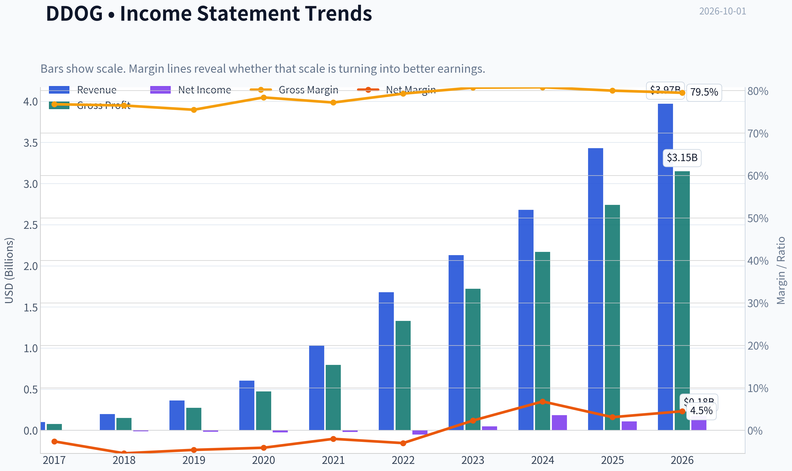

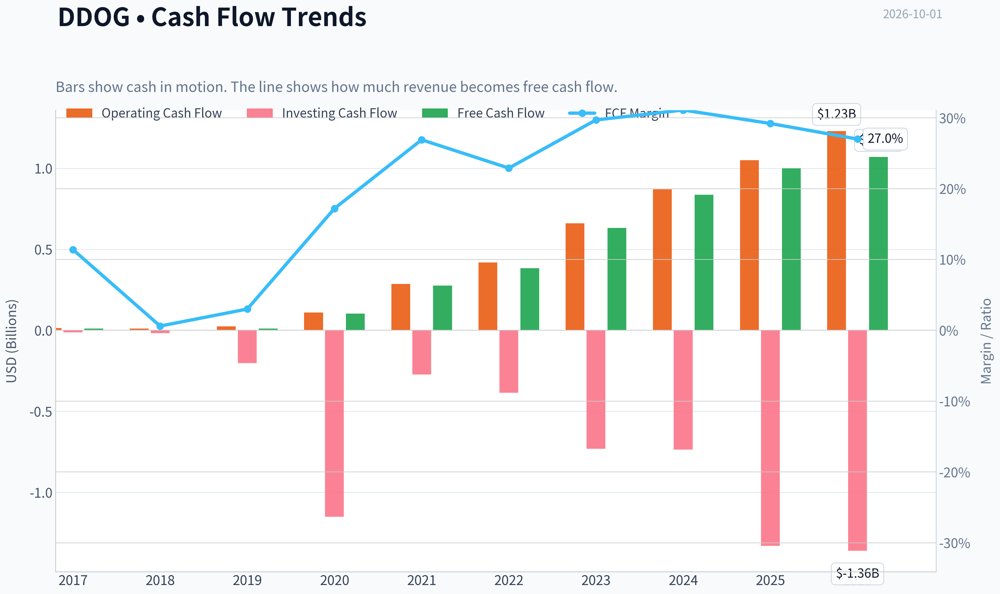

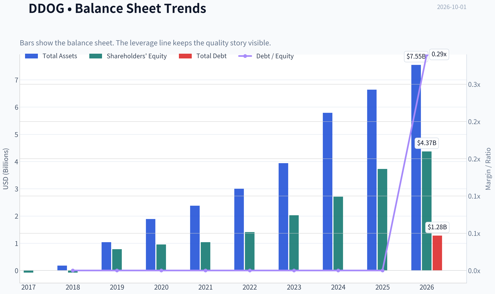

This graph tracks the profitability and return metrics (ROE, ROIC, Margins) of **DDOG** over the past decade, highlighting capital efficiency trends.

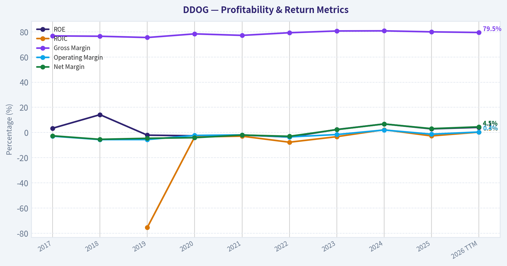

This chart illustrates the financial health of **DDOG** over the last 10 years, mapping cash equivalents and free cash flow against total obligations (Debt).

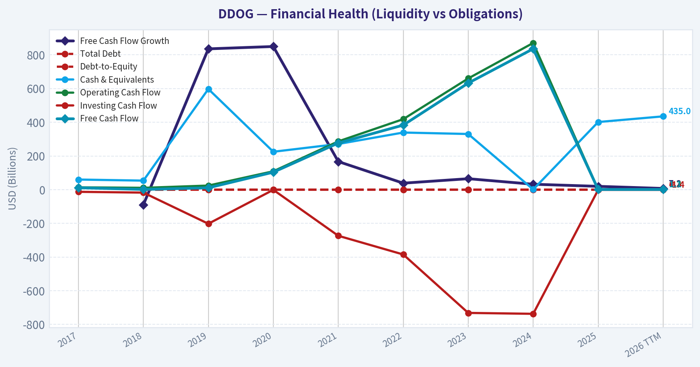

This comparison chart from *Profitability and Operating Performance* stacks current figures against historical benchmarks for **DDOG**, making it easy to see where the company trades relative to its own averages.

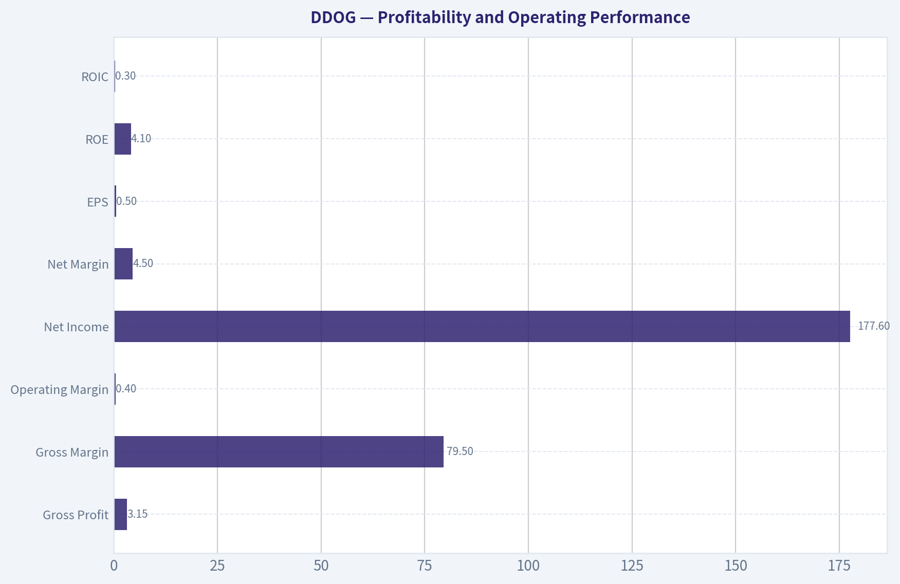

---

### Intrinsic Value Analysis (Buffett)

> *Following Warren Buffett's value investing philosophy: Circle of Competence, Economic Moat, Management Quality, and Margin of Safety.*

#### Intrinsic Value Snapshot

Price is what you pay. Intrinsic value is what the business may be worth based on the cash it can create for owners over time. We show a range, not one magic number.

- Current Price: $273.85
- Value Range (conservative to optimistic across both DCF methods): $8.59 to $255.89

##### Owner Earnings (Buffett Method)
- Net Income: $107,741,000.00
- Depreciation & Amortization: $55,756,000.00
- Capital Expenditures: $-49,578,000.00
- Working Capital Changes: $53,492,000.00
- Owner Earnings: $60,427,000.00

##### Intrinsic Value
###### Buffett Method
Uses owner earnings. Stricter, and usually more conservative.
- Conservative: $8.59
- Average: $8.59
- Optimistic: $26.02
- Discount Rate: 10.0%

###### Cash Flow Method
Uses free cash flow. Better for companies spending heavily today to grow tomorrow.
- Conservative: $79.22
- Average: $101.75
- Optimistic: $255.89
- Discount Rate: 10.0%

ANALYST STANCE: **WATCH**

#### Executive Conclusion

Datadog is a high-quality, asset-light software franchise with strong gross margins, rapid growth, and a potentially durable observability platform. However, at approximately **$274 per share and a $98.3 billion market capitalization**, the stock price appears to require extraordinary future growth.

The business may be excellent; the investment price is not attractive enough today. The weighted Buffett score is **3.26 out of 5**, placing DDOG in the **WATCH** range.

#### 1. Factor Scorecard

| Factor | Score | Assessment |
|---|---:|---|
| Circle of competence and simplicity | 3.5/5 | Datadog helps companies monitor applications, infrastructure, logs, security, and user experience. The model is understandable, but usage-based software economics and AI-driven demand introduce forecasting uncertainty. |
| Moat and competitive advantage | 4.5/5 | Strong gross margins, embedded workflows, accumulated telemetry, integration breadth, and switching friction support a wide moat. The moat appears durable, though competition from hyperscalers and other observability vendors remains meaningful. |
| Management and capital allocation | 3.0/5 | The growth record is strong, but the available evidence does not establish exceptional owner-oriented capital allocation or unusually high insider ownership. |
| Industry structure | 4.0/5 | Software observability benefits from recurring demand, scale economics, and increasing importance as systems become more complex. Competition is active, but the category is structurally attractive. |

**Gate 5 - Quality and solvency hard floor:** **Not tripped.** The available data does not indicate both deteriorating earnings or cash flow and a solvency red line such as interest coverage below 1 times. The valuation is demanding, but valuation alone is not a Gate 5 failure.

**Key Takeaways:** Datadog scores highly on business quality, moat potential, and industry structure. Its principal weakness is not the business model but the uncertainty surrounding long-term growth and the very demanding price.

#### 2. Moat Analysis

| Moat source | Evidence | Rating |
|---|---|---:|
| Intangible assets and brand | Datadog is a recognized enterprise observability brand. Its 80% gross margin indicates substantial software pricing power and scalability. | Strong |
| Switching costs | Monitoring infrastructure, alerting rules, dashboards, historical data, integrations, and employee workflows become embedded in customer operations. | Strong |
| Cost advantage | A common platform serving infrastructure, applications, logs, security, and user experience can spread research, sales, and infrastructure costs across products. | Moderate to strong |
| Network effects | Direct network effects are limited, but integrations, developer adoption, ecosystem participation, and data breadth can reinforce the platform. | Moderate |
| Moat durability | The moat is best characterized as **wide and stable, with potential to widen** if Datadog becomes the default control layer for increasingly complex and AI-enabled software environments. | 4.5/5 |

The principal threats are hyperscaler-native products, open-source tools, customer efforts to consolidate vendors, and usage optimization that reduces monitoring consumption. Datadog's defense is platform breadth, workflow integration, product innovation, and the operational risk customers bear when switching monitoring systems.

#### 3. Management Quality Assessment

Management has demonstrated strong execution through rapid revenue growth and expansion into adjacent products. The company's product strategy-moving from infrastructure monitoring into logs, application performance, security, and broader observability-can increase customer value and revenue per account.

The evidence is less conclusive on three Buffett priorities:

- Whether executive wealth is heavily concentrated in company ownership.
- Whether compensation is tightly linked to long-term per-share intrinsic value rather than revenue growth or adjusted metrics.
- Whether acquisitions and buybacks have consistently created value at attractive prices.

Accordingly, management receives a **3.0 out of 5** pending stronger evidence of owner-oriented capital allocation and conservative per-share reporting.

#### 4. Financial Summary

| Metric | Latest available figure |
|---|---:|
| Share price | $274 |
| Market capitalization | $98.33 billion |
| Revenue growth, year over year | 27.7% |
| Gross margin | 80.0% |
| Return on equity | 2.9% |
| Price-to-earnings ratio | 526.6x |
| Free-cash-flow yield | 1.0% |
| Implied free cash flow | Approximately $983 million |
| Current ratio | 3.38x |
| Headline intrinsic value | $8.59 per share |
| Three-model intrinsic values | $8.59 / $101.75 / negative $32.45 |
| Reverse-DCF implied growth | Approximately 146.1% annually for 10 years |

**Key Takeaways:** Datadog combines excellent growth and an 80% gross margin with a very high valuation. The 2.9% ROE and 526.6 times P/E show that current accounting earnings do not yet support the market capitalization. The 1% FCF yield implies investors are paying roughly 100 times current free cash flow.

#### 5. Cash Flow and Owner Earnings

The available figures imply current free cash flow of approximately:

\[
\$98.33\text{ billion} \times 1.0\% \approx \$983\text{ million}
\]

For an asset-light software company, free cash flow is a useful starting proxy for owner earnings, but it should be adjusted for:

- Stock-based compensation and dilution.
- The distinction between maintenance and growth investment.
- Working-capital benefits from deferred revenue.
- The durability of current free-cash-flow margins as the business scales.

Using current FCF as a neutral owner-earnings proxy produces approximately **$983 million** of owner earnings. The very low ROE is not necessarily evidence of poor economics because software businesses often have limited tangible equity and substantial stock-based compensation; however, it does reinforce the need to focus on per-share cash generation rather than headline growth.

#### 6. Three-Scenario DCF Valuation

The following valuation uses approximately **$983 million of current owner earnings**, implied shares outstanding of roughly **359 million**, a 10% discount rate, and no value assigned to speculative terminal multiple expansion.

| Scenario | Key assumptions | Equity value | Value per share |
|---|---|---:|---:|
| A. No growth | Owner earnings remain constant; 10% discount rate | $9.83B | $27 |
| B. GDP-like growth | 3% perpetual growth; 10% discount rate | $14.47B | $40 |
| C. High-growth normalization | 10% annual growth for 10 years, then 3% terminal growth; 10% discount rate | $24.29B | $68 |

**Key Takeaways:** Even a favorable high-growth DCF produces a value materially below the current $274 price. The no-growth and GDP-growth cases show that the current valuation cannot be justified by ordinary compounding; it depends on exceptional growth, margin durability, and significant future expansion of owner earnings.

The research pack's three-model range of **negative $32.45 to $101.75 per share** confirms considerable valuation uncertainty. Even the $101.75 figure remains approximately **63% below** the current price.

#### 7. Margin of Safety Analysis

| Valuation reference | Value per share | Difference from $274 price |
|---|---:|---:|
| No-growth DCF | $27 | -90% |
| GDP-growth DCF | $40 | -85% |
| High-growth DCF | $68 | -75% |
| FCF-based model | $101.75 | -63% |
| Headline owner-earnings model | $8.59 | -97% |
| Current market price | $274 | - |

**Key Takeaways:** Datadog does not currently offer a conventional margin of safety against cash-flow-based intrinsic value. Even for a wide-moat, high-growth compounder-where a 10% to 15% discount might be sufficient-the stock is priced at a substantial premium to the available valuation estimates.

The reverse DCF is particularly demanding: a price-implied growth rate of approximately **146% annually for 10 years** is not economically credible as a literal forecast. This result likely reflects the limitations of applying a simple DCF to a rapidly growing company, but it still clearly signals that the market price embeds heroic assumptions.

#### 8. Final Buffett Scorecard

| Criterion | Weight | Score | Weighted contribution |
|---|---:|---:|---:|
| Moat width and durability | 25% | 4.5 | 1.13 |
| Valuation and margin of safety | 20% | 1.5 | 0.30 |
| Capital returns: ROIC versus WACC | 15% | 2.5 | 0.38 |
| Business understanding and predictability | 12% | 3.5 | 0.42 |
| Management quality and capital allocation | 12% | 3.0 | 0.36 |
| Reinvestment runway | 8% | 4.5 | 0.36 |
| Balance-sheet strength | 4% | 4.0 | 0.16 |
| Industry structure | 4% | 4.0 | 0.16 |
| **Total** | **100%** | - | **3.26/5** |

**Key Takeaways:** Datadog's quality score is held back almost entirely by valuation and the still-developing relationship between growth and per-share cash returns. Its moat and reinvestment runway are attractive, but the stock price leaves little room for execution mistakes, slower usage growth, margin pressure, or dilution.

#### 9. Investment Stance

**WATCH - Moderate conviction**

Datadog is the type of modern, asset-light compounder that deserves serious consideration: high gross margins, strong revenue growth, embedded enterprise workflows, and a large reinvestment runway. It should remain on a high-quality watchlist.

At **$274**, however, the market is already pricing in extraordinary success. A more attractive entry point would require either:

1. A materially lower share price, or
2. Several years of sustained growth and free-cash-flow expansion that bring valuation closer to intrinsic value.

The correct Buffett-style action is patience: **admire the business, but do not confuse a wonderful company with a wonderful investment at any price.**
#### Valuation Bridge

This bridge places the current market price beside each intrinsic value lens so readers can see whether upside depends on one method or shows up across several methods.

| Scenario | Intrinsic Value / Share |
| --- | ---: |
| Buffett Method | $8.59 |
| Cash Flow Method | $101.75 |
| Damodaran Method | $-32.45 |
| Current Price | $273.85 |

#### Key Takeaways

If one method is far above the others, the upside case depends on a specific modelling assumption. When several methods cluster together, the valuation story is more robust.

#### Valuation Visuals

This comparison chart from *Latest Earnings Snapshot* stacks current figures against historical benchmarks for **DDOG**, making it easy to see where the company trades relative to its own averages.

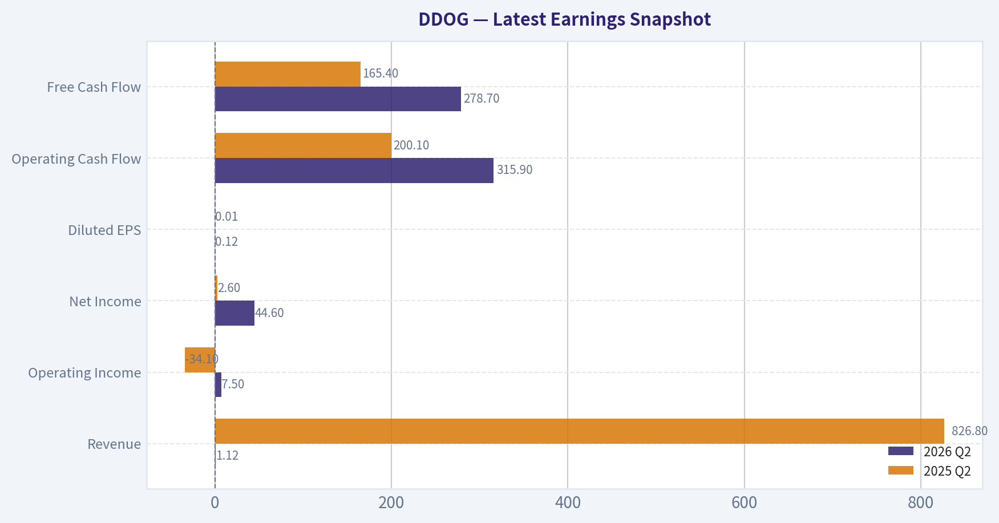

This comparison chart from *Current Versus Historical Average* stacks current figures against historical benchmarks for **DDOG**, making it easy to see where the company trades relative to its own averages.

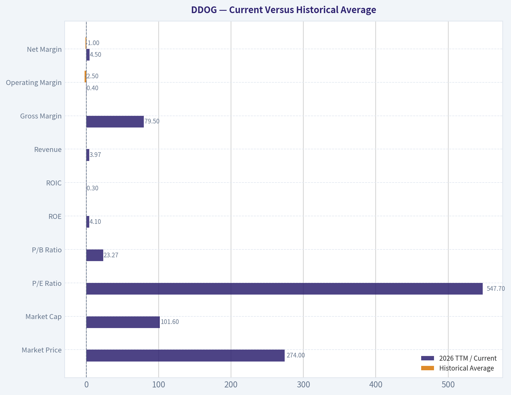

This comparison chart from *Cash Flow and Capital Allocation* stacks current figures against historical benchmarks for **DDOG**, making it easy to see where the company trades relative to its own averages.

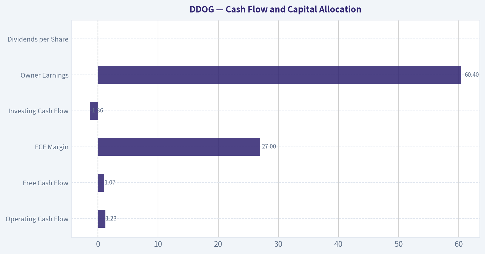

This comparison chart from *Financial Summary* stacks current figures against historical benchmarks for **DDOG**, making it easy to see where the company trades relative to its own averages.

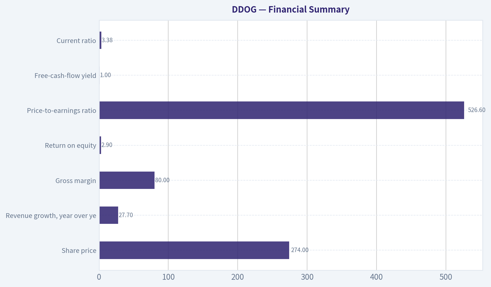

The following chart maps the **DDOG** Owner Earnings DCF valuation scenarios (Conservative, Average, Optimistic) to visually represent the margin of safety based on intrinsic value calculations.

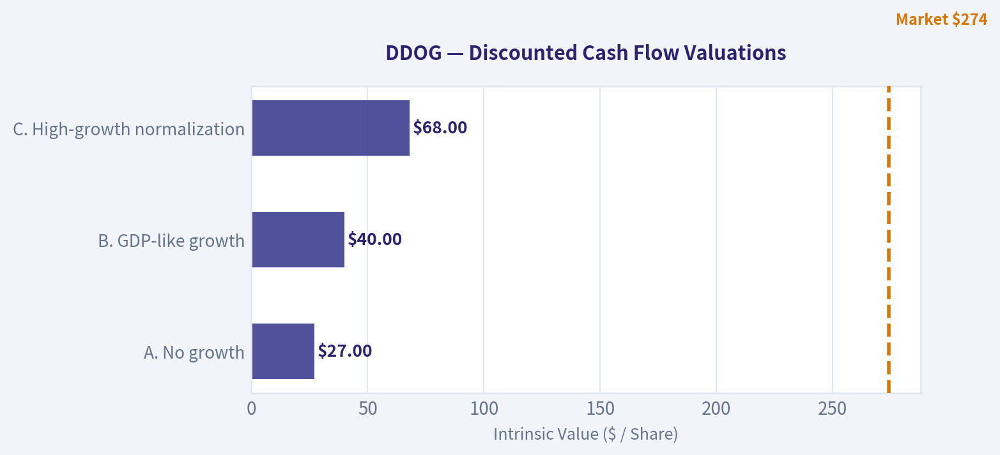

---

### Trend & Growth Analysis (Lynch/Druckenmiller/Fisher)

> *Following Peter Lynch's GARP, Stanley Druckenmiller's macro-aware approach, and Philip Fisher's scuttlebutt methodology.*

ANALYST STANCE: **WATCH**

Datadog is a high-quality secular-growth software company, but the supplied valuation data imply exceptionally demanding expectations. I would not initiate a normal growth position at $274 without evidence that AI-related demand is producing sustained revenue acceleration and that valuation is becoming more reasonable.

#### 1. Lynch classification

| Item | Assessment |
|---|---|
| Category | Fast Grower |
| Revenue growth | 27.7% year over year |
| Gross margin | 80.0% |
| Profitability | Positive earnings, but earnings remain small relative to market value |
| Growth-investing fit | Strong business; weak price discipline at the current quote |

**Key Takeaways:** DDOG fits Lynch's "fast grower" category because revenue growth remains above 25% and gross margins are excellent. However, its valuation is far beyond what a conventional PEG investor would accept, making it a watch rather than an advocate.

#### 2. The story in three bullets

- Datadog provides monitoring, security, and analytics software that helps companies operate increasingly complex cloud and AI systems.
- AI workloads, multi-cloud infrastructure, and software security can expand both Datadog's customer base and spending per customer.
- Its potential advantages include an integrated platform, embedded operational data, switching costs, and strong gross margins.

The simple version: **as companies run more critical software in the cloud, they need more visibility into whether it is working, secure, and cost-efficient.**

#### 3. TAM and 10x test

| TAM factor | Assessment |
|---|---|
| Core market | Cloud observability, application performance monitoring, infrastructure monitoring, and cloud security |
| Secular growth | Favorable; cloud complexity and AI infrastructure expand the problem Datadog solves |
| 10x revenue test | Plausible in principle, but requires expansion beyond traditional observability |
| Main constraint | Competition from hyperscalers, open-source tools, and bundled enterprise platforms |
| Current market position | Established category leader; exact share was not supplied |

**Key Takeaways:** The addressable market is expanding rather than static, supporting a long runway. A tenfold revenue outcome is possible only if Datadog becomes a broader operating and security platform; a tenfold outcome from observability alone is less certain.

#### 4. Revenue growth trend

| Metric | Result | Interpretation |
|---|---:|---|
| Latest year-over-year revenue growth | 27.7% | Strong fast-grower rate |
| Recent reported narrative | Q2 growth reportedly accelerated, helped by AI observability demand | Potential inflection |
| Growth consistency | Insufficient quarterly history supplied | Durable acceleration unconfirmed |
| Revenue quality | Subscription and usage-based software model | Recurring, but potentially sensitive to customer consumption |

**Key Takeaways:** The latest growth rate is healthy, and recent coverage points to acceleration linked to AI observability. The evidence is not sufficient to establish a durable multi-quarter acceleration pattern, particularly after reports of a major customer usage reduction and conservative guidance.

#### 5. Unit economics and operating efficiency

| Metric | Data available | Assessment |
|---|---:|---|
| Gross margin | 80.0% | Excellent software economics |
| Net revenue retention | Not supplied | Must verify; especially important for usage-based customers |
| LTV/CAC | Not supplied | Cannot calculate responsibly |
| FCF margin | Not supplied | FCF yield is 1.0%, but yield is not the same as margin |
| Rule of 40 | Not calculable | Requires revenue growth plus FCF margin |
| Current ratio | 3.38 | Strong near-term liquidity |

**Key Takeaways:** The 80% gross margin and 3.38 current ratio are positives. The most important missing proof points are net retention, customer acquisition efficiency, and free-cash-flow margin; without them, Datadog's growth efficiency cannot be fully scored.

#### 6. Inflection-point assessment

| Potential inflection | Evidence | Assessment |
|---|---|---|
| Product cycle | AI observability and security expansion | Positive |
| TAM expansion | AI increases infrastructure complexity and monitoring needs | Positive |
| Market share | No current share data supplied | Unconfirmed |
| Margin inflection | 80% gross margin; operating-margin trend unavailable | Unconfirmed |
| Competitive inflection | No clear competitor failure identified | Neutral |
| Earnings inflection | High valuation requires substantial upside to estimates | Risky |

**Key Takeaways:** The strongest potential inflection is product and TAM expansion from AI workloads. The investment case still needs confirmation through accelerating reported revenue, rising platform adoption, improving retention, and operating leverage.

#### 7. Macro setup

| Macro factor | DDOG implication |
|---|---|
| AI and cloud secular trend | Strong tailwind |
| Enterprise software spending | Supports long-term demand but can be budget-sensitive |
| Interest rates | High-duration software remains vulnerable to rising rates |
| Market regime | Current valuation leaves little room for disappointment |
| Overall macro score | Positive secularly; mixed tactically |

**Key Takeaways:** Datadog is aligned with powerful long-term trends, particularly AI infrastructure and cloud complexity. Its stock remains highly sensitive to interest rates, software-sector sentiment, and evidence that customer usage is moderating.

#### 8. Fisher 15-point score

| Fisher criterion group | Score |
|---|---:|
| Market potential and long-range outlook | 5/5 |
| Product development and R&D orientation | 4/5 |
| Sales organization and customer expansion | 4/5 |
| Margins and financial quality | 4/5 |
| Competitive advantages and switching costs | 4/5 |
| Management depth, candor, and integrity | 3/5 |
| Cost controls, accounting, and capital allocation | 3/5 |
| Dilution risk | 3/5 |
| **Estimated total** | **58/75** |

**Key Takeaways:** DDOG scores in Fisher's "good" range, supported by market potential, product relevance, and gross margins. The score is not outstanding because the supplied information does not establish retention, capital-allocation quality, dilution trends, or management performance through the latest usage-related issue.

#### 9. Valuation analysis

| Method | Result | Interpretation |
|---|---:|---|
| P/E | 526.6x | Extremely expensive |
| PEG | Approximately 19.0 | Far above Lynch's attractive range |
| FCF yield | 1.0% | Very low for a company requiring substantial execution |
| Headline intrinsic value | $8.59 | Model output is highly conservative and inconsistent with growth assumptions |
| Other model values | $101.75 FCF model; negative Damodaran FCFF model | Very wide model dispersion |
| Reverse DCF | Approximately 146.1% implied annual growth for 10 years | Severe expectation risk |
| P/S | Exact figure unavailable from supplied data | Appears very high for a software company of this scale |

**Key Takeaways:** Every available valuation signal is demanding: a 526.6 P/E, approximately 19 PEG, and 1% FCF yield. The reverse-DCF result is especially concerning because it suggests the market price requires extraordinary long-term execution; even if the model is imperfect, the warning is clear.

#### 10. Growth investor scorecard

| Criterion | Weight | Score / 5 |
|---|---:|---:|
| Lynch story | 10% | 4.5 |
| TAM and runway | 20% | 4.2 |
| Revenue growth | 20% | 4.0 |
| Unit economics | 15% | 3.0 |
| Competitive position | 10% | 4.0 |
| Management quality | 10% | 3.5 |
| Macro setup | 5% | 3.5 |
| Profitability path | 5% | 3.5 |
| Valuation | 5% | 1.0 |
| **Weighted score** | **100%** | **3.6 / 5.0** |

**Key Takeaways:** Operationally, Datadog is an attractive fast grower with a strong secular position. The weighted score reaches the low-advocate range only because valuation has a small formal weight; in practical portfolio construction, valuation deserves greater emphasis at this price.

#### 11. Position-size stance

| Investor situation | Suggested stance |
|---|---|
| New position | Do not initiate at full size |
| Existing holder | Hold only if the original thesis remains intact and the position is appropriately sized |
| Aggressive growth investor | At most a small starter position after confirmation or a valuation reset |
| Suggested new allocation now | 0% |
| Potential starter allocation later | 1-2% |
| Add triggers | Sustained growth acceleration, strong NRR, improving FCF margin, or significant valuation compression |

**Key Takeaways:** This is a "great company, demanding stock" setup. Existing owners should not automatically sell based on one soft data point, but new investors should demand either faster fundamental growth or a lower entry price.

#### 12. Catalysts and risks

| Catalysts | Risks |
|---|---|
| AI observability becomes a major new revenue stream | AI demand may be overstated or concentrated among a few customers |
| Cross-selling security and broader platform products | Hyperscaler bundling and open-source competition |
| Reacceleration in large-customer spending | Usage-based revenue can contract when customers optimize cloud costs |
| Operating leverage and rising FCF margins | Extreme valuation magnifies downside from small misses |
| Falling interest rates or software multiple expansion | Rising rates and multiple compression |
| Strong NRR and durable customer expansion | Guidance reductions or sustained growth deceleration |

**Key Takeaways:** The key catalyst is proof that AI expands Datadog's total platform consumption rather than merely shifting existing demand. The key risk is that a high-growth narrative meets a valuation that already discounts years of exceptional execution.

#### Bottom line

Datadog is a **fast-growing, strategically well-positioned cloud software company** with attractive gross margins and a credible AI-driven TAM expansion story. But at $274, the stock appears to discount an unusually optimistic future, while the supplied data do not yet prove that growth acceleration, retention, and free-cash-flow leverage are strong enough to justify it.

**Decision: WATCH.** Reassess after the next earnings reports for revenue acceleration, net revenue retention, large-customer growth, AI-related contribution, operating margin, and free-cash-flow margin.

---

### Market Technical Analysis

ANALYST STANCE: **WATCH**

#### DDOG Technical Analysis

**Data basis:** The latest available trading session is September 30, 2026, when DDOG closed at **$273.85**. October 1 is not represented as a trading session in the supplied data. The analysis uses the most recent year of price history and the latest 30-day indicator readings.

The selected indicators are **10 EMA, 50 SMA, 200 SMA, MACD, RSI, Bollinger middle band, ATR, and VWMA**. Together, they cover short-, medium-, and long-term trend, momentum, volatility, and volume confirmation without adding unnecessary redundancy.

#### Trend Structure

| Indicator | Latest reading | Recent direction | Interpretation |
|---|---:|---|---|
| DDOG close | $273.85 | Strong rebound; up from $209.23 on September 2 | Price has recovered approximately 30.9% in less than one month |
| 10 EMA | $257.09 | Rising sharply | Short-term momentum is firmly positive |
| 50 SMA | $243.39 | Slightly declining but beginning to stabilize | Medium-term trend remains mixed-to-improving |
| 200 SMA | $183.51 | Rising steadily | Long-term trend is clearly bullish |
| Price versus 10 EMA | +$16.76, or +6.5% | Extended above average | Strong momentum, but increased pullback risk |
| Price versus 50 SMA | +$30.46, or +12.5% | Well above average | Confirms upside strength but also shows significant separation from medium-term value |
| Price versus 200 SMA | +$90.34, or +49.2% | Far above average | Long-term trend is bullish, though the stock is no longer in an early-stage move |

**Key Takeaways:** DDOG's trend hierarchy is bullish because the share price is above all three major moving averages, and the 200-day average is rising. However, the price is unusually extended above the 50-day average, so a pause or retracement would be technically normal rather than automatically bearish. The 10-day EMA at $257 is the nearest meaningful short-term trend reference.

#### Momentum and Participation

| Indicator | Latest reading | Recent development | Trading implication |
|---|---:|---|---|
| MACD | 8.95 | Improved from -9.64 on September 8 and crossed into positive territory around September 23 | Momentum has shifted decisively upward |
| RSI | 69.24 | Rose from 36.26 on September 2 | Near the conventional 70 overbought threshold |
| VWMA | $247.12 | Increased from $238.59 on September 1 | Volume-weighted price trend is supportive |
| Close versus VWMA | +$26.73, or +10.8% | Price is above volume-weighted value | Buyers have controlled the recent move |
| September 25 volume | 5.37 million shares | Elevated during the initial breakout phase | The advance received meaningful participation |
| September 30 volume | 2.79 million shares | Lower than the September 25 surge | Latest advance was constructive but less emphatically confirmed by volume |

**Key Takeaways:** MACD provides the strongest confirmation that the recent rebound is more than a one- or two-day bounce. VWMA is also rising and remains below price, indicating that recent trading volume has generally supported the advance. RSI at 69.24 is close to overbought, while the lower volume on September 30 suggests traders should seek further participation before assuming another persistent leg higher.

#### Volatility and Risk

| Indicator | Latest reading | Recent direction | Interpretation |
|---|---:|---|---|
| ATR | $12.44 | Down from approximately $14.17 on September 2, but still elevated | Daily price swings remain substantial |
| ATR as percentage of close | Approximately 4.5% | High absolute risk despite some volatility normalization | Stops placed too tightly may be vulnerable |
| Bollinger middle band | $237.63 | Rising from $232.74 on September 8 | Short-term price benchmark is improving |
| Close versus Bollinger middle | +$36.22, or +15.3% | Large positive separation | Price is stretched above its recent mean |
| Recent September range | $209.23 to $273.85 | Approximately 30.9% increase from low to latest close | The rebound has been powerful but fast |

**Key Takeaways:** Volatility has eased from early September levels, but an ATR of $12.44 still implies large daily movement. DDOG's close is more than 15% above the Bollinger middle band, which supports the bullish breakout interpretation but also warns that chasing the stock at current levels carries unfavorable short-term risk. The $257 area, near the 10-day EMA, is an important first pullback reference, while the $243 to $247 zone combines the 50-day SMA and VWMA and may offer stronger trend support.

#### Price-Action Assessment

DDOG experienced a sharp reversal during September. It fell from approximately **$237 in late August to $209.23 on September 2**, then formed a recovery sequence characterized by progressively higher closes and a decisive breakout above the low-to-mid-$230s resistance area. The move accelerated after September 21, with the stock rising from **$245.05 to $273.85** by September 30.

The most constructive feature is the alignment of price with momentum. DDOG is above the 10 EMA, 50 SMA, and 200 SMA, while MACD has turned positive and RSI has climbed from deeply weak levels into the upper-neutral/near-overbought zone. This combination generally favors trend continuation rather than an immediate bearish reversal.

There are, however, three important cautions:

1. **The move is extended.** A 12.5% premium to the 50-day SMA and a 15.3% premium to the Bollinger middle band indicate that price has moved substantially faster than its medium-term averages.
2. **RSI is near 70.** This is not a sell signal by itself, particularly in a strong trend, but it means upside may become more dependent on continued buying pressure.
3. **Volume confirmation has softened.** The September 25 surge had materially higher volume, whereas the latest move to $273.85 occurred on more moderate volume. A breakout above the recent high would be more reliable if accompanied by renewed volume expansion.

#### Trading Framework

| Scenario | Confirmation level or condition | Potential implication |
|---|---|---|
| Bullish continuation | Sustained close above $273.85, ideally with volume above recent average | Opens the possibility of a continuation toward new highs |
| Short-term pullback | Failure to hold the $257 area near the 10 EMA | Signals loss of immediate momentum; could lead to consolidation |
| Deeper but still potentially constructive retracement | Test of approximately $243-$247, near the 50 SMA and VWMA | Would relieve overextension while preserving the broader bullish structure |
| Bearish deterioration | Decisive close below the $243-$247 support cluster, followed by failure to reclaim it | Would weaken the medium-term recovery thesis |
| Long-term trend risk | Break below the rising 200 SMA near $183.51 | Would represent a much more significant structural change, not merely a routine pullback |

**Key Takeaways:** The preferred bullish setup is either a high-volume breakout above $273.85 or a controlled pullback that holds near $257 and then reclaims the recent high. Buying after a rapid advance without confirmation exposes traders to a potentially wide retracement because ATR remains elevated. A break below the $243-$247 support cluster would be more concerning than an ordinary dip toward the 10-day EMA.

#### Overall View

DDOG has a **bullish trend and improving momentum**, supported by positive MACD, a rising 200-day SMA, a rising VWMA, and price action above all key moving averages. The stock's recent rebound from $209.23 has been exceptionally strong, but the current price is also significantly extended from its medium-term averages and is approaching the RSI overbought threshold.

Accordingly, the appropriate stance is **WATCH rather than aggressively chase**. Existing holders may continue to monitor the position while using the 10 EMA and the $243-$247 support zone as trend-management references. New entries are technically more attractive on either a high-volume breakout above the latest high or a pullback that stabilizes near support.

| Area | Current reading | Assessment |
|---|---:|---|
| Overall trend | Price above 10 EMA, 50 SMA, and 200 SMA | Bullish |
| Short-term momentum | 10 EMA at $257.09 and sharply rising MACD | Strongly positive |
| Long-term structure | 200 SMA at $183.51 and rising | Bullish |
| Momentum risk | RSI 69.24 | Near overbought; avoid indiscriminate chasing |
| Volume confirmation | VWMA rising to $247.12 | Supportive, but latest volume is less forceful |
| Volatility | ATR $12.44 | High; position sizing and stops require care |
| Nearest support | Approximately $257 | First pullback reference |
| Major support cluster | Approximately $243-$247 | More important medium-term trend support |
| Breakout trigger | Above $273.85 with stronger volume | Would favor continuation |
| Recommended stance | WATCH | Bullish structure, but wait for confirmation or a better entry |

**Key Takeaways:** DDOG's technical structure is bullish, but the stock has advanced rapidly and is now extended, with RSI near 70 and ATR indicating substantial daily risk. The best risk-reward may come from a confirmed, volume-backed breakout above $273.85 or a controlled pullback toward $257 or the $243-$247 support cluster.

---

### Options Market Analysis

> *Reading options flow - put/call ratios, IV skew, and unusual activity - to gauge institutional positioning and event-driven risk.*

ANALYST STANCE: **WATCH**

#### DDOG Options Flow Report

**Data date:** October 1, 2026
**Ticker:** Datadog, Inc.
**Confidence:** Low to moderate, because near-term open interest is extremely small and the feed does not provide DDOG's current share price, strikes, or detailed bid/ask execution data.

#### 1. Put/Call Ratio Analysis

| Expiration | Call OI | Put OI | Put/Call OI | Call Volume | Put Volume | Put/Call Volume |
|---|---:|---:|---:|---:|---:|---:|
| Oct. 2, 2026 | 0 | 0 | N/A | 1,514 | 1,783 | 1.18 |
| Oct. 9, 2026 | 0 | 0 | N/A | 988 | 405 | 0.41 |
| Oct. 16, 2026 | 24 | 189 | 7.88 | 1,366 | 805 | 0.59 |
| **Near-term total** | **24** | **189** | **7.88** | **3,868** | **2,993** | **0.77** |

**Key Takeaways:** The aggregate volume put/call ratio is 0.77, modestly more call-heavy than the historical neutral baseline near 0.70, suggesting slightly bullish or speculative call activity. However, the 7.88 open-interest ratio is strongly put-heavy, although it is based on only 213 total contracts and is therefore not a robust institutional signal. The expiration-level data is inconsistent, with concentrated put OI but call-led volume.

#### 2. Implied Volatility Assessment

| Expiration | Call ATM IV | Put ATM IV | Relative IV Read |
|---|---:|---:|---|
| Oct. 2, 2026 | 4.7% | 3.9% | Call IV premium |
| Oct. 9, 2026 | 1.3% | 2.6% | Put IV premium |
| Oct. 16, 2026 | 1.1% | 1.2% | Nearly balanced |
| **Near-term range** | **1.1%-4.7%** | **1.2%-3.9%** | Mixed, unusually low |

The reported near-term ATM IV is very low, particularly for options expiring within days. This may indicate limited expected movement, but it may also reflect stale quotes, sparse liquidity, or a data-quality issue. The available figures do not include true out-of-the-money put and call IV, so a formal OTM skew calculation is unavailable.

The Oct. 2 series shows a slight call-IV premium, while the Oct. 9 series shows a put-IV premium. That is not a consistent steep downside skew or upside call skew. No earnings, product launch, or other catalyst was supplied in the data, so catalyst-related IV elevation cannot be confirmed.

**Key Takeaways:** IV appears low and does not show a consistent directional skew. The small put premium in the Oct. 9 expiry could reflect short-dated downside hedging, but the call premium in the Oct. 2 expiry offsets that signal. Treat the reported IV levels cautiously because they appear unusually low for actively traded short-dated options.

#### 3. Unusual Options Activity

| Finding | Result |
|---|---|
| Contracts meeting volume greater than 5 times OI | None identified |
| Fresh directional contract-level signal | Not detected |
| Smart-money versus retail distinction | Not possible from supplied data |

No individual contract exceeded the tool's threshold for unusual activity. Consequently, there is no confirmed high-conviction sweep, block, or fresh directional position to classify as bullish or bearish.

The data does show meaningful volume despite zero reported OI in the Oct. 2 and Oct. 9 expirations, but without strikes, prices, execution side, or reliable OI history, those trades cannot be confidently interpreted as opening positions. The absence of unusual activity reduces conviction in any directional read.

**Key Takeaways:** There is no contract-level unusual activity supporting a strong bullish or bearish thesis. Volume is present, but the lack of open interest and execution details makes it difficult to determine whether trades are opening bets, closing positions, or market-making activity.

#### 4. Open Interest Concentration and Potential Gamma Levels

| Expiration | Total Call OI | Total Put OI | Total OI | Concentration Assessment |
|---|---:|---:|---:|---|
| Oct. 2, 2026 | 0 | 0 | 0 | No reported OI |
| Oct. 9, 2026 | 0 | 0 | 0 | No reported OI |
| Oct. 16, 2026 | 24 | 189 | 213 | Put-heavy, but very small |
| **Total** | **24** | **189** | **213** | Limited concentration data |

No strike-level open-interest data was provided, so specific gravitational levels, max-pain levels, or gamma walls cannot be calculated. The Oct. 16 expiry contains nearly all reported OI and is heavily weighted toward puts, but 213 contracts is too small to establish a meaningful market-wide pinning level.

The lack of reported OI in the nearest two expirations also means there is no reliable evidence of a major near-term gamma wall that would either dampen or amplify DDOG's price movement.

**Key Takeaways:** Open interest is concentrated in the Oct. 16 expiry and is strongly put-heavy, but the absolute position size is very small. No strike-level gamma wall or max-pain level can be identified from this feed. Price pinning risk therefore appears limited based on the available data.

#### 5. Overall Options Sentiment

**Signal: NEUTRAL, with a slight bullish tilt in trading volume but a defensive tilt in open interest.**

The primary bullish factor is the 0.77 near-term volume put/call ratio, which is close to neutral but modestly favors calls. The primary bearish factor is the 7.88 put/call OI ratio for Oct. 16, indicating more existing put protection or bearish positioning. However, that ratio is heavily distorted by the tiny denominator: only 24 call contracts versus 189 put contracts.

There is no unusual-options contract, no consistent IV skew, and no meaningful strike-level OI concentration. The best interpretation is that DDOG options positioning currently reflects **low-conviction, mixed short-term activity**, rather than a decisive institutional directional bet. Because the feed is thin and internally sparse, confidence in the neutral signal is limited.

#### Summary

| Category | Assessment |
|---|---|
| Put/Call Ratio | Volume ratio 0.77, slightly call-favorable; OI ratio 7.88, strongly put-heavy but based on minimal OI |
| IV Level | Reported ATM IV is very low, ranging from roughly 1.1% to 4.7%; possible liquidity or data-quality concern |
| Skew Direction | Mixed; slight call premium in Oct. 2 and put premium in Oct. 9, with no consistent skew |
| Unusual Activity | None identified using the volume-greater-than-5-times-OI threshold |
| Overall Signal | **NEUTRAL**, with a slight bullish volume tilt and defensive OI structure |

**Key Takeaways:** DDOG's options market does not provide a strong directional signal. Call-heavy volume is mildly constructive, but the very high put/call OI ratio and limited total OI suggest defensive positioning without enough scale to confirm a bearish institutional view. The appropriate stance is to watch for a new buildup of strike-level OI or genuinely unusual opening activity before assigning a stronger signal.

---

## Research Team Commentary

> *The Research Manager synthesizes the Bull vs Bear debate into action-free commentary. This is a pre-risk view, not the final stance.*

Core takeaway: Datadog appears to be a high-quality software platform, but at $274 the stock requires too much unproven future success to qualify as a Buffett-style purchase. The business deserves respect; the valuation does not provide protection against ordinary execution mistakes. I would avoid initiating a long-term position at the current price, while recognizing that strong momentum could carry the shares higher in the near term.

The strongest bull argument is that Datadog is becoming a mission-critical operating layer for increasingly complex cloud environments. Its integrated observability, security, analytics, and AI-monitoring products create genuine switching costs through embedded dashboards, alerts, workflows, integrations, and institutional knowledge. OpenTelemetry may reduce collection-level lock-in, but it does not eliminate the cost of replacing the broader operating platform. The 80% gross margin is also meaningful: it creates substantial potential for operating leverage if revenue continues growing faster than research, sales, and administrative spending. Cloud migration, multi-cloud complexity, cybersecurity, and AI workloads should all increase the volume and importance of telemetry over the next decade.

The strongest bear argument is that nearly all of this quality is already capitalized into the price. At 526.6 times current earnings, investors are not merely paying for continued growth; they are paying for a transformation from modest reported profitability into exceptional per-share owner earnings. The low 2.9% ROE and 1.6% ROA do not prove Datadog is a poor business, because accounting treatment and growth investment distort returns for asset-light software companies. They do show, however, that elite capital efficiency has not yet been demonstrated in the supplied evidence.

The bull's reverse DCF is particularly revealing. If economically adjusted, fully diluted free cash flow is $3 per share, approximately 30% annual FCF-per-share growth for ten years is needed to produce an estimated value around $319. At 25% growth, the same framework produces only about $224. Compounding at 30% for a decade would increase FCF per share almost fourteenfold, and much of the estimated value still comes from the terminal period. That is possible for an exceptional platform, but it is not a conservative base case. More importantly, the supplied information does not verify that Datadog already generates $3 of FCF per share after recognizing stock-based compensation as a real economic cost.

This is where the bull case becomes circular: the shares are attractive if current owner earnings meet an unverified threshold and then compound at an extraordinary rate. That is a scenario worth investigating, not yet a demonstrated margin of safety. Even the bull's estimated intrinsic value of $304-322 offers only 10-15% upside. Such a narrow discount is appropriate for an already proven, predictable, high-ROIC compounder-not one where normalized owner earnings, dilution, management alignment, and returns on reinvestment remain uncertain.

Competition adds further forecasting risk. Datadog has a credible moat, but hyperscaler bundling, enterprise platforms, specialist vendors, customer cost optimization, and OpenTelemetry can constrain pricing and increase portability. AI should create more telemetry, but greater data volume does not automatically create proportionate shareholder value. Customers may sample less data, negotiate harder, use bundled products, or direct most of their AI budgets toward cloud and model providers. Datadog must prove that AI-related complexity translates into durable, profitable spending rather than simply higher infrastructure costs and continued product investment.

Management may deserve a premium for technical and founder-led leadership, but the evidence supplied is insufficient to award one. Insider ownership, compensation design, acquisition returns, net dilution, and the treatment of stock-based compensation all need verification. At this valuation, management should be judged by growth in intrinsic value per diluted share, not revenue growth or adjusted operating metrics alone.

The prior Xero and Duolingo mistakes are relevant, but they point toward discipline rather than reflexive bullishness. Those stocks had suffered severe drawdowns, were near support, and showed signs of seller exhaustion. Datadog presents the opposite tactical location: it is 12.5% above its 50-day average, 15.3% above its Bollinger midpoint, and near an RSI of 70. That does not make it a short-strong momentum can persist-but it removes the washed-out valuation and technical asymmetry that was previously underappreciated. The mildly call-heavy options activity is too weak and incomplete to overcome that conclusion.

Over the next one to four quarters, I would focus first on fully diluted free cash flow per share after treating stock-based compensation as an economic expense. This is the most important missing denominator. Growth in corporate FCF is not enough if dilution absorbs a meaningful portion of the gain.

I would also monitor revenue and remaining-performance-obligation growth, large-customer additions, retention and usage trends, and the number of modules adopted per customer. Those figures should show whether platform consolidation and AI observability are producing durable expansion rather than temporary enthusiasm. Gross margin should remain close to current software-platform levels while GAAP operating margins and incremental FCF margins improve.

The thesis would strengthen if Datadog demonstrates sustained operating leverage, moderating dilution, rising per-share owner earnings, stable retention, and tangible monetization of security and AI products. Evidence that revenue can compound above 25% while FCF per share grows faster would begin to support the optimistic reverse-DCF scenario.

The thesis would weaken if growth falls toward the high teens, customers intensify telemetry-cost optimization, gross margins decline, sales and R&D spending remain structurally elevated, or share count growth consumes a material portion of cash-flow expansion. Increased pricing pressure from hyperscalers or easier migration through open standards would also reduce the appropriate valuation multiple.

I would reconsider at $274 only if verified adjusted FCF per share is materially above the bull's assumed starting point and management can credibly sustain exceptional per-share growth. Otherwise, a materially lower price is needed so that the implied growth rate moves from exceptional toward merely strong. Datadog may well be a wonderful business in formation, but Buffett's discipline requires paying for demonstrated economics rather than capitalizing the best plausible outcome.

Final stance: AVOID.

---

## Value Investing Team Commentary

> *The Investor translates the research view into an investment thesis before risk review. This is still not the final stance.*

### Investment Commentary

Datadog appears to be an excellent business offered at a price that leaves little room for ordinary disappointment. Its integrated observability, security, and analytics platform addresses a durable need: as cloud and AI systems become more complex, enterprises require a unified way to monitor performance, control costs, detect threats, and troubleshoot failures. The company's approximately 80% gross margin, expanding product suite, and embedded customer workflows are consistent with a potentially powerful software franchise.

The moat is credible but not impregnable. Dashboards, alerts, integrations, historical telemetry, and organizational workflows create switching costs, while a broad platform can benefit from product consolidation. However, OpenTelemetry makes data collection more portable, hyperscalers can bundle competing tools, and customers can reduce telemetry volumes when budgets tighten. Datadog must therefore continue converting technical leadership into retention, module adoption, pricing power, and-most importantly-growing owner earnings per diluted share.

### Valuation is the decisive issue

The 526.6 times reported earnings multiple is not, by itself, a sufficient valuation framework for a rapidly scaling software company. Current earnings are depressed by continued investment, stock-based compensation, and the accounting treatment of internally developed intellectual property. Similarly, the reported 2.9% ROE and 1.6% ROA understate some of the economics of an asset-light platform and may be affected by a large cash balance.

Nevertheless, those accounting limitations do not make the price conservative. They merely mean that free cash flow, dilution, and incremental returns on reinvestment should replace headline P/E and ROE as the primary measures.

The reverse-DCF evidence is demanding:

- At approximately $3 of economically adjusted FCF per diluted share, around 30% annual per-share growth for a decade could support a value near $319.
- At 25% growth, estimated value falls to approximately $224.
- The current $274 price therefore appears to require an outcome much closer to the exceptional scenario than to the merely strong one.

Thirty percent annual compounding over ten years would increase FCF per share almost fourteenfold. Datadog could conceivably achieve that, but possibility is not the same as a margin of safety. A valuation that works only if the company remains exceptional for a decade is vulnerable to even modest slowing, increased competition, margin pressure, or dilution.

A 10-15% discount can be sufficient for a wonderful, proven compounder. But that quality-scaled standard applies when normalized owner earnings, high incremental ROIC, management alignment, and per-share economics are already well established. The supplied evidence does not yet demonstrate all four.

### Stock-based compensation requires careful treatment

Simply subtracting all stock-based compensation from reported free cash flow can sometimes be too punitive because the accounting expense does not perfectly equal the period's economic cost. Ignoring it is equally inappropriate. The practical test is:

1. Growth in fully diluted shares over time;
2. Cash spent on repurchases merely to offset employee issuance;
3. FCF growth per diluted share rather than company-wide FCF growth; and
4. Whether compensation is tied to long-term per-share value creation.

If free cash flow rises 25% but diluted shares rise materially and buybacks are conducted at extreme valuations, shareholder economics will be weaker than the headline cash-flow figures suggest.

### Management remains an important unresolved variable

Founder-led technical leadership can be valuable, particularly in infrastructure software. But the valuation already assumes excellent execution, so management deserves a premium only if the evidence confirms:

- meaningful insider ownership;
- compensation aligned with long-term per-share value;
- disciplined acquisitions;
- declining net dilution;
- sensible repurchases made below intrinsic value; and
- improving returns on incremental spending.

At $274, investors are effectively underwriting management's future capital allocation before its full record has been established.

### Selective Contrarian View

The market's enthusiasm is not irrational. AI workloads should generate more applications, models, infrastructure dependencies, security risks, and telemetry. Datadog is reasonably positioned to benefit, and the crowd may be correct that it will become a larger and more strategically important platform.

The contrarian insight is narrower: **more telemetry does not automatically mean proportionately more shareholder value**. Customers can sample data, optimize logs, negotiate volume discounts, or use bundled cloud-provider products. AI-driven demand could increase Datadog's revenue while also increasing infrastructure costs, product-development requirements, and competitive intensity.

Current sentiment also appears enthusiastic rather than fearful. The shares are approximately 12.5% above their 50-day average, 15.3% above the Bollinger midpoint, and near an RSI of 70. These indicators are not reasons to short a superior business-strong trends can remain extended-but they show that investors are not being compensated for stepping into widespread pessimism. Mildly call-heavy options activity reinforces enthusiasm but is too limited to provide a dependable signal.

This differs from a quality company that has fallen sharply on a temporary concern and is stabilizing near support. Datadog is being offered after strong momentum, with much of the favorable narrative already embedded in the price. Contrarian discipline here means refusing to chase, not betting aggressively against the company.

### What Would Change the Assessment

The investment case would improve if Datadog demonstrates:

- revenue growth sustainably above 25%;
- FCF per diluted share growing faster than revenue;
- declining net share issuance;
- expanding GAAP operating and incremental FCF margins;
- durable retention and usage expansion;
- rising multi-product adoption;
- measurable security and AI-observability monetization; and
- continued gross margins near current levels.

A lower price would also improve the asymmetry. Using the supplied reverse DCF, a value of roughly $224 under a 25% growth case suggests that a quality-scaled purchase range might begin around $190-$205, assuming the underlying FCF estimate is validated. A higher price could be justified if normalized FCF per share is materially above $3 or if evidence strongly supports growth closer to 30% for an extended period.

The thesis would deteriorate if revenue growth moves toward the high teens, telemetry optimization intensifies, gross margins contract, operating leverage fails to emerge, or dilution absorbs a meaningful portion of cash-flow growth.

Datadog should not be dismissed as an ordinary overvalued software company, and the shares should not be shorted merely because momentum and valuation are elevated. It may become a great long-term compounder. But at $274, the investor is paying today for a substantial portion of that future greatness, while retaining most of the execution risk.

ANALYST STANCE: **AVOID** - Avoid initiating a long-term position at the current valuation. This is a valuation judgment, not a negative judgment on Datadog's products or competitive position. Reconsider after a meaningful price correction or after verified per-share owner earnings, dilution, and operating leverage make the implied growth assumptions substantially less demanding.

---

## Deep Values Commentary

> *The Risk Management Team debates and the Risk Judge provides the final action-free verdict. This section determines the final ADVOCATE / WATCH / AVOID stance.*

#### Final Stance Scorecard

This scorecard converts the final research view into a weighted decision frame. It does not replace the narrative judgement, but it makes the main drivers of the verdict easier to scan.

| Criterion | Score | Weight | Commentary |
| --- | ---: | ---: | --- |
| Business Quality | 2.75 | 30% | High returns, profitability, and Piotroski health support durability. |
| Valuation Support | 1.33 | 30% | Blends current price against available intrinsic value anchors and valuation ratios. |
| Financial Strength | 5.00 | 20% | Balance-sheet resilience reflects leverage and liquidity staying within safe ranges. |
| Growth Durability | 3.33 | 20% | Recent revenue, earnings, and free cash flow growth indicate how durable expansion looks. |
| TOTAL / FINAL STANCE | 2.89 | 100% | AVOID |

#### Key Takeaways

The weighted score lands at **2.89 / 5.0**, while the final stance remains **AVOID**. This is useful as a quick calibration aid rather than a mechanical signal.

#### Risk Summary

Higher scores indicate more risk pressure. The watch threshold is a simple guardrail: above it, the position needs tighter monitoring or a wider margin of safety.

| Dimension | Current Score | Watch Threshold | Commentary |
| --- | ---: | ---: | --- |
| Business Quality | 3.25 | 3.00 | High returns, profitability, and Piotroski health support durability. |
| Valuation Support | 4.67 | 3.00 | Blends current price against available intrinsic value anchors and valuation ratios. |
| Financial Strength | 1.00 | 3.00 | Balance-sheet resilience reflects leverage and liquidity staying within safe ranges. |
| Growth Durability | 2.67 | 3.00 | Recent revenue, earnings, and free cash flow growth indicate how durable expansion looks. |

#### Key Takeaways

This view helps readers separate *where* the risk sits: valuation, business quality, balance sheet, or growth durability. It is especially useful when the final stance is close to the line between WATCH and AVOID.
