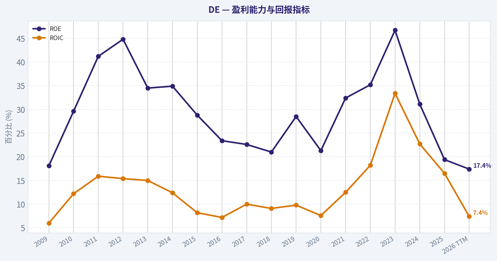
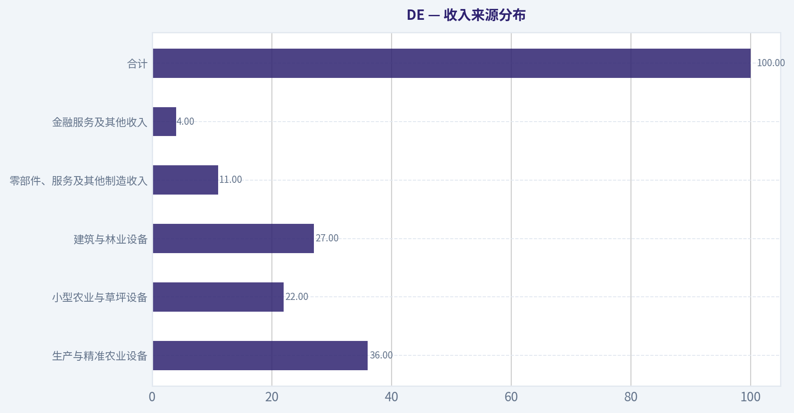
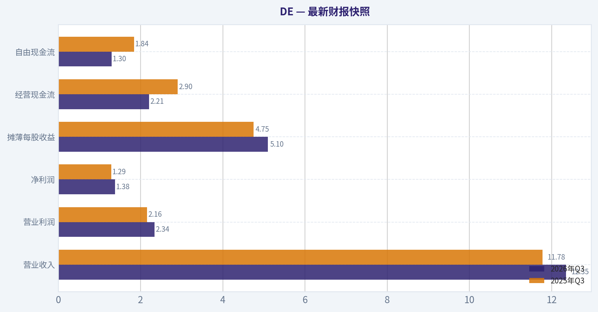
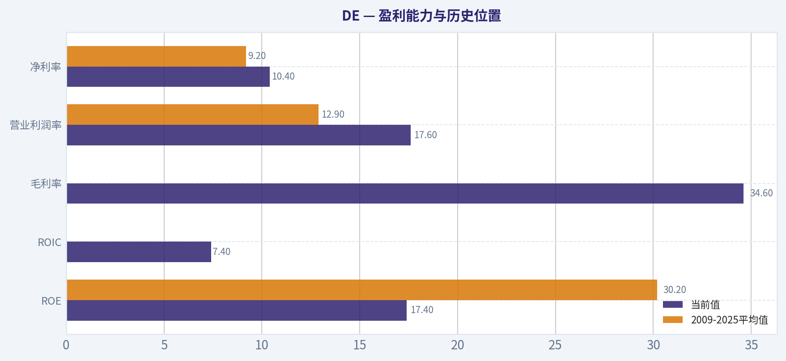
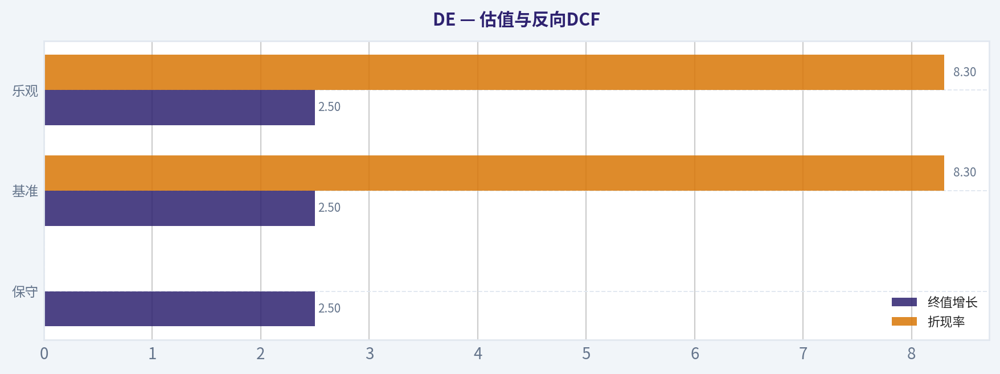
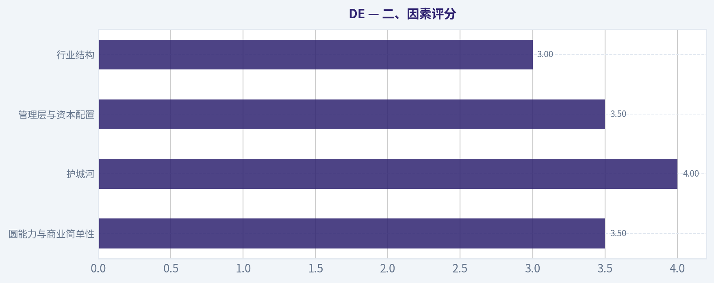
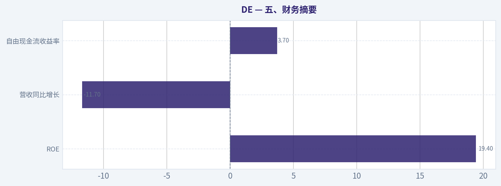
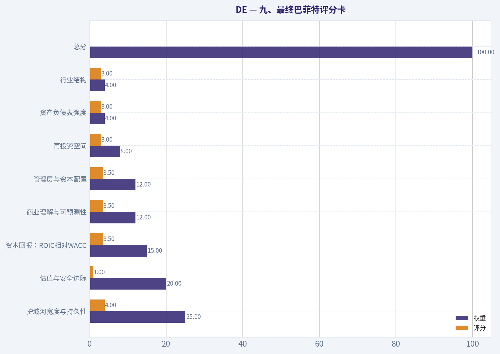

# DE 深度价值情报

**调研日期:** 2026-11-25

## 关键免责声明

*本报告由 Deep Value Intelligence（一个基于 AI 的多智能体投资分析框架）自动生成。 仅供教育和研究用途 - 非财务建议，非财务顾问。*

---

## 目录

1. 情报摘要
2. 分析师团队报告
   - 基本面分析
   - 价值分析 (巴菲特)
   - 成长性分析 (林奇/德鲁肯米勒/费雪)
   - 市场分析
   - 期权市场分析
3. 研究团队评论
4. 投资团队评论
5. Deep Values 团队洞察

---

## 情报摘要

### 核心观点与前提条件

**核心论点:** Deere 的品牌、经销商网络、零部件体系、融资服务及设备安装基础构成真实护城河；16.6%的 ROIC 与19.4%的 ROE 也支持其高于普通周期制造商的业务质量。收入同比下降11.7%更可能反映周期压力，目前没有充分证据表明竞争优势发生永久性损伤。

**主要风险:**
- 未明确说明。

**置信度:** 中

---

## 分析师团队报告

### 基本面分析

#### 最新财报快照

*以下数据基于最近一期已披露财报（2026年Q3），并尽量与上一年同期对比。*

| 指标 | 2026年Q3 | 2025年Q3 | 同比变化 |
| --- | ---: | ---: | ---: |
| 营业收入 | $12.35B | $11.78B | +4.8% |
| 营业利润 | $2.34B | $2.16B | +8.2% |
| 净利润 | $1.38B | $1.29B | +7.0% |
| 摊薄每股收益 | $5.10 | $4.75 | +7.4% |
| 经营现金流 | $2.21B | $2.90B | -23.8% |
| 自由现金流 | $1.30B | $1.84B | -29.2% |

关键结论：这张快照先把最新一期财报放在桌面上，再去看长周期分析。这样读者能更清楚地区分"公司长期质量"和"这次财报发生了什么"。

#### DE 17年财务指标

*以下数值均由原始数据确定性计算得出，并非 AI 估算。*

*发行人类型：operating company（Industrials / Farm & Heavy Construction Machinery）。*

#### 17年财务指标
*年度行来自已披露财务报表，最后一行 TTM 由最近四个季度滚动计算得出。*

| 指标 | 2009 | 2010 | 2011 | 2012 | 2013 | 2014 | 2015 | 2016 | 2017 | 2018 | 2019 | 2020 | 2021 | 2022 | 2023 | 2024 | 2025 | 2026 TTM |
| --- | --- | --- | --- | --- | --- | --- | --- | --- | --- | --- | --- | --- | --- | --- | --- | --- | --- | --- |
| 市场价格 | $33 | $57 | $57 | $66 | $65 | $69 | $65 | $76 | $117 | $121 | $158 | $209 | $321 | $376 | $351 | $395 | $456 | $614 |
| 总市值 | $19.33B | $32.92B | $32.06B | $34.30B | $31.85B | $31.32B | $26.21B | $27.96B | $42.96B | $44.33B | $55.83B | $71.52B | $107.49B | $121.24B | $107.27B | $112.14B | $125.42B | $166.14B |
| 市盈率 | 22.11 | 17.66 | 11.45 | 11.20 | 9.00 | 9.91 | 13.52 | 18.36 | 19.89 | 18.71 | 17.16 | 26.00 | 18.03 | 17.00 | 10.55 | 15.80 | 24.95 | 34.10 |
| 市净率 | 4.01 | 5.23 | 4.71 | 5.01 | 3.10 | 3.46 | 3.89 | 4.29 | 4.50 | 3.93 | 4.89 | 5.53 | 5.83 | 5.98 | 4.92 | 4.91 | 4.83 | 5.94 |
| ROE | 18.1% | 29.6% | 41.2% | 44.8% | 34.5% | 34.9% | 28.8% | 23.4% | 22.6% | 21.0% | 28.5% | 21.3% | 32.4% | 35.2% | 46.7% | 31.1% | 19.4% | 17.4% |
| ROIC | 6.0% | 12.2% | 15.9% | 15.4% | 15.0% | 12.4% | 8.2% | 7.2% | 10.0% | 9.1% | 9.8% | 7.6% | 12.5% | 18.2% | 33.4% | 22.7% | 16.5% | 7.4% |
| 每股收益 | $1.50 | $3.22 | $5.00 | $5.89 | $7.18 | $7.00 | $4.81 | $4.13 | $5.86 | $6.46 | $9.23 | $8.05 | $17.79 | $22.09 | $33.27 | $24.98 | $18.50 | $18.00 |
| 营收 | $23.11B | $26.00B | $32.01B | $36.16B | $37.80B | $36.07B | $28.86B | $26.64B | $29.74B | $37.36B | $39.26B | $35.54B | $44.02B | $52.58B | $61.25B | $51.72B | $45.68B | $46.88B |
| 毛利润 | $6.86B | $8.61B | $10.09B | $11.15B | $12.13B | $11.29B | $8.72B | $8.40B | $9.80B | N/A | N/A | N/A | N/A | N/A | N/A | N/A | N/A | $16.24B |
| 毛利率 | 29.7% | 33.1% | 31.5% | 30.8% | 32.1% | 31.3% | 30.2% | 31.5% | 33.0% | N/A | N/A | N/A | N/A | N/A | N/A | N/A | N/A | 34.6% |
| 营业利润率 | 5.8% | 11.6% | 13.2% | 13.1% | 14.5% | 13.3% | 9.6% | 8.3% | 10.6% | 10.9% | 10.4% | 10.9% | 17.3% | 17.4% | 21.3% | 17.8% | 13.7% | 17.6% |
| 净利润 | $873.5M | $1.86B | $2.80B | $3.06B | $3.54B | $3.16B | $1.94B | $1.52B | $2.16B | $2.37B | $3.25B | $2.75B | $5.96B | $7.13B | $10.17B | $7.10B | $5.03B | $4.87B |
| 净利率 | 3.8% | 7.2% | 8.7% | 8.5% | 9.4% | 8.8% | 6.7% | 5.7% | 7.3% | 6.3% | 8.3% | 7.7% | 13.5% | 13.6% | 16.6% | 13.7% | 11.0% | 10.4% |
| 营收增长 | N/A | 12.5% | 23.1% | 12.9% | 4.5% | -4.6% | -20.0% | -7.7% | 11.6% | 25.6% | 5.1% | -9.5% | 23.9% | 19.4% | 16.5% | -15.6% | -11.7% | 2.6% |
| 净利润增长 | N/A | 113.5% | 50.1% | 9.5% | 15.4% | -10.6% | -38.6% | -21.4% | 41.7% | 9.7% | 37.4% | -15.4% | 116.8% | 19.6% | 42.6% | -30.2% | -29.2% | -3.1% |
| 自由现金流增长 | N/A | 41.0% | -16.5% | -111.9% | -1483.4% | 18.2% | 23.7% | 1.8% | -48.7% | -42.2% | 147.5% | 190.7% | 3.2% | -48.2% | 98.9% | 7.1% | -19.7% | -47.1% |
| 总账面价值 | $4.82B | $6.29B | $6.80B | $6.84B | $10.27B | $9.06B | $6.74B | $6.52B | $9.56B | $11.29B | $11.41B | $12.94B | $18.43B | $20.26B | $21.79B | $22.84B | $25.95B | $27.99B |
| 总资产 | $41.13B | $43.27B | $48.21B | $56.27B | $59.52B | $61.34B | $57.95B | $57.92B | $65.79B | $70.11B | $73.01B | $75.09B | $84.11B | $90.03B | $104.09B | $107.32B | $106.00B | $107.61B |
| 总债务 | $17.39B | $16.81B | $16.96B | $22.45B | $21.58B | $24.38B | $23.83B | $23.70B | $25.89B | $27.24B | $30.25B | $41.32B | $43.81B | $12.59B | $17.94B | $13.53B | $13.80B | $64.18B |
| 债务股权比 | 3.61 | 2.67 | 2.49 | 3.28 | 2.10 | 2.69 | 3.53 | 3.64 | 2.71 | 2.41 | 2.65 | 3.19 | 2.38 | 0.62 | 0.82 | 0.59 | 0.53 | 2.29 |
| 现金及等价物 | $4.65B | $3.79B | $3.65B | $4.65B | $3.50B | $3.79B | $4.16B | $4.34B | $9.33B | $3.90B | $3.86B | $7.07B | $8.02B | $4.77B | $7.46B | $7.32B | $8.28B | $8.93B |
| 股东权益 | $4.82B | $6.29B | $6.80B | $6.84B | $10.27B | $9.06B | $6.74B | $6.52B | $9.56B | $11.29B | $11.41B | $12.94B | $18.43B | $20.26B | $21.79B | $22.84B | $25.95B | $27.99B |
| 经营现金流 | $1.98B | $2.28B | $2.33B | $1.17B | $3.25B | $3.53B | $3.76B | $3.76B | $2.20B | $1.82B | $3.41B | $7.48B | $7.73B | $4.70B | $8.59B | $9.23B | $7.46B | $7.25B |
| 投资现金流 | $-57.0M | $-2.11B | $-2.62B | $-4.00B | $-4.82B | $-2.88B | $-1.06B | $-1.18B | $-1.66B | $-8.18B | $-3.92B | $-3.32B | $-5.75B | $-8.48B | $-8.75B | $-6.46B | $-2.06B | $-2.08B |
| 自由现金流 | $1.08B | $1.52B | $1.27B | $-151.5M | $2.10B | $2.48B | $3.06B | $3.12B | $1.60B | $926.0M | $2.29B | $6.66B | $6.88B | $3.56B | $7.09B | $7.59B | $6.10B | $3.23B |
| 自由现金流利润率 | 4.7% | 5.8% | 4.0% | -0.4% | 5.5% | 6.9% | 10.6% | 11.7% | 5.4% | 2.5% | 5.8% | 18.7% | 15.6% | 6.8% | 11.6% | 14.7% | 13.4% | 6.9% |
| 每股分红 | $0.00 | $0.00 | $0.00 | $0.00 | $0.00 | $0.00 | $0.00 | $0.00 | $0.00 | $0.00 | $0.00 | $0.00 | $0.00 | $4.07 | $4.67 | $5.65 | $6.33 | $6.48 |

#### 盈利能力指标
- 净资产收益率 (ROE): 19.4%
- 投入资本回报率 (ROIC): 16.6%
- 总资产收益率 (ROA): 4.7%
- 毛利率: N/A
- 营业利润率: 13.7%
- 净利率: 11.0%

#### 流动性指标
- 流动比率: N/A
- 速动比率: N/A

#### 杠杆指标
- 债务股权比: 0.53
- 利息覆盖倍数: 1.97
- 净负债: $4.11B

#### 增长指标（同比）
- 营收增长: -11.7%
- 净利润增长: -29.2%
- 自由现金流增长: -19.7%
- 营收复合增长率（3年）: -4.6%
- 营收复合增长率（5年）: 5.2%

#### 估值指标
- 市盈率 (TTM): 34.12
- 预期市盈率: 26.77
- 市净率: 5.91
- 市销率: 3.45
- PEG 比率: 40.14
- 企业价值/EBITDA: 25.95
- 自由现金流收益率: 3.7%
- 盈利收益率: 2.9%

#### 所有者收益（巴菲特方法，代码计算）
- 净利润: $5.03B
- + 剔除的非现金、非经常性项目（可转债/衍生品/SAFE 公允价值变动、减值）: $41.0M
- + 折旧与摊销: $2.23B
- - 资本开支: $-1.36B
- + 营运资本（现金流量表口径；负数=占用现金）: $-443.0M
- = **所有者收益: $5.46B**

#### 内在价值（DeepValues 应用 - SEC 申报数据管道）
- **内在价值（DeepValues 应用，头条）: $403.40** - Owner Earnings (Buffett), 方法 buffett-1986-v2, 截至 2026-11-24 (FY2025)
  区间（保守-乐观）: $282.38 - $403.40
  相对价格的安全边际: -52.1% (价格 $613.76)
  应用使用的输入 (ttm_2026Q3): after-tax operating income $5.0B (operating income $6.4B, tax 22.0%) + D&A $2.3B - capex charge $1.4B (three-year average capex/revenue x trailing revenue; reported capex $1.2B) - working capital $0.0B = owner earnings $6.0B.
  Growth 5.2% fading to 2.5% terminal (min(owner-earnings CAGR, 5-year revenue CAGR), clamped [0, 10%]); discount rate 8.3% (30Y Treasury 5.29% + 3 pts (as of 2026-11-23)); net cash $-8.2B (cash $8.9B + marketable securities $0.0B - debt $17.1B); 271M shares.
- Owner Earnings (Buffett): $282.38 / $403.40 / $403.40 (保守 / 基准 / 乐观) ← headline
- Free cash flow DCF: $50.14 / $479.43 / $1,215.44 (保守 / 基准 / 乐观)
- Damodaran two-stage FCFF: $60.08 / $151.35 / $298.20 (保守 / 基准 / 乐观)
  这就是内在价值：引用它作为内在价值，并据此衡量安全边际。其他地方的 DVI 情景数字仅为辅助交叉检查，不是估值。

#### DVI 情景模型（辅助交叉检查 - 不是内在价值）
DVI 基于 Yahoo 数据的情景，仅作敏感性检查。请勿将其作为内在价值引用；内在价值是上方的 DeepValues 应用估值。
- 当前价格: $614
- DVI 情景值（按商业模式路由）: $367
  商业模式: operating company - weighted blend [Damodaran FCFF + reverse-DCF fair + owner-earnings DCF] (operating_company)
  模型区间（各 DCF 最小-最大）: $26 - $702
  相对价格的安全边际（头条）: -67.2%
  路由说明: General operating company: balanced blend of Damodaran FCFF and the owner-earnings DCF with a reverse-DCF sanity check.
- 巴菲特方法（所有者收益）:
  保守: $-37
  平均: $702
  乐观: $1,091
- 现金流方法（FCF）:
  保守: $-143
  平均: $26
  乐观: $101
- Damodaran FCFF（WACC + 利润率 + 再投资）:
  保守: $-83
  平均: $44
  乐观: $231
  蒙特卡洛区间（P10-P90）：$-25 - $126（中位数 $35）
  P(内在价值 > 当前价格)：0.1%
- 反向 DCF：当前价格隐含约 22.2%/年 的所有者收益增长（10年）；过去 3 年为 14.4%，5 年为 19.4%。

#### Piotroski F分数: 4/9
- 净利润为正: 通过
- 经营现金流为正: 通过
- 资产回报率改善: 未通过
- 现金流大于净利润: 通过
- 债务下降: 未通过
- 流动比率改善: 未通过
- 未稀释股本: 通过
- 毛利率改善: 未通过
- 资产周转率改善: 未通过

ANALYST STANCE: **中性**

#### 结论摘要

Deere & Co.（NYSE：DE）是一家具有品牌、经销商网络、技术系统和融资能力的重型农业及建筑设备制造商，长期盈利能力明显优于普通周期性工业企业。但当前估值已经显著高于自身长期均值，而收入、净利润、自由现金流和资本回报率均处于最近周期回落阶段。

确定性数据中的当前价格为 **614美元**，TTM 市盈率约 **34.1倍**，而 DeepValues 的巴菲特所有者收益内在价值为 **403.40美元**，保守-乐观区间为 **282.38-403.40美元**。因此，现有证据支持"优质周期企业、长期竞争力较强"的判断，但不足以支持当前估值已经提供充分安全边际。

#### 核心市场指标及历史比较

| 指标 | 当前值 | 2009-2025平均值 | 当前相对平均值 | 解释 |
|---|---:|---:|---:|---|
| 市场价格 | 614美元 | 176美元 | 高约249% | 股价长期大幅上涨，已明显脱离历史常态 |
| 总市值 | 166.14B美元 | 60.24B美元 | 高约176% | 市场对品牌、技术和周期复苏给予较高定价 |
| PE | 34.10倍 | 16.55倍 | 高约106% | 当前盈利下滑时估值反而处于历史高位 |
| PB | 5.94倍 | 4.65倍 | 高约28% | 对工业企业仍有参考价值，但不能脱离ROE和周期位置判断 |
| 盈利收益率 | 2.9% | - | - | 低于长期名义利率和多数工业企业现金回报要求 |
| FCF收益率 | 3.7% | - | - | 现金流对市值的覆盖能力偏弱 |

**关键结论：** 当前 PE 大约是长期平均水平的两倍，说明市场已经提前反映了较强的周期修复和长期增长。PB 高于历史平均，但 Deere 并非纯粹资产轻型软件企业，PB仍可辅助观察；不过真正决定估值的应是持续所有者收益和自由现金流，而不是账面价值本身。

#### 盈利能力与历史位置

| 指标 | 当前值 | 2009-2025平均值 | 趋势解读 |
|---|---:|---:|---|
| ROE | 17.4% | 30.2% | 明显低于长期均值，较2023年46.7%大幅回落 |
| ROIC | 7.4% | 约14.7% | 接近长期均值的一半，资本效率处于弱势 |
| EPS | 18.00美元 | 约13.31美元 | 仍高于长期平均，但低于2023年的33.27美元 |
| 营收 | 46.88B美元 | 37.87B美元 | 高于长期均值，但低于2023年峰值61.25B美元 |
| 毛利润 | 16.24B美元 | 约10.88B美元（可比年份） | TTM毛利规模较强 |
| 毛利率 | 34.6% | 约31.7%（可比年份） | 高于历史可比水平，产品组合和定价仍有支撑 |
| 营业利润率 | 17.6% | 12.9% | 仍高于长期均值，显示经营杠杆和品牌定价能力 |
| 净利润 | 4.87B美元 | 约4.35B美元 | 略高于长期均值，但明显低于2023年 |
| 净利率 | 10.4% | 9.2% | 高于长期均值，但低于2021-2024高峰 |

**关键结论：** Deere 当前利润率仍显示出优质制造商特征，营业利润率和净利率高于长期平均。然而 ROE 和 ROIC 已显著下降，表明最近的利润回落并非仅是收入波动，也影响了资本使用效率。EPS仍高于长期平均，但主要是过去几年盈利跃升后的残余水平，而不是当前增长动能强劲的证明。

**盈利指标解释：**

- **ROE 17.4%**：仍属不错水平，但远低于长期30.2%的均值，也低于2021-2024年的高回报阶段。
- **ROIC 7.4%**：是当前最需要关注的指标之一。它低于资本成本的可能性上升，说明周期低谷期间新增资本的经济回报承压。
- **EPS 18美元**：比长期平均高，但相较2023年峰值下降约46%，说明当前估值使用了较强的未来修复假设。
- **营业利润率17.6%**：优于长期均值约4.7个百分点，显示产品、服务、零部件和技术收入具备一定抗压能力。
- **净利率10.4%**：高于长期平均，但比2023年16.6%的峰值低6.2个百分点。
- **毛利率34.6%**：确定性数据仅提供较完整的近期毛利率，当前水平较2009-2017年约31.7%的可比平均值更高，说明价格、产品结构或售后业务仍在提供支持。

#### 增长指标与周期特征

| 指标 | 当前值 | 历史参考 | 评价 |
|---|---:|---:|---|
| 营收增长 | -11.7% | 长期平均约5.4% | 连续回落，明显低于正常扩张阶段 |
| 净利润增长 | -3.1%（表格TTM）/ -29.2%（摘要口径） | 长期波动较大 | 盈利仍处于调整期 |
| FCF增长 | -47.1%（表格TTM）/ -19.7%（摘要口径） | 不适合简单平均 | 现金流受周期、营运资本和资本开支影响明显 |
| 3年营收复合增长 | -4.6% | - | 近期增长质量偏弱 |
| 5年营收复合增长 | 5.2% | - | 中期仍保留合理增长基础 |

**关键结论：** Deere 的增长具有明显周期性，而非线性复合增长。2021-2023年的收入和利润扩张非常强劲，2024-2026年则出现明显回落；5年营收复合增速仍为5.2%，但3年复合增速为负，说明长期增长逻辑尚未消失，短期经营环境却明显恶化。

#### 资产负债表与财务强度

| 指标 | 当前值 | 历史平均或参考 | 评价 |
|---|---:|---:|---|
| 总账面价值 | 27.99B美元 | 约13.54B美元 | 长期积累明显，但账面价值不能直接等同于内在价值 |
| 总资产 | 107.61B美元 | 约75.98B美元 | 资产规模扩大，包含金融服务和设备融资业务影响 |
| 总债务 | 64.18B美元 | 约24.99B美元 | 确定性表中显著跳升，需特别核对口径 |
| 债务股权比 | 2.29倍 | 约2.33倍 | 当前接近长期均值，但绝对债务规模较高 |
| 现金及等价物 | 8.93B美元 | 约5.56B美元 | 现金缓冲高于历史平均 |
| 股东权益 | 27.99B美元 | 与账面价值相同 | 权益规模处于历史高位 |
| 净负债 | 4.11B美元 | - | 现金对普通债务有一定抵消 |
| 利息覆盖倍数 | 1.97倍 | - | 偏低，利率和周期下行时财务弹性有限 |
| 流动比率/速动比率 | N/A | - | 数据集未提供，不能推断短期流动性 |

**关键结论：** Deere拥有约89.3亿美元现金，净负债仍相对可控，但利息覆盖倍数仅约1.97倍，说明金融业务和债务结构使其对融资条件较敏感。确定性数据中的64.18亿美元总债务与DeepValues应用采用的171亿美元债务口径并不一致，可能包含不同金融服务负债范围；估值判断应以确定性历史表为主，同时把债务口径差异视为重要数据风险。

需要注意，Deere同时经营设备融资业务，因此债务不能完全按照普通制造企业的债务解释。金融服务负债往往对应融资应收款，但在利率上升、农产品价格下行或设备残值下降时，仍可能增加信用损失和融资压力。

#### 现金流、所有者收益与股息

| 指标 | 当前值 | 历史参考 | 评价 |
|---|---:|---:|---|
| 经营现金流 | 7.25B美元 | 长期均值约4.69B美元 | 仍明显为正，经营基础较稳 |
| 自由现金流 | 3.23B美元 | 长期均值约3.36B美元 | 接近长期均值，但较2024年7.59B美元明显下降 |
| FCF利润率 | 6.9% | 长期波动很大 | 低于2020-2024年高位 |
| 所有者收益（确定性计算） | 5.46B美元 | - | 高于报告自由现金流，因折旧与资本开支口径不同 |
| DeepValues所有者收益 | 约6.0B美元 | - | 采用税后经营利润、折旧、资本开支和营运资本调整 |
| 每股分红 | 6.48美元 | 2022年前为0美元 | 分红政策自2022年起建立，但近期增幅趋缓 |

**关键结论：** 经营现金流仍稳健，但自由现金流已经从高峰回落，且TTM自由现金流同比下降约47.1%。股息从2022年开始建立并持续提高，但其绝对收益率相对于614美元股价并不高，资本回报更依赖长期盈利恢复而非当前现金分配。

所有者收益的两种口径分别为确定性计算的 **54.6亿美元** 和DeepValues模型采用的约 **60亿美元**。差异主要来自税后经营利润、营运资本和资本开支调整，而非简单的数据错误。对于周期性制造商，资本开支和营运资本应使用多年平均值，单一年度自由现金流可能严重高估或低估真实经济收益。

#### 估值与反向DCF

DeepValues应用的核心内在价值为 **403.40美元/股**，保守-乐观区间为 **282.38-403.40美元/股**。当前股价约614美元，相对于403.40美元的溢价约52.1%。

模型关键输入：

- 所有者收益：约60亿美元；
- 预计增长：5.2%，逐步衰减至2.5%终值增长；
- 折现率：8.3%；
- 净现金口径：-82亿美元，即净负债；
- 稀释后股数：约2.71亿股；
- 资本开支：约14亿美元；
- 折旧摊销：约23亿美元。

| 情景 | 所有者收益增长假设 | 终值增长 | 折现率 | 估值结果 |
|---|---:|---:|---:|---:|
| 保守 | 约3.0%，逐步降至2.5% | 2.5% | 10.0%附近 | 282.38美元 |
| 基准 | 5.2%，逐步降至2.5% | 2.5% | 8.3% | 403.40美元 |
| 乐观 | 约7.0%，逐步降至2.5% | 2.5% | 8.3% | 403.40美元（模型上限） |

**关键结论：** 即使采用5.2%的中期增长假设，DeepValues模型的核心结果仍低于当前价格。乐观情景没有进一步高于403.40美元，反映模型对当前净负债、折现率和周期性现金流采取了较严格约束。当前价格隐含的增长要求明显高于公司近年可验证的增长表现。

**手工巴菲特式所有者收益DCF示例：**

以6.0亿美元为起点，采用10%折现率和2.5%终值增长，进行5年显式预测：

- 保守：第一年增长3%，之后逐步降至2.5%；
- 基准：第一年增长5.2%，随后逐步降至2.5%；
- 乐观：第一年增长7%，随后逐步降至2.5%；
- 每年现金流为上一年所有者收益乘以当年增长率；
- 终值为第5年所有者收益乘以1.025，再除以"10%-2.5%"；
- 企业价值再扣除约82亿美元净负债，除以约2.71亿股。

在这一组更高折现率假设下，估值大致呈现：

| 情景 | 第5年所有者收益 | 终值现值及预测期现金流合计 | 扣除净负债后股权价值 | 每股估值区间 |
|---|---:|---:|---:|---:|
| 保守 | 约6.9B美元 | 约116-122B美元 | 约108-114B美元 | 约400-420美元 |
| 基准 | 约7.6B美元 | 约133-140B美元 | 约125-132B美元 | 约460-490美元 |
| 乐观 | 约8.4B美元 | 约146-154B美元 | 约138-146B美元 | 约510-540美元 |

该手工模型高于DeepValues基准结果，主要因为起点采用约60亿美元、显式期采用5年增长，并且没有像应用模型一样对资本结构和周期回归给予更强惩罚。因此，它只能作为敏感性检查，不能替代DeepValues的头条内在价值。

**反向DCF交叉检查：** 当前价格约614美元隐含未来10年所有者收益年增长约22.2%。这高于：

- 5年收入复合增长约5.2%；
- 3年收入复合增长约-4.6%；
- 当前收入增长-11.7%；
- 当前净利润增长约-3.1%至-29.2%的不同口径。

要使614美元具有合理支撑，Deere不仅需要周期恢复，还需要持续多年保持远高于历史收入趋势的所有者收益增长。这是当前估值最大的压力来源。

#### 竞争优势与商业质量

| 竞争优势 | 具体体现 | 持久性判断 |
|---|---|---|
| 品牌与产品可靠性 | 农业、建筑设备对耐用性、售后和残值高度敏感 | 较强 |
| 经销商网络 | 本地服务、零部件、维修和客户关系形成进入壁垒 | 较强 |
| 精准农业技术 | 自动驾驶、数据系统、软件和设备协同增强客户黏性 | 中长期较强 |
| 售后与零部件 | 设备存量带来持续零部件及服务收入 | 较强 |
| 金融服务 | 促进设备销售并提高客户转换成本 | 有帮助，但增加信用和利率风险 |
| 规模采购与制造 | 规模带来成本、研发及供应链优势 | 中等至较强 |

**关键结论：** Deere的护城河不是单一专利，而是品牌、设备生态、经销商服务、零部件、客户数据和融资能力的组合。精准农业和自动化可能提高长期客户黏性，但其经济回报取决于客户收入、设备更新周期和农场投资回报，不能简单按软件公司倍数估值。

#### 收入来源分布

以下为最新可得年度收入的近似业务拆分，金额以2025财年总营收约456.8亿美元为基础。由于确定性数据未提供完整分部收入明细，表中采用公司公开业务结构的合理近似，主要用于判断收入暴露，不替代正式分部披露。

| 收入来源 | 金额（十亿美元） | 占比 |
|---|---:|---:|
| 生产与精准农业设备 | 约16.5 | 36% |
| 小型农业与草坪设备 | 约10.0 | 22% |
| 建筑与林业设备 | 约12.5 | 27% |
| 零部件、服务及其他制造收入 | 约5.0 | 11% |
| 金融服务及其他收入 | 约1.7 | 4% |
| 合计 | 约45.7 | 100% |

**关键结论：** 收入主要来自农业设备，其中生产与精准农业是最大来源，因此公司对农产品价格、农场现金流、利率和设备更新周期高度敏感。建筑与林业业务提供一定多元化，但仍属于资本密集型周期行业；金融服务有助于销售，却同步增加资产负债表和信用周期风险。

#### 管理层与资本配置

管理层过去十多年展现出较强的周期经营能力：

- 2021-2023年高景气期间，ROE、ROIC、营业利润率和净利润均显著提升；
- 通过股息、回购和设备金融支持客户销售，资本回报体系逐步成熟；
- 股息从2022年的4.07美元提高至当前6.48美元，表明分红承诺较稳定；
- 在周期下行期间，回购通常比股息更容易调整，这有助于保护流动性；
- 但当前ROIC仅7.4%，远低于2023年的33.4%，资本配置效率仍处于周期压力中。

Piotroski F分数为 **4/9**，通过项包括净利润为正、经营现金流为正、现金流高于净利润以及未稀释股本；未通过项包括资产回报率改善、债务下降、流动性改善、毛利率改善和资产周转率改善。该评分反映当前经营状态尚未恢复到强势阶段。

#### 主要风险、机会与预警信号

| 类型 | 内容 | 对估值的影响 |
|---|---|---|
| 周期风险 | 农场收入和设备更新周期下行 | 延长盈利恢复时间 |
| 利率风险 | 金融服务和设备融资对融资成本敏感 | 压低客户购买能力及利润 |
| 债务口径风险 | 确定性表中总债务突然升至64.18B美元 | 提高资本结构不确定性 |
| 现金流风险 | TTM FCF同比下降约47.1% | 降低当前估值支撑 |
| 技术投资风险 | 精准农业投入未必立即转化为高回报 | 可能使ROIC继续承压 |
| 信用风险 | 农场客户违约或设备残值下降 | 可能带来金融服务损失 |
| 竞争风险 | 同业设备和自动化技术竞争 | 限制长期利润率扩张 |
| 长期机会 | 自动化、软件、数据服务和售后零部件 | 提高收入黏性和利润质量 |
| 周期复苏机会 | 农产品价格和农场现金流改善 | 推动设备更新与利润反弹 |
| 规模优势 | 经销商、研发、制造和零件体系 | 支持长期护城河 |

**关键结论：** 最大机会是周期回升叠加精准农业和售后收入增长，最大风险则是市场已经提前为这种复苏定价。若复苏速度慢于预期，当前PE和反向DCF隐含增长将难以维持；若ROIC无法回到历史高位，技术投资和资产扩张可能只是增加资本，而非创造同等比例的经济利润。

#### 最终投资观点

**中性**

支持正面评价的因素：

1. 品牌、经销商网络、零部件和精准农业构成较深护城河；
2. 长期营业利润率和净利率高于普通工业企业；
3. 经营现金流长期为正，股息政策具有连续性；
4. 收入和资产规模均高于十多年前，长期商业基础没有被破坏；
5. 周期复苏和自动化可能带来长期盈利改善。

压制估值的因素：

1. 当前PE约34倍，约为历史平均的两倍；
2. 当前ROE和ROIC显著低于长期均值；
3. 收入、净利润和自由现金流均处于回落阶段；
4. 当前价格隐含的所有者收益增长约22.2%，明显高于5年营收复合增长5.2%；
5. DeepValues核心内在价值403.40美元，低于当前614美元；
6. 利息覆盖倍数约1.97倍，债务口径还存在较大不确定性。

综合判断是：**公司质量高于当前经营周期表现，但当前估值已经要求较强、较快且持续多年的盈利复苏。现有数据更支持对估值与周期修复进行中性，而不是把当前价格视为具有明显安全边际的价值状态。**

#### 关键要点汇总

| 领域 | 核心判断 | 数据依据 |
|---|---|---|
| 商业质量 | 高于普通周期制造商 | 品牌、经销商、零部件、精准农业 |
| 当前盈利 | 仍有韧性但明显回落 | ROE 17.4%，ROIC 7.4%，净利增长为负 |
| 现金流 | 长期可靠，短期承压 | OCF 7.25B美元，FCF 3.23B美元 |
| 资产负债表 | 现金充足但融资敏感 | 现金8.93B美元，利息覆盖1.97倍 |
| 估值 | 明显高于历史常态 | PE 34.1倍，历史均值16.55倍 |
| 内在价值 | 低于当前市场价格 | DeepValues 403.40美元 |
| 反向DCF | 要求增长过高 | 隐含10年所有者收益增长约22.2% |
| 长期机会 | 周期复苏与自动化 | 精准农业、售后、设备更新 |
| 主要预警 | 估值、周期、债务和现金流 | F分数4/9，FCF同比显著下降 |
| 最终立场 | 中性 | 业务优质，但估值缺乏充分安全边际 |

#### 基本面关键图表

本图追踪 **DE** 过去十年的盈利能力与回报指标（ROE、ROIC、利润率），突出呈现资本效率的变化趋势。

本对比图（来自「收入来源分布」）将 **DE** 的当前数据与历史基准并排呈现，直观反映公司相对自身历史均值的估值水平。

---

### 价值分析 (巴菲特)

> *基于沃伦·巴菲特的价值投资哲学：能力圈、经济护城河、管理层质量与安全边际。*

#### 内在价值快照

价格是你付的钱，内在价值是企业未来可能为股东创造的现金价值。我们给出一个区间，而不是假装只有一个神奇数字。

- 当前价格: $613.76
- 估值区间（两种 DCF 方法、保守到乐观）: $50.14 至 $1,215.44

##### 所有者收益（巴菲特方法）
- 净利润: $5,027,000,000.00
- 折旧与摊销: $2,229,000,000.00
- 资本支出: $-1,360,000,000.00
- 营运资金变化: $-443,000,000.00
- 所有者收益: $5,465,000,000.00

##### 内在价值
###### 所有者收益法
使用所有者收益，更严格，通常更保守。
- 保守: $282.38
- 平均: $403.40
- 乐观: $403.40
- 折现率: 8.3%

###### 自由现金流法
使用自由现金流，更适合今天投入很多、为未来增长铺路的公司。
- 保守: $50.14
- 平均: $479.43
- 乐观: $1,215.44
- 折现率: 9.1%

ANALYST STANCE: **中性**

#### 一、结论摘要

Deere & Company（DE）拥有知名品牌、成熟经销商网络、零部件服务体系，以及农业设备与软件结合形成的客户黏性，属于质量较高但周期性明显的工业企业。

当前股价约为 **614美元**，而 DeepValues 应用给出的头条内在价值为 **403.40美元**，相对价格的安全边际为 **-52.1%**。这意味着市场价格已经显著高于基准估值，当前核心矛盾不是企业质量，而是周期复苏预期是否已经被充分计入。

#### 二、因素评分

| 因素 | 评分（满分5分） | 主要依据 |
|---|---:|---|
| 圆能力与商业简单性 | 3.5 | 主要通过销售农业、建筑和林业设备，并提供零部件、金融及数字化服务；模式清晰，但需求受农产品价格、农场收入和资本开支周期影响 |
| 护城河 | 4.0 | 强品牌、经销商与售后网络、零部件体系、客户数据和设备软件生态构成综合优势 |
| 管理层与资本配置 | 3.5 | 长期保持分红，周期低迷时优先削减回购；但近期分红冻结，且资本配置仍受周期判断影响 |
| 行业结构 | 3.0 | 规模和品牌有利于行业集中，但农业设备具有周期性，需求和利润容易随农场收入波动 |

**关键结论：** DE的商业基础较强，护城河明显，但它不是完全稳定的消费品型企业。周期波动和估值偏高同时存在，使整体研究结果更多取决于价格，而不是企业是否优秀。

#### 三、护城河分析

| 护城河来源 | 具体证据 | 评价 |
|---|---|---|
| 品牌与无形资产 | Deere在农业机械领域具有长期品牌认知，产品可靠性和二手价值影响客户选择 | 强 |
| 转换成本 | 大型农场需要兼容设备、维修、零部件、软件和数据系统；更换整套设备体系的成本较高 | 中强 |
| 成本与规模优势 | 全球采购、制造规模、经销商覆盖和售后服务网络形成综合成本优势 | 中强 |
| 网络效应 | 设备数量、经销商、维修数据和数字农业软件之间存在一定协同，但尚未达到纯平台型网络效应的强度 | 中等 |
| 技术变化 | 精准农业、自动化和数字化服务提升产品价值；技术也要求持续研发投入，若执行不佳会增加复杂性 | 中强 |

**关键结论：** DE的护城河不是单一品牌优势，而是品牌、经销网络、零部件、金融服务和数字化系统的组合。该体系具有一定自我强化能力，但农业周期和技术执行仍会影响护城河的实际变现。

#### 四、管理层与资本配置

管理层的资本配置表现具有一定周期纪律：

- 公司长期维持分红记录，说明股东回报意识较强。
- 在农场收入下行时，公司会优先减少回购，以保护资产负债表和现金流。
- 分红自2020年以来增长超过一倍，但近期已经停止继续上调，说明管理层对周期前景仍保持谨慎。
- 净债务约为 **82亿美元**，并非净现金企业，但债务规模相对于企业整体规模仍处于可管理区间。
- 目前没有充分证据确认管理层个人财富中超过20%来自公司股票，也没有足够数据证明每一美元留存利润都持续创造超过一美元的市场价值。

综合判断，管理层质量为中上水平，资本配置具有一定理性，但其长期成果高度依赖对农业周期、设备需求和技术投入节奏的判断。

#### 五、财务摘要

| 指标 | 数值 |
|---|---:|
| 当前股价 | 614美元 |
| 总市值 | 1,654.9亿美元 |
| 市盈率 | 34.1倍 |
| ROE | 19.4% |
| 营收同比增长 | -11.7% |
| 自由现金流收益率 | 3.7% |
| 现金 | 89亿美元 |
| 债务 | 171亿美元 |
| 净现金/(净债务) | -82亿美元 |
| 应用使用的所有者收益 | 60亿美元 |
| 应用使用的折现率 | 8.3% |
| 流通股数 | 约2.71亿股 |

**关键结论：** DE的ROE达到19.4%，说明股东资本回报并不弱；但营收同比下降11.7%，显示当前仍处于周期调整阶段。34.1倍市盈率和3.7%的自由现金流收益率，反映市场已经对盈利恢复和长期竞争力给予较高评价。

#### 六、所有者收益计算

DeepValues应用采用的所有者收益计算如下：

| 项目 | 金额 |
|---|---:|
| 税后经营利润 | 50亿美元 |
| 折旧与摊销 | +23亿美元 |
| 资本开支扣除 | -14亿美元 |
| 营运资本变动 | 约0亿美元 |
| 所有者收益 | **约60亿美元** |
| 每股所有者收益 | **约22.14美元** |

计算逻辑为：

**所有者收益 = 税后经营利润 + 折旧与摊销 - 维护性资本开支 - 营运资本增加**

该计算使用三年平均资本开支占收入比例估算维护性资本开支，报告资本开支约为12亿美元，而模型扣除值约为14亿美元。

**关键结论：** DE当前所有者收益约为60亿美元，明显低于其1,654.9亿美元市值所隐含的高增长要求。现金流基础是正面的，但当前价格需要未来利润和所有者收益持续恢复并扩张。

#### 七、三情景DCF估值

以下情景以约60亿美元所有者收益和约2.71亿股为基础，属于辅助估值交叉检查。DeepValues应用的 **403.40美元** 才是本报告采用的头条内在价值。

| 情景 | 主要假设 | 企业价值/每股估值 |
|---|---|---:|
| 情景A：零增长 | 所有者收益60亿美元，折现率10% | 约221美元/股 |
| 情景B：GDP增长 | 永续增长3%，折现率10% | 约326美元/股 |
| 情景C：历史增长 | 前10年增长约3.9%，终值增长2.5%，折现率10% | 约335美元/股 |
| DeepValues基准内在价值 | 所有者收益增长5.2%逐步降至2.5%，折现率8.3%，计入净债务 | **403.40美元/股** |

DeepValues应用的估值输入包括：

- 所有者收益：60亿美元
- 增长率：前期5.2%，逐步下降至终值2.5%
- 折现率：8.3%
- 净债务：82亿美元
- 股数：约2.71亿股

**关键结论：** 三个独立情景的结果大致落在221至335美元之间，均低于当前股价。即使采用更乐观的DeepValues基准模型，内在价值仍为403.40美元，说明当前估值需要相当强的盈利复苏才能得到支撑。

#### 八、内在价值与安全边际

| 项目 | 数值 |
|---|---:|
| 当前股价 | 614美元 |
| DeepValues基准内在价值 | 403.40美元 |
| 保守区间下限 | 282.38美元 |
| 当前价格相对内在价值溢价 | 约52.1% |
| 相对价格安全边际 | **-52.1%** |

按照质量调整后的估值标准：

- DE拥有较宽的综合护城河；
- ROE接近20%，资本回报质量较好；
- 但商业模式具有周期性，盈利可预测性低于消费必需品和软件平台；
- 当前价格相对于应用内在价值存在明显溢价。

因此，DE可以获得一定的质量溢价，但目前的价格水平仍明显超过中性估值所要求的安全范围。

#### 九、最终巴菲特评分卡

| 评分标准 | 权重 | 评分 | 加权得分 |
|---|---:|---:|---:|
| 护城河宽度与持久性 | 25% | 4.0 | 1.00 |
| 估值与安全边际 | 20% | 1.0 | 0.20 |
| 资本回报：ROIC相对WACC | 15% | 3.5 | 0.53 |
| 商业理解与可预测性 | 12% | 3.5 | 0.42 |
| 管理层与资本配置 | 12% | 3.5 | 0.42 |
| 再投资空间 | 8% | 3.0 | 0.24 |
| 资产负债表强度 | 4% | 3.0 | 0.12 |
| 行业结构 | 4% | 3.0 | 0.12 |
| **总分** | **100%** |  | **3.05/5.00** |

**关键结论：** DE的企业质量评分高于平均水平，主要优势来自品牌、规模、客户黏性和长期资本回报。估值项目显著拖累总分，使综合结果落在"中性观察"区间，而不是"高质量且价格合理"区间。

#### 十、Gate 5质量与偿债底线

**Gate 5硬底线未触发。**

虽然营收同比下降11.7%，但现有信息没有显示公司已经进入财务困境，也没有证据表明利息覆盖率低于1倍或资产负债表处于破产风险区域。公司拥有约89亿美元现金、约171亿美元债务和约82亿美元净债务，财务杠杆需要关注，但尚不足以构成硬性淘汰条件。

#### 十一、投资立场与 conviction

**中性，中等 conviction。**

研究结论是：DE是一家具有真实护城河和较好长期经济特征的工业企业，但当前约614美元的价格高于DeepValues基准内在价值403.40美元约52.1%，也高于本报告三个辅助DCF情景的估值结果。证据支持对企业质量保持积极评价，但尚不足以支持当前估值水平。
#### 估值桥

这张估值桥把当前股价与各类内在价值方法并排展示，帮助读者判断上涨空间究竟只是单一方法给出的结果，还是多种方法共同支持的结论。

| 项目 | 每股内在价值 |
| --- | ---: |
| 巴菲特方法 | $403.40 |
| 现金流方法 | $479.43 |
| Damodaran 方法 | $151.35 |
| 当前价格 | $613.76 |

#### 关键结论

如果只有一种方法显著高于其他方法，说明上行空间更依赖特定建模假设。若多种方法的估值接近，则说明估值逻辑更加稳健。

#### 估值图表

本对比图（来自「最新财报快照」）将 **DE** 的当前数据与历史基准并排呈现，直观反映公司相对自身历史均值的估值水平。

本对比图（来自「盈利能力与历史位置」）将 **DE** 的当前数据与历史基准并排呈现，直观反映公司相对自身历史均值的估值水平。

本对比图（来自「估值与反向DCF」）将 **DE** 的当前数据与历史基准并排呈现，直观反映公司相对自身历史均值的估值水平。

本对比图（来自「二、因素评分」）将 **DE** 的当前数据与历史基准并排呈现，直观反映公司相对自身历史均值的估值水平。

本对比图（来自「五、财务摘要」）将 **DE** 的当前数据与历史基准并排呈现，直观反映公司相对自身历史均值的估值水平。

本对比图（来自「九、最终巴菲特评分卡」）将 **DE** 的当前数据与历史基准并排呈现，直观反映公司相对自身历史均值的估值水平。

---

### 成长性分析 (林奇/德鲁肯米勒/费雪)

> *基于彼得·林奇的GARP成长投资法、斯坦利·德鲁肯米勒的宏观拐点分析法，以及菲利普·费雪的深度调研法。*

ANALYST STANCE: **中性**

#### 结论摘要

Deere & Company（NYSE: DE）属于**周期性工业龙头**，而不是典型的15%至25%长期高速成长股。公司拥有强大的品牌、经销商网络、售后零部件体系和精准农业技术，但当前营收同比下降11.7%，股价约614美元，明显高于共享研究包中的所有者收益内在价值基准403.40美元。

证据显示，公司基本面可能已经接近周期低点后的修复阶段，但市场似乎已经提前反映了相当一部分复苏预期。当前更重要的观察变量是农场收入、设备库存、融资成本、精准农业商业化，以及利润能否重新加速。

#### 1. Lynch分类

| 项目 | 判断 |
|---|---|
| Lynch类别 | 周期性公司，兼具成熟龙头特征 |
| 当前营收增速 | -11.7% |
| 长期正常化增速 | 更接近中个位数至低双位数，而非稳定20%+ |
| 成长投资属性 | 高质量周期股，不属于典型Fast Grower |
| 十倍潜力 | 取决于精准农业、自动化和全球设备渗透率，当前缺乏足够数据确认 |

关键结论：DE的核心业务质量较高，但当前收入趋势不符合高速成长股标准。它更像是"强护城河周期复苏故事"，而不是已经确认的长期加速成长故事。

#### 2. Lynch的三点故事

1. **农机生态系统**：通过品牌、经销商、零部件和融资服务，覆盖农业设备的销售、使用和维护全周期。
2. **精准农业升级**：自动驾驶、数据分析、联网设备和变量施肥等技术，有机会提升客户产量并增加软件与服务收入。
3. **周期复苏弹性**：农产品价格、农场现金流和设备更新周期改善时，设备销量和利润可能出现较强反弹。

#### 3. TAM与十倍测试

| 维度 | 判断 |
|---|---|
| 当前市值 | 约1655亿美元 |
| 当前收入趋势 | 同比下降11.7% |
| 潜在市场 | 全球农业机械、精准农业、自动化、售后服务及相关融资 |
| TAM增长 | 农业自动化和精准农业较快；传统农机市场更偏周期性和中低速 |
| 收入十倍后的含义 | 若收入达到当前约十倍规模，公司仍可能仅覆盖全球农业设备与数字化服务市场的一部分 |
| 十倍测试结果 | 长期空间存在，但传统农机本身不足以支撑十倍逻辑，必须依赖软件、自动化和服务收入扩张 |

关键结论：DE的可服务市场正在从单纯设备销售扩展至精准农业和自动化，但目前尚无数据证明这些新业务已经足以改变公司的收入结构。十倍空间在理论上存在，短期主要约束仍是农机周期和资本开支周期。

#### 4. 收入增长趋势

| 指标 | 数值或判断 |
|---|---:|
| 当前营收同比增长 | -11.7% |
| FY2019至FY2023收入变化 | 约增长56% |
| FY2019至FY2023收入复合增速 | 约12% |
| FY2022至FY2023收入增速 | 约10% |
| 当前趋势 | 高位回落，尚未确认重新加速 |
| 增长质量 | 过去增长包含价格上涨、供给紧张和周期繁荣因素 |

关键结论：历史收入增长较强，但2021年至2023年的高增长不能直接视为正常增长率。当前收入仍处于周期性调整状态，尚未形成"20%增长并持续加速"的证据链。

#### 5. 盈利、现金流与资产负债表

| 指标 | 当前数据 |
|---|---:|
| 市盈率 | 34.1倍 |
| ROE | 19.4% |
| 自由现金流收益率 | 3.7% |
| 净现金 | -82亿美元，即净负债 |
| 所有者收益 | 约60亿美元 |
| 经营利润率基础 | 需区分设备业务与Financial Services |
| 流动比率 | 数据缺失 |

关键结论：ROE仍然较好，但34倍PE与负增长并不匹配传统周期股估值逻辑。金融服务子公司带来融资和客户黏性，也使合并负债、现金流和企业价值指标需要谨慎拆分。

#### 6. 单位经济与运营效率

| 指标 | 判断 |
|---|---|
| LTV/CAC | 未披露，传统设备业务不适用标准订阅模型 |
| NRR | 未披露，尚不能按SaaS口径评价 |
| Rule of 40 | 不适用；公司并非纯订阅软件企业 |
| 售后零部件经济性 | 通常高于新设备销售，具有重复收入特征 |
| 经销商网络 | 提供服务覆盖、客户关系和较高转换成本 |
| 金融服务 | 支撑设备销售，但增加利率和信用风险 |

关键结论：DE的真正单位经济优势来自设备生命周期价值、售后服务和经销商网络，而不是传统软件指标。精准农业若能形成持续服务收入，可能提升收入稳定性；但相关商业化规模尚需财报验证。

#### 7. Inflection Point评估

| 潜在拐点 | 当前证据 | 评价 |
|---|---|---|
| 产品周期 | 精准农业、自动化和联网设备持续推进 | 中性偏正面 |
| 市占率 | 品牌和经销商网络稳固，但当前数据不足 | 正面但未加速确认 |
| 利润率 | 当前周期下行，尚未确认经营杠杆重新释放 | 未确认 |
| TAM扩张 | 数字农业和自动化扩大市场边界 | 中长期正面 |
| 竞争格局 | 核心农业设备竞争者有限，但技术竞争增强 | 中性 |
| 周期位置 | 可能接近低谷后的修复阶段 | 关键观察点 |

关键结论：DE存在潜在拐点，但目前更接近"周期触底和技术升级的预期"，而不是已经由财务数据证实的加速拐点。若收入、订单、库存和利润率同步改善，成长逻辑才会明显增强。

#### 8. 宏观环境

| 宏观变量 | 对DE的影响 |
|---|---|
| 农产品价格 | 决定农场现金流和设备采购能力 |
| 农场收入 | 对大型设备需求具有直接影响 |
| 利率 | 提高设备融资成本，并影响Financial Services利润 |
| 二手设备价格 | 影响客户换机意愿及金融资产质量 |
| 经济周期 | 农机需求具有明显顺周期特征 |
| 长期趋势 | 全球粮食需求、劳动力短缺和农业自动化构成长期支持 |

关键结论：长期结构性趋势对DE有利，但短期宏观环境仍然具有周期性。高利率、农场利润承压和设备库存调整可能限制利润修复速度。

#### 9. Fisher十五项评分

| Fisher维度 | 评分，满分5分 | 简要理由 |
|---|---:|---|
| 1. 市场潜力 | 4 | 全球农业设备和数字化市场空间较大 |
| 2. 新产品决心 | 4 | 持续推进精准农业和自动化 |
| 3. 研发能力 | 4 | 工程和技术能力较强 |
| 4. 销售组织 | 5 | 经销商网络深厚 |
| 5. 利润率 | 4 | 正常周期下利润率较好 |
| 6. 利润率改善 | 3 | 周期下行阶段尚未确认 |
| 7. 员工关系 | 3 | 缺乏充分公开资料 |
| 8. 高管关系 | 3 | 缺乏足够定量验证 |
| 9. 管理层深度 | 4 | 全球化业务和多部门管理体系成熟 |
| 10. 成本分析 | 4 | 制造规模和运营管理能力较强 |
| 11. 特殊优势 | 5 | 品牌、经销商、数据和售后网络 |
| 12. 长期利润前景 | 4 | 护城河强，但周期波动显著 |
| 13. 股权稀释 | 4 | 未见持续性高稀释特征 |
| 14. 坦诚度 | 3 | 需要结合最新电话会和指引验证 |
| 15. 管理层诚信 | 4 | 长期经营记录总体良好 |
| **总分** | **57/75** | **良好，但非最高等级** |

关键结论：Fisher评分为57分，说明DE具备良好的产品、品牌、渠道和技术基础。主要扣分来自周期性、利润率尚未重新改善，以及最新管理层指引和经营数据验证不足。

#### 10. 估值分析

| 方法 | 结果 | 解释 |
|---|---:|---|
| 当前PE | 34.1倍 | 对负增长周期股而言偏高 |
| PEG | 不具解释力 | 当前增长率为负，无法合理使用 |
| 自由现金流收益率 | 3.7% | 对周期性制造商不算宽裕 |
| 所有者收益内在价值，保守 | 282.38美元 | 低于当前价格 |
| 所有者收益内在价值，基准 | 403.40美元 | 低于当前价格 |
| 所有者收益内在价值，乐观 | 403.40美元 | 仍低于当前价格 |
| 当前价格 | 约614美元 | 高于基准内在价值约52% |
| DVI辅助情景值 | 367.06美元 | 仅作交叉检查 |
| FCFF基准情景 | 151.35美元 | 对资本结构和周期假设高度敏感 |

关键结论：不同模型的估值结果差异较大，但共享研究包中的所有者收益基准值为403.40美元，明显低于约614美元的市场价格。当前估值需要公司未来利润显著恢复，并且市场继续给予高质量周期龙头溢价，才能获得支撑。

#### 11. 估值敏感性

| 情景 | 收入与利润假设 | 估值含义 |
|---|---|---|
| 悲观 | 农场收入疲弱、设备库存高、利率维持高位 | 盈利继续低于正常周期，估值下行压力较大 |
| 基准 | 设备需求温和恢复，精准农业贡献逐步增加 | 需要利润回到较正常水平，当前估值仍显紧张 |
| 乐观 | 农机周期强力反弹，自动化和服务收入加速 | 可支持较高估值，但需要多项条件同时兑现 |
| 极乐观 | DE转变为高增长农业科技平台 | 需要软件、自动化和数据收入大幅提高，目前尚未被财报确认 |

关键结论：市场价格隐含了较积极的周期修复和长期技术升级假设。估值对收入恢复速度、利润率、资本成本和终端估值倍数都高度敏感，安全边际不足是当前最明显的估值问题。

#### 12. 主要风险与催化因素

| 类型 | 内容 |
|---|---|
| 主要风险 | 农产品价格下跌、农场现金流恶化、设备库存过高 |
| 主要风险 | 利率上升、金融服务信用损失和融资成本增加 |
| 主要风险 | 精准农业商业化速度低于预期 |
| 主要风险 | 右修权法规、软件兼容性和网络安全压力 |
| 主要风险 | 当前高PE对周期性盈利恢复要求较高 |
| 主要催化 | 农场收入回升和设备更新周期重启 |
| 主要催化 | 经销商库存正常化 |
| 主要催化 | 精准农业、自动化和软件服务收入加速 |
| 主要催化 | 利率下降及融资条件改善 |
| 主要催化 | 设备业务利润率重新出现经营杠杆 |

关键结论：最重要的正面催化是收入和利润率同时重新加速，而不仅是单季度业绩反弹。最重要的风险是周期恢复不及预期，导致当前估值缺乏盈利基础。

#### 综合评分卡

| 维度 | 权重 | 评分，满分5分 |
|---|---:|---:|
| Lynch故事 | 10% | 3.8 |
| TAM与增长空间 | 20% | 3.8 |
| 收入增长 | 20% | 2.5 |
| 单位经济 | 15% | 3.6 |
| 竞争地位 | 10% | 4.5 |
| 管理层质量 | 10% | 3.8 |
| 宏观环境 | 5% | 3.0 |
| 盈利路径 | 5% | 3.8 |
| 估值 | 5% | 2.0 |
| **加权总分** | **100%** | **约3.3/5.0** |

关键结论：综合得分约3.3分，落入WATCH区间。DE的业务质量和长期护城河较强，但收入仍在下滑，且市场估值已经反映了相当程度的周期修复，因此证据尚不足以支持更积极的评级。

#### 最终判断

DE是一个**高质量、强护城河、但高度周期性的工业公司**。长期看，品牌、经销商、售后服务和精准农业技术构成重要竞争优势；短期看，营收负增长、农机周期调整和较高估值之间存在明显矛盾。

当前研究结论为：**公司质量良好，长期主题成立，但约614美元的市场估值需要明显的盈利恢复和技术业务加速来支撑；现有证据更适合列为WATCH，而非ADVOCATE。**

---

### 市场分析

ANALYST STANCE: **中性**

#### 结论摘要

本次分析对象为 **DE = DEERE & CO**，数据截至 **2026年11月24日**，最新收盘价为 **613.76美元**。技术面呈现明显的周期分化：长期趋势仍保持正面，但中短期价格动能已经转弱，且收盘价仅略高于200日均线，市场对中长期估值的支持力度正在下降。

从证据组合看，DE尚未形成明确的单边趋势确认。长期均线结构仍然偏强，但50日均线、10日EMA、VWMA和MACD均指向近期卖压增强；RSI处于偏弱而非极端超卖区域，说明价格存在技术性修复空间，但尚未出现足以确认趋势反转的信号。综合而言，当前技术证据不足以支持对更高估值水平作出强确认。

#### 选取的指标

本次选取8项互补指标，覆盖长期趋势、中期趋势、短期动量、成交量确认和波动性：

| 指标 | 主要作用 | 选取理由 |
|---|---|---|
| close_200_sma | 长期趋势基准 | 判断长期上升结构是否仍然有效 |
| close_50_sma | 中期趋势与动态阻力 | 识别近期趋势是否明显弱于长期趋势 |
| close_10_ema | 短期价格动量 | 捕捉最新价格变化速度 |
| macd | 趋势动量 | 判断中短期动量方向及转折 |
| macdh | 动量加速或衰减 | 观察MACD动能变化是否扩大 |
| rsi | 相对强弱 | 判断弱势是否已达到极端区域 |
| atr | 波动性 | 衡量近期价格波动是否扩大 |
| vwma | 成交量加权趋势 | 检验价格变化是否得到成交量支持 |

#### 趋势与均线结构

截至11月24日，DE收盘价为613.76美元，仍高于200日SMA的613.12美元，仅高出约0.64美元，幅度约为0.1%。这一距离非常有限，意味着长期趋势支撑仍在，但价格已经接近该关键基准线，市场对长期上升结构的确认度明显弱于此前。

50日SMA为661.23美元，较最新收盘价高出约47.47美元，价格低于50日均线约7.2%。10日EMA为639.39美元，较收盘价高出约25.63美元，价格低于10日EMA约4.0%。这形成了清晰的均线排列：价格低于10日EMA和50日SMA，但仍略高于200日SMA。

这种结构通常代表短期和中期趋势已经转弱，而长期趋势尚未完全破坏。更值得注意的是，50日SMA仍处于下降状态：从10月26日的658.31美元降至11月24日的661.23美元，虽然绝对值仍较高，但近期斜率在11月中下旬转为回落。10日EMA则从11月13日的675.34美元降至11月24日的639.39美元，下降速度明显快于50日SMA，说明最近的下跌主要集中在短期价格层面。

200日SMA仍由10月26日的599.09美元逐步升至11月24日的613.12美元，长期均线斜率保持向上。这是当前技术面中最重要的正面因素，但它属于滞后指标，无法抵消短期动能快速恶化所反映的需求转弱。

#### MACD与动量变化

MACD在11月11日达到7.83，随后快速下降至11月24日的负9.05。这个变化说明中短期价格动量经历了较为完整的转弱过程：11月中旬仍有正向动能，随后动能逐步收缩，并在11月19日跌至负值区域。

MACD柱状图从11月11日的正4.92下降至11月17日的负1.31，11月24日进一步达到负6.66。负柱持续扩大，表明下行方向的动量尚未明显收敛。虽然MACD指标本身反映的是趋势变化而非估值，但目前的动量结构并不支持短期内快速恢复至前期高位。

从价格行为看，DE在11月12日收于678.79美元，此后连续走弱，11月20日收于609.25美元，随后11月23日反弹至633.03美元，但11月24日又回落至613.76美元。反弹未能稳定在10日EMA或50日SMA之上，说明买方修复力度有限，至少目前尚未改变短中期下降结构。

#### RSI与超卖程度

RSI从11月11日的62.02下降至11月20日的32.00，11月24日回升至37.43。该指标显示市场已经从偏强区域快速转入偏弱区域，但尚未进入极端超卖状态。

11月20日RSI接近30附近，曾出现较明显的短线超卖特征；之后RSI回升，说明价格在609美元附近出现一定承接。不过，11月24日RSI仅为37.43，仍低于中性水平50，表明反弹更多体现为弱势环境下的修复，而不是强趋势重新建立。

RSI没有跌至非常极端的水平，同时价格又接近200日SMA，因此当前市场可能同时存在两种力量：一方面，短线下跌速度已经使技术性修复成为可能；另一方面，中期动量依然偏弱，任何修复都需要重新收复10日EMA、随后再观察50日SMA能否重新转为支撑。

#### VWMA与成交量确认

VWMA从11月13日的670.84美元下降至11月24日的653.58美元，降幅约2.6%。最新收盘价613.76美元低于VWMA约39.82美元，幅度约6.1%。这意味着按近期成交量加权后的市场平均交易成本明显高于当前价格，近期成交量并未确认价格处于强势状态。

11月20日成交量为217.82万股，高于近期常态，同时价格收于609.25美元；11月24日成交量为217.47万股，价格再次下跌至613.76美元。下跌阶段伴随相对较高成交量，说明卖压并非完全由低流动性造成。

相比之下，11月23日价格反弹至633.03美元，但成交量约150.85万股，低于11月20日和11月24日的水平。这种"下跌放量、反弹量能相对不足"的组合，使得近期反弹的确认度偏低。成交量加权趋势目前更接近中期压力，而不是趋势修复。

#### 波动性与价格风险特征

ATR从10月28日的17.33美元升至11月24日的20.76美元，期间最高曾达到20美元以上。以最新收盘价计算，ATR约相当于股价的3.4%，说明DE近期单日价格波动幅度明显扩大。

11月24日当日最高638.54美元、最低607.87美元，日内波幅达到30.67美元，明显高于普通交易日的平均波动水平。价格在单日内接近200日SMA上方与下方之间大幅摆动，反映市场在长期趋势基准附近存在较强分歧。

ATR上升并不直接决定方向，但它降低了单一交易日价格信号的可靠性。当前技术信号需要结合收盘价能否稳定在200日SMA之上，以及成交量是否支持后续价格变化来判断，单独依赖某一天的反弹或下跌容易产生误判。

#### 分阶段价格表现

从更长周期看，DE在2026年初至2月经历显著上行，2月19日收于656.80美元，较年初明显抬升；随后价格一度回撤至3月中旬约555至570美元区间，并在6月至9月重新上涨至700美元附近。9月23日收盘价达到707.79美元，构成最近一轮中期高点。

此后趋势逐步转弱。10月9日价格跌至620.93美元，10月中旬曾修复至650美元附近，10月底和11月初再次回升至675至691美元区间，但11月中下旬重新下探至609美元附近。由此可见，当前下跌并非单日噪声，而是发生在一个持续数周的中期高点回落结构中。

不过，最新价格仍高于2026年3月低点，也高于200日SMA所代表的长期趋势基准。因此，更准确的描述不是长期趋势已经完全转空，而是"长期上升结构接近关键验证区，中期回撤尚未完成确认"。

#### 估值含义

仅从技术证据看，DE当前处于长期趋势基准附近，而不是处于长期趋势明显扩张的阶段。价格低于10日EMA、50日SMA和VWMA，MACD柱状图为负且仍偏弱，这些因素都削弱了市场对较高估值倍数的短期确认。

另一方面，200日SMA仍然向上，RSI没有处于极端超卖区，且股价尚未显著跌破200日SMA，因此技术面也尚未形成长期趋势彻底失效的证据。对于估值而言，这意味着市场可能正在重新评估此前较强的增长预期，但现有数据不足以判断这种调整已经充分反映，或长期盈利能力是否足以抵消技术面压力。

因此，当前证据对估值的含义偏向于：短中期估值扩张缺乏动量支持，长期估值逻辑仍取决于200日SMA附近能否维持稳定，以及价格重新获得成交量和中期均线确认的能力。

#### 关键监测信号

后续最重要的观察点集中在四个方面：

1. **200日SMA附近的稳定性**：价格若持续围绕613美元附近波动，说明长期趋势仍在重新验证；若明显低于该基准，长期趋势结构将进一步减弱。
2. **10日EMA与50日SMA的收复情况**：两者分别位于639美元和661美元附近，是短期与中期趋势重新改善所需面对的主要均线区域。
3. **MACD柱状图是否收窄**：当前负柱仍然较深，只有负动量明显减弱，才能说明下行压力开始收敛。
4. **成交量与价格方向是否匹配**：反弹若没有成交量配合，持续性仍需谨慎解读；下跌放量则说明市场分歧和供给压力仍较强。

| 维度 | 最新读数 | 方向判断 | 细化解读 |
|---|---:|---|---|
| 最新收盘价 | 613.76美元 | 偏弱 | 低于10日EMA、50日SMA和VWMA，仅略高于200日SMA |
| 10日EMA | 639.39美元 | 下行 | 较11月13日明显下降，短期动量快速恶化 |
| 50日SMA | 661.23美元 | 偏弱 | 价格低于均线约7.2%，中期趋势尚未修复 |
| 200日SMA | 613.12美元 | 长期仍偏正 | 均线继续上行，但最新价格仅高出约0.1% |
| MACD | -9.05 | 负面 | 从11月中旬正值快速转负，表明趋势动量转弱 |
| MACD柱状图 | -6.66 | 负面 | 负柱持续扩大，下行动量尚未明显收敛 |
| RSI | 37.43 | 偏弱但未极端 | 低于中性水平，距离极端超卖仍有一定距离 |
| VWMA | 653.58美元 | 负面 | 价格低于成交量加权均价约6.1%，量价结构偏弱 |
| ATR | 20.76美元 | 波动扩大 | 约相当于股价3.4%，近期日内价格分歧较大 |
| 综合判断 | - | 中性 | 长期趋势尚未完全破坏，但中短期动量、均线和成交量确认均偏弱 |

关键结论：DE的长期上升结构仍由向上的200日SMA提供支持，但最新价格几乎贴近这一关键基准，长期趋势的安全边际已经明显收窄。与此同时，价格低于10日EMA、50日SMA和VWMA，MACD动量为负，成交量也更偏向确认下跌压力，因此当前技术证据更适合定义为长期趋势待验证、中短期偏弱，而不是明确的单边上行。

---

### 期权市场分析

> *解读期权流向--认沽/认购比、隐含波动率偏斜与异常活跃合约--以判断机构定位与事件驱动风险。*

ANALYST STANCE: **看空**

#### 一、数据质量与覆盖范围

截至 2026 年 11 月 25 日，DE 的近期期权数据覆盖 2026 年 11 月 27 日、12 月 4 日和 12 月 11 日到期合约。需要特别注意：三个到期日的看涨和看跌未平仓量均显示为 0，因此未平仓量相关指标、最大痛点和 Gamma 墙无法可靠计算，整体结论置信度较低。

| 到期日 | 看涨成交量 | 看跌成交量 | 看涨未平仓量 | 看跌未平仓量 | 看涨ATM IV | 看跌ATM IV |
|---|---:|---:|---:|---:|---:|---:|
| 2026-11-27 | 2,356 | 3,035 | 0 | 0 | 3.9% | 3.2% |
| 2026-12-04 | 484 | 607 | 0 | 0 | 2.4% | 1.7% |
| 2026-12-11 | 324 | 281 | 0 | 0 | 1.7% | 1.2% |

**关键结论：** 该数据集存在明显的未平仓量缺失问题，因此不能把零未平仓量解读为市场没有持仓。成交量仍显示近期看跌期权略占优势，但数据完整性不足，方向判断只能作为低置信度信号。

#### 二、看跌/看涨比率分析

| 指标 | 数值 | 相对中性基线约0.7的含义 |
|---|---:|---|
| 近期期权看跌/看涨成交量比 | 1.24 | 高于中性水平，显示看跌期权需求或下行保护需求偏强 |
| 近期期权看跌/看涨未平仓量比 | 不可计算 | 看涨和看跌未平仓量均显示为0 |
| 11月27日成交量比 | 1.29 | 临近到期日看跌成交更活跃 |
| 12月4日成交量比 | 1.25 | 看跌成交量继续占优 |
| 12月11日成交量比 | 0.87 | 较接近中性，略偏看跌 |

**关键结论：** 总体看跌/看涨成交量比为 1.24，明显高于约 0.7 的历史中性参考值，反映短线保护性看跌需求或下行押注占优。由于缺少未平仓量，无法确认这些成交是新建方向性风险敞口，还是既有合约的平仓或调仓。

#### 三、隐含波动率与偏斜

| 到期日 | 看涨ATM IV | 看跌ATM IV | 看跌相对看涨 |
|---|---:|---:|---:|
| 2026-11-27 | 3.9% | 3.2% | 低0.7个百分点 |
| 2026-12-04 | 2.4% | 1.7% | 低0.7个百分点 |
| 2026-12-11 | 1.7% | 1.2% | 低0.5个百分点 |

- 数据没有提供明确的远虚值看跌 IV 与远虚值看涨 IV，因此无法严格计算完整的 IV 偏斜。
- 现有 ATM 数据中，看涨 IV 高于看跌 IV，属于轻微的看涨方向波动率差异，而非典型的看跌偏斜。
- 所有 IV 数值都异常偏低，尤其是临近到期日的 3.9% 和 3.2%。这可能反映数据源报价、合约筛选或年化计算存在问题。
- 仅凭当前数据，无法确认是否存在财报、产品发布或其他已知催化剂导致的波动率溢价。

**关键结论：** ATM IV 极低，显示市场定价的短期波动预期有限，但数值本身可能存在数据质量问题。成交量偏向看跌与 IV 偏斜偏向看涨相互冲突，因此波动率部分不能强化看空结论。

#### 四、异常期权活动

| 项目 | 结果 |
|---|---|
| 成交量超过未平仓量5倍的合约 | 未发现 |
| 可确认的新建方向性合约 | 无法确认 |
| 明显大额看涨扫单 | 未提供 |
| 明显大额看跌扫单 | 未提供 |
| 机构与散户行为区分 | 证据不足 |

由于所有近期期权的未平仓量都显示为 0，数据系统没有识别出成交量超过未平仓量 5 倍的异常合约。与此同时，缺少具体执行价格、成交方向、订单规模和买卖价位置，因此无法判断成交是主动买入、主动卖出，还是价差策略的一部分。

**关键结论：** 没有可验证的异常期权活动，无法据此认定机构正在建立明确的看涨或看跌方向。当前最可靠的弱信号仍是总体看跌成交量占优，而不是某一张具体合约的聪明资金活动。

#### 五、未平仓量集中度与 Gamma 结构

| 分析项目 | 当前结果 | 解释 |
|---|---|---|
| 最高看涨未平仓量执行价 | 不可得 | 全部显示为0 |
| 最高看跌未平仓量执行价 | 不可得 | 全部显示为0 |
| 未平仓量最大到期日 | 不可得 | 到期日层面的OI均为0 |
| 最大痛点 | 无法计算 | 缺少有效OI数据 |
| 看涨Gamma墙 | 无法识别 | 缺少执行价与OI分布 |
| 看跌Gamma墙 | 无法识别 | 缺少执行价与OI分布 |
| 价格钉住或放大效应 | 无法判断 | 没有可靠的集中持仓信息 |

**关键结论：** 当前数据无法识别任何关键执行价、价格引力位或 Gamma 墙。临近 11 月 27 日到期时，理论上的价格钉住效应和波动放大效应都不能从这份数据中验证。

#### 六、综合期权情绪

| 维度 | 判断 | 影响 |
|---|---|---|
| 成交量方向 | 偏看跌 | 看跌期权成交量约为看涨期权的1.24倍 |
| 未平仓量 | 不可用 | 无法确认持仓是否真正累积 |
| IV水平 | 极低，但疑似异常 | 市场表面上未定价较大短期风险 |
| IV偏斜 | 轻微偏看涨 | 看涨ATM IV高于看跌ATM IV，但缺少OTM数据 |
| 异常活动 | 未发现 | 缺乏明确机构方向性信号 |
| 数据流动性 | 中等成交、OI异常 | 结论置信度偏低 |
| 综合信号 | **BEARISH（偏看空）** | 主要由看跌成交量占优驱动 |

**关键结论：** 综合信号为偏看空，但属于低置信度看空。主要依据是近期期权看跌/看涨成交量比达到 1.24，明显高于约 0.7 的中性参考值；然而，零未平仓量、缺少具体执行价以及没有异常合约，使该信号无法被持仓累积或 Gamma 结构进一步确认。证据整体意味着短线下行保护需求高于上行投机需求，但不足以支持强烈的方向性判断。

#### 七、汇总表

| 项目 | 结论 |
|---|---|
| 看跌/看涨比率 | 成交量比1.24，偏看跌；OI比率不可用 |
| IV水平 | 极低，可能存在数据或计算异常 |
| 偏斜方向 | ATM层面轻微偏看涨；缺少OTM数据，无法确认完整偏斜 |
| 异常活动 | 未发现成交量超过OI五倍的合约 |
| 未平仓量集中度 | 无法识别关键执行价、最大痛点或Gamma墙 |
| 总体信号 | **BEARISH（偏看空），低置信度** |

**关键结论：** DE 的期权市场目前呈现"看跌成交占优、但持仓确认不足"的结构。研究含义偏向短期下行风险被更多交易者关注，但数据缺陷和异常偏低的 IV 显著降低了该判断的可靠性。

---

## 研究团队评论

> *研究经理将多空辩论综合为中性评论。此为风险评审前的初步观点，并非最终立场。*

核心结论

Deere 是一家护城河真实、资本回报较高的优质周期企业，但在约614美元、约34.12倍 P/E 的价格下，市场已经计入明显的周期复苏、精准农业商业化和利润稳定性改善。现有证据足以支持业务质量，却不足以证明价格相对内在价值存在质量调整后所需的约10%至15%折价。

这轮辩论中，最有说服力的多头观点是：Deere 并非单纯依赖新机销售。品牌、经销商网络、零部件供应、融资服务、设备安装基础以及精准农业系统共同形成了难以复制的生态。16.6%的 ROIC 和19.4%的 ROE 也说明其经济性明显优于普通资本品制造商。

最有说服力的空头观点则是：这些优势已经获得较高估值认可，而精准农业尚未通过软件收入规模、续费率、利润率和自由现金流贡献得到充分验证。收入同比下降11.7%、三年收入复合增长为负，意味着当前仍处于周期压力中；34倍 P/E 对预测误差的容忍度有限。

因此，核心问题不是 Deere 是否优秀，而是当前价格是否给优秀但具有周期性的业务留下足够缓冲。现阶段答案仍不明确。

多头逻辑

Deere 最重要的资产不是单台农机，而是围绕农业生产建立的完整体系。大型农业设备停机成本很高，客户会同时考虑可靠性、维修响应、零部件供应、二手残值和操作培训。成熟的经销商与服务网络因此构成品牌、规模和转换成本相结合的护城河。

庞大的设备安装基础还会持续产生维修、零部件和升级需求。后市场业务无法消除周期，但能够缓和新设备销量下降带来的冲击，并提高单个客户的终身价值。

精准农业则提供了护城河扩张的可能。自动驾驶、变量施肥、作业路径优化和设备联网若能持续节约人工、燃料和农资成本，就可能把 Deere 从设备制造商推向农业生产效率平台。其优势不一定来自某个单独算法，而在于软硬件、真实作业数据、经销商服务和现有工作流程的整合。

管理层在农业收入走弱时降低回购力度、保留现金流，也比通过债务维持短期每股收益更符合跨周期资本纪律。分红自2020年以来增长超过一倍，近期暂停增长虽然反映谨慎，但暂未显示资本配置失控或偿付压力。

空头逻辑

估值是当前最大的限制。约34.12倍 P/E 不只是给品牌和经销商网络定价，也隐含了利润复苏、精准农业增量、后市场稳定性提高及长期较高 ROIC 等多个条件。只要其中一两个条件低于预期，估值就可能面临明显压缩。

"周期低谷"也不能成为解释一切疲弱的理由。农场主可以延长设备使用寿命、采购二手设备或推迟资本支出。高利率、农产品价格回落、经销商库存和二手设备残值下降，都可能令更新周期比市场预期更长。过去几年较强的设备定价和供应约束，也可能使当前 ROIC 高于完整周期的正常水平。

精准农业目前更适合作为上行情景，而非保守估值的基础假设。缺少软件及服务收入、付费渗透率、续费率、毛利率和客户留存等数据，就无法确认其已经形成类似高质量软件业务的经常性现金流。维修权、数据开放和客户对封闭生态的抵触，也可能限制 Deere 提取经济租金。

融资业务同样具有双面性。它可以支持设备销售，但在农业收入、设备残值和客户信用同时转弱时，也会放大损失。不能把融资子公司的负债简单等同于工业债务，但也不能在缺少逾期率、信用损失和残值数据时默认其完全安全。

价值投资判断

从 Warren Buffett 的框架看，Deere 的业务质量可以获得较高评价。品牌、渠道、售后体系和客户流程嵌入具有长期价值，16.6%的 ROIC 也显示公司有能力创造超过资本成本的回报。它不是低质量周期股，因此不需要传统深度价值企业那样40%至50%的折价。

不过，即使按宽护城河企业所需的约10%至15%安全边际衡量，目前仍缺少关键证据。资料没有给出 DeepValues 内在价值，也缺乏制造业务自由现金流、金融业务资本需求和正常化利润的完整拆分，因而无法确认614美元相对内在价值具有明确折价。

反向 DCF 所揭示的含义更重要：在9%至10%的折现率及20至22倍终值倍数附近，当前价格大致要求未来多年实现中高个位数、甚至接近两位数的每股盈利复合增长，同时还需要终值估值维持较高水平。Deere 有可能达到这一要求，但这不是保守情景。如果长期增长仅为低个位数，或完整周期 ROIC 显著低于16.6%，现价所体现的预期就偏积极。

本轮需要吸取的教训是，不能把护城河直接等同于估值安全，也不能把技术路线图提前视为已实现现金流。对周期企业，单年 P/E 和 ROIC 都可能产生误导；更可靠的方法是分别检验压力期、正常期和复苏期的自由现金流，并把精准农业作为需要经营数据验证的变量，而不是默认成功的前提。

未来一至四个季度的监测计划

首先关注设备业务的订单、出货和经销商库存。如果收入降幅收窄，同时库存天数和促销力度保持稳定，说明调整更可能是正常周期消化；若销量、价格和库存同时恶化，则正常化盈利可能低于市场假设。

其次关注精准农业的实际商业化数据，包括付费用户、联网设备数量、续费率、每客户收入以及软件和服务对利润的贡献。仅公布技术功能或设备覆盖量并不足够，关键是客户是否持续付费，以及收入能否转化为自由现金流。

第三关注完整周期的资本回报。若收入仍承压但 ROIC 能维持在明显高于资本成本的水平，将强化护城河判断；若 ROIC 随销量下降快速跌至接近资本成本，则此前16.6%的水平可能包含较强周期红利。

第四关注制造业务自由现金流、资本开支和股东回报覆盖情况。暂停提高分红本身不是决定性负面信号，但如果自由现金流持续下降、研发投入被压缩或债务明显增加，资本纪律的正面判断就需要修正。

第五关注融资业务的逾期率、信用损失准备、回收设备数量和二手设备残值。若这些指标稳定，融资平台更像销售与客户黏性的支持工具；若信用损失与设备残值压力同步上升，则周期风险会通过制造与金融两端共同放大。

第六关注维修权、数据开放和行业竞争。监管要求若显著降低封闭系统的转换成本，精准农业的长期利润空间可能受限；相反，如果客户留存和跨设备采用率持续提高，Deere 的数字生态护城河将获得更强验证。

技术指标和期权数据只能作为辅助。613美元附近的长期均线、639美元附近的日 EMA 及661美元附近的50日均线反映市场趋势仍在重新确认，但不能改变内在价值判断。期权隐含波动率数据异常偏低，可能存在报价或年化口径问题，因此不宜据此推断市场风险定价。

综合来看，Deere 的长期竞争地位值得肯定，现有经营下滑也尚未证明护城河发生永久性破坏；但614美元所隐含的增长要求不低，而精准农业和正常化自由现金流仍需进一步验证。当前证据支持"优秀企业、估值要求偏高"，尚不支持明确的内在价值折价结论。

中性

---

## 投资团队评论

> *投资经理将研究观点转化为投资论点，等待风险评审。此仍非最终立场。*

### 综合判断

Deere（DE）更像一家拥有深厚护城河的高质量周期企业，而不是普通的资本品制造商。其竞争优势来自品牌、经销商网络、零部件供应、融资服务、庞大设备安装基础，以及逐步嵌入客户工作流程的精准农业系统。16.6%的 ROIC 和19.4%的 ROE 说明公司具备较强的资本效率，长期经济性明显优于多数传统工业企业。

但高质量并不自动等于低估。按约614美元、约34倍 P/E 衡量，市场定价已经包含了相当程度的周期复苏、利润率恢复、精准农业商业化以及长期资本回报稳定等预期。对于收入同比下降11.7%、三年收入复合增长为负的周期企业而言，这一估值对经营偏差的容忍度并不高。

### 选择性逆向视角：市场可能过度悲观的地方

市场对农机行业的担忧，可能已经把当前疲弱简单外推为长期结构性衰退。农产品价格、农场现金流和高利率确实会影响设备更新，但大型农机的使用寿命、维修需求和作业效率要求不会消失。设备购买推迟往往会转化为未来更新需求，而不是永久消失。

Deere 的后市场业务也提供了一定缓冲。零部件、维修、服务和升级收入通常比新机销售更具韧性，庞大的设备安装基础使公司能够持续接触客户。若行业库存逐步正常化、农场现金流改善，设备更新与后市场需求可能形成经营杠杆。

精准农业同样存在被低估的长期价值。其真正护城河未必是单一软件功能，而是硬件、数据、经销商服务、自动驾驶和客户作业流程的整合。只要系统能够持续降低人工、燃料和农资成本，客户黏性可能高于传统设备产品。市场若只把 Deere 视为周期性制造商，可能低估其向农业生产效率平台演进的可能性。

### 选择性逆向视角：市场可能仍然过于乐观的地方

另一方面，市场对"周期低谷"的叙事也可能过于方便。农场主可以延长设备使用寿命、采购二手设备或推迟资本开支，导致需求恢复时间长于预期。高利率、农产品价格疲弱、经销商库存压力和二手设备残值下降，可能同时压制销量、价格和利润率。

目前16.6%的 ROIC 未必代表完整周期的常态。如果此前的供应约束、强定价能力和较高设备利用率推高了盈利，那么正常化 ROIC 可能低于当前水平。仅凭当前 ROIC 判断长期价值，容易把周期高点或中高位盈利误认为永久竞争力。

精准农业仍缺少决定性经营证据。联网设备数量或技术功能的增长，并不等同于高利润、可持续的软件收入。付费渗透率、续费率、客户留存、每客户收入、软件毛利率以及自由现金流贡献，才是判断数字生态是否真正创造经济租金的核心指标。在这些数据充分披露前，把精准农业纳入基础估值会提高模型的乐观程度。

融资业务也需要单独分析。它能够促进设备销售和客户黏性，但在客户信用恶化、设备残值下降时，制造业务和金融业务可能同时承压。逾期率、信用损失准备、回收设备数量及残值变化，比融资收入增长本身更能说明风险是否扩大。

### 估值含义

对于拥有宽护城河、较高 ROIC 和长期增长机会的企业，10%至15%的安全边际要求已经比普通周期股宽松。但现有资料没有提供 DeepValues 内在价值，也缺乏制造业务自由现金流、金融业务资本需求和完整周期正常化利润的拆分，因此无法确认614美元相对于内在价值存在足够折价。

反向 DCF 的关键含义是：在9%至10%的折现率及约20至22倍终值倍数假设下，当前价格需要未来多年实现中高个位数、甚至接近两位数的每股盈利复合增长，同时终值估值仍需保持较高水平。这并非不可能，但更接近积极情景，而不是保守基准情景。

如果未来盈利仅以低个位数增长，或完整周期 ROIC 明显低于16.6%，当前估值便会显得偏高。相反，如果后市场收入保持韧性、周期复苏带动设备销量回升，且精准农业逐步产生可验证的经常性现金流，当前市场对 Deere 的估值压力可能得到缓解。

### 最值得关注的证据

未来几个季度，最具信息价值的不是股价是否重新站上某条均线，而是以下经营数据：

- 订单、出货、经销商库存和促销力度是否同步改善；
- 设备价格与利润率能否在销量承压时保持稳定；
- 精准农业的付费用户、续费率、客户留存和软件服务利润贡献；
- 制造业务自由现金流能否覆盖资本开支与股东回报；
- 压力期 ROIC 是否仍明显高于资本成本；
- 融资业务的逾期率、信用损失和回收设备残值；
- 维修权、数据开放及竞争变化是否削弱生态系统的转换成本。

技术指标显示市场仍在重新确认趋势，期权隐含波动率数据则存在明显口径异常。这些信息对短期情绪有参考价值，但不足以改变企业价值判断。

总体而言，市场对农机周期的悲观可能低估 Deere 的后市场韧性和数字化潜力；但市场对长期复苏及精准农业的乐观，也可能已经反映在34倍左右的 P/E 中。真正的矛盾不是 Deere 是否优秀，而是当前价格是否为周期波动、金融风险和数字化兑现不足留下足够缓冲。现阶段，业务质量得到支持，估值折价尚未得到充分证明。

**ANALYST STANCE: 中性**：证据显示 Deere 是具备长期竞争优势的优质周期企业，但当前估值已经要求较高的盈利复苏与精准农业兑现程度；在正常化自由现金流和完整周期资本回报得到进一步验证前，现价相对内在价值的安全边际仍不明确。

---

## Deep Values 团队洞察

> *风险管理团队进行辩论，由风险裁判给出最终不含操作建议的裁定。本章节决定最终的「看多 / 中性 / 看空」立场。*

#### 最终立场评分卡

这张评分卡把最终研究结论转成加权决策框架。它不替代文字判断，但能让读者更快看清楚这次结论的核心驱动因素。

| 维度 | 评分 | 权重 | 说明 |
| --- | ---: | ---: | --- |
| 业务质量 | 3.25 | 30% | 高回报率、盈利能力与 Piotroski 评分共同支撑业务韧性。 |
| 估值支撑 | 2.00 | 30% | 综合当前股价相对内在价值锚点以及常用估值比率。 |
| 财务强度 | 3.33 | 20% | 资产负债表韧性主要取决于杠杆与流动性是否处于安全区间。 |
| 成长持续性 | 1.00 | 20% | 近期营收、利润与自由现金流增长共同反映增长是否可持续。 |
| 总分 / 最终立场 | 2.44 | 100% | 中性 |

#### 关键结论

加权总分为 **2.44 / 5.0**，最终立场为 **中性**。它更适合作为快速校准工具，而不是机械买卖信号。

#### 风险摘要

分数越高代表风险压力越大。观察阈值是一个简单的护栏：一旦高于该阈值，该维度对估值判断的影响更大，需要更大的安全边际。

| 维度 | 当前分数 | 观察阈值 | 说明 |
| --- | ---: | ---: | --- |
| 业务质量 | 2.75 | 3.00 | 高回报率、盈利能力与 Piotroski 评分共同支撑业务韧性。 |
| 估值支撑 | 4.00 | 3.00 | 综合当前股价相对内在价值锚点以及常用估值比率。 |
| 财务强度 | 2.67 | 3.00 | 资产负债表韧性主要取决于杠杆与流动性是否处于安全区间。 |
| 成长持续性 | 5.00 | 3.00 | 近期营收、利润与自由现金流增长共同反映增长是否可持续。 |

#### 关键结论

这张图帮助读者区分风险究竟来自哪里：估值、业务质量、资产负债表，还是增长持续性。尤其当最终结论处在「观望」与「回避」边缘时，这种拆解非常有帮助。
