# DE Deep Value Intelligence

**Analysis Date:** 2026-11-25

## Critical Disclaimer

*This analysis is generated by Deep Value Intelligence, an AI-powered multi-agent investing framework. Education & research only - not financial advice, not a financial advisor.*

---

## Table of Contents

1. Intelligence Summary
2. Analyst Team Reports
   - Fundamentals Analysis
   - Intrinsic Value Analysis (Buffett)
   - Trend & Growth Analysis (Lynch/Druckenmiller/Fisher)
   - Market Technical Analysis
   - Options Market Analysis
3. Research Team Commentary
4. Value Investing Team Commentary
5. Deep Values Commentary

---

## Intelligence Summary

### Thesis + Conditions

**Core Thesis:** **Deere is a high-quality cyclical franchise, but $614 is not supported by a demonstrated margin of safety.** Its dealer network, installed base, financing capabilities, parts infrastructure, and precision-agriculture ecosystem create a durable moat. ROIC of 16.6% and ROE of 19.4% reinforce that assessment.

**Key Risks:**
- The principal risk is valuation rather than permanent business impairment. Revenue is down 11.7%, while the 34.12x P/E already anticipates substantial earnings normalization. Even at hypothetical normalized EPS of $25-$28, the valuation remains approximately 22-25x earnings. No intrinsic-value estimate or complete free-cash-flow model establishes a sufficient discount.
- The conservative analyst correctly identifies valuation as the central risk.
- Financial services as a cyclical risk channel, not a proven crisis

**Confidence:** Low

---

## Analyst Team Reports

### Fundamentals Analysis

#### Latest Earnings Snapshot

*Most recent reported quarter anchored on 2026 Q3, with prior-year comparison when available.*

| Metric | 2026 Q3 | 2025 Q3 | YoY Change |
| --- | ---: | ---: | ---: |
| Revenue | $12.35B | $11.78B | +4.8% |
| Operating Income | $2.34B | $2.16B | +8.2% |
| Net Income | $1.38B | $1.29B | +7.0% |
| Diluted EPS | $5.10 | $4.75 | +7.4% |
| Operating Cash Flow | $2.21B | $2.90B | -23.8% |
| Free Cash Flow | $1.30B | $1.84B | -29.2% |

Key Takeaways: This snapshot anchors the most recent reported quarter before the narrative analysis. It helps readers separate long-run business quality from whatever changed in the latest earnings print.

#### 17-Year Financial Metrics for DE

*All values below are computed deterministically from raw data - not estimated by AI.*

*Issuer profile: operating company (Industrials / Farm & Heavy Construction Machinery).*

#### 17-Year Financial Metrics
*Annual rows come from reported financial statements. The final TTM row is computed from the latest four quarters.*

| Metric | 2009 | 2010 | 2011 | 2012 | 2013 | 2014 | 2015 | 2016 | 2017 | 2018 | 2019 | 2020 | 2021 | 2022 | 2023 | 2024 | 2025 | 2026 TTM |
| --- | --- | --- | --- | --- | --- | --- | --- | --- | --- | --- | --- | --- | --- | --- | --- | --- | --- | --- |
| Market Price | $33 | $57 | $57 | $66 | $65 | $69 | $65 | $76 | $117 | $121 | $158 | $209 | $321 | $376 | $351 | $395 | $456 | $614 |
| Market Cap | $19.33B | $32.92B | $32.06B | $34.30B | $31.85B | $31.32B | $26.21B | $27.96B | $42.96B | $44.33B | $55.83B | $71.52B | $107.49B | $121.24B | $107.27B | $112.14B | $125.42B | $166.14B |
| P/E Ratio | 22.11 | 17.66 | 11.45 | 11.20 | 9.00 | 9.91 | 13.52 | 18.36 | 19.89 | 18.71 | 17.16 | 26.00 | 18.03 | 17.00 | 10.55 | 15.80 | 24.95 | 34.10 |
| P/B Ratio | 4.01 | 5.23 | 4.71 | 5.01 | 3.10 | 3.46 | 3.89 | 4.29 | 4.50 | 3.93 | 4.89 | 5.53 | 5.83 | 5.98 | 4.92 | 4.91 | 4.83 | 5.94 |
| ROE | 18.1% | 29.6% | 41.2% | 44.8% | 34.5% | 34.9% | 28.8% | 23.4% | 22.6% | 21.0% | 28.5% | 21.3% | 32.4% | 35.2% | 46.7% | 31.1% | 19.4% | 17.4% |
| ROIC | 6.0% | 12.2% | 15.9% | 15.4% | 15.0% | 12.4% | 8.2% | 7.2% | 10.0% | 9.1% | 9.8% | 7.6% | 12.5% | 18.2% | 33.4% | 22.7% | 16.5% | 7.4% |
| EPS | $1.50 | $3.22 | $5.00 | $5.89 | $7.18 | $7.00 | $4.81 | $4.13 | $5.86 | $6.46 | $9.23 | $8.05 | $17.79 | $22.09 | $33.27 | $24.98 | $18.50 | $18.00 |
| Revenue | $23.11B | $26.00B | $32.01B | $36.16B | $37.80B | $36.07B | $28.86B | $26.64B | $29.74B | $37.36B | $39.26B | $35.54B | $44.02B | $52.58B | $61.25B | $51.72B | $45.68B | $46.88B |
| Gross Profit | $6.86B | $8.61B | $10.09B | $11.15B | $12.13B | $11.29B | $8.72B | $8.40B | $9.80B | N/A | N/A | N/A | N/A | N/A | N/A | N/A | N/A | $16.24B |
| Gross Margin | 29.7% | 33.1% | 31.5% | 30.8% | 32.1% | 31.3% | 30.2% | 31.5% | 33.0% | N/A | N/A | N/A | N/A | N/A | N/A | N/A | N/A | 34.6% |
| Operating Margin | 5.8% | 11.6% | 13.2% | 13.1% | 14.5% | 13.3% | 9.6% | 8.3% | 10.6% | 10.9% | 10.4% | 10.9% | 17.3% | 17.4% | 21.3% | 17.8% | 13.7% | 17.6% |
| Net Income | $873.5M | $1.86B | $2.80B | $3.06B | $3.54B | $3.16B | $1.94B | $1.52B | $2.16B | $2.37B | $3.25B | $2.75B | $5.96B | $7.13B | $10.17B | $7.10B | $5.03B | $4.87B |
| Net Margin | 3.8% | 7.2% | 8.7% | 8.5% | 9.4% | 8.8% | 6.7% | 5.7% | 7.3% | 6.3% | 8.3% | 7.7% | 13.5% | 13.6% | 16.6% | 13.7% | 11.0% | 10.4% |
| Revenue Growth | N/A | 12.5% | 23.1% | 12.9% | 4.5% | -4.6% | -20.0% | -7.7% | 11.6% | 25.6% | 5.1% | -9.5% | 23.9% | 19.4% | 16.5% | -15.6% | -11.7% | 2.6% |
| Net Income Growth | N/A | 113.5% | 50.1% | 9.5% | 15.4% | -10.6% | -38.6% | -21.4% | 41.7% | 9.7% | 37.4% | -15.4% | 116.8% | 19.6% | 42.6% | -30.2% | -29.2% | -3.1% |
| Free Cash Flow Growth | N/A | 41.0% | -16.5% | -111.9% | -1483.4% | 18.2% | 23.7% | 1.8% | -48.7% | -42.2% | 147.5% | 190.7% | 3.2% | -48.2% | 98.9% | 7.1% | -19.7% | -47.1% |
| Total Book Value | $4.82B | $6.29B | $6.80B | $6.84B | $10.27B | $9.06B | $6.74B | $6.52B | $9.56B | $11.29B | $11.41B | $12.94B | $18.43B | $20.26B | $21.79B | $22.84B | $25.95B | $27.99B |
| Total Assets | $41.13B | $43.27B | $48.21B | $56.27B | $59.52B | $61.34B | $57.95B | $57.92B | $65.79B | $70.11B | $73.01B | $75.09B | $84.11B | $90.03B | $104.09B | $107.32B | $106.00B | $107.61B |
| Total Debt | $17.39B | $16.81B | $16.96B | $22.45B | $21.58B | $24.38B | $23.83B | $23.70B | $25.89B | $27.24B | $30.25B | $41.32B | $43.81B | $12.59B | $17.94B | $13.53B | $13.80B | $64.18B |
| Debt-to-Equity | 3.61 | 2.67 | 2.49 | 3.28 | 2.10 | 2.69 | 3.53 | 3.64 | 2.71 | 2.41 | 2.65 | 3.19 | 2.38 | 0.62 | 0.82 | 0.59 | 0.53 | 2.29 |
| Cash & Equivalents | $4.65B | $3.79B | $3.65B | $4.65B | $3.50B | $3.79B | $4.16B | $4.34B | $9.33B | $3.90B | $3.86B | $7.07B | $8.02B | $4.77B | $7.46B | $7.32B | $8.28B | $8.93B |
| Shareholders' Equity | $4.82B | $6.29B | $6.80B | $6.84B | $10.27B | $9.06B | $6.74B | $6.52B | $9.56B | $11.29B | $11.41B | $12.94B | $18.43B | $20.26B | $21.79B | $22.84B | $25.95B | $27.99B |
| Operating Cash Flow | $1.98B | $2.28B | $2.33B | $1.17B | $3.25B | $3.53B | $3.76B | $3.76B | $2.20B | $1.82B | $3.41B | $7.48B | $7.73B | $4.70B | $8.59B | $9.23B | $7.46B | $7.25B |
| Investing Cash Flow | $-57.0M | $-2.11B | $-2.62B | $-4.00B | $-4.82B | $-2.88B | $-1.06B | $-1.18B | $-1.66B | $-8.18B | $-3.92B | $-3.32B | $-5.75B | $-8.48B | $-8.75B | $-6.46B | $-2.06B | $-2.08B |
| Free Cash Flow | $1.08B | $1.52B | $1.27B | $-151.5M | $2.10B | $2.48B | $3.06B | $3.12B | $1.60B | $926.0M | $2.29B | $6.66B | $6.88B | $3.56B | $7.09B | $7.59B | $6.10B | $3.23B |
| FCF Margin | 4.7% | 5.8% | 4.0% | -0.4% | 5.5% | 6.9% | 10.6% | 11.7% | 5.4% | 2.5% | 5.8% | 18.7% | 15.6% | 6.8% | 11.6% | 14.7% | 13.4% | 6.9% |
| Dividends / Share | $0.00 | $0.00 | $0.00 | $0.00 | $0.00 | $0.00 | $0.00 | $0.00 | $0.00 | $0.00 | $0.00 | $0.00 | $0.00 | $4.07 | $4.67 | $5.65 | $6.33 | $6.48 |

#### Profitability Metrics
- Return on Equity (ROE): 19.4%
- Return on Invested Capital (ROIC): 16.6%
- Return on Assets (ROA): 4.7%
- Gross Margin: N/A
- Operating Margin: 13.7%
- Net Profit Margin: 11.0%

#### Liquidity Metrics
- Current Ratio: N/A
- Quick Ratio: N/A

#### Leverage Metrics
- Debt-to-Equity Ratio: 0.53
- Interest Coverage Ratio: 1.97
- Net Debt: $4.11B

#### Growth Metrics (Year-over-Year)
- Revenue Growth: -11.7%
- Net Income Growth: -29.2%
- Free Cash Flow Growth: -19.7%
- Revenue CAGR (3-Year): -4.6%
- Revenue CAGR (5-Year): 5.2%

#### Valuation Metrics
- P/E Ratio (TTM): 34.12
- Forward P/E: 26.77
- Price-to-Book: 5.91
- Price-to-Sales: 3.45
- PEG Ratio: 40.14
- EV/EBITDA: 25.95
- Free Cash Flow Yield: 3.7%
- Earnings Yield: 2.9%

#### Owner Earnings (Buffett Method, Code-Computed)
- Net Income: $5.03B
- + Non-cash, non-recurring items excluded (fair-value changes on convertibles/derivatives/SAFEs, impairments): $41.0M
- + Depreciation & Amortization: $2.23B
- - Capital Expenditures: $-1.36B
- + Working Capital (cash-flow statement; negative = cash tied up): $-443.0M
- = **Owner Earnings: $5.46B**

#### Intrinsic Value (DeepValues app - SEC filings pipeline)
- **Intrinsic value (DeepValues app, the headline): $403.40** - Owner Earnings (Buffett), method buffett-1986-v2, as of 2026-11-24 (FY2025)
  Range (conservative - optimistic): $282.38 - $403.40
  Margin of safety vs. price: -52.1% (price $613.76)
  Inputs the app used (ttm_2026Q3): after-tax operating income $5.0B (operating income $6.4B, tax 22.0%) + D&A $2.3B - capex charge $1.4B (three-year average capex/revenue x trailing revenue; reported capex $1.2B) - working capital $0.0B = owner earnings $6.0B.
  Growth 5.2% fading to 2.5% terminal (min(owner-earnings CAGR, 5-year revenue CAGR), clamped [0, 10%]); discount rate 8.3% (30Y Treasury 5.29% + 3 pts (as of 2026-11-23)); net cash $-8.2B (cash $8.9B + marketable securities $0.0B - debt $17.1B); 271M shares.
- Owner Earnings (Buffett): $282.38 / $403.40 / $403.40 (conservative / base / optimistic) ← headline
- Free cash flow DCF: $50.14 / $479.43 / $1,215.44 (conservative / base / optimistic)
- Damodaran two-stage FCFF: $60.08 / $151.35 / $298.20 (conservative / base / optimistic)
  This is THE intrinsic value: quote it as the intrinsic value and measure margin of safety against it. Any DVI scenario figures elsewhere are a secondary cross-check, not the value.

#### DVI scenario model (secondary cross-check - NOT the intrinsic value)
DVI's own Yahoo-based scenarios, shown only as a sensitivity check. Do not quote these as the intrinsic value; the intrinsic value is the DeepValues app value above.
- Current Price: $614
- DVI scenario value (business-model routed): $367
  Business model: operating company - weighted blend [Damodaran FCFF + reverse-DCF fair + owner-earnings DCF] (operating_company)
  Model spread (min-max across DCFs): $26 - $702
  Margin of safety vs. price (headline): -67.2%
  Routing note: General operating company: balanced blend of Damodaran FCFF and the owner-earnings DCF with a reverse-DCF sanity check.
- Buffett Method (Owner Earnings):
  Conservative: $-37
  Average: $702
  Optimistic: $1,091
- Cash Flow Method (FCF):
  Conservative: $-143
  Average: $26
  Optimistic: $101
- Damodaran FCFF (WACC + margins + reinvestment):
  Conservative: $-83
  Average: $44
  Optimistic: $231
  Monte Carlo band (P10-P90): $-25 - $126 (median $35)
  P(intrinsic value > price): 0.1%
- Reverse-DCF: price implies ~22.2%/yr owner-earnings growth for 10y; trailing 3y was 14.4%, 5y 19.4%.

#### Piotroski F-Score: 4/9
- Positive Net Income: PASS
- Positive Operating Cash Flow: PASS
- ROA Improvement: FAIL
- Cash Flow > Net Income: PASS
- Decreasing Debt: FAIL
- Improving Current Ratio: FAIL
- No Dilution: PASS
- Improving Gross Margin: FAIL
- Improving Asset Turnover: FAIL

ANALYST STANCE: **Bearish**

#### Executive Summary

Deere & Company is a high-quality industrial franchise with strong brands, dealer distribution, scale, precision-agriculture capabilities, and historically attractive returns on capital. However, the current valuation is difficult to reconcile with the latest earnings profile and the deterministic intrinsic-value estimate.

At approximately **$614 per share**, Deere trades at roughly **34.1 times trailing earnings**, compared with a 2016-2025 average near **18.7 times**. Revenue, net income, free cash flow, ROE, and ROIC are all below recent peak levels, while the latest revenue and earnings growth rates remain negative. The DeepValues Buffett-style Owner Earnings estimate is **$403.40 per share**, with a conservative-to-optimistic range of **$282.38 to $403.40**. The current price is approximately **52% above** that headline intrinsic value.

#### Current Metrics Versus Historical Averages

The comparison below uses the 2016-2025 period as the historical decade. The current column uses the latest TTM or latest available deterministic value. Gross profit is not averaged over the decade because the dataset reports it only through 2017 and again for the latest TTM period.

| Metric | Current / TTM | 2016-2025 Average | Interpretation |
|---|---:|---:|---|
| Market Price | $614 | $258 | 138% above the decade average |
| Market Cap | $165.49B | $81.62B | Approximately double the decade average |
| P/E Ratio | 34.1x | 18.7x | Substantial valuation premium |
| P/B Ratio | 5.91x | 4.96x | Above historical level; limited usefulness for this operating company |
| ROE | 19.4% | 28.2% | Below the decade average and far below 2023's 46.7% |
| ROIC | 16.6% summary measure | 14.7% | Above the decade average under the summary methodology; the TTM historical row separately reports 7.4% |
| EPS | $18.00 | $15.04 | Above the decade average, but below the 2023 peak of $33.27 |
| Revenue | $46.88B | $42.38B | Above the decade average but below the 2023 peak of $61.25B |
| Operating Margin | 17.6% | 13.9% | Stronger than the decade average |
| Net Income | $4.87B | $4.74B | Near the decade average, despite being well below 2023 |
| Net Margin | 10.4% | 11.1% | Slightly below the decade average |
| Revenue Growth | -11.7% | 7.3% | Materially below normal historical growth |
| Net Income Growth | -3.1% summary / -29.2% table | 21.4% | Current earnings trend is weak |
| Free Cash Flow | $3.23B | $4.58B | Below the decade average |
| FCF Margin | 6.9% | Approximately 9.6% | Below recent normalized cash-generation levels |
| Total Debt | $64.18B | $25.01B | Reported debt is substantially elevated |
| Debt-to-Equity | 2.29x | 1.95x | Above the decade average |
| Cash & Equivalents | $8.93B | $6.44B | Stronger cash balance, but not enough to offset reported debt |
| Shareholders' Equity | $27.99B | $16.10B | Long-term growth in equity |
| Dividends per Share | $6.48 | $2.30 across the decade | Dividend has grown, although recent increases have paused |

**Key Takeaways:** Deere's current price and market capitalization are far above their decade averages even though current growth and profitability are below historical peaks. Operating margin remains a strength, but cash flow, ROE, net margin, and earnings growth do not currently justify the valuation premium on their own. The reported debt figures also warrant careful interpretation because the latest TTM debt-to-equity ratio is materially higher than the recent 2022-2025 values.

#### Market Metrics

- **Market price:** Approximately **$614**, versus a decade average of about $258. The share price has appreciated substantially, particularly from 2020 through 2023 and again into 2026.
- **Market capitalization:** Approximately **$165.49 billion** in the research-pack headline data. The deterministic TTM table reports $166.14 billion, a minor source difference.
- **P/E ratio:** Approximately **34.1 times**. This is well above the 2016-2025 average of approximately 18.7 times and above the 2023-2025 readings of 10.6, 15.8, and 25.0 times.
- **P/B ratio:** Approximately **5.9 times**. Deere is an operating industrial company rather than an asset-light software or platform business, so book value is more relevant than it would be for an IP-heavy company. Nevertheless, P/B should not be interpreted in isolation. Deere's valuation should primarily be anchored to normalized earnings and Owner Earnings, because cyclical earnings and financing activities can distort book-value comparisons.

The valuation signal is unfavorable: the market is assigning a premium multiple while the latest revenue is still approximately 24% below the 2023 peak and net income is approximately 52% below the 2023 peak.

#### Profitability and Earnings Quality

| Profitability Metric | Current | Historical Reference | Assessment |
|---|---:|---:|---|
| ROE | 19.4% | 28.2% decade average | Strong, but below the historical average |
| ROIC | 16.6% summary measure | 14.7% decade average | Good under the summary methodology |
| ROIC, TTM historical row | 7.4% | 14.7% decade average | Important methodological discrepancy; suggests caution |
| EPS | $18.00 | $15.04 decade average | Above average, but substantially below the 2023 peak |
| Revenue | $46.88B | $42.38B decade average | Above average, but cyclical |
| Gross Profit | $16.24B | Limited comparable history | Latest gross margin is 34.6% |
| Operating Margin | 17.6% | 13.9% decade average | Major structural strength |
| Net Income | $4.87B | $4.74B decade average | Near average |
| Net Margin | 10.4% | 11.1% decade average | Slightly below normal |

**Key Takeaways:** Deere still demonstrates strong operating economics, especially through its 17.6% operating margin and 34.6% latest gross margin. However, returns on equity and reported cash-generation efficiency have weakened from recent highs. The two ROIC figures in the dataset use different methodologies; that discrepancy itself is a reason to rely on normalized cash earnings rather than a single headline return metric.

- **ROE:** The latest 19.4% remains respectable for a capital-intensive industrial business, but it is well below the 2011-2013 period and the 2021-2024 cycle peak. The decline reflects lower earnings and likely less favorable operating leverage.
- **ROIC:** The summary dataset reports 16.6%, above the decade average of 14.7%. However, the TTM row reports 7.4%. Because these figures conflict, the conservative interpretation is that current returns on incremental capital are less certain than the summary figure suggests.
- **EPS:** Current EPS of $18.00 exceeds the decade average of approximately $15.04, but it is only about 54% of the 2023 peak of $33.27.
- **Revenue:** Revenue of $46.88 billion is above the decade average but below the 2022 and 2023 levels. Deere's revenue is cyclical rather than steadily compounding.
- **Operating margin:** The latest 17.6% is materially above the decade average and indicates strong pricing, product mix, manufacturing discipline, or segment profitability.
- **Net income and net margin:** Net income of $4.87 billion is close to the decade average, while the 10.4% net margin is slightly below the decade average. The conversion from operating profit to net income is affected by financing costs, taxes, and the company's financial-services activities.

#### Growth Analysis

Deere's long-term growth record is impressive but uneven. Revenue expanded from $23.11 billion in 2009 to $46.88 billion on a TTM basis, while net income rose from $873.5 million to $4.87 billion. However, the path included severe downcycles in 2015-2016, 2020, and 2024-2026.

- **Revenue growth:** Latest reported revenue growth is **-11.7%**, compared with a decade average near **7.3%**. The latest TTM row shows 2.6% growth under its separate calculation, reflecting a difference between reporting periods and methodologies.
- **Net income growth:** The latest summary reports **-3.1%**, while the deterministic annual table reports **-29.2%** for 2025. Either measure indicates weakening earnings momentum.
- **Free cash flow growth:** Latest reported FCF growth is **-19.7%** in the summary and **-47.1%** in the TTM table. The long-term average is distorted by unusually large swings, including negative FCF in 2012 and very strong rebounds in 2019-2020 and 2023.

The important pattern is not a smooth compounding trajectory. Instead, Deere exhibits high-quality economics within a cyclical industry. Earnings can expand dramatically during favorable farm-income, replacement, pricing, and inventory conditions, but the normalization process can be equally severe.

#### Balance Sheet and Financial Strength

| Balance-Sheet Metric | Current | 2016-2025 Average | Interpretation |
|---|---:|---:|---|
| Total Book Value | $27.99B | $16.10B | Strong long-term increase |
| Total Assets | $107.61B | Approximately $86.4B | Scale has expanded |
| Total Debt | $64.18B | $25.01B | Major current-period increase in reported debt |
| Debt-to-Equity | 2.29x | 1.95x | Above decade average |
| Cash & Equivalents | $8.93B | $6.44B | Above average cash balance |
| Shareholders' Equity | $27.99B | $16.10B | Higher equity base |
| Net Debt, research summary | $4.11B | Not consistently comparable | Debt remains a meaningful valuation adjustment |

**Key Takeaways:** Deere has substantially more equity, assets, and cash than it had a decade ago, but the latest reported debt figure is unusually high relative to recent years. The research-pack Owner Earnings valuation uses approximately $17.1 billion of debt and $8.9 billion of cash, whereas the deterministic TTM table reports $64.18 billion of total debt; this definitional difference should be resolved before treating leverage as fully normalized.

- **Book value and equity:** Shareholders' equity increased from $6.52 billion in 2016 to $27.99 billion currently. This provides a larger capital base and supports the company's long-term scale.
- **Debt:** The deterministic TTM debt figure of $64.18 billion is substantially above the $12.59-$17.94 billion range reported from 2022 through 2025. Deere has substantial finance-related operations, so total debt may include funding obligations that do not represent conventional industrial borrowing. Nevertheless, the discrepancy is material.
- **Cash:** Cash and equivalents of $8.93 billion are above the decade average. Cash provides resilience, but it does not eliminate the impact of higher financing obligations.
- **Interest coverage:** The summary reports interest coverage of only **1.97 times**, which is a cautionary figure for a cyclical company. Even if finance-company liabilities are partly matched by receivables, lower coverage reduces flexibility during a downturn.
- **Piotroski F-Score:** The score is **4 out of 9**, with failures on ROA improvement, debt reduction, current-ratio improvement, gross-margin improvement, and asset turnover improvement. This is consistent with a business that remains fundamentally sound but is not currently showing broad-based operating momentum.

#### Cash Flow and Capital Allocation

Current free cash flow is **$3.23 billion**, compared with a 2016-2025 average of approximately **$4.58 billion**. The current FCF margin of **6.9%** is well below the strong 2020-2025 readings, although Deere's FCF is affected by working capital, equipment financing, inventory, and cycle timing.

The deterministic Owner Earnings calculation provides:

- Net income: **$5.03 billion**
- Add-back for selected non-cash and non-recurring items: **$41 million**
- Depreciation and amortization: **$2.23 billion**
- Capital expenditures: **$1.36 billion**
- Working-capital adjustment: **-$443 million**
- Owner Earnings: **$5.46 billion**

The DeepValues app uses a somewhat different TTM operating approach and calculates approximately **$6.0 billion** of Owner Earnings. The difference reflects the use of after-tax operating income, a three-year average capital-expenditure charge, and a different working-capital treatment.

Dividends have increased from zero in the earlier dataset years to **$6.48 per share** currently. Deere has a history of maintaining its payout through cycles, but dividend increases have recently paused. This suggests management is prioritizing flexibility while agricultural and construction conditions remain uncertain.

#### Economic Moat and Business Quality

Deere's moat is based on several reinforcing advantages:

1. **Brand and reliability:** Deere equipment is deeply embedded in farm and construction workflows. Reliability, resale value, dealer support, and operator familiarity make switching costly.
2. **Dealer network:** The distribution and service network provides customer proximity, parts availability, financing access, and recurring aftermarket economics.
3. **Scale and manufacturing expertise:** Deere can spread engineering, technology, procurement, and manufacturing costs across a large installed base.
4. **Precision agriculture:** Automation, connectivity, machine data, autonomy, and software-enabled productivity can increase customer switching costs and support higher margins.
5. **Financing capabilities:** Deere Financial can facilitate equipment purchases and deepen customer relationships, though it also creates balance-sheet and credit-cycle exposure.

The moat is real, but it does not eliminate cyclicality. Farm income, crop prices, interest rates, replacement cycles, construction activity, dealer inventories, and used-equipment values all influence results.

#### Revenue Breakdown

The deterministic dataset does not provide a segment revenue breakdown. The following table uses approximate FY2025 segment figures based on Deere's publicly reported business structure and reconciles approximately to total revenue of $45.68 billion.

| Revenue Source | Amount ($B) | % of Total |
|---|---:|---:|
| Production & Precision Agriculture | $20.8 | 45.5% |
| Small Agriculture & Turf | $10.4 | 22.8% |
| Construction & Forestry | $14.5 | 31.7% |
| **Total** | **$45.7** | **100.0%** |

**Key Takeaways:** Production and Precision Agriculture is Deere's largest business, representing roughly 46% of estimated FY2025 revenue. Construction and Forestry contributes approximately one-third, while Small Agriculture and Turf provides additional diversification. The segment mix gives Deere exposure to multiple end markets, but all are influenced by capital spending and replacement-cycle conditions.

#### Buffett-Style Owner Earnings DCF

The authoritative intrinsic value from the research pack is the DeepValues Buffett Owner Earnings model:

- **Intrinsic value:** $403.40 per share
- **Conservative scenario:** $282.38
- **Base scenario:** $403.40
- **Optimistic scenario:** $403.40
- **Current price:** approximately $614
- **Margin relative to headline intrinsic value:** approximately **-52.1%**, meaning the market price is about 52% above the model's intrinsic value

The app's principal assumptions are:

- Starting Owner Earnings: approximately **$6.0 billion**
- Growth: **5.2%**, fading toward **2.5% terminal growth**
- Discount rate: **8.3%**
- Net cash adjustment: approximately **negative $8.2 billion**
- Shares outstanding: approximately **271 million**

The model's base and optimistic values converge because the durable-growth assumptions do not support a sufficiently large difference in terminal value.

For an independent hand-check, the deterministic Owner Earnings figure of $5.46 billion can be used with 271 million shares, a 10% discount rate, and 2.5% terminal growth:

\[
PV = \sum_{t=1}^{10}\frac{OE_0(1+g)^t}{(1+r)^t}
+
\frac{OE_0(1+g)^{10}(1+g_T)}{(r-g_T)(1+r)^{10}}
\]

| Scenario | Initial Owner Earnings | Explicit Growth | Discount Rate | Terminal Growth | Hand DCF Approx. Value | DeepValues Reference |
|---|---:|---:|---:|---:|---:|---:|
| Conservative | $5.46B | 0.0% | 10.0% | 2.5% | Approximately $230/share | $282.38 |
| Average | $5.46B | 5.2% | 10.0% | 2.5% | Approximately $342/share | $403.40 |
| Optimistic | $5.46B | 7.0% | 10.0% | 2.5% | Approximately $385/share | $403.40 |

**Key Takeaways:** The independent hand DCF produces values below the market price in all three cases. The authoritative DeepValues Owner Earnings model is more favorable than the hand check, but even its $403.40 headline value remains well below approximately $614. The valuation therefore requires a very strong and sustained earnings recovery rather than merely a return to normal cyclical conditions.

The reverse DCF is an important cross-check. At approximately $614 per share, the market price implies about **22.2% annual Owner Earnings growth for ten years**. That is materially above the reported trailing three-year Owner Earnings CAGR of approximately 14.4% and five-year rate of approximately 19.4%. It also assumes a rapid recovery despite current negative revenue and earnings growth.

The secondary model outputs are not used as the intrinsic value, but they reinforce the sensitivity:

- Secondary DVI scenario value: approximately **$367**
- Damodaran FCFF base case: approximately **$151**
- FCF DCF base case: approximately **$479**
- DeepValues Owner Earnings value: **$403.40**

The wide dispersion shows that Deere's valuation is highly dependent on assumptions about normalized margins, financing structure, working capital, and the speed of the next equipment cycle.

#### Risks, Opportunities, and Red Flags

| Category | Evidence | Implication |
|---|---|---|
| Valuation risk | P/E of 34.1x versus decade average of 18.7x | A large recovery is already reflected in the price |
| Earnings cyclicality | Revenue and net income fell sharply from 2023 peaks | Normalization may take longer than expected |
| Leverage uncertainty | TTM debt-to-equity of 2.29x; interest coverage of 1.97x | Financing structure deserves detailed review |
| Cash-flow weakness | FCF of $3.23B versus decade average of $4.58B | Current cash yield is modest |
| Growth requirement | Reverse DCF implies approximately 22.2% Owner Earnings growth | High execution and cycle-recovery burden |
| Moat | Brand, dealers, parts, precision agriculture, and financing | Supports durable economics over a full cycle |
| Margin strength | 17.6% operating margin and 34.6% gross margin | Indicates substantial competitive and operational advantages |
| Technology runway | Connectivity, autonomy, automation, and data | Could improve customer economics and recurring revenue |
| Dividend record | $6.48 per share and long payout history | Supports shareholder returns, though recent increases paused |
| Industry diversification | Agriculture, turf, construction, and forestry | Reduces dependence on a single end market |

**Key Takeaways:** Deere's principal opportunity is a return to stronger agricultural and construction demand combined with continued monetization of precision technologies. The principal red flags are valuation, cyclical earnings weakness, cash-flow decline, and uncertainty around the latest debt presentation. The quality of the business is stronger than the near-term valuation evidence.

#### Final Investment Stance

**Bearish**

This stance refers to the valuation evidence, not to the quality or durability of Deere's business. Deere has a defensible moat, strong brands, high operating margins, and meaningful long-term technology opportunities. However, the current price of approximately $614 requires sustained Owner Earnings growth materially above historical long-term rates and substantially above the company's latest operating trend.

The deterministic evidence does not support the valuation at the current price:

- P/E is nearly twice the 2016-2025 average.
- Revenue growth is negative.
- Net income growth is negative.
- FCF is below its decade average.
- ROE is below its decade average.
- The DeepValues intrinsic value is $403.40.
- The conservative-to-optimistic Owner Earnings range is $282.38 to $403.40.
- Reverse DCF requires approximately 22.2% annual Owner Earnings growth for ten years.

The business merits continued fundamental monitoring because a durable recovery, improved cash conversion, reduced leverage, and sustained precision-agriculture growth could improve intrinsic value. Based on the current evidence, however, the valuation premium is not adequately supported by present normalized earnings and cash flows.

#### Key Points Summary

| Area | Current Evidence | Fundamental Conclusion |
|---|---|---|
| Business quality | Strong brands, dealers, scale, and precision agriculture | High-quality industrial franchise |
| Profitability | 17.6% operating margin; ROE 19.4% | Strong, but below recent peak returns |
| Growth | Revenue growth -11.7%; earnings trend negative | Recovery is not yet fully demonstrated |
| Cash flow | FCF $3.23B; FCF margin 6.9% | Below recent normalized levels |
| Balance sheet | Cash $8.93B; reported debt $64.18B | Debt definitions and financing exposure require scrutiny |
| Valuation | P/E 34.1x; intrinsic value $403.40 | Price materially exceeds Buffett-style intrinsic value |
| Reverse DCF | 22.2% implied annual Owner Earnings growth | Aggressive assumptions embedded in market price |
| Dividend | $6.48 per share | Long record, but recent increases paused |
| Overall stance | Bearish | Business quality does not offset valuation risk at current pricing |

**Key Takeaways:** Deere is a fundamentally strong but cyclical industrial company. The central issue is not business durability; it is the gap between the current valuation and conservative normalized cash-flow estimates. The evidence supports an **Bearish** stance because the current price requires exceptional long-term growth while recent operating metrics remain below historical peaks.

#### Fundamental Visuals

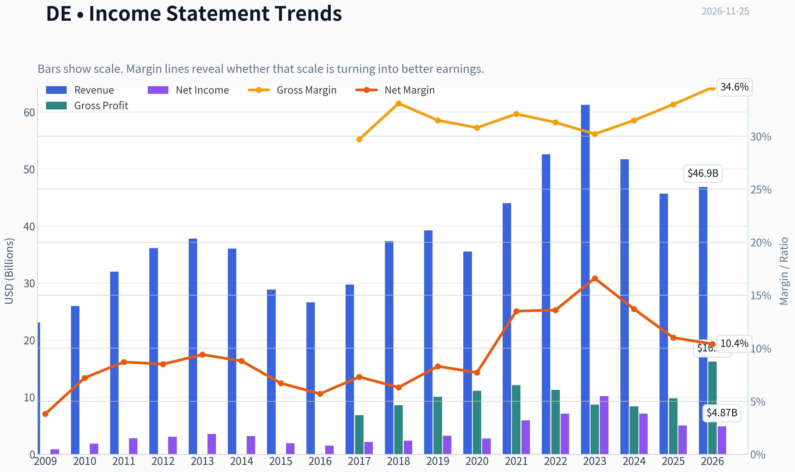

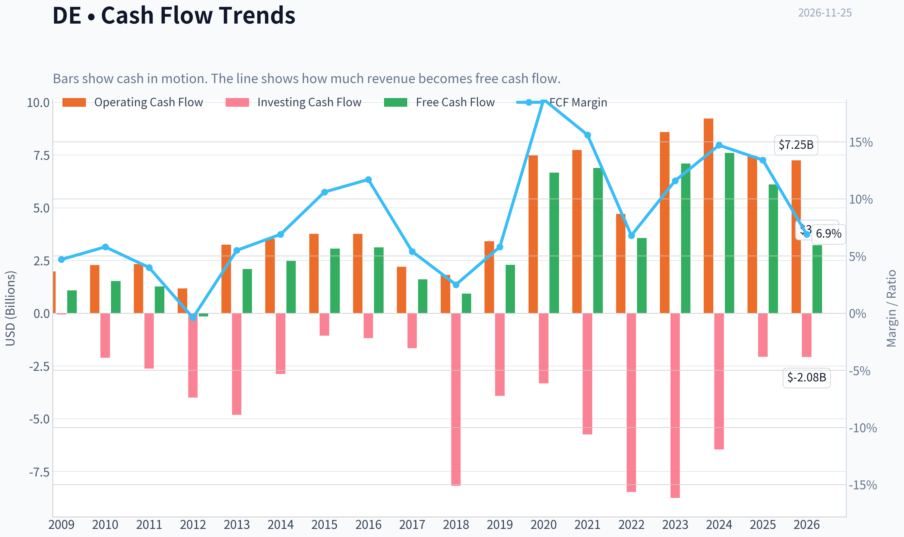

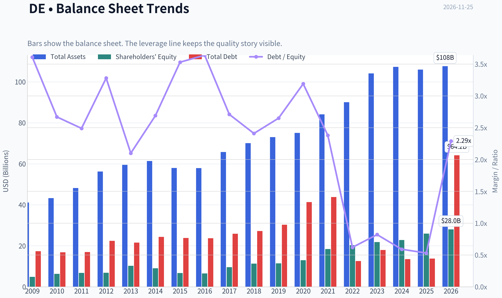

This graph tracks the profitability and return metrics (ROE, ROIC, Margins) of **DE** over the past decade, highlighting capital efficiency trends.

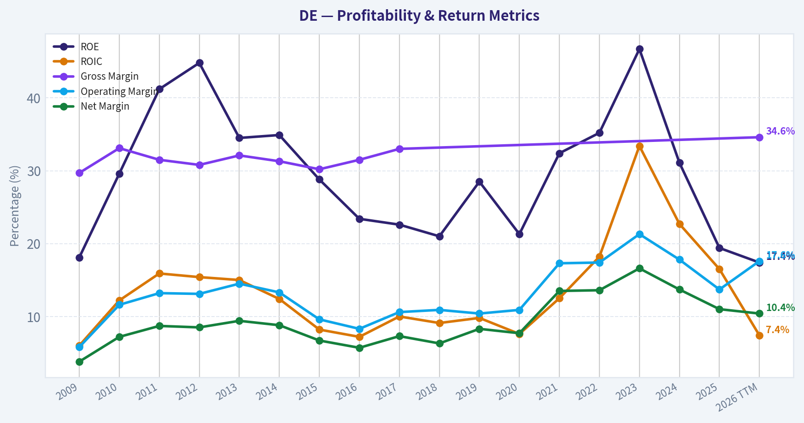

This chart illustrates the financial health of **DE** over the last 10 years, mapping cash equivalents and free cash flow against total obligations (Debt).

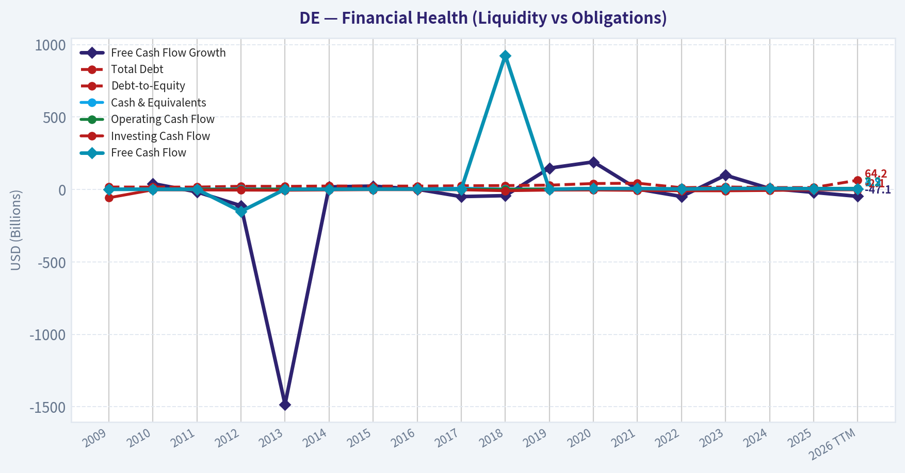

This comparison chart from *Profitability and Earnings Quality* stacks current figures against historical benchmarks for **DE**, making it easy to see where the company trades relative to its own averages.

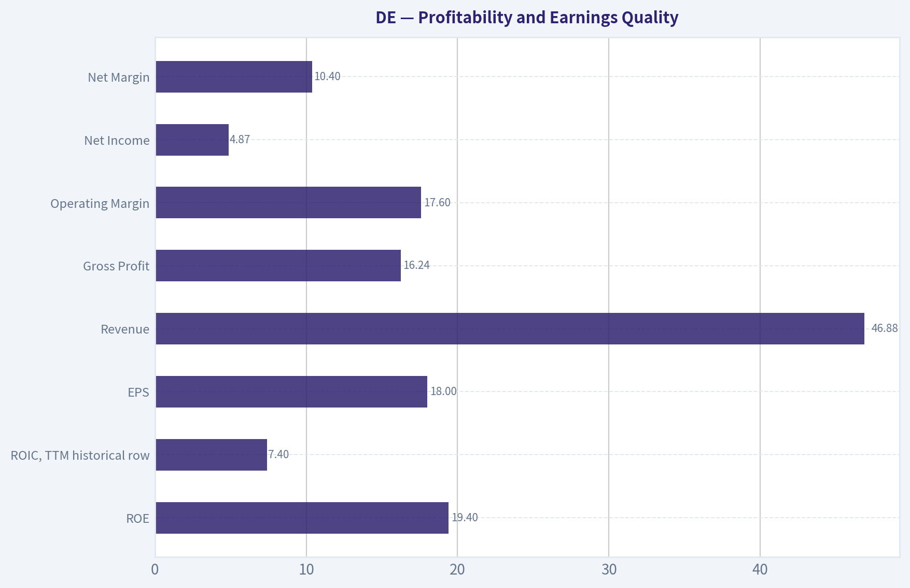

This breakdown chart from <em>Revenue Breakdown</em> shows the proportional composition for **DE** - useful for understanding what drives or risks the business.

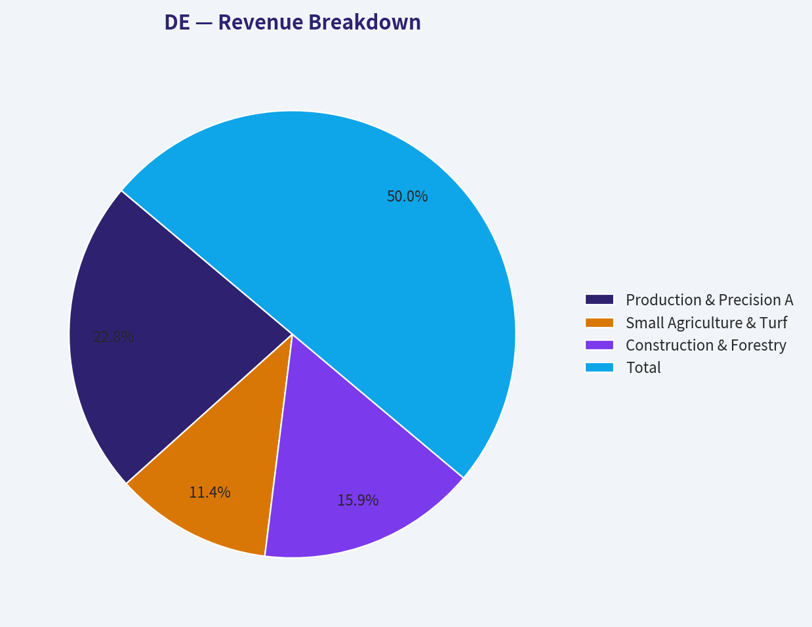

---

### Intrinsic Value Analysis (Buffett)

> *Following Warren Buffett's value investing philosophy: Circle of Competence, Economic Moat, Management Quality, and Margin of Safety.*

#### Intrinsic Value Snapshot

Price is what you pay. Intrinsic value is what the business may be worth based on the cash it can create for owners over time. We show a range, not one magic number.

- Current Price: $613.76
- Value Range (conservative to optimistic across both DCF methods): $50.14 to $1,215.44

##### Owner Earnings (Buffett Method)
- Net Income: $5,027,000,000.00
- Depreciation & Amortization: $2,229,000,000.00
- Capital Expenditures: $-1,360,000,000.00
- Working Capital Changes: $-443,000,000.00
- Owner Earnings: $5,465,000,000.00

##### Intrinsic Value
###### Buffett Method
Uses owner earnings. Stricter, and usually more conservative.
- Conservative: $282.38
- Average: $403.40
- Optimistic: $403.40
- Discount Rate: 8.3%

###### Cash Flow Method
Uses free cash flow. Better for companies spending heavily today to grow tomorrow.
- Conservative: $50.14
- Average: $479.43
- Optimistic: $1,215.44
- Discount Rate: 9.1%

ANALYST STANCE: **Neutral**

#### Executive Summary

Deere & Co. is a high-quality agricultural and construction equipment franchise with meaningful brand strength, a global dealer network, financing capabilities, and increasing precision-agriculture technology. Its long-term economics are attractive, but the current valuation is materially above the DeepValues intrinsic value of **$403.40 per share**, compared with a price of approximately **$614**.

The business is experiencing a cyclical earnings slowdown, with revenue down **11.7% year over year**, while the stock price has already recovered strongly. The evidence supports a **Neutral** stance: Deere is a potentially durable compounder, but the present valuation does not provide an adequate margin of safety for a cyclical, capital-intensive business.

#### 1. Factor Scorecard

| Factor | Score | Assessment |
|---|---:|---|
| Circle of Competence & Simplicity | 3.5/5 | Deere manufactures and finances equipment, then supports customers through dealers, parts, service, and software. The model is understandable, though cyclical and increasingly technology-enabled. |
| Moat | 4.0/5 | Strong brand, dealer density, parts ecosystem, customer relationships, financing, and precision-agriculture integration create meaningful customer attachment. |
| Management & Capital Allocation | 3.5/5 | Long operating history, durable dividend policy, and cyclical buyback discipline are positives. Deere's finance arm and debt structure require ongoing oversight. |
| Industry Structure | 3.5/5 | Scale and dealer networks support an oligopolistic structure, but agricultural equipment demand is cyclical and capital intensive. |
| Gate 5: Quality/Solvency Floor | **Not tripped** | Earnings and revenue have weakened, but there is no evidence of financial distress, interest coverage below 1x, or an Altman-style solvency crisis. |

**Key Takeaways:** Deere scores well on business quality and competitive durability, but not at the level of an exceptionally predictable, asset-light compounder. The solvency floor is not tripped, so the cyclical downturn is a valuation concern rather than a financial-distress event.

#### 2. Moat Analysis

| Moat Source | Evidence | Assessment |
|---|---|---|
| Brand and intangible assets | Deere is one of the most recognizable names in agricultural machinery, with a reputation for reliability and resale value. | Strong |
| Switching costs | Equipment purchases involve dealer relationships, maintenance history, operator familiarity, parts availability, and software integration. | Strong |
| Cost and scale advantages | Global manufacturing scale, purchasing power, dealer infrastructure, and financing capabilities support competitive economics. | Moderate to strong |
| Network effects and ecosystem | Precision-agriculture data, connected equipment, software, and dealer support become more valuable as the installed base expands. | Emerging and potentially widening |
| Pricing power | Deere can command premium pricing in critical equipment, although farm economics ultimately constrain customer spending. | Moderate |

Deere's moat is best described as **wide and stable, with selected areas widening**. The moat is not based solely on the physical equipment; it also comes from the installed base, dealer network, proprietary parts and service ecosystem, customer data, and precision-agriculture software.

The principal risk is that high equipment prices can encourage customers to defer purchases during weak farm-income periods. Deere therefore has a strong franchise but remains exposed to the agricultural cycle.

#### 3. Management Quality and Capital Allocation

Management has demonstrated several owner-oriented characteristics:

- Deere has maintained a long record of dividend payments.
- Recent coverage indicates that dividends have more than doubled since 2020, although increases have paused for more than a year.
- Buybacks are reportedly reduced when farm incomes weaken, which is more rational than maintaining aggressive repurchases through the cycle.
- The company continues to invest in precision agriculture and connected equipment rather than treating Deere as only a traditional machinery manufacturer.
- The finance business increases customer support and equipment demand but also adds balance-sheet complexity and credit exposure.

The principal deduction is that Deere's financial structure is not as simple as a pure industrial manufacturer. The company combines equipment operations with a substantial financing operation, so reported debt should be interpreted in light of the finance subsidiary and its receivables.

Overall management score: **3.5 out of 5**.

#### 4. Financial Summary

| Metric | Latest Available Figure |
|---|---:|
| Share price | $614 |
| Market capitalization | $165.49 billion |
| Price-to-earnings ratio | 34.1x |
| Return on equity | 19.4% |
| Revenue growth, year over year | -11.7% |
| Free-cash-flow yield | 3.7% |
| Operating income used in valuation | $6.4 billion |
| After-tax operating income | $5.0 billion |
| Cash and marketable securities | $8.9 billion |
| Debt | $17.1 billion |
| Net cash/(net debt) | $(8.2) billion |
| Shares outstanding used in valuation | 271 million |

**Key Takeaways:** Deere retains a respectable 19.4% return on equity, but current revenue momentum is negative and the free-cash-flow yield is only 3.7%. The 34.1 times earnings multiple is demanding for a cyclical industrial company, particularly while earnings are below recent peak conditions.

#### 5. Owner Earnings Calculation

The DeepValues Buffett methodology uses the following trailing figures:

| Owner Earnings Component | Amount |
|---|---:|
| After-tax operating income | $5.0 billion |
| Depreciation and amortization | +$2.3 billion |
| Maintenance-capital-expenditure charge | -$1.4 billion |
| Working-capital investment | -$0.0 billion |
| Estimated owner earnings | **$6.0 billion** |
| Owner earnings per share | **Approximately $22.14** |

The maintenance-capital-expenditure charge is based on a three-year average capital-expenditure-to-revenue relationship. This produces owner earnings of approximately **$6.0 billion**, materially below the company's equity market capitalization.

**Key Takeaways:** Deere converts a substantial portion of accounting earnings into owner earnings, but the resulting $22.14 per-share figure does not support a $614 share price under conservative assumptions. The owner-earnings calculation is more useful than reported free cash flow here because it adjusts capital spending toward a maintenance level.

#### 6. Three-Scenario DCF Valuation

The following scenarios use estimated owner earnings of $6.0 billion and 271 million shares. They are sensitivity checks; the DeepValues app value remains the primary intrinsic-value figure.

| Scenario | Main Assumptions | Estimated Value Per Share |
|---|---|---:|
| A: No growth | Owner earnings capitalized at 10% | **$221** |
| B: GDP-like growth | 3% perpetual growth, 10% discount rate | **$326** |
| C: Historical-growth sensitivity | Approximately 3.9% growth for 10 years, then terminal value | **$379** |
| DeepValues headline intrinsic value | 5.2% initial growth fading to 2.5%; 8.3% discount rate | **$403.40** |
| Secondary DVI scenario model | Separate cross-check only | $367.06 |

The DeepValues headline intrinsic value is **$403.40 per share**, based on:

- Owner earnings of approximately $6.0 billion
- Initial growth of 5.2%, fading to 2.5%
- Discount rate of 8.3%
- Net debt of approximately $8.2 billion
- 271 million shares outstanding

**Key Takeaways:** Even the more optimistic owner-earnings scenarios remain below the current price. The headline valuation is more favorable than the no-growth and GDP-growth cases, but it still indicates that the market price requires strong execution and a sustained recovery in Deere's earnings cycle.

#### 7. Margin of Safety Analysis

| Measure | Result |
|---|---:|
| Current price | Approximately $614 |
| DeepValues intrinsic value | $403.40 |
| Price premium to intrinsic value | Approximately 52% |
| Margin of safety versus intrinsic value | **-52.1%** |
| Free-cash-flow yield | 3.7% |
| Required margin for a cyclical industrial business | Approximately 25%-35% |

At approximately $614, Deere trades about **52% above** the DeepValues intrinsic value. That is the opposite of a margin of safety. A premium may be justified for a truly exceptional, highly predictable compounder, but Deere's exposure to farm incomes, equipment replacement cycles, interest rates, and financing conditions makes that standard difficult to justify.

The reverse-DCF implication is also demanding: the current price appears to require sustained owner-earnings growth and a robust cyclical recovery, rather than merely a return to normalized operations.

#### 8. Final Buffett Scorecard

| Criterion | Weight | Score | Weighted Contribution |
|---|---:|---:|---:|
| Moat width and durability | 25% | 4.0 | 1.00 |
| Valuation and margin of safety | 20% | 1.0 | 0.20 |
| Capital returns versus WACC | 15% | 3.5 | 0.53 |
| Business understanding and predictability | 12% | 3.5 | 0.42 |
| Management quality and capital allocation | 12% | 3.5 | 0.42 |
| Reinvestment runway | 8% | 3.5 | 0.28 |
| Balance-sheet strength | 4% | 2.5 | 0.10 |
| Industry structure | 4% | 3.5 | 0.14 |
| **Total** | **100%** |  | **3.09/5** |

**Key Takeaways:** Deere's quality characteristics are generally good, led by its moat and reinvestment opportunities. The valuation score is the decisive weakness: the stock price substantially exceeds the primary intrinsic-value estimate, bringing the total score into the Neutral range.

#### 9. Investment Stance

**ANALYST STANCE: Neutral**

**Conviction: Medium-high.**

Deere is a legitimate Buffett-style business in several respects: recognizable brand, durable customer relationships, dealer-based switching costs, pricing power, recurring parts and service revenue, and a potentially valuable precision-agriculture ecosystem. Its balance sheet and finance operations deserve continued monitoring, but the Gate 5 solvency floor is not tripped.

The central issue is valuation. At approximately **$614**, the market price is materially above the **$403.40** DeepValues intrinsic value and offers no meaningful margin of safety for a cyclical industrial franchise. The evidence supports continued attention to the business, but it does not support the current valuation as a compelling value opportunity.
#### Valuation Bridge

This bridge places the current market price beside each intrinsic value lens so readers can see whether upside depends on one method or shows up across several methods.

| Scenario | Intrinsic Value / Share |
| --- | ---: |
| Buffett Method | $403.40 |
| Cash Flow Method | $479.43 |
| Damodaran Method | $151.35 |
| Current Price | $613.76 |

#### Key Takeaways

If one method is far above the others, the upside case depends on a specific modelling assumption. When several methods cluster together, the valuation story is more robust.

#### Valuation Visuals

This comparison chart from *Latest Earnings Snapshot* stacks current figures against historical benchmarks for **DE**, making it easy to see where the company trades relative to its own averages.

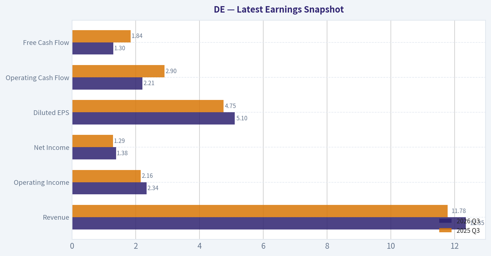

This comparison chart from *Current Metrics Versus Historical Averages* stacks current figures against historical benchmarks for **DE**, making it easy to see where the company trades relative to its own averages.

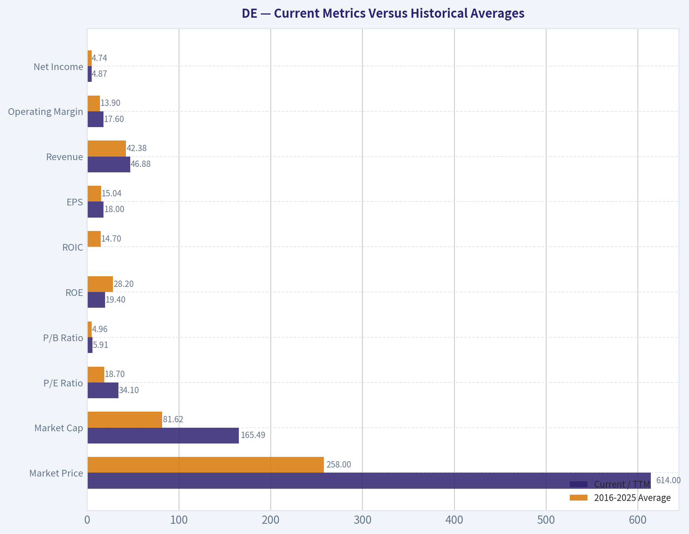

This comparison chart from *Balance Sheet and Financial Strength* stacks current figures against historical benchmarks for **DE**, making it easy to see where the company trades relative to its own averages.

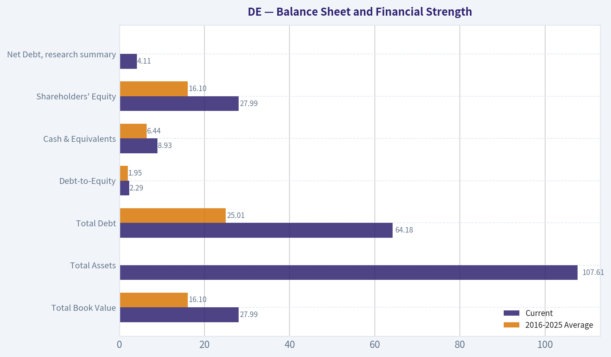

This comparison chart from *Financial Summary* stacks current figures against historical benchmarks for **DE**, making it easy to see where the company trades relative to its own averages.

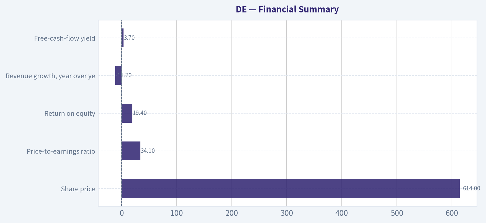

---

### Trend & Growth Analysis (Lynch/Druckenmiller/Fisher)

> *Following Peter Lynch's GARP, Stanley Druckenmiller's macro-aware approach, and Philip Fisher's scuttlebutt methodology.*

ANALYST STANCE: **Neutral**

#### 1. Lynch Classification and Story

**Classification: Cyclical with secular technology exposure, not a fast grower.**

| Lynch question | Assessment |
|---|---|
| Current growth profile | Revenue down 11.7% year over year |
| Business type | Agricultural, construction, and forestry equipment |
| Main growth drivers | Precision agriculture, autonomy, automation, replacement demand, global farm productivity |
| Main constraint | Highly cyclical farm income, interest rates, commodity prices, and dealer inventories |
| Ten-bagger characteristics | Strong franchise and technology potential, but current scale and valuation make a ten-bagger difficult |

**Key Takeaways:** Deere is a high-quality industrial franchise, but its current earnings profile is cyclical rather than that of a 15%-25% compound-growth company. The long-term technology opportunity is meaningful, although the present data show contraction rather than an accelerating growth inflection.

**The story in three bullets:**

- Deere sells mission-critical equipment that helps farms and contractors increase productivity.
- Precision agriculture, autonomy, software, and connected equipment could expand Deere's revenue per customer and improve recurring economics.
- The current valuation assumes a substantial recovery despite revenue declining 11.7% year over year.

#### 2. TAM and 10x Test

| TAM factor | Assessment |
|---|---|
| Core market | Large global agricultural, construction, and forestry equipment markets |
| Adjacent opportunity | Precision agriculture, autonomy, farm-management software, data services, and aftermarket parts |
| Current revenue base | Approximately tens of billions of dollars annually; exact revenue was not available in the shared pack |
| 10x revenue test | Not demonstrated: a tenfold revenue outcome would require either very large market expansion, major share gains, or substantial software and services penetration |
| TAM growth | Equipment demand is cyclical; precision-agriculture and autonomy segments likely grow faster than the underlying equipment market |

**Key Takeaways:** Deere has a sizable addressable market and credible adjacent software opportunities. However, the 10x test is not clearly passed at its present scale; the investment case depends more on durable compounding and technology-enabled monetization than on a straightforward tenfold expansion of the legacy equipment business.

#### 3. Revenue Growth and Inflection Point

| Indicator | Latest evidence | Interpretation |
|---|---:|---|
| Revenue growth | -11.7% year over year | Cyclical contraction |
| Quarterly earnings outlook | Fourth-quarter net income projected around $1.1 billion, approximately flat year over year | Recovery is not yet accelerating |
| Share performance | Up approximately 32% in 2026 according to cited coverage | Market has anticipated some recovery |
| Dividend | Unchanged for more than a year | Suggests caution around the current cycle |
| Guru activity | Steve Cohen added; Stanley Druckenmiller exited; Seth Klarman held according to latest 13F snapshots | Mixed institutional signal |

**Key Takeaways:** The evidence points to stabilization rather than a confirmed acceleration. Deere may be approaching a cyclical trough, but flat projected earnings and negative revenue growth do not yet establish a powerful earnings inflection. The stock's strong year-to-date performance raises the risk that recovery expectations are already reflected in valuation.

**Inflection-point assessment:**

- **Product inflection:** Positive potential from autonomy and precision agriculture, but current monetization data are insufficient.
- **Market-share inflection:** Not established by the available information.
- **Margin inflection:** Possible through software, automation, and aftermarket revenue, but no current gross-margin data were supplied.
- **TAM inflection:** Precision agriculture expands the opportunity, though its contribution to consolidated results remains unclear.
- **Competitive inflection:** No clear evidence of a major competitor failure.
- **Overall assessment:** **Potential future inflection, not yet confirmed in reported results.**

#### 4. Unit Economics and Profitability

| Metric | Result | Interpretation |
|---|---:|---|
| LTV/CAC | Not disclosed | Cannot verify customer-acquisition economics |
| Net revenue retention | Not disclosed | Software and services retention cannot be assessed |
| Rule of 40 | Not meaningful from available data | Revenue growth is negative and FCF margin was not supplied |
| ROE | 19.4% | Strong industrial profitability |
| FCF yield | 3.7% | Moderate cash-flow support at the current valuation |
| Net debt | Approximately $8.2 billion net debt in the valuation model | Adds financial sensitivity during a downturn |

**Key Takeaways:** Deere has strong historical profitability, but the metrics needed to evaluate a software-like compounding model are unavailable. The 19.4% ROE is favorable, while the 3.7% FCF yield provides only moderate valuation support given the cyclical revenue decline and net debt.

#### 5. Macro Setup

| Macro factor | Impact on Deere |
|---|---|
| Farm income | Lower crop prices or weak farm profitability can defer equipment purchases |
| Interest rates | Higher financing costs pressure dealer and farmer demand |
| Replacement cycle | Aging fleets can support a future recovery |
| Commodity prices | Strong crop prices improve capital spending capacity |
| Technology adoption | Autonomy and precision agriculture create a secular tailwind |
| Economic cycle | Current setup appears late-cycle or recovery-sensitive rather than clearly early-cycle |

**Key Takeaways:** Deere benefits from long-term agricultural productivity trends, but near-term macro conditions remain central. The secular technology tailwind is favorable, while farm income, interest rates, and replacement timing create substantial earnings volatility.

#### 6. Fisher 15-Point Assessment

| Fisher criterion | Score / 5 | Rationale |
|---|---:|---|
| Market potential | 4 | Large equipment and precision-agriculture markets |
| New-product determination | 4 | Clear emphasis on autonomy and precision technology |
| R&D effectiveness | 4 | Technology platform is strategically important |
| Sales organization | 4 | Established dealer and distribution network |
| Profit margins | 4 | Strong historical industrial economics |
| Margin improvement | 3 | Potential exists, but current evidence is limited |
| Labor relations | 3 | Insufficient current evidence |
| Executive relations | 3 | Insufficient current evidence |
| Management depth | 4 | Large, established global organization |
| Cost analysis and accounting | 4 | Mature public-company reporting |
| Outstanding competitive aspects | 5 | Brand, dealer network, installed base, data, and switching costs |
| Long-range profit outlook | 4 | Favorable if technology monetization succeeds |
| Dilution risk | 4 | No major dilution issue identified in the supplied data |
| Candor | 3 | Insufficient evidence for a higher score |
| Integrity | 4 | No major integrity concern identified |

**Fisher score: 55 / 75 - Good**

**Key Takeaways:** Deere scores well on market position, distribution, technology opportunity, and competitive advantages. The score is held back by limited evidence on current margin expansion, retention economics, management candor, and labor or executive relations.

#### 7. Valuation

| Valuation measure | Result | Interpretation |
|---|---:|---|
| Share price | $614 | Current market reference |
| Market capitalization | $165.49 billion | Large-cap industrial valuation |
| P/E | 34.1x | High for a cyclical equipment manufacturer |
| Revenue growth | -11.7% | Makes the P/E difficult to justify through current growth |
| FCF yield | 3.7% | Implies a relatively demanding cash-flow valuation |
| Owner-earnings intrinsic value | $403.40 headline value | Approximately 52.1% below the current price |
| Owner-earnings valuation range | $282.38-$403.40 | Conservative-to-optimistic range |
| Damodaran FCFF range | $60.08-$298.20 | Highly sensitive to assumptions |
| Secondary DVI scenario | $367.06 | Cross-check only, not the headline intrinsic value |

**Key Takeaways:** The supplied valuation models consistently show that the $614 market price requires a strong recovery and favorable long-term assumptions. The headline owner-earnings value of $403.40 is approximately 34% below the current price, while the stated margin of safety is negative 52.1% under the app's methodology. A 34.1x P/E is demanding for a company currently reporting negative revenue growth.

**PEG analysis:** A conventional PEG ratio is not meaningful because trailing revenue growth is negative and no reliable forward earnings-growth estimate was supplied. Using the current P/E without a credible multi-year earnings-growth rate would create false precision.

#### 8. Valuation Sensitivity

| Scenario | Business assumption | Valuation implication |
|---|---|---|
| Bear | Prolonged farm-equipment downturn, weak replacement demand, limited software contribution | Owner-earnings valuation near the lower end of the $282.38-$403.40 range or below |
| Base | Cyclical recovery, stable franchise economics, moderate precision-agriculture adoption | Around the $403.40 headline owner-earnings value |
| Bull | Rapid autonomy adoption, recurring software monetization, strong replacement cycle, margin expansion | Current valuation becomes more defensible, but requires several favorable developments |
| Multiple risk | Earnings remain cyclical while the market applies a premium multiple | Significant downside sensitivity |
| Recovery risk | Revenue stabilizes but does not accelerate | Valuation may remain ahead of fundamentals |

**Key Takeaways:** The bull case requires more than a normal equipment-cycle recovery; it requires technology-led margin and revenue expansion. The base valuation is below the current market reference, so the present price has limited tolerance for execution delays, weaker farm economics, or multiple compression.

#### 9. Growth Investor Scorecard

| Criterion | Weight | Score / 5 | Weighted contribution |
|---|---:|---:|---:|
| Story | 10% | 4.0 | 0.40 |
| TAM and runway | 20% | 3.5 | 0.70 |
| Revenue growth | 20% | 2.0 | 0.40 |
| Unit economics | 15% | 2.5 | 0.38 |
| Competitive position | 10% | 4.5 | 0.45 |
| Management quality | 10% | 3.5 | 0.35 |
| Macro setup | 5% | 3.0 | 0.15 |
| Profitability path | 5% | 4.0 | 0.20 |
| Valuation | 5% | 1.5 | 0.08 |
| **Total** | **100%** |  | **3.1 / 5.0** |

**Key Takeaways:** Deere's competitive position and long-term technology story are strong, but current revenue contraction, limited unit-economics disclosure, macro cyclicality, and valuation pressure reduce the overall score. A 3.1 out of 5 places the company in the **Neutral** range rather than the high-conviction growth category.

#### 10. Key Catalysts and Risks

| Catalysts | Risks |
|---|---|
| Farm-equipment replacement cycle turns upward | Revenue decline persists across multiple quarters |
| Higher crop prices improve farm capital spending | Farm income and commodity prices weaken |
| Precision agriculture adoption accelerates | Autonomy investment fails to produce attractive returns |
| Software and data services become material revenue streams | Current premium multiple contracts |
| Operating leverage emerges as volumes recover | Dealer inventories remain elevated |
| Evidence of market-share gains | Net debt amplifies cyclical downturn pressure |
| Reacceleration in revenue and earnings | Technology benefits remain mostly strategic rather than financial |

**Key Takeaways:** The most important catalyst would be simultaneous revenue reacceleration and evidence that precision technology is improving recurring revenue or margins. The central risk is that Deere remains a cyclical equipment manufacturer valued as though a technology-led compounding phase has already begun.

#### Overall Conclusion

Deere is a high-quality franchise with a credible secular opportunity in precision agriculture and autonomy. However, the current evidence shows a cyclical downturn, not an established growth inflection, while the $614 valuation is above the supplied $403.40 headline intrinsic value. The appropriate research stance is **Neutral**: the company becomes materially more compelling if reported revenue growth reaccelerates, technology monetization becomes measurable, and valuation better reflects cyclical risk.

---

### Market Technical Analysis

ANALYST STANCE: **Neutral**

#### Scope and data status

This analysis covers **Deere & Co. (NYSE: DE; SEC CIK 0000315189)** only. The retrieved dataset contains 251 daily records from November 25, 2025 through November 24, 2026. November 25, 2026 is identified as a non-trading day in the indicator reports, so November 24 is the latest usable observation.

The latest closing price was **$613.76**, down from the September 23 record-period high of **$707.79**. That represents a decline of approximately **13.3%** from the high, although the one-year change from the November 25, 2025 close of $492.51 remains positive at approximately **24.6%**.

#### Selected indicators

The selected set uses eight indicators with complementary roles:

- **close_10_ema:** short-term price direction and momentum.
- **close_50_sma:** intermediate trend structure.
- **close_200_sma:** long-term trend benchmark.
- **macd:** momentum regime and trend-transition signal.
- **rsi:** momentum strength and potential oversold conditions.
- **boll_ub:** upper volatility boundary and prior extension zone.
- **boll_lb:** lower volatility boundary and current downside-pressure context.
- **atr:** current trading-range volatility.

The Bollinger middle line and MACD signal line were not separately selected because the selected Bollinger bands already define the relevant volatility envelope, while MACD provides the primary momentum series without adding another highly correlated moving-average signal.

#### Price trend and moving-average structure

DE's longer-term trend remains constructive, but the shorter and intermediate trends have deteriorated materially.

The **200-day SMA was $613.12** on November 24, almost exactly aligned with the $613.76 close. This is important because the long-term trend has not yet clearly broken down: price remains marginally above the 200-day benchmark, and the 200-day SMA itself has been rising steadily. It increased from approximately $497.59 in March to $613.12 in November, showing that the broader one-year trend still incorporates substantial prior strength.

The more immediate picture is weaker. The **50-day SMA was $661.23**, placing the close roughly **7.2% below** that intermediate trend reference. The 50-day SMA has also started to flatten after rising through September and October. This indicates that the earlier advance has lost momentum rather than continuing in a clean trend.

The **10-day EMA was $639.39**, around **4.2% above** the latest close. The short-term average has fallen sharply from $675.75 on November 12 to $639.39 on November 24. That decline confirms that the recent weakness is not merely a one-day fluctuation; it reflects a sustained sequence of lower closes through November.

The moving-average configuration is therefore split into three layers:

1. The long-term trend remains barely positive because price is still just above the 200-day SMA.
2. The intermediate trend is negative because price is below the 50-day SMA.
3. The short-term trend is also negative because price is below the declining 10-day EMA.

This is a transition structure rather than a uniformly bullish or uniformly bearish one.

#### Momentum: MACD and RSI

The momentum readings have weakened substantially.

The MACD was **-9.05** on November 24, compared with **+7.83** on November 11 and **+5.08** on November 16. The move from positive to negative territory occurred as the November decline accelerated. This indicates that the short-term momentum impulse has reversed and that downside price movement is currently exerting greater influence on the MACD calculation.

The sequence is also notable because MACD had recovered from negative readings in late October to positive territory in early November. That recovery failed to produce a durable continuation, and the subsequent reversal back below zero suggests that the October-to-November improvement was not fully established.

The **RSI was 37.43** on November 24. This is weak momentum, but it is not yet at the conventional oversold threshold near 30. RSI reached 62.48 on November 9 and 62.02 on November 11 before falling to 32.00 on November 20. The rebound to 42.46 on November 23 failed to persist, with RSI falling again to 37.43 after the November 24 decline.

This behavior indicates that downside momentum is meaningful, but the indicator does not yet show an extreme oversold condition. The RSI pattern is consistent with a market that has moved from positive momentum into a weaker, risk-sensitive regime rather than one that has already completed a clear momentum washout.

#### Bollinger-band positioning

The latest close was **$613.76**, while the Bollinger bands were:

- Upper band: **$707.71**
- Lower band: **$609.59**

Price was therefore only about **$4.17 above the lower band**, or roughly **0.7% above it**. This is a near-lower-band reading and confirms that the recent decline has pushed DE toward the lower boundary of its short-term volatility range.

However, proximity to the lower band does not by itself establish a reversal. The lower band has fallen from approximately $700.06 on November 16 to $609.59 on November 24. That sharp contraction in the band's level reflects both the price decline and the changing 20-day distribution of returns. In other words, the lower band is moving downward with the market rather than remaining fixed while price merely tests it.

The current configuration has two competing implications:

- Price near the lower band shows that downside pressure is extended relative to the recent 20-day range.
- The falling lower band indicates that the volatility envelope is adapting to a lower price regime, so the reading is not automatically a bullish exhaustion signal.

The latest close also sits only slightly above the 200-day SMA, making the interaction between the lower Bollinger band and the long-term moving average particularly important for trend interpretation.

#### Volatility and trading-range conditions

The **ATR was $20.76** on November 24, up from $18.64 on November 4 and $19.40 on November 20. ATR has not reached the very elevated levels seen during some earlier sharp moves, but it is clearly above the quieter conditions observed in parts of the summer.

At $20.76, the average true range is approximately **3.4% of the latest closing price**. This means daily price movement has become more consequential in percentage terms, and short-term signals may be more prone to abrupt reversals. The November 24 session itself ranged from $607.87 to $638.54, a spread of approximately $30.67, which was substantially wider than the current ATR.

The volatility evidence therefore reinforces the momentum analysis: DE is experiencing a more unstable decline, not simply a slow drift below its intermediate average.

#### Integrated interpretation

The evidence points to a **long-term uptrend under near-term technical stress**.

The positive component is the rising 200-day SMA and the fact that the latest close remains marginally above it. The one-year price performance also remains positive despite the pullback from the September high. These features suggest that the broader trend has not yet been decisively invalidated.

The negative component is more immediate and internally consistent. Price is below both the 10-day EMA and 50-day SMA; the 10-day EMA is declining; the 50-day SMA has begun to flatten; MACD has crossed into negative territory; RSI is below 40; and price is close to the lower Bollinger band. Together, these readings describe deteriorating short- and medium-term momentum.

The key technical tension is concentrated near the **$613 area**, where the latest close and the 200-day SMA are nearly identical. A sustained separation above that benchmark would be consistent with long-term trend resilience, while sustained trading below it would make the previously rising 200-day structure less supportive. The current data do not establish either outcome because the latest observation is almost exactly at that long-term reference.

From a valuation perspective, the technical evidence does not by itself support assuming that the prior premium associated with the September high remains fully justified. The price is still materially above its 200-day average, but the weakening intermediate and short-term structure indicates that the market is reassessing the prior advance. A more constructive valuation interpretation would require evidence that momentum stabilizes while the long-term trend remains intact; a more cautious interpretation would follow from a sustained break below the 200-day benchmark accompanied by continued negative MACD and weak RSI.

| Indicator / area | Latest reading | Direction or condition | Interpretation |
|---|---:|---|---|
| Latest close | $613.76 on Nov. 24, 2026 | Down from $707.79 high | Approximately 13.3% below the period high, but still up about 24.6% year over year |
| 10-day EMA | $639.39 | Declining and above price | Short-term momentum is negative |
| 50-day SMA | $661.23 | Above price and flattening | Intermediate trend has weakened materially |
| 200-day SMA | $613.12 | Nearly equal to price; still rising | Long-term trend remains marginally positive but is being tested |
| MACD | -9.05 | Fell from positive to negative | Momentum regime has reversed toward weakness |
| RSI | 37.43 | Below neutral, above conventional oversold | Weak momentum without an extreme oversold reading |
| Bollinger bands | Upper $707.71; lower $609.59 | Price near lower band | Downside pressure is extended, but the falling band does not confirm a reversal |
| ATR | $20.76 | Elevated versus early November | Daily volatility and reversal risk have increased |
| Overall technical state | - | Long-term support versus short-term deterioration | Watch condition: the trend is transitional, with the 200-day SMA as the central technical reference |

**Key Takeaways:** DE's long-term trend remains only marginally constructive because the latest close is just above the rising 200-day SMA. Short- and medium-term evidence is considerably weaker: price is below the 10-day EMA and 50-day SMA, MACD is negative, RSI is below 40, and price is close to the lower Bollinger band. The technical evidence therefore supports a watch stance centered on whether the long-term trend benchmark continues to function as support or becomes part of a broader deterioration.

---

### Options Market Analysis

> *Reading options flow - put/call ratios, IV skew, and unusual activity - to gauge institutional positioning and event-driven risk.*

ANALYST STANCE: **BEARISH** - low confidence

#### 1. Put/Call Ratio Analysis

| Expiration | Call Volume | Put Volume | Volume Put/Call Ratio | Call OI | Put OI | OI Put/Call Ratio |
|---|---:|---:|---:|---:|---:|---:|
| Nov. 27, 2026 | 2,356 | 3,035 | 1.29 | 0 | 0 | N/A |
| Dec. 4, 2026 | 484 | 607 | 1.25 | 0 | 0 | N/A |
| Dec. 11, 2026 | 324 | 281 | 0.87 | 0 | 0 | N/A |
| **Aggregate** | **3,164** | **3,923** | **1.24** | **0** | **0** | **N/A** |

**Key Takeaways:** Near-term put volume exceeds call volume, with an aggregate put/call volume ratio of 1.24 versus the approximately 0.7 neutral reference level. This indicates a modest downside or hedging bias, concentrated in the Nov. 27 and Dec. 4 expirations. However, zero reported open interest makes it impossible to determine whether the activity represents new trades or the closing of existing contracts.

#### 2. Implied Volatility Assessment

| Expiration | Call ATM IV | Put ATM IV | Put-Call IV Difference | Interpretation |
|---|---:|---:|---:|---|
| Nov. 27, 2026 | 3.9% | 3.2% | -0.7 percentage points | Call IV higher |
| Dec. 4, 2026 | 2.4% | 1.7% | -0.7 percentage points | Call IV higher |
| Dec. 11, 2026 | 1.7% | 1.2% | -0.5 percentage points | Call IV higher |

The supplied data does not include separate out-of-the-money put and call IV readings, so a conventional OTM volatility-skew calculation is unavailable. The available ATM readings show call IV modestly above put IV, which is not consistent with pronounced downside fear. Absolute IV levels are also unusually low and may reflect stale, incomplete, or poorly populated chain data.

No earnings, product, or other catalyst information is included in the options dataset. Therefore, elevated event-related IV cannot be confirmed.

**Key Takeaways:** The available IV data does not show a conventional downside put skew; calls have slightly higher ATM IV in all three expirations. Absolute IV is extremely low, reducing confidence that these readings accurately capture current market risk. No catalyst premium can be established from the supplied information.

#### 3. Unusual Options Activity

| Finding | Result |
|---|---|
| Contracts with volume greater than 5x open interest | None identified |
| Fresh directional contracts | Not confirmed |
| Smart-money activity | No reliable evidence |
| Retail-speculation signature | No reliable evidence |

No individual contracts were provided as unusual activity. Consequently, there is no usable strike-level information to classify contracts as calls or puts, determine ITM/ATM/OTM status, calculate days to expiration by contract, or infer whether trades were directional.

The absence of unusual activity also means there is no identifiable large sweep, block, or volume/OI imbalance that could be attributed to institutional conviction.

**Key Takeaways:** The dataset contains no contracts with volume exceeding five times open interest. There is therefore no contract-specific evidence of fresh institutional bullish or bearish speculation. The aggregate put-volume tilt remains the main directional clue, but it is not validated by unusual-contract analysis.

#### 4. Open Interest Concentration and Gamma Levels

| Metric | Result |
|---|---|
| Highest call OI strike | Not available; reported call OI is zero |
| Highest put OI strike | Not available; reported put OI is zero |
| Dominant expiration | Not determinable from OI |
| Max-pain estimate | Unavailable |
| Gamma walls | No measurable gamma walls |
| Pinning or gravitational levels | Cannot be established |

Because every listed near-term expiration reports zero call and put open interest, no strike or expiration concentration can be identified. Max-pain, dealer-gamma, and price-pinning analysis are consequently unavailable.

**Key Takeaways:** There are no usable open-interest concentrations in the supplied data. This prevents identification of support or resistance effects from options positioning and materially limits confidence in any short-term options-derived directional signal.

#### 5. Overall Options Sentiment Signal

| Component | Assessment | Signal |
|---|---|---|
| Put/call volume | Aggregate ratio of 1.24 | Mildly bearish |
| Put/call open interest | Unavailable because OI is zero | Neutral/inconclusive |
| ATM IV | Extremely low, with calls above puts | Low conviction; no strong downside fear |
| Unusual activity | None detected | Neutral |
| Gamma and OI concentration | Unavailable | Neutral/inconclusive |
| **Overall** | **Put-volume dominance, but severely impaired data quality** | **BEARISH, low confidence** |

The overall signal is **BEARISH**, primarily because near-term put volume is 24% greater than call volume and exceeds the historical neutral reference of roughly 0.7. The bearish interpretation is weak rather than high conviction: open interest is reported as zero across all expirations, no unusual contracts are identified, and the very low IV readings may indicate incomplete or unreliable market data.

The evidence supports a modest downside-leaning options read, but it does not establish strong institutional conviction or a clear catalyst-driven risk premium. Options data alone provides limited support for a bearish valuation interpretation for DE.

**Key Takeaways:** The most defensible directional read is bearish, but confidence is low. The signal comes from elevated put volume rather than from open interest, unusual trades, volatility skew, or gamma concentration. Thin or anomalous data quality should substantially reduce the weight assigned to this options signal.

#### Summary

| Category | Assessment |
|---|---|
| Put/Call Ratio | Volume ratio 1.24, above the approximately 0.7 neutral baseline; OI ratio unavailable |
| IV Level | Extremely low reported ATM IV; reliability is questionable |
| Skew Direction | No conventional OTM skew supplied; ATM IV modestly favors calls over puts |
| Unusual Activity | None detected; no volume greater than 5x open interest |
| Overall Signal | **BEARISH - low confidence**, driven mainly by excess near-term put volume |

**Key Takeaways:** DE's near-term options flow leans bearish because put volume exceeds call volume. Yet the lack of open interest, contract-level unusual activity, and reliable skew data means the signal is not a strong institutional conviction measure.

---

## Research Team Commentary

> *The Research Manager synthesizes the Bull vs Bear debate into action-free commentary. This is a pre-risk view, not the final stance.*

Core Takeaway: Deere is a high-quality cyclical franchise, but the evidence does not establish that $614 offers an adequate margin of safety. Its brand, dealer network, installed base, financing capabilities, and precision-agriculture ecosystem constitute a genuine moat. Still, a 34.12x current P/E alongside an 11.7% revenue decline means the valuation already anticipates a meaningful earnings recovery and continued premium treatment. The appropriate stance is Neutral rather than Bullish because business quality is clearer than valuation support, and rather than Bearish because the available evidence does not prove severe overvaluation or structural deterioration.

Rationale: The strongest bull argument is that Deere should not be viewed as an undifferentiated machinery manufacturer. Its equipment is mission-critical, downtime is costly, and its dealer and service network would be difficult to reproduce. Customer familiarity, parts availability, resale values, financing relationships, and integrated precision-agriculture tools reinforce retention. A 16.6% ROIC and 19.4% ROE support the view that Deere has historically converted these advantages into attractive economics. Management also appears reasonably cycle-aware: the dividend has more than doubled since 2020, while slower buybacks during weaker farm conditions preserve flexibility.

Precision agriculture could deepen the moat over the next decade. Guidance, autonomy, connectivity, data, and software may raise productivity for customers and increase Deere's revenue per installed machine. The most credible version of this thesis is not that Deere becomes a software company; it is that technology improves equipment differentiation, customer retention, service economics, and lifecycle revenue.

The strongest bear argument is valuation, not franchise quality. At $614 and 34.12 times earnings, current implied EPS is approximately $18. Deere would trade at about 24.6 times earnings if sustainable EPS were $25 and 21.9 times if it were $28. Thus, even the optimistic normalization cases do not make the shares conspicuously inexpensive. They require both a substantial earnings recovery and a durable premium multiple.

That matters because $25-$28 of normalized EPS has not been demonstrated by the supplied data. Revenue is contracting, equipment purchases can be deferred, and farm income, crop prices, interest rates, dealer inventories, and used-equipment values can remain unfavorable for several years. Deere's moat can preserve market share and pricing power without preventing a material earnings downturn.

The bull's reverse-DCF discussion is also incomplete. Growing $18 of earnings at 5%-7% sounds reasonable, but distant earnings and terminal values must be discounted. Once that is done, the current price requires meaningful interim cash flows, sustained growth, and a healthy terminal multiple. That is plausible, but it is not a clear margin of safety.

A narrow 10%-15% discount can be sufficient for an exceptionally predictable compounder. Deere deserves recognition for quality, but its cyclicality and finance exposure reduce predictability relative to an asset-light recurring-revenue franchise. A somewhat wider valuation cushion is therefore appropriate. No DeepValues intrinsic-value figure or complete free-cash-flow model was provided, so the case for a discount to intrinsic value remains unproven.

The precision-agriculture narrative also deserves disciplined treatment. Features and adoption do not automatically equal recurring owner earnings. Deere must show that customers pay for these capabilities, that technology raises margins or retention, and that incremental profits exceed development, support, warranty, and cybersecurity costs. Right-to-repair rules and interoperability could also limit ecosystem control.

Financial services add another layer of cyclicality rather than indicating present distress. Equipment demand, used-equipment collateral values, dealer inventories, delinquencies, and credit losses can weaken together. There is no evidence here of solvency trouble, so a hard negative classification would be excessive. Nevertheless, finance-company credit performance and funding costs must be included in normalized value.

The put/call ratio of 1.24 indicates modest near-term hedging or bearish sentiment, but it has little weight in a ten-year appraisal. It may reflect cyclical anxiety already recognized by the market; it does not establish either permanent impairment or undervaluation.

The main lesson from comparable analytical mistakes is to separate a wonderful company from a demonstrably attractive valuation. Deere's brand and technology should not be used to capitalize optimistic earnings or award software economics before monetization is visible. Conversely, one weak revenue year should not be mistaken for permanent franchise erosion. The current evidence supports patience in the research conclusion, not certainty in either direction.

Monitoring Plan: Over the next one to four quarters, the first priority is earnings normalization. Watch production volumes, order trends, dealer inventories, used-equipment prices, and management's demand outlook. Stabilizing revenue and inventories without aggressive discounting would support the view that the decline is cyclical and manageable. Continued double-digit contraction, rising incentives, or repeated production reductions would weaken it.

Second, monitor operating margins, industrial free cash flow, and ROIC rather than focusing only on adjusted EPS. Stable margins and ROIC near the mid-teens during weak demand would demonstrate pricing power and disciplined capacity management. Material margin compression, poor cash conversion, or ROIC moving toward the cost of capital would suggest that recent returns were more cyclical than durable.

Third, evaluate financial-services credit quality through delinquencies, provisions, charge-offs, funding costs, and residual-value assumptions. Stable credit metrics despite weaker farm economics would strengthen the financial-resilience case. Rising losses alongside falling used-equipment values would increase intrinsic-value risk.

Fourth, seek measurable precision-agriculture economics: paid adoption, recurring revenue, customer retention, revenue per connected machine, incremental margins, and returns on technology spending. Product announcements alone are insufficient. Evidence that software and autonomy improve cash flow and reduce cyclicality would justify a higher quality multiple; continued disclosure centered on features rather than economics would not.

Finally, monitor capital allocation. Restrained repurchases at elevated valuations, disciplined capital expenditure, and continued investment in high-return technology would be constructive. Large repurchases during deteriorating fundamentals or technology spending without measurable returns would weaken confidence in management's cycle discipline.

Final stance: Neutral.

---

## Value Investing Team Commentary

> *The Investor translates the research view into an investment thesis before risk review. This is still not the final stance.*

Deere remains a high-quality cyclical franchise, but the supplied evidence supports caution about valuation more strongly than it supports a permanent impairment thesis.

The central positive is Deere's ecosystem rather than its machinery alone. Its dealer and service network, parts availability, financing relationships, installed base, resale values, and precision-agriculture integration create meaningful switching costs. Equipment downtime can be economically significant for farmers and contractors, which supports customer retention and gives Deere advantages that are difficult for a lower-cost competitor to replicate. The 16.6% ROIC is consistent with a business that has historically earned attractive returns on capital, although the durability of that figure must be tested across a full cycle.

The current downturn should not automatically be interpreted as moat erosion. Farm income, crop prices, interest rates, dealer inventories, and used-equipment values can all depress demand simultaneously. A revenue decline of 11.7% may therefore be cyclical rather than structural. The contrarian possibility is that the market is extrapolating weak agricultural conditions too far into the future, while Deere's competitive position remains intact.

However, the reverse argument is equally important: a good franchise can still be an inadequately valued security. At $614 and a reported P/E of 34.12, implied earnings are approximately $18 per share. Even if normalized earnings eventually reach $25-$28, the valuation would still represent roughly 22-25 times those earnings. That may be reasonable for a highly predictable compounder, but Deere's earnings are exposed to a pronounced capital-goods cycle and to credit conditions through its financial-services operations. The price therefore appears to require both earnings normalization and continued premium-market treatment.

The P/E figure should be interpreted carefully. If earnings are temporarily depressed, it can make the multiple appear artificially high just before a recovery. Conversely, if the downturn lasts longer than expected or normalized margins are lower than prior-cycle levels, the same multiple can understate valuation risk. Without a complete through-cycle free-cash-flow model, a DeepValues intrinsic-value estimate, and clearer evidence regarding normalized earnings, the available data do not demonstrate a sufficient discount to intrinsic value.

Precision agriculture is the most important long-term opportunity, but it should not yet receive the economics of a pure software company. Autonomy, connectivity, guidance, and data can improve productivity, retention, and equipment differentiation. The investment-quality evidence would be measurable paid adoption, recurring revenue, higher revenue per connected machine, stronger customer retention, and incremental margins that exceed development, support, warranty, and cybersecurity costs. Product launches alone do not establish those economics. Right-to-repair requirements and interoperability could also limit the degree of ecosystem control.

Management's reported cycle discipline is a constructive feature. Slower repurchases during weaker farm conditions are more rational than using financial flexibility to support aggressive capital returns at the bottom of a cyclical downturn. The dividend record is positive, but dividend growth and buyback behavior should be assessed against free cash flow, leverage, and the needs of the finance subsidiary rather than viewed in isolation.

The financial-services arm deserves particular attention. There is no supplied evidence of distress, but weaker equipment demand, falling collateral values, higher funding costs, dealer stress, and rising delinquencies could reinforce one another. Credit provisions, charge-offs, residual-value assumptions, and funding spreads should be incorporated into normalized owner earnings. This is a source of valuation uncertainty, not proof of structural weakness.

The options data add little to a decade-long appraisal. A put/call ratio of 1.24 indicates near-term hedging or bearish sentiment, but it neither establishes undervaluation nor predicts Deere's long-term earnings power. Contrarian analysis is useful here only in a limited sense: widespread cyclical pessimism could become attractive if operating data stabilize, but sentiment alone is not a margin of safety.

The most informative future evidence would be stabilization in orders and dealer inventories, lower reliance on incentives, resilient industrial margins, healthy free-cash-flow conversion, and ROIC remaining comfortably above the cost of capital. For precision agriculture, the decisive evidence would be monetization and cash returns rather than feature announcements. Conversely, prolonged double-digit revenue contraction, sustained margin pressure, weaker used-equipment values, or deteriorating credit metrics would make the current valuation more difficult to justify.

**ANALYST STANCE: Neutral.** Deere's moat and long-term technology opportunity are credible, and the present weakness may be cyclical rather than permanent. Yet at $614, the available evidence does not establish the quality-scaled discount required for a cyclical industrial business. The valuation remains dependent on a meaningful earnings recovery and durable premium economics that have not been demonstrated by the supplied data.

---

## Deep Values Commentary

> *The Risk Management Team debates and the Risk Judge provides the final action-free verdict. This section determines the final Bullish / Neutral / Bearish stance.*

#### Final Stance Scorecard

This scorecard converts the final research view into a weighted decision frame. It does not replace the narrative judgement, but it makes the main drivers of the verdict easier to scan.

| Criterion | Score | Weight | Commentary |
| --- | ---: | ---: | --- |
| Business Quality | 3.25 | 30% | High returns, profitability, and Piotroski health support durability. |
| Valuation Support | 2.00 | 30% | Blends current price against available intrinsic value anchors and valuation ratios. |
| Financial Strength | 3.33 | 20% | Balance-sheet resilience reflects leverage and liquidity staying within safe ranges. |
| Growth Durability | 1.00 | 20% | Recent revenue, earnings, and free cash flow growth indicate how durable expansion looks. |
| TOTAL / FINAL STANCE | 2.44 | 100% | Neutral |

#### Key Takeaways

The weighted score lands at **2.44 / 5.0**, while the final stance remains **Neutral**. This is useful as a quick calibration aid rather than a mechanical signal.

#### Risk Summary

Higher scores indicate more risk pressure. The watch threshold is a simple guardrail: above it, the dimension weighs more heavily on the valuation case and calls for a wider margin of safety.

| Dimension | Current Score | Watch Threshold | Commentary |
| --- | ---: | ---: | --- |
| Business Quality | 2.75 | 3.00 | High returns, profitability, and Piotroski health support durability. |
| Valuation Support | 4.00 | 3.00 | Blends current price against available intrinsic value anchors and valuation ratios. |
| Financial Strength | 2.67 | 3.00 | Balance-sheet resilience reflects leverage and liquidity staying within safe ranges. |
| Growth Durability | 5.00 | 3.00 | Recent revenue, earnings, and free cash flow growth indicate how durable expansion looks. |

#### Key Takeaways

This view helps readers separate *where* the risk sits: valuation, business quality, balance sheet, or growth durability. It is especially useful when the final stance is close to the line between Neutral and Bearish.
