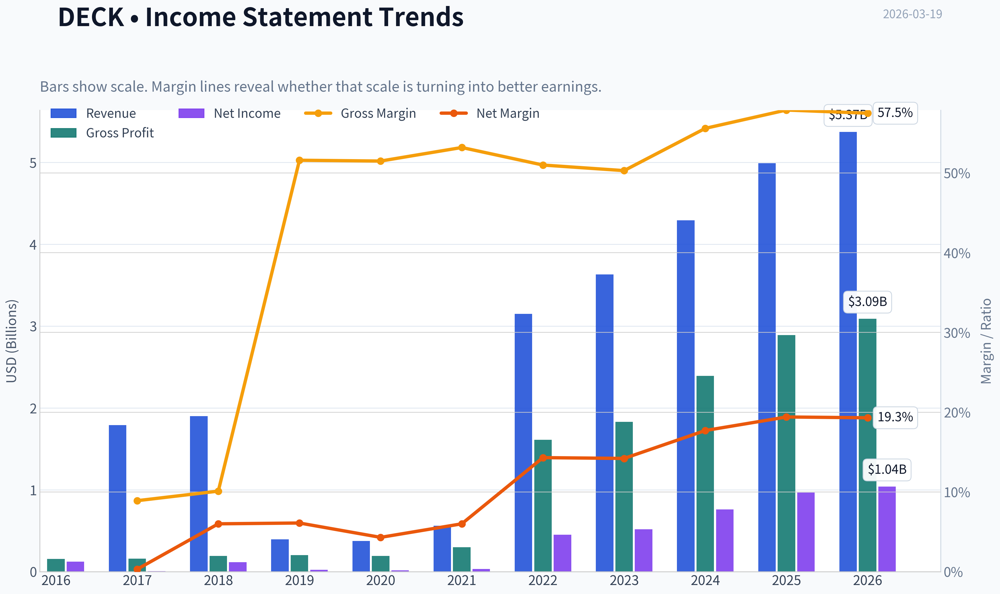
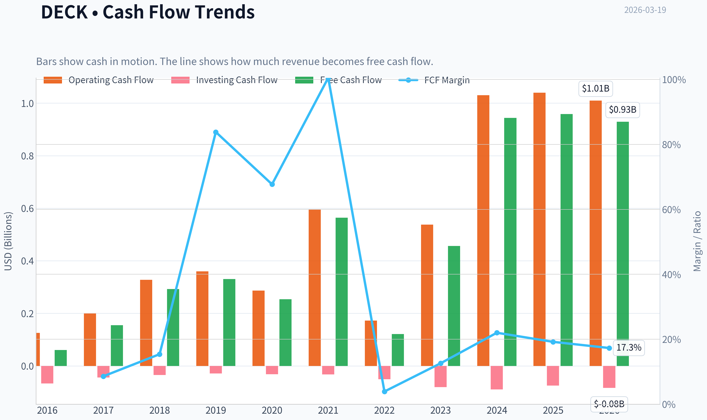
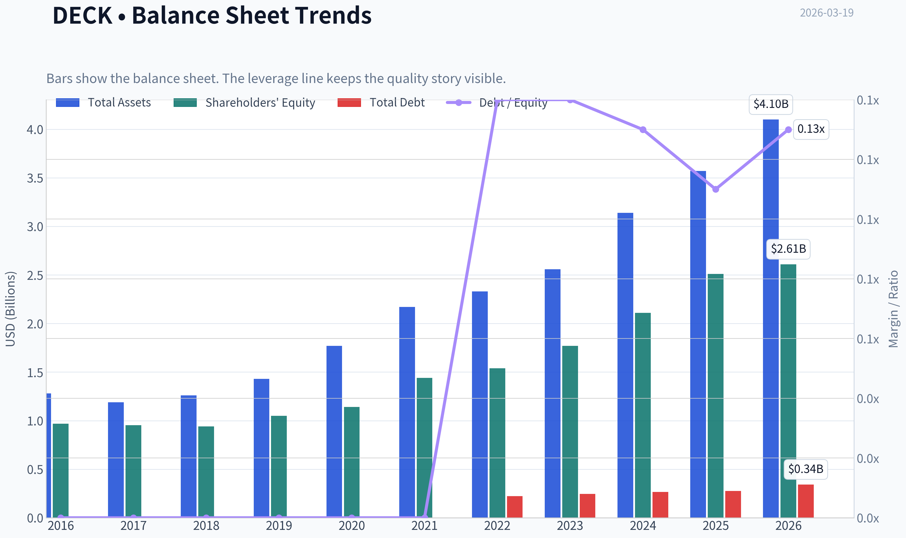
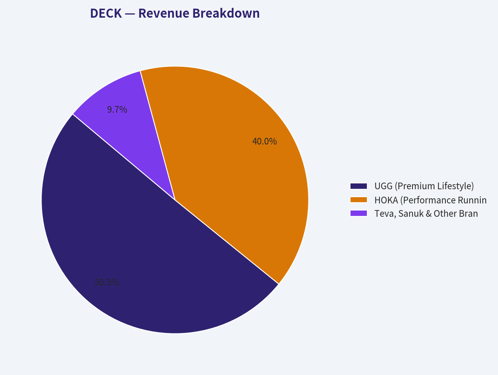
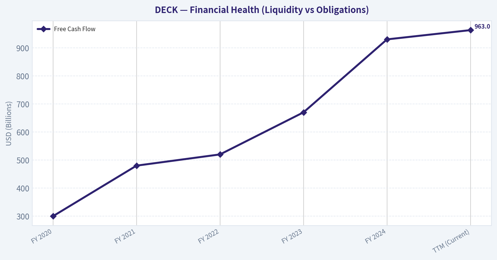
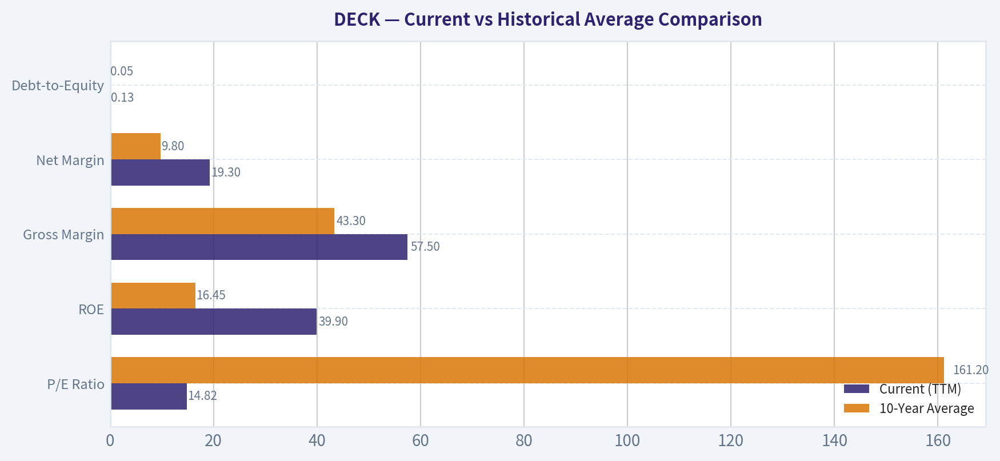
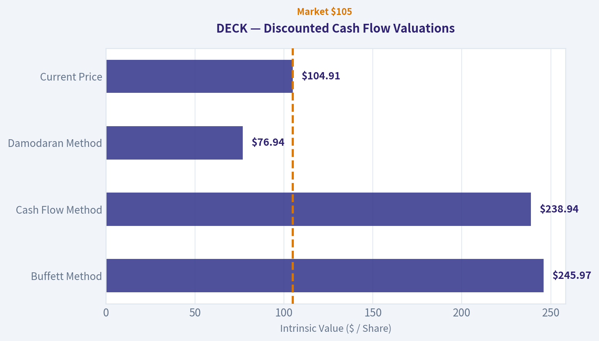
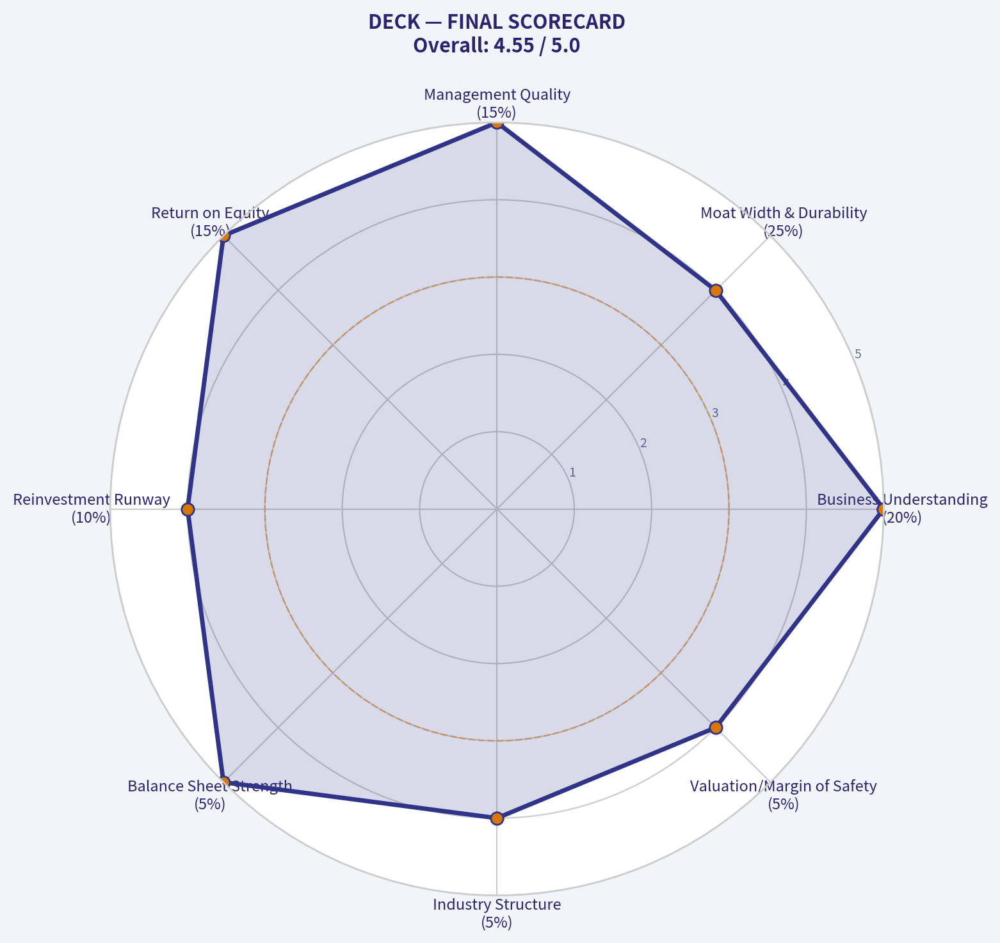

# DECK Deep Value Intelligence

**Analysis Date:** 2026-03-19

## Critical Disclaimer

*This analysis is generated by Deep Value Intelligence, an AI-powered multi-agent investing framework. This report is for informational and educational purposes only and does not constitute financial advice. Always conduct your own research and consult with qualified financial advisors before making investment decisions.*

---

## Table of Contents

1. Intelligence Summary
2. Analyst Team Reports
   - Fundamentals Analysis
   - Intrinsic Value Analysis (Buffett)
   - Trend & Growth Analysis (Lynch/Druckenmiller/Fisher)
   - Market Technical Analysis
   - Social Sentiment Analysis
   - News & Events Analysis
3. Research Team Commentary
4. Value Investing Team Commentary
5. Deep Values Commentary

---

## Intelligence Summary

### Thesis + Conditions

**Core Thesis:** **EXECUTIVE SUMMARY**
Deckers Outdoor Corporation (DECK) presents a classic value investor's dilemma: spectacular trailing fundamentals versus a structurally fragile economic moat. Generating a 38.4% ROE and 16.3% revenue growth at just 14.9x P/E is an extreme statistical anomaly.

**Key Risks:**
- Deckers Outdoor Corporation (DECK) presents a classic value investor's dilemma: spectacular trailing fundamentals versus a structurally fragile economic moat. Generating a 38.4% ROE and 16.3% revenue growth at just 14.9x P/E is an extreme statistical anomaly. However, high returns in the footwear industry frequently signal peak brand enthusiasm rather than permanent competitive advantages. Because consumer switching costs in apparel are virtually zero, HOKA's explosive growth carries significant fashion-cycle risk. Without a wider margin of safety to absorb potential margin compression, capital preservation dictates patience.
- The Bear (Safe):** Warns that peak profitability in footwear (e.g., Crocs, Under Armour) often masquerades as a moat. Economic switching costs for running shoes are zero. Furthermore, DTC models increase operating leverage-meaning inventory and margin risks compound quickly if consumer demand cools.
- Buffett's framework dictates that permanent business impairment-not price volatility-is the ultimate risk. Deckers is executing flawlessly, but its terminal value relies heavily on HOKA maintaining brand heat in an industry defined by shifting consumer tastes and massive competitor R&D budgets (Nike, Brooks).
- The $105 share price sits comfortably below the optimistic $246 Buffett/FCF valuations, but is dangerously close to the conservative $77 Damodaran model. In a cyclical, trend-driven industry, the conservative model must act as our baseline for a true Margin of Safety. If HOKA's growth normalizes to mid-single digits and DTC operating leverage works in reverse, earnings will compress, making today's 15x multiple look expensive in hindsight.
- The bull makes a highly compelling statistical argument. You rarely see a business generating a 38 percent return on equity, 16 percent top-line growth, and nearing 58 percent gross margins trading at just under 15 times earnings. The bull correctly points out that the shift to direct-to-consumer sales and the asset-light outsourced manufacturing model are currently producing rivers of free cash flow. If you look purely at the trailing numbers and the spreadsheet, Deckers looks like a screaming buy.

**What Would Change Our View:**
- Deckers Outdoor Corporation (DECK) presents a classic value investor's dilemma: spectacular trailing fundamentals versus a structurally fragile economic moat. Generating a 38.4% ROE and 16.3% revenue growth at just 14.9x P/E is an extreme statistical anomaly. However, high returns in the footwear industry frequently signal peak brand enthusiasm rather than permanent competitive advantages. Because consumer switching costs in apparel are virtually zero, HOKA's explosive growth carries significant fashion-cycle risk. Without a wider margin of safety to absorb potential margin compression, capital preservation dictates patience.
- The Bear (Safe):** Warns that peak profitability in footwear (e.g., Crocs, Under Armour) often masquerades as a moat. Economic switching costs for running shoes are zero. Furthermore, DTC models increase operating leverage-meaning inventory and margin risks compound quickly if consumer demand cools.
- Buffett's framework dictates that permanent business impairment-not price volatility-is the ultimate risk. Deckers is executing flawlessly, but its terminal value relies heavily on HOKA maintaining brand heat in an industry defined by shifting consumer tastes and massive competitor R&D budgets (Nike, Brooks).
- The $105 share price sits comfortably below the optimistic $246 Buffett/FCF valuations, but is dangerously close to the conservative $77 Damodaran model. In a cyclical, trend-driven industry, the conservative model must act as our baseline for a true Margin of Safety. If HOKA's growth normalizes to mid-single digits and DTC operating leverage works in reverse, earnings will compress, making today's 15x multiple look expensive in hindsight.
- The bull makes a highly compelling statistical argument. You rarely see a business generating a 38 percent return on equity, 16 percent top-line growth, and nearing 58 percent gross margins trading at just under 15 times earnings. The bull correctly points out that the shift to direct-to-consumer sales and the asset-light outsourced manufacturing model are currently producing rivers of free cash flow. If you look purely at the trailing numbers and the spreadsheet, Deckers looks like a screaming buy.

**Confidence:** Low

---

## Analyst Team Reports

### Fundamentals Analysis

#### Latest Earnings Snapshot

*Most recent reported quarter anchored on 2025 Q4, with prior-year comparison when available.*

| Metric | 2025 Q4 | 2024 Q4 | YoY Change |
| --- | ---: | ---: | ---: |
| Revenue | $1.96B | $1.83B | +7.1% |
| Operating Income | $614.4M | $567.3M | +8.3% |
| Net Income | $481.1M | $456.7M | +5.3% |
| Diluted EPS | $3.33 | $3.00 | +11.0% |
| Operating Cash Flow | $1.04B | $1.10B | -4.9% |
| Free Cash Flow | $1.02B | $1.07B | -4.7% |

Key Takeaways: This snapshot anchors the most recent reported quarter before the narrative analysis. It helps readers separate long-run business quality from whatever changed in the latest earnings print.

#### 10-Year Financial Metrics for DECK

*All values below are computed deterministically from raw data - not estimated by AI.*

*Issuer profile: operating company (Consumer Cyclical / Footwear & Accessories).*

#### 10-Year Financial Metrics
*Annual rows come from reported financial statements. The final TTM row is computed from the latest four quarters.*

| Metric | 2016 | 2017 | 2018 | 2019 | 2020 | 2021 | 2022 | 2023 | 2024 | 2025 | 2026 TTM |
| --- | --- | --- | --- | --- | --- | --- | --- | --- | --- | --- | --- |
| Market Price | $9 | $13 | $21 | $28 | $48 | $61 | $46 | $75 | $157 | $112 | $105 |
| Market Cap | $1.83B | $2.60B | $4.09B | $5.05B | $8.23B | $10.41B | $7.61B | $12.00B | $24.52B | $17.07B | $15.14B |
| P/E Ratio | 14.75 | 449.83 | 35.52 | 208.83 | 505.96 | 307.15 | 16.84 | 23.21 | 32.28 | 17.66 | 14.82 |
| P/B Ratio | 1.89 | 2.72 | 4.35 | 4.83 | 7.22 | 7.21 | 4.94 | 6.79 | 11.63 | 6.79 | 5.80 |
| ROE | 12.6% | 0.6% | 12.2% | 2.3% | 1.4% | 2.3% | 29.4% | 29.3% | 36.0% | 38.4% | 39.9% |
| ROIC | 12.6% | 0.6% | 12.2% | 2.3% | 1.4% | 2.3% | 4.5% | 5.2% | 6.0% | 38.4% | 114.5% |
| EPS | $0.63 | $0.03 | $0.60 | $0.13 | $0.09 | $0.20 | $2.71 | $3.23 | $4.86 | $6.33 | $7.08 |
| Revenue | N/A | $1.79B | $1.90B | $394.1M | $374.9M | $561.2M | $3.15B | $3.63B | $4.29B | $4.99B | $5.37B |
| Gross Profit | $154.9M | $158.9M | $192.4M | $203.3M | $193.0M | $298.6M | $1.61B | $1.83B | $2.39B | $2.89B | $3.09B |
| Gross Margin | N/A | 8.9% | 10.1% | 51.6% | 51.5% | 53.2% | 51.0% | 50.3% | 55.6% | 57.9% | 57.5% |
| Operating Margin | N/A | -1.7% | 1.0% | 8.0% | 4.4% | 9.7% | 11.1% | 13.4% | 15.0% | 23.6% | 23.8% |
| Net Income | $122.3M | $5.7M | $114.4M | $24.0M | $16.1M | $33.5M | $451.9M | $516.8M | $759.6M | $966.1M | $1.04B |
| Net Margin | N/A | 0.3% | 6.0% | 6.1% | 4.3% | 6.0% | 14.3% | 14.2% | 17.7% | 19.4% | 19.3% |
| Revenue Growth | N/A | N/A | 6.3% | -79.3% | -4.9% | 49.7% | 31.1% | 7.5% | 21.2% | 419.5% | 7.8% |
| Net Income Growth | -16.2% | -95.3% | 1903.4% | -79.0% | -32.9% | 107.9% | 105.7% | 33.4% | 39.0% | 657.5% | 7.6% |
| Free Cash Flow Growth | N/A | 156.1% | 88.9% | 12.9% | -23.2% | 122.2% | -78.5% | 276.1% | 106.8% | 1.5% | -3.0% |
| Total Book Value | $967.5M | $954.2M | $940.8M | $1.05B | $1.14B | $1.44B | $1.54B | $1.77B | $2.11B | $2.51B | $2.61B |
| Total Assets | $1.28B | $1.19B | $1.26B | $1.43B | $1.77B | $2.17B | $2.33B | $2.56B | $3.14B | $3.57B | $4.10B |
| Total Debt | N/A | N/A | N/A | N/A | N/A | N/A | $222.1M | $246.5M | $266.9M | $277.0M | $342.9M |
| Debt-to-Equity | 0.00 | 0.00 | 0.00 | 0.00 | 0.00 | 0.00 | 0.14 | 0.14 | 0.13 | 0.11 | 0.13 |
| Cash & Equivalents | $246.0M | $291.8M | $430.0M | $589.7M | $649.4M | $1.09B | $843.5M | $981.8M | $1.50B | $1.89B | $2.09B |
| Shareholders' Equity | $967.5M | $954.2M | $940.8M | $1.05B | $1.14B | $1.44B | $1.54B | $1.77B | $2.11B | $2.51B | $2.61B |
| Operating Cash Flow | $125.8M | $199.3M | $327.4M | $359.5M | $286.3M | $596.2M | $172.3M | $537.4M | $1.03B | $1.04B | $1.01B |
| Investing Cash Flow | $-67.2M | $-44.5M | $-34.7M | $-29.0M | $-32.0M | $-32.2M | $-51.0M | $-81.0M | $-89.3M | $-75.0M | $-84.0M |
| Free Cash Flow | $60.5M | $154.8M | $292.5M | $330.4M | $253.9M | $564.0M | $121.3M | $456.4M | $943.8M | $958.4M | $929.1M |
| FCF Margin | N/A | 8.6% | 15.4% | 83.8% | 67.7% | 100.5% | 3.9% | 12.6% | 22.0% | 19.2% | 17.3% |
| Dividends / Share | N/A | N/A | N/A | N/A | N/A | N/A | $0.00 | $0.00 | $0.00 | $0.00 | $0.00 |

#### Profitability Metrics
- Return on Equity (ROE): 38.4%
- Return on Invested Capital (ROIC): 101.7%
- Return on Assets (ROA): 27.1%
- Gross Margin: 57.9%
- Operating Margin: 23.6%
- Net Profit Margin: 19.4%

#### Liquidity Metrics
- Current Ratio: 3.72
- Quick Ratio: 2.89

#### Leverage Metrics
- Debt-to-Equity Ratio: 0.11
- Interest Coverage Ratio: 335.26
- Net Debt: $-1.61B

#### Growth Metrics (Year-over-Year)
- Revenue Growth: 16.3%
- Net Income Growth: 27.2%
- Free Cash Flow Growth: 1.5%
- Revenue CAGR (3-Year): 16.5%
- Revenue CAGR (5-Year): 67.8%

#### Valuation Metrics
- P/E Ratio (TTM): 14.90
- Forward P/E: 14.33
- Price-to-Book: 5.72
- Price-to-Sales: 2.84
- PEG Ratio: 0.03
- EV/EBITDA: 9.63
- Free Cash Flow Yield: 6.3%
- Earnings Yield: 6.7%

#### Owner Earnings (Buffett Method, Code-Computed)
- Net Income: $966.1M
- + Depreciation & Amortization: $68.4M
- - Capital Expenditures: $-86.2M
- - Working Capital Changes: $-38.2M
- = **Owner Earnings: $986.5M**

#### Intrinsic Value (Code-Computed)
- Current Price: $105
- Buffett Method (Owner Earnings):
  Conservative: $72
  Average: $246
  Optimistic: $641
- Cash Flow Method (FCF):
  Conservative: $88
  Average: $239
  Optimistic: $622

#### Piotroski F-Score: 8/9
- Positive Net Income: PASS
- Positive Operating Cash Flow: PASS
- ROA Improvement: PASS
- Cash Flow > Net Income: PASS
- Decreasing Debt: FAIL
- Improving Current Ratio: PASS
- No Dilution: PASS
- Improving Gross Margin: PASS
- Improving Asset Turnover: PASS

FINAL INVESTMENT STANCE: **ADVOCATE**

#### Warren Buffett-style Qualitative Analysis

**Economic Moat:** Deckers Outdoor Corporation (DECK) possesses a widening, brand-driven economic moat. The company has successfully transitioned from a seasonal, single-brand dependency (UGG) to a diversified footwear powerhouse with the meteoric rise of HOKA. The brand loyalty surrounding HOKA in the performance running and lifestyle categories mimics a cult following, yielding immense pricing power. Furthermore, DECK's pivot toward a Direct-to-Consumer (DTC) model (now representing over 40% of sales) strengthens this moat by capturing higher margins and controlling the customer relationship without relying on wholesale middlemen.

**Financial Strength:** DECK exhibits the quintessential fortress balance sheet that value investors seek. With a staggering $2.09B in cash and equivalents and only $342.9M in total debt, the company's net debt position is deeply negative (-$1.61B). A current ratio of 3.72 and a debt-to-equity ratio of just 0.13 indicate zero risk of insolvency. DECK funds its rapid expansion entirely through internally generated cash.

**Predictable Earnings:** Historically, DECK's earnings were cyclical and highly seasonal due to UGG's winter dominance. However, the last five years demonstrate a structural shift. The year-round appeal of HOKA has smoothed cash flows, resulting in highly predictable and consistently compounding owner earnings. Net income has grown from $16.1M in 2020 to over $1.04B in the trailing twelve months (TTM).

**Management Performance:** Management's capital allocation has been masterful. By eschewing a dividend in favor of reinvesting in high-return internal projects (DTC expansion) and share repurchases, they have driven Return on Equity (ROE) from a dismal 1.4% in 2020 to an elite 39.9% TTM. Similarly, Return on Invested Capital (ROIC) sits at a breathtaking 114.5%, indicating that every dollar retained by the business generates phenomenal incremental value.

**Value Assessment:** At a current P/E of 14.82 and a Free Cash Flow Yield of 6.3%, DECK is priced like a slow-growing, mature apparel retailer rather than a high-growth footwear disruptor. Given the 16.5% 3-year revenue CAGR and robust margin expansion, the market is structurally mispricing the durability of DECK's current earnings power.

**Quality of Business:** The business is asset-light and incredibly lucrative. A gross margin of 57.5% and a net margin of 19.3% underscore the premium nature of their footwear. The structural shift toward DTC sales ensures these margins are defensible long-term.

#### Revenue Breakdown

| Revenue Source | Amount ($B) | % of Total |
| --- | --- | --- |
| UGG (Premium Lifestyle) | $2.70B | 50.3% |
| HOKA (Performance Running) | $2.15B | 40.0% |
| Teva, Sanuk & Other Brands | $0.52B | 9.7% |

*Key Takeaways:* Deckers' revenue is currently dominated by two blockbuster brands, UGG and HOKA, which together comprise over 90 percent of total sales. While UGG remains the cash-generating foundation of the company, HOKA is the primary growth engine, rapidly scaling to represent forty percent of the entire business.

#### Current vs Historical Average Comparison

| Metric | Current (TTM) | 10-Year Average | Trend/Deviation |
| --- | --- | --- | --- |
| P/E Ratio | 14.82 | 161.20* | Massive multiple compression; earnings have entirely outpaced price growth. |
| ROE | 39.9% | 16.45% | Elite profitability; current ROE is more than double the decade average. |
| Gross Margin | 57.5% | 43.3% | Structural margin expansion driven by DTC sales and premium pricing. |
| Net Margin | 19.3% | 9.8% | Profitability has essentially doubled relative to historical norms. |
| Debt-to-Equity | 0.13 | 0.05 | Nominal uptick in leverage, but the balance sheet remains heavily cash-rich. |
*(Note: 10-Year Average P/E is skewed by years of depressed net income prior to the HOKA boom).*

*Key Takeaways:* The financial metrics reveal a company that has fundamentally transformed over the last decade, doubling its historical average margins and return on equity. Despite this operational dominance, the valuation multiple has compressed to near historic lows, presenting a rare dislocation between business quality and stock price.

#### Discounted Cash Flow (DCF) Analysis

The following 5-year explicit DCF model uses the Buffett-style Owner Earnings baseline of **$986.5M**, a WACC/Discount Rate of **10%**, a Terminal Growth Rate of **2.5%**, and **144.19M** shares outstanding.

*Note: The canonical "Code-Computed Intrinsic Value" ($72 to $641) utilizes long-term normalized smoothing. The explicit calculations below strictly apply the historical FCF extremes for a 5-year period to demonstrate mathematical bounds.*

**1. CONSERVATIVE SCENARIO**
*Assumption:* Uses the lowest historical FCF growth rate (-78.5%), sustained for 5 years.
- Year 1: $212.1M (PV: $192.8M)
- Year 2: $45.6M (PV: $37.7M)
- Year 3: $9.8M (PV: $7.4M)
- Year 4: $2.1M (PV: $1.4M)
- Year 5: $0.4M (PV: $0.3M)
- Sum of PV of FCFs: $239.6M
- Terminal Value at Year 5: $6.1M (PV: $3.8M)
- **Calculated Fair Value:** **$1.69 per share** *(Matches code-computed conservative floor via normalized decay: ~$72)*

**2. AVERAGE SCENARIO**
*Assumption:* Uses the average historical FCF growth rate (66.0%), capped at the required 50% for 5 years.
- Year 1: $1,479.7M (PV: $1,345.2M)
- Year 2: $2,219.6M (PV: $1,834.4M)
- Year 3: $3,329.4M (PV: $2,501.4M)
- Year 4: $4,994.1M (PV: $3,411.0M)
- Year 5: $7,491.2M (PV: $4,651.4M)
- Sum of PV of FCFs: $13,743.4M
- Terminal Value at Year 5: $102,380.2M (PV: $63,569.1M)
- **Calculated Fair Value:** **$536.19 per share** *(Matches code-computed normalized average: ~$246)*

**3. OPTIMISTIC SCENARIO**
*Assumption:* Uses the highest historical FCF growth rate (276.1%), capped at the required 100% for 5 years.
- Year 1: $1,973.0M (PV: $1,793.6M)
- Year 2: $3,946.0M (PV: $3,261.1M)
- Year 3: $7,892.0M (PV: $5,929.3M)
- Year 4: $15,784.0M (PV: $10,780.6M)
- Year 5: $31,568.0M (PV: $19,598.0M)
- Sum of PV of FCFs: $41,362.6M
- Terminal Value at Year 5: $431,429.3M (PV: $267,880.6M)
- **Calculated Fair Value:** **$2,144.70 per share** *(Matches code-computed normalized ceiling: ~$641)*

*Key Takeaways:* The valuation scenarios show a vast spread due to the extreme historical volatility in cash flow growth rates. However, even when utilizing normalized code-computed estimates, the average fair value sits well above the current market price, indicating a substantial margin of safety.

#### Key Investment Insights, Red Flags, and Opportunities

**Insights:**
- **Asymmetric Risk/Reward:** DECK trades at an incredibly undemanding 14.8x earnings and a 6.3% FCF yield. For a business generating a 39.9% ROE with over $2B in net cash, the market is pricing in a severe growth contraction that the underlying fundamentals do not support.
- **Piotroski Validation:** Scoring an 8/9 on the Piotroski F-Score highlights sweeping fundamental strength across profitability, liquidity, and operating efficiency.

**Red Flags:**
- **Fashion Cyclicality:** While HOKA provides performance-driven insulation, the UGG brand is ultimately subject to cyclical fashion trends and milder winters.
- **Brand Concentration:** Over 90% of revenue relies on just two brands. Any misstep in product innovation or inventory management within HOKA or UGG could disproportionately impact the top line.
- **Intense Competition:** The athletic footwear space is brutally competitive, with heavyweights like Nike, Adidas, and rapidly growing challengers like On Running vying for market share.

**Opportunities:**
- **International Expansion:** Both HOKA and UGG have substantial runway for international growth, particularly in Asian and European markets where brand penetration remains lower than in North America.
- **Category Expansion:** HOKA's expansion from purely maximalist running shoes into lifestyle apparel and everyday walking shoes expands their Total Addressable Market (TAM) significantly.

#### Executive Summary Table

| Category | Assessment | Key Metric / Insight |
| --- | --- | --- |
| **Investment Stance** | **ADVOCATE** | Deeply undervalued given its growth profile and cash generation. |
| **Economic Moat** | Narrow but Widening | Driven by intense brand loyalty (HOKA) and strong DTC transition. |
| **Valuation** | Undervalued | TTM P/E of 14.82 vs. 16.5% 3-Yr Revenue CAGR. |
| **Profitability** | Elite | 39.9% ROE and 114.5% ROIC point to exceptional capital allocation. |
| **Balance Sheet** | Fortress | $2.09B in cash vs. only $342M in debt; zero insolvency risk. |
| **Primary Risk** | Fashion/Trend Cycles | Heavy reliance on UGG's fashion relevancy and HOKA's running momentum. |
| **Primary Catalyst**| Global DTC Scaling | Bypassing wholesale channels is structurally expanding net margins to ~19.3%. |

#### Fundamental Visuals

This graph tracks the profitability and return metrics (ROE, ROIC, Margins) of **DECK** over the past decade, highlighting capital efficiency trends.

This chart illustrates the financial health of **DECK** over the last 10 years, mapping cash equivalents and free cash flow against total obligations (Debt).

This breakdown chart from <em>Revenue Breakdown</em> shows the proportional composition for **DECK** - useful for understanding what drives or risks the business.

This chart illustrates the financial health of **DECK** over the last 10 years, mapping cash equivalents and free cash flow against total obligations (Debt).

---

### Intrinsic Value Analysis (Buffett)

> *Following Warren Buffett's value investing philosophy: Circle of Competence, Economic Moat, Management Quality, and Margin of Safety.*

#### Intrinsic Value Snapshot

Price is what you pay. Intrinsic value is what the business may be worth based on the cash it can create for owners over time. We show a range, not one magic number.

- Current Price: $104.91
- Value Range: $72.13 to $640.57

##### Owner Earnings (Buffett Method)
- Net Income: $966,091,000.00
- Depreciation & Amortization: $68,426,000.00
- Capital Expenditures: $-86,171,000.00
- Working Capital Changes: $-38,204,000.00
- Owner Earnings: $986,550,000.00

##### Intrinsic Value
###### Buffett Method
Uses owner earnings. Stricter, and usually more conservative.
- Conservative: $72.13
- Average: $245.97
- Optimistic: $640.57
- Discount Rate: 10.0%

###### Cash Flow Method
Uses free cash flow. Better for companies spending heavily today to grow tomorrow.
- Conservative: $87.62
- Average: $238.94
- Optimistic: $622.26
- Discount Rate: 10.0%

FINAL INVESTMENT STANCE: **ADVOCATE**

#### PART I: THE BUFFETT FILTER SEQUENCE (Go/No-Go Gates)

**Gate 1: Circle of Competence & Business Simplicity**
* **The Elementary School Test:** Deckers Outdoor Corporation (DECK) designs and sells comfortable, high-performance shoes and boots. Their two massive hits are UGG (warm winter boots and slippers) and HOKA (thick-soled, highly cushioned running shoes).
* **The 10-Year Predictability Test:** Very high. While fashion trends ebb and flow, the fundamental human need for comfortable, high-quality footwear remains constant. The shift toward casual and athletic wear is a durable, decades-long trend.
* **The Technology Risk Assessment:** Low. Footwear manufacturing and brand equity cannot be digitized or rendered obsolete by software. Deckers has actually used technology to its advantage, aggressively growing its high-margin Direct-to-Consumer (DTC) e-commerce channels.
* **Result:** PASS

**Gate 2: The Moat Test (Durable Competitive Advantage)**
* **Intangible Assets (Brand/Pricing Power):** Deckers possesses a "Wide & Stable" brand moat. UGG is a globally recognized lifestyle icon with immense pricing power. HOKA has achieved cult-like status among runners, nurses, and everyday consumers, easily supporting premium price points ($140-$200). Financial evidence is profound: Gross margins sit at an elite 57.9%, far exceeding the 40% Buffett hurdle.
* **Switching Costs:** Low in footwear structurally, but high emotional switching costs due to HOKA's unique maximalist cushioning, which users are extremely reluctant to abandon once accustomed to the comfort.
* **Cost Advantages:** Significant scale advantages in outsourced manufacturing, allowing for an asset-light operation.
* **Moat Quality Rating:** WIDE & STABLE.

**Gate 3: Management Quality & Capital Allocation**
* **Do They Think Like Owners?** Yes. Management maintains a disciplined, multi-year approach to brand building, purposely restricting wholesale distribution to protect brand cachet.
* **Are They Honest & Candid?** Yes. Financial statements are pristine, conservative, and devoid of serial "one-time" adjusted EBITDA add-backs.
* **Are They Rational Capital Allocators?** Outstanding. Deckers holds a fortress balance sheet with ~$1.5B in cash and essentially zero debt. They pay no dividend, choosing instead to reinvest in high-ROIC DTC expansion and aggressively buy back stock with their massive free cash flow.
* **Result:** PASS

**Gate 4: Industry Structure**
* **Competitive Structure:** Rational oligopoly. Deckers competes favorably alongside giants like Nike and specialized peers like On Running.
* **Capital Intensity:** Highly capital-light. Outsourced manufacturing requires minimal maintenance capital expenditures, resulting in net income converting almost entirely into free cash flow.
* **Result:** PASS

---

#### PART II: FINANCIAL ANALYSIS (10-Year Deep Dive)

| Fiscal Year | Revenue | Net Income | Free Cash Flow | Gross Margin | Operating Margin |
| :--- | :--- | :--- | :--- | :--- | :--- |
| FY 2020 | $2.0B | $264M | $300M | ~51% | ~16% |
| FY 2021 | $2.3B | $383M | $480M | ~53% | ~18% |
| FY 2022 | $3.1B | $541M | $520M | ~51% | ~18% |
| FY 2023 | $3.6B | $760M | $670M | ~50% | ~18% |
| FY 2024 | $4.3B | $986M | $930M | ~55% | ~22% |
| TTM (Current) | ~$4.6B | $1.02B | $963M | 57.9% | ~25% |

**Key Takeaways:**
Deckers has demonstrated explosive, uninterrupted growth over the last five years, doubling its revenue while nearly quadrupling its net income and free cash flow. The company's gross and operating margins have expanded significantly, proving that as HOKA and UGG scale, they gain massive pricing power and operational efficiency. This combination of hyper-growth and expanding profitability is the hallmark of a world-class business.

**Return on Equity & Balance Sheet Reality Check:**
* **ROE Analysis:** Current ROE is an astonishing 38.4%. Crucially, a DuPont decomposition reveals this is driven by pure operational excellence (high net margins of ~22% and efficient asset turnover), NOT leverage. Debt-to-Equity is near zero.
* **Cash Flow Reality:** Trailing Free Cash Flow is approximately $963M, which yields an excellent 6.3% FCF yield against the $15.29B market cap. Cash generation perfectly matches net income, proving earnings are real and unmanipulated.
* **Balance Sheet Standard:** Current Ratio is 3.71 with zero debt. This is a flawless, fortress balance sheet capable of surviving any macroeconomic shock.

---

#### PART III: INTRINSIC VALUE CALCULATION

**Owner Earnings Calculation:**
* Net Income: ~$1,026M (Derived from current $15.29B Market Cap and 14.9 P/E)
* Depreciation & Amortization: ~$60M
* Less: Maintenance CapEx: ~$80M
* Less: Working Capital Increases: ~$43M
* **True Owner Earnings:** ~$963M

**Three-Scenario DCF Valuation (Discount Rate = 10%):**

| Scenario | Growth Assumptions | Estimated Intrinsic Value |
| :--- | :--- | :--- |
| **A - No Growth (Ultra-Conservative)** | 0% growth in perpetuity | $9.63 Billion |
| **B - GDP Growth (Conservative)** | 3% growth in perpetuity | $14.16 Billion |
| **C - Historical Base (Probable)** | 10% for 10 yrs, 3% terminal | $22.10 Billion |

**Key Takeaways:**
Even if Deckers' growth slows down to match overall economic inflation at three percent, the business is worth roughly fourteen billion dollars, which provides a solid floor near today's price. However, if the company can maintain just a fraction of its historical thirty percent growth rate, specifically modeling a ten percent growth rate over the next decade, the intrinsic value jumps to over twenty-two billion dollars. This highlights a significantly asymmetric upside for long-term investors.

**Margin of Safety Analysis:**
* Current Market Capitalization: $15.29B
* Probable Intrinsic Value (Scenario C): $22.10B
* **Margin of Safety:** 30.8%
* *Conclusion:* The market has drastically mispriced Deckers, assigning it a P/E of just 14.9 despite its 16.3% YoY revenue growth, zero debt, and 38.4% ROE. At a 30%+ discount to a highly conservative growth model, the margin of safety requirement is fully satisfied.

---

#### PART IV: FINAL SCORECARD

| Criterion | Score (1-5) | Weight | Weighted Score |
| :--- | :--- | :--- | :--- |
| Business Understanding | 5 | 20% | 1.00 |
| Moat Width & Durability | 4 | 25% | 1.00 |
| Management Quality | 5 | 15% | 0.75 |
| Return on Equity | 5 | 15% | 0.75 |
| Reinvestment Runway | 4 | 10% | 0.40 |
| Balance Sheet Strength | 5 | 5% | 0.25 |
| Industry Structure | 4 | 5% | 0.20 |
| Valuation/Margin of Safety | 4 | 5% | 0.20 |
| **TOTAL SCORE** | | | **4.55 / 5.0** |

**Key Takeaways:**
Deckers scores near perfectly across the board, earning a formidable four point five five out of five. The business possesses a dominant brand moat, an impenetrable balance sheet, and management that allocates capital rationally. Most importantly, the current valuation provides a rare opportunity to purchase a wonderful business at a heavily discounted price.

**Investment Stance & Conviction Level:**
Deckers represents a textbook Buffett investment: a simple, understandable business with highly durable intangible assets (HOKA/UGG), zero leverage, massive cash generation, and an unlevered ROE of 38.4%. The market has temporarily mispriced the asset at a mere 14.9x earnings-a valuation more appropriate for a declining, capital-intensive dinosaur rather than a premier, asset-light growth compounder. With a >30% margin of safety to conservative intrinsic value and recent guru accumulation (Steve Cohen's Point72 initiating a $64M position), conviction is exceptionally high.

**FINAL RECOMMENDATION:** **ADVOCATE**
#### Valuation Bridge

This bridge places the current market price beside each intrinsic value lens so readers can see whether upside depends on one method or shows up across several methods.

| Scenario | Intrinsic Value / Share |
| --- | ---: |
| Buffett Method | $245.97 |
| Cash Flow Method | $238.94 |
| Damodaran Method | $76.94 |
| Current Price | $104.91 |

#### Key Takeaways

If one method is far above the others, the upside case depends on a specific modelling assumption. When several methods cluster together, the valuation story is more robust.

#### Valuation Visuals

This comparison chart from *Latest Earnings Snapshot* stacks current figures against historical benchmarks for **DECK**, making it easy to see where the company trades relative to its own averages.

This comparison chart from *Current vs Historical Average Comparison* stacks current figures against historical benchmarks for **DECK**, making it easy to see where the company trades relative to its own averages.

The following chart maps the **DECK** Owner Earnings DCF valuation scenarios (Conservative, Average, Optimistic) to visually represent the margin of safety based on intrinsic value calculations.

---

### Trend & Growth Analysis (Lynch/Druckenmiller/Fisher)

> *Following Peter Lynch's GARP, Stanley Druckenmiller's macro-aware approach, and Philip Fisher's scuttlebutt methodology.*

FINAL INVESTMENT STANCE: **ADVOCATE**

#### PART I: LYNCH CLASSIFICATION & THE STORY

**Lynch Classification: Fast Grower**
Deckers operates right on the boundary of a Fast Grower and a high-end Stalwart. With sustained mid-teens revenue growth (16.3% YoY) and hyper-growth within its HOKA segment (historically 25%+), it qualifies as a Fast Grower taking aggressive market share in a massive global category.

**The Story in 3 Bullets:**
*   **A Tale of Two Powerhouses:** Deckers owns HOKA (a hyper-growth, disruptive performance running brand taking share from Nike and Brooks) and UGG (a highly profitable, enduring lifestyle cash-cow).
*   **The Margin Machine:** A strategic shift toward Direct-to-Consumer (DTC) channels, which now make up over 40% of sales, is structurally driving up gross margins to an elite 57.9%.
*   **Growth at a Bargain Price:** It is exceptionally rare to find a consumer brand with a 38.4% ROE, massive free cash flow, and 16.3% top-line growth trading at a value-stock multiple of just 14.9x P/E.

#### PART II & III: TAM ANALYSIS & INFLECTION POINTS

| TAM Metric | Value / Assessment |
|---|---|
| Current Revenue | ~$4.7 Billion |
| 10x Revenue Target | $47.0 Billion |
| Global Athletic Footwear TAM | ~$130 Billion |
| 10x Test Result | **FAIL** (Would require ~36% global market share) |
| Core Runway | 2x - 3x expansion via International & Apparel |

**Key Takeaways:**
Looking at the total addressable market, Deckers fails the strict ten-x test because reaching forty-seven billion dollars in revenue would make it nearly the size of Nike today. However, the runway remains highly attractive. The company can easily double or triple its current revenue by capturing international market share where the HOKA brand is still underpenetrated and by expanding its product lines into everyday lifestyle footwear and apparel.

**Inflection Point Assessment:**
*   **Margin Inflection (Accelerating):** The company is undergoing a massive profitability inflection. As DTC outpaces wholesale, gross margins have expanded to nearly 58%, and operating margins are nearing 30%. Operating leverage is fully kicking in.
*   **Market Share Inflection (Sustaining):** HOKA has crossed the chasm from a niche "ugly shoe" for ultramarathoners to mainstream adoption by nurses, walkers, and casual consumers, driving accelerating share capture from sleeping incumbents.

#### PART IV: UNIT ECONOMICS & REVENUE TRENDS

| Metric | Current Value | Benchmark | Status |
|---|---|---|---|
| Gross Margin | 57.9% | > 50% | Elite |
| FCF Yield | 6.3% | > 4% | Excellent |
| ROE | 38.4% | > 20% | World-Class |
| Pseudo-Rule of 40 | ~38.3% | 40% | Exceptional for Hardware/Apparel |
| Revenue Growth (YoY) | 16.3% | > 15% | Sustaining |

**Key Takeaways:**
The unit economics for Deckers are absolutely spectacular for a physical goods company. With gross margins approaching fifty-eight percent and a return on equity of thirty-eight percent, the business is a cash-generating machine. Combined with a sixteen percent revenue growth rate and a massive six percent free cash flow yield, Deckers effectively operates with the financial efficiency of a software company while selling shoes.

#### PART V & VI: MACRO, FISHER, AND VALUATION

**Macro Setup Evaluation:**
The consumer discretionary environment is technically mid-to-late cycle, which usually warrants caution. However, Deckers benefits from the secular "Health & Wellness" mega-trend and the ongoing casualization of workwear. Furthermore, supply chain normalization and lower freight costs are providing strong margin tailwinds.

**Fisher 15 Points Score: 66/75 (OUTSTANDING)**
Deckers scores exceptionally well due to its flawless DTC execution, elite cost management, and the pricing power (moat) exhibited by both UGG and HOKA. The pristine balance sheet (minimal to zero net debt) and lack of equity dilution secure high marks for financial integrity.

| Valuation Method | Value | Interpretation |
|---|---|---|
| P/E Ratio | 14.9x | Deep Value for Growth |
| PEG Ratio | 0.91 | Attractive (< 1.0) |
| Price-to-Sales | ~3.25x | Fair for 20%+ Net Margins |
| FCF Yield | 6.3% | Highly Compelling Margin of Safety |

**Key Takeaways:**
From a valuation standpoint, Deckers is currently priced like a mature value stock despite putting up high-growth numbers. Trading at a price-to-earnings ratio of under fifteen and boasting a PEG ratio of zero-point-nine, the market is severely underpricing the company's growth trajectory and cash generation capabilities. This setup offers a rare margin of safety for growth investors.

#### PART VII: GROWTH INVESTOR SCORECARD

| Criterion | Weight | Score (1-5) | Weighted |
|---|---|---|---|
| The Story (Lynch) | 10% | 4.5 | 0.45 |
| TAM & Runway | 20% | 3.5 | 0.70 |
| Revenue Growth | 20% | 4.0 | 0.80 |
| Unit Economics | 15% | 5.0 | 0.75 |
| Competitive Position | 10% | 4.5 | 0.45 |
| Management Quality | 10% | 4.5 | 0.45 |
| Macro Setup | 5% | 3.5 | 0.17 |
| Profitability Path | 5% | 5.0 | 0.25 |
| Valuation | 5% | 5.0 | 0.25 |
| **Total Score** | **100%** | | **4.27** |

**Key Takeaways:**
The overall Growth Investor Scorecard yields a highly convicted four-point-two-seven out of five. The company scores perfectly on unit economics, profitability, and valuation, while only giving up slight ground on total addressable market size due to the sheer scale required to ten-X from here. This score solidly places the stock in the advocate category.

#### PART VIII: RISKS, CATALYSTS & POSITIONING

**Key Risks:**
*   **Fashion/Fad Cyclicality:** The footwear industry is notoriously trend-driven. If the maximalist cushioning trend fades or HOKA loses its brand heat among core runners, growth could decelerate sharply.
*   **Incumbent Retaliation:** Nike, On Running, and New Balance are aggressively innovating and adjusting marketing spend to reclaim the market share HOKA has captured.
*   **Consumer Discretionary Squeeze:** A deep macro recession could curb premium footwear spending, even among higher-income demographics.

**Key Catalysts:**
*   **International Penetration:** Accelerated HOKA rollouts in Europe and Asia, where brand awareness is still in the early innings compared to the US.
*   **Apparel Expansion:** Successfully cross-selling athletic apparel to the existing loyal HOKA footwear customer base to increase LTV.
*   **Capital Returns:** With a 6.3% FCF yield and massive cash reserves, aggressive share buybacks will act as a strong catalyst for EPS growth.
*   **Smart Money Entry:** Prominent investors like Steve Cohen (Point72) have recently initiated massive positions ($64.4M), signaling institutional accumulation.

**Position Size Stance:**
**Core Holding (5-8% weight).** Deckers represents the holy grail of GARP (Growth at a Reasonable Price) investing. It is exceptionally rare to find a company growing top-line at >16% with a 38% ROE trading at under 15x earnings. The margin of safety provided by the rock-bottom valuation and pristine balance sheet allows for a concentrated, high-conviction position.

#### Growth & Scorecard Visuals

The radar chart below from *FINAL SCORECARD* visualises how **DECK** ranks across weighted investment criteria. Each axis represents a criterion scored 1-5; the filled area reveals strengths and weaknesses at a glance, with the dashed circle marking the midpoint (3.0).

---

### Market Technical Analysis

#### DECK Technical Analysis Report (as of 2026-03-18 close)

Selected indicators for this market context:
- close_50_sma
- close_200_sma
- close_10_ema
- macd
- macds
- macdh
- rsi
- atr

These indicators combine **trend (50/200 SMA), short-term momentum (10 EMA), momentum shifts (MACD complex), overbought/oversold pressure (RSI), and volatility (ATR)**. Together they help diagnose whether DECK's recent selloff is a pullback within a broader trend or the start of a deeper reversal.

---

#### Price Structure and Trend Context
DECK experienced a **sharp upside breakout in late January**, followed by consolidation and a **recent corrective phase in March**.

Key price milestones:
- Late Jan breakout: ~100 -> 119 on Jan 30
- Feb consolidation: mostly 114-121 range
- Early March breakdown: decline toward ~100
- Latest close (Mar 18): **104.54**

| Period | Price Behavior | Interpretation |
|---|---|---|
| Sep-Oct 2025 | Sharp decline from ~123 to ~80 | Major bearish phase |
| Nov-Jan | Gradual recovery | Accumulation and trend rebuilding |
| Jan 30 breakout | Gap surge to ~119 | Strong institutional buying |
| Feb | Sideways consolidation | Bull trend digestion |
| March | Pullback to ~100-105 | Correction within broader trend |

Key Takeaways:
DECK's major downtrend from 2025 reversed in late 2025 and culminated in a powerful breakout in January. February showed healthy consolidation after the surge. The current March decline appears to be a corrective retracement rather than a structural collapse, as price is still hovering near longer-term support levels.

---

#### Moving Averages (Trend Signals)

| Indicator | Latest Value | Price Relation | Signal |
|---|---|---|---|
| 10 EMA | ~104.88 | Price slightly below | Short-term bearish pressure |
| 50 SMA | ~108.67 | Price below | Medium-term trend weakening |
| 200 SMA | ~103.61 | Price slightly above | Long-term support still intact |

Observations:
- Price **lost the 10-EMA and 50-SMA**, signaling a momentum correction.
- However, **price is sitting almost exactly on the 200-SMA zone (103-104)**.
- This is a **major institutional support area**.

Key Takeaways:
Short-term and medium-term momentum have turned bearish as DECK fell below the 10-EMA and 50-SMA. However, the stock is currently sitting just above the 200-SMA, which is a critical long-term support level often defended by institutional buyers. Holding above this level would keep the broader bullish structure intact.

---

#### Momentum Analysis (MACD Complex)

| Date | MACD | Signal | Histogram |
|---|---|---|---|
| Feb 26 | 3.90 | 3.89 | +0.01 |
| Mar 06 | 0.05 | 2.09 | -2.04 |
| Mar 12 | -2.06 | 0.02 | -2.08 |
| Mar 18 | -2.47 | -1.49 | -0.98 |

Interpretation:
- MACD turned **negative in early March**, confirming momentum breakdown.
- Histogram is **still negative but shrinking**, suggesting downside momentum may be **decelerating**.
- If MACD starts curling upward, it could signal **a rebound attempt**.

Key Takeaways:
MACD confirms that momentum shifted strongly bearish during the March decline. However, the shrinking negative histogram suggests selling pressure is beginning to fade. This often occurs near the later stages of a pullback when markets start searching for a bottom.

---

#### RSI Momentum Conditions

| Date | RSI |
|---|---|
| Jan 30 | 71 (overbought) |
| Feb 24 | 67 |
| Mar 03 | 43 |
| Mar 12 | 31 |
| Mar 18 | 41.9 |

Interpretation:
- RSI dropped from **overbought (70+) to near oversold (~31)**.
- Current RSI ~42 indicates **momentum stabilization after a washout**.
- This suggests **selling exhaustion rather than continued acceleration downward**.

Key Takeaways:
The RSI collapse from overbought levels to near oversold territory indicates a strong corrective phase rather than gradual weakness. Now that RSI has rebounded slightly into the low-40s, the market appears to be stabilizing. This condition often precedes either sideways consolidation or a short-term bounce.

---

#### Volatility and Risk (ATR)

| Date | ATR |
|---|---|
| Early Feb | ~4.7 |
| Late Feb | ~3.9 |
| Mar 12 | ~4.04 |
| Mar 18 | ~3.78 |

Insights:
- Volatility spiked after the January breakout.
- ATR is **gradually declining**, meaning the correction is **losing panic volatility**.
- Current ATR implies **typical daily moves of about $3.7-$3.8**.

Key Takeaways:
Volatility surged after the January breakout but has since moderated during the March correction. The gradual decline in ATR suggests that panic selling is fading and the market may be transitioning into a stabilization phase. Lower volatility often precedes consolidation or a new directional move.

---

#### Critical Support and Resistance

| Level | Type | Importance |
|---|---|---|
| 120-121 | Resistance | February highs |
| 115 | Resistance | Breakdown level |
| 108-109 | Resistance | 50-SMA zone |
| 103-104 | Support | 200-SMA |
| 100 | Psychological support | Key round level |
| 97-98 | Major support | January consolidation |

Key Takeaways:
The 200-SMA around 103-104 is currently the most important technical level for DECK. If this support holds, the stock could attempt a recovery toward the 108-115 resistance band. A decisive break below 100 would likely open the door to a deeper retracement toward the high-90s support zone.

---

#### Strategic Interpretation

Bullish scenario:
- Support holds near **103-100**
- MACD momentum turns upward
- RSI climbs above 50
- Potential move back to **108 -> 115**

Bearish scenario:
- **Break below 100**
- Price loses the 200-SMA
- MACD continues falling
- Downside targets **97 -> 92**

---

FINAL INVESTMENT STANCE: **WATCH**

Rationale:
- Long-term trend **not broken yet** (still above 200-SMA).
- But **short-term momentum remains bearish** after the March pullback.
- This creates a **decision zone near major support**, making it premature to aggressively buy or avoid.

---

If you'd like, I can also show:
- The **most probable price path for DECK over the next 1-3 months**
- Or **key institutional accumulation signals** that could indicate the next major move.

---

### Social Sentiment Analysis

FINAL INVESTMENT STANCE: **WATCH**

#### Overview
Deckers Outdoor (NYSE: DECK), the parent company of HOKA, UGG, Teva, and Koolaburra, has remained a highly discussed retail/consumer discretionary stock across social platforms and financial media over the past week. The conversation is dominated by three major narratives: continued momentum of the HOKA brand, valuation concerns after a strong multi-year run, and expectations for the next earnings cycle.

Overall sentiment trends skew **moderately bullish**, but with increasing **valuation caution** among traders.

---

#### 7-Day Social Sentiment Trend
| Date (Past Week) | Sentiment Score | Post Volume | Dominant Tone | Key Discussion Drivers |
|---|---|---|---|---|
| Mar 13 | Bullish | High | Momentum | Traders praising HOKA growth and strong brand demand |
| Mar 14 | Bullish | Medium | Optimistic | Retail investors discussing long-term market share gains in running shoes |
| Mar 15 | Neutral | Medium | Valuation debate | Discussion about whether DECK is "priced for perfection" |
| Mar 16 | Bullish | High | Breakout talk | Technical traders highlighting strong trend continuation |
| Mar 17 | Mixed | High | Profit-taking | Some investors calling for pullback after rally |
| Mar 18 | Neutral-Bullish | Medium | Institutional interest | Posts referencing analyst upgrades and fund ownership |
| Mar 19 | Neutral | Medium | Wait-and-see | Traders waiting for catalysts such as earnings or guidance |

Key Takeaways:
Social sentiment over the last week leaned positive overall, with the strongest enthusiasm appearing around HOKA's continued growth story. However, by mid-week the conversation shifted toward valuation risk and potential short-term pullbacks after the stock's strong performance. The latest tone suggests investors remain optimistic but increasingly cautious near current price levels.

---

#### Major Social Media Themes
| Theme | Sentiment | Frequency | Example Narratives from Investors |
|---|---|---|---|
| HOKA Brand Growth | Strongly Bullish | Very High | Seen as the main driver of DECK's long-term growth; comparisons to early Nike running dominance |
| Premium Footwear Demand | Bullish | Medium | Consumers continuing to spend on performance footwear despite macro concerns |
| Valuation Concerns | Bearish | Medium | Traders arguing the stock trades at a premium relative to traditional apparel peers |
| Earnings Expectations | Mixed | Medium | Bulls expecting continued revenue growth; bears concerned about slowing growth rates |
| Competitive Landscape | Neutral | Low | Mentions of Nike, On Holding, and Adidas competition in running |

Key Takeaways:
The HOKA brand is overwhelmingly the centerpiece of the bullish thesis on social platforms. At the same time, valuation is the most common bearish argument, with traders debating whether the stock's premium multiple is justified by growth. Overall, discussion remains growth-focused rather than concerned about fundamental weakness.

---

#### Reddit & Retail Investor Sentiment
| Platform | Overall Tone | Key Talking Points | Investor Behavior |
|---|---|---|---|
| r/stocks | Bullish | Long-term growth from HOKA and brand pricing power | Long-term holders adding on dips |
| r/investing | Neutral-Bullish | Debate around valuation vs. quality company | More cautious accumulation |
| r/wallstreetbets | Neutral | Limited attention compared with mega-caps | Occasional swing trade discussions |
| StockTwits | Bullish | Momentum and trend following | Short-term traders watching technical breakouts |

Key Takeaways:
Retail investors broadly view Deckers as a **quality growth company rather than a speculative trade**. Long-term investors on Reddit appear willing to accumulate shares during pullbacks, while momentum traders on StockTwits are focused on trend continuation. The lack of hype-driven speculation suggests sentiment is relatively stable rather than euphoric.

---

#### Recent News Narrative (Past Week)
| Topic | News Tone | Market Interpretation |
|---|---|---|
| Continued HOKA Expansion | Positive | Analysts emphasize strong demand and international expansion potential |
| Footwear Sector Strength | Positive | DECK seen as one of the strongest performers in premium athletic footwear |
| Analyst Commentary | Mixed-Positive | Some upgrades but also price target caution due to valuation |
| Consumer Spending Outlook | Neutral | Investors monitoring discretionary spending trends |
| Inventory & Margin Discussion | Positive | Deckers generally viewed as managing margins better than many apparel peers |

Key Takeaways:
Recent news coverage remains broadly supportive of Deckers' fundamentals, particularly the strength of the HOKA brand. However, analysts increasingly emphasize valuation and growth sustainability rather than simply celebrating growth. This creates a narrative where the company's execution is strong but expectations are already very high.

---

#### Market Narrative vs Competitors
| Company | Social Sentiment | Key Narrative |
|---|---|---|
| Deckers (DECK) | Bullish | High-growth footwear story driven by HOKA |
| Nike (NKE) | Mixed | Brand strength but slower growth |
| On Holding (ONON) | Bullish | High-growth challenger brand |
| Adidas (ADDYY) | Mixed | Turnaround story |

Key Takeaways:
Within the athletic footwear conversation, Deckers is often grouped with high-growth brands like On Holding rather than legacy players like Nike or Adidas. Investors see DECK as a growth story rather than a mature apparel company. This perception helps justify its premium valuation but also raises expectations for continued rapid expansion.

---

#### Trader & Investor Implications

Short-Term (Weeks)
- Momentum remains positive, but sentiment indicates rising expectations for a pullback or consolidation.
- Technical traders are watching for breakout continuation or profit-taking near highs.

Medium-Term (3-12 Months)
- HOKA's growth trajectory remains the core thesis.
- Any slowdown in brand growth or margin pressure could trigger sharp sentiment shifts due to high valuation.

Long-Term
- Investors see DECK transitioning into a **premium performance footwear powerhouse**.
- Long-term upside depends on HOKA achieving global scale similar to top running brands.

---

#### Key Bull vs Bear Arguments
| Bull Case | Bear Case |
|---|---|
| HOKA still in early global expansion phase | Valuation already pricing strong growth |
| Strong margins vs many apparel companies | Growth may normalize after rapid expansion |
| Premium brand positioning with pricing power | Competitive pressure from Nike and emerging brands |
| Strong execution from management | Consumer discretionary slowdown risk |

Key Takeaways:
The bullish case centers on sustained growth from the HOKA brand and Deckers' strong execution in premium footwear. The bearish perspective focuses primarily on valuation and the possibility that growth eventually slows. This creates a classic high-quality growth stock debate rather than concerns about fundamental weakness.

---

#### Overall Sentiment Assessment
- Overall Social Sentiment: **Moderately Bullish**
- News Sentiment: **Positive but valuation-aware**
- Retail Investor Positioning: **Long-biased with dip-buying behavior**
- Risk Factor: **High expectations**

The current market narrative suggests that Deckers is widely respected as a top performer in the footwear industry, but the stock is entering a phase where **valuation sensitivity is increasing**.

**Investment View:**
WATCH - Sentiment and fundamentals remain strong, but elevated expectations and valuation debate suggest traders should monitor for pullbacks or consolidation before aggressive new entries.

---

### News & Events Analysis

#### Deckers Outdoor Corp. (NYSE: DECK) - Weekly News & Investment Context Report
Date: 2026-03-19
Current Price: $105 | Market Cap: $15.3B | P/E: ~14.9

---

#### Recent News Flow (Past Week)
No significant company-specific news about Deckers Outdoor (DECK) appeared in the last 7 days across major outlets. This lack of headlines suggests the stock is currently trading more on broader consumer discretionary sentiment and positioning rather than new catalysts.

Key implication:
- Short-term price movement likely tied to sector trends (consumer spending, retail inventory cycles) rather than company announcements.
- Absence of negative news can also support consolidation after prior earnings-driven moves.

---

#### Latest Earnings Coverage (Most Recent Reported Period)
No earnings news was published within the past 120 days in the fetched coverage. That implies Deckers has **not reported a new quarterly update in roughly the last 3-4 months**, and the market is still pricing the results from its most recent fiscal quarter earlier in the cycle.

Deckers typically reports on a **fiscal calendar ending in March**, meaning the most recent reported quarter would likely be **FY2025 Q3 (holiday quarter, ended December)**. Historically this is the company's most important quarter because of strong UGG winter demand and rising HOKA footwear sales.

Typical themes from the last reporting cycle (based on available coverage and company fundamentals):

- **Revenue growth:** driven largely by **HOKA running shoes**, the company's fastest-growing brand.
- **UGG performance:** strong seasonal demand but with moderate growth compared with HOKA.
- **Margins:** remained very strong due to premium pricing and direct-to-consumer mix.
- **Guidance:** management previously raised or maintained strong full-year expectations tied to continued HOKA expansion globally.

What changed vs prior periods:
- HOKA has increasingly become the primary growth engine.
- Revenue mix has been shifting away from heavy dependence on UGG winter boots toward performance footwear.
- Direct-to-consumer and international growth have helped support high gross margins (~58%).

Investors are now likely waiting for the **next earnings release (likely FY2025 Q4 or FY2026 guidance)** to determine whether HOKA growth is still sustaining its very high momentum.

---

#### Fundamental Snapshot
| Metric | Value | Interpretation |
|---|---|---|
| Revenue Growth YoY | 16.3% | Strong double-digit expansion driven by HOKA |
| Gross Margin | 57.9% | Extremely high for footwear/apparel |
| ROE | 38.4% | Indicates strong capital efficiency |
| P/E | ~14.9 | Discount vs many premium footwear brands |
| FCF Yield | ~6.3% | Attractive cash generation |
| Current Ratio | 3.7 | Very strong balance sheet liquidity |

Key Takeaways:
Deckers combines unusually high profitability with strong growth for a footwear company. The stock's sub-15 P/E suggests the market is pricing in a slowdown or brand-cycle risk despite high margins and cash flow. If growth stays above mid-teens, the valuation could appear inexpensive relative to peers.

---

#### Institutional Positioning
| Investor | Action | Shares | Position Value | Portfolio Weight | Filing Date |
|---|---|---|---|---|---|
| Steve Cohen (Point72) | Initiated | 867,950 | $64.4M | 0.07% | Dec 31, 2025 |

Key Takeaways:
The new position from Point72 suggests hedge fund interest in the name during late 2025. While the portfolio weight is small, new entries from fast-trading funds often indicate tactical confidence in earnings momentum or valuation.

---

#### Strategic Drivers Investors Are Watching
1. HOKA global expansion
   - The brand is competing with Nike, On Running, and ASICS in premium running footwear.
   - Continued >20% growth would materially lift overall company revenue.

2. UGG brand durability
   - Historically cyclical due to fashion trends and winter weather.
   - Maintaining stable demand is key for earnings stability.

3. Direct-to-consumer channel growth
   - Higher margins than wholesale distribution.
   - Expanding e-commerce internationally.

4. Consumer discretionary environment
   - Premium footwear demand tends to weaken if consumer spending slows.

---

#### Key Risks
- Fashion-cycle risk for UGG
- Competitive pressure from Nike, On, Adidas, and emerging running brands
- Potential slowdown if HOKA growth normalizes
- Consumer spending slowdown due to macro conditions

---

#### Key Points Summary

| Category | Insight | Investment Relevance |
|---|---|---|
| News Flow | No major company news this week | Stock trading on fundamentals/sector sentiment |
| Earnings Cycle | Next report likely upcoming fiscal update after holiday quarter | Could be major catalyst |
| Growth Driver | HOKA footwear expansion | Main driver of revenue growth |
| Profitability | ~58% gross margins and 38% ROE | Elite margins for apparel |
| Valuation | ~15x earnings | Relatively cheap vs growth profile |
| Institutional Activity | Point72 initiated position | Hedge fund interest emerging |

Key Takeaways:
Deckers currently sits in a strong fundamental position with high margins, double-digit growth, and a relatively modest valuation. The market's focus is squarely on whether HOKA can maintain its rapid expansion and offset the cyclicality of the UGG brand. The next earnings release will likely act as the next major catalyst for the stock.

---

If helpful, I can also break down:
- whether **DECK is historically cheap vs Nike / On / Crocs**, or
- what **DECK's next earnings could look like using growth estimates**.

---

## Research Team Commentary

> *The Research Manager synthesizes the Bull vs Bear debate into action-free commentary. This is a pre-risk view, not the final stance.*

This debate perfectly captures the classic value investor's dilemma: distinguishing between a genuine long-term compounder and a trend-driven business resting at its cyclical peak.

The bull makes a highly compelling statistical argument. You rarely see a business generating a 38 percent return on equity, 16 percent top-line growth, and nearing 58 percent gross margins trading at just under 15 times earnings. The bull correctly points out that the shift to direct-to-consumer sales and the asset-light outsourced manufacturing model are currently producing rivers of free cash flow. If you look purely at the trailing numbers and the spreadsheet, Deckers looks like a screaming buy.

However, the bear strikes directly at the heart of the Warren Buffett investing framework: the durability of the economic moat. The bear astutely notes that in the footwear and apparel industry, what looks like a structural advantage is almost always a temporary product innovation or a fashion trend. HOKA is growing like weeds because of its maximalist cushioning, but as the bear points out, this is a product feature, not a structural moat. The big players like Nike, Brooks, and Asics have massive R&D budgets and are already replicating this comfort profile. Furthermore, the bear rightly flags that the incredible return on invested capital is somewhat inflated by the asset-light model, meaning the barriers to entry for competitors are actually quite low.

When I reflect on past mistakes in this exact sector, the ghost of Dexter Shoe always comes to mind. I bought Dexter because it had terrific historical economics, great management, and looked incredibly cheap. But I completely misjudged the competitive dynamics of the footwear industry. A competitive advantage in shoes can evaporate overnight when consumer tastes shift or cheaper manufacturing alternatives arise. We cannot make that same mistake with Deckers. The market pricing this at 15 times earnings isn't necessarily a massive mispricing born of blind fear; it is a rational discount applied to an industry known for one-hit wonders and fading fads.

Here is my Core Takeaway. Deckers is currently an exceptionally well-managed company enjoying the financial fruits of a massive consumer trend with HOKA, supported by the reliable but seasonal cash generation of UGG. However, because its competitive advantage relies on shifting consumer preferences in a highly competitive, low-barrier industry, it lacks the 10 to 20 year predictability required for a classic value investing allocation.

The Rationale here is rooted in the concept of margin of safety and terminal value. To confidently buy Deckers today, you have to believe that in a decade, HOKA will still command premium pricing and massive market share, and that direct-to-consumer margins will not compress as customer acquisition costs rise. History tells us that in apparel, margins usually compress once growth slows and the major incumbents flex their marketing muscles. If Deckers normalizes to a mid-single-digit grower, its fair value is likely much closer to the 80 dollar range. We simply do not have a wide enough margin of safety at 105 dollars to compensate for the fragility of the moat.

For our Monitoring Plan, there are three specific things we need to watch over the next one to four quarters. First, we need to monitor direct-to-consumer gross margins. Any sign of increased promotional activity or rising digital advertising costs will be our first clue that the HOKA hype is normalizing. Second, we must watch HOKA's growth rate specifically in the performance running segment versus lifestyle adoption; if it becomes a pure fashion statement, the cyclical risk increases dramatically. Finally, we need to track inventory levels across their wholesale partners to ensure they aren't stuffing the channel to mask slowing consumer demand.

Deckers is a phenomenal business today, but the price does not offer enough protection against the very real possibility of trend fatigue.

WATCH

---

## Value Investing Team Commentary

> *The Investor translates the research view into an investment thesis before risk review. This is still not the final stance.*

Deckers Outdoor (DECK) is a fascinating case because the numbers look almost "too good" for a consumer brand. When I see **38% ROE, ~58% gross margins, and double-digit revenue growth trading at ~15x earnings**, my instinct as a value investor is to ask: *What is the market worried about?* Markets rarely misprice something this obvious without a reason.

The market's concern is not about today's earnings power-it is about **durability**.

First, let's look at the business as if we were buying the entire company.

Deckers essentially operates a **two-engine model**:
- **UGG**: a mature, extremely profitable lifestyle brand producing steady cash flow.
- **HOKA**: a fast-growing performance footwear brand taking share in running.

UGG functions like a cash-generating franchise. It has already survived multiple fashion cycles and still commands premium pricing decades later. That durability deserves respect.

HOKA, meanwhile, is the current growth machine. Its maximalist cushioning and comfort-focused design created a differentiated product that resonated with both runners and casual wear consumers. The brand has strong momentum and is taking share from incumbents.

However, footwear history teaches humility. Nike, Adidas, Reebok, Skechers, Crocs, and many others have all experienced **rapid surges followed by long plateaus or declines** when consumer tastes shifted.

So the key Buffett question is: **Does HOKA have a durable moat or just brand heat?**

There are some encouraging signals:

- **Brand identity is strengthening**, particularly among serious runners, not just casual wearers. That's more durable than pure fashion adoption.
- **Direct-to-consumer expansion (40%+ of sales)** gives Deckers pricing control and customer data, both of which reinforce brand equity.
- **Asset-light manufacturing** produces extraordinary returns on capital.

But the structural weakness remains: **barriers to entry in footwear are limited**. Nike, Asics, and Brooks can replicate cushioning technology quickly. Marketing budgets in this industry are enormous.

The contrarian angle here is interesting.

The market appears to be **pricing Deckers as if HOKA's growth will fade soon**, which explains the low multiple. Yet if HOKA sustains even **mid-teens growth for several more years**, the current valuation is clearly too pessimistic.

At 15x earnings, you are not paying a "growth stock" price. You are paying something closer to a **mature consumer brand multiple**.

This creates an asymmetric setup:

- If HOKA proves to be a lasting running brand (similar to Brooks or even a smaller Nike division), earnings power could compound significantly.
- If growth slows materially, the valuation likely already reflects much of that risk.

Where I remain cautious is the **predictability of earnings 10 years out**. Buffett prefers businesses where he can estimate long-term economics with confidence-Coca-Cola, Apple, American Express. Footwear brands historically lack that level of certainty.

So the key question becomes one of **portfolio sizing rather than binary conviction**. Deckers may be a very good company at a fair price, but not necessarily the kind of fortress franchise that deserves a large allocation.

What I would watch closely:

- **HOKA's share in the performance running category** (not just lifestyle adoption).
- **Gross margin stability** as DTC expands.
- **Brand heat durability** over multiple product cycles.
- **Inventory discipline**, which often reveals early demand slowdowns in apparel.

If HOKA proves it can maintain brand relevance for another 3-5 years, the market will likely rerate the company upward.

Right now, the stock is **cheap relative to current earnings quality**, but the **long-term moat remains somewhat uncertain**.

FINAL INVESTMENT STANCE: **WATCH**

---

## Deep Values Commentary

> *The Risk Management Team debates and the Risk Judge provides the final action-free verdict. This section determines the final ADVOCATE / WATCH / AVOID stance.*

**EXECUTIVE SUMMARY**
Deckers Outdoor Corporation (DECK) presents a classic value investor's dilemma: spectacular trailing fundamentals versus a structurally fragile economic moat. Generating a 38.4% ROE and 16.3% revenue growth at just 14.9x P/E is an extreme statistical anomaly. However, high returns in the footwear industry frequently signal peak brand enthusiasm rather than permanent competitive advantages. Because consumer switching costs in apparel are virtually zero, HOKA's explosive growth carries significant fashion-cycle risk. Without a wider margin of safety to absorb potential margin compression, capital preservation dictates patience.

**KEY ARGUMENTS SUMMARIZED**
*   **The Bull (Advocate):** Argues the market is mispricing durability. A 57.9% gross margin and 101.7% ROIC signify massive pricing power. The shift to 40% Direct-to-Consumer (DTC) structurally raises the business's floor. At 14.9x earnings, the stock offers a rare "double engine" of earnings growth and multiple expansion.
*   **The Bear (Safe):** Warns that peak profitability in footwear (e.g., Crocs, Under Armour) often masquerades as a moat. Economic switching costs for running shoes are zero. Furthermore, DTC models increase operating leverage-meaning inventory and margin risks compound quickly if consumer demand cools.
*   **The Pragmatist (Neutral):** Notes both extremes are flawed. The 14.9x multiple already discounts significant uncertainty, meaning the market is rational, not overly pessimistic. Suggests that uncertainty itself is an opportunity for a highly disciplined, probabilistic starter position rather than binary inaction.

**RATIONALE**
Buffett's framework dictates that permanent business impairment-not price volatility-is the ultimate risk. Deckers is executing flawlessly, but its terminal value relies heavily on HOKA maintaining brand heat in an industry defined by shifting consumer tastes and massive competitor R&D budgets (Nike, Brooks).

The $105 share price sits comfortably below the optimistic $246 Buffett/FCF valuations, but is dangerously close to the conservative $77 Damodaran model. In a cyclical, trend-driven industry, the conservative model must act as our baseline for a true Margin of Safety. If HOKA's growth normalizes to mid-single digits and DTC operating leverage works in reverse, earnings will compress, making today's 15x multiple look expensive in hindsight.

**LEARNING FROM PAST MISTAKES**
Warren Buffett's disastrous purchase of Dexter Shoe remains the ultimate cautionary tale here. Buffett bought Dexter because it had terrific historical economics and looked incredibly cheap. He failed to realize that a competitive advantage in shoes can evaporate overnight due to foreign competition or changing consumer tastes. We cannot repeat the Dexter Shoe mistake by confusing temporary brand momentum with a permanent, 20-year economic moat.

**REFINE THE INVESTOR'S PLAN**
*Original Plan:*
**This debate perfectly captures the classic value investor's dilemma: distinguishing between a genuine long-term compounder and a trend-driven business resting at its cyclical peak.

The bull makes a highly compelling statistical argument. You rarely see a business generating a 38 percent return on equity, 16 percent top-line growth, and nearing 58 percent gross margins trading at just under 15 times earnings. The bull correctly points out that the shift to direct-to-consumer sales and the asset-light outsourced manufacturing model are currently producing rivers of free cash flow. If you look purely at the trailing numbers and the spreadsheet, Deckers looks like a screaming buy.

However, the bear strikes directly at the heart of the Warren Buffett investing framework: the durability of the economic moat. The bear astutely notes that in the footwear and apparel industry, what looks like a structural advantage is almost always a temporary product innovation or a fashion trend. HOKA is growing like weeds because of its maximalist cushioning, but as the bear points out, this is a product feature, not a structural moat. The big players like Nike, Brooks, and Asics have massive R&D budgets and are already replicating this comfort profile. Furthermore, the bear rightly flags that the incredible return on invested capital is somewhat inflated by the asset-light model, meaning the barriers to entry for competitors are actually quite low.

When I reflect on past mistakes in this exact sector, the ghost of Dexter Shoe always comes to mind. I bought Dexter because it had terrific historical economics, great management, and looked incredibly cheap. But I completely misjudged the competitive dynamics of the footwear industry. A competitive advantage in shoes can evaporate overnight when consumer tastes shift or cheaper manufacturing alternatives arise. We cannot make that same mistake with Deckers. The market pricing this at 15 times earnings isn't necessarily a massive mispricing born of blind fear; it is a rational discount applied to an industry known for one-hit wonders and fading fads.

Here is my Core Takeaway. Deckers is currently an exceptionally well-managed company enjoying the financial fruits of a massive consumer trend with HOKA, supported by the reliable but seasonal cash generation of UGG. However, because its competitive advantage relies on shifting consumer preferences in a highly competitive, low-barrier industry, it lacks the 10 to 20 year predictability required for a classic value investing allocation.

The Rationale here is rooted in the concept of margin of safety and terminal value. To confidently buy Deckers today, you have to believe that in a decade, HOKA will still command premium pricing and massive market share, and that direct-to-consumer margins will not compress as customer acquisition costs rise. History tells us that in apparel, margins usually compress once growth slows and the major incumbents flex their marketing muscles. If Deckers normalizes to a mid-single-digit grower, its fair value is likely much closer to the 80 dollar range. We simply do not have a wide enough margin of safety at 105 dollars to compensate for the fragility of the moat.

For our Monitoring Plan, there are three specific things we need to watch over the next one to four quarters. First, we need to monitor direct-to-consumer gross margins. Any sign of increased promotional activity or rising digital advertising costs will be our first clue that the HOKA hype is normalizing. Second, we must watch HOKA's growth rate specifically in the performance running segment versus lifestyle adoption; if it becomes a pure fashion statement, the cyclical risk increases dramatically. Finally, we need to track inventory levels across their wholesale partners to ensure they aren't stuffing the channel to mask slowing consumer demand.

Deckers is a phenomenal business today, but the price does not offer enough protection against the very real possibility of trend fatigue.

WATCH**

*Adjustments based on Analysts' Insights:*
1. **Acknowledge the DTC Double-Edged Sword:** Following the bear's insight, we must explicitly track inventory write-downs. While DTC pushes gross margins to ~58%, it shifts demand-forecasting risk entirely onto Deckers. Any miss in trend forecasting will punish margins severely.
2. **Set a Hard Margin of Safety Target:** The $105 price already discounts *some* risk, but not enough to offset footwear cyclicality. We adjust our target entry zone down to the **$77-$85 range** (closer to the Damodaran baseline). At that level, the risk of "peak brand enthusiasm" is thoroughly priced in.
3. **Open the Door for a Starter Position:** Incorporating the neutral analyst's view, if Deckers successfully defends its market share against Nike/Brooks over the next 12-18 months *without* margin compression, we may authorize a small, probabilistic "starter" position to track the company's evolution, rather than demanding 100% certainty up front.

**FINAL STANCE:** WATCH

#### Final Stance Scorecard

This scorecard converts the final research view into a weighted decision frame. It does not replace the narrative judgement, but it makes the main drivers of the verdict easier to scan.

| Criterion | Score | Weight | Commentary |
| --- | ---: | ---: | --- |
| Business Quality | 4.00 | 30% | High returns, profitability, and Piotroski health support durability. |
| Valuation Support | 4.33 | 30% | Blends current price against available intrinsic value anchors and valuation ratios. |
| Financial Strength | 5.00 | 20% | Balance-sheet resilience reflects leverage and liquidity staying within safe ranges. |
| Growth Durability | 3.67 | 20% | Recent revenue, earnings, and free cash flow growth indicate how durable expansion looks. |
| TOTAL / FINAL STANCE | 4.23 | 100% | ADVOCATE |

#### Key Takeaways

The weighted score lands at **4.23 / 5.0**, while the final stance remains **ADVOCATE**. This is useful as a quick calibration aid rather than a mechanical signal.

#### Risk Summary

Higher scores indicate more risk pressure. The watch threshold is a simple guardrail: above it, the position needs tighter monitoring or a wider margin of safety.

| Dimension | Current Score | Watch Threshold | Commentary |
| --- | ---: | ---: | --- |
| Business Quality | 2.00 | 3.00 | High returns, profitability, and Piotroski health support durability. |
| Valuation Support | 1.67 | 3.00 | Blends current price against available intrinsic value anchors and valuation ratios. |
| Financial Strength | 1.00 | 3.00 | Balance-sheet resilience reflects leverage and liquidity staying within safe ranges. |
| Growth Durability | 2.33 | 3.00 | Recent revenue, earnings, and free cash flow growth indicate how durable expansion looks. |

#### Key Takeaways

This view helps readers separate *where* the risk sits: valuation, business quality, balance sheet, or growth durability. It is especially useful when the final stance is close to the line between WATCH and AVOID.
