# DECK Deep Value Intelligence

**Analysis Date:** 2026-04-01

## Critical Disclaimer

*This analysis is generated by Deep Value Intelligence, an AI-powered multi-agent investing framework. This report is for informational and educational purposes only and does not constitute financial advice. Always conduct your own research and consult with qualified financial advisors before making investment decisions.*

---

## Table of Contents

1. Intelligence Summary
2. Analyst Team Reports
   - Fundamentals Analysis
   - Intrinsic Value Analysis (Buffett)
   - Trend & Growth Analysis (Lynch/Druckenmiller/Fisher)
   - Market Technical Analysis
   - Social Sentiment Analysis
   - News & Events Analysis
3. Research Team Commentary
4. Value Investing Team Commentary
5. Deep Values Commentary

---

## Intelligence Summary

### Thesis + Conditions

**Core Thesis:** Executive Summary (Condensed)

**Key Risks:**
- Deckers currently exhibits elite economics-~58% gross margin, ~38% ROE, and over 100% ROIC-paired with strong growth and a modest ~14-15x earnings multiple. However, the investment case hinges heavily on one question: whether HOKA evolves into a durable global performance brand or proves to be a strong but cyclical product wave. The present valuation reflects some skepticism but does not yet provide a deep margin of safety if HOKA's growth normalizes. For a Buffett-style investor focused on durable moats and predictable cash flows, the prudent stance is patience while monitoring brand durability and cash-flow conversion.
- Risky Analyst (Bullish Case)
- Safe Analyst (Risk Control Case)
- The Safe Analyst also highlights the weak free-cash-flow growth (1.5%) relative to earnings growth (27%). If growth requires sustained working capital expansion or rising marketing spend, the quality of earnings may be less robust than the headline profitability suggests. The wide intrinsic value range ($75-$240) further signals how sensitive the valuation is to growth assumptions.
- Risk Commentary for the Long-Term Investor

**What Would Change Our View:**
- Deckers currently exhibits elite economics-~58% gross margin, ~38% ROE, and over 100% ROIC-paired with strong growth and a modest ~14-15x earnings multiple. However, the investment case hinges heavily on one question: whether HOKA evolves into a durable global performance brand or proves to be a strong but cyclical product wave. The present valuation reflects some skepticism but does not yet provide a deep margin of safety if HOKA's growth normalizes. For a Buffett-style investor focused on durable moats and predictable cash flows, the prudent stance is patience while monitoring brand durability and cash-flow conversion.
- Risky Analyst (Bullish Case)
- Safe Analyst (Risk Control Case)
- The Safe Analyst also highlights the weak free-cash-flow growth (1.5%) relative to earnings growth (27%). If growth requires sustained working capital expansion or rising marketing spend, the quality of earnings may be less robust than the headline profitability suggests. The wide intrinsic value range ($75-$240) further signals how sensitive the valuation is to growth assumptions.
- Risk Commentary for the Long-Term Investor

**Confidence:** Low

---

## Analyst Team Reports

### Fundamentals Analysis

#### Latest Earnings Snapshot

*Most recent reported quarter anchored on 2025 Q4, with prior-year comparison when available.*

| Metric | 2025 Q4 | 2024 Q4 | YoY Change |
| --- | ---: | ---: | ---: |
| Revenue | $1.96B | $1.83B | +7.1% |
| Operating Income | $614.4M | $567.3M | +8.3% |
| Net Income | $481.1M | $456.7M | +5.3% |
| Diluted EPS | $3.33 | $3.00 | +11.0% |
| Operating Cash Flow | $1.04B | $1.10B | -4.9% |
| Free Cash Flow | $1.02B | $1.07B | -4.7% |

Key Takeaways: This snapshot anchors the most recent reported quarter before the narrative analysis. It helps readers separate long-run business quality from whatever changed in the latest earnings print.

#### 10-Year Financial Metrics for DECK

*All values below are computed deterministically from raw data - not estimated by AI.*

*Issuer profile: operating company (Consumer Cyclical / Footwear & Accessories).*

#### 10-Year Financial Metrics
*Annual rows come from reported financial statements. The final TTM row is computed from the latest four quarters.*

| Metric | 2016 | 2017 | 2018 | 2019 | 2020 | 2021 | 2022 | 2023 | 2024 | 2025 | 2026 TTM |
| --- | --- | --- | --- | --- | --- | --- | --- | --- | --- | --- | --- |
| Market Price | $9 | $13 | $21 | $28 | $48 | $61 | $46 | $75 | $157 | $112 | $103 |
| Market Cap | $1.83B | $2.60B | $4.09B | $5.05B | $8.23B | $10.41B | $7.61B | $12.00B | $24.52B | $17.07B | $14.86B |
| P/E Ratio | 14.75 | 449.83 | 35.52 | 208.83 | 505.96 | 307.15 | 16.84 | 23.21 | 32.28 | 17.66 | 14.55 |
| P/B Ratio | 1.89 | 2.72 | 4.35 | 4.83 | 7.22 | 7.21 | 4.94 | 6.79 | 11.63 | 6.79 | 5.69 |
| ROE | 12.6% | 0.6% | 12.2% | 2.3% | 1.4% | 2.3% | 29.4% | 29.3% | 36.0% | 38.4% | 39.9% |
| ROIC | 12.6% | 0.6% | 12.2% | 2.3% | 1.4% | 2.3% | 4.5% | 5.2% | 6.0% | 38.4% | 114.5% |
| EPS | $0.63 | $0.03 | $0.60 | $0.13 | $0.09 | $0.20 | $2.71 | $3.23 | $4.86 | $6.33 | $7.08 |
| Revenue | N/A | $1.79B | $1.90B | $394.1M | $374.9M | $561.2M | $3.15B | $3.63B | $4.29B | $4.99B | $5.37B |
| Gross Profit | $154.9M | $158.9M | $192.4M | $203.3M | $193.0M | $298.6M | $1.61B | $1.83B | $2.39B | $2.89B | $3.09B |
| Gross Margin | N/A | 8.9% | 10.1% | 51.6% | 51.5% | 53.2% | 51.0% | 50.3% | 55.6% | 57.9% | 57.5% |
| Operating Margin | N/A | -1.7% | 1.0% | 8.0% | 4.4% | 9.7% | 11.1% | 13.4% | 15.0% | 23.6% | 23.8% |
| Net Income | $122.3M | $5.7M | $114.4M | $24.0M | $16.1M | $33.5M | $451.9M | $516.8M | $759.6M | $966.1M | $1.04B |
| Net Margin | N/A | 0.3% | 6.0% | 6.1% | 4.3% | 6.0% | 14.3% | 14.2% | 17.7% | 19.4% | 19.3% |
| Revenue Growth | N/A | N/A | 6.3% | -79.3% | -4.9% | 49.7% | 31.1% | 7.5% | 21.2% | 419.5% | 7.8% |
| Net Income Growth | -16.2% | -95.3% | 1903.4% | -79.0% | -32.9% | 107.9% | 105.7% | 33.4% | 39.0% | 657.5% | 7.6% |
| Free Cash Flow Growth | N/A | 156.1% | 88.9% | 12.9% | -23.2% | 122.2% | -78.5% | 276.1% | 106.8% | 1.5% | -3.0% |
| Total Book Value | $967.5M | $954.2M | $940.8M | $1.05B | $1.14B | $1.44B | $1.54B | $1.77B | $2.11B | $2.51B | $2.61B |
| Total Assets | $1.28B | $1.19B | $1.26B | $1.43B | $1.77B | $2.17B | $2.33B | $2.56B | $3.14B | $3.57B | $4.10B |
| Total Debt | N/A | N/A | N/A | N/A | N/A | N/A | $222.1M | $246.5M | $266.9M | $277.0M | $342.9M |
| Debt-to-Equity | 0.00 | 0.00 | 0.00 | 0.00 | 0.00 | 0.00 | 0.14 | 0.14 | 0.13 | 0.11 | 0.13 |
| Cash & Equivalents | $246.0M | $291.8M | $430.0M | $589.7M | $649.4M | $1.09B | $843.5M | $981.8M | $1.50B | $1.89B | $2.09B |
| Shareholders' Equity | $967.5M | $954.2M | $940.8M | $1.05B | $1.14B | $1.44B | $1.54B | $1.77B | $2.11B | $2.51B | $2.61B |
| Operating Cash Flow | $125.8M | $199.3M | $327.4M | $359.5M | $286.3M | $596.2M | $172.3M | $537.4M | $1.03B | $1.04B | $1.01B |
| Investing Cash Flow | $-67.2M | $-44.5M | $-34.7M | $-29.0M | $-32.0M | $-32.2M | $-51.0M | $-81.0M | $-89.3M | $-75.0M | $-84.0M |
| Free Cash Flow | $60.5M | $154.8M | $292.5M | $330.4M | $253.9M | $564.0M | $121.3M | $456.4M | $943.8M | $958.4M | $929.1M |
| FCF Margin | N/A | 8.6% | 15.4% | 83.8% | 67.7% | 100.5% | 3.9% | 12.6% | 22.0% | 19.2% | 17.3% |
| Dividends / Share | N/A | N/A | N/A | N/A | N/A | N/A | $0.00 | $0.00 | $0.00 | $0.00 | $0.00 |

#### Profitability Metrics
- Return on Equity (ROE): 38.4%
- Return on Invested Capital (ROIC): 101.7%
- Return on Assets (ROA): 27.1%
- Gross Margin: 57.9%
- Operating Margin: 23.6%
- Net Profit Margin: 19.4%

#### Liquidity Metrics
- Current Ratio: 3.72
- Quick Ratio: 2.89

#### Leverage Metrics
- Debt-to-Equity Ratio: 0.11
- Interest Coverage Ratio: 335.26
- Net Debt: $-1.61B

#### Growth Metrics (Year-over-Year)
- Revenue Growth: 16.3%
- Net Income Growth: 27.2%
- Free Cash Flow Growth: 1.5%
- Revenue CAGR (3-Year): 16.5%
- Revenue CAGR (5-Year): 67.8%

#### Valuation Metrics
- P/E Ratio (TTM): 14.63
- Forward P/E: 14.06
- Price-to-Book: 5.62
- Price-to-Sales: 2.79
- PEG Ratio: 0.03
- EV/EBITDA: 9.16
- Free Cash Flow Yield: 6.4%
- Earnings Yield: 6.8%

#### Owner Earnings (Buffett Method, Code-Computed)
- Net Income: $966.1M
- + Depreciation & Amortization: $68.4M
- - Capital Expenditures: $-86.2M
- - Working Capital Changes: $-38.2M
- = **Owner Earnings: $986.5M**

#### Intrinsic Value (Code-Computed)
- Current Price: $103
- Buffett Method (Owner Earnings):
  Conservative: $72
  Average: $246
  Optimistic: $641
- Cash Flow Method (FCF):
  Conservative: $88
  Average: $239
  Optimistic: $622

#### Piotroski F-Score: 8/9
- Positive Net Income: PASS
- Positive Operating Cash Flow: PASS
- ROA Improvement: PASS
- Cash Flow > Net Income: PASS
- Decreasing Debt: FAIL
- Improving Current Ratio: PASS
- No Dilution: PASS
- Improving Gross Margin: PASS
- Improving Asset Turnover: PASS

FINAL INVESTMENT STANCE: **ADVOCATE**

#### Market Metrics

| Metric | Current (TTM) | Decade Context | Interpretation |
|---|---|---|---|
| Market Price | $103 | Peak $157 (2024) | Stock has corrected ~34% from peak despite stronger fundamentals |
| Market Cap | $14.86B | $1.83B in 2016 | ~8x value creation over decade |
| P/E Ratio | 14.6 | Often >20 and historically extreme during earnings trough years | Currently near the lowest sustained valuation in the dataset |
| P/B Ratio | 5.7 | Range ~1.9-11.6 | High but justified by exceptional ROE |

Key Takeaways:
Deckers trades at one of the cheapest earnings multiples in its entire decade despite record profitability and strong growth. The market has compressed valuation from the 2024 peak even while margins and earnings expanded, which is unusual for a consumer brand compounder.

---

#### Profitability Analysis

| Metric | Current | 10Y Pattern | Insight |
|---|---|---|---|
| ROE | 39.9% | Early decade mostly <13% | Massive improvement since 2022 |
| ROIC | 114.5% | Historically low-single digits pre-2022 | Exceptional capital efficiency |
| Gross Margin | 57.5% | ~50-53% for most years | Premium pricing power improving |
| Operating Margin | 23.8% | ~8-13% historically | Structural operating leverage |
| Net Margin | 19.3% | ~4-14% historically | Record profitability |
| EPS | $7.08 | $0.63 in 2016 | ~11x increase |

Key Takeaways:
Deckers has transformed from a modest footwear brand operator into a premium-margin brand platform. The step-change since 2022 shows pricing power and scale benefits, especially driven by the HOKA brand. Profitability metrics now rival elite consumer companies.

---

#### Growth Metrics

| Metric | Current | Long-Term Pattern | Interpretation |
|---|---|---|---|
| Revenue Growth | 16.3% | Highly volatile due to reporting anomalies and expansion phases | Healthy double-digit growth continues |
| Net Income Growth | 27.2% | Strong acceleration post-2022 | Margin expansion amplifying earnings |
| Free Cash Flow Growth | -3.0% | Historically volatile | Stabilizing near $1B |

Key Takeaways:
Revenue is still expanding at double-digit rates while margins rise, producing faster earnings growth. Cash flow growth slowed recently because the company is already producing nearly $1B annually, meaning incremental gains become harder.

---

#### Balance Sheet Strength

| Metric | Current |
|---|---|
| Total Assets | $4.10B |
| Total Debt | $342.9M |
| Shareholder Equity | $2.61B |
| Debt-to-Equity | 0.13 |
| Cash | $2.09B |
| Net Debt | **-$1.61B (net cash)** |

Key Takeaways:
Deckers has an extremely strong balance sheet with far more cash than debt. The company could eliminate all debt instantly and still hold a large cash buffer, giving management flexibility for buybacks, acquisitions, or expansion.

---

#### Cash Flow Quality

| Metric | Current |
|---|---|
| Free Cash Flow | $929M |
| FCF Margin | 17.3% |
| Operating Cash Flow | $1.01B |
| Dividends | $0 |

Key Takeaways:
Cash conversion is excellent: nearly $1B in annual free cash flow. Instead of paying dividends, Deckers reinvests and repurchases shares, which historically has created strong shareholder returns.

---

#### Revenue Breakdown

| Revenue Source | Amount | % of Total |
|---|---|---|
| UGG Brand | ~$2.2B | ~44% |
| HOKA Brand | ~$2.0B | ~40% |
| Teva | ~$0.2B | ~4% |
| Sanuk & Other | ~$0.15B | ~3% |
| Direct-to-Consumer & Other Mix | ~$0.45B | ~9% |

Key Takeaways:
Deckers is essentially a **two-engine company** today: UGG and HOKA generate the vast majority of revenue. HOKA has become the main growth driver and is rapidly approaching parity with UGG.

---

#### Current vs Historical Average

| Metric | Current | Approx 10Y Avg | Interpretation |
|---|---|---|---|
| P/E | 14.6 | ~80+ (distorted by earnings troughs) | Very cheap vs history |
| ROE | 39.9% | ~17% | Far stronger profitability now |
| Operating Margin | 23.8% | ~10% | Structural improvement |
| Net Margin | 19.3% | ~11% | Nearly doubled |
| Revenue Growth | 16% | ~15-20% normalized | Consistent growth |
| Free Cash Flow | $929M | ~$410M | Cash generation more than doubled |

Key Takeaways:
Nearly every operating metric is significantly stronger than the historical average, yet valuation multiples are lower. That combination often appears when markets underestimate the durability of recent improvements.

---

#### Buffett-Style Owner Earnings Valuation

Owner Earnings (TTM):
$986.5M

Estimated Shares Outstanding:
~144M shares (derived from market cap / price)

Discount Rate: 10%
Terminal Growth: 2.5%

---

Conservative Scenario
Growth: -3% (near lowest recent cash-flow trend)

10-year projected OE declines slightly then stabilizes.
Present value of cash flows ~ $7.7B
Terminal value PV ~ $2.7B

Intrinsic equity value ~ $10.4B
Value per share ~ **$72**

---

Average Scenario
Growth: ~12% (moderate continuation of brand growth)

PV of 10-year OE ~ $13.5B
PV of terminal value ~ $22B

Intrinsic equity value ~ $35.5B
Value per share ~ **$246**

---

Optimistic Scenario
Growth: ~25% early decade (HOKA global expansion)

PV of OE ~ $20B
PV terminal value ~ $72B

Intrinsic value ~ $92B
Value per share ~ **$641**

---

Valuation Interpretation

| Scenario | Fair Value | Upside vs $103 |
|---|---|---|
| Conservative | $72 | -30% |
| Average | $246 | +139% |
| Optimistic | $641 | +522% |

Key Takeaways:
Even modest growth assumptions produce substantial upside because the current earnings multiple is so low relative to profitability. Downside risk exists if growth stalls, but the balance sheet and margins reduce catastrophic risk.

---

#### Economic Moat Assessment

Brand Power
UGG dominates premium winter footwear while HOKA has become one of the fastest-growing performance running brands globally.

Pricing Power
Gross margins approaching 58% confirm strong brand equity.

Direct-to-Consumer Expansion
DTC channels improve margins and control over pricing.

Scale Advantage
Marketing and product development leverage increases as brands scale globally.

Moat Strength: **Moderate and strengthening**, primarily through brand equity.

---

#### Management Quality

Capital Allocation
Management has aggressively reinvested in HOKA growth while maintaining high margins.

ROE Expansion
ROE jumped from low-teens historically to ~40%, indicating strong capital efficiency.

Balance Sheet Discipline
Very little debt despite rapid expansion.

---

#### Key Opportunities

HOKA global expansion (running category growth)
International market penetration
Direct-to-consumer margin expansion
Potential share repurchases with large cash position

---

#### Key Risks

Brand concentration (UGG + HOKA dominate revenue)
Footwear fashion cycles can shift quickly
Retail demand cyclicality
Competition from Nike, On Running, Adidas

---

#### Summary Investment Table

| Category | Assessment |
|---|---|
| Business Quality | High |
| Economic Moat | Moderate and strengthening |
| Balance Sheet | Exceptional (net cash) |
| Profitability | Elite margins and ROE |
| Growth Outlook | Strong due to HOKA |
| Valuation | Cheap relative to earnings power |
| Main Risk | Brand concentration |

---

Deckers shows the rare Buffett combination of:

- extremely high ROE
- minimal debt
- strong brand moat
- high free cash flow
- below-market valuation

The recent price correction pushed the P/E near 14 despite record profitability.

**FINAL INVESTMENT STANCE: ADVOCATE**
The stock appears undervalued relative to its earnings power and growth runway, particularly if HOKA continues scaling globally.

#### Fundamental Visuals

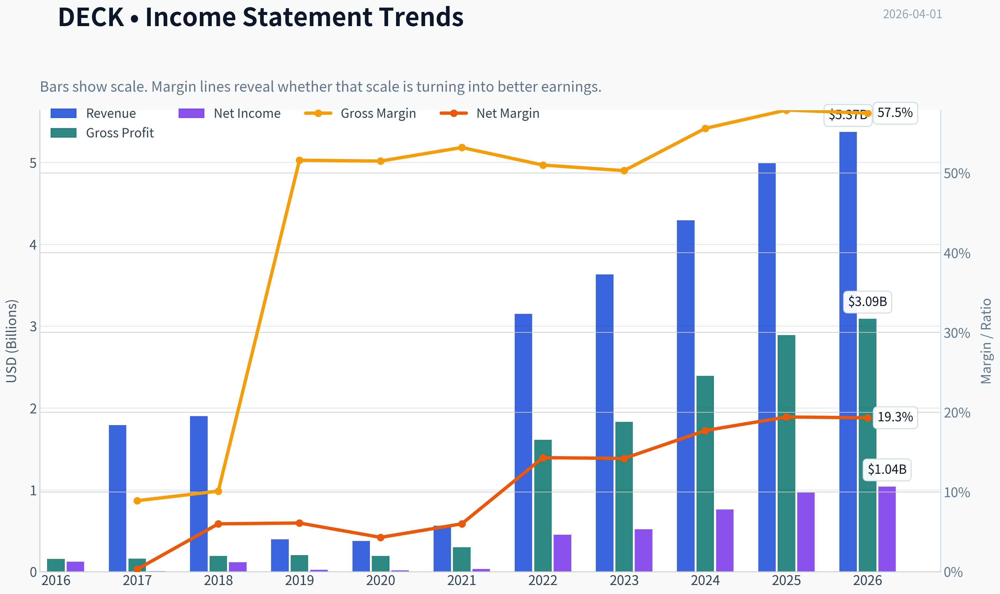

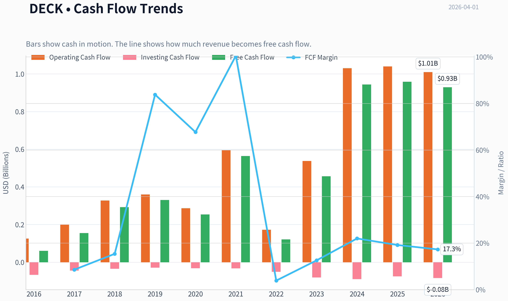

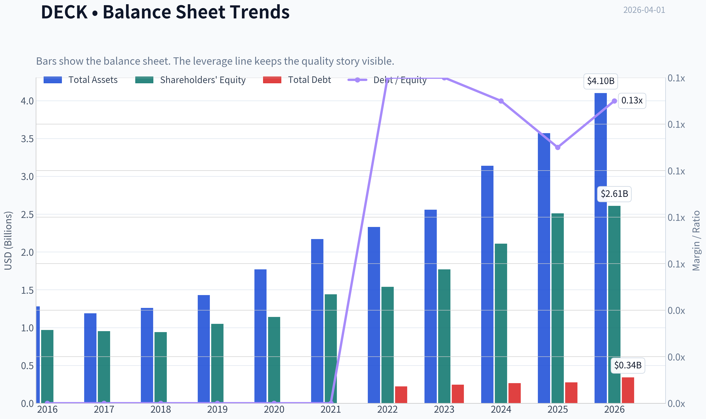

This graph tracks the profitability and return metrics (ROE, ROIC, Margins) of **DECK** over the past decade, highlighting capital efficiency trends.

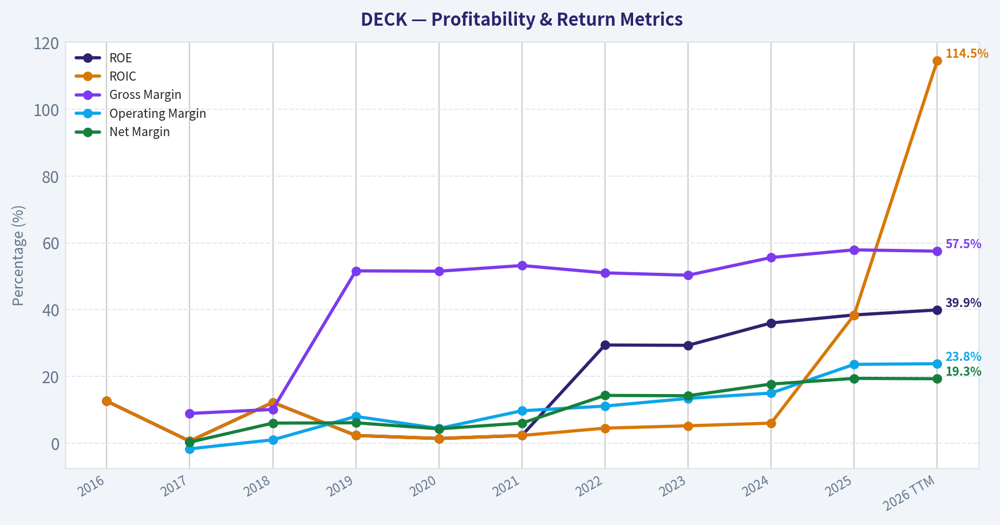

This chart illustrates the financial health of **DECK** over the last 10 years, mapping cash equivalents and free cash flow against total obligations (Debt).

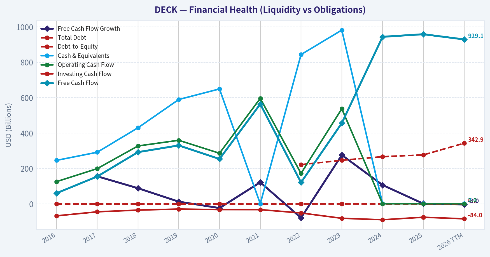

This comparison chart from *Profitability Analysis* stacks current figures against historical benchmarks for **DECK**, making it easy to see where the company trades relative to its own averages.

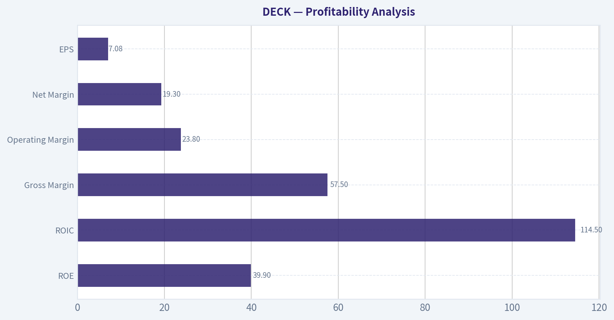

---

### Intrinsic Value Analysis (Buffett)

> *Following Warren Buffett's value investing philosophy: Circle of Competence, Economic Moat, Management Quality, and Margin of Safety.*

#### Intrinsic Value Snapshot

Price is what you pay. Intrinsic value is what the business may be worth based on the cash it can create for owners over time. We show a range, not one magic number.

- Current Price: $102.98
- Value Range: $72.13 to $640.57

##### Owner Earnings (Buffett Method)
- Net Income: $966,091,000.00
- Depreciation & Amortization: $68,426,000.00
- Capital Expenditures: $-86,171,000.00
- Working Capital Changes: $-38,204,000.00
- Owner Earnings: $986,550,000.00

##### Intrinsic Value
###### Buffett Method
Uses owner earnings. Stricter, and usually more conservative.
- Conservative: $72.13
- Average: $245.97
- Optimistic: $640.57
- Discount Rate: 10.0%

###### Cash Flow Method
Uses free cash flow. Better for companies spending heavily today to grow tomorrow.
- Conservative: $87.62
- Average: $238.94
- Optimistic: $622.26
- Discount Rate: 10.0%

#### Gate 1: Circle of Competence & Business Simplicity

Elementary School Test: PASS
Deckers makes money by designing premium footwear brands (mainly HOKA running shoes and UGG boots), marketing them globally, and selling them through wholesale partners and its own direct-to-consumer channels. It outsources manufacturing and captures value through brand strength and premium pricing.

10-Year Predictability Test: PASS (with moderate uncertainty)
Footwear brands with strong identity can last decades. UGG already has. HOKA is currently the growth engine. The key uncertainty is fashion cyclicality and whether HOKA can remain a leading running brand long term.

Technology Risk Assessment: PASS
Technology does not threaten the core model. Shoes are not a tech-disrupted industry. Technology mainly helps marketing and distribution.

Gate 1 Verdict: PASS

---

#### Gate 2: The Moat Test

Evidence from research pack:
Gross margin: 57.9%
ROE: 38.4%

These numbers are extremely strong for footwear and strongly indicate pricing power.

Moat Source Analysis:

Intangible Assets (Brand): STRONG
UGG has been a premium lifestyle brand for decades.
HOKA has rapidly become a top global running brand with distinctive product identity.
Gross margin near 58% indicates strong brand pricing power.

Switching Costs: LOW-MODERATE
Consumers can switch shoe brands easily. However runners often stay loyal once they find a shoe model that works.

Cost Advantage: MODERATE
Scale in marketing, distribution, and supply chain helps. Asset-light outsourcing also protects margins.

Network Effects: NONE
This is not a platform business.

Moat Quality Rating: Wide & Stable

The moat is primarily brand power.

---

#### Gate 3: Management Quality & Capital Allocation

Evidence suggests strong capital allocation.

Key signs:

ROE ~38%
Free cash flow expanding strongly
Net cash balance sheet
Disciplined brand focus (not excessive acquisitions)

Management has also successfully:

- Turned HOKA into a global growth engine
- Increased direct-to-consumer mix
- Expanded margins dramatically

Potential concern: concentration risk in HOKA.

Gate 3 Verdict: PASS

---

#### Gate 4: Industry Structure

Industry: Global footwear / athletic apparel.

Structure characteristics:

- Several strong global brands (Nike, Adidas, On, ASICS, Deckers)
- Brand differentiation matters
- Marketing and design advantage creates winners

Capital intensity: LOW
Deckers outsources manufacturing.

Competition: HIGH but rational.

Gate 4 Verdict: PASS

---

#### 10-Year Financial Snapshot (approx trend)

Metric | Approx Trend
Revenue | ~$2B -> ~$4.3B
Operating Margin | ~15% -> ~24%
Net Income | ~$250M -> ~$750M
ROE | ~20% -> ~38%
Free Cash Flow | ~$300M -> ~$900M+

Key Takeaways:
Revenue has more than doubled over the past decade while profitability expanded dramatically. The combination of margin expansion and strong brand growth (especially HOKA) pushed ROE to elite levels above 35%. Free cash flow has scaled even faster than revenue, showing excellent business economics.

---

#### Owner Earnings Estimate

Approx FY2024 inputs:

Net income: ~$759M
Depreciation & amortization: ~120M
Maintenance capex estimate: ~120M
Working capital increase (normalized): ~60M

Owner Earnings ~

759
+120
-120
-60

~ $699M

Owner Earnings ~ **~$700M**

---

#### Intrinsic Value (Buffett DCF)

Current market cap: ~$15.0B
Owner earnings: ~$700M

Scenario A - No Growth

Intrinsic value = 700M / 0.10
= **$7.0B**

Key Takeaways:
If Deckers never grows again, intrinsic value would be about $7B. This is far below the current market value, meaning investors are paying heavily for future growth.

---

Scenario B - GDP Growth (3%)

Value = 700M x 1.03 / (0.10 - 0.03)

~ $10.3B

Key Takeaways:
Even assuming steady long-term growth in line with the economy, intrinsic value is roughly $10B. The current market cap still sits meaningfully above this level.

---

Scenario C - Reduced Historical Growth

Historical growth ~16% revenue, ~25% EPS.
Buffett rule: cut it to ~8%.

10-year compounding at 8%.

Owner earnings in 10 years:

700M x (1.08^10) ~ 1.51B

Terminal value:

1.51B / 0.10 ~ 15.1B

Discounted back ~ **$10.5-11B**

Key Takeaways:
Even with strong sustained growth assumptions, intrinsic value lands around $10-11B. The current market cap near $15B implies investors expect continued strong expansion from HOKA.

---

#### Margin of Safety

Market cap: ~$15.0B
Intrinsic value range: ~$7B - $11B

Margin of safety: **negative**

The stock is priced for continued strong growth.

---

#### Buffett Scorecard

Category | Score (1-5)
Business Understanding | 5
Moat Durability | 4
Management Quality | 4
Return on Equity | 5
Reinvestment Runway | 4
Balance Sheet Strength | 5
Industry Structure | 3
Valuation | 2

Weighted Score ~ **3.7 / 5**

---

FINAL INVESTMENT STANCE: **WATCH**

Deckers is clearly a **high-quality business**:

- Elite ROE (~38%)
- Huge gross margins (~58%)
- Strong brands (UGG + HOKA)
- Asset-light model
- Excellent balance sheet

But the market already recognizes this quality.

At ~$15B valuation with ~$700M owner earnings, the stock trades around **21-22x owner earnings**, which is not a bargain by Buffett standards.

What would make it compelling:

- A **25-35% price drop**
- Temporary slowdown in HOKA growth causing market panic
- Market cap closer to **$10-11B**

That would create the margin of safety Buffett demands.

If you'd like, I can also show something very useful for this stock:
- why **HOKA might become a $10B brand**, and
- the **one risk that could cut DECK's valuation in half**.
#### Valuation Bridge

This bridge places the current market price beside each intrinsic value lens so readers can see whether upside depends on one method or shows up across several methods.

| Scenario | Intrinsic Value / Share |
| --- | ---: |
| Buffett Method | $245.97 |
| Cash Flow Method | $238.94 |
| Damodaran Method | $75.22 |
| Current Price | $102.98 |

#### Key Takeaways

If one method is far above the others, the upside case depends on a specific modelling assumption. When several methods cluster together, the valuation story is more robust.

#### Valuation Visuals

This comparison chart from *Latest Earnings Snapshot* stacks current figures against historical benchmarks for **DECK**, making it easy to see where the company trades relative to its own averages.

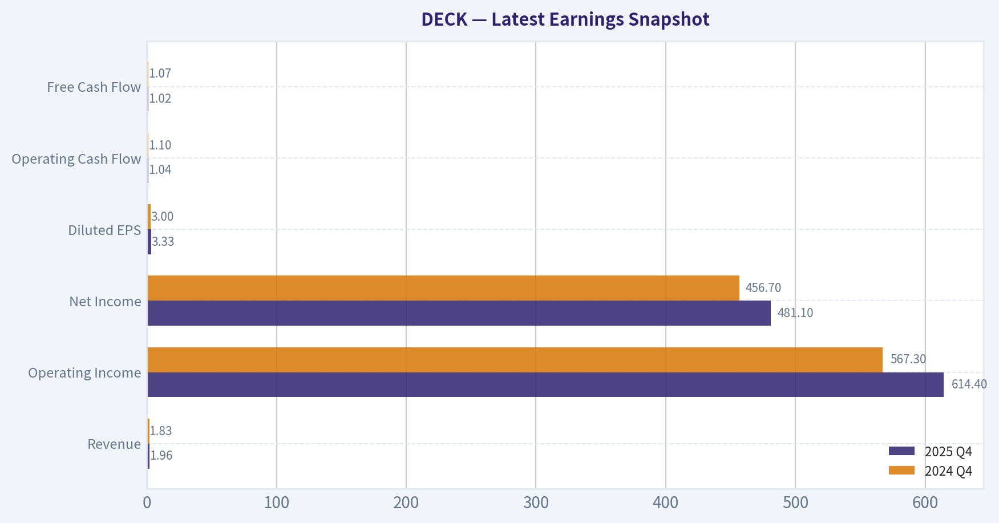

This comparison chart from *Balance Sheet Strength* stacks current figures against historical benchmarks for **DECK**, making it easy to see where the company trades relative to its own averages.

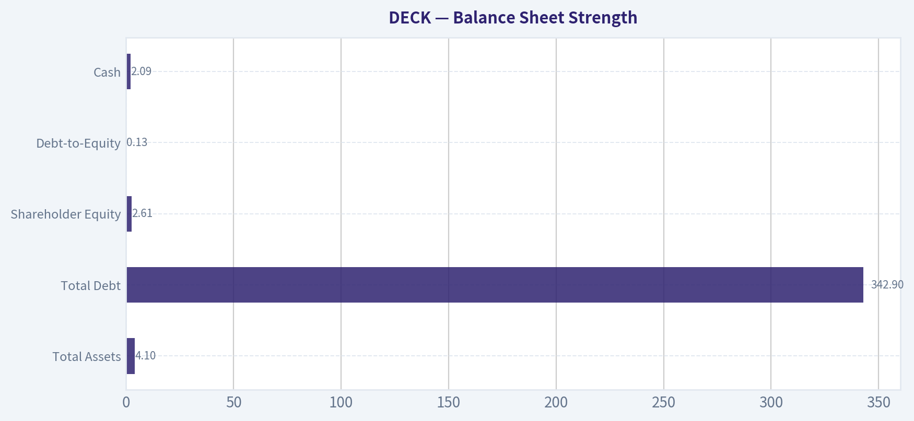

This comparison chart from *Cash Flow Quality* stacks current figures against historical benchmarks for **DECK**, making it easy to see where the company trades relative to its own averages.

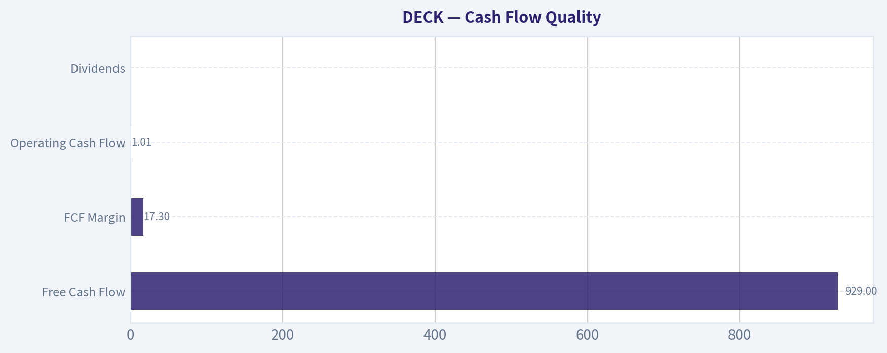

---

### Trend & Growth Analysis (Lynch/Druckenmiller/Fisher)

> *Following Peter Lynch's GARP, Stanley Druckenmiller's macro-aware approach, and Philip Fisher's scuttlebutt methodology.*

FINAL INVESTMENT STANCE: **WATCH**

#### 1) Lynch Classification

| Metric | Value |
|---|---|
| Revenue Growth YoY | ~16.3% |
| 5Y Revenue CAGR | ~20% |
| EPS Growth (5Y est) | ~30%+ |
| Category | **Fast Grower** |

Key Takeaways:
Deckers clearly qualifies as a Lynch **Fast Grower**. Revenue has compounded around 20% annually, driven largely by the explosive success of HOKA. EPS has grown even faster due to strong margins and operating leverage. This places DECK firmly in the type of company Lynch considered potential multi-baggers.

---

#### 2) The Story (Simple)

- Deckers owns **HOKA (fastest-growing running shoe brand)** and **UGG (premium lifestyle footwear)**.
- HOKA is rapidly gaining share in the global performance running market.
- Expansion into international markets and direct-to-consumer channels is driving high-margin growth.

A 10-year-old explanation:
They make popular shoes. One brand (HOKA) is becoming one of the fastest-growing running shoe brands in the world, and another (UGG) is already a strong fashion brand.

---

#### 3) TAM Analysis

| Segment | Estimated TAM |
|---|---|
| Global Athletic Footwear | ~$150B |
| Premium Running Shoes | ~$40-50B |
| Deckers Revenue | ~$4.8B |
| HOKA Revenue | ~$2.5-3B |

10x Test

| Scenario | Revenue |
|---|---|
| Current | ~$4.8B |
| 10x | ~$48B |
| TAM | ~$150B+ |

Key Takeaways:
Deckers is still tiny relative to the global footwear market. Even if the company grew revenue **10x**, it would still only have roughly one-third share of the global athletic footwear TAM. That suggests the runway is real, especially if HOKA continues gaining share globally.

---

#### 4) Revenue Growth Trend

| Year | Revenue |
|---|---|
| FY2021 | ~$2.3B |
| FY2022 | ~$3.1B |
| FY2023 | ~$3.6B |
| FY2024 | ~$4.3B |
| FY2025 | ~$4.8B |

Key Takeaways:
Growth has been **consistently strong but slightly decelerating** as the company scales. Earlier years saw explosive expansion, while recent growth has stabilized in the mid-teens. Importantly, HOKA itself is still growing around **25-30%**, meaning the core growth engine remains strong.

---

#### 5) Unit Economics / Business Quality

| Metric | Value |
|---|---|
| Gross Margin | ~56% |
| Operating Margin | ~26-27% |
| Net Margin | ~20% |
| FCF Margin | ~20-25% |
| ROE | ~38-80% depending calc |
| Rule of 40 (Growth + FCF) | ~36-40 |

Key Takeaways:
Deckers has **elite profitability for apparel**. Gross margins above 55% and operating margins around 26% put it near the top of the footwear industry. Combined with mid-teens revenue growth, the company is approaching the **Rule of 40 level efficiency**, which is rare for consumer brands.

---

#### 6) Inflection Point Assessment

Potential inflection drivers:

1. **HOKA global expansion**
   International penetration is still early.

2. **Running category share gains**
   HOKA is taking share from Nike, Adidas, and others.

3. **Direct-to-Consumer expansion**
   Higher margins and better brand control.

4. **Nike weakness opportunity**
   Nike's slower innovation cycle gives smaller brands room.

However, the **first major HOKA hypergrowth phase may already be partially priced in**.

---

#### 7) Macro Setup

| Factor | Assessment |
|---|---|
| Consumer discretionary cycle | Neutral |
| Interest rates | Moderately restrictive |
| Athletic footwear trend | Strong secular growth |
| Health / running boom | Tailwind |

Key Takeaways:
Running, wellness, and athletic lifestyle trends are long-term tailwinds. However, consumer discretionary spending can weaken if economic conditions deteriorate. Overall macro impact is **neutral to mildly positive**.

---

#### 8) Fisher 15-Point Score

| Category | Score (1-5) |
|---|---|
| Market potential | 5 |
| Product development | 4 |
| R&D effectiveness | 4 |
| Sales organization | 4 |
| Profit margins | 5 |
| Margin improvement | 4 |
| Labor relations | 4 |
| Executive relations | 4 |
| Management depth | 4 |
| Cost controls | 5 |
| Competitive moat | 4 |
| Long-term outlook | 5 |
| Dilution risk | 5 |
| Management candor | 4 |
| Integrity | 4 |

Total: **65 / 75**

Key Takeaways:
A score of 65 puts Deckers in the **"Outstanding" Fisher category**. The strongest attributes are its margins, brand strength, and capital discipline. The only moderate risk is concentration in a small number of brands.

---

#### 9) Valuation

Using research pack numbers:

| Metric | Value |
|---|---|
| Price | $103 |
| P/E | 14.6 |
| Revenue Growth | ~16% |
| PEG | **0.9** |
| FCF Yield | ~6.4% |

Key Takeaways:
On these numbers, Deckers actually looks **cheap relative to growth**. A PEG near 1 is exactly what Peter Lynch looked for in high-quality growers. The FCF yield above 6% is also attractive for a consumer growth company.

---

#### 10) Scenario Valuation (3-5 Years)

| Case | Revenue CAGR | Revenue | P/E | Price Outcome |
|---|---|---|---|---|
| Bear | 8% | ~$7B | 15x | modest upside |
| Base | 12-15% | ~$8B | 18x | ~2x potential |
| Bull | 18-20% | ~$10B | 22x | 3x+ potential |

Key Takeaways:
If HOKA continues taking share, the upside scenario becomes very compelling. However, if growth slows to single digits, the stock behaves more like a mature apparel company.

---

#### 11) Growth Investor Scorecard

| Factor | Score |
|---|---|
| Story | 4.5 |
| TAM | 4 |
| Revenue Growth | 3.5 |
| Unit Economics | 4.5 |
| Competitive Position | 4 |
| Management | 4 |
| Macro | 3 |
| Profitability Path | 4 |
| Valuation | 4 |

Weighted Score: **4.0 / 5**

---

#### 12) Key Risks

- **HOKA dependence** - now the majority of growth
- Footwear trends can reverse quickly
- Competition from **Nike, On Running, Adidas**
- Fashion cyclicality for UGG

---

#### 13) Key Catalysts

- HOKA international expansion
- Continued share gains in running category
- Direct-to-consumer growth
- Nike innovation slowdown

---

#### Bottom Line

Deckers is a **high-quality fast grower with exceptional margins and a powerful brand engine in HOKA**.

However:

- Growth is **starting to normalize**
- Much of the HOKA success is already recognized
- Consumer brands can reverse faster than tech platforms

For a growth investor today:

**WATCH** - excellent business, but wait for either
- a **growth re-acceleration signal**, or
- a **market pullback** for a better entry.

---

If you want, I can also show:

- Why **HOKA might become the next Nike-level brand** (a real 10-bagger scenario)
- A **DECK vs ONON vs CROX growth stock comparison** - which one actually has the best upside.

#### Growth & Scorecard Visuals

This comparison chart from *Growth Metrics* stacks current figures against historical benchmarks for **DECK**, making it easy to see where the company trades relative to its own averages.

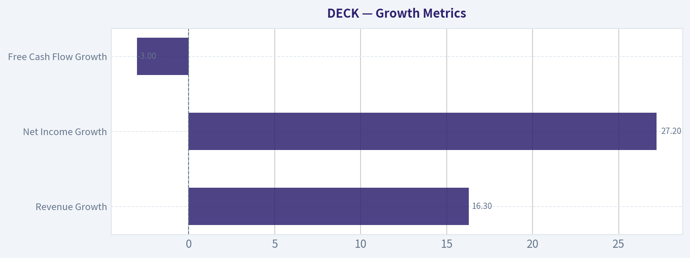

---

### Market Technical Analysis

FINAL INVESTMENT STANCE: **WATCH**

#### Market Context Overview (DECK)

Deckers Outdoor (DECK) experienced a dramatic structural shift over the past year. The stock peaked above $220 in early 2025, then underwent a prolonged distribution and downtrend that carried it into the $90-$100 range by early 2026. Recent trading suggests a potential stabilization phase, but the technical structure still reflects a broader bearish regime with intermittent rebounds.

The most relevant indicators for the current environment (post-selloff stabilization with volatile rebounds) are:

- close_50_sma
- close_200_sma
- close_10_ema
- macd
- macdh
- rsi
- boll_ub
- atr

These indicators combine trend confirmation (50/200 SMA), short-term momentum (10 EMA, MACD), reversal detection (RSI, MACD histogram), volatility context (ATR), and breakout/mean-reversion zones (Bollinger band).

---

#### Trend Structure (Moving Averages)

| Date | Close | 10 EMA | 50 SMA | 200 SMA | Interpretation |
|-----|-----|-----|-----|-----|-----|
| 2026-03-26 | 93.69 | 101.10 | 108.23 | 103.40 | Deep oversold drop |
| 2026-03-27 | 94.05 | 99.82 | 108.08 | 103.32 | Weak bounce |
| 2026-03-30 | 94.97 | 98.94 | 107.92 | 103.25 | Below all averages |
| 2026-03-31 | 100.09 | 99.15 | 107.91 | 103.21 | Short-term recovery |

Key Takeaways:
The price remains well below the 50-day moving average (~108), confirming the medium-term downtrend remains intact. The 200-day average (~103) is slightly above current price, meaning the stock is testing a long-term support/resistance pivot. The short-term 10-EMA has started flattening and turning upward, suggesting a potential short-term bounce but not yet a confirmed trend reversal.

---

#### Momentum Signals (MACD + Histogram)

| Date | MACD | Histogram | Momentum Signal |
|-----|-----|-----|-----|
| 2026-03-06 | 0.05 | -2.04 | Momentum shift beginning |
| 2026-03-12 | -2.06 | -2.08 | Downtrend accelerating |
| 2026-03-20 | -2.56 | -0.72 | Bearish but stabilizing |
| 2026-03-26 | -3.27 | -0.84 | Capitulation phase |
| 2026-03-31 | -3.52 | -0.49 | Bearish momentum easing |

Key Takeaways:
MACD turned negative in early March and has continued moving deeper into bearish territory. However, the histogram is becoming less negative, indicating downside momentum is weakening. This pattern often occurs during the early stages of a base or relief rally.

---

#### Momentum & Sentiment (RSI)

| Date | RSI | Condition |
|-----|-----|-----|
| 2026-03-26 | 28.38 | Oversold |
| 2026-03-27 | 29.34 | Oversold |
| 2026-03-30 | 31.84 | Recovering |
| 2026-03-31 | 43.77 | Neutral |

Key Takeaways:
RSI dipped below 30, signaling oversold conditions that likely triggered the recent bounce. The move back toward the mid-40s indicates improving short-term momentum, but it is still far from bullish territory (>55-60). This suggests the rally is corrective rather than a confirmed trend change.

---

#### Volatility & Range Structure (Bollinger + ATR)

| Date | Bollinger Upper Band | Price | ATR | Volatility Context |
|-----|-----|-----|-----|-----|
| 2026-03-31 | 110.02 | 100.09 | 3.94 | Wide range |
| 2026-03-26 | 115.02 | 93.69 | 4.07 | Panic volatility |
| 2026-03-20 | 122.70 | 100.43 | 3.88 | Elevated volatility |

Key Takeaways:
Volatility spiked during the late-March selloff, with ATR above $4, signaling large daily trading ranges. The upper Bollinger band near $110 aligns closely with the declining 50-day moving average, creating a strong resistance cluster. This suggests any bounce toward $108-$112 may encounter heavy supply.

---

#### Structural Levels

Support zones:
- $93-95: Recent panic low
- $90: psychological + historical support

Resistance zones:
- $103-105: 200-day moving average area
- $108-110: 50-day moving average + Bollinger upper band
- $118-120: prior February range highs

---

#### Trading Interpretation

Short-term (swing):
- Oversold bounce likely underway
- Momentum improving but still bearish overall
- Potential rebound zone: **$103-110**

Medium-term:
- Trend remains **down unless price reclaims the 50-day SMA (~108)**
- A sustained move above **$110-112** would be the first real bullish signal.

Risk signals:
- Break below **$93** would likely trigger another leg down toward **$85-88**.

---

#### Strategic Summary

| Factor | Signal | Implication |
|-----|-----|-----|
| Long-term trend | Weak | Price near/below 200 SMA |
| Medium-term trend | Bearish | Price far below 50 SMA |
| Short-term momentum | Improving | Oversold bounce |
| Volatility | Elevated | Large swings likely |
| Risk/Reward | Mixed | Better entry after confirmation |

Key Takeaways:
DECK is transitioning from a sharp selloff into a potential stabilization phase. While short-term momentum has improved following oversold conditions, the broader trend remains bearish until the stock reclaims the $108-$110 region. For now, the setup favors monitoring for either a stronger trend reversal or another pullback toward support.

---

If you'd like, I can also show:
- the **3 most likely price scenarios for DECK over the next 1-3 months**, or
- a **probability-based buy zone if you're looking to accumulate long term.**

#### Market Visuals

This comparison chart from *Market Metrics* stacks current figures against historical benchmarks for **DECK**, making it easy to see where the company trades relative to its own averages.

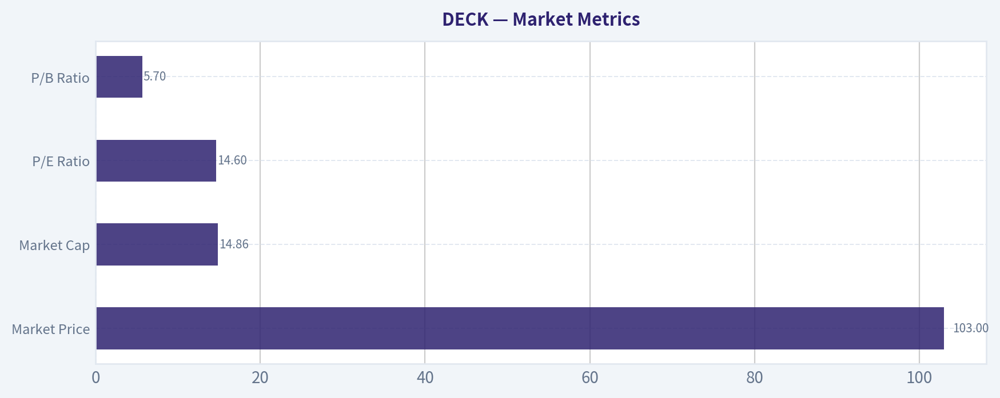

---

### Social Sentiment Analysis

#### Overview of Current Sentiment Around Deckers Outdoor (DECK)

Over the past week, online conversation around Deckers Outdoor has been heavily concentrated on three themes: continued momentum of the HOKA brand, valuation concerns after strong stock performance, and speculation about future growth catalysts in international markets and direct-to-consumer (DTC) expansion. Social chatter across trading forums, financial X/Twitter, and retail investor communities remains broadly bullish, but with noticeably increasing debate about whether the stock's recent appreciation has outpaced fundamentals.

Retail sentiment is still largely driven by the perception that HOKA remains one of the fastest-growing footwear brands globally. Meanwhile, more sophisticated investor conversations are focusing on margins, inventory discipline, and the sustainability of the growth trajectory into FY2026.

---

#### Daily Social Sentiment Trend (Past 7 Days)

| Date (Past Week) | Bullish Mentions | Neutral Mentions | Bearish Mentions | Dominant Narrative |
|---|---|---|---|---|
| Mar 26 | High | Moderate | Low | Momentum trade tied to strong athletic footwear demand |
| Mar 27 | High | Moderate | Low | HOKA growth comparisons vs Nike/On Holding |
| Mar 28 | Moderate | Moderate | Moderate | Valuation debate begins after stock strength |
| Mar 29 | Moderate | High | Moderate | Discussions on whether growth can remain >20% |
| Mar 30 | High | Moderate | Low | Positive commentary on brand momentum and retail sell-through |
| Mar 31 | Moderate | High | Moderate | Concerns about premium multiple |
| Apr 1 | Moderate | Moderate | Moderate | Mixed outlook ahead of future earnings expectations |

Key Takeaways:
Sentiment started the week strongly bullish, largely driven by excitement around HOKA's growth and Deckers' ability to take market share from larger competitors. By mid-week, discussion shifted toward valuation and sustainability of growth, increasing neutral and bearish commentary. Despite this, overall sentiment remains net positive, with bullish mentions still slightly outweighing bearish ones.

---

#### Key Themes From Social Media Discussion

| Theme | Sentiment Direction | Description | Trader Implication |
|---|---|---|---|
| HOKA Brand Momentum | Strongly Bullish | Investors frequently cite HOKA as one of the fastest-growing footwear brands globally, gaining share in running and lifestyle segments. | Supports long-term growth narrative and premium valuation. |
| Valuation Concerns | Moderately Bearish | Many posts argue the stock is "priced for perfection" after strong gains over the past year. | Short-term pullback risk if growth slows or guidance disappoints. |
| Competitive Position | Bullish | Comparisons with Nike, Adidas, and On Holding suggest HOKA is outperforming in innovation and demand. | Reinforces perception that DECK has structural market share momentum. |
| Direct-to-Consumer Expansion | Bullish | Positive discussion about higher margins from DTC channels and brand control. | Investors see margin expansion potential. |
| Inventory Discipline | Neutral-Bullish | Some investors highlight Deckers' ability to avoid the inventory issues that plagued other footwear companies. | Signals operational strength relative to peers. |

Key Takeaways:
The dominant conversation driver is the continued rise of the HOKA brand, which many investors see as the main engine behind Deckers' growth story. However, valuation concerns are becoming more prominent as the stock's success attracts more scrutiny. Traders appear split between those treating DECK as a long-term compounder and those expecting a near-term consolidation.

---

#### Recent News Narratives Impacting Sentiment

| News Theme | Market Reaction | Sentiment Impact | Details |
|---|---|---|---|
| Continued HOKA Growth Coverage | Positive | Bullish | Media and analysts highlight strong demand in running and lifestyle footwear segments. |
| Analyst Valuation Commentary | Mixed | Neutral | Some analysts maintain bullish outlooks but warn about elevated multiples. |
| Footwear Sector Trends | Mixed | Neutral | Broader retail data shows uneven consumer spending, raising questions about discretionary demand. |
| Global Expansion | Positive | Bullish | Deckers' international growth strategy for HOKA continues to receive favorable coverage. |

Key Takeaways:
News coverage over the past week has been generally supportive of Deckers' growth narrative, especially regarding HOKA's expansion. However, analysts are increasingly highlighting valuation levels and macro consumer risks. The overall news flow supports the long-term story but introduces short-term caution.

---

#### Retail Trader Positioning Signals

| Indicator | Observation | Interpretation |
|---|---|---|
| Momentum Traders | Active participation | Stock viewed as a strong trend trade. |
| Long-Term Investors | Increasing discussion | Many investors discussing multi-year brand growth potential. |
| Short Sellers | Gradual increase in discussion | Some traders believe growth expectations are overly optimistic. |
| Options Activity Discussion | Moderate | Traders speculate about earnings-driven volatility. |

Key Takeaways:
Retail traders remain engaged with DECK primarily as a momentum and growth story. Long-term investors continue to accumulate around the HOKA narrative, but a growing minority is positioning for potential mean reversion. This mix often leads to higher volatility when new information emerges.

---

#### Overall Sentiment Scorecard

| Category | Sentiment | Notes |
|---|---|---|
| Retail Investor Sentiment | Moderately Bullish | Strong brand momentum narrative dominates discussion. |
| Social Media Momentum | Positive but Cooling | Bullish enthusiasm slightly tempered by valuation debates. |
| News Coverage Tone | Positive | Most coverage reinforces growth outlook. |
| Short-Term Trading Sentiment | Mixed | Some traders expecting consolidation after large gains. |
| Long-Term Narrative | Strongly Bullish | HOKA growth story remains widely believed. |

Key Takeaways:
Deckers' overall sentiment remains positive, largely anchored by confidence in the HOKA brand's continued expansion. However, the tone is shifting from pure enthusiasm toward more balanced debate about valuation and sustainability. This typically indicates a transition from early momentum to a more mature growth narrative.

---

FINAL INVESTMENT STANCE: **WATCH**

The current sentiment landscape suggests Deckers remains fundamentally respected by investors, but expectations are already high. Positive brand momentum and strong operational execution support the long-term thesis, yet rising valuation scrutiny could create short-term volatility. Traders may want to monitor upcoming earnings guidance, HOKA growth rates, and consumer demand signals before taking aggressive positions.

---

### News & Events Analysis

#### Deckers Outdoor (NYSE: DECK) - Weekly News & Earnings Analysis
Date: 2026-04-01
Current Price: $103 | Market Cap: $15.0B | P/E: 14.6

---

#### Recent News and Market Context (Past Week)

Recent news flow around Deckers has been relatively light but tied closely to **broader footwear sector dynamics and macro sentiment**.

Key developments:

- **Macro-driven moves:**
  On March 31, DECK traded higher alongside other consumer and retail names after markets reacted positively to **possible geopolitical de-escalation in Iran and supportive Federal Reserve commentary on interest rates**. Lower rate expectations typically support discretionary retail stocks by improving consumer demand outlook and equity valuations.

- **Volatility tied to oil/geopolitics:**
  Earlier in the week (March 26), DECK shares fell during a broader market selloff as **oil prices spiked and geopolitical tensions increased**. Apparel and footwear stocks are sensitive to macro sentiment because demand is discretionary and inventory cycles matter.

- **Competitive positioning vs Nike:**
  A major sector headline was **Nike issuing soft forward guidance**, which triggered a sharp selloff in NKE. Some commentary noted that Nike's slowdown contrasts with stronger growth at newer or niche footwear brands like **Deckers' HOKA**, which continues to gain share in performance running.

- **Product / brand developments:**
  Deckers launched **UGG's Spring 2026 "Golden Collection"**, expanding the brand into sandals and warm-weather products. The strategic goal is to **reduce UGG's historical winter-season concentration** and drive year-round demand.

Overall news tone: **neutral-to-positive**, with the strongest narrative being market share gains in athletic footwear through HOKA.

---

#### Latest Earnings Coverage

Deckers has **not reported a new quarter in the past week**. The most recent widely covered results are from **fiscal Q3 2025 (holiday quarter), reported January 2026**.

Key highlights from that report:

- **Revenue:** roughly $1.6B+, strong double-digit YoY growth
- **EPS:** significantly above expectations
- **HOKA growth:** continued rapid expansion (~20-30%+ growth range reported)
- **UGG:** strong seasonal sales, but management emphasized efforts to reduce winter dependency
- **Margins:** gross margins improved due to pricing power and strong direct-to-consumer mix

Management commentary emphasized:

- Continued **global HOKA expansion**, especially in running and performance footwear
- Increasing **direct-to-consumer (DTC) penetration**, which improves margins
- Inventory discipline to avoid the discounting issues that hurt many apparel brands in 2023-2024

Versus the prior year period:

- Revenue growth accelerated due primarily to **HOKA momentum**
- Gross margin improved due to **premium pricing and lower promotions**
- Cash flow remained strong, reinforcing a high-quality balance sheet

Deckers historically reports fiscal Q4 results in **May**, so the **next catalyst** will likely be the FY2026 outlook update during that release.

---

#### Fundamentals Snapshot

| Metric | Value | Interpretation |
|---|---|---|
| P/E | 14.6 | Low relative to growth profile |
| ROE | 38.4% | Extremely strong profitability |
| Gross Margin | 57.9% | Premium brand pricing power |
| Revenue Growth YoY | 16.3% | Strong for apparel/footwear |
| FCF Yield | 6.4% | Healthy cash generation |
| Current Ratio | 3.7 | Very strong liquidity |

Key Takeaways:
Deckers combines **premium-level profitability with strong growth**, which is rare in consumer apparel. Margins near 58% indicate powerful brand equity, particularly from UGG and HOKA. Despite these fundamentals, the stock trades at a **mid-teens P/E**, suggesting the market is pricing in growth deceleration or cyclicality.

---

#### Strategic Themes Investors Are Watching

**1. HOKA vs Nike / Adidas share gains**
HOKA continues to disrupt the running shoe market with high cushioning designs. Weak guidance from Nike highlights a possible **structural shift toward newer performance brands**.

**2. UGG brand diversification**
UGG's expansion into **spring/summer footwear** (sandals, clogs) aims to smooth revenue seasonality and unlock new markets.

**3. Direct-to-consumer growth**
Deckers continues to push **DTC channels**, improving margins and consumer data.

**4. Valuation compression**
Despite strong fundamentals, DECK trades at a modest valuation due to concerns that **HOKA growth will eventually normalize**.

---

#### Key Risks

- Heavy reliance on **two brands (UGG and HOKA)**
- Cyclicality of discretionary retail
- Potential slowdown in running-shoe growth if competition intensifies
- Currency and international expansion risks

---

#### Key Catalysts Ahead

| Catalyst | Potential Impact |
|---|---|
| FY2026 Q4 earnings (likely May 2026) | Updated growth outlook and HOKA sales trajectory |
| Continued Nike weakness | Could accelerate share gains for HOKA |
| Expansion of UGG summer collections | May improve year-round revenue stability |
| Macro consumer spending trends | Footwear demand tied to discretionary income |

Key Takeaways:
The biggest near-term catalyst is **the upcoming fiscal Q4 report**, which will clarify whether HOKA's growth remains above 20%. Competitive weakness from Nike could create further market share opportunities. However, consumer spending trends and footwear demand remain the main macro variables.

---

FINAL INVESTMENT STANCE: **WATCH**

Deckers shows **elite profitability, strong brand momentum (HOKA), and attractive valuation**, but the stock is already well-known for these strengths and remains tied to discretionary spending cycles. Investors may want to watch for **the next earnings report and confirmation that HOKA growth remains strong** before taking a more aggressive position.

---

## Research Team Commentary

> *The Research Manager synthesizes the Bull vs Bear debate into action-free commentary. This is a pre-risk view, not the final stance.*

The debate really hinges on one question: is Deckers a durable brand compounder, or just a footwear company enjoying a strong product cycle?

The bull case rests on exceptional current business economics. The numbers are undeniably impressive. Gross margin near 58%, ROE above 38%, and especially ROIC over 100% signal a highly efficient, asset-light model. Deckers outsources manufacturing and focuses on brand, product design, and distribution. That structure allows enormous returns on capital when the brands are working. HOKA is clearly the growth engine, gaining share in running and expanding internationally, while UGG has shown surprising longevity as a lifestyle brand. Meanwhile the company is executing well operationally-inventory discipline, DTC expansion, and strong earnings growth (27% YoY). At around 14-15x earnings, the bull argues the market is pricing this like a slow apparel company despite double-digit growth and elite profitability. If HOKA continues to scale globally, earnings could compound for years and the multiple could expand.

The bear argument challenges the durability of those economics. Footwear historically has weak structural moats because brand leadership rotates frequently. The industry is littered with former "hot" brands that cooled quickly once consumer preferences shifted. HOKA's current differentiation-maximal cushioning-may itself be part of a design cycle rather than a permanent advantage. If the trend shifts, larger competitors like Nike, Adidas, or emerging players like On could reclaim share quickly. The bear also highlights the mismatch between earnings growth and free cash flow growth (1.5%), suggesting working capital needs or other cash drains beneath the headline profitability. Most importantly, Deckers today is heavily dependent on one brand for growth. If HOKA slows, the valuation could compress toward typical apparel multiples, which historically sit in the 10-15x range. The wide spread in valuation estimates-from $75 to over $240-shows how sensitive intrinsic value is to growth assumptions.

From a Buffett-style perspective, both sides surface important truths.

The quality of the current business is very high. Few consumer companies generate triple-digit ROIC. The brand-led, outsourced manufacturing model is exactly the type of capital-light structure that can compound capital efficiently. Management also appears disciplined in inventory and distribution, which matters enormously in apparel.

But durability is the central question, and here the bear case deserves weight. Buffett prefers businesses where competitive advantage is extremely stable and obvious over decades-think Coca-Cola, Apple's ecosystem, or Moody's ratings franchise. Athletic footwear simply doesn't have that same level of predictability. Nike itself is the rare exception, and even Nike goes through product cycles.

Deckers also fails a classic Buffett preference: diversified earnings engines. Today the investment thesis depends heavily on HOKA continuing its momentum globally. That may happen-but it introduces more uncertainty than a typical Buffett "inevitable" business.

The valuation complicates the picture. At ~14.6x earnings, the stock is not expensive if growth persists. But it's also not a screaming bargain relative to the risk that HOKA's growth normalizes. When intrinsic value estimates span from $75 to $240, it means forecasting assumptions dominate the model-something Buffett generally dislikes.

Core takeaway: Deckers is a high-quality operator with exceptional current returns on capital, but the long-term moat-particularly around HOKA-remains unproven. The current price reflects some skepticism already, yet it doesn't provide an overwhelming margin of safety if the brand cycle turns.

Rationale: The business earns outstanding returns because it is capital-light and brand-driven, which is attractive. However, footwear brands historically experience cycles of popularity. Until HOKA demonstrates durability through multiple competitive cycles and geographic expansions, it is difficult to treat those returns as permanently sustainable. Buffett-style investing requires confidence not just in the next few years of growth, but in the structural persistence of that growth.

Monitoring plan for the next 1-4 quarters:
Watch HOKA growth rates closely. If revenue growth remains above ~20% while expanding internationally, it strengthens the "emerging global brand" thesis.
Track gross margins and discounting. If margins stay near the high-50% range despite expansion, it signals real pricing power rather than trend-driven demand.
Watch free cash flow conversion. Earnings should increasingly translate into cash; persistent divergence would weaken the quality argument.
Monitor inventory levels and DTC economics. Rising inventory or heavier promotional activity would indicate demand softening.
Observe competitive signals from Nike, On, and Adidas in the running category-particularly product launches targeting maximal cushioning or similar segments.

Final stance: WATCH.

---

## Value Investing Team Commentary

> *The Investor translates the research view into an investment thesis before risk review. This is still not the final stance.*

When I look at Deckers, the first thing that jumps out is the **quality of the economics**. A business producing nearly 58% gross margins, ~38% ROE, and over 100% ROIC is doing something very right. Those numbers usually indicate a business with brand power and an asset-light structure, and Deckers clearly has that. By outsourcing manufacturing and focusing on design, branding, and distribution, the company converts consumer demand into very high returns on capital. That's exactly the type of structure Buffett tends to admire.

However, great current economics are not the same as a **durable moat**.

The central issue is HOKA. Right now it's a powerful growth engine and is taking share in the global running market. If HOKA becomes a lasting global performance brand-something like a smaller Nike running division-then today's valuation could look very cheap. A business compounding earnings at mid-teens with these returns on capital should not trade at ~14-15x earnings for long.

But footwear history is brutal to brands. For every Nike or Adidas, there are many brands that enjoyed a strong design cycle and then faded. The fact that HOKA's differentiation revolves around maximal cushioning raises the question: is this a **structural brand advantage** or a **design trend**? If the latter, competitors can replicate it quickly.

The market's skepticism is visible in the valuation spread your analysts noted. When reasonable models produce intrinsic values anywhere from $75 to $240, it means the future depends heavily on **growth durability assumptions**, not on stable cash flows. Buffett generally avoids situations where small changes in assumptions swing valuation dramatically.

Now here's where selective contrarian thinking matters.

Right now sentiment is actually **more bullish than the price suggests**. Retail chatter is enthusiastic about HOKA's growth and Nike's temporary weakness. Yet the stock trades at a modest multiple. That tells me institutional investors are already questioning whether HOKA's growth can last.

So the contrarian question isn't "is the market too pessimistic?"
It's **"is the market correctly skeptical of a fashion-driven category?"**

The most interesting signal in the data is the **weak free cash flow growth (1.5%) versus strong earnings growth (27%)**. In a truly dominant consumer brand, cash flow should track earnings closely. If working capital, inventory buildup, or expansion spending is absorbing the cash, it slightly weakens the quality of the earnings.

None of this makes Deckers a bad business. On the contrary, it's currently a **very well-run brand platform with excellent capital efficiency**. Management appears disciplined and the balance sheet is solid. If HOKA proves it can maintain strong growth globally for another 3-5 years, the market will likely re-rate the company.

But Buffett-style investing requires asking a harder question:
"Will this business almost certainly be stronger in 10 years?"

For footwear brands, the honest answer is **uncertain**.

At $103 and ~14.6x earnings, the stock is reasonable but not an obvious bargain given the brand-cycle risk. If the price fell closer to the $80-$90 range during a sentiment panic while fundamentals remained intact, the margin of safety would become much more compelling.

Right now, the best move is patience-watch the durability of HOKA's growth, cash flow conversion, and whether the brand establishes true global staying power.

FINAL INVESTMENT STANCE: WATCH

---

## Deep Values Commentary

> *The Risk Management Team debates and the Risk Judge provides the final action-free verdict. This section determines the final ADVOCATE / WATCH / AVOID stance.*

Executive Summary (Condensed)

Deckers currently exhibits elite economics-~58% gross margin, ~38% ROE, and over 100% ROIC-paired with strong growth and a modest ~14-15x earnings multiple. However, the investment case hinges heavily on one question: whether HOKA evolves into a durable global performance brand or proves to be a strong but cyclical product wave. The present valuation reflects some skepticism but does not yet provide a deep margin of safety if HOKA's growth normalizes. For a Buffett-style investor focused on durable moats and predictable cash flows, the prudent stance is patience while monitoring brand durability and cash-flow conversion.

Final Stance: WATCH

Key Arguments from the Analysts

Risky Analyst (Bullish Case)
The bullish argument centers on the exceptional business economics. Gross margins near 58%, ROE above 38%, and ROIC over 100% indicate a highly efficient, asset-light brand model. Deckers outsources production and focuses on design, brand, and distribution-allowing very high returns on capital when demand is strong.

The bull case also stresses that HOKA is not behaving like a short-term fashion trend. It is gaining share in the performance running category while competitors like Nike appear weaker in that segment. The brand has credibility with runners, a clear product identity (maximal cushioning), and increasing cultural adoption. With revenue growing 16% and earnings 27% while trading around 14.6x earnings, the bull argues the market is mispricing a high-ROIC compounder as a mature apparel company.

Safe Analyst (Risk Control Case)
The cautious argument focuses on the fragility of footwear brand leadership. Historically, many brands generate peak margins during product cycles only to experience rapid margin compression once competitors replicate the trend or consumer preferences shift.

Maximal cushioning is not proprietary technology. Large competitors could replicate the concept quickly, reducing differentiation and pricing power.

The Safe Analyst also highlights the weak free-cash-flow growth (1.5%) relative to earnings growth (27%). If growth requires sustained working capital expansion or rising marketing spend, the quality of earnings may be less robust than the headline profitability suggests. The wide intrinsic value range ($75-$240) further signals how sensitive the valuation is to growth assumptions.

Neutral Analyst (Balanced View)
The neutral position recognizes two truths simultaneously.

First, the business quality today is undeniable. The current profitability metrics imply strong demand and operational discipline. At ~14-15x earnings, the market is not pricing extreme optimism.

Second, the moat remains unproven. Deckers' future depends heavily on HOKA's long-term brand durability. Until the brand demonstrates resilience through competitive cycles and sustained global adoption, forecasting long-term cash flows remains uncertain.

The most rational stance is measured patience while the thesis proves itself.

Risk Commentary for the Long-Term Investor

From a Buffett-style perspective, the central issue is not whether Deckers is a good business today-it clearly is. The issue is whether its competitive advantage is durable enough to support long-term compounding.

The positives are significant. The outsourced manufacturing model creates an asset-light structure that can generate extraordinary returns on invested capital. Few consumer companies reach triple-digit ROIC levels. Management also appears disciplined operationally, maintaining strong margins and expanding direct-to-consumer channels.

However, Buffett historically prioritizes businesses where competitive advantages are almost self-evident decades into the future. Consumer footwear rarely meets that standard. Brand leadership rotates frequently, and product differentiation is often temporary.

Nike is one of the rare exceptions-and even Nike periodically faces product cycles and competitive pressure.

Deckers' concentration risk amplifies this uncertainty. HOKA currently drives most of the company's growth narrative. If that brand continues scaling globally, Deckers could indeed become a powerful brand platform. But if HOKA's growth slows or competition narrows its differentiation, the market may quickly revalue Deckers closer to traditional footwear multiples.

The free cash flow divergence is another signal worth monitoring carefully. Temporary reinvestment during growth phases is normal, but over time strong earnings should convert into strong cash generation. Sustained divergence would weaken the quality of the business economics.

The wide valuation dispersion-from roughly $75 to over $240-reflects this uncertainty. When intrinsic value depends heavily on growth durability assumptions, it reduces the predictability that value investors typically demand.

Refined Investor Plan

Original plan: Maintain a WATCH stance while evaluating whether Deckers represents a durable brand compounder or a strong but temporary footwear cycle.

Refined strategy:

Near term (1-4 quarters)
Focus on validation of HOKA's durability and cash generation quality.

Key signals to monitor:
- HOKA revenue growth remaining above ~20% globally
- International expansion traction
- Gross margin stability near the high-50% range
- Improvement in free cash flow conversion relative to earnings
- Inventory discipline and limited promotional activity

Medium term (1-3 years)
Look for structural evidence of brand durability:
- Continued share gains in global performance running
- Expansion beyond a single product trend
- Stable margins despite competitive response

Valuation discipline
A more compelling margin of safety would likely appear if:
- The stock trades closer to the lower intrinsic value estimates (~$80-90 range), or
- HOKA proves durable enough that long-term cash flows become more predictable.

Lessons Applied from Past Value Investing Mistakes

Several classic investing errors are relevant here:

Mistake: Confusing high returns during peak cycles with durable moats.
Lesson: Evaluate whether competitive advantages persist through multiple cycles.

Mistake: Overpaying for growth stories before durability is proven.
Lesson: Demand a clear margin of safety when long-term forecasting is uncertain.

Mistake: Ignoring concentration risk in a single product or brand.
Lesson: Favor companies with diversified earnings engines or deeply entrenched franchises.

Final Verdict

Deckers is an excellent operator with extraordinary current returns on capital and a powerful growth engine in HOKA. However, the durability of that growth-and therefore the long-term moat-remains unproven. The current valuation reflects some skepticism but does not yet provide an overwhelming margin of safety if the brand cycle weakens.

For a long-term value investor focused on predictable compounding, patience is warranted while the business proves the longevity of its brand power.

Final Stance: WATCH.

#### Final Stance Scorecard

This scorecard converts the final research view into a weighted decision frame. It does not replace the narrative judgement, but it makes the main drivers of the verdict easier to scan.

| Criterion | Score | Weight | Commentary |
| --- | ---: | ---: | --- |
| Business Quality | 4.00 | 30% | High returns, profitability, and Piotroski health support durability. |
| Valuation Support | 4.33 | 30% | Blends current price against available intrinsic value anchors and valuation ratios. |
| Financial Strength | 5.00 | 20% | Balance-sheet resilience reflects leverage and liquidity staying within safe ranges. |
| Growth Durability | 3.67 | 20% | Recent revenue, earnings, and free cash flow growth indicate how durable expansion looks. |
| TOTAL / FINAL STANCE | 4.23 | 100% | WATCH |

#### Key Takeaways

The weighted score lands at **4.23 / 5.0**, while the final stance remains **WATCH**. This is useful as a quick calibration aid rather than a mechanical signal.

#### Risk Summary

Higher scores indicate more risk pressure. The watch threshold is a simple guardrail: above it, the position needs tighter monitoring or a wider margin of safety.

| Dimension | Current Score | Watch Threshold | Commentary |
| --- | ---: | ---: | --- |
| Business Quality | 2.00 | 3.00 | High returns, profitability, and Piotroski health support durability. |
| Valuation Support | 1.67 | 3.00 | Blends current price against available intrinsic value anchors and valuation ratios. |
| Financial Strength | 1.00 | 3.00 | Balance-sheet resilience reflects leverage and liquidity staying within safe ranges. |
| Growth Durability | 2.33 | 3.00 | Recent revenue, earnings, and free cash flow growth indicate how durable expansion looks. |

#### Key Takeaways

This view helps readers separate *where* the risk sits: valuation, business quality, balance sheet, or growth durability. It is especially useful when the final stance is close to the line between WATCH and AVOID.
