# DECK Deep Value Intelligence

**Analysis Date:** 2026-11-28

## Critical Disclaimer

*This analysis is generated by Deep Value Intelligence, an AI-powered multi-agent investing framework. Education & research only - not financial advice, not a financial advisor.*

---

## Table of Contents

1. Intelligence Summary
2. Analyst Team Reports
   - Fundamentals Analysis
   - Intrinsic Value Analysis (Buffett)
   - Trend & Growth Analysis (Lynch/Druckenmiller/Fisher)
   - Market Technical Analysis
   - Options Market Analysis
3. Research Team Commentary
4. Value Investing Team Commentary
5. Deep Values Commentary

---

## Intelligence Summary

### Thesis + Conditions

**Core Thesis:** Deckers appears to be a high-quality, asset-light branded-footwear company priced for substantial earnings normalization. At $86.94 and 11.52 times reported earnings, valuation does not appear to require heroic growth.

**Key Risks:**
- The main risk is not price volatility, technical weakness, or put activity. It is permanent brand deterioration-specifically, slowing HOKA demand combined with discounting, excess inventory, rising marketing intensity, and structurally lower margins. No such synchronized breakdown is established in the supplied evidence.
- The original plan is directionally sound: distinguish ordinary growth normalization from permanent impairment and focus monitoring on demand quality, margins, inventory, and cash conversion. The principal adjustment is to reduce reliance on the precise $180.03 intrinsic value and place more weight on normalized owner earnings.
- This is an **Bullish** judgment with conditional rather than maximal confidence. Deckers' financial strength limits solvency risk, while the current earnings multiple appears to discount significant operating deterioration already. The case would weaken materially only if several indicators deteriorate together, not merely because of one soft quarter or weak market momentum.

**Confidence:** Low

---

## Analyst Team Reports

### Fundamentals Analysis

#### Latest Earnings Snapshot

*Most recent reported quarter anchored on 2026 Q3, with prior-year comparison when available.*

| Metric | 2026 Q3 | 2025 Q3 | YoY Change |
| --- | ---: | ---: | ---: |
| Revenue | $1.48B | $1.43B | +3.5% |
| Operating Income | $389.5M | $326.5M | +19.3% |
| Net Income | $313.1M | $268.2M | +16.8% |
| Diluted EPS | $2.31 | $1.82 | +26.9% |
| Operating Cash Flow | $-57.2M | $8.1M | -806.9% |
| Free Cash Flow | $-79.1M | $-13.9M | -469.0% |

Key Takeaways: This snapshot anchors the most recent reported quarter before the narrative analysis. It helps readers separate long-run business quality from whatever changed in the latest earnings print.

#### 11-Year Financial Metrics for DECK

*All values below are computed deterministically from raw data - not estimated by AI.*

*Issuer profile: operating company (Consumer Cyclical / Footwear & Accessories).*

#### 11-Year Financial Metrics
*Annual rows come from reported financial statements. The final TTM row is computed from the latest four quarters.*

| Metric | 2015 | 2016 | 2017 | 2018 | 2019 | 2020 | 2021 | 2022 | 2023 | 2024 | 2025 | 2026 TTM |
| --- | --- | --- | --- | --- | --- | --- | --- | --- | --- | --- | --- | --- |
| Market Price | $12 | $10 | $10 | $15 | $24 | $22 | $55 | $46 | $75 | $157 | $112 | $87 |
| Market Cap | $2.53B | $1.98B | $1.93B | $2.88B | $4.40B | $3.84B | $9.39B | $7.61B | $12.00B | $24.52B | $17.07B | $11.76B |
| P/E Ratio | 15.64 | 16.19 | 331.83 | 25.15 | 16.63 | 13.93 | 24.53 | 16.84 | 23.20 | 32.28 | 17.66 | 11.53 |
| P/B Ratio | 2.70 | 2.05 | 2.03 | 3.06 | 4.21 | 3.37 | 6.50 | 4.94 | 6.79 | 11.63 | 6.79 | 5.07 |
| ROE | 17.3% | 12.6% | 0.6% | 12.2% | 25.3% | 24.2% | 26.5% | 29.4% | 29.3% | 36.0% | 38.4% | 45.7% |
| ROIC | 24.1% | 16.9% | 1.5% | 19.8% | 54.3% | 57.7% | 91.1% | 86.1% | 68.1% | 101.9% | 146.7% | 61.5% |
| EPS | $0.78 | $0.62 | $0.03 | $0.60 | $1.47 | $1.60 | $2.25 | $2.71 | $3.23 | $4.86 | $6.33 | $7.54 |
| Revenue | $1.82B | $1.88B | $1.79B | $1.90B | $2.02B | $2.13B | $2.55B | $3.15B | $3.63B | $4.29B | $4.99B | $5.58B |
| Gross Profit | $878.1M | $846.7M | $835.2M | $931.6M | $1.04B | $1.10B | $1.37B | $1.61B | $1.83B | $2.39B | $2.89B | $3.29B |
| Gross Margin | 48.3% | 45.2% | 46.7% | 48.9% | 51.5% | 51.8% | 54.0% | 51.0% | 50.3% | 55.6% | 57.9% | 58.9% |
| Operating Margin | 12.2% | 8.4% | -0.4% | 11.6% | 16.2% | 15.9% | 19.8% | 17.9% | 18.0% | 21.6% | 23.6% | 23.6% |
| Net Income | $161.8M | $122.3M | $5.7M | $114.4M | $264.3M | $276.1M | $382.6M | $451.9M | $516.8M | $759.6M | $966.1M | $1.06B |
| Net Margin | 8.9% | 6.5% | 0.3% | 6.0% | 13.1% | 12.9% | 15.0% | 14.3% | 14.2% | 17.7% | 19.4% | 19.0% |
| Revenue Growth | 14.5% | 3.2% | -4.5% | 6.3% | 6.2% | 5.6% | 19.4% | 23.8% | 15.1% | 18.2% | 16.3% | 11.9% |
| Net Income Growth | N/A | -24.4% | -95.3% | 1903.4% | 131.1% | 4.5% | 38.5% | 18.1% | 14.4% | 47.0% | 27.2% | 9.7% |
| Free Cash Flow Growth | -47.2% | -24.0% | 159.7% | 88.9% | 12.9% | -23.2% | 122.2% | -78.5% | 276.1% | 106.8% | 1.5% | 9.8% |
| Total Book Value | $937.0M | $967.5M | $954.3M | $940.8M | $1.05B | $1.14B | $1.44B | $1.54B | $1.77B | $2.11B | $2.51B | $2.32B |
| Total Assets | $1.17B | $1.28B | $1.19B | $1.26B | $1.43B | $1.77B | $2.17B | $2.33B | $2.56B | $3.14B | $3.57B | $3.95B |
| Total Debt | $5.4M | $67.5M | $550,000 | $578,000 | $603,000 | $638,000 | $0 | $0 | $0 | $0 | $0 | $539.5M |
| Debt-to-Equity | 0.01 | 0.07 | 0.00 | 0.00 | 0.00 | 0.00 | 0.00 | 0.00 | 0.00 | 0.00 | 0.00 | 0.23 |
| Cash & Equivalents | $225.1M | $246.0M | $291.8M | $430.0M | $589.7M | $649.4M | $1.09B | $843.5M | $981.8M | $1.50B | $1.89B | $1.21B |
| Shareholders' Equity | $937.0M | $967.5M | $954.3M | $940.8M | $1.05B | $1.14B | $1.44B | $1.54B | $1.77B | $2.11B | $2.51B | $2.32B |
| Operating Cash Flow | $169.7M | $125.8M | $199.3M | $327.4M | $359.5M | $286.3M | $596.2M | $172.4M | $537.4M | $1.03B | $1.04B | $1.13B |
| Investing Cash Flow | $-100.6M | $-67.2M | $-44.5M | $-34.7M | $-29.0M | $-32.0M | $-32.2M | $-51.0M | $-81.0M | $-89.3M | $-75.0M | $-75.9M |
| Free Cash Flow | $78.5M | $59.6M | $154.8M | $292.5M | $330.4M | $253.9M | $564.0M | $121.3M | $456.4M | $943.8M | $958.4M | $1.05B |
| FCF Margin | 4.3% | 3.2% | 8.6% | 15.4% | 16.4% | 11.9% | 22.2% | 3.9% | 12.6% | 22.0% | 19.2% | 18.9% |
| Dividends / Share | $0.00 | $0.00 | $0.00 | $0.00 | $0.00 | $0.00 | $0.00 | $0.00 | $0.00 | $0.00 | $0.00 | $0.00 |

#### Profitability Metrics
- Return on Equity (ROE): 41.0%
- Return on Invested Capital (ROIC): 164.6%
- Return on Assets (ROA): 27.8%
- Gross Margin: 57.7%
- Operating Margin: 23.1%
- Net Profit Margin: 18.7%

#### Liquidity Metrics
- Current Ratio: 3.54
- Quick Ratio: 2.77

#### Leverage Metrics
- Debt-to-Equity Ratio: 0.00
- Interest Coverage Ratio: 499.17
- Net Debt: $-1.91B

#### Growth Metrics (Year-over-Year)
- Revenue Growth: 9.8%
- Net Income Growth: 6.0%
- Free Cash Flow Growth: 14.5%
- Revenue CAGR (3-Year): 14.7%
- Revenue CAGR (5-Year): 16.5%

#### Valuation Metrics
- P/E Ratio (TTM): 11.52
- Forward P/E: 10.61
- Price-to-Book: 5.01
- Price-to-Sales: 2.08
- PEG Ratio: 0.45
- EV/EBITDA: 7.88
- Free Cash Flow Yield: 9.5%
- Earnings Yield: 8.7%

#### Owner Earnings (Buffett Method, Code-Computed)
- Net Income: $966.1M
- + Non-cash, non-recurring items excluded (fair-value changes on convertibles/derivatives/SAFEs, impairments): $9.3M
- + Depreciation & Amortization: $75.8M
- - Capital Expenditures: $-84.6M
- + Working Capital (cash-flow statement; negative = cash tied up): $18.6M
- = **Owner Earnings: $887.3M**

#### Intrinsic Value (DeepValues app - SEC filings pipeline)
- **Intrinsic value (DeepValues app, the headline): $180.03** - Owner Earnings (Buffett), method buffett-1986-v2, as of 2026-11-28 (FY2026)
  Range (conservative - optimistic): $126.02 - $180.03
  Margin of safety vs. price: 51.7% (price $86.94)
  Inputs the app used (ttm_2027Q2): after-tax operating income $1.0B (operating income $1.3B, tax 22.4%) + D&A $0.1B - capex charge $0.1B (three-year average capex/revenue x trailing revenue; reported capex $0.1B) - working capital $0.0B = owner earnings $1.0B.
  Growth 10.0% fading to 2.5% terminal (min(owner-earnings CAGR, 5-year revenue CAGR), clamped [0, 10%]); discount rate 8.3% (30Y Treasury 5.33% + 3 pts (as of 2026-11-27)); net cash $1.2B (cash $1.2B + marketable securities $0.0B - debt $0.0B); 135M shares.
- Owner Earnings (Buffett): $126.02 / $180.03 / $180.03 (conservative / base / optimistic) ← headline
- Free cash flow DCF: $158.28 / $272.89 / $435.19 (conservative / base / optimistic)
- Damodaran two-stage FCFF: $76.58 / $125.79 / $202.86 (conservative / base / optimistic)
  This is THE intrinsic value: quote it as the intrinsic value and measure margin of safety against it. Any DVI scenario figures elsewhere are a secondary cross-check, not the value.

#### DVI scenario model (secondary cross-check - NOT the intrinsic value)
DVI's own Yahoo-based scenarios, shown only as a sensitivity check. Do not quote these as the intrinsic value; the intrinsic value is the DeepValues app value above.
- Current Price: $87
- DVI scenario value (business-model routed): $221
  Business model: asset light platform - weighted blend [Damodaran FCFF + reverse-DCF fair + owner-earnings DCF] (asset_light_platform)
  Model spread (min-max across DCFs): $112 - $224
  Margin of safety vs. price (headline): 60.7%
  Routing note: Asset-light / high-margin platform: value driven by margins and reinvestment economics - the headline centers on the reverse-DCF demonstrated-growth fair value with Damodaran FCFF as a floor, down-weighting the owner-earnings DCF.
- Buffett Method (Owner Earnings):
  Conservative: $125
  Average: $224
  Optimistic: $788
- Cash Flow Method (FCF):
  Conservative: $44
  Average: $193
  Optimistic: $734
- Damodaran FCFF (WACC + margins + reinvestment):
  Conservative: $69
  Average: $112
  Optimistic: $181
  Monte Carlo band (P10-P90): $87 - $146 (median $111)
  P(intrinsic value > price): 89.6%
- Reverse-DCF: price implies ~-7.9%/yr owner-earnings growth for 10y; trailing 3y was 31.0%, 5y 30.5%.

#### Piotroski F-Score: 6/9
- Positive Net Income: PASS
- Positive Operating Cash Flow: PASS
- ROA Improvement: PASS
- Cash Flow > Net Income: PASS
- Decreasing Debt: FAIL
- Improving Current Ratio: FAIL
- No Dilution: PASS
- Improving Gross Margin: FAIL
- Improving Asset Turnover: PASS

ANALYST STANCE: **Bullish**

#### Executive Summary

Deckers Outdoor Corporation, or DECK, shows the characteristics of a high-quality branded consumer business: strong gross margins, improving operating leverage, substantial cash generation, minimal structural debt, and high returns on capital. The principal valuation question is not business quality but whether HOKA and UGG can sustain enough growth after an exceptional multi-year expansion.

At a market price of approximately **$87**, DECK trades at **11.5 times trailing earnings**, **10.6 times forward earnings**, and provides a **9.5% free-cash-flow yield**. The deterministic DeepValues Owner Earnings model assigns an intrinsic value of **$180.03 per share**, with a conservative value of **$126.02**. This implies a substantial valuation discount, although the independent hand-built DCF is more conservative because it uses a higher discount rate and the lower code-computed Owner Earnings figure.

#### Current Metrics Compared With Historical Averages

The averages below use the 2015-2025 annual observations in the deterministic dataset. Growth averages are interpreted cautiously because unusual years, especially 2017 and 2018 net income, materially distort simple arithmetic means.

| Metric | Current / TTM | 2015-2025 Average | Interpretation |
|---|---:|---:|---|
| Market Price | $87 | $48.91 | 78% above the simple historical average, but below the 2024 peak of $157 |
| Market Capitalization | $11.76B | $8.01B | Larger than the decade average, but well below the 2024 peak |
| P/E Ratio | 11.53 | 48.53* | Low relative to history; average is distorted by 331.8 times in 2017 |
| P/E, excluding 2017 outlier | 20.20 | - | Current multiple remains materially below normalized history |
| P/B Ratio | 5.07 | 4.92 | Slightly above the historical average; not a primary valuation measure here |
| ROE | 45.7% | 22.9% | Approximately double the historical average |
| ROIC | 61.5% | 60.9% | In line with the unusually strong recent historical range |
| EPS | $7.54 | $2.23 | More than three times the historical average |
| Revenue | $5.58B | $2.74B | Revenue has more than doubled relative to the annual average |
| Gross Margin | 58.9% | 51.9% | About 7 percentage points above the historical average |
| Operating Margin | 23.6% | 15.0% | Significant structural improvement |
| Net Income | $1.06B | $365.6M | Almost three times the historical average |
| Net Margin | 19.0% | 11.7% | Strong expansion in earnings conversion |
| Revenue Growth | 11.9% | 10.7% | Still above the long-term average, but slowing from the 2021-2025 peak |
| Free Cash Flow | $1.05B | $383.1M | Nearly three times the historical average |
| FCF Margin | 18.9% | Approximately 12.2% | Strong cash conversion and operating leverage |
| Cash and Equivalents | $1.21B | Approximately $0.83B | Above the historical average despite recent working-capital and balance-sheet movements |
| Debt-to-Equity | 0.23 | Approximately 0.03 | Higher than historical levels, but still modest in absolute terms |
| Dividends per Share | $0.00 | $0.00 | No regular cash dividend throughout the period |

\*The historical P/E average is heavily distorted by the near-zero earnings year in 2017.

**Key Takeaways:** DECK's current valuation is substantially below its normalized earnings multiple despite profitability, margins, and cash flow being much stronger than historical norms. The stock price is above the decade-average price because the business is materially larger, but the valuation has compressed sharply from the 2024 peak. The main deterioration versus history is not operating quality; it is slower growth and a modest increase in reported debt.

#### Market Metrics and Valuation

- **Market price:** approximately **$87**, versus a 2024 high-period value of $157 and a 2015-2025 average of approximately $48.91.
- **Market capitalization:** approximately **$11.76 billion**, below the 2024 level of $24.52 billion but still considerably above the earlier decade.
- **P/E ratio:** **11.53 times**, versus a normalized historical average of approximately 20.2 times when the 2017 outlier is excluded. This is a meaningful valuation compression.
- **P/B ratio:** **5.07 times**, close to the historical average of 4.92 times.

P/B is not especially informative for DECK. This is an operating brand company whose value is primarily generated by trademarks, consumer loyalty, distribution, design, and future cash flows. Those intangible economic assets are not fully reflected in accounting book value. Accordingly, the valuation case should be anchored in earnings power, free cash flow, and Owner Earnings rather than book value.

#### Profitability and Operating Quality

DECK's profitability has improved materially:

- **ROE:** 45.7%, compared with a 22.9% historical average.
- **ROIC:** 61.5%, approximately in line with the historical average but supported by a much larger earnings base.
- **Gross margin:** 58.9%, versus a 51.9% historical average.
- **Operating margin:** 23.6%, versus a 15.0% historical average.
- **Net margin:** 19.0%, versus an 11.7% historical average.
- **EPS:** $7.54, compared with a historical average of $2.23.

The progression from low-to-mid-single-digit net margins in 2015-2018 to roughly 19% currently indicates both brand strength and operating leverage. Gross margin expansion suggests greater pricing power, improved product mix, or better channel economics. The principal caution is that premium footwear margins can be cyclical: inventory corrections, promotional activity, freight costs, foreign exchange, and wholesale-channel weakness can reverse part of the improvement.

#### Growth Analysis

Revenue reached **$5.58 billion**, with TTM revenue growth of **11.9%**. That remains healthy, but it is slower than the 15%-24% growth achieved during the strongest expansion years.

- **Three-year revenue CAGR:** 14.7%.
- **Five-year revenue CAGR:** 16.5%.
- **TTM net income growth:** 9.7% in the annual table, with a separate latest-growth calculation of approximately 6.0%.
- **TTM FCF growth:** approximately 9.8% in the annual table, with a separate latest-growth calculation of approximately 14.5%.

The difference between revenue growth and earnings growth deserves attention. Revenue is still expanding at a double-digit rate, while net income growth has moderated. That may reflect a normalization after unusually strong margin expansion, rising brand investment, product launches, or increased operating costs. FCF growth remains comparatively resilient, which is favorable for intrinsic value.

#### Balance Sheet and Financial Strength

| Balance-Sheet Metric | Current / TTM | Historical Context |
|---|---:|---|
| Total Book Value | $2.32B | Above the early-decade level, but below 2025's $2.51B |
| Total Assets | $3.95B | Highest level shown |
| Total Debt | $539.5M | Historically negligible or zero from 2021-2025 |
| Debt-to-Equity | 0.23 | Above the historical average, but still moderate |
| Cash and Equivalents | $1.21B | Down from $1.89B in 2025, but still substantial |
| Shareholders' Equity | $2.32B | Strongly above the early-decade base |
| Net Debt | Negative $1.91B in the latest summary | Indicates net cash when securities and debt are considered |
| Current Ratio | 3.54 | Strong liquidity |
| Quick Ratio | 2.77 | Strong near-term liquidity |
| Interest Coverage | 499.17 times | Very strong reported coverage |

**Key Takeaways:** DECK remains financially strong, with substantial liquidity and net cash economics despite the TTM debt entry. The rise in reported debt and decline in cash from 2025 warrant monitoring, but leverage remains modest relative to operating cash flow. Liquidity is a strength, not a constraint.

The deterministic dataset reports **$539.5 million of total debt** in the TTM period, versus zero debt in each of 2021-2025. However, the research pack's net-cash calculation shows approximately **$1.2 billion of cash and marketable securities against zero debt** for the DeepValues valuation input. This difference may reflect timing, classification, or source-period differences. It is an important data-reconciliation item rather than evidence of financial distress.

#### Cash Flow and Capital Allocation

DECK generated:

- **Operating cash flow:** $1.13 billion.
- **Free cash flow:** $1.05 billion.
- **FCF margin:** 18.9%.
- **Code-computed Owner Earnings:** $887.3 million.
- **DeepValues Owner Earnings input:** approximately $1.0 billion.
- **Dividends per share:** $0.00 throughout the full dataset.

Free cash flow rose from $78.5 million in 2015 to $1.05 billion currently. Cash conversion is especially strong because capital intensity is modest: investing cash flow was only approximately $75.9 million in the latest period.

The absence of dividends means shareholder returns depend on reinvestment, balance-sheet accumulation, and any capital actions not reflected as dividends. For a high-return branded business, retaining capital can be economically attractive if management continues to reinvest at high incremental returns. Conversely, the lack of a dividend makes capital allocation discipline and transparency especially important.

#### Revenue Breakdown

Precise current TTM segment figures are not included in the deterministic pack. The following is an approximate FY2025 brand breakdown based on publicly reported brand-level revenue proportions and reconciled to the $4.99 billion FY2025 total.

| Revenue Source | Amount ($B) | % of Total |
|---|---:|---:|
| UGG | Approximately $2.32B | Approximately 46.5% |
| HOKA | Approximately $2.23B | Approximately 44.7% |
| Other brands and businesses, including Teva and Sanuk | Approximately $0.44B | Approximately 8.8% |
| **Total** | **Approximately $4.99B** | **100.0%** |

**Key Takeaways:** DECK is economically concentrated in two major brands, UGG and HOKA, which together represent approximately 91% of FY2025 revenue. UGG provides scale, global recognition, and seasonal strength, while HOKA supplies the faster structural growth opportunity. This concentration creates operating leverage but also makes brand relevance, fashion cycles, and channel execution critical.

#### Warren Buffett-Style Business Assessment

**Economic moat:**
The moat is primarily intangible. UGG and HOKA possess recognizable brand identities, premium pricing, loyal consumer communities, specialized product attributes, and increasingly broad distribution. HOKA's differentiation in maximalist running footwear and UGG's lifestyle positioning provide some protection from pure price competition.

The moat is not absolute. Footwear trends can change quickly, competitors can replicate design concepts, and wholesale partners retain bargaining power. The durability of the moat therefore depends on continuing product innovation and disciplined brand management.

**Predictable earnings:**
The decade shows a clear long-term upward trajectory, but not a perfectly smooth one. Revenue declined in 2017, net income nearly disappeared in that year, and FCF declined sharply in 2022. These fluctuations demonstrate consumer-cycle and inventory sensitivity. Nevertheless, the broader trend is strong: revenue, EPS, operating margins, and FCF are all far above early-decade levels.

**Management performance:**
Management's strongest evidence is the improvement in margins and returns on capital. ROE increased from 17.3% in 2015 to 45.7% currently, while operating margin increased from 12.2% to 23.6%. ROIC has remained exceptionally high, although recent figures can be magnified by a relatively asset-light balance sheet and share repurchases or changes in invested capital.

The lack of dividends is not inherently negative, but it places greater emphasis on whether retained cash is deployed into high-return brand growth, productive marketing, distribution, and product development.

**Financial strength:**
The company has strong liquidity, high interest coverage, low leverage relative to cash generation, and substantial net cash under the DeepValues valuation framework. This reduces bankruptcy and refinancing risk and gives the company flexibility during cyclical downturns.

**Quality of business:**
The combination of high gross margins, low capital intensity, strong FCF conversion, and brand-led pricing power is attractive. The primary quality risk is concentration: two brands account for most revenue, and each must remain culturally and commercially relevant.

#### Owner Earnings DCF

The DeepValues app's Owner Earnings valuation is the canonical intrinsic-value estimate:

- **Intrinsic value:** **$180.03 per share**
- **Conservative value:** **$126.02**
- **Optimistic value:** **$180.03**
- **Current price used:** approximately **$86.94-$87**
- **Margin of safety versus the headline intrinsic value:** approximately **51.7%**

The app uses approximately $1.0 billion of Owner Earnings, 10% initial growth fading toward a 2.5% terminal rate, an 8.3% discount rate, approximately $1.2 billion of net cash, and 135 million shares outstanding.

For an independent sanity check, the following hand DCF uses the lower code-computed Owner Earnings figure of **$887.3 million**, a 10% discount rate, 2.5% terminal growth, $1.2 billion of net cash, and 135 million shares.

| Scenario | Explicit Growth Assumption | PV of 5-Year Owner Earnings | PV of Terminal Value | Net Cash Added | Indicative Value per Share |
|---|---|---:|---:|---:|---:|
| Conservative | 3% annually | $3.66B | $8.72B | $1.20B | Approximately $101 |
| Average | 8%, fading to 5% | $4.12B | $10.46B | $1.20B | Approximately $117 |
| Optimistic | 10%, fading to 5% | $4.33B | $11.17B | $1.20B | Approximately $124 |

**Key Takeaways:** The hand-built DCF produces a range of approximately $101 to $124 per share because it applies a higher 10% discount rate and starts from the lower $887.3 million Owner Earnings figure. The canonical DeepValues model is more favorable because it uses approximately $1.0 billion of Owner Earnings and an 8.3% discount rate, producing the official $126.02-$180.03 range. Both approaches indicate that the market price embeds relatively cautious expectations, although the independent calculation confirms that valuation is sensitive to the starting cash-flow base and discount rate.

#### Reverse-DCF Cross-Check

The research pack indicates that the current price implies approximately **negative 7.9% annual Owner Earnings growth over ten years**, while historical three-year and five-year Owner Earnings growth rates were approximately **31.0% and 30.5%**, respectively.

This does not mean historical growth will persist. It does indicate a large gap between the growth required by the current valuation and the growth the company has recently demonstrated. A normalization toward low-single-digit growth could still support value above the current market quotation if margins remain near present levels. Conversely, a sharp decline in HOKA growth, renewed UGG weakness, or significant margin compression would narrow the valuation cushion.

#### Key Risks, Red Flags, and Opportunities

| Category | Evidence | Investment Relevance |
|---|---|---|
| Brand concentration | UGG and HOKA represent approximately 91% of FY2025 revenue | A setback in either brand could materially affect consolidated results |
| Growth normalization | Revenue growth has slowed from peak levels to approximately 11.9% | The valuation depends less on hypergrowth but still benefits from durable expansion |
| Margin risk | Current operating margin is 23.6%, well above the 15.0% historical average | Promotional activity or higher marketing costs could reduce earnings power |
| Balance-sheet reconciliation | TTM data shows $539.5M debt, while the valuation input uses zero debt and $1.2B net cash | Source-period and classification differences require verification |
| Cash-flow volatility | FCF fell 78.5% in 2022 before recovering strongly | Working capital and inventory cycles can cause uneven annual cash generation |
| No dividend | Dividends were zero in every year | Capital allocation depends on reinvestment and other shareholder-return mechanisms |
| High returns on capital | ROE 45.7%, ROIC 61.5%, FCF margin 18.9% | Supports the presence of a high-quality, asset-light economic model |
| Valuation compression | P/E 11.5 times versus approximately 20.2 times normalized history | Provides a valuation tailwind if earnings remain durable |
| HOKA runway | HOKA is approximately 45% of FY2025 revenue and remains a major growth engine | Continued category expansion could sustain above-GDP growth |
| UGG durability | UGG remains the largest revenue contributor | Product innovation and lifestyle extensions can support resilience |

**Key Takeaways:** The largest opportunities are valuation normalization, continued HOKA expansion, and sustained high cash conversion. The largest risks are brand concentration, margin normalization, and discrepancies between the TTM debt data and the valuation model's net-cash assumptions. The thesis is strongest when DECK is viewed as a high-return branded compounder, not as a low-risk commodity footwear manufacturer.

#### Final Assessment

DECK compares favorably with Buffett-style quality criteria:

- Durable brands and intangible competitive advantages.
- Strong and improving gross, operating, and net margins.
- High ROE and ROIC.
- Substantial free cash flow relative to capital requirements.
- Strong liquidity and modest leverage.
- A current P/E substantially below normalized historical levels.
- DeepValues Owner Earnings intrinsic value of $180.03 versus a market price near $87.

The main qualification is predictability. DECK has experienced meaningful annual volatility, especially in 2017 and 2022, and approximately 91% of revenue is concentrated in UGG and HOKA. The headline valuation also depends on maintaining a strong Owner Earnings base and avoiding a material decline in brand momentum.

Overall, the evidence supports an **Bullish** stance: the business quality is high, the balance sheet is strong, cash generation is substantial, and the current valuation appears materially below the canonical intrinsic-value estimate. The valuation case remains dependent on continued brand relevance and on reconciling the TTM balance-sheet data with the DeepValues net-cash assumptions.

#### Report Summary

| Key Point | Finding | Significance |
|---|---|---|
| Business quality | High-margin, asset-light branded footwear company | Strong economic characteristics |
| Current valuation | 11.5x P/E and 9.5% FCF yield | Low relative to normalized history |
| Profitability | 45.7% ROE and 61.5% ROIC | Indicates powerful earnings economics |
| Growth | 11.9% latest revenue growth; 14.7% three-year CAGR | Growth remains healthy but is moderating |
| Cash generation | $1.05B FCF and $887.3M code-computed Owner Earnings | Strong conversion and low capital intensity |
| Financial strength | $1.21B cash, high liquidity, modest leverage | Significant balance-sheet resilience |
| Main risk | UGG and HOKA concentration | Brand-specific setbacks could be material |
| Canonical intrinsic value | $180.03 per share | Approximately 51.7% above the current price |
| Hand DCF sanity check | Approximately $101-$124 per share | More conservative, but still above the current price |
| Final stance | **Bullish** | Evidence favors undervaluation, subject to operating and data-reconciliation risks |

#### Fundamental Visuals

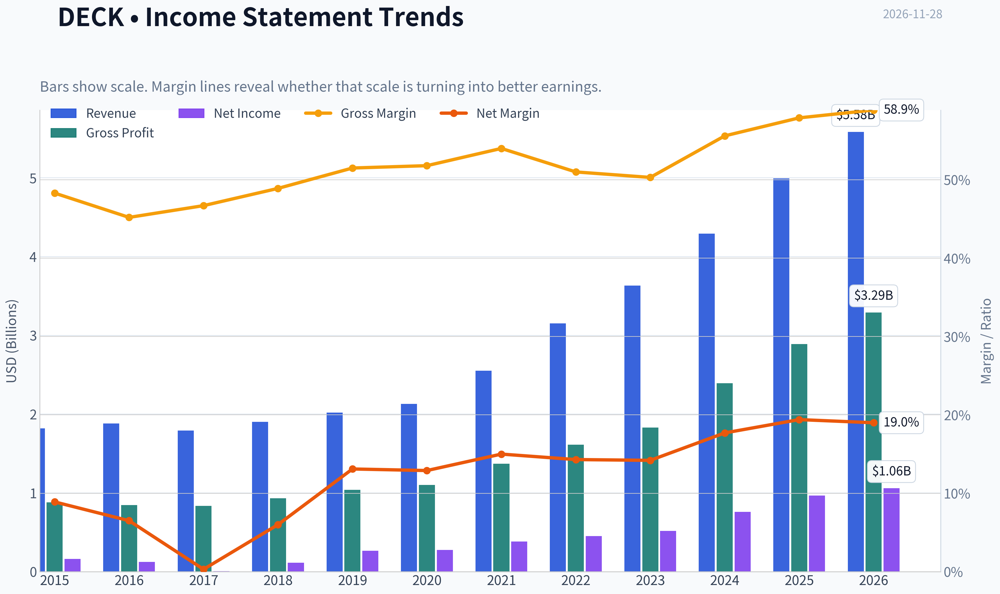

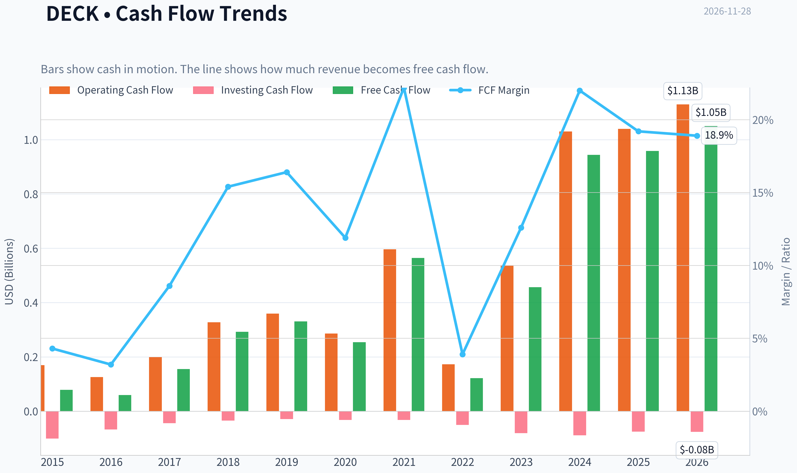

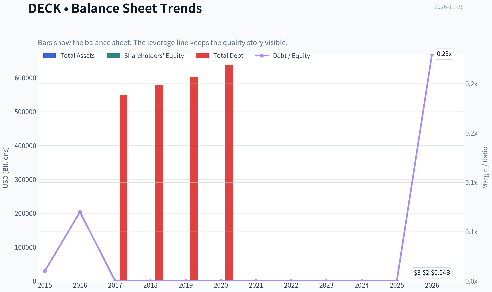

This graph tracks the profitability and return metrics (ROE, ROIC, Margins) of **DECK** over the past decade, highlighting capital efficiency trends.

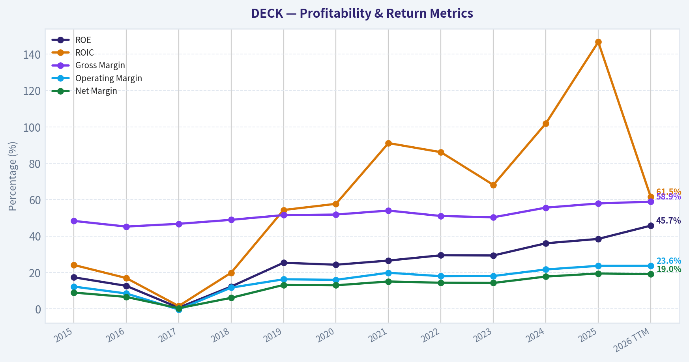

This chart illustrates the financial health of **DECK** over the last 10 years, mapping cash equivalents and free cash flow against total obligations (Debt).

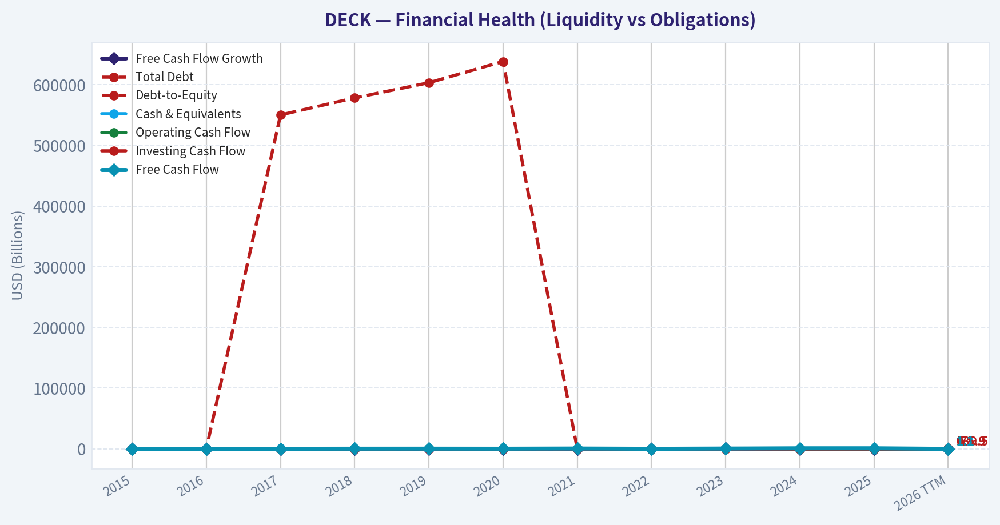

---

### Intrinsic Value Analysis (Buffett)

> *Following Warren Buffett's value investing philosophy: Circle of Competence, Economic Moat, Management Quality, and Margin of Safety.*

#### Intrinsic Value Snapshot

Price is what you pay. Intrinsic value is what the business may be worth based on the cash it can create for owners over time. We show a range, not one magic number.

- Current Price: $86.94
- Value Range (conservative to optimistic across both DCF methods): $126.02 to $435.19

##### Owner Earnings (Buffett Method)
- Net Income: $966,091,000.00
- Depreciation & Amortization: $75,773,000.00
- Capital Expenditures: $-84,623,000.00
- Working Capital Changes: $18,593,000.00
- Owner Earnings: $887,317,698.84

##### Intrinsic Value
###### Buffett Method
Uses owner earnings. Stricter, and usually more conservative.
- Conservative: $126.02
- Average: $180.03
- Optimistic: $180.03
- Discount Rate: 8.3%

###### Cash Flow Method
Uses free cash flow. Better for companies spending heavily today to grow tomorrow.
- Conservative: $158.28
- Average: $272.89
- Optimistic: $435.19
- Discount Rate: 9.1%

ANALYST STANCE: **Bullish**

#### Executive Summary

Deckers Outdoor operates two powerful global footwear brands: UGG and HOKA. The business combines strong brand economics, high gross margins, substantial net cash, minimal capital intensity, and significant owner earnings.

At approximately **$87 per share**, the stock trades at roughly **11.5 times earnings** and offers a **9.5% free-cash-flow yield**. The DeepValues Buffett owner-earnings valuation is **$180.03 per share**, implying a **51.7% margin of safety** versus the current price. The principal risks are brand concentration, fashion sensitivity, wholesale-channel volatility, and the possibility that HOKA growth moderates.

The weighted Buffett score is **4.39 out of 5.0**, supporting an **Bullish** stance with medium-high conviction.

#### Factor Scorecard

| Factor | Score | Evidence |
|---|---:|---|
| Circle of Competence & Business Simplicity | 4/5 | Deckers designs, markets, and distributes branded footwear and apparel. UGG and HOKA are understandable businesses, although fashion cycles and international growth introduce some uncertainty. |
| Moat Test | 4/5 | Strong brands, 57.7% gross margin, global distribution, customer loyalty, and differentiated product franchises. The moat is strong but not immune to fashion shifts or competitor imitation. |
| Management Quality & Capital Allocation | 4/5 | High returns, strong cash generation, net cash of approximately $1.2 billion, and no reported debt support disciplined capital allocation. Direct evidence on insider ownership and long-term compensation alignment is less extensive. |
| Industry Structure | 4/5 | Branded footwear benefits from scale, distribution, and marketing advantages. The industry remains competitive and trend-sensitive, preventing a top score. |

**Gate 5 hard floor:** **Not tripped.** Earnings and cash generation are strong, the company has approximately $1.2 billion of net cash, and there is no evidence of financial distress or inadequate interest coverage.

**Key Takeaways:** Deckers scores well because it owns recognizable brands in a simple, cash-generative business. The main deduction is not financial weakness but the inherent uncertainty of fashion and footwear competition.

#### Moat Analysis

| Moat Source | Assessment | Supporting Evidence |
|---|---|---|
| Intangible assets | Strong | UGG has a distinctive lifestyle identity, while HOKA has developed a differentiated comfort and performance reputation. Gross margin is 57.7%, consistent with meaningful brand value. |
| Switching costs | Moderate | Consumers can technically switch footwear brands, so customer captivity is weaker than in enterprise software. Repeat purchasing, fit familiarity, and brand preference still provide some retention. |
| Cost advantages | Moderate to strong | Scale in marketing, sourcing, distribution, and retail relationships supports attractive economics. The advantage is less structural than a pure logistics or infrastructure monopoly. |
| Network effects | Limited | The brands benefit from visibility and social adoption, but they do not possess classic platform network effects. |

The moat is best characterized as **wide and stable, with potential to widen through HOKA international expansion**. It is not entirely permanent: brand relevance, product innovation, and cultural momentum must be continuously maintained.

#### Financial Summary

| Metric | Latest Reported Figure |
|---|---:|
| Share price | $87 |
| Market capitalization | $11.60 billion |
| P/E ratio | 11.5x |
| Revenue growth, year over year | 9.8% |
| Gross margin | 57.7% |
| ROE | 41.0% |
| Free-cash-flow yield | 9.5% |
| Cash and marketable securities | Approximately $1.2 billion |
| Debt | Approximately $0 |
| Current ratio | 3.54x |
| Owner earnings used in valuation | Approximately $1.0 billion |
| Shares used in valuation | Approximately 135 million |

**Key Takeaways:** The financial profile is unusually strong for a consumer brand company: high gross margins, 41% ROE, positive growth, and a net-cash balance sheet. The combination of an approximately $1.0 billion owner-earnings base and an $11.6 billion market capitalization indicates a substantial cash-flow yield.

The available valuation data also indicates that the company has maintained strong cash conversion, with reported capital expenditure around $0.1 billion and working-capital investment approximately neutral in the valuation period.

#### Owner Earnings Calculation

| Owner Earnings Component | Amount |
|---|---:|
| After-tax operating income | $1.0 billion |
| Add: depreciation and amortization | $0.1 billion |
| Less: maintenance capital expenditure | $0.1 billion |
| Less: working-capital increase | Approximately $0.0 billion |
| Estimated owner earnings | **Approximately $1.0 billion** |
| Owner earnings per share | **Approximately $7.41** |

**Key Takeaways:** Deckers converts a large portion of operating profit into distributable economic cash flow because the business does not require heavy capital investment. The estimated owner earnings of approximately $7.41 per share compare favorably with a market price near $87.

#### Return on Equity and Capital Returns

ROE is reported at **41.0%**, a strong result that does not appear to depend on excessive leverage because the company carries approximately **no debt** and holds substantial net cash. This indicates that the return profile is primarily supported by brand profitability, asset efficiency, and cash generation rather than financial engineering.

The 57.7% gross margin also supports the conclusion that Deckers captures meaningful economic value from its brands. The key question going forward is whether HOKA and UGG can continue reinvesting at attractive returns without requiring excessive promotional spending or inventory expansion.

#### Three-Scenario DCF Valuation

These scenarios are sensitivity checks. The required intrinsic value is the DeepValues app valuation shown below.

| Scenario | Method | Estimated Value Per Share |
|---|---|---:|
| A: No growth | $1.0B owner earnings divided by 10%, plus net cash | Approximately $108.89 |
| B: GDP-like growth | 3% growth, 10% discount rate, plus net cash | Approximately $117.88 |
| C: Historical-growth sensitivity | 10% annual growth for 10 years, 2.5% terminal growth, 10% discount rate, plus net cash | Approximately $184.20 |
| DeepValues app intrinsic value | 10% growth fading to 2.5%, 8.3% discount rate, $1.2B net cash | **$180.03** |

**Key Takeaways:** Even the no-growth scenario produces value above the current share price, although it relies on the durability of the current owner-earnings base. The conservative 3% growth case also indicates meaningful undervaluation, while the app valuation of $180.03 is consistent with a strong-brand compounder rather than a distressed or purely cyclical company.

#### Intrinsic Value and Margin of Safety

The DeepValues app's headline intrinsic value is:

- **Intrinsic value:** $180.03 per share
- **Current price:** approximately $87
- **Margin of safety:** **51.7%**
- **Valuation range:** $126.02 to $180.03
- **App owner-earnings input:** approximately $1.0 billion
- **Discount rate:** 8.3%
- **Terminal growth rate:** 2.5%
- **Net cash:** approximately $1.2 billion

The valuation already incorporates a relatively favorable discount rate, so the principal sensitivity is not balance-sheet risk but the sustainability of owner earnings and growth. At the current valuation, the market appears to be pricing Deckers as a mature branded footwear company rather than fully crediting continued HOKA expansion and durable cash conversion.

#### Final Buffett Scorecard

| Criterion | Weight | Score | Weighted Contribution |
|---|---:|---:|---:|
| Moat width and durability | 25% | 4.0 | 1.00 |
| Valuation and margin of safety | 20% | 5.0 | 1.00 |
| Capital returns: ROIC versus WACC | 15% | 5.0 | 0.75 |
| Business understanding and predictability | 12% | 4.0 | 0.48 |
| Management quality and capital allocation | 12% | 4.0 | 0.48 |
| Reinvestment runway | 8% | 4.0 | 0.32 |
| Balance-sheet strength | 4% | 5.0 | 0.20 |
| Industry structure | 4% | 4.0 | 0.16 |
| **Total** | **100%** |  | **4.39 / 5.0** |

**Key Takeaways:** The score is lifted by valuation, capital returns, and balance-sheet strength. Deckers does not receive a perfect score because footwear remains fashion-sensitive and the moat depends on continued brand execution rather than contractual switching costs.

#### Principal Risks

| Risk | Why It Matters |
|---|---|
| Brand concentration | UGG and HOKA account for the central economic value of the company, increasing dependence on a small number of franchises. |
| Fashion and product-cycle risk | Consumer preferences can change quickly, and strong recent product momentum may normalize. |
| HOKA growth moderation | A lower growth rate would reduce the valuation justified by the current owner-earnings model. |
| Wholesale and inventory risk | Retailer promotions, channel inventory, and weaker consumer demand could pressure margins. |
| Competitive response | Nike, Adidas, On, Brooks, and other brands can compete aggressively for performance and lifestyle footwear demand. |

#### Investment Stance

**Bullish - Medium-high conviction.**

Deckers combines understandable operations, strong brands, high margins, excellent cash generation, net cash, and a substantial discount to the DeepValues intrinsic value of **$180.03**. The evidence supports the conclusion that the valuation near **$87** is attractive relative to estimated owner earnings and business quality.

The central issue is not solvency or financial quality; it is whether UGG and HOKA can preserve their brand momentum and reinvestment returns over a full business cycle. At the current valuation, the margin of safety appears sufficient to compensate for those execution and fashion-cycle risks.
#### Valuation Bridge

This bridge places the current market price beside each intrinsic value lens so readers can see whether upside depends on one method or shows up across several methods.

| Scenario | Intrinsic Value / Share |
| --- | ---: |
| Buffett Method | $180.03 |
| Cash Flow Method | $272.89 |
| Damodaran Method | $125.79 |
| Current Price | $86.94 |

#### Key Takeaways

If one method is far above the others, the upside case depends on a specific modelling assumption. When several methods cluster together, the valuation story is more robust.

#### Valuation Visuals

This comparison chart from *Latest Earnings Snapshot* stacks current figures against historical benchmarks for **DECK**, making it easy to see where the company trades relative to its own averages.

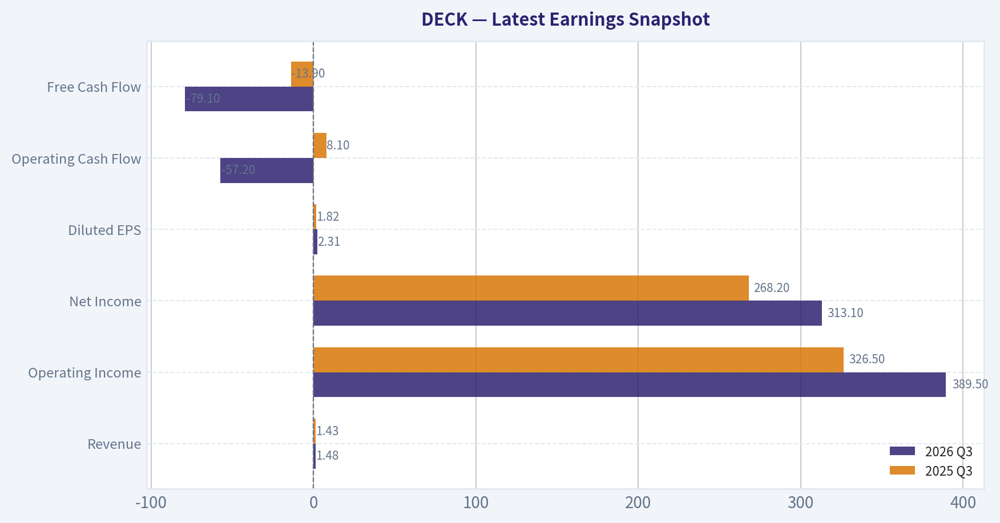

This comparison chart from *Current Metrics Compared With Historical Averages* stacks current figures against historical benchmarks for **DECK**, making it easy to see where the company trades relative to its own averages.

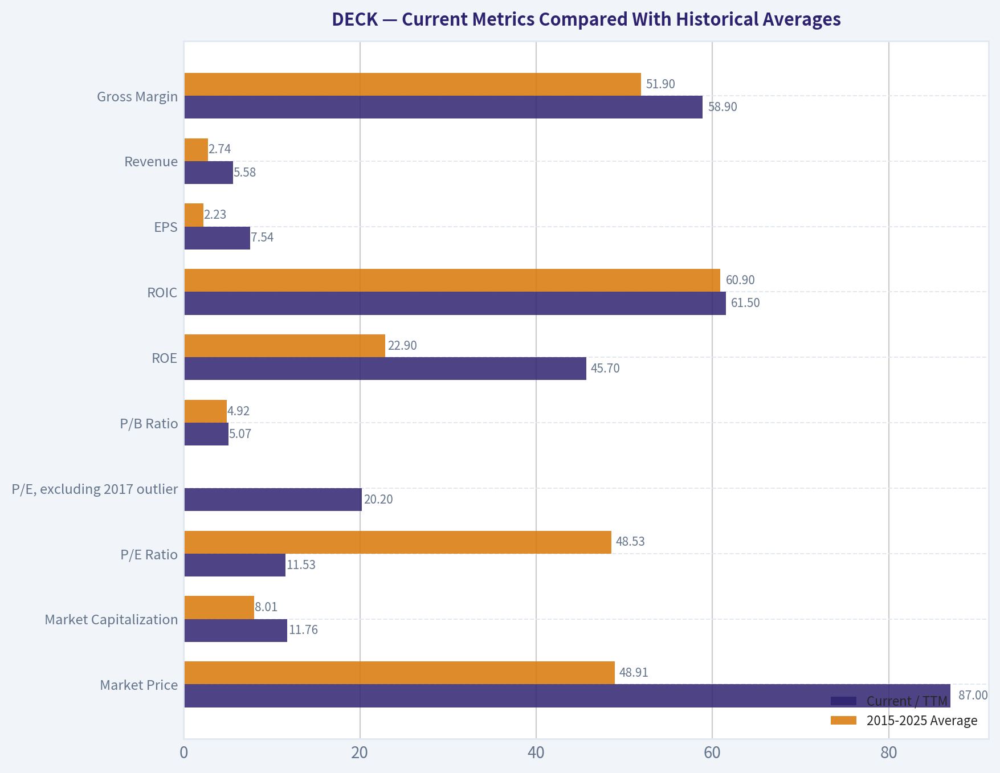

This comparison chart from *Balance Sheet and Financial Strength* stacks current figures against historical benchmarks for **DECK**, making it easy to see where the company trades relative to its own averages.

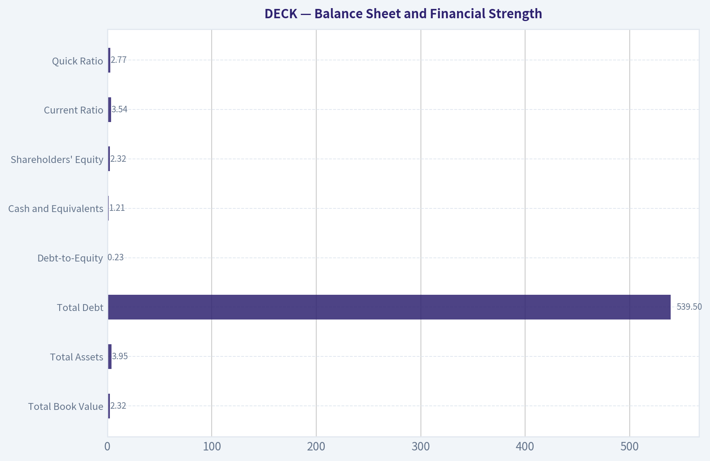

This comparison chart from *Financial Summary* stacks current figures against historical benchmarks for **DECK**, making it easy to see where the company trades relative to its own averages.

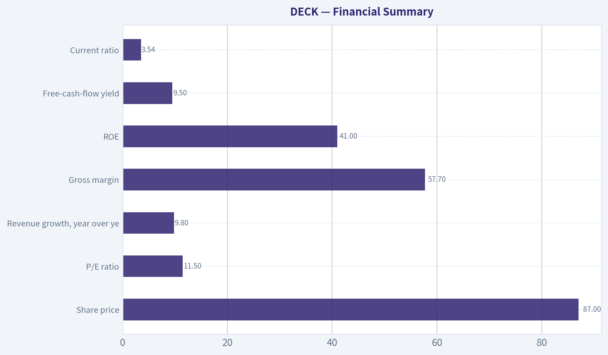

The following chart maps the **DECK** Owner Earnings DCF valuation scenarios (Conservative, Average, Optimistic) to visually represent the margin of safety based on intrinsic value calculations.

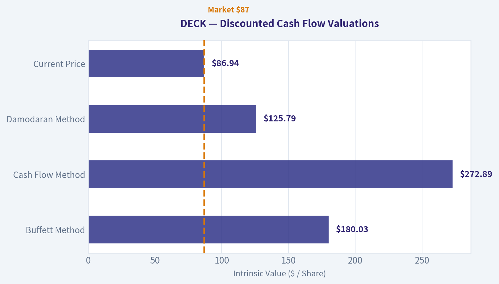

---

### Trend & Growth Analysis (Lynch/Druckenmiller/Fisher)

> *Following Peter Lynch's GARP, Stanley Druckenmiller's macro-aware approach, and Philip Fisher's scuttlebutt methodology.*

ANALYST STANCE: **Neutral**

#### 1. Lynch Classification

**Current classification: Stalwart, with potential to re-enter fast-grower territory.**

Revenue growth is currently **9.8% year over year**, below the 15-25% threshold for a classic fast grower. However, DECK owns two globally recognized brands-HOKA and UGG-with meaningful international, category, and direct-to-consumer expansion opportunities. The central question is whether HOKA can reaccelerate consolidated growth while UGG remains durable rather than merely seasonal.

#### 2. The Story in Three Bullets

- **HOKA is the growth engine:** The brand participates in the secular shift toward premium athletic and running footwear.
- **UGG provides brand strength and cash generation:** Its lifestyle positioning, product extensions, and retail experiences support resilience and marketing leverage.
- **The valuation is modest relative to quality:** DECK trades near **11.5 times earnings**, with strong gross margins, high return on equity, net cash, and a substantial free-cash-flow yield.

#### 3. TAM and Runway

| Area | Evidence | Assessment |
|---|---:|---|
| Current market capitalization | $11.6B | Moderate company scale |
| Current revenue | Exact figure not provided in the research pack | Limits precision of 10x test |
| HOKA category | Global performance and lifestyle footwear | Expanding secular category |
| UGG category | Premium lifestyle footwear and accessories | Mature but still extensible |
| International opportunity | Material expansion runway implied | Positive |
| 10x test | Requires approximately $116B market capitalization, not revenue | Cannot be completed rigorously without current revenue and TAM data |

**Key Takeaways:** DECK has a credible runway through HOKA's category growth, international expansion, and product extensions. The exact 10x revenue test cannot be verified because the current revenue and addressable-market figures were not supplied. UGG is likely a durable cash generator, but HOKA must provide most of the long-term acceleration.

#### 4. Revenue Growth Trend

| Metric | Latest reading | Interpretation |
|---|---:|---|
| Year-over-year revenue growth | 9.8% | Stalwart-level growth |
| Gross margin | 57.7% | Strong brand economics |
| Return on equity | 41.0% | High capital efficiency |
| Free-cash-flow yield | 9.5% | Strong cash conversion signal |
| Revenue pattern | One current growth datapoint | Acceleration cannot yet be confirmed |

**Key Takeaways:** The available data shows solid but not exceptional growth. There is no evidence in the supplied pack of a confirmed acceleration pattern such as 10% to 20% to 30%. The investment case therefore depends on future HOKA momentum, rather than on an already demonstrated growth inflection.

#### 5. Unit Economics and Operating Efficiency

| Metric | Value | Assessment |
|---|---:|---|
| LTV/CAC | Not disclosed | Cannot calculate |
| Net revenue retention | Not applicable or not disclosed | Consumer-brand model |
| Rule of 40 | Not applicable | Not a SaaS company |
| Gross margin | 57.7% | Strong |
| Free-cash-flow yield | 9.5% | Attractive cash-generation profile |
| Current ratio | 3.54 | Strong liquidity |
| Net cash | Approximately $1.2B | Balance-sheet strength |

**Key Takeaways:** DECK's economics are better evaluated through gross margin, inventory discipline, brand pricing power, and free cash flow rather than SaaS metrics. The balance sheet is a meaningful positive: the company has substantial liquidity and reported no debt in the valuation inputs. Missing CAC, repeat-purchase, and channel-level data prevents a complete consumer unit-economics assessment.

#### 6. Inflection-Point Assessment

| Potential inflection | Current evidence | Status |
|---|---|---|
| HOKA product-cycle acceleration | Launches and category expansion referenced, but no acceleration data | Unconfirmed |
| International growth | Clear strategic runway | Potential catalyst |
| UGG product and experience expansion | Holiday experiential partnership and customization initiatives | Early evidence |
| Margin inflection | 57.7% gross margin, but trend unavailable | Unconfirmed |
| Competitive share gains | No quantified market-share data supplied | Unconfirmed |
| Valuation re-rating | Low earnings multiple creates room if growth improves | Possible |

**Key Takeaways:** DECK has several plausible catalysts, but the critical inflection has not yet been proven in the available figures. The strongest near-term test is whether HOKA and UGG launches translate into sustained revenue acceleration without sacrificing gross margin or inventory quality.

#### 7. Macro Setup

| Macro factor | Impact on DECK |
|---|---|
| Consumer spending | Potentially cyclical, especially in discretionary footwear |
| Interest rates | Elevated rates can pressure valuation multiples |
| Premiumization | Positive if consumers continue favoring differentiated brands |
| Athletic and wellness trends | Positive secular support for HOKA |
| Foreign exchange and international expansion | Opportunity with translation and execution risk |
| Retail environment | Wholesale partnerships can expand reach but add channel dependence |

**Key Takeaways:** The macro backdrop is mixed rather than clearly favorable. DECK benefits from wellness, running, premiumization, and brand-led consumption trends, but discretionary spending and rates remain potential headwinds. The balance sheet and cash generation reduce financial risk, though they do not eliminate demand sensitivity.

#### 8. Fisher 15-Point Score

| Fisher criterion | Score / 5 | Rationale |
|---|---:|---|
| Market potential | 4 | Large global footwear categories |
| New-product determination | 4 | Ongoing HOKA and UGG extensions |
| R&D effectiveness | 4 | Product innovation appears central to brand positioning |
| Sales organization | 4 | Broad wholesale and direct channels |
| Profit margins | 4 | 57.7% gross margin |
| Margin improvement | 3 | Trend not supplied |
| Labor relations | 3 | Insufficient information |
| Executive relations | 3 | Insufficient information |
| Management depth | 4 | Established public-company platform |
| Cost analysis and accounting | 4 | Strong cash generation and liquidity |
| Outstanding competitive aspects | 4 | Brand equity and differentiated products |
| Long-range profit outlook | 4 | Positive, conditional on HOKA growth |
| Dilution | 4 | No meaningful dilution concern indicated |
| Management candor | 3 | Insufficient evidence in the research pack |
| Management integrity | 4 | No major concern supplied |
| **Total** | **56 / 75** | **Good** |

**Key Takeaways:** DECK scores as a good, though not outstanding, Fisher company based on brand equity, product differentiation, margins, and balance-sheet quality. The score is held back primarily by missing evidence on management communication, labor relations, margin progression, and detailed customer economics.

#### 9. Valuation Analysis

| Measure | Result | Interpretation |
|---|---:|---|
| Share price | Approximately $87 | Current reference value |
| Market capitalization | $11.60B | Moderate scale |
| P/E | 11.5x | Low relative to many branded growth companies |
| Implied PEG using 9.8% growth | Approximately 1.18 | Fair rather than deeply discounted |
| FCF yield | 9.5% | Strong |
| Owner-earnings intrinsic value | $180.03 headline | Material valuation support under that methodology |
| Owner-earnings range | $126.02-$180.03 | Positive range versus current price |
| Damodaran FCFF range | $76.58-$202.86 | Wide sensitivity |
| FCF DCF range | $158.28-$435.19 | Highly assumption-sensitive |

**Key Takeaways:** DECK appears inexpensive on earnings and free cash flow, but the PEG is approximately 1.18 because current growth is only 9.8%. The supplied owner-earnings model produces a headline intrinsic value of $180.03, while the more conservative FCFF framework ranges down to $76.58. This dispersion shows that the valuation is attractive under sustained cash-flow growth assumptions but not risk-free.

#### 10. Growth Investor Scorecard

| Criterion | Weight | Score / 5 | Weighted result |
|---|---:|---:|---:|
| The story | 10% | 4.0 | 0.40 |
| TAM and runway | 20% | 3.8 | 0.76 |
| Revenue growth | 20% | 3.0 | 0.60 |
| Unit economics | 15% | 3.5 | 0.53 |
| Competitive position | 10% | 4.2 | 0.42 |
| Management quality | 10% | 3.7 | 0.37 |
| Macro setup | 5% | 3.0 | 0.15 |
| Profitability path | 5% | 4.5 | 0.23 |
| Valuation | 5% | 4.2 | 0.21 |
| **Total** | **100%** |  | **3.67 / 5.00** |

**Key Takeaways:** DECK's score of 3.67 supports a **Neutral** classification under the stated framework. Its strongest attributes are brand quality, margins, cash generation, liquidity, and valuation. The main limitation is that current growth does not yet establish the acceleration required for a high-conviction fast-grower designation.

#### 11. Valuation Sensitivity

| Scenario | Core assumption | Valuation implication |
|---|---|---|
| Bear | Growth remains around high single digits; multiple stays compressed | Conservative FCFF outcomes become relevant |
| Base | HOKA reaccelerates moderately and UGG remains stable | Owner-earnings valuation has meaningful support |
| Bull | HOKA sustains strong growth, international penetration expands, margins remain high | Higher cash-flow and earnings multiples become defensible |
| Stress case | Consumer weakness, inventory pressure, or brand slowdown | Current low multiple may not prevent further valuation pressure |

**Key Takeaways:** The valuation has a favorable payoff profile if HOKA reaccelerates, but the downside case is meaningful because the business remains exposed to discretionary demand and brand momentum. The largest sensitivity is not the discount rate alone; it is whether revenue growth returns to the mid-teens or remains near 10%.

#### 12. Key Risks and Catalysts

| Catalysts | Risks |
|---|---|
| HOKA product launches outperform expectations | HOKA growth decelerates further |
| International expansion | Premium footwear demand weakens |
| UGG product extensions and experiential marketing | Fashion and brand relevance change |
| Margin stability or improvement | Promotional activity pressures margins |
| Continued high free-cash-flow conversion | Inventory buildup or wholesale destocking |
| Multiple re-rating from renewed growth | Elevated rates constrain valuation |

**Key Takeaways:** The central catalyst is a measurable reacceleration in HOKA-led revenue growth while gross margins remain near current levels. The central risk is that DECK is a high-quality but mature branded-footwear company whose growth settles permanently near single digits. The latest guru data is not a strong signal: Steve Cohen's disclosed DECK holding was reduced substantially as of September 30, 2026, though 13F filings are delayed snapshots.

#### Overall Conclusion

DECK is a financially strong branded consumer company with attractive margins, net cash, high return on equity, and valuation support from free cash flow and owner earnings. At the same time, the available evidence does not yet establish the accelerating growth required for a classic ten-bagger setup. The appropriate research stance is **Neutral**, with particular attention to HOKA growth acceleration, international sales, inventory discipline, and sustained cash conversion.

#### Growth & Scorecard Visuals

The radar chart below from *Final Buffett Scorecard* visualises how **DECK** ranks across weighted investment criteria. Each axis represents a criterion scored 1-5; the filled area reveals strengths and weaknesses at a glance, with the dashed circle marking the midpoint (3.0).

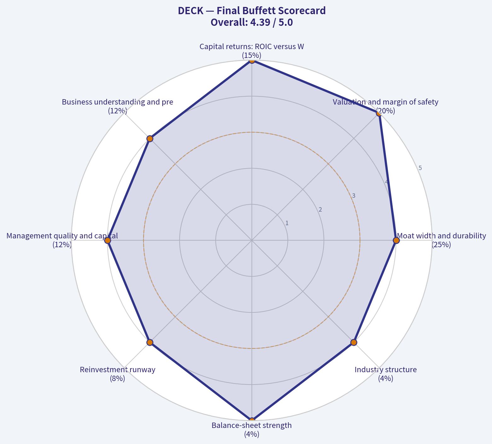

---

### Market Technical Analysis

ANALYST STANCE: **Neutral**

#### DECK technical analysis

**Registrant:** Deckers Outdoor Corporation (NYSE: DECK)
**Latest available session:** November 27, 2026, because November 28 was not a trading day.
**Latest close:** $86.94
**Review window:** Approximately the latest 12 months, with indicator detail focused on the most recent 60 calendar days.

The selected indicators are **close_10_ema, close_50_sma, close_200_sma, macd, rsi, boll_ub, boll_lb, and atr**. Together, they cover short-, medium-, and long-term trend, momentum, mean-reversion context, volatility, and the range of recent price dispersion without relying on multiple highly redundant oscillators.

#### Price structure and trend

DECK experienced a pronounced deterioration after reaching a 2026 high near $122.29 on February 20. The decline unfolded in several stages: an initial retreat toward the low-$90s in March, a rebound above $114 in late May, and then a sustained slide through the summer into September. The September 18-to-September 29 period was particularly weak, with the closing price falling from $78.43 to $77.68 before reaching a low close of $77.51 on September 15 during the broader decline.

The fourth quarter brought a partial recovery. DECK rose from the high-$70s in late September to $90.43 on November 9, but that advance failed to establish a durable higher-high sequence. Selling pressure returned in mid-November, carrying the close down to $77.94 on November 20. The subsequent rebound to $86.94 by November 27 was meaningful in percentage terms, but it remains below the November 9 high and well below the longer-term moving-average benchmarks.

This produces a divided trend picture: the latest rebound is constructive on a short-term basis, while the medium- and long-term structures remain damaged.

#### Moving averages

The **10 EMA was $84.01** on November 27, compared with the **$86.94 close**. Price therefore finished above its short-term average, indicating that the late-November rebound had begun to improve near-term momentum. The 10 EMA itself rose from approximately $79.06 on September 29 to a peak near $87.10 on November 11, then declined during the mid-November selloff before turning upward again. This is consistent with a short-term recovery that is still relatively young and vulnerable to rapid reversals.

The **50 SMA was $82.95**, placing the latest close roughly $3.99, or about 4.8%, above that medium-term average. The 50 SMA declined steadily from $89.09 on September 29 to approximately $82.33 in early November, then flattened around $82.5 to $82.95. Its stabilization is an improvement, but it does not yet establish a clear upward medium-term trend.

The **200 SMA was $97.16**, approximately $10.22, or 10.5%, above the latest close. This is the most important longer-term negative feature in the technical profile. The 200 SMA itself has been declining, from $101.63 on September 29 to $97.16 on November 27, showing that weakness has persisted long enough to pull the long-term benchmark lower. DECK remains below both the 200 SMA and the broader level of prices associated with its earlier 2026 advance.

#### MACD momentum

MACD improved materially from late September through late October. It rose from **-3.18 on September 29** to positive territory by October 26, reaching approximately **0.91 on October 22**. This reflected the first major rebound from the September lows.

However, that improvement did not persist. MACD declined from **1.55 on November 11** to **-0.69 on November 20**, showing that the November selloff rapidly reversed the earlier momentum signal. By November 27, MACD had recovered to **-0.06**, nearly neutral but still slightly negative. The sequence suggests that downside momentum has eased, but the indicator has not yet demonstrated a decisive, sustained positive impulse.

The MACD pattern also highlights the market's increased sensitivity: momentum has shifted from strongly negative to positive and back again within a relatively short period. That is more consistent with an unstable rebound environment than with a well-established directional trend.

#### RSI momentum

RSI was **55.29** on November 27. This is modestly above the neutral 50 level and far from the conventional overbought threshold near 70. It confirms that the latest recovery has improved momentum without creating an obviously stretched condition.

The recent path is informative. RSI fell to **38.85 on November 20**, reflecting substantial downside pressure, then recovered into the mid-50s as price rebounded. Earlier, RSI reached **63.62 on November 9**, but that stronger reading preceded the mid-November decline. Thus, RSI is currently constructive but not conclusive: it indicates recovery from weak conditions, not a confirmed long-term trend reversal.

There is no current evidence of an extreme overbought reading. At the same time, RSI has not sustained readings consistently above 60, which limits the strength of the bullish momentum interpretation.

#### Bollinger Bands and price dispersion

On November 27, the **upper Bollinger Band was $91.79** and the **lower Bollinger Band was $78.05**. With the close at $86.94, price was in the upper half of the recent 20-session range but remained about $4.85 below the upper band. This indicates improving price location without an extreme upside extension.

The lower band has risen from approximately $75.40 on September 29 to $78.05, while the upper band has expanded from $85.48 to $91.79. The widening range reflects a meaningful increase in price dispersion as DECK moved through the October-November volatility cycle. The latest close is comfortably above the lower band, suggesting that the sharp November 20 weakness has partially unwound.

The bands should be interpreted together with the trend indicators. A move toward the upper band would not automatically imply overvaluation or reversal risk, because prices can remain near an upper band during persistent advances. In the current case, however, the upper band is near the November 9 high, creating a technically relevant area where the durability of the rebound would be tested.

#### Volatility

ATR increased from **$2.34 on September 29** to **$3.42 on November 27**, after reaching approximately $3.48 on November 25. This means recent daily trading ranges are materially larger than they were in late September. Relative to the latest close, the ATR is approximately 3.9%, which is elevated enough to make short-term indicator signals less reliable and to increase the likelihood of sharp reversals.

The rise in ATR coincided with several high-volume, wide-range sessions, including the November 17 decline and the November 20 selloff. Volatility therefore appears linked to genuine repricing pressure rather than merely quiet, low-liquidity fluctuations.

#### Integrated interpretation

The evidence supports a **short-term recovery inside a broader downtrend**. The close is above both the 10 EMA and 50 SMA, RSI has recovered above 50, and MACD has moved back toward neutral. These are meaningful improvements from the November 20 low.

The counterarguments are equally important. DECK remains substantially below the declining 200 SMA, the 50 SMA is only flattening after a long decline, and MACD remains marginally negative. The rebound has also not exceeded the November 9 high, while ATR remains elevated. Collectively, these features imply that the market has improved tactically but has not yet repaired its longer-term trend structure.

From a valuation perspective, the technical evidence does not establish that a higher valuation is being validated by a durable trend reversal. The current market price reflects a recovery from deeply weak levels, but confirmation would require greater evidence of sustained medium-term momentum and improved long-term price structure. Conversely, the RSI and Bollinger readings do not indicate that the latest price is in an obvious short-term technical extreme.

#### Indicator selection

| Indicator | Latest reading | What it contributes | Interpretation for DECK |
|---|---:|---|---|
| close_10_ema | $84.01 | Responsive short-term trend | Close above the EMA shows near-term recovery momentum |
| close_50_sma | $82.95 | Medium-term trend and dynamic reference | Average has flattened after declining; medium-term repair is incomplete |
| close_200_sma | $97.16 | Long-term trend benchmark | Close remains materially below a declining long-term average |
| macd | -0.06 | Momentum direction and inflection | Recovered sharply from negative extremes but remains slightly negative |
| rsi | 55.29 | Momentum strength and extremes | Neutral-to-constructive; neither overbought nor strongly trending |
| boll_ub | $91.79 | Upper volatility envelope | Rebound has room before reaching the recent upper dispersion boundary |
| boll_lb | $78.05 | Lower volatility envelope | Price has recovered away from the November weakness near the lower range |
| atr | $3.42 | Current trading-range intensity | Volatility is elevated, increasing the risk of rapid technical reversals |

**Key Takeaways:** DECK's latest close is above its short- and medium-term averages, and momentum has recovered from the November selloff. However, the stock remains below a declining 200-day average, MACD is only near neutral, and volatility is elevated. The overall evidence therefore describes a developing short-term rebound rather than a confirmed long-term trend reversal or a fully validated higher valuation.

---

### Options Market Analysis

> *Reading options flow - put/call ratios, IV skew, and unusual activity - to gauge institutional positioning and event-driven risk.*

ANALYST STANCE: **BEARISH**

#### DECK Options Market Overview

The near-term options data shows a modestly defensive bias. Aggregate put open interest is almost equal to call open interest, but put volume exceeds call volume and the ratio is above the historical neutral reference of approximately 0.7.

| Near-term expiry | Call OI | Put OI | Put/Call OI | Call volume | Put volume |
|---|---:|---:|---:|---:|---:|
| 2026-12-04 | 1,314 | 2,737 | 2.08 | 611 | 183 |
| 2026-12-11 | 1,319 | 194 | 0.15 | 287 | 1,057 |
| 2026-12-18 | 7,305 | 7,080 | 0.97 | 373 | 341 |
| **Total** | **9,938** | **10,011** | **1.01** | **1,271** | **1,581** |

| Aggregate metric | Value | Interpretation |
|---|---:|---|
| Put/Call OI ratio | **1.01** | Slightly more put open interest than call open interest |
| Put/Call volume ratio | **1.24** | Put volume exceeds call volume |
| Historical neutral reference | **~0.70** | Current OI and volume ratios are more defensive than neutral |

**Key Takeaways:** Aggregate open interest is broadly balanced, but the 1.24 put/call volume ratio indicates greater near-term demand for puts. The signal is defensive rather than aggressively bearish because the overall OI ratio is only modestly above 1.0. Expiry-level data is highly uneven, with the December 11 chain showing unusually heavy put activity.

#### Implied Volatility Assessment

| Expiry | Call ATM IV | Put ATM IV | Call-put IV difference |
|---|---:|---:|---:|
| 2026-12-04 | 53.7% | 51.7% | Calls +2.0 percentage points |
| 2026-12-11 | 54.7% | 53.3% | Calls +1.4 percentage points |
| 2026-12-18 | 52.7% | 46.7% | Calls +6.0 percentage points |

Near-term ATM implied volatility is elevated in absolute terms, ranging from approximately 47% to 55%, although no historical IV series was supplied for a percentile comparison. The available ATM data shows calls trading at higher IV than puts, which is the opposite of a conventional downside put-skew signal.

| IV assessment | Reading |
|---|---|
| Near-term IV level | Approximately **47%-55%**, relatively high in absolute terms |
| OTM put-versus-call skew | **Not provided**; ATM data instead shows higher call IV |
| Catalyst risk | No confirmed earnings, product, or macro catalyst was provided in the dataset |
| Conviction | Moderate, because IV percentile and full strike-level skew are unavailable |

**Key Takeaways:** DECK options are pricing meaningful movement over the next several weeks, with ATM IV near or above 50% across expirations. The available data does not show a steep downside put skew; however, that conclusion is limited because true OTM skew was not supplied. The elevated volatility could reflect event risk, but no specific catalyst can be confirmed from this data.

#### Unusual Options Activity

The data provider flags contracts with volume greater than five times open interest and volume above 500 contracts.

| Expiry | Type | Strike | Volume | Open interest | Volume/OI | IV | Days to expiry |
|---|---|---:|---:|---:|---:|---:|---:|
| 2026-12-11 | Put | $85.00 | 1,003 | 3 | **334.3x** | 44.2% | **13** |

The $85 put represents a very large increase in trading relative to existing open interest, which is consistent with fresh activity rather than the rollover of a large established position. The current DECK share price was not included in the supplied data, so the contract cannot be reliably classified as ITM, ATM, or OTM.

| Interpretation factor | Assessment |
|---|---|
| Directional implication | Defensive or bearish protection |
| Freshness of activity | Very high; volume is 334 times open interest |
| Institutional versus retail | Cannot be determined from volume/OI alone |
| Alternative explanation | Could include a hedge, put spread, block trade, or speculative downside exposure |

**Key Takeaways:** The December 11 $85 put is the clearest directional signal in the chain. Its extreme volume-to-open-interest ratio suggests new or recently initiated activity, but the trade structure and execution details are unavailable, so it cannot be conclusively labeled institutional or outright bearish speculation.

#### Open Interest Concentration and Potential Gamma Levels

| Expiry | Total call OI | Total put OI | Combined OI | Concentration assessment |
|---|---:|---:|---:|---|
| 2026-12-04 | 1,314 | 2,737 | 4,051 | Put-heavy near-term exposure |
| 2026-12-11 | 1,319 | 194 | 1,513 | Call-heavy open interest |
| 2026-12-18 | 7,305 | 7,080 | **14,385** | Largest concentration by far |

December 18 contains approximately 72% of total call-plus-put open interest across the three reported expirations, making it the primary expiration for potential pinning or dealer hedging effects. Strike-level open interest and gamma data were not provided, so specific gamma walls, maximum-pain strikes, and likely price-pinning levels cannot be identified.

**Key Takeaways:** The December 18 expiration is the dominant open-interest concentration and may exert the greatest influence on expiration-related price behavior. The absence of strike-level OI prevents identification of exact gravitational levels. The December 4 chain is put-heavy, while the December 11 chain has unusually large put volume despite relatively little put open interest.

#### Overall Options Sentiment

The overall signal is **BEARISH**, with moderate confidence.

The primary drivers are:

1. Aggregate put/call volume of 1.24, above the approximately 0.7 neutral reference.
2. A total put/call OI ratio of 1.01, indicating slightly more put exposure than call exposure.
3. One exceptionally unusual December 11 $85 put transaction, with volume 334 times existing open interest.
4. Elevated near-term IV, indicating that the market is pricing substantial movement and uncertainty.

The bearish interpretation is tempered by the absence of a steep measured OTM put skew and by the fact that the largest open-interest bucket, December 18, is nearly balanced between calls and puts. The unusual put could also be a hedge or part of a spread rather than a standalone bearish bet.

| Category | Assessment |
|---|---|
| Put/Call Ratio | **Defensive:** OI 1.01; volume 1.24, both above the neutral reference in different degrees |
| IV Level | **Elevated:** ATM IV approximately 47%-55% |
| Skew Direction | **No confirmed downside skew:** ATM calls have higher IV than puts, but OTM skew is unavailable |
| Unusual Activity | **Bearish/defensive:** December 11 $85 put, 1,003 contracts versus 3 OI |
| Overall Signal | **BEARISH**, with moderate confidence |

**Key Takeaways:** DECK's options market leans bearish because put trading is more active than call trading and the chain contains an exceptionally large fresh-looking $85 put transaction. The signal is not high conviction because strike-level gamma, current share price, execution type, and full OTM skew data are unavailable. The options evidence implies elevated downside uncertainty rather than providing a valuation measure by itself.

---

## Research Team Commentary

> *The Research Manager synthesizes the Bull vs Bear debate into action-free commentary. This is a pre-risk view, not the final stance.*

Core takeaway

Deckers appears to be a high-quality branded-footwear company valued at a multiple that already anticipates substantial growth normalization. HOKA's product momentum, UGG's enduring brand equity, 57.7% gross margin, net-cash balance sheet, and capital-light economics make the business materially better than an ordinary fashion company. At approximately $86.94 and 11.5 times reported earnings, the market seems to be discounting either a meaningful earnings decline or lasting brand deterioration.

The bullish conclusion is stronger than the specific $180.03 intrinsic-value estimate. That estimate cannot be accepted with high confidence because its growth, margin, reinvestment, discount-rate, and terminal assumptions were not supplied. Nevertheless, even after normalizing earnings downward, the valuation remains defensible: a 25% earnings reduction would imply a multiple of roughly 15.4 times, while a 40% reduction would imply approximately 19.2 times. Those are not obviously excessive multiples for a net-cash company with two valuable brands and substantial gross profitability.

Rationale

The strongest bull argument is the combination of business quality and low embedded expectations. Deckers is not simply a low-multiple retailer. It owns differentiated intellectual property in the form of consumer brands, earns unusually high gross margins, requires relatively little tangible capital, and has a balance sheet capable of supporting product and geographic investment through weaker demand periods.

HOKA is the central source of both upside and risk. Its distinctive products, specialty-running credibility, comfort positioning, and crossover into everyday use suggest more than a fleeting product fad. International distribution and category expansion provide a credible runway. UGG offers a complementary source of brand recognition and cash generation, although it remains more seasonal and fashion-sensitive.

The 164.6% reported ROIC should not be capitalized literally. The denominator is small, while economically necessary spending on marketing, design, and brand development is generally expensed rather than recorded as invested capital. Still, the broader collection of evidence-41% ROE, 27.8% ROA, 57.7% gross margin, and net cash-supports the conclusion that Deckers has excellent underlying economics even if normalized ROIC is far below the headline figure.

The strongest bear argument is that current earnings may represent unusually favorable brand and margin conditions. HOKA competes against Nike, Adidas, New Balance, On, Brooks, ASICS, and others in a category with low switching costs. Its moat rests on continuously renewed consumer preference rather than contractual recurring revenue or network effects. UGG also remains exposed to weather, fashion, seasonality, wholesale inventory adjustments, and promotional pressure. A few weak quarters would not establish permanent impairment, but sustained market-share losses accompanied by discounting would.

The second major bear point is evidentiary. The supplied intrinsic value of $180.03 is not adequately auditable. Without a visible owner-earnings bridge and sensitivity analysis, the claimed 51.7% margin of safety is too precise. It should be treated as an optimistic reference case, not as an established fact. The valuation case should instead rest on normalized free cash flow and the expectations embedded in the current price.

On that more conservative basis, the shares still appear inexpensive relative to the quality of the franchise. The market does not seem to require heroic future growth at 11.5 times current earnings. Even a sizable earnings normalization would leave a valuation that could be supported if HOKA retains relevance, UGG remains profitable, and consolidated margins settle above ordinary footwear-industry levels. The evidence therefore points to undervaluation, but with less confidence in the magnitude than the headline appraisal suggests.

Short-term technical weakness and elevated put activity provide little information about ten-year owner earnings. The unusual December put transaction could reflect hedging or event exposure rather than informed conviction about brand impairment. It is useful as a marker of near-term uncertainty, not as a substitute for fundamental analysis.

A key lesson from comparable consumer-brand situations is to avoid equating a successful product cycle with a permanent moat. The opposite error is also important: growth deceleration does not automatically mean value destruction. The correct test is whether slower growth is accompanied by lower full-price sell-through, weakening repeat demand, rising promotions, deteriorating inventory economics, and structurally lower returns on brand investment. That distinction keeps the analysis from either extrapolating peak performance or mistaking temporary normalization for permanent damage.

Monitoring plan

Over the next one to four quarters, the most important evidence will be brand-level growth and quality of demand. HOKA's revenue growth should be assessed alongside unit growth, pricing, full-price sell-through, market share, repeat purchasing, and international performance. Growth driven mainly by broader distribution or discounting would weaken the moat argument; continued growth with stable pricing and strong specialty-retail credibility would strengthen it.

Gross margin and operating margin deserve particular attention. Modest normalization would be unsurprising, but persistent compression caused by promotions, markdowns, rising customer-acquisition costs, or unfavorable channel mix would suggest that current earnings are above sustainable levels. Marketing expense should be considered alongside sales growth to determine whether incremental revenue is becoming progressively more expensive.

Inventory growth should remain reasonably aligned with revenue. Rising inventory, slower turnover, retailer order reductions, or greater markdown allowances would be early warnings of demand normalization becoming an earnings problem. Wholesale commentary is particularly important because retailer orders can change more abruptly than end-consumer demand.

Free-cash-flow conversion should be reconciled with reported earnings, including working-capital movements, capital expenditures, stock-based compensation, and any unusual tax effects. Consistently strong conversion would support the quality of reported earnings. A widening gap between adjusted earnings and cash generation would weaken the valuation case.

For UGG, the relevant indicators are full-price demand, performance outside the core boot franchise, geographic diversification, and the economics of product extensions. Extensions that expand sales while preserving pricing and brand identity would support durability; extensions requiring heavier promotions could indicate dilution.

Management should also be evaluated through capital allocation. Repurchase timing, dilution, executive incentives, acquisition discipline, and disclosure of brand-level economics matter more than merely retaining net cash. Clearer disclosure would make it possible to replace the unsupported point estimate of intrinsic value with a conservative range based on normalized owner earnings.

Overall, the bull case wins because the current multiple appears to compensate for a meaningful degree of normalization while the balance sheet limits financial risk. The bear case appropriately reduces confidence in the claimed magnitude of undervaluation, but it does not establish either distress or clear overvaluation.

Final stance: Bullish

---

## Value Investing Team Commentary

> *The Investor translates the research view into an investment thesis before risk review. This is still not the final stance.*

### DECK: Fundamental and Contrarian Commentary

Deckers appears to be a high-quality branded consumer business being valued more like a mature or temporarily impaired footwear company. At approximately $86.94 and 11.5 times earnings, the market is assigning limited value to sustained growth from HOKA and relatively modest expectations to UGG. That creates an attractive analytical setup: the valuation does not require flawless execution, but it does require the brands to remain economically relevant.

The strongest part of the thesis is the combination of brand equity, gross profitability, balance-sheet strength, and relatively low capital intensity. A 57.7% gross margin is materially more consistent with differentiated consumer franchises than with undifferentiated apparel or footwear distribution. Net cash further reduces financial risk and gives management flexibility to support marketing, product development, international expansion, and shareholder returns through a downturn.

HOKA is the central variable. Its growth is more credible than a simple fashion fad because the brand has built recognition around product functionality, comfort, specialty-running credibility, and broader everyday use. Nevertheless, its competitive advantage is behavioral and brand-based rather than contractual. Consumers can switch among HOKA, On, Brooks, ASICS, New Balance, Nike, and Adidas with limited friction. The moat must therefore be renewed continuously through product innovation, athlete and community credibility, distribution quality, and full-price demand.

UGG provides useful diversification. It has greater maturity and seasonality than HOKA, but its brand recognition, product extensions, and lifestyle positioning can generate substantial cash flow when managed with discipline. The principal concern is that extensions or broader distribution could expand revenue while weakening exclusivity and increasing promotional dependence. Sales growth by itself would not resolve that question; pricing, sell-through, inventory quality, and gross margin are more informative.

### What the low valuation may be signaling

At the current earnings multiple, the market may be discounting one or more of the following:

- HOKA growth normalizing sharply after an unusually strong period.
- Gross and operating margins reverting toward industry norms.
- UGG experiencing renewed fashion or weather-related volatility.
- Wholesale customers becoming more cautious and ordering less inventory.
- Consumer-brand economics deteriorating as competition intensifies.
- The current earnings base containing unusually favorable mix, pricing, or tax effects.

Some of this skepticism is rational. Footwear brands can lose relevance quickly, and the industry has numerous examples of successful products becoming overdistributed or overpromoted. The contrarian opportunity exists only if the market is treating ordinary normalization as permanent impairment. If HOKA continues to gain share while maintaining healthy full-price sell-through, the current valuation would appear to embed an overly pessimistic long-term scenario.

The reverse-DCF question is therefore more important than the headline intrinsic-value estimate. The supplied $180.03 figure implies a large discount, but without the underlying cash-flow forecast, reinvestment assumptions, terminal growth, and discount rate, the precision of that estimate is not established. It is better treated as an optimistic reference case than as a verified appraisal.

The valuation remains persuasive even under more conservative framing. The implied earnings per share at the stated multiple is approximately $7.55. A 25% earnings reduction would raise the effective multiple on normalized earnings to roughly 15.4 times; a 40% reduction would raise it to approximately 19.2 times. Those figures are not automatically inexpensive, but they can be reasonable for a net-cash company with durable brands, strong gross margins, and a credible long-term growth runway. The key is that the business must retain above-average economics after normalization.

### Quality of reported returns

The 41% ROE and 27.8% ROA reinforce the quality assessment, although neither should be extrapolated mechanically. The reported 164.6% ROIC is especially difficult to interpret because the invested-capital denominator is small and economically important brand-building expenditures are expensed rather than capitalized. A normalized return on invested capital would almost certainly be lower.

That accounting limitation does not invalidate the broader thesis. High gross margins, strong cash generation, limited tangible-asset requirements, and net cash are genuine indicators of attractive economics. They simply mean that the business should be valued through normalized owner earnings and brand durability rather than through the headline ROIC alone.

### Sentiment and market signals

The elevated put/call volume ratio and slightly put-heavy open interest indicate caution around the shares, but they provide limited evidence about ten-year earning power. The unusually large December $85 put transaction may reflect hedging, event risk, or a single institutional trade. It should be viewed as a measure of near-term uncertainty, not as proof of informed pessimism about the brands.

Similarly, technical weakness may reveal that sentiment has deteriorated, but it does not establish permanent business impairment. The useful contrarian question is whether the negative sentiment is accompanied by deteriorating operating evidence. If price weakness occurs while HOKA maintains full-price demand, UGG remains profitable, inventory stays controlled, and free-cash-flow conversion remains strong, the market may be overemphasizing short-term deceleration. If weakness coincides with promotions, retailer destocking, margin compression, and declining repeat demand, the skepticism would be fundamentally justified.

### Evidence that matters most

The next several quarters should be judged by the quality-not merely the rate-of growth:

1. HOKA growth by geography, channel, unit volume, and pricing.
2. Full-price sell-through and repeat demand.
3. Inventory growth relative to revenue and inventory turnover.
4. Gross-margin stability and promotional intensity.
5. Marketing efficiency and the cost of sustaining incremental growth.
6. UGG performance outside its core seasonal franchise.
7. Free-cash-flow conversion after working capital, capital expenditures, taxes, and stock compensation.
8. Management's use of excess cash and transparency around brand-level economics.

The most important warning sign would be a combination of slowing HOKA growth, rising inventories, heavier discounting, and structurally lower margins. Any one of those could be temporary; their simultaneous appearance would suggest that the market's discount reflects genuine deterioration rather than excessive pessimism.

### Conclusion

Deckers has the characteristics of a high-quality, asset-light consumer franchise rather than an ordinary footwear retailer. The valuation appears to incorporate meaningful earnings normalization and does not seem to require heroic growth assumptions. The case is strongest when based on normalized cash generation, brand durability, and balance-sheet strength-not on the unverified precision of the $180.03 intrinsic-value estimate or the unusually high reported ROIC.

The central risk is not financial distress but brand erosion: HOKA must continue earning consumer preference, while UGG must preserve pricing power and relevance. On the evidence provided, the downside appears more related to uncertain magnitude than to clear overvaluation. The valuation is therefore favorable if the brands retain above-average economics, though confidence should remain conditional on demand quality and margin behavior.

**ANALYST STANCE: Bullish** - DECK combines strong brand economics, net cash, and a modest earnings multiple. The evidence supports a favorable valuation interpretation, while the principal uncertainty is whether HOKA's current growth and margin profile can normalize without a material loss of brand power.

---

## Deep Values Commentary

> *The Risk Management Team debates and the Risk Judge provides the final action-free verdict. This section determines the final Bullish / Neutral / Bearish stance.*

#### Final Stance Scorecard

This scorecard converts the final research view into a weighted decision frame. It does not replace the narrative judgement, but it makes the main drivers of the verdict easier to scan.

| Criterion | Score | Weight | Commentary |
| --- | ---: | ---: | --- |
| Business Quality | 4.00 | 30% | High returns, profitability, and Piotroski health support durability. |
| Valuation Support | 5.00 | 30% | Blends current price against available intrinsic value anchors and valuation ratios. |
| Financial Strength | 5.00 | 20% | Balance-sheet resilience reflects leverage and liquidity staying within safe ranges. |
| Growth Durability | 3.33 | 20% | Recent revenue, earnings, and free cash flow growth indicate how durable expansion looks. |
| TOTAL / FINAL STANCE | 4.37 | 100% | Bullish |

#### Key Takeaways

The weighted score lands at **4.37 / 5.0**, while the final stance remains **Bullish**. This is useful as a quick calibration aid rather than a mechanical signal.

#### Risk Summary

Higher scores indicate more risk pressure. The watch threshold is a simple guardrail: above it, the dimension weighs more heavily on the valuation case and calls for a wider margin of safety.

| Dimension | Current Score | Watch Threshold | Commentary |
| --- | ---: | ---: | --- |
| Business Quality | 2.00 | 3.00 | High returns, profitability, and Piotroski health support durability. |
| Valuation Support | 1.00 | 3.00 | Blends current price against available intrinsic value anchors and valuation ratios. |
| Financial Strength | 1.00 | 3.00 | Balance-sheet resilience reflects leverage and liquidity staying within safe ranges. |
| Growth Durability | 2.67 | 3.00 | Recent revenue, earnings, and free cash flow growth indicate how durable expansion looks. |

#### Key Takeaways

This view helps readers separate *where* the risk sits: valuation, business quality, balance sheet, or growth durability. It is especially useful when the final stance is close to the line between Neutral and Bearish.
