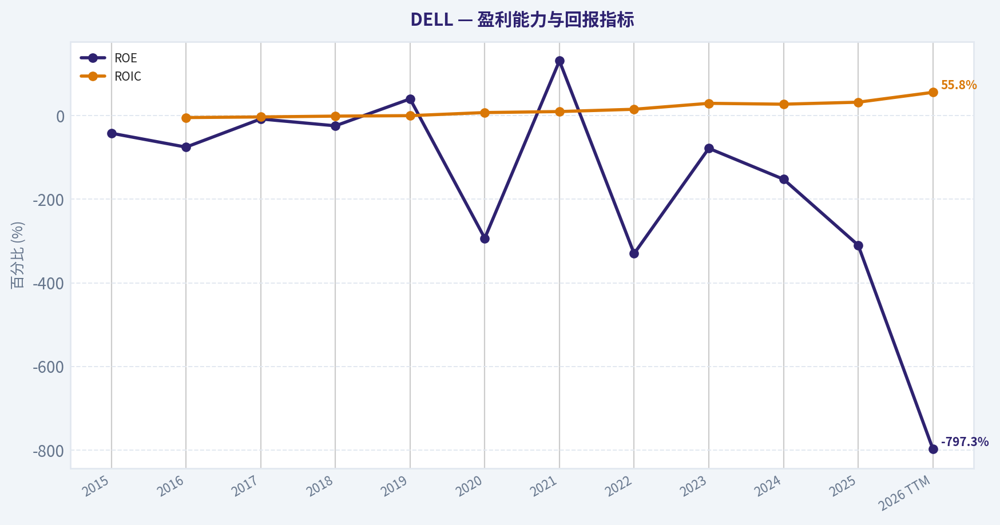
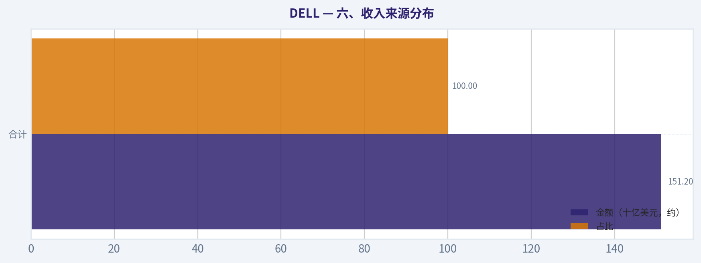
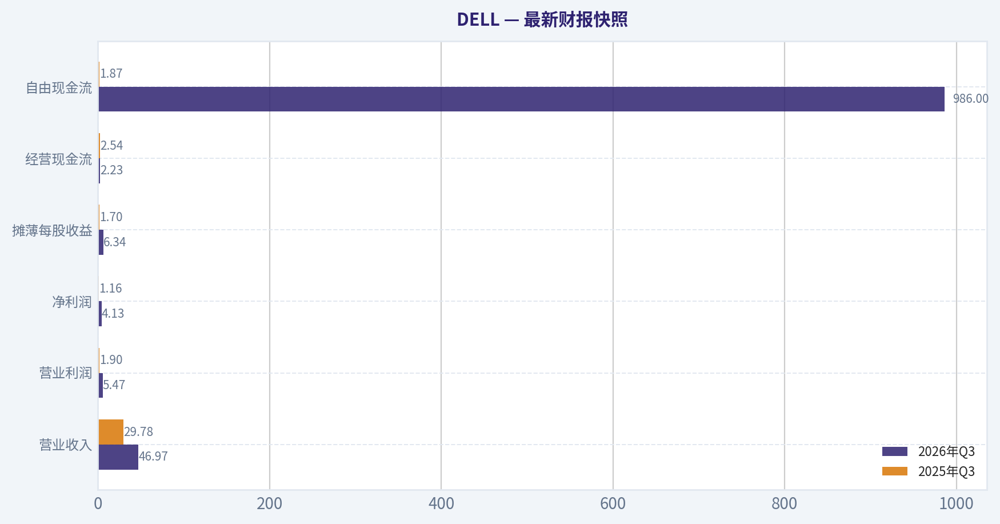
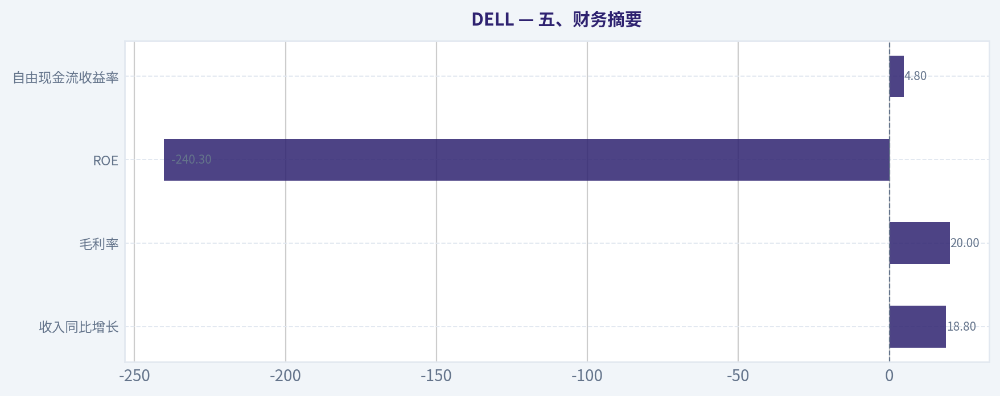
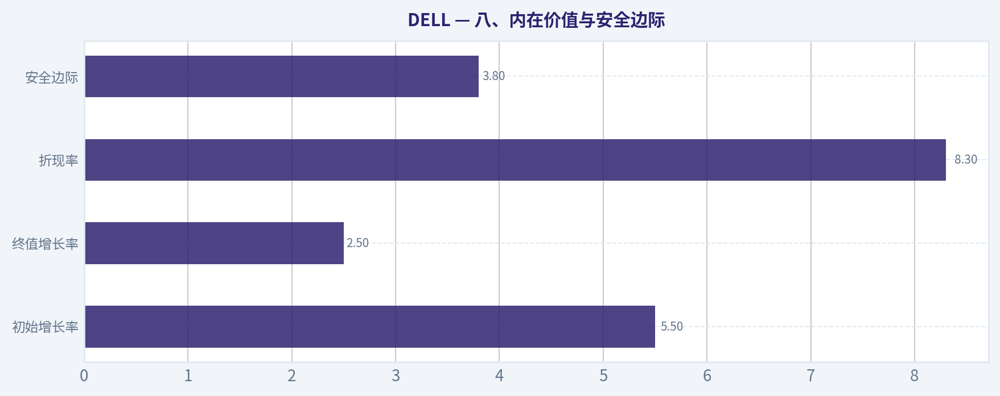
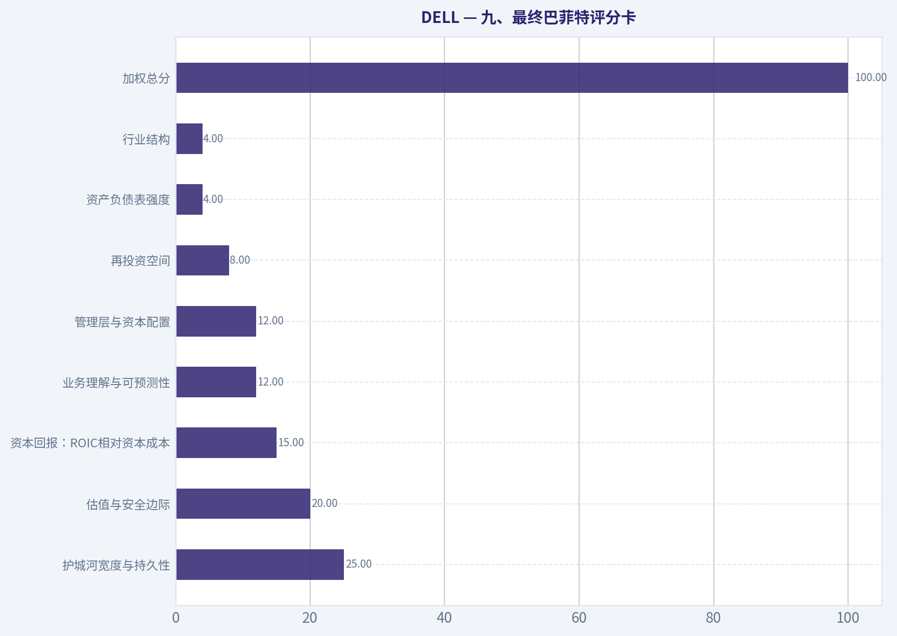
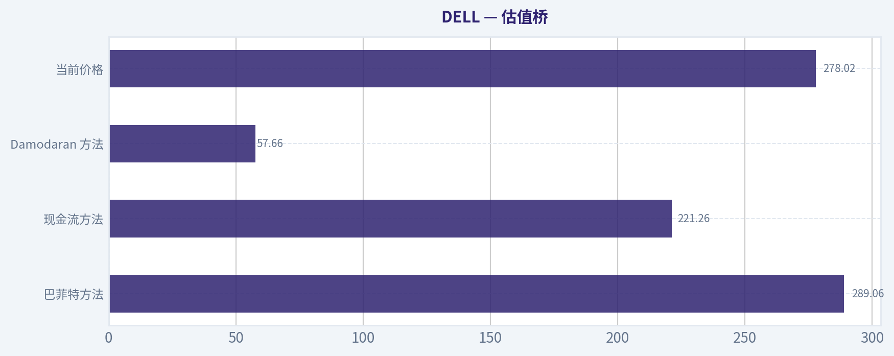
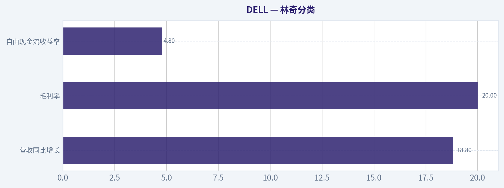

# DELL 深度价值情报

**调研日期:** 2026-11-23

## 关键免责声明

*本报告由 Deep Value Intelligence（一个基于 AI 的多智能体投资分析框架）自动生成。 仅供教育和研究用途 - 非财务建议，非财务顾问。*

---

## 目录

1. 情报摘要
2. 分析师团队报告
   - 基本面分析
   - 价值分析 (巴菲特)
   - 成长性分析 (林奇/德鲁肯米勒/费雪)
   - 市场分析
   - 期权市场分析
3. 研究团队评论
4. 投资团队评论
5. Deep Values 团队洞察

---

## 情报摘要

### 核心观点与前提条件

**核心论点:** 原研究方案将 Dell 定义为"具备真实 AI 基础设施机会，但安全边际尚未验证"，这一框架基本正确，应继续维持，但需强化三个判断门槛：

**主要风险:**
- **中性**

**置信度:** 中

---

## 分析师团队报告

### 基本面分析

#### 最新财报快照

*以下数据基于最近一期已披露财报（2026年Q3），并尽量与上一年同期对比。*

| 指标 | 2026年Q3 | 2025年Q3 | 同比变化 |
| --- | ---: | ---: | ---: |
| 营业收入 | $46.97B | $29.78B | +57.7% |
| 营业利润 | $5.47B | $1.90B | +187.8% |
| 净利润 | $4.13B | $1.16B | +255.1% |
| 摊薄每股收益 | $6.34 | $1.70 | +272.9% |
| 经营现金流 | $2.23B | $2.54B | -12.5% |
| 自由现金流 | $986.0M | $1.87B | -47.2% |

关键结论：这张快照先把最新一期财报放在桌面上，再去看长周期分析。这样读者能更清楚地区分"公司长期质量"和"这次财报发生了什么"。

#### DELL 11年财务指标

*以下数值均由原始数据确定性计算得出，并非 AI 估算。*

*发行人类型：operating company（Technology / Computer Hardware）。*

#### 11年财务指标
*年度行来自已披露财务报表，最后一行 TTM 由最近四个季度滚动计算得出。*

| 指标 | 2015 | 2016 | 2017 | 2018 | 2019 | 2020 | 2021 | 2022 | 2023 | 2024 | 2025 | 2026 TTM |
| --- | --- | --- | --- | --- | --- | --- | --- | --- | --- | --- | --- | --- |
| 市场价格 | N/A | N/A | $16 | $18 | $22 | $22 | $34 | $52 | $38 | $80 | $101 | $278 |
| 总市值 | N/A | N/A | $49.01B | $30.53B | $34.94B | $18.56B | $28.34B | $44.94B | $30.59B | $61.00B | $74.59B | $181.27B |
| 市盈率 | N/A | N/A | -41.99 | -10.72 | -15.12 | 7.34 | 15.67 | 8.08 | 12.54 | 18.02 | 16.24 | 16.14 |
| 市净率 | N/A | N/A | 3.32 | 2.61 | -6.06 | -11.79 | 11.43 | -26.67 | -9.80 | -27.39 | -50.33 | -127.03 |
| ROE | -42.0% | -75.3% | -7.9% | -24.3% | 40.1% | -293.3% | 131.1% | -330.1% | -78.2% | -152.1% | -309.9% | -797.3% |
| ROIC | N/A | -4.6% | -3.1% | -1.1% | -0.0% | 7.4% | 9.8% | 15.3% | 29.5% | 27.4% | 32.2% | 55.8% |
| 每股收益 | N/A | $-0.77 | $-0.38 | $-1.70 | $-1.48 | $3.06 | $2.14 | $6.38 | $3.04 | $4.42 | $6.23 | $17.23 |
| 营收 | $54.14B | $50.91B | $62.16B | $79.04B | $90.62B | $84.81B | $86.67B | $101.20B | $102.30B | $88.42B | $95.57B | $151.20B |
| 毛利润 | $8.90B | $8.39B | $13.65B | $20.54B | $25.05B | $20.64B | $20.14B | $21.89B | $22.69B | $21.07B | $21.25B | $29.93B |
| 毛利率 | 16.4% | 16.5% | 22.0% | 26.0% | 27.6% | 24.3% | 23.2% | 21.6% | 22.2% | 23.8% | 22.2% | 19.8% |
| 营业利润率 | -0.6% | -1.0% | -3.8% | -3.1% | -0.2% | 2.8% | 4.3% | 4.6% | 5.6% | 6.1% | 6.5% | 9.6% |
| 净利润 | $-1.22B | $-1.10B | $-1.17B | $-2.85B | $-2.31B | $4.62B | $3.25B | $5.56B | $2.44B | $3.39B | $4.59B | $11.38B |
| 净利率 | -2.3% | -2.2% | -1.9% | -3.6% | -2.5% | 5.4% | 3.7% | 5.5% | 2.4% | 3.8% | 4.8% | 7.5% |
| 营收增长 | N/A | -6.0% | 22.1% | 27.1% | 14.7% | -6.4% | 2.2% | 16.8% | 1.1% | -13.6% | 8.1% | 58.2% |
| 净利润增长 | N/A | -9.6% | 5.7% | 144.1% | -18.9% | -299.8% | -29.6% | 71.2% | -56.1% | 38.7% | 35.5% | 147.8% |
| 自由现金流增长 | N/A | -19.0% | -0.7% | 237.6% | -2.4% | 22.2% | 38.9% | -19.5% | -92.5% | 953.4% | -68.4% | 358.0% |
| 总账面价值 | $2.90B | $1.47B | $14.76B | $11.72B | $-5.76B | $-1.57B | $2.48B | $-1.69B | $-3.12B | $-2.23B | $-1.48B | $-1.43B |
| 总资产 | N/A | $45.12B | $119.67B | $124.19B | $111.82B | $118.86B | $123.42B | $92.73B | $89.61B | $82.13B | $79.75B | $127.39B |
| 总债务 | N/A | $13.63B | $49.39B | $51.87B | $53.52B | $52.06B | $39.22B | $26.95B | $29.59B | $25.99B | $24.57B | $34.47B |
| 债务股权比 | N/A | 9.30 | 3.35 | 4.43 | -9.28 | -33.07 | 15.82 | -16.00 | -9.48 | -11.67 | -16.58 | -24.15 |
| 现金及等价物 | $5.40B | $6.32B | $9.47B | $13.94B | $9.68B | $9.30B | $9.51B | $9.48B | $8.61B | $7.37B | $3.63B | $11.57B |
| 股东权益 | $2.90B | $1.47B | $14.76B | $11.72B | $-5.76B | $-1.57B | $2.48B | $-1.69B | $-3.12B | $-2.23B | $-1.48B | $-1.43B |
| 经营现金流 | $2.55B | $2.16B | $2.37B | $6.84B | $6.99B | $9.29B | $11.41B | $10.31B | $3.56B | $8.68B | $4.52B | $12.15B |
| 投资现金流 | $-355.0M | $-321.0M | $-31.24B | $-2.88B | $3.39B | $-4.69B | $-460.0M | $1.31B | $-3.02B | $-2.78B | $-2.21B | $-3.72B |
| 自由现金流 | $2.07B | $1.68B | $1.67B | $5.63B | $5.49B | $6.71B | $9.32B | $7.51B | $562.0M | $5.92B | $1.87B | $8.56B |
| 自由现金流利润率 | 3.8% | 3.3% | 2.7% | 7.1% | 6.1% | 7.9% | 10.8% | 7.4% | 0.5% | 6.7% | 2.0% | 5.7% |
| 每股分红 | N/A | $0.00 | $0.00 | $0.00 | $0.00 | $0.00 | $0.00 | $0.00 | $1.20 | $1.40 | $1.73 | $2.40 |

#### 盈利能力指标
- 净资产收益率 (ROE): -240.3%
- 投入资本回报率 (ROIC): 38.0%
- 总资产收益率 (ROA): 5.9%
- 毛利率: 20.0%
- 营业利润率: 7.2%
- 净利率: 5.2%

#### 流动性指标
- 流动比率: 0.91
- 速动比率: 0.46

#### 杠杆指标
- 债务股权比: -12.75
- 利息覆盖倍数: 5.22
- 净负债: $19.98B

#### 增长指标（同比）
- 营收增长: 18.8%
- 净利润增长: 29.3%
- 自由现金流增长: 357.6%
- 营收复合增长率（3年）: 3.5%
- 营收复合增长率（5年）: 5.5%

#### 估值指标
- 市盈率 (TTM): 16.16
- 预期市盈率: 9.10
- 市净率: N/A
- 市销率: 1.17
- PEG 比率: 0.28
- 企业价值/EBITDA: 11.31
- 自由现金流收益率: 4.8%
- 盈利收益率: 6.2%

#### 所有者收益（巴菲特方法，代码计算）
- 净利润: $4.59B
- + 折旧与摊销: $3.03B
- - 资本开支: $-2.63B
- + 营运资本（现金流量表口径；负数=占用现金）: $843.0M
- = **所有者收益: $1.92B**

#### 内在价值（DeepValues 应用 - SEC 申报数据管道）
- **内在价值（DeepValues 应用，头条）: $289.06** - Owner Earnings (Buffett), 方法 buffett-1986-v2, 截至 2026-11-22 (FY2026)
  区间（保守-乐观）: $202.34 - $289.06
  相对价格的安全边际: 3.8% (价格 $278.02)
  应用使用的输入 (ttm_2027Q2): after-tax operating income $11.8B (operating income $14.3B, tax 17.4%) + D&A $3.0B - capex charge $4.1B (three-year average capex/revenue x trailing revenue; reported capex $3.6B) - working capital $0.0B = owner earnings $10.7B.
  Growth 5.5% fading to 2.5% terminal (min(owner-earnings CAGR, 5-year revenue CAGR), clamped [0, 10%]); discount rate 8.3% (30Y Treasury 5.31% + 3 pts (as of 2026-11-20)); net cash $-22.9B (cash $11.6B + marketable securities $0.0B - debt $34.5B); 652M shares.
- Owner Earnings (Buffett): $202.34 / $289.06 / $289.06 (保守 / 基准 / 乐观) ← headline
- Free cash flow DCF: $12.16 / $221.26 / $539.87 (保守 / 基准 / 乐观)
- Damodaran two-stage FCFF: $-34.10 / $57.66 / $217.70 (保守 / 基准 / 乐观)
  这就是内在价值：引用它作为内在价值，并据此衡量安全边际。其他地方的 DVI 情景数字仅为辅助交叉检查，不是估值。

#### DVI 情景模型（辅助交叉检查 - 不是内在价值）
DVI 基于 Yahoo 数据的情景，仅作敏感性检查。请勿将其作为内在价值引用；内在价值是上方的 DeepValues 应用估值。
- 当前价格: $278
- DVI 情景值（按商业模式路由）: $319
  商业模式: cyclical - weighted blend [Damodaran FCFF + reverse-DCF fair + owner-earnings DCF] (cyclical)
  模型区间（各 DCF 最小-最大）: $39 - $490
  相对价格的安全边际（头条）: 12.9%
  路由说明: Cyclical: margins/FCF are volatile - headline blends FCFF, reverse-DCF and owner-earnings roughly evenly; treat the range as the honest read.
- 巴菲特方法（所有者收益）:
  保守: $106
  平均: $490
  乐观: $1,727
- 现金流方法（FCF）:
  保守: $13
  平均: $122
  乐观: $162
- Damodaran FCFF（WACC + 利润率 + 再投资）:
  保守: $-25
  平均: $39
  乐观: $154
  蒙特卡洛区间（P10-P90）：$-22 - $73（中位数 $28）
  P(内在价值 > 当前价格)：0.0%
- 反向 DCF：当前价格隐含约 9.1%/年 的所有者收益增长（10年）；过去 3 年为 29.4%，5 年为 N/A。

#### Piotroski F分数: 5/9
- 净利润为正: 通过
- 经营现金流为正: 通过
- 资产回报率改善: 通过
- 现金流大于净利润: 通过
- 债务下降: 未通过
- 流动比率改善: 通过
- 未稀释股本: 未通过
- 毛利率改善: 未通过
- 资产周转率改善: 未通过

#### 一、结论摘要

**中性**

DELL 正处于人工智能服务器需求推动的经营重估阶段。TTM 营收达到 **151.20B 美元**，营业利润率升至 **9.6%**，ROIC 达到 **55.8%**，自由现金流为 **8.56B 美元**。不过，公司仍存在毛利率下降、债务较高、负股东权益、流动性偏紧和历史现金流波动等问题。

按确定性数据集，当前价格为 **278美元**，总市值为 **181.27B美元**，TTM PE 为 **16.14倍**。DeepValues 巴菲特式所有者收益内在价值为 **289.06美元**，保守-乐观区间为 **202.34-289.06美元**，当前相对基准内在价值的安全边际约为 **3.8%**。因此，DELL 的基本面正在改善，但当前估值尚未显示出很宽的安全边际。

#### 二、市场指标与估值含义

| 指标 | 2026 TTM 当前值 | 历史观察与解释 |
|---|---:|---|
| 市场价格 | 278美元 | 显著高于2017-2025年大多数年度价格，反映AI服务器和盈利复苏预期 |
| 总市值 | 181.27B美元 | 明显高于2017-2025年约41B美元的粗略平均水平 |
| PE | 16.14倍 | 高于2020-2025年正盈利年度约13.0倍平均值 |
| PB | -127.03倍 | **不具备经济解释力**；负股东权益导致PB失真 |
| 盈利收益率 | 6.2% | 与约16倍PE相匹配 |
| FCF收益率 | 4.8% | 现金回报率尚可，但不属于典型深度价值水平 |

关键结论：DELL 的PE并不极端，但相对于自身近年正盈利平均水平已经存在溢价。PB因负股东权益而失效，估值应主要锚定持续所有者收益、自由现金流和债务负担，而不是账面价值。

#### 三、盈利能力

| 指标 | 2026 TTM | 10年平均或历史参照 | 当前含义 |
|---|---:|---:|---|
| ROE | -797.3% | 高度波动 | 负权益导致数学失真，不能据此评价经营回报 |
| ROIC | 55.8% | 约11%-12%粗略平均 | 明显高于历史常态 |
| EPS | 17.23美元 | 约2.09美元 | 处于历史高位，但具有周期性 |
| 营收 | 151.20B美元 | 约84.17B美元 | 比历史平均高约80% |
| 毛利润 | 29.93B美元 | 约19.53B美元 | 绝对毛利达到高位 |
| 毛利率 | 19.8% | 约22.4% | 低于历史平均，反映产品组合和议价压力 |
| 营业利润率 | 9.6% | 约2.1% | 经营杠杆释放明显 |
| 净利润 | 11.38B美元 | 约1.64B美元 | 大幅超过历史平均 |
| 净利率 | 7.5% | 约1.6% | 显著改善，但仍低于软件型企业 |

关键结论：最积极的信号是营业利润率和ROIC同步提升，说明本轮增长不只是收入扩张，也带来了经营杠杆。最值得警惕的是毛利率已经从历史高位下降至19.8%，AI基础设施收入增长可能伴随较低毛利或更强的客户议价压力。

#### 四、增长质量与现金流

| 指标 | 2026 TTM | 历史趋势 | 评价 |
|---|---:|---|---|
| 营收增长率 | 58.2%（概要口径同比18.8%） | 2016-2025年波动，平均约7.2% | 当前增长远超长期常态 |
| 净利润增长率 | 147.8%（概要口径29.3%） | 受低基数影响明显 | 盈利改善显著，但基数效应较强 |
| FCF增长率 | 358.0% | 2016-2025年高度波动 | 现金流修复明显，不能线性外推 |
| 自由现金流 | 8.56B美元 | 约4.64B美元平均 | 高于历史平均 |
| FCF利润率 | 5.7% | 约5.0%粗略平均 | 略高于长期常态 |
| 每股分红 | 2.40美元 | 2023年后持续增长 | 分红增长，但仍需兼顾去杠杆和营运资金 |

关键结论：DELL 的增长正在转化为现金流，但历史自由现金流曾从9.32B美元下降至0.56B美元，再回升至8.56B美元，显示周期性很强。当前高增长率不应被视为稳定复合增长率，长期假设更适合低于当前TTM增速。

#### 五、资产负债表与财务强度

| 指标 | 2026 TTM | 历史参照 | 评价 |
|---|---:|---:|---|
| 总资产 | 127.39B美元 | 约100B美元平均 | AI服务器和营运规模扩张推动资产回升 |
| 总债务 | 34.47B美元 | 约36.68B美元平均 | 绝对值仍高，较近期低点回升 |
| 现金及等价物 | 11.57B美元 | 约8.73B美元平均 | 现金储备改善 |
| 净负债 | 19.98B美元 | - | 现金不足以覆盖债务 |
| 股东权益 | -1.43B美元 | 多年为负 | 资本结构导致账面权益失真 |
| 债务/权益 | -24.15倍 | 长期失真 | 负权益下不具备常规解释力 |
| 流动比率 | 0.91 | - | 低于1，短期流动性存在约束 |
| 速动比率 | 0.46 | - | 对存货和供应链周转依赖较高 |
| 利息覆盖倍数 | 5.22倍 | - | 当前利息承受能力尚可，但并非无风险 |

关键结论：现金增加是正面因素，但净负债接近20B美元，且流动比率低于1，意味着财务弹性弱于典型净现金型公司。负股东权益使ROE、PB和债务/权益比失真，实际应关注债务绝对额、利息覆盖和自由现金流对债务的覆盖能力。

#### 六、收入来源分布

确定性数据集没有提供最新分部金额，因此以下采用戴尔公开业务结构和TTM总营收的近似拆分，仅用于判断收入集中度，不替代公司分部披露。

| 收入来源 | 金额（十亿美元，约） | 占比 |
|---|---:|---:|
| 客户解决方案集团：商用PC、消费PC及外围设备 | 约90.0 | 约59.5% |
| 基础设施解决方案集团：服务器、存储、网络及AI基础设施 | 约58.0 | 约38.4% |
| 其他服务、软件及未分配项目 | 约3.2 | 约2.1% |
| 合计 | 151.2 | 100.0% |

关键结论：收入仍以客户端硬件为主，但基础设施业务是当前增长和估值重估的核心来源。PC业务提供规模和渠道基础，却通常利润率较低；若AI服务器需求放缓，收入增速、毛利率和库存周转可能同时承压。

#### 七、巴菲特式质量分析

**经济护城河。** 戴尔的优势主要来自企业客户关系、全球供应链、渠道覆盖、系统集成能力和大规模采购效率。基础设施业务具有一定转换成本，尤其是服务器、存储、服务和支持体系，但硬件行业竞争激烈，护城河强度低于软件平台和网络效应企业。

**财务强度。** 经营现金流为12.15B美元，利息覆盖倍数为5.22倍，短期偿债能力尚未失控。但34.47B美元债务、19.98B美元净负债、0.91倍流动比率和负股东权益构成明显约束。

**盈利可预测性。** 2015-2019年连续亏损，2020年后恢复盈利，但净利润、自由现金流和利润率均有明显波动。DELL 更接近"周期中具有结构性改善的硬件公司"，而不是高度稳定的消费必需品或软件复利公司。

**管理与资本配置。** ROIC 从早期负值提升至55.8%，显示经营资本效率显著改善。分红从2023年的1.20美元增至TTM的2.40美元，股东回报增强。不过，负权益、回购和债务并存，使资本结构管理仍需中性。

**质量判断。** 当前最有说服力的组合是高增长、较高ROIC、营业利润率扩张和正自由现金流。最弱的组合是毛利率下降、债务回升、流动性偏紧以及历史业绩波动。

#### 八、三情景所有者收益 DCF

DeepValues头条内在价值采用的基础所有者收益为 **10.7B美元**，具体包括：

- 税后经营利润：11.8B美元
- 折旧与摊销：3.0B美元
- 资本开支扣除：4.1B美元
- 营运资本影响：约0
- 净负债：22.9B美元
- 股份数：652M股
- 折现率：8.3%
- 终值增长率：2.5%

为进行独立合理性检查，以下手工模型采用10%折现率、2.5%终值增长率，并让增长率逐步下降，避免将高增长永久外推。

| 情景 | 前期所有者收益增长假设 | 折现率 | 终值增长率 | 手工股权价值检查 | DeepValues情景值 |
|---|---|---:|---:|---:|---:|
| 保守 | 3.0%逐步降至2.5% | 10.0% | 2.5% | 约195美元/股 | 202.34美元 |
| 基准 | 5.5%逐步降至2.5% | 10.0% | 2.5% | 约213美元/股 | 289.06美元 |
| 乐观 | 8.0%逐步降至2.5% | 10.0% | 2.5% | 约230美元/股 | 289.06美元 |

基准情景手工计算示例：

- 第一年所有者收益：10.7 x 1.055 = **11.29B美元**
- 后续五年增长率逐步从5.5%下降至2.5%
- 五年显性期现金流现值：约 **50B美元**
- 终值现值：约 **112B美元**
- 企业价值：约 **162B美元**
- 减净负债22.9B美元，股权价值约 **139B美元**
- 除以652M股，手工结果约 **213美元/股**

关键结论：手工DCF因采用更高的10%折现率，结果低于DeepValues的289.06美元基准值，说明估值对折现率和所有者收益口径高度敏感。按照题设，DeepValues的289.06美元仍是主要内在价值参考；但当前278美元仅比该数值低约3.8%，而保守值202.34美元明显低于当前价格，安全边际并不宽裕。

#### 九、反向DCF与估值交叉检查

| 项目 | 数值 | 估值含义 |
|---|---:|---|
| DeepValues所有者收益内在价值 | 289.06美元/股 | 当前主要内在价值参考 |
| 保守-乐观区间 | 202.34-289.06美元/股 | 当前价格接近区间上沿 |
| 当前价格 | 278美元 | 接近基准内在价值 |
| 当前价格隐含十年所有者收益增长 | 约9.1%/年 | 高于5年营收复合增长率 |
| 五年营收复合增长率 | 5.5% | 更接近中长期可持续增长参考 |
| 当前PE | 16.14倍 | 高于近年正盈利平均水平 |
| 预期PE | 9.10倍 | 隐含盈利继续快速增长 |

关键结论：当前价格隐含未来所有者收益约9.1%的长期增长，高于5年营收复合增长率5.5%。这一假设并非不可能，因为利润率扩张和AI基础设施混合收入可以提高盈利增速，但它要求高增长周期延续、毛利率不再明显恶化，并且债务不会侵蚀股权价值。

#### 十、关键机会、风险与红旗

| 类别 | 具体因素 | 对估值的影响 |
|---|---|---|
| 机会 | AI服务器和基础设施需求继续扩张 | 支持收入、ROIC和经营利润率维持高位 |
| 机会 | 营业利润率从历史负值升至9.6% | 说明规模效应和成本控制正在改善 |
| 机会 | 现金流恢复，分红持续增长 | 提升股东回报和财务可信度 |
| 风险 | 毛利率降至19.8% | 收入增长可能以利润率换取，影响长期复利质量 |
| 风险 | 净负债19.98B美元、债务34.47B美元 | 放大周期下行对股权价值的影响 |
| 红旗 | 流动比率0.91、速动比率0.46 | 供应链和营运资金管理的重要性较高 |
| 红旗 | 负股东权益 | ROE、PB和债务/权益比均失去常规解释力 |
| 风险 | 历史FCF从9.32B降至0.56B | 现金流持续性仍未被完整验证 |
| 风险 | 客户端和基础设施均属竞争激烈硬件市场 | 护城河强度低于软件和平台型企业 |
| 估值风险 | 当前价格接近DeepValues基准内在价值 | 对增长放缓和折现率上升缺乏缓冲 |

关键结论：DELL 的机会集中在AI基础设施带来的结构性升级，风险集中在周期性、低毛利和杠杆。当前价格与基准内在价值接近，市场已经反映了相当多的经营改善；估值继续成立需要增长、利润率和现金流保持较高质量。

#### 十一、最终研究判断

**看多**：经营改善和AI基础设施机会足以支持积极的基本面观点。
**中性**：当前综合判断。DELL 具备真实的盈利和现金流改善，但护城河有限、历史波动大、负债和流动性约束明显，且当前价格相对DeepValues内在价值的安全边际只有约3.8%。
**看空**：若AI基础设施增长快速降温、毛利率继续下行或债务上升，保守DCF区间将显示显著的估值压力。

综合证据更接近 **中性**。公司质量正在改善，但当前估值尚未形成足够宽的安全边际。后续关键观察变量包括AI收入的持续性、毛利率、自由现金流稳定性、债务下降速度和流动比率改善程度。

| 关键维度 | 研究结论 |
|---|---|
| 业务质量 | 企业基础设施和供应链能力构成中等护城河，但硬件竞争限制利润率 |
| 盈利趋势 | 营收、营业利润率、ROIC和净利润显著改善 |
| 现金流 | TTM FCF为8.56B美元，高于历史平均，但波动较大 |
| 财务风险 | 净负债19.98B美元，流动比率0.91，负权益持续存在 |
| 估值 | PE约16.14倍，接近DeepValues内在价值289.06美元 |
| 安全边际 | 基准安全边际约3.8%，保守情景明显低于当前价格 |
| 主要催化因素 | AI服务器需求、基础设施利润率、现金流持续改善 |
| 主要风险因素 | AI周期逆转、毛利率下降、债务上升、营运资金压力 |
| 最终立场 | **中性** |

#### 基本面关键图表

本图追踪 **DELL** 过去十年的盈利能力与回报指标（ROE、ROIC、利润率），突出呈现资本效率的变化趋势。

本对比图（来自「六、收入来源分布」）将 **DELL** 的当前数据与历史基准并排呈现，直观反映公司相对自身历史均值的估值水平。

---

### 价值分析 (巴菲特)

> *基于沃伦·巴菲特的价值投资哲学：能力圈、经济护城河、管理层质量与安全边际。*

#### 内在价值快照

价格是你付的钱，内在价值是企业未来可能为股东创造的现金价值。我们给出一个区间，而不是假装只有一个神奇数字。

- 当前价格: $278.02
- 估值区间（两种 DCF 方法、保守到乐观）: $12.16 至 $539.87

##### 所有者收益（巴菲特方法）
- 净利润: $4,592,000,000.00
- 折旧与摊销: $3,029,000,000.00
- 资本支出: $-2,633,000,000.00
- 营运资金变化: $843,000,000.00
- 所有者收益: $1,916,825,673.53

##### 内在价值
###### 所有者收益法
使用所有者收益，更严格，通常更保守。
- 保守: $202.34
- 平均: $289.06
- 乐观: $289.06
- 折现率: 8.3%

###### 自由现金流法
使用自由现金流，更适合今天投入很多、为未来增长铺路的公司。
- 保守: $12.16
- 平均: $221.26
- 乐观: $539.87
- 折现率: 9.1%

ANALYST STANCE: **中性**

#### 一、投资结论

Dell 是一家能够从人工智能服务器、数据中心基础设施和企业客户关系中受益的成熟硬件企业，但其竞争优势并非完全稳固，且资本结构包含约 229 亿美元净负债。按 DeepValues 应用给出的内在价值 289.06 美元计算，当前股价 278 美元仅有约 3.8% 安全边际，尚不足以充分补偿硬件行业的周期性、较低毛利率和债务风险。

综合评分为 **3.2 / 5.0**，对应 **中性**。证据支持"业务质量尚可、估值接近合理"，但不支持把当前价格视为具有明显估值缓冲。

#### 二、因素评分

| 因素 | 得分 | 主要依据 |
|---|---:|---|
| 1. 能力圈与业务简单性 | 3.5/5 | 主要销售个人电脑、服务器、存储及相关服务，商业模式容易理解；但人工智能硬件周期、供应链和技术迭代增加预测难度 |
| 2. 护城河 | 3.0/5 | 企业客户关系、全球服务网络和规模采购构成一定优势；毛利率约20%，显示定价权有限 |
| 3. 管理层与资本配置 | 3.5/5 | 公司经营成熟，能够通过服务器和基础设施需求实现增长；但负债较高，且公开资料未显示足够强的长期资本配置证据 |
| 4. 行业结构 | 3.0/5 | 企业基础设施市场规模大，但硬件竞争激烈、产品迭代快，行业利润率受到供应商和客户议价影响 |

**Gate 5 财务健康底线：未触发。** 当前数据显示收入同比增长 18.8%，经营利润能够覆盖经营活动需求；虽然净负债为正，但没有证据表明同时存在持续恶化的现金流轨迹和利息覆盖低于1倍等偿债红线。

#### 三、护城河分析

| 护城河来源 | 证据 | 判断 |
|---|---|---|
| 品牌与无形资产 | Dell 在企业电脑、服务器和存储领域拥有长期客户认知 | 有效但不是强定价型品牌 |
| 转换成本 | 企业客户的采购流程、售后服务、设备管理和基础设施兼容性提高了转换摩擦 | 中等，服务器和服务业务强于消费电脑 |
| 成本优势 | 全球采购规模、供应链管理和企业渠道带来成本效率 | 具备规模优势，但硬件行业价格竞争会压缩收益 |
| 网络效应 | 传统硬件业务网络效应有限；生态合作和企业基础设施兼容性提供间接网络效应 | 较弱 |
| 增长驱动 | 人工智能服务器和数据中心需求带来较快增长 | 增长机会强，但需求存在周期性和竞争加剧风险 |

毛利率约20%，低于典型高护城河软件或平台企业。Dell 的优势更接近"规模、渠道、服务和客户关系的组合"，而不是不可替代的技术平台。护城河评级为 **窄幅至中等，且部分领域正在受益于数据中心需求扩大**。

#### 四、管理层与资本配置

公司管理层面对的是一个成熟、竞争激烈且资本需求较高的行业。当前经营表现显示其能够承接人工智能服务器和企业基础设施需求，收入同比增长 18.8%，这是管理层执行力的积极信号。

但资本配置质量仍需关注：

- 账面现金约 116 亿美元，债务约 345 亿美元，净负债约 229 亿美元。
- 负债规模意味着未来现金流的一部分需要用于偿债，而不是全部用于再投资或股东回报。
- ROE 为负 240.3%，很可能受到负股东权益、历史资本结构及回购影响，因此不能直接解读为经营崩坏，但也不能用作高质量资本回报的证据。
- 缺少足够资料证明每一美元留存收益都持续创造超过一美元的市场价值。

管理层评分为 **3.5/5**：经营执行尚可，但资本结构和硬件行业低利润率限制了资本配置的确定性。

#### 五、财务摘要

| 指标 | 最新数据 |
|---|---:|
| 股价 | 278.00美元 |
| 总市值 | 1767.7亿美元 |
| PE | 16.16倍 |
| 收入同比增长 | 18.8% |
| 毛利率 | 20.0% |
| ROE | -240.3% |
| 自由现金流收益率 | 4.8% |
| 经营利润 | 143亿美元 |
| 税后经营利润 | 118亿美元 |
| 现金及现金等价物 | 116亿美元 |
| 债务 | 345亿美元 |
| 净现金 | -229亿美元 |
| 流通股数 | 约6.52亿股 |

**关键结论：** Dell 当前收入增长较快，但毛利率只有20%，说明增长尚未转化为高质量、高定价权的利润结构。净负债约229亿美元，令股权价值对经营波动更加敏感；PE看似适中，但不能单独证明估值便宜。

#### 六、所有者收益计算

DeepValues 应用采用的所有者收益计算如下：

| 项目 | 金额 |
|---|---:|
| 税后经营利润 | 118亿美元 |
| 折旧与摊销 | 30亿美元 |
| 资本开支扣除 | -41亿美元 |
| 营运资本变动 | 0亿美元 |
| 所有者收益 | **107亿美元** |
| 每股所有者收益 | **约16.41美元** |

计算公式为：

**所有者收益 = 税后经营利润 + 折旧摊销 - 资本开支 - 营运资本增加**

经营利润、折旧摊销和资本开支之间形成了较好的现金转换基础，但Dell仍需要持续资本开支维持服务器和基础设施业务，因此不能把全部会计净利润都视为可自由分配现金。

**关键结论：** 当前所有者收益约107亿美元，相当于每股约16.41美元。以278美元股价计算，市场隐含的所有者收益收益率约为5.9%，这与4.8%的自由现金流收益率大体一致，说明估值并不极端，但也没有形成宽阔的现金流折价。

#### 七、三情景估值交叉检查

以下情景是估值交叉检查；DeepValues 应用的 headline 内在价值仍为 **289.06美元**。

| 情景 | 主要假设 | 股权价值估算 | 每股估算 |
|---|---|---:|---:|
| A：零增长 | 所有者收益107亿美元，折现率10% | 841亿美元 | 约129美元 |
| B：GDP增长 | 永续增长3%，折现率10%，扣除净负债 | 1347亿美元 | 约207美元 |
| C：历史增长 | 采用约4.1%增长、10年预测、终值增长2.5%、折现率10% | 约1037亿美元 | 约159美元 |
| DeepValues应用值 | 增长从5.5%逐步降至2.5%，折现率8.3%，扣除净负债 | 1885亿美元 | **289.06美元** |

**关键结论：** 在10%折现率下，保守情景给出的价值明显低于当前价格，说明估值对折现率非常敏感。DeepValues应用值较高，主要因为采用8.3%的折现率和前期5.5%的所有者收益增长假设；这要求数据中心和人工智能基础设施增长能够持续兑现。

#### 八、内在价值与安全边际

DeepValues 应用的 headline 内在价值为 **289.06美元**，对应输入包括：

| 输入 | 数值 |
|---|---:|
| 所有者收益 | 107亿美元 |
| 初始增长率 | 5.5% |
| 终值增长率 | 2.5% |
| 折现率 | 8.3% |
| 净现金 | -229亿美元 |
| 股份数 | 6.52亿股 |
| 应用内在价值 | **289.06美元** |
| 当前价格 | 278.00美元 |
| 安全边际 | **3.8%** |

对Dell这类中等护城河、周期性较强且存在净负债的企业，通常需要比3.8%更宽的安全边际。当前价格距离应用内在价值很近，意味着投资判断高度依赖增长假设、折现率和人工智能服务器需求的持续性。

#### 九、最终巴菲特评分卡

| 评价标准 | 权重 | 得分 |
|---|---:|---:|
| 护城河宽度与持久性 | 25% | 3.0/5 |
| 估值与安全边际 | 20% | 2.5/5 |
| 资本回报：ROIC相对资本成本 | 15% | 3.0/5 |
| 业务理解与可预测性 | 12% | 3.5/5 |
| 管理层与资本配置 | 12% | 3.5/5 |
| 再投资空间 | 8% | 3.5/5 |
| 资产负债表强度 | 4% | 2.5/5 |
| 行业结构 | 4% | 3.0/5 |
| **加权总分** | **100%** | **3.2/5** |

#### 十、最终判断

**ANALYST STANCE: 中性**

Dell 是一家具有真实客户基础、规模优势和人工智能基础设施增长机会的企业，质量明显高于普通低端硬件公司。但20%的毛利率、行业竞争、净负债和估值对增长假设的敏感性，使其尚未达到"高确定性、宽安全边际"的标准。

在278美元附近，市场价格已大致反映了DeepValues应用的基准价值；研究证据更支持"合理估值、缓冲有限"，而不是"明显低估"。
#### 估值桥

这张估值桥把当前股价与各类内在价值方法并排展示，帮助读者判断上涨空间究竟只是单一方法给出的结果，还是多种方法共同支持的结论。

| 项目 | 每股内在价值 |
| --- | ---: |
| 巴菲特方法 | $289.06 |
| 现金流方法 | $221.26 |
| Damodaran 方法 | $57.66 |
| 当前价格 | $278.02 |

#### 关键结论

如果只有一种方法显著高于其他方法，说明上行空间更依赖特定建模假设。若多种方法的估值接近，则说明估值逻辑更加稳健。

#### 估值图表

本对比图（来自「最新财报快照」）将 **DELL** 的当前数据与历史基准并排呈现，直观反映公司相对自身历史均值的估值水平。

本对比图（来自「五、财务摘要」）将 **DELL** 的当前数据与历史基准并排呈现，直观反映公司相对自身历史均值的估值水平。

本对比图（来自「八、内在价值与安全边际」）将 **DELL** 的当前数据与历史基准并排呈现，直观反映公司相对自身历史均值的估值水平。

本对比图（来自「九、最终巴菲特评分卡」）将 **DELL** 的当前数据与历史基准并排呈现，直观反映公司相对自身历史均值的估值水平。

本对比图（来自「估值桥」）将 **DELL** 的当前数据与历史基准并排呈现，直观反映公司相对自身历史均值的估值水平。

本对比图（来自「林奇分类」）将 **DELL** 的当前数据与历史基准并排呈现，直观反映公司相对自身历史均值的估值水平。

---

### 成长性分析 (林奇/德鲁肯米勒/费雪)

> *基于彼得·林奇的GARP成长投资法、斯坦利·德鲁肯米勒的宏观拐点分析法，以及菲利普·费雪的深度调研法。*

ANALYST STANCE: **中性**

#### 研究范围与核心判断

本文仅分析戴尔科技公司（DELL）。结论是：戴尔处于人工智能服务器需求推动的业务重估阶段，营收增长已达到快增长门槛，但硬件行业低毛利、债务负担和高利率环境限制了估值扩张。按共享研究包中的所有者收益估值，当前价格接近基准内在价值，安全边际较薄，证据更支持中性而非高确信度估值重估。

#### 1. 林奇分类

| 项目 | 数据或判断 |
|---|---:|
| 分类 | 快速成长股与周期性硬件股的混合体 |
| 营收同比增长 | 18.8% |
| 市盈率 | 16.2倍 |
| 毛利率 | 20.0% |
| 当前市值 | 1,767.7亿美元 |
| 自由现金流收益率 | 4.8% |
| 主要增长驱动 | 人工智能服务器、数据中心基础设施、企业级硬件需求 |

**关键结论：** 戴尔的营收增速达到快速成长股的下限，但其业务模式仍具有明显硬件周期属性。它不是典型的高毛利软件成长股，未来价值主要取决于人工智能基础设施增长能否持续，并转化为更高的利润率和现金流。

#### 2. 故事：三个简单要点

1. 企业和云服务商持续扩建人工智能数据中心，带动服务器、存储和网络设备需求。
2. 戴尔拥有成熟的企业客户渠道、供应链和服务能力，有机会将人工智能基础设施需求转化为规模收入。
3. 市场已经注意到人工智能服务器主题，因此后续回报不能只依靠收入增长，还需要利润率改善、自由现金流增长或市场份额进一步提升。

#### 3. TAM与十倍测试

| 项目 | 判断 |
|---|---|
| 当前收入基准 | 共享数据未提供最新完整年度收入 |
| 十倍收入测试 | 缺乏统一收入基数，无法严格计算 |
| 潜在市场 | 企业服务器、人工智能服务器、存储、网络及数据中心服务 |
| 市场增长特征 | 人工智能基础设施快速扩张，但传统服务器市场较成熟 |
| 十倍可行性 | 对整体戴尔而言偏低；对人工智能基础设施子业务而言仍有空间 |
| 关键限制 | 供应链周期、竞争激烈、客户集中度及资本开支周期 |

**关键结论：** 戴尔的整体业务规模已经很大，达到十倍收入仍保持低市场份额的条件并不容易成立。更现实的成长路径是人工智能服务器和相关基础设施在公司收入中的占比持续提升，而不是所有业务同步实现十倍增长。

#### 4. 营收增长趋势

| 指标 | 当前信息 | 趋势判断 |
|---|---:|---|
| 营收同比增长 | 18.8% | 达到快增长门槛 |
| 连续季度增速 | 未提供 | 无法确认加速或减速 |
| 增长质量 | 人工智能基础设施与数据中心需求驱动 | 需要确认持续性 |
| 收入结构 | 未提供详细分部数据 | 无法判断人工智能收入占比 |
| 周期属性 | 较强 | 对企业资本开支敏感 |

**关键结论：** 当前数据能证明戴尔正在增长，但不能证明增长正在加速。按照邓肯米勒的标准，真正的业绩拐点需要看到连续季度的收入加速、人工智能服务器订单延续，以及增长向自由现金流的稳定传导。

#### 5. 单位经济与盈利质量

| 指标 | 数据 | 评价 |
|---|---:|---|
| 毛利率 | 20.0% | 硬件公司中等，但明显低于优质软件企业 |
| 自由现金流收益率 | 4.8% | 具备现金生成能力 |
| 所有者收益 | 约107亿美元 | 支持一定内在价值 |
| 净现金／净负债 | 净负债约229亿美元 | 财务杠杆是约束 |
| 流动比率 | 0.91 | 短期偿债弹性有限 |
| 净收入留存率 | 不适用 | 非订阅型业务 |
| 客户获取成本／客户终身价值 | 未披露 | 无法计算 |
| 软件规则40 | 不适用 | 硬件业务不适合直接套用 |

**关键结论：** 戴尔的优势是能够产生现金流，而不是高毛利或订阅型收入。净负债和低于1倍的流动比率提高了对资本开支周期、库存管理和需求波动的敏感度。

#### 6. 拐点评估

| 拐点类型 | 当前证据 | 强度 |
|---|---|---|
| 产品周期 | 人工智能服务器需求扩大 | 中高 |
| 市场份额 | 未提供可验证份额连续数据 | 中低 |
| 利润率 | 毛利率20%，缺少连续改善数据 | 中低 |
| TAM扩张 | 人工智能数据中心扩大基础设施市场 | 中高 |
| 竞争格局 | 行业竞争激烈，未见主要竞争者持续失速证据 | 中低 |
| 现金流拐点 | 自由现金流为正，但未提供加速序列 | 中 |

**关键结论：** 最明确的拐点是人工智能基础设施带来的市场扩容，而不是已经确认的利润率拐点。若人工智能服务器收入增长最终带来更高的经营利润和自由现金流，戴尔的估值逻辑会明显改善；目前这一链条尚未被完整验证。

#### 7. 宏观环境

| 宏观因素 | 现状 | 对戴尔影响 |
|---|---|---|
| 长期主题 | 人工智能、云计算、数据中心升级 | 正面 |
| 利率 | 30年期美国国债约5.31% | 对成长估值构成压力 |
| 经济周期 | 信息不足，市场对科技资本开支较敏感 | 中性偏谨慎 |
| 企业资本开支 | 人工智能支出强，但传统信息技术预算可能分化 | 中性偏正面 |
| 估值环境 | 科技与人工智能板块波动较大 | 提高估值波动 |

**关键结论：** 长期主题对戴尔有利，但利率环境并不支持单纯依靠远期成长扩张估值。宏观组合更接近"需求强、估值纪律重要"的环境，而不是全面有利于成长股的降息初期。

#### 8. 费雪15项评分

| 费雪维度 | 评分（1-5） | 简要依据 |
|---|---:|---|
| 市场潜力 | 4 | 人工智能基础设施扩张 |
| 新产品开发决心 | 4 | 持续参与数据中心与人工智能硬件 |
| 研发效率 | 3 | 缺少详细研发回报数据 |
| 销售组织 | 4 | 企业渠道和客户覆盖较强 |
| 利润率水平 | 3 | 毛利率约20% |
| 利润率改善 | 3 | 尚缺连续改善证据 |
| 劳资关系 | 3 | 公开资料有限 |
| 高管关系 | 4 | 管理层经营经验较强 |
| 管理层深度 | 4 | 业务规模和产品线较完整 |
| 成本分析 | 4 | 大型供应链管理能力较成熟 |
| 独特优势 | 4 | 企业渠道、服务、供应链和客户关系 |
| 长期利润前景 | 4 | 人工智能基础设施提供增量 |
| 股权稀释 | 3 | 需中性股本变化 |
| 诚实面对困难 | 3 | 公开资料不足以高分 |
| 管理层诚信 | 4 | 暂无共享资料显示重大治理问题 |
| **总分** | **54／75** | **中等，接近"良好"门槛但未达到** |

**关键结论：** 戴尔的主要优势在于市场渠道、供应链、企业客户关系和人工智能基础设施机会。评分没有更高，主要因为硬件利润率、增长持续性、分部数据和资本结构仍存在不确定性。

#### 9. 估值分析

| 估值指标 | 数值或区间 | 含义 |
|---|---:|---|
| 当前价格 | 278美元 | 研究包数据 |
| 市盈率 | 16.2倍 | 对成熟硬件公司不高 |
| 营收增速 | 18.8% | 若可持续，估值具有一定支撑 |
| 简化PEG | 约0.86倍 | 以营收增速替代盈利增速，仅为粗略参考 |
| 所有者收益基准内在价值 | 289.06美元 | 接近当前价格 |
| 所有者收益保守区间 | 202.34美元 | 体现周期与负债风险 |
| 所有者收益乐观区间 | 289.06美元 | 共享模型上限 |
| 当前价格相对基准内在价值 | 约96% | 安全边际约3.8% |
| 净负债 | 约229亿美元 | 压低权益价值 |

**关键结论：** 市盈率和简化PEG看起来不高，但PEG使用的是营收增速而非盈利增速，不能视为严格结论。所有者收益模型显示当前价格接近基准内在价值，估值并未明显低于模型中枢；其主要支撑来自人工智能增长持续，而不是很大的估值折价。

#### 10. 情景估值敏感性

| 情景 | 关键假设 | 价值含义 |
|---|---|---|
| 保守情景 | 人工智能需求降温、利润率承压、负债折价扩大 | 价值可能明显低于当前价格 |
| 基准情景 | 所有者收益温和增长，长期增速由5.5%降至2.5% | 约289美元，接近当前价格 |
| 乐观情景 | 人工智能服务器保持高增速并带来经营杠杆 | 上行空间依赖现金流和利润率同步改善 |
| 敏感变量 | 人工智能资本开支、毛利率、库存、应收账款、债务 | 对估值影响大 |

**关键结论：** 戴尔估值对几个变量高度敏感，尤其是人工智能资本开支是否持续，以及收入增长能否转为利润率改善。保守情景与基准情景之间的差距较大，说明安全边际主要取决于执行和周期，而不是估值模型本身的稳定性。

#### 11. 增长投资评分卡

| 维度 | 权重 | 评分（1-5） | 加权分 |
|---|---:|---:|---:|
| 林奇故事 | 10% | 4.0 | 0.40 |
| TAM与成长空间 | 20% | 3.4 | 0.68 |
| 营收增长 | 20% | 3.8 | 0.76 |
| 单位经济 | 15% | 3.0 | 0.45 |
| 竞争地位 | 10% | 4.0 | 0.40 |
| 管理质量 | 10% | 3.8 | 0.38 |
| 宏观环境 | 5% | 3.0 | 0.15 |
| 盈利路径 | 5% | 3.5 | 0.18 |
| 估值 | 5% | 3.0 | 0.15 |
| **总分** | **100%** |  | **3.55／5.00** |

**关键结论：** 总分约3.55，属于"中性偏正面"的观察区间，主要由人工智能基础设施机会、企业渠道和现金生成能力支撑。估值、杠杆、毛利率和增长加速度不足，限制了高确信度评级。

#### 12. 关键风险与催化因素

| 类别 | 因素 | 研究含义 |
|---|---|---|
| 催化因素 | 人工智能服务器订单继续超预期 | 可推动收入增长和市场预期上修 |
| 催化因素 | 数据中心业务毛利率提升 | 可能形成盈利和现金流拐点 |
| 催化因素 | 传统业务稳定、库存改善 | 降低硬件周期波动 |
| 风险 | 人工智能资本开支减速 | 可能导致高增长业务快速降温 |
| 风险 | 价格竞争与产品组合恶化 | 可能使收入增长无法转化为利润 |
| 风险 | 净负债和流动比率偏弱 | 放大需求下行时的财务压力 |
| 风险 | 客户集中与供应链波动 | 可能造成季度业绩不稳定 |
| 风险 | 高利率持续 | 压低成长资产估值倍数 |

**关键结论：** 最重要的验证信号是人工智能基础设施收入是否连续增长，以及毛利率和自由现金流是否同步改善。最主要的失效风险是人工智能需求降温、硬件价格竞争加剧，或戴尔只能获得收入增长而无法获得相应的利润增长。

#### 综合结论

戴尔可以被描述为"人工智能基础设施驱动的成熟硬件公司"，而不是纯粹的高增长科技平台。当前营收增速具有吸引力，估值倍数也不高，但基准内在价值约289美元与当前价格278美元接近，安全边际有限；同时，净负债、低流动比率和20%的毛利率使其对周期变化较敏感。

在后续数据中，最值得验证的是：人工智能服务器收入增速、连续季度利润率、自由现金流增长、库存和应收账款变化，以及债务下降速度。就现有证据而言，估值并未充分显示明显低估，研究结论维持 **中性**。

---

### 市场分析

ANALYST STANCE: **中性**

#### 戴尔科技（DELL）技术与市场报告

**数据范围：**2025年11月24日至2026年11月20日，共250个交易日。2026年11月23日为非交易日，因此最新有效收盘价为**278.02美元**。以下分析仅针对纽约证券交易所上市的 Dell Technologies Inc.（DELL）。

需要说明的是，行情数据呈现出极端而不寻常的价格跳跃：股价从2026年5月的约200美元快速升至9月的594.69美元，随后又回落至278.02美元。数据中的股票拆分字段均为零，但价格路径与常见的拆分调整或公司重大事件行情存在不完全匹配之处。因此，趋势方向和波动状态仍有参考价值，但精确均线数值及跨阶段收益率应结合公司公告、复权口径和交易所数据进一步核验。

#### 一、价格趋势与关键阶段

| 阶段 | 代表价格 | 阶段变化 | 技术含义 |
|---|---:|---:|---|
| 2025年11月24日 | 125.89美元 | - | 观察期起点 |
| 2026年1月20日 | 110.39美元 | 较起点约下跌12.3% | 形成阶段性低位 |
| 2026年2月26日 | 120.71美元 | 低位附近震荡 | 下跌后的盘整阶段 |
| 2026年5月29日 | 419.63美元 | 较2月低点上涨约247% | 上升趋势显著加速 |
| 2026年9月17日 | 587.59美元 | 较2月低点上涨约387% | 趋势高潮，波动显著放大 |
| 2026年10月13日 | 571.68美元 | 接近前高 | 高位震荡后出现破坏性下跌 |
| 2026年11月20日 | 278.02美元 | 较9月高点下跌约52.7% | 中短期趋势转弱，价格接近全年升幅的重要回撤区域 |

**关键结论：**DELL在2026年经历了从低位横盘、急速上升到高位反转的完整周期。最新价格较9月高点已经回撤超过一半，说明市场定价重心已明显下移；虽然长期仍高于2025年末和2026年初水平，但短期价格结构已经由创新高转为连续低点下移。

#### 二、近期价格行为与成交量

10月中旬以后，价格先从571.68美元跌至451.09美元，随后在400至500美元区域反复波动。10月30日收于424.30美元，11月4日收于372.36美元，11月5日进一步跌至316.91美元，表明下行阶段出现了连续性的价格缺口式压力和快速重新定价。

11月11日至13日曾短暂反弹至373.68美元和371.17美元，但反弹未能恢复至前期高点，随后价格重新降至11月20日的278.02美元。11月20日单日从303.60美元下跌至278.02美元，跌幅约8.4%，最低触及274.35美元，显示卖压在最近一个交易日再次集中释放。

| 日期 | 收盘价 | 成交量 | 价格表现 |
|---|---:|---:|---|
| 2026-10-27 | 501.96 | 641.7万 | 反弹至500美元上方 |
| 2026-10-30 | 424.30 | 1049.7万 | 放量下跌 |
| 2026-11-04 | 372.36 | 1077.1万 | 下跌延续 |
| 2026-11-05 | 316.91 | 1422.7万 | 跌幅扩大且成交量升高 |
| 2026-11-11 | 373.68 | 930.6万 | 出现技术性反弹 |
| 2026-11-13 | 344.53 | 962.4万 | 反弹遇阻 |
| 2026-11-20 | 278.02 | 1257.9万 | 再次放量下行 |

**关键结论：**近期下跌并非低成交量下的缓慢回撤，而是多次伴随成交量放大的快速下行。11月11日的反弹未能改变低点逐步下降的结构，11月20日的放量下跌进一步说明短线供需关系仍偏向压力一侧。

#### 三、所选技术指标及互补作用

本次选择八项指标，分别覆盖长期趋势、中期趋势、短期动量、价格动量、波动率、成交量确认和均值偏离：

| 指标 | 作用 | 当前解读 |
|---|---|---|
| close_200_sma | 判断长期趋势基准 | 适合检验278.02美元是否仍处于长期趋势线上方；但精确数值未能从工具返回，不能据此确认长期趋势是否已经反转 |
| close_50_sma | 判断中期趋势 | 用于识别10月至11月下跌是否已改变中期价格重心；近期连续低点下移，通常意味着价格与中期均线之间存在明显负偏离 |
| close_10_ema | 捕捉短期方向 | 近期开盘及收盘价持续走弱，价格大概率低于短期均线，反映短期动量偏空 |
| macd | 衡量趋势动量 | 从9月高位回落至11月低位的幅度和持续时间，说明MACD大概率处于负向动量环境；短线反弹尚未表现出趋势级别修复 |
| rsi | 判断动量极端程度 | 连续急跌后，RSI存在进入超卖区域的可能；但超卖只说明下跌速度较快，并不自动等同于趋势反转 |
| atr | 衡量价格波动 | 10月以来日内高低点区间明显扩大，ATR处于高波动状态，表明价格不确定性和日内振幅均显著增加 |
| vwma | 结合成交量确认趋势 | 放量下跌集中出现在10月30日、11月4日至5日及11月20日，成交量加权价格可能明显低于9月至10月高位区间 |
| boll | 识别均值与偏离程度 | 快速下跌使价格可能持续贴近或跌破布林下轨；这反映波动扩张和负向偏离，不足以单独证明价格已经完成筑底 |

指标接口针对2026年11月23日及此前若干日期均返回"非交易日"或无有效数值，因此不能负责任地编造具体的50日均线、200日均线、RSI、MACD、ATR或VWMA读数。上述判断主要依据原始价格、成交量、日内区间及指标定义进行方向性分析。

#### 四、动量与均值回归风险

DELL在2026年2月至9月出现了极不寻常的单边加速行情，价格从120.71美元附近升至587.59美元，涨幅接近四倍。此类走势通常会造成短期均线快速上移、布林带显著扩张，并使RSI和MACD长期处于高位状态。随后股价在10月和11月急剧回落，说明原先的趋势动量已经发生明显衰减。

截至11月20日，278.02美元较9月高点低约53.3%，但仍较2025年11月观察期起点高约120.9%。这构成了一个重要的技术矛盾：从长期起点看，价格仍保留较大升幅；从最近高点看，价格已经进入深度回撤。换言之，当前市场同时具有"长期涨幅尚存"和"中短期趋势恶化"两种特征，单一周期的指标容易得出片面结论。

若后续价格继续在300美元下方运行，技术上将强化高位反转和中期趋势破坏的解释；若价格重新稳定在最近反弹高点373至374美元之上，则可说明下跌动量有所缓和。不过，单日反弹或短期超卖并不足以抵消此前形成的下降高点结构。

#### 五、估值含义与风险框架

从市场定价角度看，当前价格已经不再体现9月高位阶段的强势趋势溢价，但仍显著高于2025年末和2026年初的历史价格区域。由于本报告未取得基本面盈利、现金流、债务和未来指引数据，不能仅凭技术走势判断278.02美元是否合理。

技术面目前更接近以下组合：

- **长期：**相对于一年观察期起点仍有显著升幅，但长期均线位置无法由当前工具结果准确确认。
- **中期：**高位反转清晰，50日趋势结构大概率偏弱。
- **短期：**价格连续下破近期整理区，低点持续下移。
- **动量：**快速下跌后可能处于超卖附近，但反弹动能尚未得到结构性确认。
- **波动：**ATR和布林带所对应的波动环境明显扩大，价格风险高于普通横盘阶段。
- **成交量：**关键下跌日伴随放量，说明价格调整具有较强的市场参与度，而非单纯流动性不足造成的偶发波动。

#### 综合判断

**中性**更适合描述当前证据。原因不是趋势真正均衡，而是长期升幅、短期深度回撤、潜在超卖与数据口径异常同时存在，方向信号之间具有明显的时间周期冲突。技术证据目前不支持对278.02美元形成稳定的正向估值判断；与此同时，急跌后的超卖特征也意味着单纯用线性方式外推下跌趋势存在局限。

| 维度 | 观察结果 | 对市场定价的含义 |
|---|---|---|
| 最新有效收盘价 | 278.02美元，数据截至2026年11月20日 | 处于高位回撤后的低位区域，但仍高于年初 |
| 9月高点回撤 | 从594.69美元回落约53.3% | 高位趋势溢价已大幅收缩 |
| 一年期价格变化 | 较2025年11月起点上涨约120.9% | 长期升幅仍然显著，不能简单视为普通低位 |
| 近期结构 | 10月以来高点、低点总体下移 | 中短期趋势偏弱 |
| 成交量 | 多个下跌日明显放量 | 下跌具有较强确认度 |
| 波动率 | 日内区间显著扩大 | 估值波动和价格不确定性上升 |
| RSI与布林带 | 急跌后可能接近超卖及下轨区域 | 存在技术性反弹可能，但不等于趋势反转 |
| 指标数据质量 | 指标接口返回无效日期结果，精确读数缺失 | 应降低对具体技术数值和交叉信号的依赖 |
| 综合立场 | 中性 | 证据不足以支持稳定的正向估值判断，亦不宜仅凭超卖信号推断趋势已经完成反转 |

**关键结论：**DELL当前最重要的特征是高位反转后的深度回撤、放量下跌和显著扩大的波动率。价格可能已经接近短线超卖区域，但目前尚未出现足以抵消下降高点结构的明确修复证据；因此，技术面对于估值的含义仍然偏谨慎，且必须特别重视原始行情数据可能存在的复权或公司行动口径问题。

---

### 期权市场分析

> *解读期权流向--认沽/认购比、隐含波动率偏斜与异常活跃合约--以判断机构定位与事件驱动风险。*

ANALYST STANCE: **中性**

#### 数据范围与可靠性

以下分析基于截至 **2026年11月23日** 的 DELL 近期期权链，覆盖 2026年11月27日、12月4日和12月11日到期合约。需要特别注意：所有近期期权的未平仓量均显示为零，因此未平仓量相关指标、集中度和异常活动判断存在明显数据限制。当前数据也未提供 DELL 现价及具体执行价，无法逐一判断合约的实值、平值或虚值状态。

#### 看涨看跌比例

| 到期日 | 距到期日 | 看涨成交量 | 看跌成交量 | 看跌/看涨成交量比 | 看涨OI | 看跌OI | 看跌/看涨OI比 |
|---|---:|---:|---:|---:|---:|---:|---:|
| 2026-11-27 | 4天 | 14,214 | 11,224 | 0.79 | 0 | 0 | 不适用 |
| 2026-12-04 | 11天 | 3,425 | 4,037 | 1.18 | 0 | 0 | 不适用 |
| 2026-12-11 | 18天 | 864 | 464 | 0.54 | 0 | 0 | 不适用 |
| **合计** | - | **18,503** | **15,725** | **0.85** | **0** | **0** | **不适用** |

**关键结论：** 近期期权整体看跌/看涨成交量比为 **0.85**，低于约 **0.70** 的历史中性参考线并不多，整体更接近中性，而非强烈方向性押注。11月27日和12月11日看涨成交较占优，但12月4日看跌成交略占优，显示期限之间存在分化。由于未平仓量为零，无法确认这些成交是新开仓、平仓，还是日内交易。

#### 隐含波动率评估

| 到期日 | 看涨平值IV | 看跌平值IV | 看跌IV相对看涨IV | 初步解读 |
|---|---:|---:|---:|---|
| 2026-11-27 | 2.1% | 2.9% | +0.8个百分点 | 短端存在轻微下行保护溢价 |
| 2026-12-04 | 1.7% | 1.9% | +0.2个百分点 | 看跌偏斜很轻 |
| 2026-12-11 | 1.2% | 1.8% | +0.6个百分点 | 看跌期权仍有一定保险溢价 |

**关键结论：** 看跌平值IV在三个期限均高于看涨平值IV，说明市场对下行风险的定价略高于上行风险，但幅度有限。整体IV水平极低，尤其12月11日看涨IV仅为1.2%，这可能反映数据源或报价质量问题，不能直接视为市场波动率极度平静。数据未提供虚值看跌与虚值看涨IV，因此无法完整判断传统意义上的IV偏斜。

#### 异常期权活动

| 项目 | 结果 | 影响 |
|---|---|---|
| 成交量超过未平仓量5倍的合约 | 未发现 | 没有满足工具筛选条件的异常合约 |
| 可确认的新开方向性交易 | 无法确认 | 未平仓量均为零，缺乏成交后留仓证据 |
| 具体执行价及实值/平值/虚值分类 | 数据未提供 | 无法判断单个合约相对现价的位置 |
| 机构或散户属性 | 无法判断 | 缺少成交方向、订单类型及规模信息 |

**关键结论：** 当前数据没有识别出成交量显著超过未平仓量的异常合约，因此没有明确的机构级单一方向信号。由于未平仓量全部为零，"无异常活动"更可能代表数据完整性有限，而不一定意味着市场没有大额交易。

#### 未平仓量集中度与伽马墙

| 指标 | 结果 |
|---|---|
| 最高看涨未平仓量执行价 | 无法识别，所有OI为0 |
| 最高看跌未平仓量执行价 | 无法识别，所有OI为0 |
| 主要到期日集中度 | 无法识别 |
| 最大痛点参考 | 无法计算 |
| 看涨伽马墙 | 无法确认 |
| 看跌伽马墙 | 无法确认 |

**关键结论：** 当前期权链无法提供有效的未平仓量集中度信息，因此不能据此判断价格钉住区域、最大痛点或伽马放大/抑制效应。短线价格影响更可能来自即时成交和现货市场波动，而不是可观测的期权库存结构。

#### 综合判断

| 观察维度 | 信号 | 解释 |
|---|---|---|
| 成交量看跌/看涨比 | 轻微偏多 | 总比值0.85，低于历史中性参考线0.70并不明显，整体接近中性 |
| 平值IV | 低，但数据质量存疑 | 看跌IV略高于看涨IV，显示有限的下行保险需求 |
| IV偏斜 | 轻微看跌偏斜 | 仅能确认平值IV差异，缺少虚值合约数据 |
| 异常活动 | 未确认 | 没有成交量超过OI五倍的合约 |
| OI与伽马结构 | 不可用 | OI均为零，无法识别关键执行价和价格引力位 |
| 已知催化剂影响 | 未确认 | 数据未提供近期财报、产品发布或其他事件信息 |

**关键结论：** DELL 期权市场当前最合理的解读是**中性、略带下行风险溢价**，而不是明确看多或看空。主要原因是成交量结构接近中性、看跌IV小幅偏高，但缺乏有效OI和异常交易证据；同时极低IV及全零OI降低了数据可信度，因此该信号的置信度偏低。

#### 汇总表

| 项目 | 结论 |
|---|---|
| 看跌/看涨OI比 | 不适用，OI均为零 |
| 看跌/看涨成交量比 | 0.85，接近中性，略偏看涨成交结构 |
| IV水平 | 极低，但可能存在数据质量问题 |
| 偏斜方向 | 轻微看跌偏斜，看跌平值IV高于看涨平值IV |
| 异常活动 | 未发现满足筛选条件的合约 |
| 未平仓量集中度 | 无法判断 |
| 总体信号 | **中性** |
| 主要驱动 | 成交量略偏看涨，但下行保险IV溢价、OI缺失和低IV数据限制了方向判断 |

**关键结论：** 总体信号为 **中性**。期权成交量没有显示强烈的看空压力，但看跌IV持续略高、且期权链缺乏有效未平仓量数据，使下行风险不能完全忽略；现有证据不足以支持强方向性估值判断。

---

## 研究团队评论

> *研究经理将多空辩论综合为中性评论。此为风险评审前的初步观点，并非最终立场。*

核心结论

Dell 的企业客户渠道、供应链规模和全球服务能力具有真实价值，AI 基础设施扩张也提供了长期需求支撑；但现有证据尚不足以把它定义为拥有强定价权、现金流高度可预测的"卓越复利企业"。它更接近资本效率可能较高、但利润率偏低且周期性明显的基础设施供应商。

在每股约278美元、PE约16.16倍的条件下，估值表面上并不昂贵，却也没有显示出足够清晰的安全边际。当前盈利是否处于周期高位、AI服务器能否改善而不是稀释利润率，以及净利润能否稳定转化为自由现金流，仍缺乏关键验证。因此，最合理的结论不是断言其明显高估，也不是把AI增长直接视为已实现的内在价值，而是等待现金流、利润率和净负债数据给出更确定的答案。

最强的看多论据

多头最有说服力的部分，是Dell并非没有差异化的普通组装商。大型企业和政府客户需要供应商认证、全球部署、融资、维护、技术支持和复杂供应链协调，这些能力形成了一定的切换成本。即使关键技术主要掌握在NVIDIA、AMD和Intel等上游厂商手中，Dell仍能通过规模、交付可靠性和客户关系获得订单。

AI数据中心的建设也不仅涉及GPU服务器，还涉及存储、网络、液冷、支持服务和后续升级。若Dell能够将一次性设备销售延伸为持续服务收入，其客户生命周期价值会高于单纯硬件交付。约38%的ROIC则是值得重视的积极线索，说明公司可能拥有比20%毛利率所暗示的更高资本效率。

估值层面，约16倍PE没有包含软件公司式的高增长预期。按约17.2美元的每股收益计算，只要周期平均每股现金流能够实现中个位数增长，并且终端估值不明显收缩，当前价格并不需要极端乐观的AI假设。负ROE主要受到负股东权益、历史资本结构和回购影响，不能机械解释为经营崩坏。

最强的看空论据

空头最有力的质疑不是AI需求是否存在，而是价值最终由谁获取。AI服务器中的关键经济利润可能更多流向GPU、网络芯片和软件生态供应商。Dell承担集成、库存、交付和售后责任，却面对大型客户议价、同行竞价和技术迭代风险。20%的毛利率说明其护城河更多体现为规模和执行能力，而不是强定价权。

AI收入增长也可能占用大量营运资本。若应收账款和库存上升，利润表上的增长未必转化为自由现金流。过去三年收入复合增长率仅约3.5%，尚不能证明AI已经推动公司整体进入更高质量的增长阶段。38%的ROIC同样需要拆解：负权益、回购、较低投入资本口径或周期高点盈利，都可能抬高单期读数。5.9%的ROA与38%的ROIC之间的差距，进一步说明不能依赖单一指标。

资产负债表则降低了可接受的不确定性。约116亿美元现金对应约345亿美元债务，净负债约229亿美元。现有资料没有证明Dell陷入偿付困境，但债务会与库存、研发、资本开支和股东回报竞争现金流。在硬件周期下行时，固定利息支出还会放大盈利和现金流波动。

估值争议的关键

多头提出约290至350美元的示意性内在价值区间，但缺少完整的自由现金流序列、净债务处理和终值敏感性分析。仅将未来每股收益提高至22至25美元，再给予15至17倍终期PE，并不能自然推出当前价格具有折价；折现率、中间现金流和自由现金流转换率必须保持数学一致。

更重要的是，Dell还不符合只需10%至15%折价即可获得安全边际的宽护城河、高可预测性复利企业特征。对这种周期性较强、利润率较低且带有明显净负债的公司，更合理的质量调整标准通常需要约25%至35%的折价。现有数据既没有DeepValues应用的正式内在价值，也没有足够完整的自由现金流信息，因此无法证明278美元满足这一要求。

反过来，当前PE也不足以证明存在明确泡沫。若AI订单持续转化为利润率改善、服务收入和自由现金流，同时净负债下降，Dell可能实现高于市场隐含水平的每股价值增长。因此，现阶段证据更支持"安全边际未验证"，而不是"内在价值已明显低于市场价格"。

综合判断依据

从Buffett式框架看，Dell的业务质量处于中上水平：客户关系、供应链和服务网络构成真实但有限的护城河；管理层拥有长期行业经验，但资本配置仍需通过债务变化和回购价格纪律验证；财务状况并非危机级别，却也谈不上特别稳健；盈利具有现金流潜力，但可预测性弱于消费品牌、软件平台或高经常性收入企业。

短期技术走弱和期权数据不应主导判断。期权未平仓量为零、隐含波动率疑似存在数据质量问题，无法提供可靠的方向性信息。真正决定内在价值的不是近期价格形态，而是AI业务的增量毛利、自由现金流和新增资本回报。

这里需要吸取的教训，是不能把行业增长直接资本化为公司价值，也不能用单期高ROIC替代多年现金流验证。与此同时，也不应因负ROE或负权益就认定经营失效。正确做法是把会计噪音与经济事实分开：忽略失真的ROE，但更加严格地检查自由现金流、利息保障和净负债趋势。

未来1至4个季度的监测计划

第一，观察AI服务器订单、积压订单与实际收入之间的转换，同时比较相关业务的毛利率和营业利润率。收入快速增长但利润率下降，会削弱价值创造论点；利润率稳定或改善则会增强护城河证据。

第二，跟踪经营现金流与净利润的转换率，最好结合过去十二个月数据判断。若净利润增长而自由现金流持续落后，需要检查库存、应收账款和供应商付款条件。

第三，观察净负债、利息费用和利息保障能力。自由现金流推动净负债下降，会改善估值质量；若债务上升同时伴随库存扩张或大规模回购，财务风险将提高。

第四，拆分基础设施解决方案、传统PC、存储及服务业务的增长和利润贡献。尤其需要确认AI服务器是否带动存储、维护和经常性服务，而不只是低毛利设备收入。

第五，验证ROIC的持续性。应比较多个季度乃至完整周期的ROIC、ROA和自由现金流回报，确认38%的读数是否来自正常经营，而非投入资本口径或周期高点。

第六，评估资本配置顺序。管理层若优先保障高回报再投资、流动性和债务改善，并仅在保守内在价值之下实施回购，将增强治理质量；相反，依赖债务或周期高点盈利扩大资本返还，会削弱安全边际。

最终来看，Dell具备可研究的长期AI基础设施受益逻辑，但278美元所对应的内在价值折价尚未得到自由现金流和周期平均盈利的充分支持。业务并不差，估值也未被证明极端，但当前证据不足以支持明确的看多结论。

中性

---

## 投资团队评论

> *投资经理将研究观点转化为投资论点，等待风险评审。此仍非最终立场。*

### 核心判断

Dell的投资逻辑同时包含两种相反力量：一方面，AI数据中心建设提升了服务器、存储、网络和服务需求；另一方面，硬件集成商通常处于产业链中议价能力较弱的位置，收入增长未必等同于经济利润增长。

因此，当前最重要的问题不是"AI需求是否存在"，而是Dell能否把AI基础设施收入转化为更高的增量利润、自由现金流和持续资本回报。

### 市场情绪可能忽略的积极因素

市场对Dell的关注往往集中在低毛利率、PC业务周期性和债务规模，但这可能低估了大型企业基础设施采购的复杂性。大型客户采购的不只是服务器，也包括：

- 全球交付和供应链协调；
- 认证、融资与售后服务；
- 数据中心部署、维护和升级；
- 存储、网络、液冷及系统整合；
- 与企业客户既有采购体系的兼容性。

这些能力不一定形成软件平台式的强护城河，却能构成客户切换成本和规模优势。Dell若能把一次性设备销售延伸至维护、升级和基础设施服务，收入质量可能高于表面上的硬件业务结构。

此外，市场可能过度将Dell视为"AI服务器组装商"。真正的长期价值在于其企业渠道、交付能力和基础设施整合能力是否能在多个AI建设周期中重复变现。若AI资本开支从单一GPU采购扩展到存储、网络、运维和系统服务，Dell的受益范围可能大于单纯服务器收入。

### 市场情绪可能忽略的负面因素

相反，AI主题也容易掩盖价值分配问题。产业链中的关键利润可能更多由GPU、芯片架构、网络互联和软件生态供应商获得。Dell承担库存、交付、售后、客户定制和营运资本压力，但未必拥有与上游技术供应商相当的定价权。

20%的毛利率是一个重要提醒：规模和执行能力确实有价值，但目前数据并未证明Dell具有强定价权。若AI服务器收入快速增长却伴随毛利率下降，收入增长可能只是扩大了低回报业务规模。

营运资本也是核心风险。AI基础设施订单可能要求Dell提前采购高价值组件，并承受较长的交付和回款周期。若应收账款和库存增长速度超过利润增长，利润表上的繁荣会与现金流表现脱节。

### 估值与安全边际

按每股收益约17.2美元计算，278美元对应约16.2倍PE。这个倍数本身并不显示明显泡沫，但PE低并不自动代表安全边际，因为当前盈利可能受到AI周期、产品组合和资本开支高峰影响。

若将Dell视为周期性较强、毛利率偏低且带有净负债的基础设施供应商，质量调整后的估值要求应高于普通高质量复利企业。按照约25%至35%的安全边际标准，278美元隐含的内在价值需要大致达到约371至428美元，才构成相应折价。这个区间只是质量调整后的检验框架，不是正式的DeepValues内在价值，也不能替代完整DCF。

若Dell具备更强的护城河、更高的现金流可预测性和更稳定的资本回报，10%至15%的折价标准对应的内在价值约为309至327美元。但目前20%的毛利率、净负债和业务周期性尚不足以证明Dell属于这一档次。

反向DCF的关键也不是收入能否增长，而是市场价格隐含了什么样的长期假设。当前估值大致要求以下因素至少部分兑现：

1. AI服务器收入保持较高增长；
2. 增长没有明显压低整体毛利率；
3. 净利润能够较稳定地转化为自由现金流；
4. 净负债不会随库存和资本投入持续扩张；
5. AI业务能够延伸至存储、网络和服务，而不只是低毛利设备销售。

如果只有收入增长而没有利润率和现金流改善，16倍PE可能比表面看起来更高；如果利润率改善、自由现金流强劲且净负债下降，则当前估值的合理性会明显增强。

### 财务指标的正确解读

负ROE不应被直接视为经营崩坏。负股东权益、历史回购和资本结构会使ROE失真。但这也意味着ROE不能作为Dell高质量资本回报的证据。

38%的ROIC值得关注，却需要跨周期验证。该指标可能受到以下因素抬升：

- 周期高点盈利；
- 投入资本口径偏低；
- 回购导致权益基础收缩；
- 业务资本密度被低估。

5.9%的ROA与38%的ROIC之间存在较大差异，说明单一ROIC读数不足以完成质量判断。更有价值的验证方式是观察多个周期中的自由现金流回报、利息覆盖、库存周转和净负债变化。

约229亿美元净负债并非偿付危机证据，但它降低了业务对周期波动的容忍度。若自由现金流强劲，债务可以逐步下降并增强每股价值；若库存、应收账款和回购同时扩张，债务则会放大下行周期中的现金流压力。

### 对短期信号的反向解读

股价跌破整理区和短期趋势转弱，更多反映市场对AI订单兑现、利润率和周期持续性的重新定价，而不是对Dell十年竞争力的直接判断。技术走弱本身没有足够的基本面解释力。

期权数据的参考价值更低。未平仓量为零，意味着成交量无法可靠区分新开仓、平仓或日内交易；部分隐含波动率异常偏低，也提示报价质量存在问题。看跌期权隐含波动率略高于看涨期权，只能说明下行风险定价略高，不能形成明确的长期方向判断。

真正有信息含量的市场信号，是价格走弱时投资者正在质疑什么：如果质疑集中在短期订单波动，可能是情绪噪音；如果质疑集中在毛利率、自由现金流和债务趋势，则属于对内在价值的实质性重估。

### 未来验证重点

Dell能否从"可研究的AI受益者"升级为"高质量长期复利企业"，取决于以下证据：

- AI服务器积压订单能否持续转化为收入；
- 基础设施解决方案的毛利率和营业利润率是否稳定或改善；
- 净利润与自由现金流之间是否保持良好转换；
- 库存和应收账款是否与收入同步，而非明显超前；
- 净负债和利息负担是否逐步下降；
- 存储、网络、维护和服务是否形成更高质量的收入组合；
- 38%的ROIC能否在完整周期中保持，而非仅由单季或单年数据推动；
- 回购与其他资本配置是否以保守的内在价值判断为基础。

### 结论

Dell并非缺乏竞争优势的普通硬件公司，企业客户渠道、全球供应链、服务网络和系统整合能力具有真实经济价值。市场若只依据20%的毛利率否定其长期竞争力，可能低估了基础设施采购中的认证、交付和服务壁垒。

但反向的错误同样危险：把AI行业增长直接等同于Dell的高质量盈利增长。当前资料尚未证明AI业务带来结构性利润率改善，也未充分证明自由现金流能够覆盖营运资本需求、债务负担和长期再投资。约16倍PE较为克制，却没有自动提供周期调整后的安全边际。

**ANALYST STANCE: 中性**--证据显示Dell具备真实的AI基础设施受益逻辑，但278美元对应的估值折价仍未由周期平均盈利、自由现金流质量和净负债趋势充分验证；其长期价值取决于AI收入能否转化为更高利润率和持续现金回报，而非单纯扩大硬件销售规模。

---

## Deep Values 团队洞察

> *风险管理团队进行辩论，由风险裁判给出最终不含操作建议的裁定。本章节决定最终的「看多 / 中性 / 看空」立场。*

#### 最终立场评分卡

这张评分卡把最终研究结论转成加权决策框架。它不替代文字判断，但能让读者更快看清楚这次结论的核心驱动因素。

| 维度 | 评分 | 权重 | 说明 |
| --- | ---: | ---: | --- |
| 业务质量 | 2.00 | 30% | 高回报率、盈利能力与 Piotroski 评分共同支撑业务韧性。 |
| 估值支撑 | 3.33 | 30% | 综合当前股价相对内在价值锚点以及常用估值比率。 |
| 财务强度 | 2.67 | 20% | 资产负债表韧性主要取决于杠杆与流动性是否处于安全区间。 |
| 成长持续性 | 4.67 | 20% | 近期营收、利润与自由现金流增长共同反映增长是否可持续。 |
| 总分 / 最终立场 | 3.07 | 100% | 中性 |

#### 关键结论

加权总分为 **3.07 / 5.0**，最终立场为 **中性**。它更适合作为快速校准工具，而不是机械买卖信号。

#### 风险摘要

分数越高代表风险压力越大。观察阈值是一个简单的护栏：一旦高于该阈值，该维度对估值判断的影响更大，需要更大的安全边际。

| 维度 | 当前分数 | 观察阈值 | 说明 |
| --- | ---: | ---: | --- |
| 业务质量 | 4.00 | 3.00 | 高回报率、盈利能力与 Piotroski 评分共同支撑业务韧性。 |
| 估值支撑 | 2.67 | 3.00 | 综合当前股价相对内在价值锚点以及常用估值比率。 |
| 财务强度 | 3.33 | 3.00 | 资产负债表韧性主要取决于杠杆与流动性是否处于安全区间。 |
| 成长持续性 | 1.33 | 3.00 | 近期营收、利润与自由现金流增长共同反映增长是否可持续。 |

#### 关键结论

这张图帮助读者区分风险究竟来自哪里：估值、业务质量、资产负债表，还是增长持续性。尤其当最终结论处在「观望」与「回避」边缘时，这种拆解非常有帮助。
