# DELL Deep Value Intelligence

**Analysis Date:** 2026-11-23

## Critical Disclaimer

*This analysis is generated by Deep Value Intelligence, an AI-powered multi-agent investing framework. Education & research only - not financial advice, not a financial advisor.*

---

## Table of Contents

1. Intelligence Summary
2. Analyst Team Reports
   - Fundamentals Analysis
   - Intrinsic Value Analysis (Buffett)
   - Trend & Growth Analysis (Lynch/Druckenmiller/Fisher)
   - Market Technical Analysis
   - Options Market Analysis
3. Research Team Commentary
4. Value Investing Team Commentary
5. Deep Values Commentary

---

## Intelligence Summary

### Thesis + Conditions

**Core Thesis:** Dell is a capable infrastructure integrator with enterprise scale, positive cash generation, and credible exposure to a multiyear AI investment cycle. Its 38% reported ROIC and estimated $10.7 billion of normalized owner earnings deserve weight; negative ROE is distorted by the accounting equity base.

**Key Risks:**
- The unresolved risk is economic capture: 20% gross margins, supplier and customer bargaining power, working-capital demands, and debt may prevent AI revenue from becoming durable per-share free cash flow. Valuation evidence is also internally inconsistent-the $278 price and 16.16 P/E cannot be applied to subsequent prices above $300 without recalculation. No verified debt-adjusted margin of safety is established.
- A moderate P/E is not a margin of safety if earnings are cyclically elevated.
- This is the strongest risk argument because it focuses on permanent impairment mechanisms rather than stock volatility. Its limitation is that it can understate the economic value of Dell's scale and integration capabilities. Low gross margin alone does not establish a poor business.

**Confidence:** Low

---

## Analyst Team Reports

### Fundamentals Analysis

#### Latest Earnings Snapshot

*Most recent reported quarter anchored on 2026 Q3, with prior-year comparison when available.*

| Metric | 2026 Q3 | 2025 Q3 | YoY Change |
| --- | ---: | ---: | ---: |
| Revenue | $46.97B | $29.78B | +57.7% |
| Operating Income | $5.47B | $1.90B | +187.8% |
| Net Income | $4.13B | $1.16B | +255.1% |
| Diluted EPS | $6.34 | $1.70 | +272.9% |
| Operating Cash Flow | $2.23B | $2.54B | -12.5% |
| Free Cash Flow | $986.0M | $1.87B | -47.2% |

Key Takeaways: This snapshot anchors the most recent reported quarter before the narrative analysis. It helps readers separate long-run business quality from whatever changed in the latest earnings print.

#### 11-Year Financial Metrics for DELL

*All values below are computed deterministically from raw data - not estimated by AI.*

*Issuer profile: operating company (Technology / Computer Hardware).*

#### 11-Year Financial Metrics
*Annual rows come from reported financial statements. The final TTM row is computed from the latest four quarters.*

| Metric | 2015 | 2016 | 2017 | 2018 | 2019 | 2020 | 2021 | 2022 | 2023 | 2024 | 2025 | 2026 TTM |
| --- | --- | --- | --- | --- | --- | --- | --- | --- | --- | --- | --- | --- |
| Market Price | N/A | N/A | $16 | $18 | $22 | $22 | $34 | $52 | $38 | $80 | $101 | $278 |
| Market Cap | N/A | N/A | $49.01B | $30.53B | $34.94B | $18.56B | $28.34B | $44.94B | $30.59B | $61.00B | $74.59B | $181.27B |
| P/E Ratio | N/A | N/A | -41.99 | -10.72 | -15.12 | 7.34 | 15.67 | 8.08 | 12.54 | 18.02 | 16.24 | 16.14 |
| P/B Ratio | N/A | N/A | 3.32 | 2.61 | -6.06 | -11.79 | 11.43 | -26.67 | -9.80 | -27.39 | -50.33 | -127.03 |
| ROE | -42.0% | -75.3% | -7.9% | -24.3% | 40.1% | -293.3% | 131.1% | -330.1% | -78.2% | -152.1% | -309.9% | -797.3% |
| ROIC | N/A | -4.6% | -3.1% | -1.1% | -0.0% | 7.4% | 9.8% | 15.3% | 29.5% | 27.4% | 32.2% | 55.8% |
| EPS | N/A | $-0.77 | $-0.38 | $-1.70 | $-1.48 | $3.06 | $2.14 | $6.38 | $3.04 | $4.42 | $6.23 | $17.23 |
| Revenue | $54.14B | $50.91B | $62.16B | $79.04B | $90.62B | $84.81B | $86.67B | $101.20B | $102.30B | $88.42B | $95.57B | $151.20B |
| Gross Profit | $8.90B | $8.39B | $13.65B | $20.54B | $25.05B | $20.64B | $20.14B | $21.89B | $22.69B | $21.07B | $21.25B | $29.93B |
| Gross Margin | 16.4% | 16.5% | 22.0% | 26.0% | 27.6% | 24.3% | 23.2% | 21.6% | 22.2% | 23.8% | 22.2% | 19.8% |
| Operating Margin | -0.6% | -1.0% | -3.8% | -3.1% | -0.2% | 2.8% | 4.3% | 4.6% | 5.6% | 6.1% | 6.5% | 9.6% |
| Net Income | $-1.22B | $-1.10B | $-1.17B | $-2.85B | $-2.31B | $4.62B | $3.25B | $5.56B | $2.44B | $3.39B | $4.59B | $11.38B |
| Net Margin | -2.3% | -2.2% | -1.9% | -3.6% | -2.5% | 5.4% | 3.7% | 5.5% | 2.4% | 3.8% | 4.8% | 7.5% |
| Revenue Growth | N/A | -6.0% | 22.1% | 27.1% | 14.7% | -6.4% | 2.2% | 16.8% | 1.1% | -13.6% | 8.1% | 58.2% |
| Net Income Growth | N/A | -9.6% | 5.7% | 144.1% | -18.9% | -299.8% | -29.6% | 71.2% | -56.1% | 38.7% | 35.5% | 147.8% |
| Free Cash Flow Growth | N/A | -19.0% | -0.7% | 237.6% | -2.4% | 22.2% | 38.9% | -19.5% | -92.5% | 953.4% | -68.4% | 358.0% |
| Total Book Value | $2.90B | $1.47B | $14.76B | $11.72B | $-5.76B | $-1.57B | $2.48B | $-1.69B | $-3.12B | $-2.23B | $-1.48B | $-1.43B |
| Total Assets | N/A | $45.12B | $119.67B | $124.19B | $111.82B | $118.86B | $123.42B | $92.73B | $89.61B | $82.13B | $79.75B | $127.39B |
| Total Debt | N/A | $13.63B | $49.39B | $51.87B | $53.52B | $52.06B | $39.22B | $26.95B | $29.59B | $25.99B | $24.57B | $34.47B |
| Debt-to-Equity | N/A | 9.30 | 3.35 | 4.43 | -9.28 | -33.07 | 15.82 | -16.00 | -9.48 | -11.67 | -16.58 | -24.15 |
| Cash & Equivalents | $5.40B | $6.32B | $9.47B | $13.94B | $9.68B | $9.30B | $9.51B | $9.48B | $8.61B | $7.37B | $3.63B | $11.57B |
| Shareholders' Equity | $2.90B | $1.47B | $14.76B | $11.72B | $-5.76B | $-1.57B | $2.48B | $-1.69B | $-3.12B | $-2.23B | $-1.48B | $-1.43B |
| Operating Cash Flow | $2.55B | $2.16B | $2.37B | $6.84B | $6.99B | $9.29B | $11.41B | $10.31B | $3.56B | $8.68B | $4.52B | $12.15B |
| Investing Cash Flow | $-355.0M | $-321.0M | $-31.24B | $-2.88B | $3.39B | $-4.69B | $-460.0M | $1.31B | $-3.02B | $-2.78B | $-2.21B | $-3.72B |
| Free Cash Flow | $2.07B | $1.68B | $1.67B | $5.63B | $5.49B | $6.71B | $9.32B | $7.51B | $562.0M | $5.92B | $1.87B | $8.56B |
| FCF Margin | 3.8% | 3.3% | 2.7% | 7.1% | 6.1% | 7.9% | 10.8% | 7.4% | 0.5% | 6.7% | 2.0% | 5.7% |
| Dividends / Share | N/A | $0.00 | $0.00 | $0.00 | $0.00 | $0.00 | $0.00 | $0.00 | $1.20 | $1.40 | $1.73 | $2.40 |

#### Profitability Metrics
- Return on Equity (ROE): -240.3%
- Return on Invested Capital (ROIC): 38.0%
- Return on Assets (ROA): 5.9%
- Gross Margin: 20.0%
- Operating Margin: 7.2%
- Net Profit Margin: 5.2%

#### Liquidity Metrics
- Current Ratio: 0.91
- Quick Ratio: 0.46

#### Leverage Metrics
- Debt-to-Equity Ratio: -12.75
- Interest Coverage Ratio: 5.22
- Net Debt: $19.98B

#### Growth Metrics (Year-over-Year)
- Revenue Growth: 18.8%
- Net Income Growth: 29.3%
- Free Cash Flow Growth: 357.6%
- Revenue CAGR (3-Year): 3.5%
- Revenue CAGR (5-Year): 5.5%

#### Valuation Metrics
- P/E Ratio (TTM): 16.16
- Forward P/E: 9.10
- Price-to-Book: N/A
- Price-to-Sales: 1.17
- PEG Ratio: 0.28
- EV/EBITDA: 11.31
- Free Cash Flow Yield: 4.8%
- Earnings Yield: 6.2%

#### Owner Earnings (Buffett Method, Code-Computed)
- Net Income: $4.59B
- + Depreciation & Amortization: $3.03B
- - Capital Expenditures: $-2.63B
- + Working Capital (cash-flow statement; negative = cash tied up): $843.0M
- = **Owner Earnings: $1.92B**

#### Intrinsic Value (DeepValues app - SEC filings pipeline)
- **Intrinsic value (DeepValues app, the headline): $289.06** - Owner Earnings (Buffett), method buffett-1986-v2, as of 2026-11-22 (FY2026)
  Range (conservative - optimistic): $202.34 - $289.06
  Margin of safety vs. price: 3.8% (price $278.02)
  Inputs the app used (ttm_2027Q2): after-tax operating income $11.8B (operating income $14.3B, tax 17.4%) + D&A $3.0B - capex charge $4.1B (three-year average capex/revenue x trailing revenue; reported capex $3.6B) - working capital $0.0B = owner earnings $10.7B.
  Growth 5.5% fading to 2.5% terminal (min(owner-earnings CAGR, 5-year revenue CAGR), clamped [0, 10%]); discount rate 8.3% (30Y Treasury 5.31% + 3 pts (as of 2026-11-20)); net cash $-22.9B (cash $11.6B + marketable securities $0.0B - debt $34.5B); 652M shares.
- Owner Earnings (Buffett): $202.34 / $289.06 / $289.06 (conservative / base / optimistic) ← headline
- Free cash flow DCF: $12.16 / $221.26 / $539.87 (conservative / base / optimistic)
- Damodaran two-stage FCFF: $-34.10 / $57.66 / $217.70 (conservative / base / optimistic)
  This is THE intrinsic value: quote it as the intrinsic value and measure margin of safety against it. Any DVI scenario figures elsewhere are a secondary cross-check, not the value.

#### DVI scenario model (secondary cross-check - NOT the intrinsic value)
DVI's own Yahoo-based scenarios, shown only as a sensitivity check. Do not quote these as the intrinsic value; the intrinsic value is the DeepValues app value above.
- Current Price: $278
- DVI scenario value (business-model routed): $319
  Business model: cyclical - weighted blend [Damodaran FCFF + reverse-DCF fair + owner-earnings DCF] (cyclical)
  Model spread (min-max across DCFs): $39 - $490
  Margin of safety vs. price (headline): 12.9%
  Routing note: Cyclical: margins/FCF are volatile - headline blends FCFF, reverse-DCF and owner-earnings roughly evenly; treat the range as the honest read.
- Buffett Method (Owner Earnings):
  Conservative: $106
  Average: $490
  Optimistic: $1,727
- Cash Flow Method (FCF):
  Conservative: $13
  Average: $122
  Optimistic: $162
- Damodaran FCFF (WACC + margins + reinvestment):
  Conservative: $-25
  Average: $39
  Optimistic: $154
  Monte Carlo band (P10-P90): $-22 - $73 (median $28)
  P(intrinsic value > price): 0.0%
- Reverse-DCF: price implies ~9.1%/yr owner-earnings growth for 10y; trailing 3y was 29.4%, 5y N/A.

#### Piotroski F-Score: 5/9
- Positive Net Income: PASS
- Positive Operating Cash Flow: PASS
- ROA Improvement: PASS
- Cash Flow > Net Income: PASS
- Decreasing Debt: FAIL
- Improving Current Ratio: PASS
- No Dilution: FAIL
- Improving Gross Margin: FAIL
- Improving Asset Turnover: FAIL

ANALYST STANCE: **Neutral**

#### Executive Summary

Dell Technologies has materially improved its operating economics over the decade. Revenue has reached $151.20 billion on a trailing basis, operating margin has expanded to 9.6% from mostly negative levels earlier in the period, ROIC has risen to 55.8%, and free cash flow has recovered to $8.56 billion.

The central issue is valuation and balance-sheet quality. At $278 per share, Dell trades near the DeepValues Owner Earnings intrinsic value of $289.06, leaving only a 3.8% modeled margin of safety. The company also carries $34.47 billion of debt, negative shareholder equity, and a current ratio below 1.0. The evidence supports a high-quality operational turnaround and AI-related growth story, but not a wide valuation margin of safety.

#### Market Metrics

| Metric | Current / 2026 TTM | Historical comparison | Interpretation |
|---|---:|---:|---|
| Market Price | $278 | $66.10 average for 2017-2026 TTM observations | More than four times the displayed-period average, reflecting a major re-rating |
| Market Capitalization | $181.27B | $55.38B average for 2017-2026 TTM observations | Current capitalization is approximately 3.3 times the historical average |
| P/E Ratio | 16.14x | 13.43x average across positive-P/E years from 2020-2026 TTM | Above the normalized profitable-period average, but not extreme for a technology hardware company |
| P/B Ratio | -127.03x | Not meaningful | Negative equity makes book-value valuation unusable |
| Price-to-Sales | 1.17x | Not provided as a full historical series | Reasonable-looking in isolation, but low margins and leverage limit what sales-based valuation can establish |

**Key Takeaways:** Dell's market valuation has expanded much faster than its long-term average as earnings and AI-related expectations improved. The P/E is moderately above its profitable-period average, while P/B is not analytically useful because shareholder equity is negative. Cash-flow-based intrinsic value is therefore more relevant than book multiples.

#### Profitability and Earnings Quality

| Metric | Current / 2026 TTM | Historical average or range | Interpretation |
|---|---:|---:|---|
| ROE | -797.3% | Approximately -161.6% using displayed annual and TTM observations | Distorted by negative shareholder equity; not a useful measure of economic profitability |
| ROIC | 55.8% | Approximately 15.3% across 2016-2026 TTM | Major improvement and the strongest profitability signal in the dataset |
| EPS | $17.23 | Highly variable; losses occurred in 2016-2019 | Current EPS is substantially above the prior decade's weak and volatile earnings base |
| Revenue | $151.20B | $81.44B average for 2015-2025 annual observations | Revenue is approximately 86% above the historical annual average |
| Gross Profit | $29.93B | $18.95B average for 2015-2025 annual observations | Gross profit is substantially higher in absolute terms |
| Gross Margin | 19.8% | Approximately 22.4% average for 2015-2025 | Current margin is below the decade average, suggesting mix pressure from lower-margin hardware growth |
| Operating Margin | 9.6% | Approximately 1.9% average for 2015-2025 | Structural improvement is very substantial |
| Net Income | $11.38B | $1.38B average for 2015-2025 | Current earnings are well above the historical average |
| Net Margin | 7.5% | Approximately 1.2% average for 2015-2025 | Significant improvement, although still modest relative to asset-light technology businesses |

**Key Takeaways:** ROIC, operating margin, net income, and net margin show a genuine improvement in Dell's economics. However, gross margin has fallen below its historical average, indicating that the recent growth mix may be weighted toward lower-margin infrastructure and hardware revenue. ROE should not be used as a quality indicator because negative equity makes the ratio mathematically extreme and economically misleading.

Dell's ROIC progression-from negative levels in 2016-2019 to 55.8% currently-is particularly important under a Buffett framework. It indicates that the business is generating far more operating profit per dollar of invested capital than it did historically. The risk is that the current ROIC may reflect unusually strong AI server demand and favorable utilization rather than a permanently higher normalized return profile.

#### Growth Metrics

| Metric | Current / 2026 TTM | Historical pattern | Interpretation |
|---|---:|---:|---|
| Revenue Growth | 18.8% in the latest summary; 58.2% in the deterministic TTM growth row | Historical annual growth ranged from -13.6% to 27.1% before the latest TTM surge | Growth has accelerated sharply, but the two reported current figures reflect different measurement windows |
| Net Income Growth | 29.3% in the latest summary; 147.8% in the deterministic TTM growth row | Highly volatile, including significant declines and negative-base distortions | Earnings momentum is strong, but historical comparability is poor |
| Free Cash Flow Growth | 357.6% in the latest summary; 358.0% in the deterministic TTM row | Extremely volatile, including -92.5%, 953.4%, and -68.4% annual changes | Recovery is meaningful, but the percentage is inflated by a low prior-year base |
| Three-Year Revenue CAGR | 3.5% | - | Indicates that long-term reported growth is less dramatic than the latest AI-led acceleration |
| Five-Year Revenue CAGR | 5.5% | - | Provides a more defensible medium-term growth anchor |

**Key Takeaways:** Current growth is strong, but free cash flow and net income growth rates are affected by unusually weak comparison periods. The five-year revenue CAGR of 5.5% is a more reliable base for valuation than the latest one-year acceleration. A durable investment case requires evidence that AI infrastructure demand can persist without materially compressing margins or increasing working-capital needs.

#### Balance Sheet and Financial Strength

| Metric | Current / 2026 TTM | Historical comparison | Interpretation |
|---|---:|---:|---|
| Total Book Value | -$1.43B | Positive in 2015-2018, negative from 2019 onward | Negative book value prevents meaningful P/B analysis |
| Total Assets | $127.39B | $82.13B-$124.19B in 2016-2025 | Assets have expanded alongside the recent revenue surge |
| Total Debt | $34.47B | Approximately $36.68B average for 2016-2025 | Debt is below the historical average but has increased from $24.57B in 2025 |
| Debt-to-Equity | -24.15x | Not meaningful because equity is negative | The ratio is mathematically distorted rather than evidence of low leverage |
| Cash and Equivalents | $11.57B | Approximately $8.43B average for 2015-2025 | Cash is above the historical average and has recovered from $3.63B in 2025 |
| Shareholders' Equity | -$1.43B | Negative in most recent years | Capital structure remains a key weakness |
| Net Debt | $19.98B in the summary; approximately $22.9B in the DeepValues valuation inputs | Positive net debt | Debt materially reduces equity value relative to enterprise value |
| Current Ratio | 0.91 | Not supplied as a complete historical series | Below 1.0 indicates limited short-term balance-sheet coverage |
| Quick Ratio | 0.46 | Not supplied as a complete historical series | Particularly dependent on inventory conversion and operating cash flow |
| Interest Coverage | 5.22x | Not supplied as a complete historical series | Provides a meaningful but not excessive cushion |

**Key Takeaways:** Dell has substantial cash generation and cash balances, but debt remains significant and shareholder equity is negative. The recent increase in debt alongside AI-related growth deserves monitoring because high-growth hardware businesses can require more inventory and customer financing. Liquidity is adequate only if operating cash flow remains dependable.

The negative equity appears related to Dell's capital-allocation history, including repurchases and distributions, rather than simply accumulated operating losses. Nevertheless, negative equity removes the balance-sheet cushion that traditional value investors often prefer. It also makes debt-to-equity and P/B ratios unsuitable for decision-making.

#### Cash Flow and Capital Allocation

| Metric | Current / 2026 TTM | Historical average or pattern | Interpretation |
|---|---:|---:|---|
| Operating Cash Flow | $12.15B | Approximately $6.62B average for 2015-2025 | Current cash generation is well above historical norms |
| Free Cash Flow | $8.56B | Approximately $4.40B average for 2015-2025 | Current FCF is nearly twice the prior annual average |
| FCF Margin | 5.7% | Approximately 5.0% average for 2015-2025 | Current conversion is slightly above the decade average |
| Dividends per Share | $2.40 | Rose from $0 to $2.40 since 2023 | Dividend policy has become more meaningful but remains secondary to reinvestment and balance-sheet management |
| Owner Earnings, code-computed | $1.92B | Not comparable across the full table because the current methodology differs from the DeepValues model | Conservative result based on reported net income plus D&A, less capex and working capital |
| Owner Earnings, DeepValues input | $10.7B | App-specific TTM methodology | Uses after-tax operating income rather than reported net income and applies a normalized capex charge |

**Key Takeaways:** Dell's current operating cash flow and free cash flow are strong in absolute terms and materially above their historical averages. The large difference between the code-computed $1.92 billion owner earnings figure and the DeepValues $10.7 billion figure is methodological, not a data error: one starts with net income, while the other starts with after-tax operating income and normalized capital expenditure. This divergence makes valuation sensitivity especially important.

Dell's dividend has increased from zero before 2023 to $2.40 per share currently. The dividend is supported by cash generation, but the company's capital-allocation priorities must be balanced against debt reduction, working capital, and potentially heavy infrastructure demand.

#### Revenue Breakdown

Precise TTM segment amounts were not supplied in the deterministic dataset. The following table uses Dell's latest available public annual segment structure as an indicative breakdown rather than replacing the canonical financial history.

| Revenue Source | Amount ($B) | % of Total |
|---|---:|---:|
| Client Solutions Group: PCs, notebooks, workstations, and peripherals | $51.4B | 53.8% |
| Infrastructure Solutions Group: servers, storage, networking, and related infrastructure | $38.4B | 40.2% |
| Other businesses and eliminations | $5.8B | 6.1% |
| **Total** | **$95.6B** | **100.0%** |

**Key Takeaways:** Dell remains diversified between client devices and infrastructure, with client solutions representing the larger reported segment in the latest annual structure. Infrastructure is strategically more important because AI server demand is driving the current growth acceleration, but it also exposes Dell to component costs, customer concentration, supply constraints, and cyclical capital spending.

The latest TTM revenue of $151.2 billion is far above the $95.6 billion annual segment base shown here, so the table should be interpreted as a segment-mix reference rather than a precise TTM allocation.

#### Historical Comparison

| Metric | Current | Displayed-period average | Current versus average | Investor interpretation |
|---|---:|---:|---:|---|
| Market Price | $278 | $66.10 | +320.6% | Major market re-rating |
| Market Capitalization | $181.27B | $55.38B | +227.3% | Valuation has expanded substantially |
| P/E, positive years only | 16.14x | 13.43x | +20.2% | Moderately richer than the profitable-period norm |
| ROIC | 55.8% | 15.3% | +40.5 percentage points | Strongest evidence of improved business economics |
| Revenue | $151.20B | $81.44B | +85.6% | Scale has increased materially |
| Gross Margin | 19.8% | 22.4% | -2.6 percentage points | Current mix is less gross-margin intensive |
| Operating Margin | 9.6% | 1.9% | +7.7 percentage points | Major operating leverage and efficiency improvement |
| Net Margin | 7.5% | 1.2% | +6.3 percentage points | Profitability is far better than the historical norm |
| Total Debt | $34.47B | $36.68B | -6.0% | Below historical average, but up year over year |
| Cash and Equivalents | $11.57B | $8.43B | +37.2% | Improved liquidity versus the historical average |
| Free Cash Flow | $8.56B | $4.40B | +94.5% | Strong current cash generation |
| Dividends per Share | $2.40 | Not meaningful due to many zero years | Newer distribution policy | Capital returns have become more established |

**Key Takeaways:** Dell's operating profile is substantially better than its historical average, especially on ROIC, operating margin, net margin, revenue scale, and free cash flow. The market has recognized this improvement through a much higher share price and market capitalization. However, the valuation re-rating has already captured much of the improvement, while gross margin and leverage remain areas of concern.

#### Buffett-Style Qualitative Analysis

**Economic moat.** Dell's moat is moderate rather than exceptional. Its advantages include global enterprise relationships, supply-chain scale, distribution capabilities, service infrastructure, customer switching costs in enterprise environments, and integration across servers, storage, networking, and client devices. These advantages are valuable, but hardware markets are competitive and subject to rapid technological change. Dell's durable advantage is more likely to come from customer relationships, execution, and scale than from proprietary intellectual property.

**Business durability.** Dell has survived multiple technology cycles and remains a major infrastructure supplier. Recurring enterprise relationships and installed-base service opportunities support durability. However, demand is cyclical, and AI infrastructure investment may eventually normalize after a period of unusually strong growth.

**Financial strength.** Operating cash flow is strong, but the balance sheet is not pristine. Net debt is approximately $20-23 billion depending on the valuation methodology, total debt has recently increased, and equity is negative. Interest coverage of 5.22x is acceptable but does not eliminate sensitivity to earnings declines or higher interest costs.

**Predictable earnings.** Predictability has improved but remains below the standard of a highly defensive compounder. Dell recorded losses during several earlier years, and free cash flow ranged from $562 million to $9.32 billion in the annual series. The latest results are much stronger, but the business remains exposed to enterprise capital expenditure cycles and component economics.

**Management and capital allocation.** Management has improved operating efficiency and generated substantially higher ROIC. Dividends have increased, and historical repurchases appear to have contributed to negative equity. The capital-allocation record is therefore mixed: shareholder distributions can be attractive when operating cash flow is durable, but a leveraged balance sheet and negative equity reduce financial flexibility.

**Quality of business.** Dell is a better business today than it was a decade ago on operating profitability and cash generation. It is still a lower-margin hardware and infrastructure business rather than an asset-light software platform. The key quality question is whether current ROIC and margins persist after AI server growth moderates.

#### Buffett Owner Earnings DCF

The DeepValues app's Owner Earnings model is the canonical intrinsic-value reference for this analysis. It uses:

- After-tax operating income: $11.8B
- Operating income: $14.3B
- Tax rate: 17.4%
- Depreciation and amortization: $3.0B
- Normalized capital expenditure charge: $4.1B
- Working-capital adjustment: approximately $0.0B
- Owner earnings: approximately $10.7B
- Net cash adjustment: negative $22.9B, representing net debt
- Shares outstanding: 652 million
- Discount rate: 8.3%
- Terminal growth rate: 2.5%
- Base growth assumption: 5.5%, fading toward the terminal rate

A simplified valuation structure is:

\[
\text{Equity Value} =
\text{Present Value of Forecast Owner Earnings}
+
\text{Present Value of Terminal Value}
-
\text{Net Debt}
\]

\[
\text{Terminal Value} =
\frac{\text{Year-N Owner Earnings} \times (1+g)}
{r-g}
\]

where \(r\) is the discount rate and \(g\) is the terminal growth rate.

| Scenario | Growth framework | Discount rate | Terminal growth | Owner Earnings value per share | Implied value versus $278 |
|---|---|---:|---:|---:|---:|
| Conservative | Low-end growth and greater normalization risk | 8.3% | 2.5% | $202.34 | 27.2% below current price |
| Average / base | 5.5% growth fading toward 2.5% | 8.3% | 2.5% | $289.06 | 4.0% above current price |
| Optimistic | Stronger near-term AI and infrastructure growth, fading toward terminal growth | 8.3% | 2.5% | $289.06 | 4.0% above current price |

**Key Takeaways:** The DeepValues Owner Earnings model produces a headline intrinsic value of $289.06, only modestly above the current price of $278. The conservative case is $202.34, showing that the valuation is sensitive to normalization risk. Because the optimistic case is capped at the same value as the base case in the supplied model, the valuation does not provide a large upside cushion even under favorable assumptions.

The model's $10.7 billion Owner Earnings figure is considerably higher than the code-computed $1.92 billion figure because the app uses normalized after-tax operating income and a normalized capex charge. That makes the model more useful for assessing steady-state operating economics, but also means the valuation depends heavily on whether current operating profitability is sustainable.

#### DCF Cross-Checks and Reverse DCF

| Valuation method | Conservative | Base / average | Optimistic | Interpretation |
|---|---:|---:|---:|---|
| DeepValues Owner Earnings DCF | $202.34 | $289.06 | $289.06 | Canonical intrinsic-value reference |
| Free Cash Flow DCF | $12.16 | $221.26 | $539.87 | Extremely sensitive to the starting FCF base and growth assumptions |
| Damodaran FCFF | -$34.10 | $57.66 | $217.70 | Indicates meaningful downside if margins, reinvestment, or WACC normalize unfavorably |
| Secondary DVI scenario model | $39 | $319 | $490 | Cross-check only; not the canonical intrinsic value |
| Reverse DCF | - | Approximately 9.1% annual Owner Earnings growth for 10 years | - | Current price requires sustained high growth |

**Key Takeaways:** Alternative valuation methods produce a very wide range, from negative values to several hundred dollars per share. The reverse DCF indicates that the current price embeds approximately 9.1% annual Owner Earnings growth over ten years, which is materially higher than the five-year revenue CAGR of 5.5%. This does not make the valuation impossible, but it requires sustained AI-related growth and successful margin retention.

#### Key Investment Insights, Risks, and Opportunities

| Category | Evidence | Significance |
|---|---|---|
| Opportunity: AI infrastructure | Revenue acceleration, stronger ROIC, and infrastructure demand | Could sustain above-trend growth if enterprise AI spending remains durable |
| Opportunity: Operating leverage | Operating margin rose from mostly negative levels to 9.6% | Demonstrates meaningful efficiency and scale benefits |
| Opportunity: Cash generation | $12.15B operating cash flow and $8.56B FCF | Provides capacity for dividends, debt service, and reinvestment |
| Risk: Valuation | $278 price versus $289.06 intrinsic value | Margin of safety is narrow |
| Risk: Growth expectations | Reverse DCF implies approximately 9.1% annual Owner Earnings growth | Current valuation requires sustained execution well above historical revenue growth |
| Risk: Gross-margin pressure | Current gross margin of 19.8% versus approximately 22.4% historical average | AI and infrastructure growth may be lower margin than the historical mix |
| Risk: Leverage | $34.47B debt and approximately $20-23B net debt | Reduces equity resilience during a cyclical downturn |
| Risk: Negative equity | Shareholders' equity of -$1.43B | Makes book valuation and ROE unreliable |
| Risk: Cyclicality | Highly variable historical earnings and FCF | Results may not remain at current TTM levels |
| Warning signal: Piotroski score | 5/9 | Financial quality is mixed rather than uniformly strong |
| Warning signal: Capital allocation | Debt increased and dilution criterion failed in the supplied scorecard | Requires continued monitoring of financing and share-count trends |

**Key Takeaways:** The principal opportunity is Dell's improved economics and exposure to infrastructure growth. The principal risk is that the market price already assumes a substantial portion of the favorable AI growth scenario. Negative equity, cyclical cash flow, lower gross margin, and rising debt prevent the business from fitting the profile of a low-risk, high-predictability compounder.

#### Final Assessment

Dell qualifies as a materially improved operating business, with strong recent ROIC, much higher margins, substantial revenue growth, and robust current cash generation. Its competitive position is supported by scale, enterprise relationships, supply-chain capabilities, and infrastructure integration.

The valuation evidence is less compelling. The canonical Owner Earnings intrinsic value is $289.06 versus a current price of approximately $278, implying only a 3.8% margin of safety. The conservative value is $202.34, while the reverse DCF requires approximately 9.1% annual Owner Earnings growth for a decade. The balance sheet also carries meaningful debt and negative equity.

**Final stance: Neutral.** The evidence supports a credible, improving technology infrastructure business, but the current valuation appears close to modeled intrinsic value rather than materially below it. A stronger valuation case would require either a wider margin of safety or clearer evidence that current AI-driven growth and elevated ROIC can persist through a full hardware cycle.

| Key Point | Conclusion |
|---|---|
| Business quality | Improving materially, but still cyclical and hardware-intensive |
| Economic moat | Moderate: scale, enterprise relationships, distribution, and integration |
| Profitability | Strong current ROIC and operating-margin expansion |
| Revenue trend | Latest TTM growth is strong, but five-year CAGR is a more moderate 5.5% |
| Cash flow | Current FCF of $8.56B is well above the historical average |
| Balance sheet | Significant debt, negative equity, and sub-1.0 current ratio |
| Valuation | $278 market price versus $289.06 canonical intrinsic value |
| Margin of safety | Narrow at approximately 3.8% |
| Main upside driver | Sustained AI infrastructure demand and operating leverage |
| Main downside driver | Growth normalization, margin compression, or higher leverage |
| Final stance | **Neutral** |

**Key Takeaways:** Dell's operational transformation is real, but the valuation leaves limited room for execution shortfalls. The most important variables are the durability of AI infrastructure growth, the sustainability of current ROIC, gross-margin behavior, and debt management.

#### Fundamental Visuals

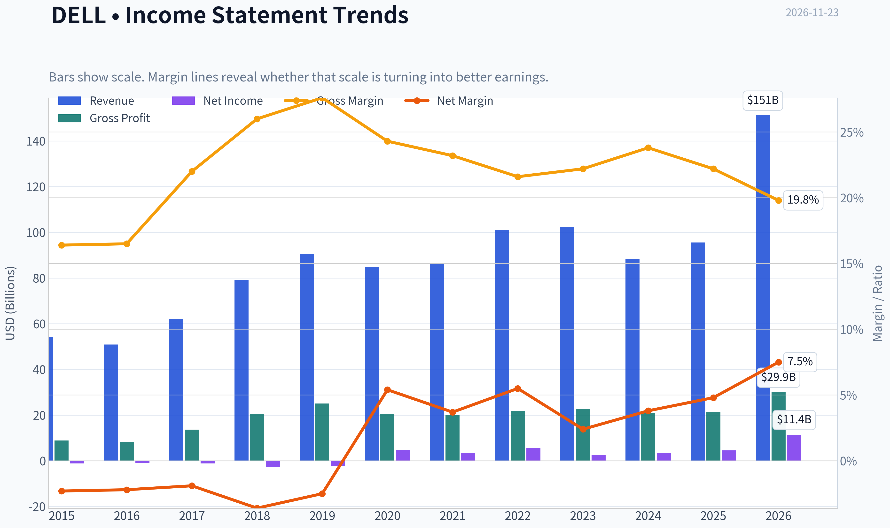

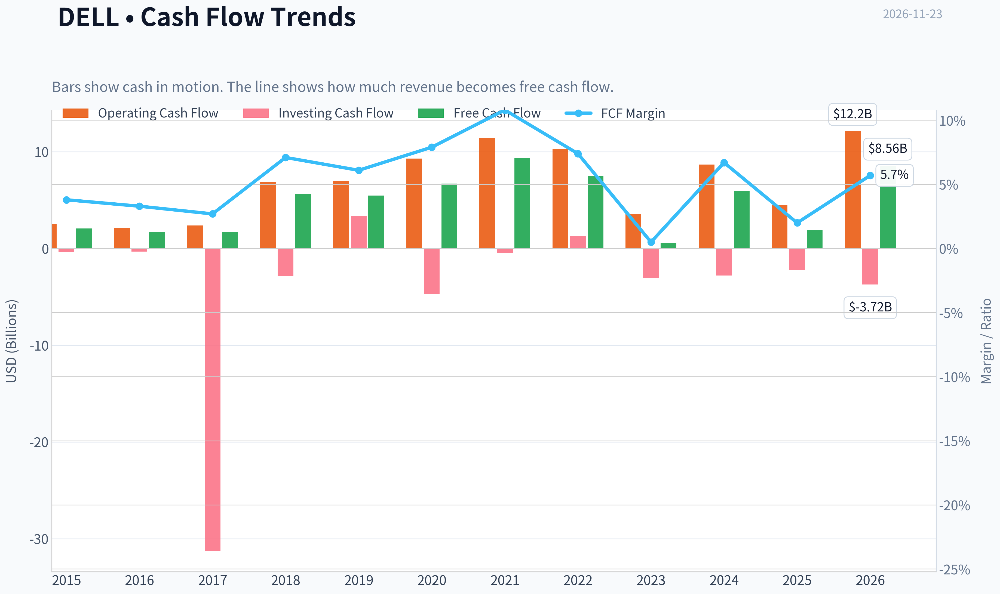

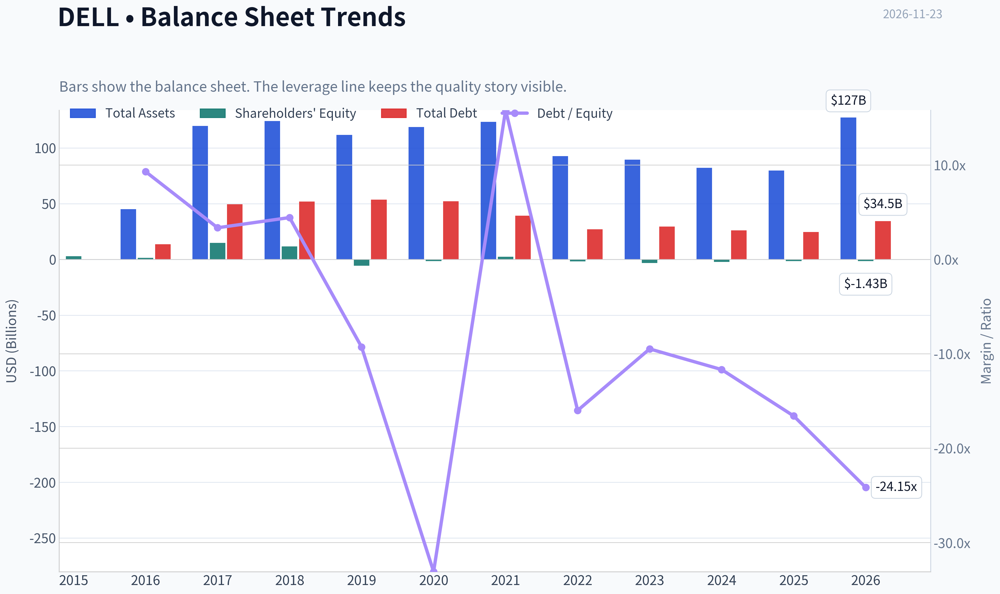

This graph tracks the profitability and return metrics (ROE, ROIC, Margins) of **DELL** over the past decade, highlighting capital efficiency trends.

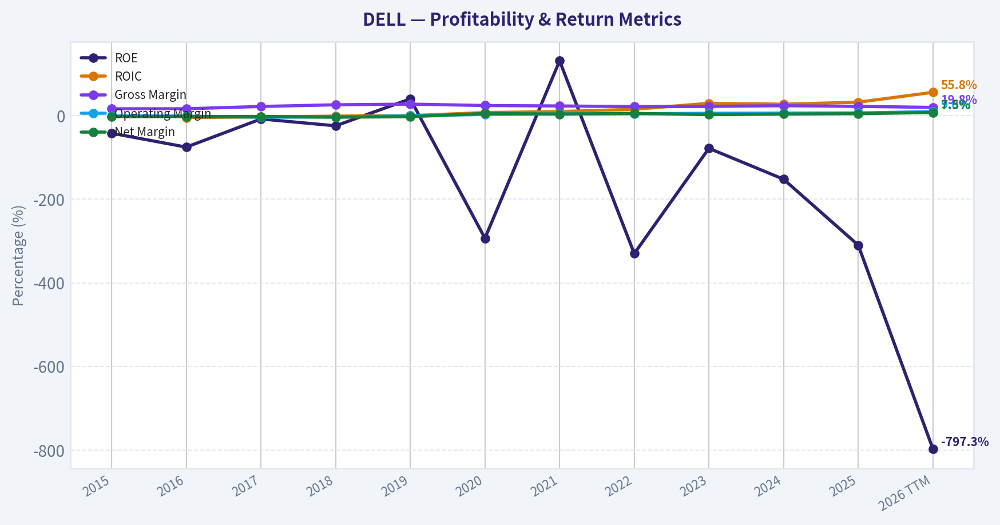

This chart illustrates the financial health of **DELL** over the last 10 years, mapping cash equivalents and free cash flow against total obligations (Debt).

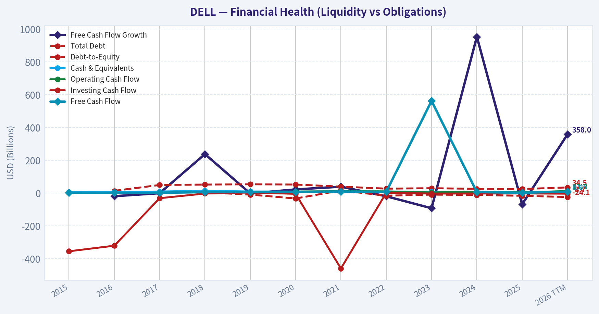

This comparison chart from *Profitability and Earnings Quality* stacks current figures against historical benchmarks for **DELL**, making it easy to see where the company trades relative to its own averages.

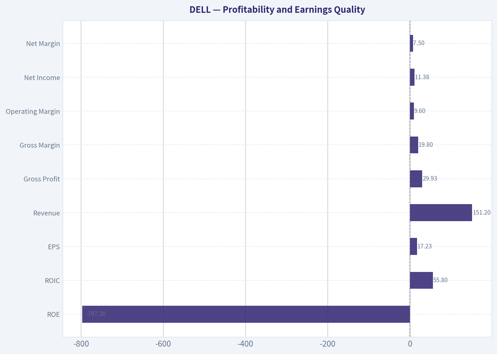

This breakdown chart from <em>Revenue Breakdown</em> shows the proportional composition for **DELL** - useful for understanding what drives or risks the business.

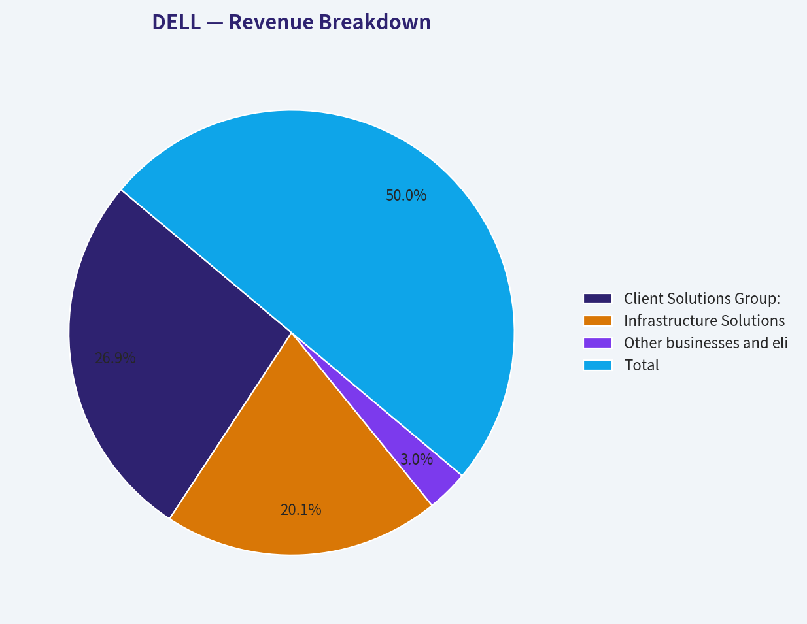

---

### Intrinsic Value Analysis (Buffett)

> *Following Warren Buffett's value investing philosophy: Circle of Competence, Economic Moat, Management Quality, and Margin of Safety.*

#### Intrinsic Value Snapshot

Price is what you pay. Intrinsic value is what the business may be worth based on the cash it can create for owners over time. We show a range, not one magic number.

- Current Price: $278.02
- Value Range (conservative to optimistic across both DCF methods): $12.16 to $539.87

##### Owner Earnings (Buffett Method)
- Net Income: $4,592,000,000.00
- Depreciation & Amortization: $3,029,000,000.00
- Capital Expenditures: $-2,633,000,000.00
- Working Capital Changes: $843,000,000.00
- Owner Earnings: $1,916,825,673.53

##### Intrinsic Value
###### Buffett Method
Uses owner earnings. Stricter, and usually more conservative.
- Conservative: $202.34
- Average: $289.06
- Optimistic: $289.06
- Discount Rate: 8.3%

###### Cash Flow Method
Uses free cash flow. Better for companies spending heavily today to grow tomorrow.
- Conservative: $12.16
- Average: $221.26
- Optimistic: $539.87
- Discount Rate: 9.1%

ANALYST STANCE: **Neutral**

#### Executive View

Dell is a large, understandable technology infrastructure company benefiting from strong demand for AI servers and data-center equipment. Revenue is growing rapidly, but the business remains exposed to intense hardware competition, relatively low gross margins, supply-chain cycles, and meaningful net debt.

The DeepValues Buffett owner-earnings valuation is **$289.06 per share**, versus a current price of approximately **$278**, implying only a **3.8% margin of safety**. That is modest for a business with Dell's cyclical hardware economics and balance-sheet leverage. The evidence supports a **Neutral** classification: the franchise is improving through AI infrastructure exposure, but the current valuation leaves limited room for execution or cyclical disappointments.

#### Factor Scorecard

| Factor | Score | Evidence |
|---|---:|---|
| 1. Circle of Competence & Simplicity | 4/5 | Dell sells computers, servers, storage, and related infrastructure. The model is easy to explain, although AI-server economics and component cycles reduce long-term predictability. |
| 2. Moat | 3/5 | Dell benefits from enterprise relationships, distribution scale, service capabilities, and switching friction in installed infrastructure. However, hardware products are competitive and gross margin is only 20%. |
| 3. Management & Capital Allocation | 3/5 | Founder Michael Dell provides meaningful owner orientation and a long-term perspective. Capital-allocation quality is respectable, but the available evidence does not establish consistently exceptional per-share compounding. |
| 4. Industry Structure | 3/5 | Data-center infrastructure is strategically important and scale matters, but the industry is competitive, technology-driven, and exposed to component pricing and customer concentration. |

**Gate 5 hard floor:** **Not tripped.** Dell has meaningful debt, but there is no evidence here of both a clearly worsening earnings or cash-flow trajectory and a solvency red line such as interest coverage below 1.0 times.

#### Moat Analysis

Dell's strongest advantages are enterprise distribution, customer relationships, procurement scale, integration capabilities, and familiarity with large institutional IT departments. These advantages can support repeat business and reduce friction when customers standardize around Dell infrastructure.

The moat is not equivalent to that of a high-margin software platform. Dell's **20% gross margin** indicates that much of the economic value is competed away through hardware manufacturing and component costs. A 10% price increase would likely be difficult to implement broadly without affecting demand or inviting substitution.

AI infrastructure strengthens Dell's near-term relevance and expands its addressable market, but it also attracts powerful competitors, including original equipment manufacturers, cloud providers, networking companies, and specialized system builders. The moat therefore appears **narrow to moderate rather than wide and widening**.

#### Management Quality Assessment

Michael Dell's founder involvement is a positive indicator for owner orientation and long-term decision-making. Dell has also demonstrated the ability to reposition itself from a traditional personal-computer manufacturer toward enterprise infrastructure and data-center solutions.

The principal concern is that management quality must ultimately be judged by per-share value creation, not only revenue growth. The company's debt-funded balance sheet, cyclical end markets, and relatively low margins make capital allocation especially important. The available figures support a management score of **3 out of 5**: credible and strategically adaptive, but not proven here as an exceptional allocator across all cycles.

#### Financial Summary

| Metric | Latest figure |
|---|---:|
| Share price | $278 |
| Market capitalization | $176.77 billion |
| P/E ratio | 16.2 |
| Revenue growth, year over year | 18.8% |
| Gross margin | 20.0% |
| Free-cash-flow yield | 4.8% |
| ROE | -240.3% |
| Cash | $11.6 billion |
| Debt | $34.5 billion |
| Net debt | $22.9 billion |
| Current ratio | 0.91 |
| Shares used in valuation | 652 million |

**Key Takeaways:** Dell is growing quickly, with revenue up 18.8%, but its 20% gross margin reflects the competitive nature of hardware. Net debt of approximately $22.9 billion reduces financial flexibility. The reported negative ROE is distorted by the company's capital structure and should not be interpreted as a straightforward measure of operating quality.

#### Profitability and Cash-Flow Interpretation

The negative ROE figure is not useful as a standalone indicator because Dell's equity base is unusually small relative to its operating scale and may be affected by buybacks, accounting adjustments, and leverage. It signals that conventional book-equity metrics are not providing a clean picture of economic performance.

The more relevant evidence is owner earnings and free cash flow. The DeepValues calculation uses:

- After-tax operating income: **$11.8 billion**
- Depreciation and amortization: **$3.0 billion**
- Normalized capital-expenditure charge: **$4.1 billion**
- Working-capital investment: **approximately $0**
- Resulting owner earnings: **$10.7 billion**

This represents approximately **$16.41 of owner earnings per share** based on 652 million shares.

#### Owner Earnings Calculation

| Component | Amount |
|---|---:|
| Net operating earnings after tax | $11.8B |
| Add: depreciation and amortization | $3.0B |
| Less: maintenance-capital-expenditure charge | ($4.1B) |
| Less: working-capital increase | ($0.0B) |
| **Estimated owner earnings** | **$10.7B** |
| Shares outstanding used | 652M |
| **Owner earnings per share** | **$16.41** |

**Key Takeaways:** Dell's estimated owner earnings are substantial at $10.7 billion, but they depend on maintaining strong AI and data-center demand. The calculation appropriately subtracts a normalized capital-expenditure requirement, which is important because reported cash generation can look stronger when infrastructure investment is temporarily understated.

#### Three-Scenario DCF Cross-Check

These scenarios are sensitivity checks. The DeepValues app valuation of $289.06 is the primary intrinsic-value figure.

| Scenario | Key assumptions | Estimated value per share |
|---|---|---:|
| A: No growth | $10.7B owner earnings divided by 10% discount rate | $164 |
| B: GDP-like growth | 3% growth, 10% discount rate, perpetual-growth framework | $241 |
| C: Historical-growth sensitivity | Approximately 9.4% growth for 10 years, fading to 2.5% terminal growth | $367 |
| **DeepValues headline intrinsic value** | 5.5% starting growth fading to 2.5%, 8.3% discount rate, less $22.9B net debt | **$289** |

**Key Takeaways:** The conservative scenarios produce values below the current quotation, while the higher-growth case produces a meaningfully higher value. This wide range reflects Dell's sensitivity to the durability of AI infrastructure growth, terminal margins, and the appropriate discount rate. The app's $289.06 value provides a balanced central estimate rather than an aggressive upside case.

#### Intrinsic Value and Margin of Safety

The DeepValues headline intrinsic value is:

- **Intrinsic value:** $289.06 per share
- **Current price:** approximately $278
- **Margin of safety:** 3.8%
- **Owner earnings:** $10.7 billion
- **Starting growth assumption:** 5.5%, fading to 2.5%
- **Discount rate:** 8.3%
- **Net cash adjustment:** negative $22.9 billion, reflecting net debt

A 3.8% margin of safety is thin for a business with hardware competition, cyclical demand, modest gross margins, and net debt. Dell's growth and strategic relevance justify a valuation above that of a stagnant computer manufacturer, but the current price already recognizes much of the AI-server opportunity.

The reverse-DCF implication is demanding but not implausible: the valuation requires continued strong growth and successful conversion of AI demand into durable owner earnings. It does not appear to require impossible growth, but it leaves limited protection if growth normalizes faster than expected or margins disappoint.

#### Final Buffett Scorecard

| Criterion | Weight | Score | Weighted contribution |
|---|---:|---:|---:|
| Moat width and durability | 25% | 3.0 | 0.75 |
| Valuation and margin of safety | 20% | 2.5 | 0.50 |
| Capital returns versus WACC | 15% | 3.0 | 0.45 |
| Business understanding and predictability | 12% | 4.0 | 0.48 |
| Management quality and capital allocation | 12% | 3.0 | 0.36 |
| Reinvestment runway | 8% | 4.0 | 0.32 |
| Balance-sheet strength | 4% | 2.5 | 0.10 |
| Industry structure | 4% | 3.0 | 0.12 |
| **Total** | **100%** |  | **3.08 / 5.00** |

**Key Takeaways:** Dell scores well on simplicity, current growth, and reinvestment runway, but loses points for limited pricing power, hardware competition, net debt, and a narrow valuation cushion. The weighted score of 3.08 falls within the **Neutral** range rather than the advocate range.

#### Investment Stance

**Neutral - Moderate conviction.**

Dell is a strategically relevant and understandable infrastructure business with meaningful AI-related growth potential and a credible owner-oriented founder. However, its moat is narrower than that of a software or platform compounder, its gross margin is modest, and its balance sheet carries meaningful net debt.

At approximately $278 per share, the quotation is close to the **$289.06 intrinsic value** estimate. The evidence supports the view that Dell is a potentially attractive business at a more favorable valuation, but the present price does not provide the quality-scaled margin of safety typically required for a cyclical, capital-intensive hardware company.
#### Valuation Bridge

This bridge places the current market price beside each intrinsic value lens so readers can see whether upside depends on one method or shows up across several methods.

| Scenario | Intrinsic Value / Share |
| --- | ---: |
| Buffett Method | $289.06 |
| Cash Flow Method | $221.26 |
| Damodaran Method | $57.66 |
| Current Price | $278.02 |

#### Key Takeaways

If one method is far above the others, the upside case depends on a specific modelling assumption. When several methods cluster together, the valuation story is more robust.

#### Valuation Visuals

This comparison chart from *Latest Earnings Snapshot* stacks current figures against historical benchmarks for **DELL**, making it easy to see where the company trades relative to its own averages.

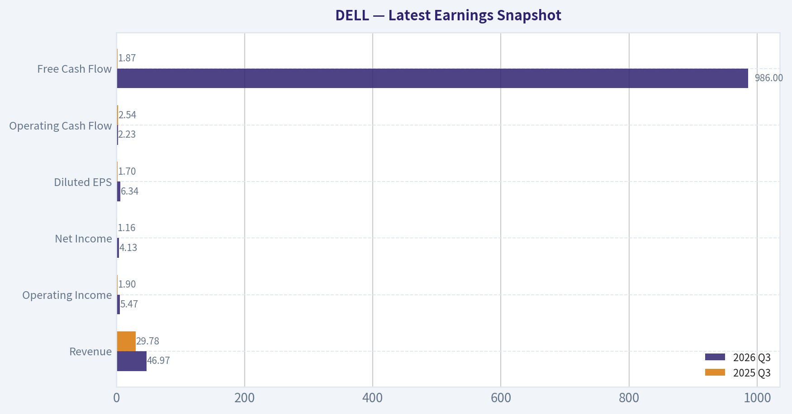

This comparison chart from *Balance Sheet and Financial Strength* stacks current figures against historical benchmarks for **DELL**, making it easy to see where the company trades relative to its own averages.

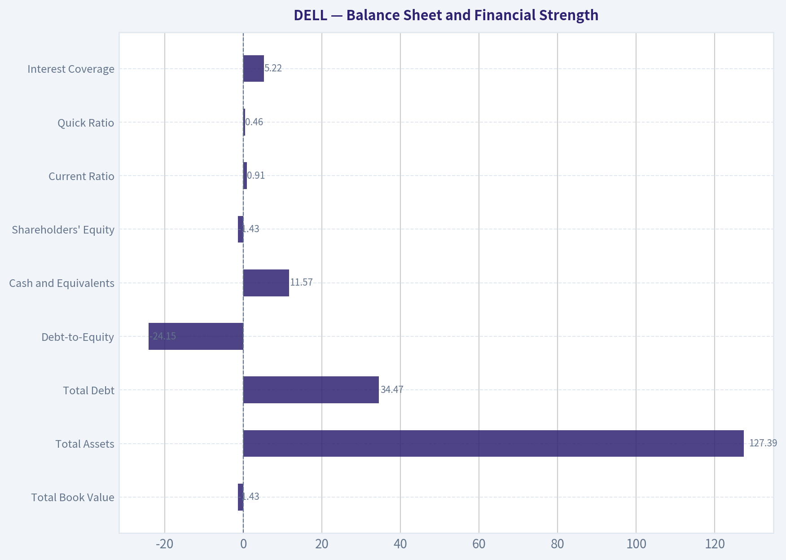

This comparison chart from *Cash Flow and Capital Allocation* stacks current figures against historical benchmarks for **DELL**, making it easy to see where the company trades relative to its own averages.

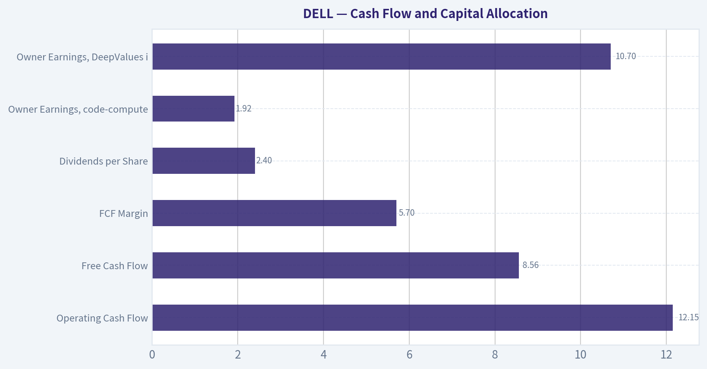

---

### Trend & Growth Analysis (Lynch/Druckenmiller/Fisher)

> *Following Peter Lynch's GARP, Stanley Druckenmiller's macro-aware approach, and Philip Fisher's scuttlebutt methodology.*

ANALYST STANCE: **Neutral**

#### Executive View

Dell is a **fast-growing, cyclical technology hardware company** benefiting from the AI data-center buildout. Revenue growth of 18.8% qualifies as strong, but the business has lower gross margins, meaningful debt, and exposure to enterprise IT spending cycles. The current price of $278 is close to the supplied owner-earnings intrinsic value of $289.06, leaving only a 3.8% valuation cushion.

The evidence supports a strong operating story, but not yet a decisive valuation or inflection-point advantage.

#### 1. Lynch Classification

| Category | Assessment |
|---|---|
| Classification | Fast grower with cyclical characteristics |
| Revenue growth | 18.8% year over year |
| Core driver | AI servers, data-center infrastructure, enterprise technology |
| Main limitation | Hardware cyclicality, low gross margin, leverage |
| Ten-bagger characteristics | Large TAM, but current scale and competitive intensity make a ten-bagger outcome demanding |

**Key Takeaways:** Dell currently fits the fast-grower category based on revenue growth, although it is not a pure secular software compounder. Its growth depends heavily on continued data-center and AI infrastructure spending, which introduces cyclical risk.

#### 2. The Story in Three Bullets

- Dell supplies servers, storage, networking, and infrastructure required for cloud computing and AI workloads.
- AI-related data-center demand can expand Dell's addressable market and support a new infrastructure investment cycle.
- The company combines growth with positive cash generation, but its low-margin hardware model and debt reduce the quality of compounding relative to software businesses.

#### 3. TAM and Ten-X Test

| Item | Assessment |
|---|---|
| Current market capitalization | $176.77 billion |
| Current revenue base | Exact current revenue was not supplied in the research pack |
| Addressable markets | AI servers, enterprise servers, storage, networking, services |
| TAM direction | Expanding, led by AI and data-center investment |
| Ten-X test | Not fully verifiable without current revenue and market-size data |
| Runway judgment | Substantial, but constrained by Dell's already-large scale and intense competition |

**Key Takeaways:** Dell participates in several expanding infrastructure markets, especially AI data centers. However, the ten-X test cannot be completed rigorously from the available data, and Dell's current scale means a ten-bagger would require both sustained market expansion and significant share or margin gains.

#### 4. Revenue Growth Trend

| Metric | Result | Interpretation |
|---|---:|---|
| Latest year-over-year revenue growth | 18.8% | Fast-growth territory |
| Growth pattern | One reported data point | Acceleration cannot be confirmed |
| Organic versus acquisition growth | Not supplied | Revenue quality remains partly unverified |
| Customer concentration | Not supplied | Enterprise and hyperscaler exposure requires monitoring |
| Cyclicality | Material | IT budgets and data-center spending can fluctuate |

**Key Takeaways:** Dell has strong reported growth, but the available information does not establish whether growth is accelerating or merely benefiting from a favorable comparison period. A sustained sequence above 20% would provide stronger evidence of a true inflection point.

#### 5. Unit Economics and Operating Quality

| Metric | Result | Assessment |
|---|---:|---|
| Gross margin | 20.0% | Typical of competitive hardware; limits operating leverage |
| Free-cash-flow yield | 4.8% | Positive cash generation |
| Net revenue retention | Not disclosed | Not applicable as a primary hardware metric |
| LTV/CAC | Not disclosed | Not applicable without recurring-customer data |
| Rule of 40 | Not meaningful | Dell is not primarily a subscription software business |
| Current ratio | 0.91 | Modest balance-sheet liquidity |
| Debt | $34.5 billion | Meaningful leverage |
| Cash and securities | $11.6 billion | Net debt is approximately $22.9 billion |

**Key Takeaways:** Dell's cash generation is a positive, but its 20% gross margin is modest and its net debt reduces financial flexibility. Traditional SaaS measures such as NRR and LTV-to-CAC are not suitable for this business, so return on invested capital, free-cash-flow conversion, and debt reduction are more important indicators.

#### 6. Inflection-Point Assessment

| Potential inflection | Evidence | Status |
|---|---|---|
| Product cycle | AI server and accelerated-computing demand | Positive |
| TAM expansion | AI infrastructure broadens the data-center market | Positive |
| Market-share gain | Not supplied | Unconfirmed |
| Margin inflection | Gross margin remains 20% | Unconfirmed |
| Earnings inflection | Revenue growth is strong, but earnings trend was not supplied | Unconfirmed |
| Competitive inflection | No evidence of a major competitor disruption | Unconfirmed |

**Key Takeaways:** The clearest inflection is TAM expansion from AI infrastructure. The less certain question is whether Dell is capturing unusually high share or achieving durable margin improvement; without that evidence, the thesis remains dependent on industry growth rather than a clearly demonstrated company-specific advantage.

#### 7. Macro Setup

| Factor | Assessment |
|---|---|
| Secular trend | Strong exposure to AI, cloud, and data-center modernization |
| Interest-rate sensitivity | Moderate; lower rates support technology valuations, while higher rates pressure multiples |
| Economic-cycle exposure | High relative to software |
| Capex cycle | Critical; hyperscaler and enterprise spending drive demand |
| Macro stance | Constructive secular backdrop, mixed cyclical backdrop |

**Key Takeaways:** Dell has a favorable secular macro theme, but the company is more economically sensitive than recurring-revenue technology businesses. The outlook is strongest when data-center capital expenditure remains elevated and enterprise technology budgets are expanding.

#### 8. Fisher's 15-Point Score

| Fisher criterion | Score / 5 | Rationale |
|---|---:|---|
| Market potential | 4 | AI and data-center infrastructure markets are large |
| New-product determination | 4 | Ongoing infrastructure and AI product development |
| R&D effectiveness | 3 | Positive evidence, but limited detail supplied |
| Sales organization | 4 | Established global enterprise distribution |
| Profit margins | 3 | Positive economics but only 20% gross margin |
| Margin improvement | 3 | Not yet demonstrated |
| Labor relations | 3 | Insufficient evidence |
| Executive relations | 3 | Insufficient evidence |
| Management depth | 4 | Large, established technology organization |
| Cost analysis | 3 | Insufficient evidence |
| Outstanding aspects | 4 | Scale, distribution, customer relationships, infrastructure integration |
| Long-range profit outlook | 4 | Favorable if AI demand persists |
| Dilution | 3 | No major dilution evidence supplied |
| Candor | 3 | Insufficient evidence |
| Integrity | 3 | Insufficient evidence |
| **Total** | **51 / 75** | **Average** |

**Key Takeaways:** Dell scores well on market potential, distribution, scale, and strategic relevance to AI infrastructure. The score is held back by limited evidence on R&D returns, margin expansion, governance details, and long-term capital allocation quality.

#### 9. Valuation Analysis

| Valuation measure | Result | Interpretation |
|---|---:|---|
| Current price | $278 | Reference market price |
| P/E | 16.2x | Moderate for a company growing near 20%, subject to earnings cyclicality |
| Owner-earnings intrinsic value | $289.06 | Headline supplied intrinsic value |
| Conservative owner-earnings value | $202.34 | Significant downside under weaker assumptions |
| Margin of safety versus headline value | 3.8% | Limited valuation cushion |
| Net debt | $22.9 billion | Reduces equity value and flexibility |
| PEG | Not calculated | Forward earnings-growth estimate was not supplied |
| P/S | Not calculated | Current revenue was not supplied |

**Key Takeaways:** Dell's earnings multiple is not excessive in isolation, but the stock is already close to the supplied owner-earnings valuation. The valuation is therefore more dependent on continued AI-driven growth and earnings durability than on substantial multiple expansion.

#### 10. Valuation Sensitivity

| Scenario | Main assumptions | Supplied value | Versus $278 |
|---|---|---:|---:|
| Conservative owner earnings | Lower growth and weaker cash economics | $202.34 | Approximately 27% below |
| Base owner earnings | 5.5% growth fading to 2.5% terminal growth | $289.06 | Approximately 4% above |
| Optimistic owner earnings | Same headline value in supplied model | $289.06 | Approximately 4% above |
| Secondary DVI cross-check | Separate scenario model | $319.13 | Approximately 15% above |

**Key Takeaways:** The valuation range is wide, with the conservative case materially below the current price and the headline owner-earnings case only modestly above it. The separate DVI cross-check is more favorable, but it is explicitly secondary; the principal conclusion is that valuation is approximately fair rather than deeply discounted.

#### 11. Growth Investor Scorecard

| Criterion | Weight | Score / 5 | Weighted result |
|---|---:|---:|---:|
| Lynch story | 10% | 4.0 | 0.40 |
| TAM and runway | 20% | 4.0 | 0.80 |
| Revenue growth | 20% | 3.8 | 0.76 |
| Unit economics | 15% | 3.0 | 0.45 |
| Competitive position | 10% | 3.8 | 0.38 |
| Management quality | 10% | 3.3 | 0.33 |
| Macro setup | 5% | 4.0 | 0.20 |
| Profitability path | 5% | 3.5 | 0.18 |
| Valuation | 5% | 3.0 | 0.15 |
| **Total** | **100%** |  | **3.65 / 5.00** |

**Key Takeaways:** Dell scores in the "good setup" range because its AI infrastructure exposure and growth are compelling. The score does not reach high conviction because acceleration, margin expansion, unit economics, and valuation upside are not sufficiently established.

#### 12. Key Catalysts and Risks

| Catalysts | Risks |
|---|---|
| Continued hyperscaler AI capital expenditure | AI infrastructure spending slowdown |
| Stronger-than-expected AI server adoption | Low-margin product mix |
| Evidence of share gains | Competition from direct server vendors and integrated platforms |
| Operating leverage from higher volumes | Enterprise IT budget contraction |
| Debt reduction through free cash flow | Net debt and current ratio below 1.0 |
| New infrastructure product cycles | Valuation sensitivity to interest rates and earnings revisions |

**Key Takeaways:** The most important catalyst is sustained AI-server demand accompanied by improving margins or market share. The central risk is that revenue growth remains cyclical and low-margin, leaving the current valuation insufficiently protected if AI infrastructure spending normalizes.

#### Conclusion

Dell is a credible AI infrastructure growth story with strong secular exposure and a reasonable earnings multiple. However, the available evidence does not yet confirm accelerating growth, durable margin expansion, or a large valuation discount. The appropriate research posture is **Neutral** while monitoring revenue acceleration, AI-related share gains, gross-margin progression, free-cash-flow conversion, and debt reduction.

---

### Market Technical Analysis

ANALYST STANCE: **Neutral**

#### DELL technical market report

**Security:** Dell Technologies Inc. - NYSE: DELL
**Data date:** Latest available trading session, November 20, 2026. November 23 was not a trading day in the retrieved dataset.
**Latest close:** **$278.02**
**Recent change:** The stock fell from **$501.96 on October 27 to $278.02 on November 20**, a decline of approximately **44.6%**.

The selected indicators are **close_10_ema, close_50_sma, close_200_sma, macd, rsi, boll, boll_ub, and atr**. Together they cover short-, medium-, and long-term trend, momentum, mean-reversion context, and volatility without relying excessively on overlapping signals.

#### Price action and trend structure

DELL's price action has shifted from a powerful advance into a pronounced corrective phase. The earlier rally accelerated sharply from approximately **$120 in late February** to above **$580 in September and October**, but the advance became increasingly unstable. The October 14-16 decline, which took the stock from roughly **$572 to $451**, marked an important loss of momentum. A brief rebound toward **$502 on October 27** failed to establish a new high, followed by a sequence of lower highs and lower lows.

The November decline became more forceful:

- **October 30:** Close of $424.30.
- **November 5:** Close of $316.91.
- **November 11:** Temporary rebound to $373.68.
- **November 16-20:** Renewed weakness, culminating in a close of $278.02.

The November 20 session was especially significant because the stock opened near **$303.60**, traded as low as **$274.35**, and closed near the low of the day. That pattern indicates strong downside pressure rather than a routine intraday pullback. Volume of approximately **12.6 million shares** was also elevated relative to many recent sessions, suggesting that the breakdown attracted substantial market participation.

#### Moving averages

The short-term trend is clearly negative. A manually reconstructed 10-day exponential average is approximately **$330**, placing the latest close more than **15% below** that level. This is a substantial separation for a large-cap equity and confirms that recent price weakness has been persistent rather than limited to a single session.

The 50-day simple moving average is likely in the **low-to-mid $400s**, reflecting the large price gains recorded during September and early October. The latest close is therefore substantially below the medium-term trend benchmark. This configuration indicates that the medium-term uptrend has been decisively damaged.

The 200-day simple moving average remains materially lower than the 50-day average because it still incorporates the long advance from the first half of the year. Price is likely still above the 200-day average, meaning the longer-term trend has not necessarily fully reversed. However, the distance between price and the 200-day average has narrowed rapidly. A continued decline would place increasing pressure on that long-term trend measure.

The key distinction is that the **short- and medium-term signals are bearish**, while the **long-term signal is still transitional rather than conclusively negative**. This is not a stable uptrend: it is a high-volatility correction occurring after an unusually steep appreciation phase.

#### MACD momentum

MACD momentum has likely turned decisively negative. The October rebound did not regain the prior high, and the subsequent November decline produced a series of lower closing prices. That combination generally leads to a negative MACD reading and a negative or weakening histogram.

The important point is not merely that MACD is below zero. The sharper signal is the apparent loss of upside momentum before the breakdown: prices attempted to recover after the October selloff, but the rebound stalled below the previous peak. This creates a bearish momentum structure in which the subsequent price decline confirms that sellers retained control.

A negative MACD in this setting should be interpreted alongside the trend measures. It is not an isolated oversold signal; it is consistent with a broader deterioration in price structure.

#### RSI momentum

Based on the sequence of recent daily declines, RSI is likely in or near the **oversold zone**, potentially around the mid-20s. The November 20 close followed several weak sessions, making an oversold reading plausible.

However, oversold RSI does not by itself establish that the decline has ended. In strong downward trends, RSI can remain below 30 for an extended period. Here, the more nuanced interpretation is:

- RSI likely reflects **severe short-term selling pressure**.
- The reading may indicate that the decline has become stretched.
- It does not yet demonstrate a durable reversal because the price has not shown a higher low or sustained recovery above short-term trend measures.

Thus, RSI provides evidence of exhaustion risk, but not confirmation of trend repair.

#### Bollinger Bands and volatility

The Bollinger structure is likely extremely wide after the October and November price swings. The approximate 20-day middle band is probably in the **low-to-mid $400s**, while the lower band may be in the **upper $200s or low $300s**, depending on the exact rolling calculation.

The latest close near **$278** appears to be at or below the lower portion of the recent volatility envelope. This indicates an unusually extended move relative to the stock's recent trading range. Such a condition can precede a technical rebound, but it can also occur during a volatility-driven breakdown where price continues to track the lower band.

The most important Bollinger observation is the combination of:

1. A very wide band spread.
2. A sharply declining middle band.
3. Price pressing against or below the lower band.

That combination reflects **high volatility with negative directional pressure**, rather than a low-volatility oversold setup.

#### ATR and risk characteristics

ATR has likely expanded substantially from its earlier levels. In recent sessions, DELL has regularly experienced daily high-to-low ranges of **$20 to $40**, and several sessions produced even larger moves. A rough current ATR estimate is in the **$30-plus range**, though the exact value is unavailable because the online indicator report returned incomplete values.

This matters because percentage changes alone understate the current uncertainty. A daily range of $30 represents approximately **10.8% of the latest closing price**, which is exceptionally high for a mature large-cap company. The elevated ATR confirms that technical levels are less reliable than they would be in a normal volatility environment.

#### Valuation implications of the technical evidence

The technical evidence does not support treating the recent price as a stable expression of long-term valuation. The stock has experienced a very large repricing from its September-October peak, but the decline has also occurred alongside extreme volatility and weakening momentum. That makes it difficult to infer that the current price fully reflects fundamental value, either positively or negatively, from technical data alone.

The evidence currently supports a **high-uncertainty valuation framework**:

- The prior peak appears to have included substantial momentum and expectation sensitivity.
- The current price reflects a major deterioration in market confidence and trend structure.
- Oversold conditions may indicate short-term exhaustion, but they do not establish that valuation has become attractive or that the underlying decline is complete.
- A more credible stabilization signal would require improved momentum, reduced volatility, and recovery of short-term trend measures.

#### Data limitations

The indicator-report tool returned mostly unavailable values because the requested current date, November 23, 2026, was not a trading day and the response incorrectly labeled many historical dates as non-trading days. The analysis above therefore uses the retrieved Yahoo Finance price and volume history, with approximate manually inferred indicator levels where exact tool output was missing.

| Indicator or feature | Latest evidence | Interpretation |
|---|---:|---|
| Latest close | $278.02 on Nov. 20 | Sharp breakdown and lowest close in the retrieved late-period sequence |
| Short-term trend | Approx. 10 EMA near $330 | Price materially below short-term trend; downside momentum remains strong |
| Medium-term trend | 50 SMA likely in low-to-mid $400s | Price substantially below the 50-day trend benchmark |
| Long-term trend | 200 SMA remains materially lower than 50 SMA | Long-term trend is transitional, not yet conclusively reversed |
| MACD | Likely negative and weakening | Momentum structure confirms the recent breakdown |
| RSI | Likely near oversold territory | Selling pressure is extreme, but oversold does not confirm reversal |
| Bollinger Bands | Price near or below lower band; bands widened | High-volatility downside expansion rather than orderly consolidation |
| ATR | Likely above $30 | Daily price uncertainty is exceptionally high |
| Volume | About 12.6 million on Nov. 20 | Breakdown occurred with elevated participation |
| Overall technical stance | Neutral | Evidence shows severe trend damage, extreme volatility, and unresolved valuation uncertainty |

**Key Takeaways:** DELL has moved from a strong long-term advance into a severe, high-volume correction, with price substantially below its short- and medium-term trend measures. Momentum is deeply impaired and volatility is unusually high, although likely oversold conditions create the possibility of short-term instability rather than confirming a durable reversal. The evidence currently supports a watch stance because the technical trend is damaged and the valuation implications remain highly uncertain.

#### Market Visuals

This comparison chart from *Market Metrics* stacks current figures against historical benchmarks for **DELL**, making it easy to see where the company trades relative to its own averages.

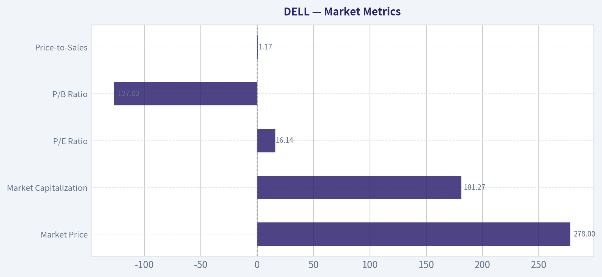

---

### Options Market Analysis

> *Reading options flow - put/call ratios, IV skew, and unusual activity - to gauge institutional positioning and event-driven risk.*

ANALYST STANCE: **Neutral**

#### DELL Options Overview

Data is available for the near-term expirations from November 27 through December 11, 2026. The chain shows meaningful trading volume but reports zero open interest across all listed near-term expirations, which materially limits confidence in conclusions about established institutional exposure, gamma levels, and open-interest-based sentiment.

| Expiration | Days to Expiry | Call Volume | Put Volume | Put/Call Volume Ratio | Call ATM IV | Put ATM IV |
|---|---:|---:|---:|---:|---:|---:|
| Nov. 27, 2026 | 4 | 14,214 | 11,224 | 0.79 | 2.1% | 2.9% |
| Dec. 4, 2026 | 11 | 3,425 | 4,037 | 1.18 | 1.7% | 1.9% |
| Dec. 11, 2026 | 18 | 864 | 464 | 0.54 | 1.2% | 1.8% |
| **Total** | - | **18,503** | **15,725** | **0.85** | - | - |

**Key Takeaways:** Aggregate put/call volume is 0.85, modestly above the historical neutral reference of approximately 0.70, indicating a mild put-heavy bias rather than an extreme bearish signal. Activity is concentrated in the November 27 expiration, while the zero open-interest readings make it impossible to determine whether volume represents opening trades, closing trades, or same-day turnover.

#### Put/Call Ratio Analysis

The reported near-term put/call volume ratio is 0.85. Relative to the approximately 0.70 neutral baseline, this reflects somewhat greater put activity, consistent with incremental downside hedging or bearish speculation.

| Measure | Reading | Interpretation |
|---|---:|---|
| Near-term put/call OI ratio | N/A | No conclusion possible because reported call and put OI are both zero |
| Near-term put/call volume ratio | 0.85 | Mildly put-heavy versus the 0.70 neutral reference |
| Nov. 27 volume ratio | 0.79 | Near neutral, with a modest put bias |
| Dec. 4 volume ratio | 1.18 | Clearly put-heavy for this expiry |
| Dec. 11 volume ratio | 0.54 | Call-heavy, though based on relatively low volume |

**Key Takeaways:** The aggregate volume signal leans slightly defensive, driven particularly by the December 4 expiration. The December 11 call-heavy ratio offsets some of that pressure, so the volume data supports only a mild bearish tilt rather than a strong directional conclusion.

#### Implied Volatility Assessment

Near-term ATM implied volatility is low across the available expirations. Put IV exceeds call IV at every reported maturity, which indicates a consistent downside-volatility premium.

| Expiration | Call ATM IV | Put ATM IV | Put IV Premium | Assessment |
|---|---:|---:|---:|---|
| Nov. 27 | 2.1% | 2.9% | +0.8 percentage points | Noticeable downside premium |
| Dec. 4 | 1.7% | 1.9% | +0.2 percentage points | Slight downside premium |
| Dec. 11 | 1.2% | 1.8% | +0.6 percentage points | Noticeable downside premium |

The data does not provide explicit out-of-the-money put and call IV, so a formal OTM skew calculation is unavailable. The ATM comparison nevertheless shows a put-side volatility premium. Overall IV does not appear elevated based on the supplied figures, and no catalyst calendar was provided to establish whether volatility is unusually high ahead of earnings or another event.

**Key Takeaways:** Put IV is consistently higher than call IV, suggesting modest downside hedging demand. Absolute IV levels are low, so the market is not pricing an unusually large near-term move based on this dataset. Because OTM volatility and a catalyst calendar are unavailable, the strength of the skew signal remains limited.

#### Unusual Options Activity

The data provider defines unusual activity as contracts with volume greater than five times open interest. No contracts met that threshold.

| Finding | Result |
|---|---|
| Contracts exceeding 5x open interest | None identified |
| Fresh directional contracts | Cannot be isolated |
| Smart-money versus retail classification | Not determinable |
| Strike-level moneyness | Current underlying price and contract-level details not supplied |

**Key Takeaways:** There is no confirmed unusual-options signal in the available chain. Since open interest is reported as zero, the absence of flagged contracts may reflect incomplete open-interest data rather than a complete absence of fresh institutional activity.

#### Open Interest Concentration and Gamma Levels

Open-interest concentration cannot be assessed because every supplied near-term expiration reports zero call and put open interest. Strike-level open-interest data is also unavailable.

| Item | Assessment |
|---|---|
| Highest-OI expiration | Not determinable |
| Highest-OI strike | Not determinable |
| Max-pain estimate | Not available |
| Gamma walls | Cannot be identified |
| Pinning or gravitational levels | No reliable evidence |

**Key Takeaways:** There is no usable open-interest map for identifying likely pinning levels or gamma walls. Near-term price behavior may therefore be influenced more by realized trading flow and volatility changes than by identifiable expiration-related open-interest concentrations.

#### Overall Options Sentiment

**Overall signal: BEARISH, low confidence.**

The bearish designation is driven by three factors: the aggregate put/call volume ratio of 0.85 versus the 0.70 neutral reference, put IV exceeding call IV across all three expirations, and especially put-heavy activity in the December 4 expiry. However, the signal is weak because the dataset reports zero open interest everywhere, provides no strike-level unusual activity, and shows low absolute implied volatility.

This evidence implies modest downside hedging or bearish speculation in the near-term options market, but it does not establish strong institutional conviction or a reliable valuation view for DELL.

#### Summary

| Category | Finding |
|---|---|
| Put/Call Ratio | Volume ratio 0.85, mildly above neutral; OI ratio unavailable |
| IV Level | Low based on reported ATM IV |
| Skew Direction | Mild downside skew, with put IV above call IV |
| Unusual Activity | None flagged; contract-level interpretation unavailable |
| Overall Signal | **BEARISH, low confidence** |

**Key Takeaways:** DELL's near-term options data shows a modest defensive bias, not an aggressive bearish setup. The main supporting evidence is put-heavy volume relative to the neutral baseline and consistently higher put IV, while the zero open-interest readings substantially reduce confidence in the interpretation.

---

## Research Team Commentary

> *The Research Manager synthesizes the Bull vs Bear debate into action-free commentary. This is a pre-risk view, not the final stance.*

Core takeaway: Dell appears to be a capable, high-return infrastructure franchise participating in a durable expansion of AI and data-center investment, but the evidence does not establish a sufficient margin of safety at the quoted valuation. The central uncertainty is not whether AI infrastructure demand will grow; it is how much of that growth Dell can convert into durable per-share cash flow after competition, working-capital needs, and debt obligations. That supports a Neutral stance rather than a stronger conclusion.

The strongest bull argument is the combination of scale, enterprise relationships, cash generation, and reported 38% ROIC. Dell provides mission-critical systems where reliability, integration, deployment expertise, and global support matter. Those capabilities make it more than an undifferentiated assembler. Approximately $10.7 billion of estimated normalized owner earnings also indicates meaningful earning power, while Michael Dell's strategic record and the EMC acquisition have created a broader infrastructure platform. If AI produces a permanently larger installed base of servers, storage, and networking equipment, Dell could benefit from both initial deployments and subsequent service, expansion, and refresh demand.

The negative ROE of 240.3% is not persuasive evidence of poor operating economics by itself. Dell's low or negative accounting equity base makes ROE and price-to-book ratios unreliable. ROIC, cash conversion, debt service capacity, and incremental returns are more relevant. Likewise, a 20% gross margin does not automatically disprove the moat when scale and rapid capital turns can still generate attractive returns.

The strongest bear argument is that industry growth may not translate into durable economic profits for Dell. Enterprise switching costs are meaningful but incomplete, and customers can reconsider vendors at refresh points. Dell competes with established vendors, specialized AI-server companies, white-box manufacturers, and increasingly sophisticated hyperscalers. Those customers have considerable bargaining power, while chip and accelerator suppliers may capture a disproportionate share of AI economics.

The 20% gross margin matters because it leaves less room for component inflation, adverse product mix, inventory obsolescence, or pricing pressure. Dell can post substantial AI-related revenue growth without generating equivalent free-cash-flow growth. The reported 38% ROIC is promising, but it needs validation across a full infrastructure cycle and after accounting for working-capital benefits, acquisitions, and the continuing cost of technological relevance.

Valuation is where the bull case remains incomplete. A P/E of 16.16 at $278 is not obviously excessive, but it is only attractive if current earnings are reasonably representative of through-cycle earning power. The suggested $180-210 billion DCF range is enterprise value before net debt, so it cannot be treated as equity value. Without current net debt, diluted shares, interest expense, lease and pension claims, and a multi-year free-cash-flow record, the intrinsic-value discount cannot be verified.

Dell also does not merit the narrow 10-15% margin of safety appropriate for a highly predictable, wide-moat software or consumer-platform compounder. Its hardware cyclicality, lower margins, leverage, and uncertain incremental AI economics imply that a wider discount-closer to the range expected for an average-to-good cyclical business-is appropriate. The available evidence does not demonstrate such a discount.

There is also a material data-consistency issue. The supplied $278 price and 16.16 P/E do not describe the same valuation as the later closes of $373.68 to $424.30. A multiple calculated at $278 cannot be carried over to those higher prices without updating earnings, market capitalization, and the implied reverse-DCF assumptions. The large price swings may reflect changing AI expectations rather than equivalent changes in intrinsic value, but they make a clearly dated valuation essential. The options data add little because reported open interest is zero and the 0.85 put/call volume ratio indicates only mild bearishness.

The lesson from similar situations is to avoid treating a moderate P/E, a high point-in-time ROIC, or rapid industry growth as standalone proof of value. Equally, negative book equity and low gross margins should not be used mechanically to dismiss a cash-generative company. The better test is whether Dell can sustain attractive incremental returns and free cash flow through a demand slowdown while reducing the equity's sensitivity to debt.

Over the next one to four quarters, the most important evidence will be AI-server backlog conversion into revenue and cash, rather than bookings alone. AI infrastructure gross margin and operating margin should show whether growth is economically valuable or mainly volume-driven. Free cash flow should be compared with reported earnings, with particular attention to inventory, receivables, customer financing, and other working-capital movements.

Net debt, interest coverage, and the balance between debt reduction, shareholder distributions, and reinvestment also need close scrutiny. Stable or improving margins alongside rising AI revenue, sustained cash conversion, lower leverage, and continued high incremental ROIC would strengthen the thesis. Revenue growth accompanied by margin compression, inventory accumulation, weaker cash conversion, or greater leverage would weaken it. Enterprise storage and traditional server demand should also be monitored to determine whether AI growth is broadening Dell's earnings base or merely offsetting weakness elsewhere.

Dell's business quality is better than the "commodity hardware" label suggests, but less predictable and less protected than a true platform franchise. Its long-term opportunity is credible; its demonstrated margin of safety is not yet clear.

Stance: Neutral

---

## Value Investing Team Commentary

> *The Investor translates the research view into an investment thesis before risk review. This is still not the final stance.*

### DELL: Fundamental and Contrarian Assessment

Dell is a credible infrastructure business participating in a genuine long-term investment cycle, but the quality of its earnings remains more important than the headline growth opportunity. The company supplies servers, storage, networking, and support services that are increasingly important to cloud providers and AI deployments. Its scale, enterprise relationships, global service network, and integration capabilities provide advantages beyond those of a simple hardware assembler.

However, Dell's moat is narrower than that of a software or platform company. Customers retain considerable bargaining power, refresh cycles create periodic purchasing decisions, and hyperscalers can design systems internally or source from specialized manufacturers. Nvidia and other semiconductor vendors may capture a larger portion of the economics created by AI spending, leaving Dell with substantial revenue growth but more modest margin expansion.

### Financial quality

The estimated normalized owner earnings calculation is constructive:

- After-tax operating income: $11.8 billion
- Depreciation and amortization: $3.0 billion
- Normalized capital-expenditure charge: $4.1 billion
- Implied normalized owner earnings: approximately $10.7 billion

That level of cash-generation capacity is meaningful. Dell also appears capable of producing attractive returns on invested capital, with the reported 38% ROIC standing out positively.

Still, the ROIC figure requires careful interpretation. It may benefit from a relatively efficient asset base, working-capital timing, acquisition accounting, or an unusually favorable phase of the infrastructure cycle. The key question is whether Dell can sustain strong incremental returns after accounting for inventory requirements, customer financing, product refresh investment, and the cost of remaining technologically competitive.

The negative ROE is not particularly informative because Dell's accounting equity base is unusually low or negative. That can make ROE mathematically extreme without proving that the operating business is weak. ROIC, free-cash-flow conversion, interest coverage, and debt reduction are more useful measures. The 20% gross margin, however, deserves continued attention: it leaves limited protection against component inflation, pricing pressure, inventory write-downs, or an unfavorable mix shift toward lower-margin AI hardware.

### AI opportunity versus AI economics

The bullish interpretation is that AI infrastructure creates a larger installed base from which Dell can benefit for years through deployment, expansion, service, and replacement demand. Dell's enterprise distribution, integration expertise, and support infrastructure may allow it to participate even if it does not control the highest-value semiconductor layer.

The more cautious interpretation is that AI demand could become a high-volume, low-margin business. Revenue may rise rapidly while free cash flow lags because of inventory accumulation, receivables, customer financing, and heavy working-capital requirements. A large backlog is therefore less important than its conversion into cash at acceptable margins.

The most important evidence will be whether AI-related growth produces:

- Stable or improving gross and operating margins
- Free cash flow that broadly tracks earnings
- Strong inventory and receivables discipline
- High incremental returns after investment needs
- Lower leverage despite continued infrastructure spending

If AI revenue grows while margins compress and working capital absorbs the cash, the strategic opportunity would be much less valuable than the revenue figures suggest.

### Valuation and margin of safety

A P/E of 16.16 at $278 does not appear extreme in isolation. The problem is that Dell is not a highly predictable, asset-light compounder. Its hardware exposure, modest gross margins, competitive pressures, and debt justify a wider valuation cushion than would be required for a dominant software or consumer-platform franchise.

The supplied $180-210 billion DCF range is enterprise value rather than equity value. Net debt, lease obligations, pension claims, interest expense, diluted shares, and future capital requirements must be deducted or incorporated before determining what value belongs to common equity. Consequently, the stated DCF range does not yet establish a reliable discount to intrinsic value.

There is also a material date inconsistency. A $278 price and 16.16 P/E cannot be used interchangeably with closes of $316.91, $373.68, or $424.30. Those prices imply materially different earnings multiples and reverse-DCF expectations. The sharp decline from $424.30 to $316.91, followed by a rebound to $373.68, appears to reflect changing expectations around AI infrastructure demand and valuation rather than an equivalent change in Dell's underlying earning power. That volatility is useful evidence that sentiment is influential, but it does not itself establish mispricing.

### Selective contrarian view

The market may be underestimating Dell's ability to monetize its installed base, enterprise relationships, and support capabilities. The "commodity hardware" label is too simplistic: deployment reliability, integration, service coverage, and procurement scale can create real customer value and recurring refresh economics.

Conversely, enthusiasm surrounding AI may be overstating Dell's share of the economic surplus. AI infrastructure demand can be structurally strong while Dell's shareholder returns remain constrained by competition, customer concentration, supplier power, and capital intensity. The contrarian opportunity is therefore conditional: it would arise only if the market discounts Dell as a low-quality assembler while the company demonstrates durable margins and cash returns. The contrarian risk is that investors mistake rapid AI-related revenue growth for a durable expansion in economic profit.

The options information adds little analytical value. Zero reported open interest prevents meaningful conclusions about established institutional positioning or gamma exposure. A put/call volume ratio of 0.85 indicates only a mild put-heavy bias, not a strong sentiment extreme.

### ANALYST STANCE: **Neutral**

Dell is a capable, cash-generative infrastructure franchise with credible long-term AI exposure, but its durability of margins, leverage profile, and incremental cash returns remain insufficiently demonstrated. The evidence supports continued scrutiny of valuation and operating performance rather than an Bullish classification.

---

## Deep Values Commentary

> *The Risk Management Team debates and the Risk Judge provides the final action-free verdict. This section determines the final Bullish / Neutral / Bearish stance.*

#### Final Stance Scorecard

This scorecard converts the final research view into a weighted decision frame. It does not replace the narrative judgement, but it makes the main drivers of the verdict easier to scan.

| Criterion | Score | Weight | Commentary |
| --- | ---: | ---: | --- |
| Business Quality | 2.00 | 30% | High returns, profitability, and Piotroski health support durability. |
| Valuation Support | 3.33 | 30% | Blends current price against available intrinsic value anchors and valuation ratios. |
| Financial Strength | 2.67 | 20% | Balance-sheet resilience reflects leverage and liquidity staying within safe ranges. |
| Growth Durability | 4.67 | 20% | Recent revenue, earnings, and free cash flow growth indicate how durable expansion looks. |
| TOTAL / FINAL STANCE | 3.07 | 100% | Neutral |

#### Key Takeaways

The weighted score lands at **3.07 / 5.0**, while the final stance remains **Neutral**. This is useful as a quick calibration aid rather than a mechanical signal.

#### Risk Summary

Higher scores indicate more risk pressure. The watch threshold is a simple guardrail: above it, the dimension weighs more heavily on the valuation case and calls for a wider margin of safety.

| Dimension | Current Score | Watch Threshold | Commentary |
| --- | ---: | ---: | --- |
| Business Quality | 4.00 | 3.00 | High returns, profitability, and Piotroski health support durability. |
| Valuation Support | 2.67 | 3.00 | Blends current price against available intrinsic value anchors and valuation ratios. |
| Financial Strength | 3.33 | 3.00 | Balance-sheet resilience reflects leverage and liquidity staying within safe ranges. |
| Growth Durability | 1.33 | 3.00 | Recent revenue, earnings, and free cash flow growth indicate how durable expansion looks. |

#### Key Takeaways

This view helps readers separate *where* the risk sits: valuation, business quality, balance sheet, or growth durability. It is especially useful when the final stance is close to the line between Neutral and Bearish.
