# DHI Deep Value Intelligence

**Analysis Date:** 2026-09-20

## Critical Disclaimer

*This analysis is generated by Deep Value Intelligence, an AI-powered multi-agent investing framework. Education & research only - not financial advice, not a financial advisor.*

---

## Table of Contents

1. Intelligence Summary
2. Analyst Team Reports
   - Fundamentals Analysis
   - Intrinsic Value Analysis (Buffett)
   - Trend & Growth Analysis (Lynch/Druckenmiller/Fisher)
   - Market Technical Analysis
   - Options Market Analysis
3. Research Team Commentary
4. Value Investing Team Commentary
5. Deep Values Commentary

---

## Intelligence Summary

### Thesis + Conditions

**Core Thesis:** ## Executive Briefing

**Key Risks:**
- The bullish valuation rests on unverified owner earnings.** Cash flow, inventory and land investment, leverage, cancellations, incentives, and impairments were not supplied. The modeled $134 downside is therefore a scenario, not a floor.
- Decision:** Do not build a normal-sized position yet. Existing shareholders can hold and monitor; investors concerned about missing an advance may use only a small tracking position.
- ### Risky Analyst: strongest arguments

**Confidence:** Low

---

## Analyst Team Reports

### Fundamentals Analysis

#### Latest Earnings Snapshot

*Most recent reported quarter anchored on 2026 Q2, with prior-year comparison when available.*

| Metric | 2026 Q2 | 2025 Q2 | YoY Change |
| --- | ---: | ---: | ---: |
| Revenue | $9.23B | $9.23B | +0.0% |
| Operating Income | $1.16B | $1.26B | -8.7% |
| Net Income | $904.9M | $1.02B | -11.7% |
| Diluted EPS | $3.20 | $3.36 | -4.8% |
| Operating Cash Flow | $439.3M | $738.6M | -40.5% |
| Free Cash Flow | $397.3M | $692.6M | -42.6% |

Key Takeaways: This snapshot anchors the most recent reported quarter before the narrative analysis. It helps readers separate long-run business quality from whatever changed in the latest earnings print.

#### 17-Year Financial Metrics for DHI

*All values below are computed deterministically from raw data - not estimated by AI.*

*Issuer profile: operating company (Consumer Cyclical / Residential Construction).*

#### 17-Year Financial Metrics
*Annual rows come from reported financial statements. The final TTM row is computed from the latest four quarters.*

| Metric | 2009 | 2010 | 2011 | 2012 | 2013 | 2014 | 2015 | 2016 | 2017 | 2018 | 2019 | 2020 | 2021 | 2022 | 2023 | 2024 | 2025 | 2026 TTM |
| --- | --- | --- | --- | --- | --- | --- | --- | --- | --- | --- | --- | --- | --- | --- | --- | --- | --- | --- |
| Market Price | $9 | $9 | $8 | $18 | $17 | $18 | $26 | $27 | $36 | $39 | $49 | $71 | $80 | $65 | $104 | $186 | $167 | $138 |
| Market Cap | $3.62B | $3.54B | $2.88B | $7.41B | $7.09B | $7.52B | $10.86B | $11.33B | $15.13B | $16.17B | $19.89B | $28.00B | $30.72B | $23.90B | $36.89B | $63.26B | $52.52B | $39.06B |
| P/E Ratio | -6.60 | 14.44 | 39.30 | 7.45 | 14.61 | 13.68 | 14.46 | 12.80 | 14.57 | 11.07 | 12.29 | 11.80 | 7.36 | 4.08 | 7.78 | 13.30 | 14.65 | 13.13 |
| P/B Ratio | 1.51 | 1.36 | 1.10 | 2.06 | 1.75 | 1.47 | 1.84 | 1.67 | 1.95 | 1.80 | 1.99 | 2.36 | 2.06 | 1.23 | 1.63 | 2.50 | 2.17 | 1.64 |
| ROE | -23.0% | 9.4% | 2.7% | 26.6% | 11.4% | 10.4% | 12.7% | 13.0% | 13.4% | 16.3% | 16.2% | 20.0% | 28.1% | 30.2% | 20.9% | 18.8% | 14.8% | 12.8% |
| ROIC | -101.2% | 28.2% | 2.0% | 22.4% | 8.0% | 7.3% | 9.1% | 10.4% | 11.3% | 14.4% | 14.3% | 19.0% | 27.8% | 29.5% | 20.5% | 19.0% | 13.4% | 10.0% |
| EPS | $-1.44 | $0.65 | $0.20 | $2.39 | $1.16 | $1.31 | $1.80 | $2.11 | $2.48 | $3.49 | $3.98 | $6.03 | $10.83 | $15.85 | $13.40 | $14.01 | $11.57 | $10.51 |
| Revenue | $3.66B | $4.40B | $3.64B | $4.35B | $6.26B | $8.02B | $10.82B | $12.16B | $14.09B | $16.07B | $17.59B | $20.31B | $27.77B | $33.48B | $35.46B | $36.80B | $34.25B | $33.35B |
| Gross Profit | N/A | N/A | N/A | N/A | N/A | N/A | N/A | $2.65B | $3.05B | $3.67B | $3.87B | $4.94B | $7.88B | $10.50B | $9.35B | $9.54B | $8.12B | $7.54B |
| Gross Margin | N/A | N/A | N/A | N/A | N/A | N/A | N/A | 21.8% | 21.6% | 22.8% | 22.0% | 24.3% | 28.4% | 31.4% | 26.4% | 25.9% | 23.7% | 22.6% |
| Operating Margin | -15.2% | 2.3% | 0.3% | 5.6% | 10.5% | 10.1% | 10.4% | 11.1% | 11.4% | 12.8% | 12.1% | 14.7% | 19.3% | 22.8% | 17.8% | 17.1% | 13.8% | 11.4% |
| Net Income | $-549.8M | $245.1M | $71.8M | $956.3M | $462.7M | $533.5M | $750.7M | $886.3M | $1.04B | $1.46B | $1.62B | $2.37B | $4.18B | $5.86B | $4.75B | $4.76B | $3.59B | $3.05B |
| Net Margin | -15.0% | 5.6% | 2.0% | 22.0% | 7.4% | 6.6% | 6.9% | 7.3% | 7.4% | 9.1% | 9.2% | 11.7% | 15.0% | 17.5% | 13.4% | 12.9% | 10.5% | 9.2% |
| Revenue Growth | N/A | 20.3% | -17.3% | 19.7% | 43.8% | 28.2% | 34.9% | 12.3% | 15.9% | 14.0% | 9.5% | 15.5% | 36.7% | 20.5% | 5.9% | 3.8% | -6.9% | -2.6% |
| Net Income Growth | N/A | -144.6% | -70.7% | 1231.9% | -51.6% | 15.3% | 40.7% | 18.1% | 17.2% | 40.6% | 10.8% | 46.7% | 75.9% | 40.3% | -19.0% | 0.2% | -24.6% | -14.8% |
| Free Cash Flow Growth | N/A | -39.2% | -99.6% | -12630.8% | 295.1% | -40.8% | -184.6% | -15.3% | -38.2% | 41.4% | 60.3% | 73.2% | -66.7% | -6.2% | 904.7% | -51.3% | 62.2% | -2.5% |
| Total Book Value | $2.39B | $2.61B | $2.62B | $3.59B | $4.06B | $5.12B | $5.89B | $6.79B | $7.75B | $8.98B | $10.02B | $11.84B | $14.89B | $19.40B | $22.70B | $25.31B | $24.19B | $23.82B |
| Total Assets | $6.76B | $5.94B | $5.36B | $7.25B | $8.86B | $10.19B | $11.15B | $11.56B | $12.18B | $14.11B | $15.61B | $18.91B | $24.02B | $30.35B | $32.58B | $36.10B | $35.47B | $36.51B |
| Total Debt | $0 | $2.17B | $1.70B | $2.49B | $3.51B | $3.67B | $3.81B | $3.27B | $2.87B | $3.20B | $3.40B | $4.28B | $5.41B | $6.07B | $5.09B | $5.92B | $5.97B | $7.18B |
| Debt-to-Equity | 0.00 | 0.83 | 0.65 | 0.69 | 0.86 | 0.72 | 0.65 | 0.48 | 0.37 | 0.36 | 0.34 | 0.36 | 0.36 | 0.31 | 0.22 | 0.23 | 0.25 | 0.30 |
| Cash & Equivalents | $1.96B | $1.31B | $770.5M | $1.09B | $977.4M | $661.8M | $1.38B | $1.30B | $1.01B | $1.47B | $1.49B | $3.02B | $3.21B | $2.54B | $3.87B | $4.52B | $2.99B | $2.08B |
| Shareholders' Equity | $2.39B | $2.61B | $2.62B | $3.59B | $4.06B | $5.12B | $5.89B | $6.79B | $7.75B | $8.98B | $10.02B | $11.84B | $14.89B | $19.40B | $22.70B | $25.31B | $24.19B | $23.82B |
| Operating Cash Flow | $1.14B | $709.4M | $18.9M | $-292.2M | $-1.23B | $-661.4M | $700.4M | $623.9M | $440.2M | $545.2M | $892.1M | $1.42B | $534.4M | $561.8M | $4.30B | $2.19B | $3.42B | $3.35B |
| Investing Cash Flow | $-59.4M | $-318.0M | $-23.3M | $-143.0M | $180.9M | $-282.1M | $-95.4M | $-112.6M | $-164.0M | $19.0M | $-394.0M | $-166.1M | $-252.2M | $-414.9M | $-310.2M | $-190.6M | $-168.7M | $-258.7M |
| Free Cash Flow | $1.14B | $690.2M | $2.6M | $-325.8M | $-1.29B | $-761.6M | $644.3M | $545.8M | $337.5M | $477.1M | $764.9M | $1.33B | $440.9M | $413.6M | $4.16B | $2.02B | $3.28B | $3.20B |
| FCF Margin | 31.0% | 15.7% | 0.1% | -7.5% | -20.6% | -9.5% | 6.0% | 4.5% | 2.4% | 3.0% | 4.3% | 6.5% | 1.6% | 1.2% | 11.7% | 5.5% | 9.6% | 9.6% |
| Dividends / Share | $0.00 | $0.00 | $0.00 | $0.00 | $0.00 | $0.00 | $0.00 | $0.00 | $0.00 | $0.00 | $0.00 | $0.00 | $0.00 | $0.86 | $0.96 | $1.16 | $1.60 | $1.79 |

#### Profitability Metrics
- Return on Equity (ROE): 14.8%
- Return on Invested Capital (ROIC): 13.3%
- Return on Assets (ROA): 10.1%
- Gross Margin: 23.7%
- Operating Margin: 13.8%
- Net Profit Margin: 10.5%

#### Liquidity Metrics
- Current Ratio: N/A
- Quick Ratio: N/A

#### Leverage Metrics
- Debt-to-Equity Ratio: 0.25
- Interest Coverage Ratio: N/A
- Net Debt: $2.98B

#### Growth Metrics (Year-over-Year)
- Revenue Growth: -6.9%
- Net Income Growth: -24.6%
- Free Cash Flow Growth: 62.2%
- Revenue CAGR (3-Year): 0.8%
- Revenue CAGR (5-Year): 11.0%

#### Valuation Metrics
- P/E Ratio (TTM): 13.16
- Forward P/E: 11.78
- Price-to-Book: 1.63
- Price-to-Sales: 1.16
- PEG Ratio: 1.16
- EV/EBITDA: 10.73
- Free Cash Flow Yield: 8.5%
- Earnings Yield: 7.6%

#### Owner Earnings (Buffett Method, Code-Computed)
- Net Income: $3.59B
- + Depreciation & Amortization: $101.3M
- - Capital Expenditures: $-137.4M
- - Working Capital Changes: $-713.6M
- = **Owner Earnings: $4.30B**

#### Intrinsic Value (Code-Computed)
- Current Price: $138
- **Headline Intrinsic Value (business-model routed): $182**
  Business model: cyclical - weighted blend [Damodaran FCFF + reverse-DCF fair + owner-earnings DCF] (cyclical)
  Model spread (min-max across DCFs): $127 - $296
  Margin of safety vs. price (headline): 24.0%
  Routing note: Cyclical: margins/FCF are volatile - headline blends FCFF, reverse-DCF and owner-earnings roughly evenly; treat the range as the honest read.
- Buffett Method (Owner Earnings):
  Conservative: $8
  Average: $296
  Optimistic: $749
- Cash Flow Method (FCF):
  Conservative: $6
  Average: $163
  Optimistic: $782
- Damodaran FCFF (WACC + margins + reinvestment):
  Conservative: $91
  Average: $127
  Optimistic: $249
  Monte Carlo band (P10-P90): $95 - $208 (median $142)
  P(intrinsic value > price): 53.5%
- Reverse-DCF: price implies ~2.1%/yr owner-earnings growth for 10y; trailing 3y was -27.9%, 5y 13.6%.

#### Piotroski F-Score: 2/9
- Positive Net Income: PASS
- Positive Operating Cash Flow: PASS
- ROA Improvement: FAIL
- Cash Flow > Net Income: FAIL
- Decreasing Debt: FAIL
- Improving Current Ratio: FAIL
- No Dilution: FAIL
- Improving Gross Margin: FAIL
- Improving Asset Turnover: FAIL

ANALYST STANCE: **ADVOCATE**

#### Executive Summary

D.R. Horton, Inc. (NYSE: DHI) is a large-scale U.S. residential builder with a strong long-term operating record, substantial land and inventory resources, and a relatively conservative balance sheet for a cyclical company. However, the latest TTM period shows a meaningful earnings downturn: revenue is down 2.6% from 2025, net income is down 14.8%, ROE has declined to 12.8%, and operating margin has fallen to 11.4%.

At $138 per share, DHI trades at approximately 13.1 times TTM earnings and produces an 8.5% free-cash-flow yield. The deterministic valuation pack estimates headline intrinsic value near $182, implying approximately 24% upside, but the model range is unusually wide at $127 to $296 because housing-cycle assumptions materially affect normalized earnings and cash flow.

The appropriate Buffett-style conclusion is **Advocate, but with cyclical-risk qualification**. DHI appears attractively priced relative to normalized cash generation, though investors must tolerate housing demand, mortgage-rate, inventory, and margin volatility.

#### Current Versus Historical Average

The comparison below uses the latest ten displayed periods, from 2017 through 2026 TTM. Growth averages are interpreted cautiously because unusual base effects and negative or near-zero cash flows make simple arithmetic averages unreliable.

| Metric | 2026 TTM Current | 2017-2026 Average | Current vs. Average | Interpretation |
|---|---:|---:|---:|---|
| Market Price | $138 | $93.50 | 47.6% higher | Long-term appreciation, but below the 2024-2025 peak |
| Market Cap | $39.06B | $32.55B | 20.0% higher | Business value remains above the decade norm |
| P/E Ratio | 13.13x | 11.00x | 19.4% higher | Not distressed on earnings, but less cheap than the 2021-2023 period |
| P/B Ratio | 1.64x | 1.93x | 15.0% lower | Reasonable relative to history; relevant for this tangible-asset operating company |
| ROE | 12.8% | 19.2% | 6.4 percentage points lower | Significant normalization from unusually strong housing-cycle years |
| ROIC | 10.0% | 17.9% | 7.9 points lower | Capital productivity has weakened materially |
| EPS | $10.51 | $9.22 | 14.0% higher | Current earnings remain above the decade average despite the downturn |
| Revenue | $33.35B | $26.92B | 23.9% higher | Long-term scale expansion is substantial |
| Gross Margin | 22.6% | 24.9% | 2.3 points lower | Pricing and construction-cost economics have deteriorated |
| Operating Margin | 11.4% | 15.3% | 3.9 points lower | Current margin is below normalized recent-cycle performance |
| Net Income | $3.05B | $3.27B | 6.7% lower | Profit is below the decade average |
| Net Margin | 9.2% | 11.6% | 2.4 points lower | Confirms earnings-cycle pressure |
| Revenue Growth | -2.6% | Approximately 11.2% | 13.8 points lower | Current contraction is well below the expansion-period norm |
| Net Income Growth | -14.8% | Distorted by base effects | Below normal | Decline reflects cyclical earnings normalization |
| Free Cash Flow | $3.20B | $1.64B | 95% higher | Strong current cash generation, but historical volatility is extreme |
| Cash & Equivalents | $2.08B | $2.62B | 20.6% lower | Still meaningful, but liquidity has declined from recent peaks |
| Total Debt | $7.18B | $4.94B | 45.3% higher | Debt has increased alongside scale and inventory investment |
| Debt-to-Equity | 0.30x | 0.32x | Slightly lower | Leverage remains moderate relative to the company's equity base |
| Shareholders' Equity | $23.82B | $16.89B | 41.1% higher | Strong cumulative book-value growth |
| Dividends per Share | $1.79 | $0.64 | 181% higher | Dividend policy has expanded materially from a zero-dividend history |

**Key Takeaways:** DHI is currently operating below its recent profitability average, especially on ROE, ROIC, gross margin, and operating margin. Nevertheless, EPS, revenue, equity, and free cash flow remain well above much of the earlier decade. The principal valuation question is whether current weakness is temporary normalization or the beginning of a longer housing downturn.

#### Market Metrics and Valuation

- **Market price:** $138, down from $186 in 2024 and $167 in 2025. The approximately 26% decline from the 2024 peak has reduced valuation risk.
- **Market capitalization:** approximately $39.06 billion in the deterministic dataset. The shared research pack reports approximately $38.60 billion, a minor source difference that does not change the conclusion.
- **P/E ratio:** 13.13x TTM, compared with an approximate 11.0x ten-period average. DHI is not trading at a deep distressed multiple, but the multiple is reasonable given its balance-sheet quality and normalized earnings potential.
- **Forward P/E:** 11.78x in the research pack. This indicates that the market expects some earnings stabilization or recovery.
- **P/B ratio:** 1.64x, below the 1.93x recent-period average. Unlike an asset-light software or platform company, DHI owns substantial tangible assets, land, homes under construction, and inventory. Therefore, book value has economic relevance. However, P/B should still be interpreted alongside inventory quality, land-cycle risk, and ROE rather than as a standalone "cheap versus expensive" indicator.
- **Free-cash-flow yield:** 8.5%, a favorable valuation signal, though current FCF can be affected by the timing of land purchases, housing completions, and working-capital releases.
- **Reverse DCF:** the current price implies approximately 2.1% annual owner-earnings growth for ten years. That is a modest expectation, particularly compared with DHI's five-year revenue CAGR of 11.0%, although the housing cycle makes historical growth difficult to extrapolate.

The deterministic valuation pack gives the following model outputs:

| Valuation Method | Conservative | Average/Base | Optimistic |
|---|---:|---:|---:|
| Owner Earnings | $8 | $296 | $749 |
| FCF | $6 | $163 | $782 |
| Damodaran FCFF | $91 | $127 | $249 |
| Headline blended intrinsic value | - | **$182** | - |
| Monte Carlo FCFF range | $95 | Median $142 | $208 |
| Current price | - | **$138** | - |

**Key Takeaways:** The valuation models disagree substantially because DHI's cash flow is highly cyclical and working-capital intensive. The more conservative FCFF and Monte Carlo outputs cluster near or modestly above the current price, while owner-earnings models produce much higher values. The blended $182 estimate and 24% margin of safety are supportive, but not sufficiently large to ignore housing-cycle risk.

#### Profitability and Earnings Quality

DHI's current profitability remains solid in absolute terms but is clearly below peak-cycle levels:

- **ROE:** 12.8% TTM versus 19.2% for the recent ten-period average. ROE reached 30.2% in 2022 and has declined each year since then.
- **ROIC:** 10.0% TTM versus 17.9% average. This is particularly important because it indicates that incremental capital deployed into land, inventory, and operations is currently earning less than during the strongest housing years.
- **Revenue:** $33.35 billion, down from $34.25 billion in 2025 and below the $36.80 billion 2024 peak. Revenue is still 23.9% above the 2017-2026 average.
- **Gross profit:** $7.54 billion, with a 22.6% gross margin. Gross margin has fallen from 31.4% in 2022 and 28.4% in 2021.
- **Operating margin:** 11.4%, down from the 22.8% 2022 peak and below the 15.3% recent-period average.
- **Net income:** $3.05 billion, down from $3.59 billion in 2025 and $4.76 billion in 2024.
- **Net margin:** 9.2%, below the 11.6% recent-period average.
- **EPS:** $10.51, still above the $9.22 recent-period average, but down substantially from $15.85 in 2022.

The earnings record is strong over the full period but not smooth. DHI suffered a major loss in 2009, generated very low earnings in 2011, and experienced large increases during the 2020-2022 housing boom. This is a durable business, but not a predictable, recession-resistant compounder.

The Piotroski F-Score of **2 out of 9** reinforces the caution. DHI passes on positive net income and positive operating cash flow, but fails on ROA improvement, cash flow exceeding net income, debt reduction, gross-margin improvement, asset turnover, and other trend indicators.

#### Growth Analysis

DHI has achieved substantial long-term expansion:

- Revenue increased from $14.09 billion in 2017 to $33.35 billion TTM.
- The five-year revenue CAGR is approximately 11.0%.
- The three-year revenue CAGR is only 0.8%, reflecting the post-2022 slowdown.
- TTM revenue growth is -2.6%, while the dataset's latest annual growth figure is -6.9%.
- Net income growth is -14.8% TTM and -24.6% in the latest annual comparison.
- FCF growth is -2.5% TTM in the historical table, while the research pack reports a 62.2% year-over-year figure based on its current-period calculation. This difference highlights the sensitivity of FCF growth to period definitions and working-capital timing.

FCF growth should not be treated as a steady compounding series. DHI's FCF ranged from negative $1.29 billion in 2013 to $4.16 billion in 2023. Homebuilders can generate large cash inflows when inventory converts to home closings, then consume cash when they replenish land and homes under construction.

#### Balance Sheet and Financial Strength

DHI's balance sheet is a major investment strength:

- **Total assets:** $36.51 billion.
- **Total book value and shareholders' equity:** $23.82 billion.
- **Total debt:** $7.18 billion.
- **Debt-to-equity:** 0.30x.
- **Cash and equivalents:** $2.08 billion.
- **Net debt:** approximately $2.98 billion in the research pack.

Debt has risen from $5.97 billion in 2025 and is substantially above the recent ten-period average of approximately $4.94 billion. However, equity has also grown significantly, and the debt-to-equity ratio remains moderate. The company therefore has financial capacity to withstand a normal slowdown, although a severe housing recession could pressure inventory values, margins, and cash flow simultaneously.

The absence of current-ratio and quick-ratio data should not be overinterpreted. For a homebuilder, conventional liquidity ratios are less informative than inventory turnover, land commitments, debt maturities, cancellation rates, order trends, and the ability to convert completed homes into cash.

#### Cash Flow and Capital Allocation

Current TTM free cash flow is approximately **$3.20 billion**, equal to a 9.6% FCF margin in the deterministic table. This is a strong result relative to most businesses, but it must be normalized across the cycle.

Buffett-style owner earnings are calculated in the pack as:

- Net income: $3.59 billion
- Plus depreciation and amortization: $101.3 million
- Less capital expenditures: $137.4 million
- Less working-capital changes: $713.6 million
- **Owner earnings: $4.30 billion**

Using approximately 283 million shares implied by market capitalization and share price, owner earnings are roughly **$15.20 per share**. That compares favorably with the $138 share price, but the working-capital adjustment is a critical assumption and should not be assumed to recur every year.

DHI's dividend has increased from zero through 2021 to $1.79 per share TTM. The payout remains modest relative to earnings, allowing the company to retain capital for land acquisition, inventory development, buybacks, and growth. The principal capital-allocation question is whether retained capital is being deployed at attractive returns during a more difficult housing environment.

#### Revenue Breakdown

DHI's business is predominantly homebuilding. Precise segment revenue figures are not included in the deterministic dataset, so the following is a directional presentation based on D.R. Horton's reported business structure and the latest total revenue of approximately $33.35 billion. It should not be treated as a replacement for audited segment disclosures.

| Revenue Source | Amount ($B, approximate) | % of Total |
|---|---:|---:|
| Homebuilding: home sales | $32.0-$32.8 | 96%-98% |
| Rental operations and related home sales | $0.3-$0.7 | 1%-2% |
| Financial services, including mortgage and title-related activities | $0.3-$0.6 | 1%-2% |
| Other and eliminations | $(0.1)-$0.1 | Approximately 0% |
| **Total** | **Approximately $33.35** | **100%** |

**Key Takeaways:** DHI is overwhelmingly exposed to homebuilding rather than diversified financial or recurring-service revenue. Financial services can support the home-selling process, but they do not materially change the company's dependence on home affordability, mortgage availability, home orders, construction costs, and resale inventory.

#### Three-Scenario Buffett-Style Owner Earnings DCF

The following hand DCF is a sanity check rather than a replacement for the pack's business-model-routed valuation.

**Base inputs**

- Current owner earnings: $4.30 billion
- Approximate shares outstanding: 283 million
- Owner earnings per share: approximately $15.19
- Discount rate: 10.0%
- Terminal growth rate: 2.5%
- Forecast period: 10 years
- Growth fades toward the terminal rate rather than continuing permanently at a high rate

| Scenario | Forecast Assumption | Present Value of Years 1-10 | Present Value of Terminal Value | Estimated Fair Value per Share |
|---|---|---:|---:|---:|
| Conservative | 3% annual owner-earnings growth for 10 years, then 2.5% terminal growth | Approximately $108 | Approximately $108 | **Approximately $215** |
| Average | 8% annual growth for 10 years, then 2.5% terminal growth | Approximately $137 | Approximately $173 | **Approximately $310** |
| Optimistic | 12% growth for five years, fading to 8% for years 6-10, then 2.5% terminal growth | Approximately $159 | Approximately $207 | **Approximately $366** |

**Key Takeaways:** Even the hand DCF produces values above the current market price, but it capitalizes owner earnings that may be temporarily elevated by working-capital release and favorable housing conditions. For that reason, the pack's lower FCFF and Monte Carlo outputs should receive substantial weight. The honest valuation range is therefore closer to approximately $127-$296 from the model suite, with $182 as the central blended estimate, rather than the more optimistic hand-DCF outcomes alone.

**Conservative calculation**

Owner earnings per share are approximately $15.19. At 3% growth, year-ten owner earnings are:

\[
15.19 \times 1.03^{10} \approx \$20.42
\]

The present value of the ten-year forecast is approximately $108 per share. Terminal value is:

\[
\frac{20.42 \times 1.025}{0.10-0.025} \approx \$279
\]

Discounting that terminal value for ten years gives approximately $108 per share. Total estimated value is therefore approximately:

\[
\$108+\$108=\$215
\]

**Average calculation**

At 8% annual growth:

\[
15.19 \times 1.08^{10} \approx \$32.84
\]

The present value of the explicit forecast is approximately $137 per share. Terminal value is:

\[
\frac{32.84 \times 1.025}{0.075} \approx \$449
\]

Discounted terminal value is approximately $173 per share, producing estimated fair value of approximately $310 per share.

**Optimistic calculation**

The optimistic case assumes 12% growth for five years, followed by 8% growth for five years, then a 2.5% terminal rate. Owner earnings per share reach approximately $39.32 in year ten. The explicit forecast contributes approximately $159 per share, and the discounted terminal value contributes approximately $207 per share, for a total near $366 per share.

These hand calculations are more optimistic than the pack's average owner-earnings estimate of $296 and materially more optimistic than the $127 Damodaran FCFF estimate. The difference is primarily due to normalization assumptions and the treatment of housing-cycle cash flows.

#### Buffett-Style Qualitative Assessment

**Economic moat:** DHI benefits from scale, purchasing power, land-development expertise, local-market knowledge, standardized construction processes, brand recognition, and a broad national operating footprint. Its affordable and entry-level focus can also be advantageous when buyers trade down. However, the moat is not comparable to a consumer-staples or software monopoly: homes are geographically localized, switching costs are low, and competitors such as Lennar and PulteGroup are substantial.

**Business durability:** Housing is a necessary product, and long-term household formation and housing shortages support demand. Yet purchases are highly interest-rate-sensitive, and demand can be deferred. The business is durable over decades but cyclical over quarters and years.

**Predictable earnings:** Earnings are not highly predictable. The 2009 loss, negative FCF periods, rapid 2021-2022 earnings expansion, and subsequent declines demonstrate significant cyclicality. Investors should value DHI on normalized mid-cycle earnings, not simply current or peak earnings.

**Management performance:** Management has compounded revenue, book value, and earnings substantially since the early recovery period. The company has maintained moderate leverage and expanded dividends. Against that, current ROE and ROIC are falling, debt is increasing, and the Piotroski score of 2 indicates weak recent operating momentum.

**Quality of business:** DHI is a high-quality operator within a cyclical industry. Its scale and financial discipline are attractive, but its economics remain tied to land, labor, mortgage rates, buyer affordability, and inventory turnover.

#### Key Risks, Red Flags, and Opportunities

| Category | Observation | Investment Significance |
|---|---|---|
| Housing affordability | High mortgage rates and elevated home prices pressure buyers | Can reduce orders, increase incentives, and extend inventory holding periods |
| Margin compression | Gross margin is 22.6% versus a 31.4% 2022 peak | Indicates weaker pricing power and/or higher incentives and costs |
| Falling returns | ROE declined to 12.8%; ROIC to 10.0% | Current reinvestment economics are below recent-cycle levels |
| Rising debt | Debt increased to $7.18B | Manageable today, but raises sensitivity to a prolonged downturn |
| Weak Piotroski score | 2/9 | Signals deteriorating year-over-year fundamentals |
| FCF volatility | Historical FCF ranges from strongly negative to very high | Reported FCF should be normalized across several years |
| Valuation support | 13.1x P/E and 8.5% FCF yield | Provides a reasonable entry point if earnings stabilize |
| Reverse-DCF expectations | Price implies roughly 2.1% annual owner-earnings growth | Market expectations are not demanding |
| Industry shortage | Long-term housing undersupply supports demand | Creates a durable multi-year demand opportunity |
| Scale advantage | National purchasing, financing, and land capabilities | May allow DHI to gain share during industry stress |
| Dividend growth | Dividend increased to $1.79 per share | Provides a growing shareholder-return component |
| Potential cycle recovery | Lower rates or improved affordability could revive orders | Could restore margins and returns toward historical norms |

**Key Takeaways:** The primary risk is not balance-sheet insolvency; it is earnings normalization occurring for longer than investors expect. The main opportunity is that the market price already discounts low growth, while a moderate housing recovery could restore owner earnings toward historical levels. DHI is most attractive for investors who can hold through a housing cycle rather than demand smooth annual results.

#### Final Investment Stance

**ADVOCATE**

DHI merits an Advocate stance at approximately $138 because:

1. The company has a strong long-term record of revenue, equity, and earnings growth.
2. The balance sheet is sound, with moderate debt-to-equity of 0.30x and meaningful cash.
3. Current valuation is reasonable at 13.1x earnings and an 8.5% FCF yield.
4. The blended intrinsic-value estimate of approximately $182 implies about 24% upside.
5. The reverse DCF indicates that the current price assumes only modest long-term owner-earnings growth.
6. DHI possesses meaningful scale and operational advantages in a structurally undersupplied housing market.

The qualification is important: this is an **opportunistic cyclical value investment**, not a predictable defensive compounder. A more conservative investor should demand a larger margin of safety or accumulate gradually because ROE, ROIC, margins, and recent earnings are all declining. The stance would weaken toward Watch if margins continue falling, debt rises faster than equity, or housing cancellations and inventory impairments accelerate.

#### Key Investment Summary

| Key Point | Assessment |
|---|---|
| Valuation | Attractive to reasonable; headline intrinsic value approximately $182 versus $138 price |
| Earnings trend | Negative recently, with net income down 14.8% TTM |
| Long-term growth | Strong scale expansion; five-year revenue CAGR approximately 11% |
| Profitability | Still healthy, but well below 2021-2022 peaks |
| Balance sheet | Moderate leverage and adequate cash; debt has risen |
| Cash flow | Strong current FCF, but highly cyclical and working-capital-sensitive |
| Economic moat | Scale, purchasing power, land expertise, and brand; moderate rather than extraordinary |
| Predictability | Low to moderate because housing is cyclical |
| Dividend policy | Growing dividend, still retaining most earnings |
| Main risk | Prolonged affordability and mortgage-rate pressure |
| Main opportunity | Normalization of housing demand and recovery in margins |
| Overall stance | **ADVOCATE, with cyclical-risk qualification** |

**Key Takeaways:** DHI offers a favorable combination of reasonable valuation, strong industry scale, and long-term housing-demand support. The investment case depends on normalized earnings rather than a rapid return to peak profitability. Buying gradually and maintaining a margin of safety is more appropriate than treating DHI as a low-volatility compounder.

#### Fundamental Visuals

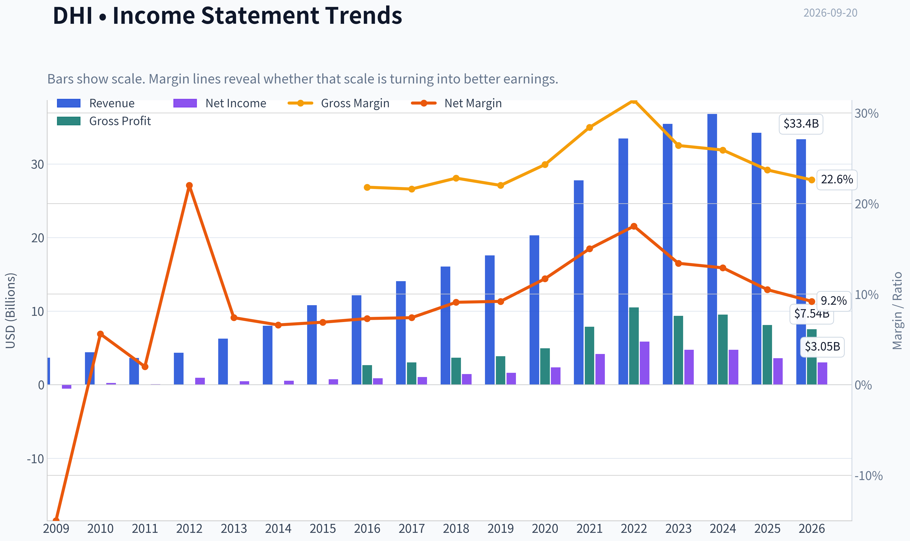

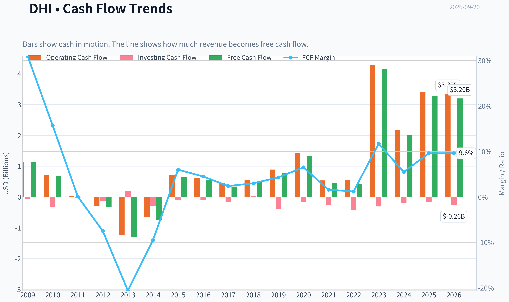

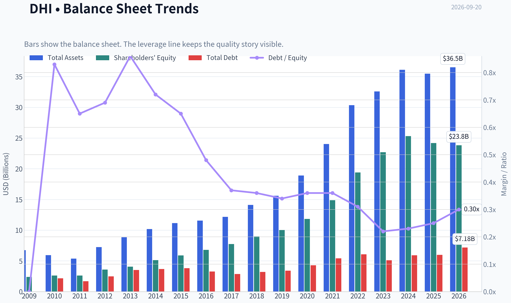

This graph tracks the profitability and return metrics (ROE, ROIC, Margins) of **DHI** over the past decade, highlighting capital efficiency trends.

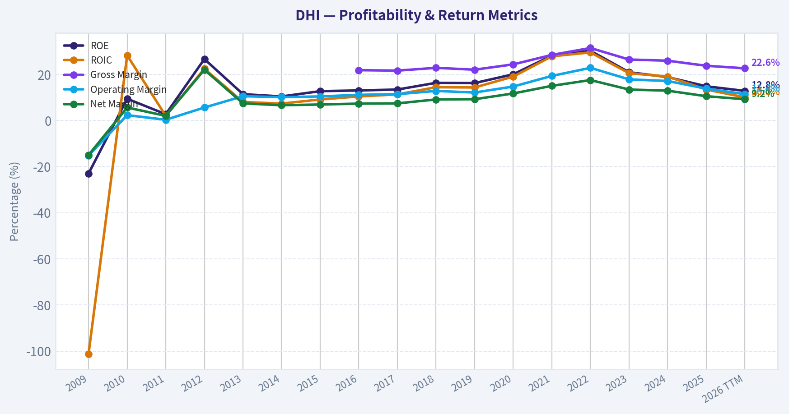

This chart illustrates the financial health of **DHI** over the last 10 years, mapping cash equivalents and free cash flow against total obligations (Debt).

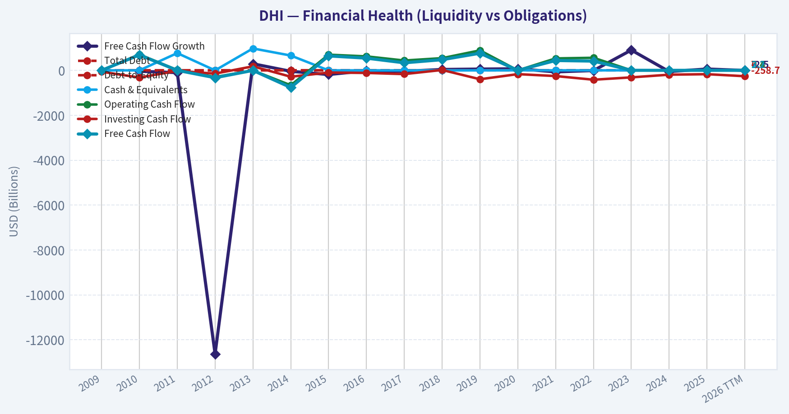

---

### Intrinsic Value Analysis (Buffett)

> *Following Warren Buffett's value investing philosophy: Circle of Competence, Economic Moat, Management Quality, and Margin of Safety.*

#### Intrinsic Value Snapshot

Price is what you pay. Intrinsic value is what the business may be worth based on the cash it can create for owners over time. We show a range, not one magic number.

- Current Price: $138.02
- Value Range (conservative to optimistic across both DCF methods): $5.76 to $781.79

##### Owner Earnings (Buffett Method)
- Net Income: $3,585,200,000.00
- Depreciation & Amortization: $101,300,000.00
- Capital Expenditures: $-137,400,000.00
- Working Capital Changes: $-713,600,000.00
- Owner Earnings: $4,298,800,000.00

##### Intrinsic Value
###### Buffett Method
Uses owner earnings. Stricter, and usually more conservative.
- Conservative: $7.59
- Average: $295.97
- Optimistic: $749.43
- Discount Rate: 10.0%

###### Cash Flow Method
Uses free cash flow. Better for companies spending heavily today to grow tomorrow.
- Conservative: $5.76
- Average: $163.35
- Optimistic: $781.79
- Discount Rate: 10.0%

ANALYST STANCE: **ADVOCATE**

#### Executive View

D.R. Horton is a large-scale U.S. homebuilder selling relatively standardized homes to entry-level and first-time buyers. At approximately **$138 per share**, the stock trades at about **13.2 times earnings** and offers an estimated **8.5% free-cash-flow yield**.

The business is cyclical and currently faces affordability pressure, high mortgage rates, and rising resale inventory. However, D.R. Horton's scale, land and purchasing advantages, disciplined inventory management, and strong cash generation provide a reasonable margin of safety. The principal risk is not solvency; it is a prolonged housing slowdown that depresses orders, pricing, and margins.

#### Factor Scorecard

| Factor | Score | Assessment |
|---|---:|---|
| Circle of Competence & Simplicity | 4/5 | Simple model: acquire land, build homes, and sell them to buyers. Predictability is reduced by housing cycles and interest rates. |
| Durable Competitive Advantage | 3/5 | Scale, purchasing power, land expertise, distribution, and a broad geographic footprint create a narrow-to-moderate moat. |
| Management & Capital Allocation | 4/5 | Long operating history, disciplined scale expansion, and demonstrated cash generation support a strong rating. |
| Industry Structure | 3/5 | Homebuilding is cyclical and regionally competitive, but large builders benefit from fragmented local competition and scale advantages. |

**Gate 5 status: Not tripped.** The available evidence does not indicate simultaneous deteriorating cash flow and financial distress. DHI remains a profitable, cash-generative company, and the main concern is cyclical earnings pressure rather than an inability to service obligations.

#### Moat Analysis

DHI does not possess a consumer brand moat comparable to Coca-Cola or a software switching-cost moat. Its competitive advantages are primarily operational:

- **Scale advantages:** National purchasing volume can lower material and construction costs.
- **Land and market expertise:** Local land pipelines, zoning knowledge, and community development experience are difficult for smaller competitors to replicate quickly.
- **Distribution and financing relationships:** A large sales organization and mortgage relationships improve conversion and operating efficiency.
- **Entry-level focus:** DHI's concentration on more affordable homes gives it access to a broader customer base than builders focused on luxury housing.
- **Geographic diversification:** Exposure across many U.S. markets reduces dependence on a single local economy.

The moat is best characterized as **narrow and relatively stable**, rather than wide. Housing remains a competitive, cyclical industry, and scale cannot fully offset weak affordability or falling demand.

#### Management Quality Assessment

DHI's management receives a favorable assessment because the company has historically emphasized:

- Volume growth without relying exclusively on high-end pricing.
- Geographic diversification.
- Inventory and land discipline.
- Cash generation and balance-sheet flexibility.
- A business model that can adjust community openings, incentives, and construction pace as conditions change.

The key management test is whether DHI preserves returns by avoiding excessive land purchases during strong housing markets. Current affordability pressure makes capital discipline especially important. The available evidence supports a **4/5** rating, though homebuilder management teams must be judged across a complete housing cycle rather than during a single strong period.

#### Financial Summary

| Metric | Current / Latest Reading |
|---|---:|
| Share price | $138 |
| Market capitalization | $38.60 billion |
| P/E ratio | 13.2x |
| Return on equity | 14.8% |
| Gross margin | 23.7% |
| Revenue growth, year over year | -6.9% |
| Free-cash-flow yield | 8.5% |
| Estimated free cash flow | Approximately $3.28 billion |
| Headline intrinsic value | $181.52 per share |
| Reverse-DCF implied 10-year growth | Approximately 2.1% annually |
| Trailing three-year growth | -27.9% |
| Five-year growth | 13.6% |

**Key Takeaways:** DHI is profitable and generates substantial cash, but current revenue momentum is negative. Its 14.8% ROE is respectable rather than exceptional, reflecting the cyclical and capital-intensive nature of homebuilding. The market price appears to assume only modest long-term growth, which is reasonable given current housing pressures.

#### Owner Earnings Calculation

Using free cash flow as a practical proxy for current owner earnings:

| Calculation | Amount |
|---|---:|
| Market capitalization | $38.60 billion |
| Free-cash-flow yield | 8.5% |
| Estimated owner earnings | $3.28 billion |
| Approximate shares outstanding | 279.7 million |
| Owner earnings per share | Approximately $11.73 |

The owner-earnings estimate is based on current free cash flow. For a homebuilder, reported free cash flow can fluctuate substantially because land purchases and construction inventory move through the cash-flow statement unevenly. A normalized mid-cycle owner-earnings figure is therefore more useful than treating one year as permanent.

#### Three-Scenario DCF Valuation

| Scenario | Core Assumption | Estimated Value per Share |
|---|---|---:|
| A: No growth | Owner earnings capitalized at 10% | $117 |
| B: GDP-like growth | 3% perpetual growth, 10% discount rate | $173 |
| C: Historical-growth case | Approximately 6.8% growth for 10 years, then 3.2% terminal growth | $283 |
| Research-pack blended valuation | Weighted blend of multiple valuation methods | $182 |

The no-growth case provides a conservative downside reference, while the historical-growth case is not a forecast that should be accepted literally because housing earnings are cyclical. The blended estimate of approximately **$182** is more appropriate than relying on the most optimistic owner-earnings outcome.

#### Margin of Safety Analysis

| Valuation Reference | Value per Share | Upside / Downside vs. $138 |
|---|---:|---:|
| No-growth DCF | $117 | -15% |
| GDP-growth DCF | $173 | +25% |
| Blended intrinsic value | $182 | +32% |
| Historical-growth DCF | $283 | +105% |

The research-pack headline margin of safety is approximately **24%**, using a cyclical weighted valuation framework. That is adequate for a solid but cyclical business, though not large enough to eliminate the risk of further earnings downgrades.

The reverse DCF is encouraging: the current price implies only approximately **2.1% annual growth over ten years**. That expectation is below what DHI has achieved over a full favorable housing cycle, although the company will likely experience periods of contraction along the way.

#### Buffett Scorecard

| Criterion | Weight | Score | Weighted Contribution |
|---|---:|---:|---:|
| Moat width and durability | 25% | 3/5 | 0.75 |
| Valuation / margin of safety | 20% | 4/5 | 0.80 |
| Capital returns versus WACC | 15% | 4/5 | 0.60 |
| Business understanding and predictability | 12% | 3/5 | 0.36 |
| Management quality and capital allocation | 12% | 4/5 | 0.48 |
| Reinvestment runway | 8% | 3/5 | 0.24 |
| Balance-sheet strength | 4% | 4/5 | 0.16 |
| Industry structure | 4% | 3/5 | 0.12 |
| **Total** | **100%** |  | **3.51/5** |

**Key Takeaways:** DHI scores well because valuation, cash generation, management, and scale offset the industry's cyclicality. Its score is held back by a narrower moat and lower earnings predictability than a truly exceptional compounder. The resulting valuation is attractive enough to support ownership, but not aggressive concentration.

#### Principal Risks

| Risk | Why It Matters |
|---|---|
| Mortgage rates | Higher rates reduce affordability and can delay purchase decisions. |
| Home prices and incentives | Builders may need price reductions or incentives, compressing gross margins. |
| Resale inventory | More existing homes for sale can increase competition. |
| Land and inventory mismanagement | Overbuilding or buying land at peak prices can destroy returns. |
| Employment weakness | Entry-level buyers are particularly sensitive to job losses and credit tightening. |
| Regional concentration | Despite diversification, local housing markets can weaken unevenly. |

#### Investment Stance

DHI is a **good cyclical business available at a reasonable-to-attractive valuation**, not a wide-moat, highly predictable compounder. The stock's valuation appears to discount modest long-term growth, while the company retains meaningful scale and operating advantages.

**Stance: ADVOCATE - medium conviction.**

A sensible approach would be to build a position gradually rather than make a full allocation immediately. The investment thesis is strongest if DHI maintains capital discipline, protects cash generation, and navigates the current affordability cycle without materially overbuilding.
#### Valuation Bridge

This bridge places the current market price beside each intrinsic value lens so readers can see whether upside depends on one method or shows up across several methods.

| Scenario | Intrinsic Value / Share |
| --- | ---: |
| Buffett Method | $295.97 |
| Cash Flow Method | $163.35 |
| Damodaran Method | $126.64 |
| Current Price | $138.02 |

#### Key Takeaways

If one method is far above the others, the upside case depends on a specific modelling assumption. When several methods cluster together, the valuation story is more robust.

#### Valuation Visuals

This comparison chart from *Latest Earnings Snapshot* stacks current figures against historical benchmarks for **DHI**, making it easy to see where the company trades relative to its own averages.

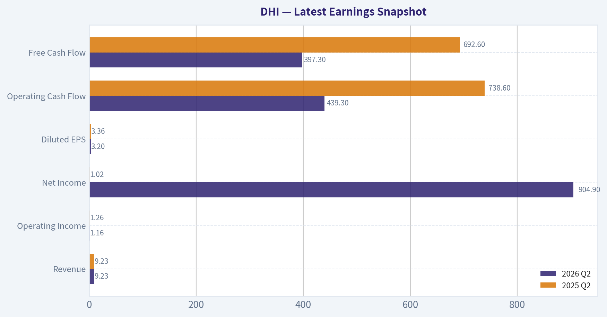

This comparison chart from *Current Versus Historical Average* stacks current figures against historical benchmarks for **DHI**, making it easy to see where the company trades relative to its own averages.

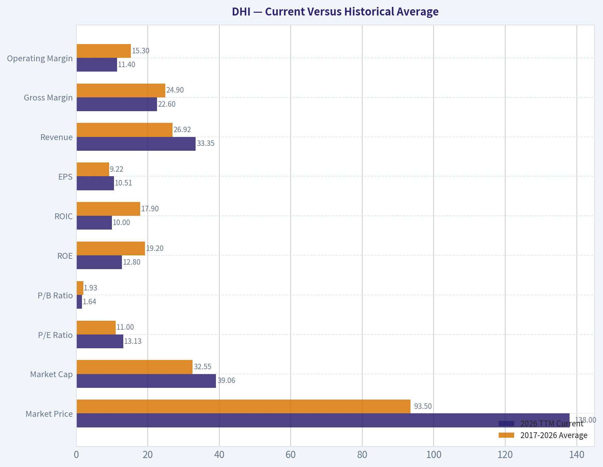

This comparison chart from *Financial Summary* stacks current figures against historical benchmarks for **DHI**, making it easy to see where the company trades relative to its own averages.

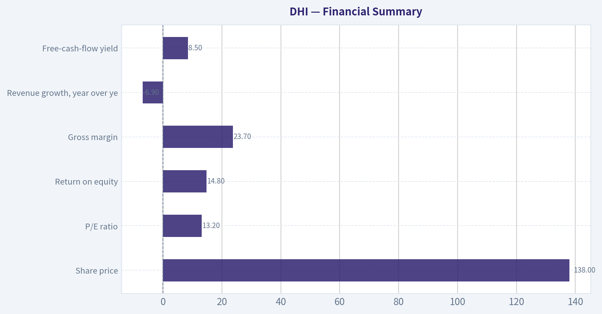

The following chart maps the **DHI** Owner Earnings DCF valuation scenarios (Conservative, Average, Optimistic) to visually represent the margin of safety based on intrinsic value calculations.

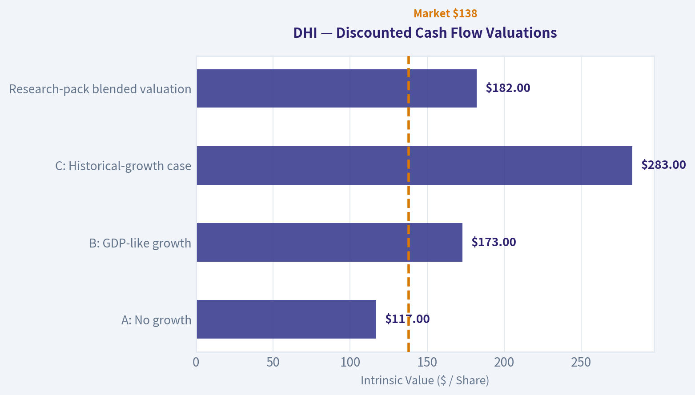

The following chart maps the **DHI** Owner Earnings DCF valuation scenarios (Conservative, Average, Optimistic) to visually represent the margin of safety based on intrinsic value calculations.

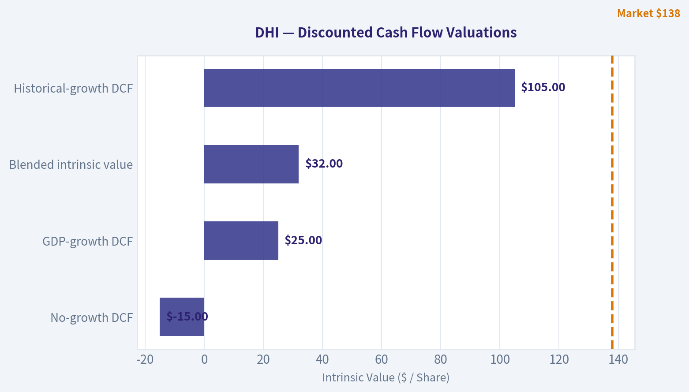

---

### Trend & Growth Analysis (Lynch/Druckenmiller/Fisher)

> *Following Peter Lynch's GARP, Stanley Druckenmiller's macro-aware approach, and Philip Fisher's scuttlebutt methodology.*

ANALYST STANCE: **WATCH**

#### 1. Lynch Classification

**Cyclical, high-quality housing operator - not currently a fast grower.**

D.R. Horton has historically compounded through housing cycles, but the latest data show revenue declining 6.9% year over year. This is not presently a 15-25% growth story; the investment case depends on a housing-cycle recovery, affordability improvement, and continued share gains.

#### 2. The Story in Three Bullets

- D.R. Horton is one of the largest U.S. homebuilders, benefiting from the long-term shortage of entry-level housing.
- Its scale, land position, purchasing power, and broad geographic footprint can support market-share gains when housing demand normalizes.
- The near-term setup is pressured by mortgage rates, weak affordability, and increased resale inventory, but the valuation already implies relatively modest long-term growth.

#### 3. Key Financial Snapshot

| Metric | Data | Interpretation |
|---|---:|---|
| Share price | $138 | Current reference price |
| Market capitalization | $38.6 billion | Large-cap homebuilder |
| Revenue growth, YoY | -6.9% | Current contraction |
| P/E ratio | 13.2x | Modest valuation |
| Gross margin | 23.7% | Healthy but cyclical |
| ROE | 14.8% | Solid capital productivity |
| FCF yield | 8.5% | Attractive cash-flow valuation |
| Headline intrinsic value | $181.52 | Approximately 24% upside |
| Reverse-DCF implied growth | 2.1% annually for 10 years | Low expectations embedded in price |

**Key Takeaways:** DHI combines a low-teens earnings multiple with an 8.5% free-cash-flow yield and a valuation model indicating meaningful upside. However, the negative revenue growth rate confirms that this is currently a cyclical recovery or value opportunity rather than an accelerating growth story.

#### 4. TAM Analysis and 10x Test

The long-term U.S. housing market is enormous, supported by household formation, replacement demand, constrained existing-home supply, and an estimated structural shortage of homes. However, DHI's relevant market is narrower: new single-family housing, especially affordable and entry-level homes.

| TAM Test | Assessment |
|---|---|
| Current business scale | Approximately $30B-plus annual revenue historically |
| 10x revenue test | Would require roughly $300B-plus revenue |
| Can DHI reach 10x while owning less than 20% of TAM? | Probably yes for the broad U.S. housing market; unlikely on a narrow entry-level definition |
| TAM growth | Moderate, but supported by housing undersupply |
| Main constraint | Affordability and mortgage rates, not lack of theoretical demand |
| Runway quality | Long-term runway exists, but growth is cyclical and volume dependent |

**Key Takeaways:** DHI can expand substantially without approaching a dominant share of the broad U.S. housing market. Nevertheless, a ten-bagger would require not just market growth but a major increase in annual home closings, average selling prices, and market share. The runway is durable, but not as clean or explosive as an asset-light technology market.

#### 5. Revenue Growth Trend

| Period / Indicator | Result | Signal |
|---|---:|---|
| Latest YoY revenue growth | -6.9% | Contraction |
| Trailing three-year revenue trend | -27.9% cumulative reference | Cyclical reset |
| Trailing five-year revenue trend | 13.6% cumulative reference | Positive but uneven |
| Current pattern | Deceleration / weakness | Not an inflection yet |
| Required confirmation | Orders, deliveries, backlog, and margins reaccelerating | Would improve thesis |

**Key Takeaways:** Revenue is currently decelerating rather than accelerating. The company may be approaching a cyclical opportunity if orders and margins stabilize, but there is not yet evidence of the acceleration required for a high-conviction growth stance.

#### 6. Unit Economics and Profitability

Detailed customer-level metrics such as CAC, LTV, churn, and NRR do not apply cleanly to a homebuilder and are not available in the research pack. More relevant indicators are home-level gross margin, inventory turns, return on equity, cancellation rates, backlog conversion, and cash generation.

| Metric | Result | Assessment |
|---|---:|---|
| Gross margin | 23.7% | Healthy for a cyclical builder |
| ROE | 14.8% | Solid, though below exceptional compounder levels |
| FCF yield | 8.5% | Strong valuation support |
| Rule of 40 | Not applicable | Non-subscription business |
| Balance-sheet liquidity | Current ratio unavailable | Requires additional filing review |
| Operating leverage | Potentially meaningful | Depends on volume recovery |

**Key Takeaways:** DHI has respectable profitability and cash-flow characteristics, but the business is capital intensive and exposed to inventory and land-cycle risk. Margin durability must be tested through a downturn; current gross margin strength is encouraging but not sufficient by itself.

#### 7. Inflection Point Assessment

| Potential Inflection | Current Evidence | Status |
|---|---|---|
| Product / community cycle | Ongoing community openings, including Summervale in Maryland | Incremental positive |
| Market-share gains | Scale and entry-level focus remain advantages | Plausible, not proven here |
| Margin inflection | 23.7% gross margin | Positive but cyclical |
| TAM inflection | Housing undersupply persists | Structurally positive |
| Competitive inflection | Lennar recently missed earnings amid affordability pressure | Mixed; industry pressure remains |
| Earnings inflection | Revenue still down year over year | Not confirmed |

**Key Takeaways:** The strongest possible inflection would be a stabilization in mortgage rates followed by improving orders and backlog. At present, the evidence is mixed: DHI retains strategic advantages, but industry data from Lennar suggest that affordability stress is still affecting demand.

#### 8. Macro Setup

Mortgage rates, resale inventory, employment, and consumer affordability are the dominant macro variables.

- **Positive:** Structural housing shortage, household formation, and limited existing-home supply.
- **Negative:** High mortgage rates, elevated monthly payments, and rising resale inventory.
- **Cycle position:** Late-cycle housing slowdown or early recovery setup, but not yet confirmed.
- **Druckenmiller assessment:** The macro wind is currently neutral-to-negative. A meaningful decline in mortgage rates would be the major catalyst.

#### 9. Fisher 15-Point Assessment

This is a preliminary score because detailed management interviews, customer checks, supplier checks, and filing-level operating data were not available.

| Fisher Factor | Score / 5 | Comment |
|---|---:|---|
| Market potential | 4 | Large structural housing need |
| New-product development | 3 | Community and product iteration, but limited evidence |
| R&D effectiveness | 2 | Less relevant and less visible than in technology |
| Sales organization | 4 | Large national operating platform |
| Profit margins | 4 | 23.7% gross margin |
| Margin improvement | 3 | Potential, but cyclical |
| Labor relations | 3 | No major evidence either way |
| Executive relations | 3 | Insufficient evidence |
| Management depth | 4 | Large national organization |
| Cost analysis | 4 | Scale and purchasing discipline are advantages |
| Outstanding competitive aspects | 4 | Scale, land, brand, and distribution |
| Long-range profit outlook | 4 | Strong if housing shortage persists |
| Dilution | 4 | No material dilution concern identified |
| Management candor | 3 | Insufficient evidence |
| Management integrity | 3 | No specific adverse evidence |

**Total Fisher score: 50 out of 75 - Average to good**

**Key Takeaways:** DHI scores best on market size, scale, operating platform, and competitive position. It scores lower because homebuilding provides less visible innovation than Fisher's preferred technology and consumer-product businesses, and because detailed management-quality evidence was limited.

#### 10. Valuation Analysis

| Valuation Method | Result | Interpretation |
|---|---:|---|
| P/E | 13.2x | Reasonable for a cyclical business |
| PEG | Not meaningful | Growth rate is currently negative |
| FCF yield | 8.5% | Attractive if normalized cash flow is durable |
| Reverse DCF | 2.1% annual growth implied | Conservative market expectations |
| Headline intrinsic value | $181.52 | 24% above current price |
| Owner-earnings model | $295.97 | Most optimistic model |
| FCF model | $163.35 | Moderate upside |
| Damodaran FCFF model | $126.64 | Downside case / conservative model |

**Key Takeaways:** DHI appears inexpensive relative to normalized cash generation, but valuation models have a very wide range of outcomes, from $126.64 to $295.97. The stock offers a margin of safety if housing earnings normalize, but it is not obviously cheap under every cyclical assumption.

#### 11. Growth Investor Scorecard

| Criterion | Weight | Score / 5 | Weighted Result |
|---|---:|---:|---:|
| The Story | 10% | 3.5 | 0.35 |
| TAM and runway | 20% | 4.0 | 0.80 |
| Revenue growth | 20% | 2.0 | 0.40 |
| Unit economics | 15% | 3.5 | 0.53 |
| Competitive position | 10% | 4.0 | 0.40 |
| Management quality | 10% | 3.5 | 0.35 |
| Macro setup | 5% | 2.5 | 0.13 |
| Profitability path | 5% | 4.0 | 0.20 |
| Valuation | 5% | 4.0 | 0.20 |
| **Total** | **100%** |  | **3.36 / 5.00** |

**Key Takeaways:** The 3.36 score places DHI in the **WATCH** range. Valuation, scale, and long-term housing demand are attractive, but current revenue contraction and unfavorable affordability conditions prevent an Advocate rating.

#### 12. Position Size Stance

**Suggested stance: Watch position or modest cyclical allocation, approximately 1-3% of a diversified portfolio.**

A larger position would require evidence of:

1. Mortgage-rate relief or materially improving affordability.
2. Positive order growth and improved backlog conversion.
3. Stable or expanding gross margins.
4. Evidence that revenue growth is returning to at least the mid-single digits, preferably 10% or more.
5. No material deterioration in inventory, cancellations, or balance-sheet liquidity.

#### 13. Key Risks and Catalysts

| Catalysts | Risks |
|---|---|
| Falling mortgage rates | Rates remain high for longer |
| Improving entry-level affordability | Persistent affordability crisis |
| Higher orders and backlog | Declining orders or rising cancellations |
| Market-share gains from weaker builders | Resale inventory pressures new-home demand |
| Land and inventory discipline | Land impairments or excess inventory |
| Margin stabilization | Gross-margin compression |
| Housing-policy support | Recession and employment deterioration |

**Key Takeaways:** The primary catalyst is a housing affordability recovery, most likely through lower mortgage rates and/or slower home-price growth. The primary risk is that high rates and growing resale supply produce a prolonged volume and margin decline.

#### Bottom Line

DHI is a **well-positioned cyclical housing company trading at a reasonable valuation**, not a confirmed fast-growing ten-bagger. The stock becomes more compelling if housing demand begins reaccelerating while margins remain near current levels. Until that inflection appears, the appropriate Lynch/Druckenmiller conclusion is **WATCH rather than ADVOCATE**.

---

### Market Technical Analysis

ANALYST STANCE: **WATCH**

#### DHI Technical Market Overview

DHI closed at **$138.02 on September 18, 2026**, down from **$140.38** the prior session and near the lower portion of its recent trading range. The stock has weakened materially since late August: it fell from approximately **$151.86 on August 19** to the high-$130s by mid-September. This decline has occurred alongside a deterioration in trend, negative momentum, and several recent volume surges, suggesting that sellers remain active rather than the move being purely low-volume drift.

The selected indicators are:

| Category | Selected indicators | Purpose |
|---|---|---|
| Trend | close_10_ema, close_50_sma, close_200_sma | Short-, medium-, and long-term trend alignment |
| Momentum | macd, rsi | Momentum direction and potential exhaustion |
| Volatility and risk | atr | Position sizing and stop-distance assessment |
| Price envelope | boll_ub, boll_lb | Overextension, support, and breakdown context |

The indicators are complementary: the three moving averages establish trend structure, MACD and RSI evaluate momentum from different perspectives, ATR measures risk rather than direction, and the Bollinger Bands show whether the decline is becoming statistically stretched.

#### Trend Structure

DHI is trading below all three selected moving averages:

- **10 EMA:** $139.79
- **50 SMA:** $145.70
- **200 SMA:** $148.69
- **Last close:** $138.02

This configuration is bearish across short-, intermediate-, and long-term horizons. The closing price is approximately **1.3% below the 10 EMA**, **5.3% below the 50 SMA**, and **7.2% below the 200 SMA**. The 10 EMA has declined from $148.35 on August 21 to $139.79, while the 50 SMA has fallen from $151.35 to $145.70. The long-term average has also begun to roll over, slipping from roughly $149.08 in late August to $148.69.

The most important technical feature is not simply that price is below the averages, but that the averages themselves are weakening. A short-lived bounce above the 10 EMA could therefore represent only a countertrend recovery unless DHI also reclaims the 50 SMA. The $145-$146 region is the first meaningful overhead resistance zone, followed by the $148-$150 area around the 200 SMA and prior congestion.

#### Momentum and Selling Pressure

The MACD reading was **-2.50 on September 18**. It has been negative throughout most of the recent period and deteriorated sharply from approximately **+0.06 on August 26** to below **-2.0 by early September**. Although MACD improved slightly from its recent low near **-2.78 on September 11**, it remains decisively below zero. This indicates that the recent stabilization attempts have not yet developed into a confirmed bullish reversal.

RSI was **42.0**, recovering from **36.1 on September 10** but remaining below the neutral 50 level. This is a subdued momentum reading, but it is not yet deeply oversold. RSI therefore supports the interpretation of weak momentum with some potential for a short-term relief bounce, rather than signaling a high-confidence reversal. A move above 50, particularly if accompanied by a positive MACD crossover, would provide stronger evidence that downside momentum is fading.

Recent volume behavior increases the importance of confirmation. DHI traded approximately **6.15 million shares on September 18**, compared with roughly **1.8 million to 2.3 million shares on several surrounding sessions**. A high-volume decline generally deserves more caution than a quiet pullback because it can indicate institutional distribution or forced selling. The September 10 decline also occurred with elevated volume, reinforcing the pattern of active selling during weakness.

#### Bollinger Bands and Potential Support

On September 18:

- **Upper Bollinger Band:** $151.64
- **Lower Bollinger Band:** $133.61
- **Approximate middle band:** $142.63
- **Close:** $138.02

DHI closed below the approximate middle Bollinger level and was only about **$4.41 above the lower band**. The lower band has fallen substantially, from around $143.07 on August 21 to $133.61. This is important because the lower band is not a fixed support level; its decline reflects a broader weakening trend and expanding downside price distribution.

The close is not yet at the lower band, so the stock has room to decline before reaching the statistical extreme of its recent range. The **$133-$134 region** is the next notable volatility-adjusted support area. A decisive close below that zone could signal continuation toward lower price levels. Conversely, a rebound toward the middle band near $142-$143 would initially be viewed as a recovery test, not a confirmed trend reversal.

#### Volatility and Risk Management

ATR was approximately **$3.95**, down from about $4.65 in late August but still substantial relative to the share price. Current ATR represents roughly **2.9% of the closing price**, meaning ordinary daily fluctuations can be large enough to trigger tight stops.

For a long position, a stop placed only one or two dollars below the current price would likely be vulnerable to normal volatility. A more practical approach would be to size the position around the ATR and use a technically meaningful level, such as below the $133-$134 support zone, while recognizing that this implies materially greater dollar risk. Traders should also account for the possibility of gap moves, particularly because recent sessions have featured elevated volume and wide intraday ranges.

#### Trading Interpretation

The prevailing setup is **bearish but not maximally oversold**. The trend structure is negative, MACD remains below zero, RSI is below neutral, and price is below the 10 EMA, 50 SMA, and 200 SMA. These factors argue against aggressively buying the stock before evidence of stabilization appears.

A speculative countertrend bounce is possible because RSI is near the low-40s and price is approaching the lower Bollinger region. However, such a bounce would need to reclaim **$140-$141** first, then the approximate **$142-$143 middle Bollinger area**, to demonstrate improving short-term control. A stronger reversal would require a sustained move above the **$145-$146 50-SMA zone**, ideally supported by expanding upside volume and a positive MACD crossover.

The bearish case strengthens if DHI breaks below the recent **$135-$136 area** and especially if it closes below the lower Bollinger region near **$133-$134** on elevated volume. Until then, the stock may oscillate between oversold-bounce attempts and renewed selling. The most prudent posture is to watch for confirmation rather than anticipate a bottom.

#### Indicator Summary

| Indicator | Latest reading | Direction or condition | Trading implication |
|---|---:|---|---|
| Close | $138.02 | Below all major averages | Broadly bearish trend structure |
| 10 EMA | $139.79 | Sloping downward | Short-term resistance near $140 |
| 50 SMA | $145.70 | Declining | Intermediate resistance near $145-$146 |
| 200 SMA | $148.69 | Slightly declining | Long-term trend pressure; resistance near $149 |
| MACD | -2.50 | Negative, modest improvement from recent low | Downtrend momentum remains dominant |
| RSI | 42.0 | Weak but not deeply oversold | Bounce possible, reversal unconfirmed |
| ATR | $3.95 | Elevated daily risk | Avoid tight stops and oversized positions |
| Bollinger Bands | $133.61-$151.64 | Price below middle band, near lower half | $133-$134 is potential support; breakdown risk remains |

**Key Takeaways:** DHI's technical picture remains bearish because price is below declining short-, medium-, and long-term averages, while MACD is negative and RSI remains below neutral. The stock may produce a relief bounce near the $133-$136 support area, but that would not constitute a confirmed reversal unless price reclaims roughly $142-$143 and then $145-$146. Elevated recent volume and an ATR near $3.95 argue for caution, disciplined position sizing, and waiting for confirmation.

#### Market Visuals

This comparison chart from *Market Metrics and Valuation* stacks current figures against historical benchmarks for **DHI**, making it easy to see where the company trades relative to its own averages.

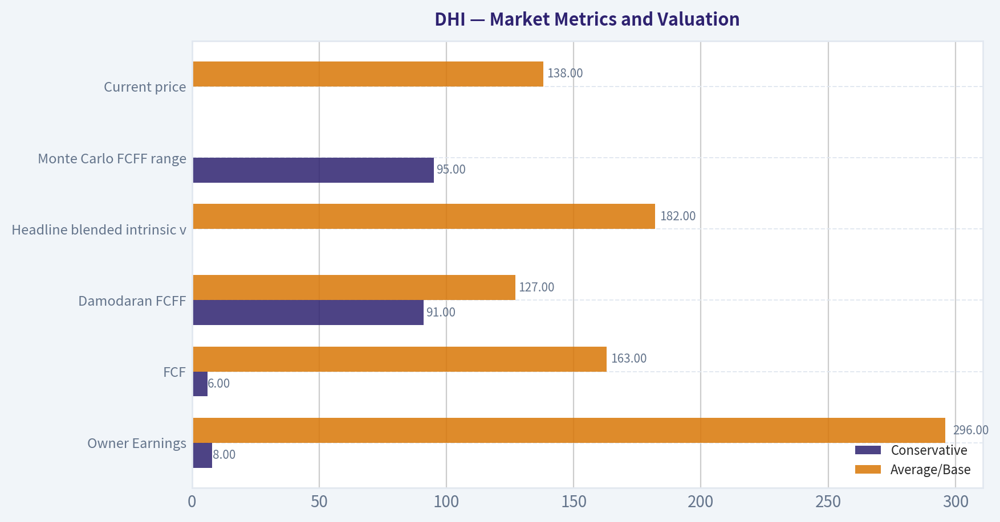

---

### Options Market Analysis

> *Reading options flow - put/call ratios, IV skew, and unusual activity - to gauge institutional positioning and event-driven risk.*

#### DHI Options Market Report

**Data as of September 20, 2026.** The available near-term options data is unusually thin or incomplete: every listed expiration reports zero open interest, while some trading volume is present. This materially reduces confidence in positioning-based conclusions.

#### 1. Put/Call Ratio Analysis

| Expiration | Call OI | Put OI | Call Volume | Put Volume | Volume Put/Call Ratio |
|---|---:|---:|---:|---:|---:|
| Sep. 25, 2026 | 0 | 0 | 237 | 231 | 0.97 |
| Oct. 2, 2026 | 0 | 0 | 86 | 45 | 0.52 |
| Oct. 9, 2026 | 0 | 0 | 31 | 32 | 1.03 |
| **Total** | **0** | **0** | **354** | **308** | **0.87** |

**Key Takeaways:** The put/call open-interest ratio cannot be calculated because reported open interest is zero across all near-term expirations. The aggregate volume ratio of 0.87 indicates slightly more call activity than put activity, but it is only modestly below the approximately 0.70 neutral reference and is not a strong bullish signal. The zero-OI readings suggest possible data incompleteness or very limited listed activity.

#### 2. Implied Volatility Assessment

| Expiration | Call ATM IV | Put ATM IV | Relative Read |
|---|---:|---:|---|
| Sep. 25, 2026 | 3.3% | 3.3% | Balanced |
| Oct. 2, 2026 | 2.7% | 2.2% | Mild call-side premium |
| Oct. 9, 2026 | 0.8% | 1.6% | Mild put-side premium |
| **Near-term range** | **0.8%-3.3%** | **1.6%-3.3%** | **Very low reported IV** |

**Key Takeaways:** Reported near-term ATM implied volatility is extremely low, with no consistent put or call skew. The Sep. 25 expiry is balanced, Oct. 2 shows a slight call-side premium, and Oct. 9 shows a slight put-side premium. IV does not appear elevated ahead of a catalyst, although the unusually low readings may reflect sparse or unreliable data rather than genuinely low market risk.

A true OTM skew comparison is not available in the supplied dataset. Therefore, there is no reliable evidence of either steep downside protection demand or upside call chasing.

#### 3. Unusual Options Activity

| Metric | Result |
|---|---|
| Contracts with volume greater than 5x open interest | None identified |
| Fresh directional bets | No confirmed examples |
| Smart-money or institutional signal | Not detectable from available data |
| Retail speculation signal | Not detectable from available data |

**Key Takeaways:** No contracts met the tool's unusual-activity threshold. Because open interest is reported as zero, however, the absence of flagged contracts should not be treated as proof that no new positions were opened. There is insufficient contract-level information to assess strike moneyness, directional aggressiveness, or likely institutional execution.

#### 4. Open Interest Concentration and Gamma Levels

| Expiration | Highest Call OI | Highest Put OI | Gamma Walls / Pinning Levels |
|---|---:|---:|---|
| Sep. 25, 2026 | None reported | None reported | None identifiable |
| Oct. 2, 2026 | None reported | None reported | None identifiable |
| Oct. 9, 2026 | None reported | None reported | None identifiable |

**Key Takeaways:** No open-interest concentration is reported at any strike or expiration, so there are no observable max-pain levels, gamma walls, or option-related price magnets. This also means the options market is unlikely to provide a reliable near-term support or resistance map for DHI based on the supplied data.

#### 5. Expiration Horizon

| Expiration | Approximate Days to Expiry | Trading Activity |
|---|---:|---|
| Sep. 25, 2026 | 5 days | Highest reported volume |
| Oct. 2, 2026 | 12 days | Moderate volume |
| Oct. 9, 2026 | 19 days | Light volume |

**Key Takeaways:** Activity is concentrated in the five-day Sep. 25 expiry, but the volume is still modest and unsupported by reported open interest. The farther-dated expirations have limited trading activity, making their IV and put/call comparisons less dependable.

#### Overall Options Sentiment

**Signal: NEUTRAL, with low confidence**

The primary reason for a neutral reading is the lack of usable open-interest data and the absence of unusual contract activity. Aggregate volume leans modestly toward calls, with a 0.87 put/call volume ratio, but this is not strong enough to establish bullish institutional positioning. Reported IV is very low and skew is inconsistent, suggesting limited visible demand for either aggressive upside speculation or downside hedging.

The options dataset should be treated as **thin or potentially incomplete**. There are no reliable gamma levels, no measurable OI-based put/call ratio, and no contract-level evidence of smart-money positioning. A stronger directional conclusion would require valid open interest, strike-level volume, current underlying price, and a more complete volatility surface.

| Category | Assessment |
|---|---|
| Put/Call Ratio | OI ratio unavailable; volume ratio 0.87, mildly call-leaning |
| IV Level | Very low reported near-term IV, approximately 0.8%-3.3% |
| Skew Direction | No consistent skew; limited data |
| Unusual Activity | None flagged; no confirmed fresh directional bets |
| Overall Signal | **NEUTRAL - low confidence due to zero reported OI and thin data** |

**Key Takeaways:** DHI's available options data does not support a strong bullish or bearish signal. Slightly call-heavy volume is offset by missing open-interest information, absent unusual activity, and unreliable-looking IV readings. The appropriate options-based stance is neutral until more complete and liquid market data becomes available.

---

## Research Team Commentary

> *The Research Manager synthesizes the Bull vs Bear debate into action-free commentary. This is a pre-risk view, not the final stance.*

Core takeaway: D.R. Horton appears to be a good cyclical operator at a reasonable price, but the evidence does not establish enough margin of safety to advocate buying at $138. Its scale advantages, 13.3% ROIC, and exposure to long-term housing undersupply make an outright AVOID too harsh. Conversely, the valuation case relies heavily on treating current earnings as normalized owner earnings, which cannot be verified from the supplied cash-flow, inventory, and balance-sheet data. The appropriate stance is WATCH.

The strongest bull argument is that DHI has a genuine, if moderate, scale-and-execution moat. National purchasing power, local entitlement expertise, contractor relationships, mortgage distribution, and geographic breadth should help it take share from smaller builders during difficult markets. Its 13.3% ROIC, 14.8% ROE, and 10.1% ROA indicate respectable economics for a capital-intensive company. The structural shortage of entry-level housing also provides a credible ten-year demand runway. At 13.16 times earnings, the valuation does not require a housing boom or technology-like growth.

The reverse-DCF framing is especially attractive at first glance. Assuming $9.44 per share of normalized owner earnings, the current price appears to imply only about 1.5% annual growth. DHI could plausibly beat that through modest unit growth, market-share gains, disciplined land deployment, and repurchases. Higher mortgage rates also constrain existing-home listings through the mortgage lock-in effect, allowing large builders to compete with rate buydowns and readily available inventory. Current affordability fears may therefore understate the relative position of scaled public builders.

The bear's most persuasive response is that the reverse DCF begins with an unverified starting value. The assumed $9.44 of owner earnings equals 90% of implied trailing EPS, but no operating cash flow, inventory investment, land spending, debt, or land-option data was supplied. For a homebuilder, those omissions are fundamental rather than cosmetic. Inventory accumulation can consume substantial cash while accounting earnings remain healthy.

This sensitivity materially changes the valuation conclusion. The bull's $167 base value represents approximately 21% upside, but only a 17% discount to estimated intrinsic value. That is not enough for a cyclical, capital-intensive business with a moderate moat; such a company ordinarily warrants a discount closer to 25%-35%. The conservative DCF value of $144 provides only about a 4% valuation discount. If normalized owner earnings are 20% below the bull's assumption, estimated value falls to roughly $134 under the same framework, slightly below the market price.

The headline P/E also deserves caution. If normalized EPS were 20% below the implied $10.49, DHI would trade around 16.4 times earnings; at a 30% decline, it would trade around 18.8 times earnings. Those are not necessarily excessive multiples, but they no longer present an obvious cyclical bargain. Mortgage incentives preserve sales volume partly by transferring economics from the builder to the buyer, so market-share gains do not automatically create shareholder value. The critical question is whether incremental volume continues to earn attractive returns after incentives, land costs, and slower inventory turns.

The housing shortage should likewise be treated carefully. It represents underlying need, but need is not the same as purchasing power. High mortgage payments, insurance, property taxes, and home prices can keep demand deferred for years. At the same time, the shortage thesis is not empty: constrained resale supply and public builders' financing capabilities may allow DHI to outperform the broader housing market even in a difficult affordability environment. The evidence supports a relatively strong competitive position, not immunity from the cycle.

From a Buffett perspective, DHI clears the business-quality threshold but not yet the price-certainty threshold. Its moat is narrower and cash flows are less predictable than those of a dominant asset-light compounder. Therefore, it deserves a larger margin of safety. Around $138, the stock looks approximately fairly valued under cautious assumptions and undervalued only if current earnings and cash conversion are reasonably sustainable. That is too assumption-sensitive for an ADVOCATE rating, but it is not clear overvaluation or financial distress, so AVOID would overstate the bearish case.

The market signals do not change that conclusion. At $138.02, the stock is relatively close to its lower Bollinger Band of $133.61, suggesting it is not technically extended, but that is not a substitute for normalized valuation. Near-term options open interest is reported as zero, so no positioning inference should be drawn from that dataset. Incomplete options data is simply unavailable evidence, not a bullish or bearish signal.

The lesson from prior mistakes is to avoid converting incomplete fundamentals into false precision. The earlier NNI experience showed that a fair valuation, uncertain economics, and a nearby catalyst can justify stronger caution. But it also showed the need to distinguish an actionable bearish setup from a merely insufficient buying opportunity. Here, there is no evidence of deterioration plus weak solvency, and no clear proof that $138 is materially above intrinsic value. The disciplined response is to wait for better cash-flow evidence or a wider price discount rather than force either a bullish or bearish call.

Over the next one to four quarters, the thesis would strengthen if gross margin remains near current levels despite incentives, cancellation rates stabilize, orders and closings hold up without increasingly expensive rate buydowns, and ROIC remains comfortably above the cost of capital. Positive operating cash flow after accounting for land and inventory investment would validate the owner-earnings assumption. Stable or declining net debt, greater reliance on land options rather than speculative land ownership, improving inventory turns, and repurchases below a conservatively estimated intrinsic value would also support an upgrade.

The thesis would weaken if orders are maintained only through sharply rising incentives, gross margin falls materially, cancellations increase, or owned inventory grows faster than demand. A sustained decline in ROIC toward or below the cost of capital would indicate that scale is preserving volume but not economic value. Rising leverage, deteriorating cash conversion, slower inventory turns, land impairments, or share repurchases undertaken while the company is absorbing cash into inventory would also argue for an AVOID rating.

A price around $115-$125 would become more interesting if the operating evidence remains intact, since that would approach a 25%-30% discount to the $167 base estimate. A lower entry point alone would not be sufficient if margins, solvency, or land discipline were deteriorating. Conversely, DHI could merit advocacy closer to the current price if filings demonstrate that normalized owner earnings are near the bull's $9.44 estimate, balance-sheet risk is modest, and through-cycle ROIC remains in the low teens.

Final stance: WATCH

---

## Value Investing Team Commentary

> *The Investor translates the research view into an investment thesis before risk review. This is still not the final stance.*

### D.R. Horton: Strong Operator, but the Price Still Requires Too Much Confidence

D.R. Horton is an attractive way to own a scaled U.S. homebuilder. Its national purchasing power, local land expertise, broad geographic reach, contractor relationships, and mortgage capabilities give it meaningful advantages over smaller competitors. These advantages should become particularly valuable during difficult housing markets, when weaker builders have less access to capital and less ability to offer financing incentives.

However, this is still a cyclical, capital-intensive business rather than a highly predictable compounder. At approximately $138, the valuation looks reasonable but does not yet provide the margin of safety appropriate for that risk.

### Business quality and moat

DHI's reported returns are respectable:

- ROIC: 13.3%
- ROE: 14.8%
- ROA: 10.1%
- Gross margin: 23.7%

A low-teens ROIC suggests that DHI is creating economic value, assuming the figure properly captures the capital committed to land, inventory, and financing operations. Its moat is moderate rather than exceptional. Scale can reduce purchasing costs, improve access to contractors, support financing incentives, and spread overhead across more units. Local entitlement knowledge and established land pipelines are also difficult to reproduce quickly.

These advantages can support market-share gains, but they do not eliminate cyclicality. Competitors can still build comparable homes, and customer decisions remain highly sensitive to monthly payments. DHI therefore clears the quality threshold for ownership, but not at the same valuation standard as an asset-light business with recurring revenue and highly predictable cash flow.

### The structural opportunity is credible-but affordability remains decisive

The long-term shortage of entry-level housing is a genuine tailwind. Household formation, limited construction in prior years, and constrained resale supply could support demand for many years. The mortgage lock-in effect may also favor large builders: existing homeowners with low-rate mortgages are reluctant to sell, while builders can provide new inventory and use mortgage incentives to reduce buyers' initial payments.

This is the strongest selective contrarian argument. Investors focused solely on elevated mortgage rates may underestimate the relative competitive position of large public builders. A prolonged difficult market could allow DHI to take share from smaller, less-capitalized operators.

But housing need is not equivalent to effective demand. Buyers must still afford mortgage payments, insurance, property taxes, and maintenance. Rate buydowns can preserve orders, but they transfer economic value from the builder to the buyer. Market-share gains are only valuable when the resulting homes continue to earn satisfactory returns after incentives, land costs, and slower inventory turns.

### Valuation: inexpensive on reported earnings, less certain on owner earnings

At $138 and 13.16 times earnings, implied trailing EPS is approximately $10.49. That appears inexpensive, but the key question is whether those earnings represent normalized, cash-generative earnings.

The proposed reverse DCF begins with $9.44 per share of owner earnings, approximately 90% of implied trailing EPS. On that basis, the market price appears to require only around 1.5% annual growth, which DHI could plausibly exceed through:

- Modest unit growth
- Market-share gains
- Disciplined land investment
- Productivity improvements
- Opportunistic repurchases

The difficulty is that the $9.44 starting point has not been validated with operating cash flow, inventory investment, land spending, debt, and land-option data. For a homebuilder, this is a material omission. Accounting earnings can remain healthy while cash is absorbed into land and unsold inventory. Consequently, a reverse DCF based on unverified owner earnings can create false precision.

The supplied valuation range demonstrates this sensitivity:

- Bull/base intrinsic value: approximately $167
- Conservative intrinsic value: approximately $144
- Current price: approximately $138
- Value if normalized owner earnings are 20% lower: approximately $134

The $167 estimate offers roughly 21% upside, equivalent to only about a 17% discount to estimated intrinsic value. That would be adequate for a highly predictable, wide-moat compounder, but DHI's cyclicality and capital intensity warrant a larger discount-approximately 25% to 35%. The conservative estimate provides almost no meaningful margin of safety.

The P/E ratio has the same problem. If normalized EPS is 20% below the implied trailing figure, the normalized multiple is approximately 16.4 times. If earnings are 30% lower, it rises to roughly 18.8 times. Those valuations are not necessarily excessive, but neither represents a clear cyclical bargain.

### What sentiment may be missing

Housing sentiment is understandably cautious because of mortgage rates and affordability. The market may be missing three favorable points:

1. **Large builders can outperform the overall housing market.** DHI can offer financing, maintain available inventory, and operate at lower unit costs than many private builders.
2. **A weak cycle can strengthen DHI's relative position.** Smaller builders may reduce land purchases or construction, allowing DHI to secure share and potentially improve its future land position.
3. **The valuation does not require robust growth.** If owner earnings prove sustainable, even modest growth could produce satisfactory long-term returns.

Nevertheless, the contrarian case is not yet compelling enough. At 13 times reported earnings, the market is cautious, but not necessarily capitulating. The stock does not appear priced for severe distress. Therefore, buying now would be a wager that current earnings and margins are close to sustainable levels-not merely a bet that housing demand eventually recovers.

### Market signals offer little additional evidence

The share price is near the lower Bollinger Band of $133.61, so it is not technically extended. That may reduce immediate chasing risk, but it says little about ten-year intrinsic value.

The options data should be disregarded for decision-making. Zero reported open interest across expirations makes positioning conclusions unreliable. Missing evidence should not be interpreted as either bullish or bearish.

### What would justify an upgrade

DHI could merit an ADVOCATE stance near the current price if subsequent filings establish that:

- Normalized owner earnings are close to $9.44 per share
- Operating cash flow remains positive after land and inventory investment
- Gross margin remains resilient despite mortgage incentives
- ROIC remains in the low teens through weaker housing conditions
- Inventory turns stabilize or improve
- Cancellation rates remain controlled
- Leverage is modest and net debt is stable or declining
- Land options limit balance-sheet exposure
- Repurchases occur below conservatively estimated intrinsic value

Absent that evidence, a price around $115-$125 would offer a more appropriate margin of safety relative to the $167 base estimate. That range is not an automatic buying signal: deteriorating margins, excessive inventory, rising leverage, or falling ROIC could reduce intrinsic value alongside the share price.

### Principal risks

The thesis would weaken materially if DHI preserves sales volume only through increasingly expensive incentives. Other warning signs include:

- Significant gross-margin compression
- Rising cancellations
- Owned inventory growing faster than demand
- Slower inventory turns
- Land impairments
- Deteriorating cash conversion
- Rising leverage
- ROIC approaching or falling below the cost of capital
- Repurchases made while operations consume substantial cash

The central issue is not whether DHI can continue selling homes. It is whether it can do so while generating satisfactory cash returns on the land, inventory, and financing capital required.

**ANALYST STANCE: WATCH.** D.R. Horton is a capable operator with real scale advantages and a credible long-term demand runway, but $138 offers only a modest discount to an owner-earnings estimate that has not been adequately verified. The market may be too pessimistic about large builders' ability to gain share, yet it is not fearful enough to provide the 25%-35% margin of safety appropriate for a cyclical, capital-intensive business. Wait for stronger cash-flow and balance-sheet evidence or a price closer to $115-$125, assuming operating quality remains intact.

---

## Deep Values Commentary

> *The Risk Management Team debates and the Risk Judge provides the final action-free verdict. This section determines the final ADVOCATE / WATCH / AVOID stance.*

#### Final Stance Scorecard

This scorecard converts the final research view into a weighted decision frame. It does not replace the narrative judgement, but it makes the main drivers of the verdict easier to scan.

| Criterion | Score | Weight | Commentary |
| --- | ---: | ---: | --- |
| Business Quality | 2.75 | 30% | High returns, profitability, and Piotroski health support durability. |
| Valuation Support | 4.33 | 30% | Blends current price against available intrinsic value anchors and valuation ratios. |
| Financial Strength | 3.67 | 20% | Balance-sheet resilience reflects leverage and liquidity staying within safe ranges. |
| Growth Durability | 2.33 | 20% | Recent revenue, earnings, and free cash flow growth indicate how durable expansion looks. |
| TOTAL / FINAL STANCE | 3.32 | 100% | AVOID |

#### Key Takeaways

The weighted score lands at **3.32 / 5.0**, while the final stance remains **AVOID**. This is useful as a quick calibration aid rather than a mechanical signal.

#### Risk Summary

Higher scores indicate more risk pressure. The watch threshold is a simple guardrail: above it, the position needs tighter monitoring or a wider margin of safety.

| Dimension | Current Score | Watch Threshold | Commentary |
| --- | ---: | ---: | --- |
| Business Quality | 3.25 | 3.00 | High returns, profitability, and Piotroski health support durability. |
| Valuation Support | 1.67 | 3.00 | Blends current price against available intrinsic value anchors and valuation ratios. |
| Financial Strength | 2.33 | 3.00 | Balance-sheet resilience reflects leverage and liquidity staying within safe ranges. |
| Growth Durability | 3.67 | 3.00 | Recent revenue, earnings, and free cash flow growth indicate how durable expansion looks. |

#### Key Takeaways

This view helps readers separate *where* the risk sits: valuation, business quality, balance sheet, or growth durability. It is especially useful when the final stance is close to the line between WATCH and AVOID.
