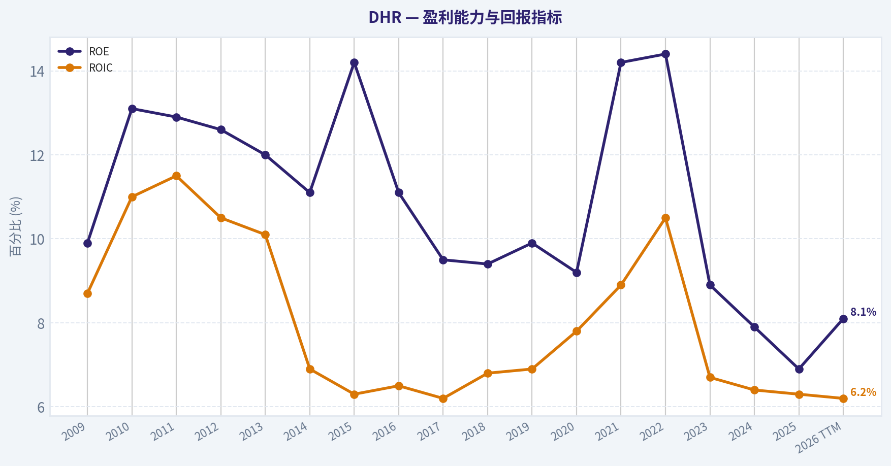
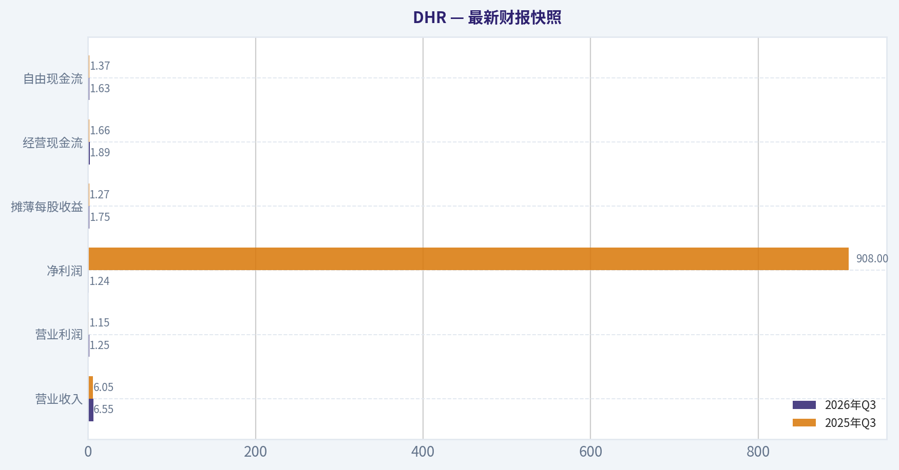
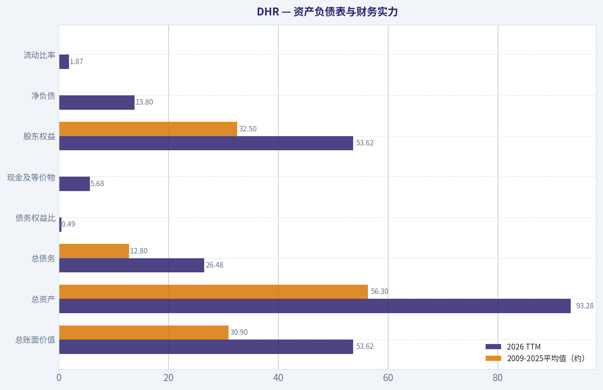
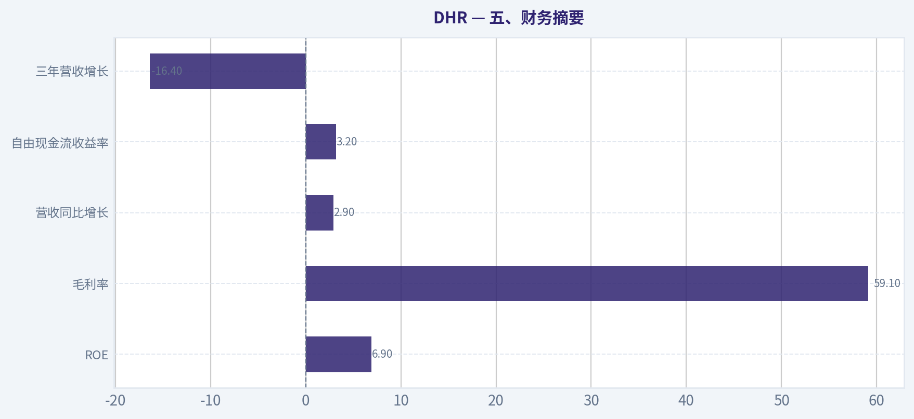
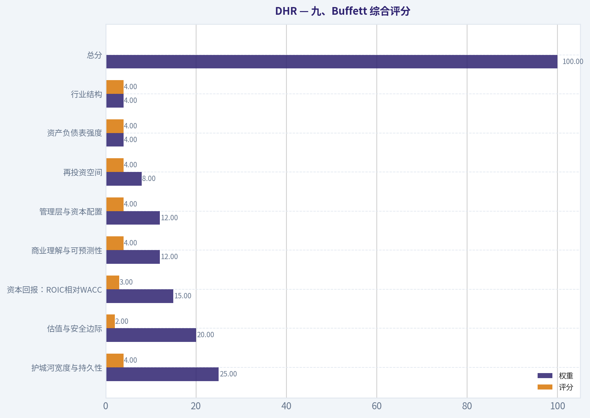
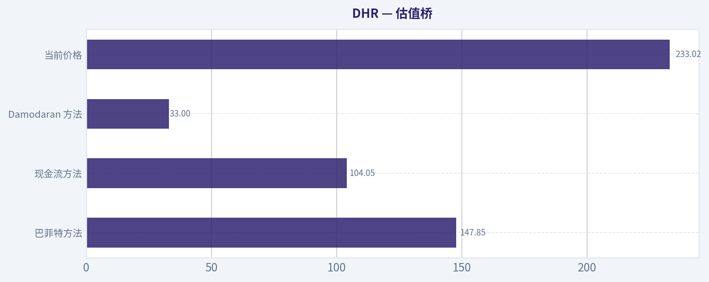
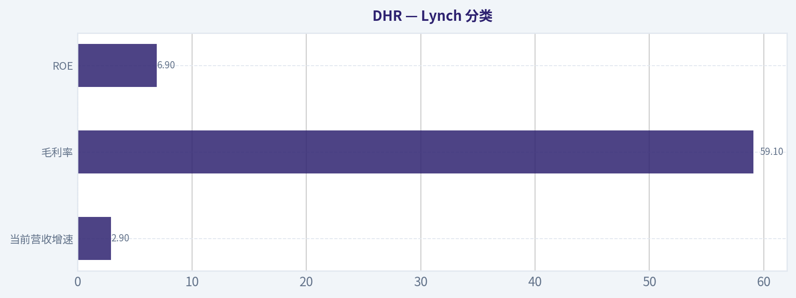
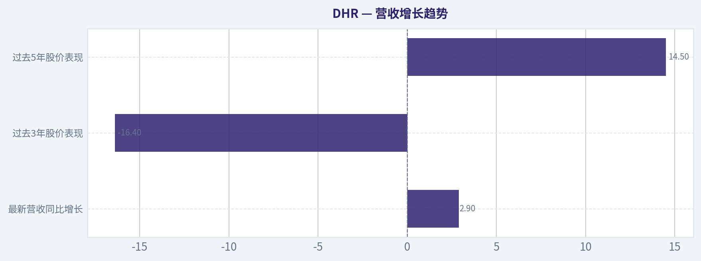

# DHR 深度价值情报

**调研日期:** 2026-11-14

## 关键免责声明

*本报告由 Deep Value Intelligence（一个基于 AI 的多智能体投资分析框架）自动生成。 仅供教育和研究用途 - 非财务建议，非财务顾问。*

---

## 目录

1. 情报摘要
2. 分析师团队报告
   - 基本面分析
   - 价值分析 (巴菲特)
   - 成长性分析 (林奇/德鲁肯米勒/费雪)
   - 市场分析
   - 期权市场分析
3. 研究团队评论
4. 投资团队评论
5. Deep Values 团队洞察

---

## 情报摘要

### 核心观点与前提条件

**核心论点:** **裁决：继续观察。** Danaher 的转换成本、安装基础、耗材复购和 DBS 支持真实护城河，近年疲软更可能包含周期与库存因素，尚未证明永久性竞争力受损。 **主要风险是价格，而非短期波动。** 约233美元对应38.6倍PE，而ROIC仅6.0%、三年营收复合下降2.7%；当前估值已预支订单复苏、利润率修复和并购持续成功。 **安全边际不足。** 按每股约7.5美元正常化自由现金流的示意性反向DCF，当前价格大致需要未来十年接近10%的自由现金流复合增长。该情景可以实现，但不够保守。 **行动建议：** 现有股东可在仓位受控的前提下持有；新资金不宜追涨。若必须保留上行参与，可建立不超过目标仓位10%至20%的观察仓，但后续加仓必须由经营改善而非单纯下跌触发。 **当前没有足够证据支持 看空。** 已知数据没有显示护城河崩塌或明确偿债危机；但也没有足够估值折价支持 看多。

**主要风险:**
- **最终立场：中性**

**置信度:** 中

---

## 分析师团队报告

### 基本面分析

#### 最新财报快照

*以下数据基于最近一期已披露财报（2026年Q3），并尽量与上一年同期对比。*

| 指标 | 2026年Q3 | 2025年Q3 | 同比变化 |
| --- | ---: | ---: | ---: |
| 营业收入 | $6.55B | $6.05B | +8.3% |
| 营业利润 | $1.25B | $1.15B | +7.9% |
| 净利润 | $1.24B | $908.0M | +36.0% |
| 摊薄每股收益 | $1.75 | $1.27 | +37.8% |
| 经营现金流 | $1.89B | $1.66B | +13.5% |
| 自由现金流 | $1.63B | $1.37B | +19.1% |

关键结论：这张快照先把最新一期财报放在桌面上，再去看长周期分析。这样读者能更清楚地区分"公司长期质量"和"这次财报发生了什么"。

#### DHR 17年财务指标

*以下数值均由原始数据确定性计算得出，并非 AI 估算。*

*发行人类型：operating company（Healthcare / Diagnostics & Research）。*

#### 17年财务指标
*年度行来自已披露财务报表，最后一行 TTM 由最近四个季度滚动计算得出。*

| 指标 | 2009 | 2010 | 2011 | 2012 | 2013 | 2014 | 2015 | 2016 | 2017 | 2018 | 2019 | 2020 | 2021 | 2022 | 2023 | 2024 | 2025 | 2026 TTM |
| --- | --- | --- | --- | --- | --- | --- | --- | --- | --- | --- | --- | --- | --- | --- | --- | --- | --- | --- |
| 市场价格 | $15 | $19 | $19 | $23 | $31 | $35 | $38 | $66 | $79 | $88 | $132 | $192 | $285 | $230 | $228 | $227 | $228 | $233 |
| 总市值 | $25.25B | $32.23B | $32.98B | $39.86B | $54.89B | $46.53B | $49.89B | $54.47B | $65.54B | $73.24B | $111.35B | $159.65B | $214.91B | $173.44B | $171.91B | $169.22B | $163.93B | $164.70B |
| 市盈率 | 21.73 | 17.87 | 15.13 | 16.64 | 20.32 | 17.90 | 14.86 | 21.33 | 26.29 | 27.57 | 37.90 | 45.43 | 33.88 | 24.36 | 36.26 | 43.39 | 45.33 | 38.14 |
| 市净率 | 2.17 | 2.35 | 1.95 | 2.10 | 2.45 | 1.99 | 2.11 | 2.37 | 2.49 | 2.60 | 3.68 | 4.01 | 4.76 | 3.46 | 3.21 | 3.42 | 3.12 | 3.07 |
| ROE | 9.9% | 13.1% | 12.9% | 12.6% | 12.0% | 11.1% | 14.2% | 11.1% | 9.5% | 9.4% | 9.9% | 9.2% | 14.2% | 14.4% | 8.9% | 7.9% | 6.9% | 8.1% |
| ROIC | 8.7% | 11.0% | 11.5% | 10.5% | 10.1% | 6.9% | 6.3% | 6.5% | 6.2% | 6.8% | 6.9% | 7.8% | 8.9% | 10.5% | 6.7% | 6.4% | 6.3% | 6.2% |
| 每股收益 | $0.69 | $1.06 | $1.25 | $1.36 | $1.53 | $1.94 | $2.55 | $3.08 | $3.00 | $3.20 | $3.48 | $4.22 | $8.40 | $9.46 | $6.38 | $5.29 | $5.05 | $6.11 |
| 营收 | $10.52B | $12.55B | $16.09B | $18.26B | $18.28B | $12.87B | $14.43B | $16.88B | $18.33B | $19.89B | $17.91B | $22.28B | $24.80B | $26.64B | $23.89B | $23.88B | $24.57B | $25.61B |
| 毛利润 | $5.07B | $6.40B | $8.18B | $8.84B | $9.34B | $6.85B | $7.77B | $9.33B | $8.57B | $9.51B | $9.98B | $12.47B | $15.24B | $16.19B | $14.03B | $14.21B | $14.52B | $15.01B |
| 毛利率 | 48.2% | 51.0% | 50.8% | 48.4% | 51.1% | 53.2% | 53.8% | 55.3% | 46.8% | 47.8% | 55.7% | 56.0% | 61.4% | 60.8% | 58.7% | 59.5% | 59.1% | 58.6% |
| 营业利润率 | 13.7% | 16.3% | 16.3% | 16.3% | 17.1% | 15.9% | 15.0% | 16.2% | 14.0% | 15.4% | 18.3% | 19.0% | 25.7% | 28.3% | 21.8% | 20.4% | 19.1% | 20.4% |
| 净利润 | $1.15B | $1.79B | $2.17B | $2.39B | $2.69B | $2.60B | $3.36B | $2.55B | $2.49B | $2.65B | $3.01B | $3.65B | $6.43B | $7.21B | $4.76B | $3.90B | $3.61B | $4.33B |
| 净利率 | 11.0% | 14.3% | 13.5% | 13.1% | 14.7% | 20.2% | 23.3% | 15.1% | 13.6% | 13.3% | 16.8% | 16.4% | 25.9% | 27.1% | 19.9% | 16.3% | 14.7% | 16.9% |
| 营收增长 | N/A | 19.3% | 28.2% | 13.5% | 0.1% | -29.6% | 12.2% | 17.0% | 8.6% | 8.5% | -10.0% | 24.4% | 11.3% | 7.4% | -10.3% | -0.1% | 2.9% | 4.2% |
| 净利润增长 | N/A | 55.7% | 21.2% | 10.1% | 12.7% | -3.6% | 29.2% | -23.9% | -2.4% | 6.4% | 13.5% | 21.2% | 76.4% | 12.1% | -33.9% | -18.2% | -7.3% | 19.8% |
| 自由现金流增长 | N/A | 16.5% | 21.0% | 29.6% | 2.6% | 8.1% | -0.1% | -10.8% | -0.9% | 18.3% | -3.5% | 63.4% | 31.4% | 4.0% | -21.9% | -8.4% | -0.7% | 8.9% |
| 总账面价值 | $11.63B | $13.71B | $16.90B | $19.02B | $22.39B | $23.38B | $23.69B | $23.00B | $26.36B | $28.21B | $30.27B | $39.77B | $45.17B | $50.08B | $53.49B | $49.54B | $52.53B | $53.62B |
| 总资产 | $19.60B | $22.22B | $29.95B | $32.94B | $34.67B | $36.99B | $48.22B | $45.30B | $46.65B | $47.83B | $62.08B | $76.16B | $83.18B | $84.35B | $84.49B | $77.54B | $83.46B | $93.28B |
| 总债务 | $3.11B | $2.82B | $5.31B | $5.34B | $3.50B | $3.47B | $12.87B | $12.27B | $10.52B | $9.74B | $21.73B | $21.20B | $22.18B | $19.68B | $18.40B | $16.00B | $18.42B | $26.48B |
| 债务股权比 | 0.27 | 0.21 | 0.31 | 0.28 | 0.16 | 0.15 | 0.54 | 0.53 | 0.40 | 0.35 | 0.72 | 0.53 | 0.49 | 0.39 | 0.34 | 0.32 | 0.35 | 0.49 |
| 现金及等价物 | $1.72B | $1.63B | $537.0M | $1.68B | $3.12B | $3.01B | $790.8M | $963.7M | $630.3M | $787.8M | $19.91B | $6.04B | $2.59B | $6.00B | $5.86B | $2.08B | $4.62B | $5.68B |
| 股东权益 | $11.63B | $13.71B | $16.90B | $19.02B | $22.39B | $23.38B | $23.69B | $23.00B | $26.36B | $28.21B | $30.27B | $39.77B | $45.17B | $50.08B | $53.49B | $49.54B | $52.53B | $53.62B |
| 经营现金流 | $1.80B | $2.08B | $2.63B | $3.42B | $3.59B | $3.76B | $3.80B | $3.52B | $3.48B | $4.02B | $3.95B | $6.21B | $8.36B | $8.52B | $7.16B | $6.69B | $6.42B | $6.86B |
| 投资现金流 | $-942.9M | $-2.29B | $-5.85B | $-1.89B | $-552.5M | $-3.44B | $-14.95B | $-5.24B | $-843.4M | $-2.95B | $-1.24B | $-21.24B | $-12.99B | $-2.23B | $-7.08B | $-1.98B | $-1.20B | $-11.08B |
| 自由现金流 | $1.63B | $1.89B | $2.29B | $2.97B | $3.05B | $3.29B | $3.29B | $2.93B | $2.91B | $3.44B | $3.32B | $5.42B | $7.12B | $7.40B | $5.78B | $5.30B | $5.26B | $5.73B |
| 自由现金流利润率 | 15.5% | 15.1% | 14.2% | 16.3% | 16.7% | 25.6% | 22.8% | 17.4% | 15.9% | 17.3% | 18.5% | 24.3% | 28.7% | 27.8% | 24.2% | 22.2% | 21.4% | 22.4% |
| 每股分红 | $0.00 | $0.00 | $0.00 | $0.00 | $0.00 | $0.00 | $0.00 | $0.00 | $0.00 | $0.00 | $0.00 | $0.00 | $0.00 | $0.00 | $0.00 | $0.00 | $0.00 | $0.00 |

#### 盈利能力指标
- 净资产收益率 (ROE): 6.9%
- 投入资本回报率 (ROIC): 6.0%
- 总资产收益率 (ROA): 4.3%
- 毛利率: 59.1%
- 营业利润率: 19.1%
- 净利率: 14.7%

#### 流动性指标
- 流动比率: 1.87
- 速动比率: 1.25

#### 杠杆指标
- 债务股权比: 0.35
- 利息覆盖倍数: 17.70
- 净负债: $13.80B

#### 增长指标（同比）
- 营收增长: 2.9%
- 净利润增长: -7.3%
- 自由现金流增长: -0.7%
- 营收复合增长率（3年）: -2.7%
- 营收复合增长率（5年）: 2.0%

#### 估值指标
- 市盈率 (TTM): 38.58
- 预期市盈率: 25.00
- 市净率: 3.06
- 市销率: 6.40
- PEG 比率: 1.34
- 企业价值/EBITDA: 22.53
- 自由现金流收益率: 3.2%
- 盈利收益率: 2.6%

#### 所有者收益（巴菲特方法，代码计算）
- 净利润: $3.61B
- + 折旧与摊销: $2.45B
- - 资本开支: $-1.16B
- - 营运资本变动: $-719.0M
- = **所有者收益: $5.62B**

#### 内在价值（代码计算）
- 当前价格: $233
- **头条内在价值（按商业模式路由）: $120**
  商业模式: stable cash cow - weighted blend [Damodaran FCFF + reverse-DCF fair + owner-earnings DCF] (stable_cash_cow)
  模型区间（各 DCF 最小-最大）: $33 - $148
  相对价格的安全边际（头条）: -94.3%
  路由说明: Stable cash cow: FCF ~ earnings and the maintenance-capex proxy is fair, so the owner-earnings DCF is the primary read, lightly blended with FCFF.
- 巴菲特方法（所有者收益）:
  保守: $78
  平均: $148
  乐观: $169
- 现金流方法（FCF）:
  保守: $64
  平均: $104
  乐观: $160
- Damodaran FCFF（WACC + 利润率 + 再投资）:
  保守: $32
  平均: $33
  乐观: $60
  蒙特卡洛区间（P10-P90）：$24 - $77（中位数 $44）
  P(内在价值 > 当前价格)：0.0%
- 反向 DCF：当前价格隐含约 22.7%/年 的所有者收益增长（10年）；过去 3 年为 -16.4%，5 年为 14.5%。

#### Piotroski F分数: 4/9
- 净利润为正: 通过
- 经营现金流为正: 通过
- 资产回报率改善: 未通过
- 现金流大于净利润: 通过
- 债务下降: 未通过
- 流动比率改善: 通过
- 未稀释股本: 未通过
- 毛利率改善: 未通过
- 资产周转率改善: 未通过

ANALYST STANCE: **看空**

#### 投资结论

Danaher（DHR）是一家具有显著竞争壁垒、产品黏性和长期并购整合能力的生命科学与诊断设备公司，商业质量较高。但以当前股价 **233美元** 计算，估值已经明显脱离近期盈利、现金流和资本回报水平。确定性数据中的综合内在价值约为 **120美元**，所有者收益模型区间为 **78-169美元**，而当前价格隐含未来十年所有者收益年增长约 **22.7%**，远高于过去三年表现，也高于公司较长期的合理增长能力。

因此，DHR更适合列入高质量公司观察名单，而不是在当前估值下积极买入。

#### 市场估值与当前经营表现

| 指标 | 2026 TTM当前值 | 2009-2025平均值 | 当前相对历史平均 | 解读 |
|---|---:|---:|---:|---|
| 市场价格 | $233 | 约$114 | 高约104% | 长期复合上涨后仍处高位 |
| 总市值 | $164.70B | 约$96.43B | 高约71% | 市场对恢复增长已有较高预期 |
| PE | 38.14-38.58倍 | 约27.31倍 | 高约40% | 盈利收益率仅约2.6%，估值偏贵 |
| PB | 3.07倍 | 约2.86倍 | 高约7% | 账面价值受并购商誉和无形资产影响，参考价值有限 |
| ROE | 8.1% | 约11.2% | 低约3.1个百分点 | 低于历史水平，资本效率尚未恢复 |
| ROIC | 6.2% | 约8.4% | 低约2.2个百分点 | 低于资本成本附近，新增投资回报承压 |
| EPS | $6.11 | 约$3.50 | 高约75% | 长期增长明显，但低于2021-2022年高点 |
| 营收 | $25.61B | 约$18.95B | 高约35% | 规模扩张成功，但近年增速明显放缓 |
| 毛利率 | 58.6% | 约53.6% | 高约5.0个百分点 | 产品组合和服务收入仍具较强定价能力 |
| 营业利润率 | 20.4% | 约18.1% | 高约2.3个百分点 | 运营效率长期改善，但低于2021-2022年峰值 |
| 净利润 | $4.33B | 约$3.55B | 高约22% | 已从疫情后低谷恢复，但仍未回到高峰 |
| 净利率 | 16.9% | 约17.0% | 大致持平 | 盈利质量稳定，但恢复速度有限 |
| 自由现金流 | $5.73B | 约$3.90B | 高约47% | 现金创造能力强，但当前市值对应收益率仅约3.2% |
| 每股股息 | $0.00 | $0.00 | 无变化 | 不支付普通股息，回报主要依赖再投资和资本增值 |

关键结论：DHR的长期收入、EPS和自由现金流已经显著高于十年前，但当前估值同样处于历史高位。最重要的矛盾是，估值显著高于历史平均，而ROE、ROIC和近期增长却低于历史高点，这意味着市场已经提前计入了较强的盈利复苏。

PB并非DHR的核心估值指标。公司通过长期并购积累了大量商誉和无形资产，账面价值不完全代表品牌、客户关系、技术平台及耗材生态的经济价值。因此，估值判断应优先依靠自由现金流、所有者收益和长期资本回报，而不是机械地将3.07倍PB定义为便宜或昂贵。

#### 盈利能力与增长质量

DHR过去十七年展现出较强的长期扩张能力。收入从2009年的10.52亿美元？应为 **105.2亿美元**，增长至当前约256.1亿美元；自由现金流从16.3亿美元增长至57.3亿美元。这里的长期增长主要来自并购、产品组合升级、全球化扩张和耗材及服务收入增加。

但近期趋势更复杂：

| 增长指标 | 当前值 | 历史观察 | 重要性 |
|---|---:|---|---|
| 营收增长率 | 2.9%同比；TTM约4.2% | 历史上曾多次达到10%-28%，也出现过负增长 | 当前属于温和恢复，不是高增长状态 |
| 净利润增长率 | -7.3%同比；TTM约19.8% | 疫情后曾连续下降，当前有恢复迹象 | TTM改善，但基数效应明显 |
| 自由现金流增长率 | -0.7%同比；TTM约8.9% | 长期增长良好，2023-2025承压 | 现金流恢复尚不够强 |
| 3年收入复合增长 | -2.7% | 明显弱于长期趋势 | 反映疫情后去库存及生物技术资本开支疲软 |
| 5年收入复合增长 | 2.0% | 低于长期并购驱动增长 | 估值与经营增速不匹配 |

关键结论：DHR的长期增长记录优于近期表现。当前收入仅低个位数增长，净利润和自由现金流虽有恢复，但还不足以支持市场隐含的22.7%长期所有者收益增长假设。

毛利率长期从约48%-51%提升至当前58.6%，说明公司拥有较好的技术、品牌和耗材黏性。营业利润率当前为20.4%，高于长期平均，但明显低于2021-2022年的25.7%-28.3%。这表明公司仍有较强盈利能力，却尚未恢复到疫情期间的异常高盈利水平。

#### 资产负债表与财务实力

| 资产负债表项目 | 2026 TTM | 2009-2025平均值（约） | 当前变化 | 判断 |
|---|---:|---:|---:|---|
| 总账面价值 | $53.62B | $30.9B | 明显增加 | 并购扩张推动资产规模增长 |
| 总资产 | $93.28B | $56.3B | 明显增加 | 规模大，但商誉及无形资产占比较高 |
| 总债务 | $26.48B | $12.8B | 高于历史平均 | 近期债务上升，需关注去杠杆 |
| 债务权益比 | 0.49 | 约0.38 | 高于历史平均 | 杠杆有所恶化，但仍非失控水平 |
| 现金及等价物 | $5.68B | 约$4.8B | 略高于平均 | 提供一定流动性缓冲 |
| 股东权益 | $53.62B | $32.5B | 明显增加 | 资本基础较大 |
| 净负债 | $13.80B | - | 当前为正 | 收购与融资使净债务仍然重要 |
| 流动比率 | 1.87 | - | 健康 | 短期偿债能力较好 |
| 利息覆盖倍数 | 17.70倍 | - | 较强 | 利息负担目前尚未构成核心风险 |

关键结论：DHR的流动性和利息覆盖能力较强，暂不存在明显偿债危机。但总债务已升至264.8亿美元，债务权益比高于历史平均，且Piotroski F分数仅为4/9，说明资产负债表质量并非处于最佳状态。

债务上升本身并不一定负面，如果公司能够以高回报率进行并购。然而当前ROIC仅约6.2%，明显低于历史平均约8.4%，这削弱了继续以较高估值和债务扩张的安全性。

#### 现金流与资本配置

当前经营现金流约68.6亿美元，自由现金流约57.3亿美元，所有者收益约56.2亿美元。自由现金流利润率为22.4%，显示DHR仍是一家现金转化能力较强的企业。

公司不支付普通股息，所有者回报主要依赖：

1. 再投资于研发、销售网络和生产能力；
2. 收购具有耗材、软件或服务收入的业务；
3. 偶尔进行股票回购或通过盈利增长提升每股价值。

这种资本配置方式与高质量复利型企业相符，但前提是并购回报率足够高。当前ROIC下滑、债务上升和资产周转率未改善，说明并购与资本投入的边际效率需要重新验证。

#### 收入来源分布

以下为基于DHR近期业务结构的估算，具体年度分部金额可能因公司报告口径、内部重分类和汇率变化而不同。

| 收入来源 | 金额（十亿美元） | 占比 |
|---|---:|---:|
| 生命科学 | 约$10.75B | 约42% |
| 生物技术 | 约$6.92B | 约27% |
| 诊断 | 约$7.94B | 约31% |
| 合计 | 约$25.61B | 100% |

关键结论：DHR收入分布较为均衡，生命科学、诊断和生物技术三大业务共同构成收入基础，降低了单一产品依赖。生命科学和生物技术受药物研发、生物制程投资和新药管线影响较大，诊断业务则提供相对稳定的医疗检测需求。

#### 经济护城河与业务质量

| 护城河来源 | 具体体现 | 稳定性评价 |
|---|---|---|
| 消耗品与重复收入 | 试剂、耗材、检测组件和工作流配套产品 | 高 |
| 客户转换成本 | 实验室流程、仪器、软件和耗材形成系统绑定 | 高 |
| 技术与品牌 | 高端仪器、诊断平台和生物制程解决方案 | 中高 |
| 规模经济 | 全球销售、研发、采购和服务网络 | 高 |
| 并购整合能力 | 长期通过并购扩大产品和客户覆盖 | 中高，但需关注估值 |
| 行业增长 | 生物药、精准诊断和生命科学研发长期扩张 | 中高，短期周期性明显 |

关键结论：DHR的护城河主要来自客户工作流绑定、耗材复购、技术认证和服务网络，而不是单一专利。其业务具有较强的长期耐久性，但生物技术资本开支周期、药企研发预算和实验室去库存会导致短期波动。

#### 可预测盈利与管理层表现

DHR的长期收入总体呈上升趋势，但并不平滑。2009-2025期间出现多次负增长，包括2014年、2019年和2023年，说明公司并非完全防御型消费必需品企业，而是受到并购整合、汇率、疫情、库存调整和生命科学资本开支影响。

管理层的优点包括：

- 能够持续扩大收入规模和毛利率；
- 通过并购形成多元化平台；
- 保持较高自由现金流利润率；
- 将业务重心放在高附加值仪器、耗材和服务。

需要警惕的方面包括：

- ROE从历史平均约11.2%降至当前8.1%；
- ROIC从约8.4%降至6.2%；
- 债务权益比从部分年份的0.3左右升至0.49；
- 资产周转率、毛利率改善和未稀释股本等Piotroski指标未通过；
- 并购对每股价值的提升需要更严格检验。

#### 巴菲特式所有者收益DCF

当前所有者收益约为 **56.2亿美元**，隐含流通股数约为：

\[
流通股数=\frac{163.94亿美元}{233美元}\approx7.04亿股
\]

每股所有者收益约为：

\[
\frac{56.2亿美元}{7.04亿股}\approx7.99美元
\]

采用10%折现率、2.5%永续增长率，并让增长率逐步向终值增长率回落：

| 情景 | 显性期假设 | 终值增长率 | 手工DCF参考价值 | 研究包模型价值 | 估值判断 |
|---|---|---:|---:|---:|---|
| 保守 | 前期约3%，逐步降至2.5% | 2.5% | 约$90-100 | $78 | 当前价格明显高估 |
| 平均 | 前期约7%-8%，逐步降至2.5% | 2.5% | 约$140-160 | $148 | 仍低于当前价格 |
| 乐观 | 前期约10%-12%，逐步降至2.5% | 2.5% | 约$180-205 | $169 | 需要较强复苏才能接近当前价格 |

关键结论：即使采用相对乐观的增长路径，所有者收益DCF仍大多低于233美元。研究包中的所有者收益模型给出78美元、148美元和169美元三个情景值，均低于当前股价，说明安全边际不足。

保守情景的计算示例：

\[
OE_0=5.62B
\]

\[
OE_1=5.62B\times1.03=5.79B
\]

前十年现金流现值近似为：

\[
PV_{1-10}\approx5.79B\times4.84=28.0B
\]

第十年所有者收益约为：

\[
OE_{10}=5.62B\times1.03^{10}\approx7.54B
\]

终值为：

\[
TV=\frac{7.54B\times1.025}{10\%-2.5\%}\approx103.1B
\]

折现后的终值约为39.8亿美元，总股权价值约为67.8亿美元，折合每股约96美元。由于不同模型对维护性资本开支、营运资本和资本结构的处理不同，研究包给出的保守值为78美元，但两者共同指向同一个结论：当前价格缺乏安全边际。

综合Damodaran FCFF、反向DCF和所有者收益模型，研究包给出的综合内在价值约为 **119.91美元**，模型区间约为 **33-148美元**。现金流模型区间为 **64-160美元**，Monte Carlo内在价值区间为 **24-77美元**，中位数约44美元。模型之间差异较大，反映出DHR未来恢复速度和资本回报率存在较大不确定性；但没有模型支持当前233美元价格。

#### 当前价格需要什么增长才能合理

反向DCF显示，当前股价约隐含未来十年所有者收益年增长 **22.7%**。这一假设存在几个问题：

- 过去三年收入复合增长率约为-2.7%；
- 过去五年收入复合增长率约为2.0%；
- 当前营收增长约2.9%；
- ROIC已经低于历史平均；
- 债务上升而资产周转率没有改善。

DHR可能在生物技术资本开支恢复、并购协同兑现和诊断需求增长的推动下实现较快反弹，但持续十年达到22.7%的所有者收益复合增长率，需要接近历史最强阶段的表现，并且需要大规模并购持续成功。这不是一个具有足够安全边际的基础假设。

#### 关键风险、机会与催化剂

| 类型 | 关键因素 | 对投资判断的影响 |
|---|---|---|
| 风险 | 当前PE约38倍，明显高于历史平均 | 盈利稍有不及预期，估值压缩空间较大 |
| 风险 | ROIC和ROE低于历史平均 | 资本投入效率下降 |
| 风险 | 总债务升至约264.8亿美元 | 限制并购和回购灵活性 |
| 风险 | 生物技术客户资本开支周期 | 可能造成订单和收入波动 |
| 风险 | 并购整合和商誉减值 | 可能侵蚀账面价值与现金回报 |
| 机会 | 生物制程市场长期增长 | 支持中长期收入恢复 |
| 机会 | 单次使用生物反应器和耗材 | 增加重复性收入和客户黏性 |
| 机会 | 诊断、核酸提取和精准医疗 | 提供结构性增长 |
| 机会 | 毛利率接近59% | 保留经营杠杆和利润恢复空间 |
| 催化剂 | 收入增长恢复至中高个位数 | 可能支撑盈利上修 |
| 催化剂 | ROIC回升至8%-10%以上 | 提升并购和再投资可信度 |
| 催化剂 | 债务下降、自由现金流加速 | 改善资产负债表质量 |

关键结论：DHR的机会主要来自生命科学和生物制程周期复苏，而风险主要来自估值过高和资本回报不足。只有当收入增长、ROIC和自由现金流同时改善时，当前估值才可能逐步变得合理。

#### 估值与买入纪律

对于具有长期护城河的公司，合理买入价不应只看绝对PE，还应结合未来现金流增长和安全边际。根据当前模型：

- 约80美元附近：接近保守所有者收益估值，具备较高安全边际；
- 约120美元附近：接近综合内在价值；
- 约145-170美元：需要较好的增长恢复，属于乐观合理区间；
- 233美元：需要明显高于历史水平的长期增长，安全边际不足。

这并不意味着DHR一定会跌至120美元，也不意味着业务质量恶化。估值过高的优质公司可以长期维持高估值，但投资者此时承担的是"增长兑现风险"和"估值压缩风险"，而不是以合理价格购买高质量资产。

#### 最终投资立场

**看空**

这里的"看空"主要针对当前价格，而不是否定公司本身。DHR拥有优秀的业务组合、较强的客户黏性、较高的毛利率和长期并购能力，属于值得长期跟踪的高质量企业。但目前：

1. PE显著高于历史平均；
2. 当前价格约为综合内在价值的1.9倍；
3. ROE和ROIC低于历史平均；
4. 收入和自由现金流近期增长偏弱；
5. 债务权益比高于长期平均；
6. 反向DCF要求未来十年所有者收益增长约22.7%。

更合理的策略是等待估值回落，或等待经营数据出现明确改善后再重新评估。若股价回到约120-150美元区间，同时ROIC恢复、债务下降、自由现金流增长达到中高个位数，投资评级可由"看空"上调至"中性观察"甚至"谨慎看多"。

#### 核心要点汇总

| 维度 | 判断 | 核心依据 |
|---|---|---|
| 商业质量 | 高 | 技术、耗材、客户转换成本和全球服务网络 |
| 长期护城河 | 中高 | 生命科学与诊断工作流形成持续绑定 |
| 盈利稳定性 | 中高 | 长期向上，但存在周期和并购波动 |
| 当前增长 | 中等偏弱 | 营收约2.9%增长，3年复合增长为负 |
| 现金流质量 | 高 | 自由现金流约57.3亿美元，利润率约22.4% |
| 财务实力 | 中高 | 流动性和利息覆盖较强，但债务上升 |
| 管理层资本配置 | 中高但需验证 | 并购历史优秀，但ROIC近期下降 |
| 当前估值 | 高估 | PE约38倍，明显高于历史平均 |
| 综合内在价值 | 约$120 | 低于当前股价约49% |
| 合理操作 | 等待 | 等待估值下降或经营回报率明显改善 |

关键结论：DHR是"好公司、贵价格"的典型案例。公司本身值得长期跟踪，但当前价格没有提供足够安全边际，因此在价值投资框架下应避免追高，等待更合理的买入点。

#### 基本面关键图表

本图追踪 **DHR** 过去十年的盈利能力与回报指标（ROE、ROIC、利润率），突出呈现资本效率的变化趋势。

---

### 价值分析 (巴菲特)

> *基于沃伦·巴菲特的价值投资哲学：能力圈、经济护城河、管理层质量与安全边际。*

#### 内在价值快照

价格是你付的钱，内在价值是企业未来可能为股东创造的现金价值。我们给出一个区间，而不是假装只有一个神奇数字。

- 当前价格: $233.02
- 估值区间（两种 DCF 方法、保守到乐观）: $63.60 至 $168.94

##### 所有者收益（巴菲特方法）
- 净利润: $3,614,000,000.00
- 折旧与摊销: $2,447,000,000.00
- 资本支出: $-1,156,000,000.00
- 营运资金变化: $-719,000,000.00
- 所有者收益: $5,624,000,000.00

##### 内在价值
###### 所有者收益法
使用所有者收益，更严格，通常更保守。
- 保守: $77.87
- 平均: $147.85
- 乐观: $168.94
- 折现率: 10.0%

###### 自由现金流法
使用自由现金流，更适合今天投入很多、为未来增长铺路的公司。
- 保守: $63.60
- 平均: $104.05
- 乐观: $159.54
- 折现率: 10.0%

ANALYST STANCE: **中性**

#### 一、投资结论

Danaher 是一家高质量生命科学与诊断设备平台，具备品牌、客户黏性、规模效应和持续并购整合能力。其核心竞争力仍然稳固，但当前股价约 **233美元**，明显高于基于现金流的保守内在价值区间；反向 DCF 显示，市场隐含未来十年约 **22.7%的年增长率**，这一要求过高。

公司没有触发财务困境硬门槛，但估值缺乏安全边际。因此，当前更适合 **观察和等待价格回落**，而不是追高买入。

#### 二、因素评分

| 因素 | 评分 | 主要依据 |
|---|---:|---|
| 圆圈能力与商业简单性 | 4/5 | 通过生命科学、诊断和生物工艺设备赚取耗材、仪器及服务收入；业务专业但商业逻辑清晰 |
| 护城河 | 4/5 | 品牌、监管认证、客户验证成本、工作流程黏性和规模效应明显 |
| 管理层与资本配置 | 4/5 | Danaher Business System 长期有效，并购整合记录优秀；但并购依赖和资本配置判断仍需持续跟踪 |
| 行业结构 | 4/5 | 高技术壁垒、客户转换成本高，行业竞争理性；部分终端市场具有周期性 |
| 第五关：质量与偿付能力硬门槛 | 未触发 | 没有证据显示经营现金流持续恶化并同时出现利息覆盖不足或明显偿付危机 |

**关键结论：** DHR 的问题不是业务质量，而是价格。公司拥有足够强的商业护城河来避免"看空"，但当前估值已经要求非常高的持续增长。

#### 三、护城河分析

| 护城河来源 | 具体证据 | 评价 |
|---|---|---|
| 无形资产 | 生命科学仪器、诊断平台和监管认证形成信任与验证壁垒；毛利率约59.1% | 强 |
| 转换成本 | 仪器、试剂、软件、数据和实验流程相互绑定；客户更换供应商需重新验证 | 强 |
| 成本优势 | 全球采购、规模化制造、并购后的流程标准化提高运营效率 | 中强 |
| 网络效应 | 不是典型社交网络，但平台装机量、耗材生态和客户数据具有一定规模反馈 | 中等 |
| 需求质量 | 生物制药、诊断和科研需求长期增长，但生物工艺订单存在周期波动 | 中强 |

Danaher 的真正优势不是单一产品，而是持续收购优质生命科学资产，再通过标准化管理体系提升利润率、现金流和市场地位。这种"并购加运营系统"的组合构成较难复制的组织能力。

#### 四、管理层与资本配置

Danaher 长期采用分散化运营和标准化管理体系，管理层能够在收购后改善业务质量，而不是简单堆积资产。其资本配置优势主要体现在：

- 能够围绕生命科学、诊断和生物工艺进行专业化并购；
- 通过运营改造提升被收购公司的效率；
- 重视自由现金流和长期每股价值；
- 业务组合持续向高毛利、耗材型和客户黏性较强的领域演进。

需要注意的是，Danaher 的增长部分依赖并购。未来若收购价格过高、融资成本上升，或者生物工艺市场长期疲软，资本回报率可能受到压制。管理层评分为 **4/5**，属于优秀但并非没有资本配置风险。

#### 五、财务摘要

| 指标 | 最新数据 |
|---|---:|
| 股价 | 233美元 |
| 总市值 | 1,639.4亿美元 |
| PE | 38.6倍 |
| ROE | 6.9% |
| 毛利率 | 59.1% |
| 营收同比增长 | 2.9% |
| 自由现金流收益率 | 3.2% |
| 估算自由现金流 | 约52.5亿美元 |
| 流动比率 | 1.87倍 |
| 三年营收增长 | -16.4% |
| 五年营收增长 | 14.5% |

**关键结论：** 毛利率接近60%，说明产品和客户关系质量较高；但近期营收增长仅2.9%，且三年增长为负，显示生物工艺周期和疫情后调整仍在影响经营表现。ROE只有6.9%，低于典型优秀复利公司的水平，不能仅凭高毛利率就忽视资本回报问题。

#### 六、所有者收益估算

以自由现金流作为所有者收益的近似值：

| 项目 | 估算值 |
|---|---:|
| 总市值 | 1,639.4亿美元 |
| 自由现金流收益率 | 3.2% |
| 估算所有者收益 | 约52.5亿美元 |
| 估算流通股数 | 约7.04亿股 |
| 估算每股所有者收益 | 约7.46美元 |
| 当前价格对应所有者收益率 | 约3.2% |

计算逻辑：

> 所有者收益 ~ 净利润 + 折旧摊销 - 维持性资本开支 - 营运资本增加
> 在现有资料下，以自由现金流约52.5亿美元作为较保守的所有者收益代理。

**关键结论：** 当前股价对应的所有者收益率只有约3.2%，意味着投资者为一项高质量但近期增长放缓的业务支付了较高价格。除非未来增长重新明显提速，否则当前收益率不足以提供充分安全边际。

#### 七、三情景 DCF 估值

以下使用约52.5亿美元的所有者收益作为起点，折现率统一采用10%，并以约7.04亿股计算每股价值。

| 情景 | 核心假设 | 企业价值 | 每股内在价值 |
|---|---|---:|---:|
| A：零增长 | 所有者收益 ÷ 10% | 525亿美元 | 约74.6美元 |
| B：GDP增长 | 永续增长3% | 772亿美元 | 约109.7美元 |
| C：历史增长 | 未来十年增长约7.25%，终值增长7.25% | 约1,448亿美元 | 约205.7美元 |
| 研究包综合估值 | 所有者收益、FCF及FCFF模型加权 | - | 119.91美元 |

情景 C 使用五年增长率14.5%的约50%，即7.25%，体现对历史增长的折扣。若将终值增长率进一步降至3%，则十年 DCF 约为 **151美元/股**，说明对终值假设的变化极其敏感。

**关键结论：** 保守模型大多低于当前股价233美元，只有对长期增长和终值给予较乐观假设时，估值才接近当前价格。研究包中的三模型估值为每股147.85美元、104.05美元和33美元，进一步说明估值分歧很大且下行风险不可忽视。

#### 八、估值与安全边际

| 估值指标 | 结果 |
|---|---:|
| 当前价格 | 233美元 |
| 综合内在价值 | 119.91美元 |
| 当前价格相对综合估值溢价 | 约94% |
| 零增长估值 | 74.6美元 |
| GDP增长估值 | 109.7美元 |
| 较温和增长估值 | 约151美元 |
| 反向DCF隐含十年增长 | 约22.7%/年 |

按照质量分层，Danaher 可以获得相对一般公司的较低安全边际要求，但即便对宽护城河企业只要求10%至15%的安全边际，当前价格仍然偏高。若以综合内在价值119.91美元计算，当前价格没有安全边际，反而包含显著估值溢价。

#### 九、Buffett 综合评分

| 评分项目 | 权重 | 评分 | 加权得分 |
|---|---:|---:|---:|
| 护城河宽度与持久性 | 25% | 4.0 | 1.00 |
| 估值与安全边际 | 20% | 2.0 | 0.40 |
| 资本回报：ROIC相对WACC | 15% | 3.0 | 0.45 |
| 商业理解与可预测性 | 12% | 4.0 | 0.48 |
| 管理层与资本配置 | 12% | 4.0 | 0.48 |
| 再投资空间 | 8% | 4.0 | 0.32 |
| 资产负债表强度 | 4% | 4.0 | 0.16 |
| 行业结构 | 4% | 4.0 | 0.16 |
| **总分** | **100%** | - | **3.45/5** |

**关键结论：** DHR 的质量评分较高，但估值评分明显拖累总分。3.45分接近"优质企业等待合理价格"的区间，尚不足以支持在当前价格积极买入。

#### 十、投资立场

**ANALYST STANCE: 中性**

- **业务质量：** 高；
- **护城河：** 宽且总体稳定；
- **管理层：** 优秀，运营和并购能力突出；
- **财务风险：** 未达到硬性财务困境标准；
- **主要风险：** 估值过高、近期增长放缓、生物工艺周期、并购回报率下降；
- **当前行动：** 持有者可继续观察，潜在投资者不宜追高；
- **更合理的关注区间：** 若价格回落至约150美元附近，安全边际将明显改善；接近120美元则更具吸引力。

投资者需要看到的是：未来增长重新加速、自由现金流恢复增长，以及股价回落至能够反映正常化收益率的水平。
#### 估值桥

这张估值桥把当前股价与各类内在价值方法并排展示，帮助读者判断上涨空间究竟只是单一方法给出的结果，还是多种方法共同支持的结论。

| 项目 | 每股内在价值 |
| --- | ---: |
| 巴菲特方法 | $147.85 |
| 现金流方法 | $104.05 |
| Damodaran 方法 | $33.00 |
| 当前价格 | $233.02 |

#### 关键结论

如果只有一种方法显著高于其他方法，说明上行空间更依赖特定建模假设。若多种方法的估值接近，则说明估值逻辑更加稳健。

#### 估值图表

本对比图（来自「最新财报快照」）将 **DHR** 的当前数据与历史基准并排呈现，直观反映公司相对自身历史均值的估值水平。

本对比图（来自「资产负债表与财务实力」）将 **DHR** 的当前数据与历史基准并排呈现，直观反映公司相对自身历史均值的估值水平。

本对比图（来自「五、财务摘要」）将 **DHR** 的当前数据与历史基准并排呈现，直观反映公司相对自身历史均值的估值水平。

本对比图（来自「九、Buffett 综合评分」）将 **DHR** 的当前数据与历史基准并排呈现，直观反映公司相对自身历史均值的估值水平。

本对比图（来自「估值桥」）将 **DHR** 的当前数据与历史基准并排呈现，直观反映公司相对自身历史均值的估值水平。

本对比图（来自「Lynch 分类」）将 **DHR** 的当前数据与历史基准并排呈现，直观反映公司相对自身历史均值的估值水平。

本对比图（来自「营收增长趋势」）将 **DHR** 的当前数据与历史基准并排呈现，直观反映公司相对自身历史均值的估值水平。

---

### 成长性分析 (林奇/德鲁肯米勒/费雪)

> *基于彼得·林奇的GARP成长投资法、斯坦利·德鲁肯米勒的宏观拐点分析法，以及菲利普·费雪的深度调研法。*

分析师立场：**看空**

#### 结论摘要

Danaher（DHR）拥有优质的生命科学工具、诊断和生物工艺平台，长期竞争壁垒较强，但当前更像"高质量成熟公司"，而不是处于高速增长拐点的成长股。营收同比仅增长 **2.9%**，股价约 **233美元**，而研究包提供的加权内在价值约 **119.91美元**，估值与增长明显不匹配。

当前不建议新建仓。若已持有，可继续跟踪生物工艺订单、生命科学需求复苏和利润率改善，但需要看到连续几个季度的营收重新加速后，才值得重新评估。

#### 1. Lynch 分类

| 项目 | 判断 |
|---|---|
| Lynch 分类 | 暂属稳健型公司，接近周期复苏型，而非快速成长股 |
| 当前营收增速 | 2.9% |
| PE | 38.6倍 |
| 毛利率 | 59.1% |
| ROE | 6.9% |
| 主要业务 | 生命科学工具、诊断、生物工艺 |
| 成长股适配度 | 偏低 |

关键结论：DHR 的商业质量较高，但当前增长速度远低于快速成长股通常需要的15%至25%以上。高 PE 配合低个位数增长，使其不符合 Lynch 的"合理价格买成长"标准。

#### 2. 故事：三个简单要点

1. Danaher 为制药、生物技术和诊断行业提供关键设备、耗材和工具，客户更换供应商的成本较高。
2. 生物工艺、单次使用生物反应器、核酸提取和微流控设备仍受长期医疗创新趋势支持。
3. 如果生物制药资本开支和研发活动复苏，DHR 可能迎来订单、营收和利润率的周期性反弹。

但目前的核心问题是：这仍然主要是"等待复苏"的故事，而不是已经被财报验证的增长加速故事。

#### 3. TAM 与十倍测试

| TAM因素 | 现有信息 | 判断 |
|---|---|---|
| 微流控设备市场 | 预计至2032年约111亿美元，年复合增长率约8.7% | 中等增长 |
| 生物工艺市场 | 受单次使用设备和生物药研发推动 | 长期有吸引力 |
| 诊断与核酸工具 | 具备医疗创新和分子诊断增长驱动 | 中长期良好 |
| 当前公司营收 | 研究包未提供最新绝对营收 | 无法精确完成十倍测试 |
| 十倍收入后市场份额 | 因缺少最新营收和完整TAM数据，无法确认 | 暂不通过 |

关键结论：DHR 所处的细分市场仍在扩张，但部分市场增速仅为中个位数至低双位数，不能自动支持十倍增长。缺少最新营收和完整可服务市场数据，也意味着目前无法证明公司收入增长十倍后仍能保持较低市场份额。

#### 4. 营收增长趋势

| 指标 | 数据或观察 | 解读 |
|---|---:|---|
| 最新营收同比增长 | 2.9% | 低增长 |
| 过去3年股价表现 | -16.4% | 市场已反映部分增长失速 |
| 过去5年股价表现 | 14.5% | 长期回报一般 |
| 当前增长形态 | 未显示20%至25%以上加速 | 尚未形成成长拐点 |
| 主要潜在驱动 | 生物工艺订单恢复、研发资本开支回升 | 需要财报验证 |

关键结论：目前没有足够证据显示营收处于"20%到25%再到35%"的加速阶段。若未来几个季度营收从低个位数恢复至双位数，并伴随订单增长和利润率扩张，才可能形成真正的 Druckenmiller 式拐点。

#### 5. 单位经济与现金流

| 指标 | 数据 | 判断 |
|---|---:|---|
| 毛利率 | 59.1% | 体现较强产品价值和业务质量 |
| 自由现金流收益率 | 3.2% | 对当前估值吸引力有限 |
| 流动比率 | 1.87 | 短期偿债能力尚可 |
| NRR | 未披露 | 无法评估 |
| LTV/CAC | 不适用于目前披露口径，且未提供 | 无法评估 |
| Rule of 40 | 不适用或无法计算 | 非典型订阅软件模式 |

关键结论：DHR 的毛利率和流动性良好，但自由现金流收益率只有3.2%，不足以抵消38.6倍 PE 带来的估值风险。由于公司不是纯 SaaS，NRR、LTV/CAC 和 Rule of 40 不是核心判断工具。

#### 6. Inflection Point 拐点评估

| 潜在拐点 | 当前证据 | 评分 |
|---|---|---:|
| 产品周期 | 单次使用生物反应器、核酸工具具备长期需求 | 3/5 |
| 市场份额 | 细分市场地位较强，但缺乏最新份额加速数据 | 3/5 |
| 利润率 | 毛利率较高，但未提供持续扩张趋势 | 3/5 |
| TAM扩张 | 生物制药和诊断市场仍扩张 | 4/5 |
| 竞争格局 | 具备规模、品牌和客户关系优势 | 4/5 |
| 财报验证 | 营收仅增长2.9%，尚未确认复苏 | 2/5 |

关键结论：DHR 有潜在拐点，但拐点尚未被数据确认。最重要的观察指标是订单增长是否领先于营收、核心生物工艺业务是否重新加速，以及经营利润率能否在收入恢复时明显扩张。

#### 7. 宏观环境

| 宏观因素 | 对DHR的影响 | 判断 |
|---|---|---|
| 生物科技融资环境 | 融资收缩会压制客户设备采购 | 当前仍是风险 |
| 制药研发支出 | 长期需求稳定，支持工具和耗材市场 | 长期利好 |
| 利率环境 | 高利率压低高估值成长资产估值 | 对当前股价不利 |
| 医疗创新趋势 | 生物药、核酸、诊断和自动化持续发展 | 结构性利好 |
| 经济周期 | 更接近需求复苏等待期，而非强劲扩张期 | 中性偏谨慎 |

关键结论：长期行业趋势仍然有利，但短期宏观环境尚未形成明显顺风。DHR 作为高估值、低当前增长公司，对利率和生物科技资本开支变化较为敏感。

#### 8. Fisher 15项评分

| Fisher维度 | 分数（1-5） | 评价 |
|---|---:|---|
| 市场潜力 | 4 | 生命科学和诊断市场长期空间较大 |
| 新产品开发决心 | 4 | 持续布局生物工艺和诊断工具 |
| 研发效率 | 4 | 产品技术含量和客户粘性较高 |
| 销售组织 | 4 | 全球渠道和行业客户关系较强 |
| 利润率质量 | 4 | 毛利率达到59.1% |
| 利润率改善 | 3 | 当前缺乏明确扩张证据 |
| 劳资关系 | 3 | 信息不足 |
| 高管关系 | 3 | 信息不足 |
| 管理层深度 | 4 | 多业务平台和规模优势明显 |
| 成本分析 | 4 | 运营体系通常较成熟 |
| 特殊竞争优势 | 5 | 品牌、耗材、客户流程和切换成本 |
| 长期盈利前景 | 4 | 长期良好，短期受周期影响 |
| 股权稀释 | 3 | 未见明显恶性稀释证据，但需跟踪并购融资 |
| 管理层坦诚度 | 3 | 当前资料不足 |
| 管理层诚信 | 4 | 未见重大治理问题 |
| **总分** | **56/75** | **良好，但非卓越级** |

关键结论：Fisher 评分为56分，说明DHR的产品、客户关系和管理体系具有较强质量。不过，优秀商业模式并不等于当前股价便宜，尤其当短期增长只有低个位数时，估值仍是主要制约因素。

#### 9. 估值分析

| 估值指标 | 结果 | 判断 |
|---|---:|---|
| 股价 | 233美元 | 偏高 |
| 市值 | 1639亿美元 | 大型成熟公司 |
| PE | 38.6倍 | 对2.9%增长明显偏贵 |
| PEG | 约13.3倍 | 极不具吸引力 |
| 自由现金流收益率 | 3.2% | 估值安全边际较低 |
| 加权内在价值 | 119.91美元 | 明显低于现价 |
| 所有者收益模型 | 147.85美元 | 低于现价 |
| FCF模型 | 104.05美元 | 低于现价 |
| Damodaran FCFF模型 | 33.00美元 | 显著低于现价 |
| 反向DCF隐含增长 | 约22.7%，持续10年 | 市场预期激进 |

关键结论：按当前 PE 和2.9%营收增长计算，PEG约为13.3，远高于合理水平。更严重的是，233美元股价隐含了约22.7%的长期年增长假设，而当前实际营收增速只有2.9%，市场预期与基本面之间存在巨大缺口。

#### 10. 机构与名人投资者信号

| 投资者 | 最新动作 | 解读 |
|---|---|---|
| Stanley Druckenmiller | 新建约958万美元仓位，占其组合0.18% | 小规模试探性看好，可能押注周期复苏 |
| Steve Cohen | 减持约91.9%，剩余约813万美元 | 短期资金态度偏谨慎 |
| 综合信号 | 一买一卖 | 方向不一致，不能构成强确认 |

关键结论：Druckenmiller 建仓值得关注，可能反映其对未来周期或业绩拐点的预期，但仓位仅占0.18%，信号强度有限。Cohen 大幅减持则说明机构对短期估值或增长仍有保留。

#### 11. 成长投资者评分卡

| 维度 | 权重 | 评分（1-5） | 加权分 |
|---|---:|---:|---:|
| Lynch故事 | 10% | 3.5 | 0.35 |
| TAM与增长跑道 | 20% | 3.5 | 0.70 |
| 营收增长 | 20% | 2.0 | 0.40 |
| 单位经济 | 15% | 3.5 | 0.53 |
| 竞争地位 | 10% | 4.5 | 0.45 |
| 管理层质量 | 10% | 4.0 | 0.40 |
| 宏观环境 | 5% | 3.0 | 0.15 |
| 盈利路径 | 5% | 3.5 | 0.18 |
| 估值 | 5% | 1.0 | 0.05 |
| **总分** | **100%** | - | **3.21/5** |

关键结论：DHR 得分约3.21分，落入"中性"的基础区间，但考虑到股价显著高于多模型内在价值、PEG极高，以及当前营收增速不足，实际投资结论下调为 **看空**。它是值得跟踪的优质公司，但不是当前值得追价买入的成长股。

#### 12. 仓位建议

| 投资者类型 | 建议 |
|---|---|
| 尚未持有 | 暂不建仓 |
| 已持有且成本较低 | 可保留核心观察仓，避免继续加仓 |
| 高估值成长投资者 | 等待估值压缩或业绩重新加速 |
| 长期医疗行业投资者 | 可列入观察名单，等待更好的买点 |
| 目标仓位 | 目前建议为0%；若业绩确认拐点，可考虑1%至3%试探仓 |

关键结论：当前最优策略是等待，而不是追高。只有当营收增速恢复至至少10%至15%、订单出现持续改善、利润率重新扩张，且估值回落至更合理区间时，才适合提高仓位。

#### 13. 关键催化剂与风险

| 催化剂 | 可能影响 |
|---|---|
| 生物制药资本开支复苏 | 推动设备和耗材订单增长 |
| 生物工艺业务重新加速 | 可能带来营收和利润率双重改善 |
| 新产品放量 | 扩大TAM并提升客户粘性 |
| 利率下降 | 支撑高质量成长股估值 |
| 并购整合成功 | 可能改善产品组合和长期增长 |

| 风险 | 可能影响 |
|---|---|
| 营收持续低个位数增长 | 证明当前估值缺乏基本面支撑 |
| 生物科技融资继续疲弱 | 客户削减研发和设备采购 |
| 高利率维持 | 压缩高 PE 资产估值 |
| 并购整合不佳 | 降低资本回报率并拖累现金流 |
| 生物工艺市场竞争加剧 | 毛利率和市场份额承压 |
| 反向DCF预期落空 | 股价可能出现较大估值重估 |

关键结论：上行空间依赖于业绩加速，而不是单纯依赖行业叙事。下行风险则更直接：如果营收仍接近3%增长，市场可能重新将DHR按成熟型医疗工具公司定价，估值压缩空间较大。

#### 最终判断

DHR 是一家优秀的生命科学平台公司，但当前不是典型的快速成长股，也没有充分证据显示其处于盈利和营收加速拐点。以233美元计价，市场隐含的增长预期远高于实际表现，且多模型内在价值均显著低于现价。

**最终立场：看空--不建议新建仓，等待业绩加速或估值大幅回落。**

---

### 市场分析

ANALYST STANCE: **中性**

#### DHR 技术面综合判断

截至 2026 年 11 月 13 日，DHR 收于 **233.02 美元**。股价仍处于中长期均线之上，说明中长期趋势保持偏强；但短期价格动能在 230 至 237 美元区域反复，MACD 从高位回落，RSI 也降至中性区间，显示上涨趋势尚未破坏，却缺乏进一步加速的确认信号。

本次重点采用 8 项互补指标：10 EMA、50 SMA、200 SMA、MACD、RSI、布林上轨、布林下轨和 ATR。它们分别覆盖短中长期趋势、动量、超买超卖、波动区间与风险管理，避免仅依赖同一类信号。

| 指标 | 2026-11-13 数值 | 近期变化 | 技术含义 |
|---|---:|---|---|
| 收盘价 | 233.02 | 低于 11 月 10 日的 236.11，但高于 11 月 5 日的 226.34 | 短线高位震荡，尚未形成明确反转 |
| 10 EMA | 232.70 | 近几日基本走平 | 短期趋势由上行转为横向，233 美元附近是即时多空分界 |
| 50 SMA | 222.38 | 持续上升 | 中期趋势仍然偏多，222 美元附近构成重要动态支撑 |
| 200 SMA | 200.43 | 近乎走平 | 股价较长期均线高约 16.3%，长期结构明显强于年初 |
| MACD | 3.02 | 从 10 月 29 日的 5.01 回落 | 仍在零轴上方，但上行动能明显减弱 |
| RSI | 54.71 | 从 10 月 29 日的 65.22 回落 | 动能中性，既未超买，也未进入超卖反弹区 |
| 布林上轨 | 238.98 | 近期大致横向 | 239 美元附近是近期上方压力与突破确认位 |
| 布林下轨 | 224.25 | 高于 11 月初的约 214 美元 | 波动区间中枢上移，224 至 225 美元附近是重要防守区域 |
| ATR | 6.39 美元 | 低于 11 月 9 日的 7.17 美元 | 波动率有所收缩，但单日约 6 美元的正常波动仍不可忽视 |

关键结论：DHR 的中长期趋势仍偏多，最重要的依据是股价明显高于 50 SMA 和 200 SMA，且 50 SMA 仍在上行。与此同时，10 EMA 走平、MACD 回落和 RSI 回到 55 附近，说明短期上涨动能正在降温，当前更像是高位整理，而不是强趋势加速阶段。

#### 趋势结构与关键价位

DHR 在 2026 年 7 月 21 日出现从约 200 美元附近快速跌至 178.69 美元的剧烈波动，随后经历反弹并在 9 月下旬重新升至 225 美元以上。10 月中下旬股价进一步上探至 236 至 238 美元区域，但 11 月初一度回落至 226 美元附近，之后重新反弹。

这种走势表明，市场已经完成了从中期下跌到修复性上升的转换，但 238 美元附近仍有较明显的供给压力。当前价格距离布林上轨约 6 美元，距离布林下轨约 8.8 美元，处于通道中上部，说明多方仍占据结构优势，但追涨的盈亏比不如回调时理想。

| 价位区域 | 重要性 | 交易解读 |
|---|---|---|
| 238-240 美元 | 短线阻力 | 接近布林上轨及近期高点，若放量突破并收稳，才有机会打开新的上行空间 |
| 233-236 美元 | 当前震荡区 | 多空拉锯区，突破 236 美元但缺乏成交量配合时，容易出现假突破 |
| 229-232 美元 | 即时支撑 | 接近现价及 10 EMA，若跌破并连续收在其下，短期动能将进一步转弱 |
| 224-226 美元 | 重要支撑 | 接近布林下轨和近期回调低点，失守会削弱高位整理结构 |
| 218-222 美元 | 中期支撑 | 接近 50 SMA，若回撤至该区域且出现止跌信号，较适合观察趋势型买点 |
| 200-201 美元 | 长期趋势支撑 | 接近 200 SMA，跌至该区域将意味着中长期趋势显著恶化 |

关键结论：239 美元左右是多方必须突破并站稳的确认区域，而 229 至 232 美元是最直接的短线防守带。若股价回落至 224 至 226 美元后能够缩量止跌，仍可视为上升趋势中的正常回撤；若进一步跌破 222 美元，则中期上涨结构会明显削弱。

#### 动量、波动与风险

MACD 目前仍为正值，说明中期多头动能尚未转负，但其数值从 5.01 降至 3.02，反映前期上涨的推动力正在减弱。由于没有同时取得 MACD 信号线和柱状图数值，不能武断判断已经发生正式死叉；不过，MACD 连续回落本身已经足以提示交易者降低追高意愿。

RSI 为 54.71，处在中性偏强区间。它没有进入 70 以上的超买区域，因此不能仅凭 RSI 判断股价即将回落；但 RSI 从 65 附近降至 55 左右，也说明近期上涨并非持续增强。若未来股价重新挑战 238 至 240 美元，而 RSI 无法同步突破前高，需警惕顶背离风险。

ATR 从 7.17 美元降至 6.39 美元，显示近期波动率正在收缩。波动收缩通常有两种可能：一是趋势稳定后的继续缓慢上行，二是重大突破前的蓄势。结合股价目前位于布林通道中上部、MACD 走弱，现阶段更适合等待方向确认，而不是预判突破。

#### 交易情景与执行思路

| 情景 | 触发条件 | 可能目标 | 风险控制 |
|---|---|---|---|
| 偏多突破 | 收盘价有效站上 239-240 美元，并伴随成交量明显增加 | 先观察 245 美元附近，再评估是否延伸 | 跌回 236 美元下方且无法快速收复时，谨慎处理假突破 |
| 区间交易 | 股价维持在 224-239 美元之间，10 EMA继续走平 | 靠近支撑观察反弹，靠近阻力减少追价 | 采用较小仓位，避免在区间中部追涨杀跌 |
| 偏空转弱 | 跌破 224-226 美元，且收盘无法收回 | 进一步观察 218-222 美元 | 若跌破 222 美元，需重新评估中期多头结构 |
| 中长期持有 | 股价仍高于 50 SMA 与 200 SMA，回撤后出现止跌 | 以趋势延续为主要目标 | 可用 ATR 的约 1 至 1.5 倍设置动态风险距离，避免止损过近 |

关键结论：最有利的多头情景是放量突破 239 至 240 美元并站稳；在突破发生前，DHR 更适合等待回调确认，而不是在 233 至 236 美元区域盲目追高。若跌破 224 至 226 美元，短线结构将转弱；若进一步跌破 50 SMA 附近的 222 美元，中期风险会显著上升。

#### 最终结论

DHR 当前属于**中长期偏多、短期中性整理**。价格位于 50 SMA 和 200 SMA 之上，说明趋势背景仍然健康；但 10 EMA 横向、MACD 回落、RSI 中性以及价格接近布林通道上半部，均表明上涨动能尚未重新增强。

因此，当前评级为 **中性**，而不是直接追涨。偏积极的交易者可等待 239 至 240 美元放量突破后再确认趋势延续；稳健型交易者则可等待 224 至 226 美元附近出现止跌，或等待价格重新站稳 236 美元。若跌破 222 美元，应将判断下调为中期偏弱，并严格控制仓位。

| 核心项目 | 当前判断 |
|---|---|
| 长期趋势 | 偏多，股价显著高于 200 SMA |
| 中期趋势 | 偏多，50 SMA 持续上行 |
| 短期趋势 | 高位震荡，10 EMA 已趋于走平 |
| 动量 | 正值但减弱，MACD 尚未转负 |
| 超买超卖 | RSI 54.71，中性，不支持极端反转判断 |
| 波动率 | ATR 回落，波动收缩但仍较大 |
| 上方确认位 | 239-240 美元 |
| 关键支撑位 | 224-226 美元，其次为 218-222 美元 |
| 操作倾向 | 等待突破确认或回调止跌，不宜在区间中部追高 |
| 综合立场 | **中性** |

关键结论：DHR 的大趋势仍由多方掌控，但短线尚未出现足够强的加速信号。239 至 240 美元决定上行是否延续，224 至 226 美元决定高位整理是否仍然有效；在这两个区域被有效突破或跌破之前，观望优于激进追价。

---

### 期权市场分析

> *解读期权流向--认沽/认购比、隐含波动率偏斜与异常活跃合约--以判断机构定位与事件驱动风险。*

ANALYST STANCE: **中性**

#### DHR 期权市场概览

以下数据截至 2026 年 11 月 14 日，覆盖近期期权到期日。期权市场显示：未平仓量结构接近中性略偏多，但当日成交量明显偏向看跌期权，短线存在对冲或下行保护需求。

| 到期日 | 看涨未平仓量 | 看跌未平仓量 | 看涨成交量 | 看跌成交量 | 看跌/看涨未平仓量比 | ATM 看涨 IV | ATM 看跌 IV |
|---|---:|---:|---:|---:|---:|---:|---:|
| 2026-11-20 | 13,774 | 9,771 | 586 | 1,945 | 0.71 | 40.1% | 39.0% |
| 2026-11-27 | 521 | 560 | 43 | 176 | 1.07 | 35.3% | 37.4% |
| 2026-12-04 | 109 | 74 | 54 | 19 | 0.68 | 34.9% | 34.6% |
| **合计** | **14,404** | **10,405** | **683** | **2,140** | **0.72** | - | - |

**关键结论：**总体看跌/看涨未平仓量比为 0.72，略高于约 0.70 的历史中性基线，未平仓结构并不悲观。可是，看跌期权成交量约为看涨期权的 3.13 倍，说明短线交易者更积极地买入保护或押注下行，形成"存量中性偏多、增量偏空"的分化格局。

#### 看跌/看涨比例分析

| 指标 | 数值 | 相对中性基线 | 解读 |
|---|---:|---|---|
| 总体看跌/看涨未平仓量比 | 0.72 | 接近 0.70 | 存量仓位略偏看涨或至少不偏空 |
| 总体看跌/看涨成交量比 | 3.13 | 显著偏高 | 看跌成交明显活跃，可能是保护性对冲或短线看空 |
| 2026-11-20 未平仓量比 | 0.71 | 接近中性 | 最大近月仓位仍较平衡 |
| 2026-11-27 未平仓量比 | 1.07 | 偏高 | 该到期日看跌保护相对集中 |
| 2026-12-04 未平仓量比 | 0.68 | 略偏多 | 远一期限结构偏向看涨 |

**关键结论：**成交量比 3.13 是当前最重要的谨慎信号，代表近期资金流明显偏向看跌期权。不过，若这些看跌期权主要是机构保护性买入，而非裸方向性看空，则它更可能反映风险管理，而不是对 DHR 基本面极度悲观。

#### 隐含波动率与偏斜

| 到期日 | ATM 看涨 IV | ATM 看跌 IV | 看跌 IV 相对看涨 IV | 解读 |
|---|---:|---:|---:|---|
| 2026-11-20 | 40.1% | 39.0% | -1.1 个百分点 | ATM 波动率较高，但未显示明显看跌偏斜 |
| 2026-11-27 | 35.3% | 37.4% | +2.1 个百分点 | 存在温和看跌偏斜，反映下行保护需求 |
| 2026-12-04 | 34.9% | 34.6% | -0.3 个百分点 | 基本平衡 |
| **近期期限范围** | **34.9%-40.1%** | **34.6%-39.0%** | - | 前端 IV 偏高，短线事件风险较大 |

**关键结论：**近月 ATM IV 约为 35%至 40%，对单一股票而言属于偏高水平，市场正在为较大的短线波动定价。数据没有提供完整的虚值看跌和虚值看涨 IV，因此无法严格计算整个波动率微笑；现有 ATM 数据仅显示 11 月 27 日存在温和看跌偏斜。当前日期附近可能存在财报或其他催化剂，但提供的数据未确认具体事件，不能据此断言 IV 一定是财报溢价。

#### 异常期权活动

工具定义的异常标准为：期权成交量超过未平仓量五倍。近期期限内没有符合该标准的合约。

| 项目 | 结果 | 含义 |
|---|---|---|
| 成交量超过未平仓量五倍的合约 | 未发现 | 没有明确的新开仓异常合约 |
| 异常看涨合约 | 未发现 | 暂无突出的机构式上行押注 |
| 异常看跌合约 | 未发现 | 虽然看跌成交量高，但未确认具体新开仓合约 |
| 资金风格判断 | 无法确认 | 缺乏逐笔成交方向、执行价和买卖盘信息 |

**关键结论：**没有异常合约意味着目前不能把高看跌成交量直接解释为"聪明钱强烈看空"。它可能包含保护性买入、平仓、滚动仓位或价差策略，因此方向性置信度有限。

#### 未平仓量集中与潜在价格引力

| 到期日 | 总未平仓量 | 占所列期限总未平仓量 | 观察 |
|---|---:|---:|---|
| 2026-11-20 | 23,545 | 94.3% | 未平仓量绝大多数集中于最近到期日 |
| 2026-11-27 | 1,081 | 4.3% | 仓位明显较少，但看跌/看涨比高于 1 |
| 2026-12-04 | 183 | 0.7% | 远期仓位很少 |
| **合计** | **24,809** | **100%** | 市场高度集中在最近到期日 |

**关键结论：**DHR 的期权仓位高度集中于 2026 年 11 月 20 日到期，意味着临近到期时，价格可能受到较强的 Gamma 交易、做市商对冲和价格钉住效应影响。但数据没有提供执行价分布，因此无法识别具体的最大未平仓执行价、最大痛点或看涨/看跌 Gamma 墙。集中到期本身会放大短线波动和到期日附近的价格扰动。

#### 综合判断

| 维度 | 信号 | 说明 |
|---|---|---|
| 未平仓量结构 | 中性略偏多 | 总看跌/看涨未平仓量比 0.72，接近中性基线 |
| 成交量结构 | 偏空或偏防御 | 看跌/看涨成交量比 3.13 |
| 隐含波动率 | 偏高 | 近月 ATM IV 约 35%至 40% |
| 波动率偏斜 | 温和偏空 | 11 月 27 日看跌 IV 高于看涨 IV |
| 异常活动 | 无明确方向 | 没有成交量超过未平仓量五倍的合约 |
| 流动性与置信度 | 中等偏低 | 近月有一定成交，但更远期限成交较薄，且缺少执行价明细 |
| **总体信号** | **中性** | 存量略偏多，但短线资金流偏向下行保护 |

**关键结论：**综合判断为中性，而不是明确看多或看空。主要原因是未平仓量比仍接近中性且略偏多，但近期看跌成交量大幅占优、11 月 27 日存在温和看跌 IV 偏斜，说明短线下行风险被重点对冲。若必须作方向选择，当前更接近"中性偏谨慎"，不支持在缺乏具体异常合约和执行价证据的情况下追涨。

#### 汇总表

| 项目 | 结论 |
|---|---|
| 看跌/看涨比率 | 未平仓量比 0.72，接近中性；成交量比 3.13，显著偏向看跌 |
| IV 水平 | 近月 ATM IV 约 35%至 40%，偏高 |
| 偏斜方向 | 整体资料不足以完整测算；已知 11 月 27 日为温和看跌偏斜 |
| 异常活动 | 未发现成交量超过未平仓量五倍的合约 |
| 未平仓量集中 | 94.3%集中于 2026 年 11 月 20 日到期，存在到期日 Gamma 和钉住效应 |
| **总体信号** | **中性**，存量略偏多但短线资金流偏防御 |

**关键结论：**DHR 期权市场的核心信息是"未平仓仓位尚未转空，但短线交易明显增加了下行保护"。因此总体维持中性观察，只有在后续出现持续的看跌新开仓、看跌 IV 进一步扩大，或未平仓量比明显升破 1.0 时，才会转向更明确的看空信号。

---

## 研究团队评论

> *研究经理将多空辩论综合为中性评论。此为风险评审前的初步观点，并非最终立场。*

核心结论

Danaher 是一家具有真实护城河的生命科学平台，但在约233美元的价格上，投资者已经为相当程度的周期复苏、利润率修复和持续并购成功付费。公司质量足以排除"因为短期低迷就直接看空"的判断，但当前估值和资本回报也不足以支持积极买入。

最合理的决策是继续观察，而不是追涨，也不必因为短期技术面或期权数据卖出优质资产。现有股东可以持有并等待经营验证；尚未持有者应要求更好的价格或更强的自由现金流证据。

多头最有说服力的地方

DHR 的护城河是真实的。其仪器、耗材、试剂、软件和服务被嵌入制药、诊断及生物工艺流程，更换供应商可能引发重新验证、监管审批、员工培训和生产中断。由此形成的转换成本、安装基础和重复耗材收入，使其经济质量明显高于普通资本设备公司。

长期需求也没有因近三年的疲软而消失。生物制药复杂度提高、单次使用工艺渗透、实验室自动化、分子诊断以及细胞和基因治疗，仍能提供十年以上的增长空间。疫情后的库存消化、生物科技融资收紧和资本开支推迟，很可能解释了相当部分收入下降，不能机械地把近三年营收复合下降2.7%外推到未来十年。

管理层和 Danaher Business System 同样具有价值。DHR 长期通过专业化收购、运营改善和业务组合升级，把集团向高毛利、耗材型和高黏性领域迁移。这种资本配置能力可能使正常化盈利质量高于当前ROIC和PE所呈现的静态结果。

空头最有说服力的地方

真正的问题不是公司差，而是价格缺乏明确的安全边际。约38.6倍PE、6.0%的ROIC和负的三年营收增长组合，意味着当前价格不能仅靠"优质企业"来辩护。质量能够降低所需折价，却不能取消估值纪律。

示意性反向DCF显示，若以每股约7.5美元正常化自由现金流、8.5%折现率和3%永续增长率计算，233美元大致要求未来十年自由现金流接近10%的复合增长。这个要求并非绝对不可能，但需要有机增长恢复、利润率回升、耗材需求改善以及并购继续创造价值。它更接近合理偏乐观的假设，而不是明显保守的定价。

低ROIC也不能完全归咎于商誉和会计处理。商誉代表管理层真实支付过的收购资本。如果DHR需要持续以高价格收购才能维持增长，股东获得的增量回报可能不高。关键不是剔除商誉后数字有多漂亮，而是每股自由现金流是否增长、收购回报是否超过资本成本。

多头给出的保守价值区间约为180至220美元，基准区间约为230至280美元。233美元只是接近基准区间下沿，并没有达到高质量企业通常要求的约10%至15%折价。若正常化价值靠近区间中值，当前价格尚可；若复苏延迟，则盈利下修和估值压缩可能同时发生。

综合判断

我不会接受基本面分析师基于静态PE和当前ROIC直接给出的强硬回避结论，因为它低估了DHR的转换成本、经常性收入、长期行业跑道及运营体系。但我也不会接受"优质平台可以在233美元分批买入"的积极结论，因为反向DCF已要求公司恢复接近两位数的自由现金流增长，而经营数据尚未提供足够验证。

技术面和期权市场只能影响节奏，不能决定内在价值。股价位于中长期均线之上，但短期动能减弱；看跌与看涨期权成交量比约3.13，反映短期保护需求，却可能是机构对冲。两者共同说明市场在等待确认，而不是证明长期护城河受损。

从 Buffett 式视角看，这是一家"值得拥有，但不必在任何价格拥有"的企业。233美元附近更像合理价值附近，而不是具有可验证安全边际的买点。对于如此优质但当前回报率较弱的公司，等待并非错过机会，而是在要求经营事实承担举证责任。

投资理由

选择中性观察主要基于三个判断。

第一，业务质量较高。客户转换成本、监管壁垒、耗材收入、全球服务能力以及DBS构成了可持续竞争优势，近年的行业调整尚未证明这些优势遭到永久破坏。

第二，正常化盈利存在反弹潜力。若库存调整结束、生物科技融资回暖和生物工艺订单恢复，经营杠杆可能使利润与自由现金流增长快于收入。

第三，估值没有为错误留下足够空间。约10%的隐含长期自由现金流增长并非"英雄式"到完全无法实现，但也远高于当前经营趋势。若折现率提高至9.5%至10%，或长期增长率降至2%至2.5%，估值会明显承压。因此，当前赔率不够偏向买方。

过去容易犯的错误，是只看静态PE而错过优质复利企业，或者反过来，用"周期复苏"和"护城河"替高估值辩护。这次需要同时检查市场环境与基本面：既不把低谷利润永久化，也不把未经验证的复苏提前当成现金流。

未来1至4个季度的监测计划

未来一个季度，重点观察生物工艺订单、订单出货比、核心有机收入和耗材收入。订单改善必须转化为实际收入，而不能只停留在管理层对行业触底的描述。如果耗材恢复而设备仍弱，反而可能是更健康的信号，因为耗材通常更能体现客户实际使用率。

未来两个季度，重点检查经营利润率和自由现金流转换率。收入小幅回升但利润率继续下降，说明定价、产品组合或成本结构存在问题；收入增长较温和而自由现金流明显改善，则支持周期低谷论。还应剔除营运资本释放等一次性因素，避免把库存下降误判为可持续现金增长。

未来三至四个季度，应观察滚动ROIC是否持续回升，并要求管理层量化大型收购后的收入增长、利润率改善和现金回报。仅有调整后EPS增长不够，必须看到每股自由现金流增长，同时确认股票薪酬、增发和债务没有吞噬股东收益。

资产负债表方面，应跟踪净债务与正常化EBITDA、利息覆盖、债务到期安排和商誉减值风险。如果公司在经营尚未恢复时继续高价收购或明显加杠杆，投资吸引力会下降。

强化多头判断的条件包括：核心有机收入恢复中高个位数增长、耗材与生物工艺订单连续改善、利润率扩张、每股自由现金流增长快于收入，以及ROIC明显高于资本成本。若这些指标得到验证，即使股价没有大幅回调，内在价值增长也可能逐步创造安全边际。

削弱投资判断的条件包括：订单再次恶化、耗材收入持续疲软、利润率无法随收入修复、ROIC长期停留在约6%、收购依赖加杠杆，或管理层继续以"暂时性周期"解释超过数个季度的结构性疲软。在这种情况下，即使股价下跌，也要重新评估护城河和正常化盈利，而不能机械抄底。

价格层面，若经营证据没有明显变化，约200至210美元开始提供更有意义的质量调整折价；接近180至195美元时，风险收益会显著改善。反之，如果股价维持或高于233美元，则需要连续几个季度的自由现金流和ROIC改善来支撑估值。

最终立场：中性

---

## 投资团队评论

> *投资经理将研究观点转化为投资论点，等待风险评审。此仍非最终立场。*

### 综合判断

这份分析的核心结论基本合理：Danaher（DHR）是高质量生命科学平台，但在约233美元附近，估值已经隐含了相当程度的周期复苏与现金流改善，尚不足以提供清晰的安全边际。因此，更合适的策略是观察，而不是因为短期疲软强行看空，也不是因为护城河优秀就追价买入。

不过，仍需对几个关键判断进行校正。

### 1. 静态ROIC偏低，但不能轻易忽略

6%的ROIC确实低于一家优秀资产轻型企业应有的水平，也可能低于其资本成本。但DHR是长期通过并购扩张的企业，商誉和无形资产会压低账面回报率。单看ROIC可能低估经营资产的真实效率。

然而，这不能成为无限期为低ROIC辩护的理由。商誉不是"虚假的资本"，而是管理层实际支付出去的收购价格。投资者最终需要看到的是：

- 每股自由现金流持续增长；
- 收购后收入与利润率达到预期；
- 增量投入资本能够产生合理回报；
- 并购没有依赖持续加杠杆或过度发行股票。

换言之，剔除商誉后的回报率可以帮助理解业务，但不能替代对股东真实回报的检验。

### 2. 收入下滑可能是周期性，但复苏尚未被证实

过去三年收入复合下降2.7%，很可能受到生物科技融资收缩、客户去库存、疫情后需求正常化以及生物制药资本开支延迟的共同影响。DHR所处行业并未失去长期增长逻辑，单次使用技术、实验室自动化、分子诊断和生物工艺仍有较长的渗透空间。

但"长期行业增长"不等于"DHR短期必然复苏"。需要区分三类增长：

1. 客户库存重新补充带来的短期反弹；
2. 行业资本开支恢复带来的周期性回升；
3. 安装基础扩大、耗材渗透和产品创新带来的结构性增长。

只有第三类增长，才能真正支撑较高的长期估值。若未来仅出现订单反弹，却没有耗材收入、利润率和每股自由现金流的同步改善，估值修复可能只是暂时性的。

### 3. 反向DCF的方向正确，但不应过度精确

以约7.5美元正常化自由现金流、8.5%折现率和3%永续增长率估算，233美元确实要求未来自由现金流接近高个位数至约10%的长期复合增长。这不是不可能，但需要多个条件同时成立：

- 有机收入重新达到中高个位数增长；
- 毛利率和经营利润率回升；
- 生物工艺需求恢复；
- 并购继续创造价值；
- 资本开支和营运资本不会长期吞噬现金流。

因此，当前价格并非明显泡沫，但也不是保守定价。若折现率升至9.5%至10%，或者长期增长率下降至2%至2.5%，合理价值会明显下移。DHR的估值对假设较敏感，这意味着投资者应要求经营数据先行，而不是仅凭管理层对周期触底的表述提前支付复苏溢价。

### 4. 市场情绪提供的是节奏信息，不是价值结论

技术面仍然偏强、短期动能降温，说明股价尚未出现基本面崩坏的信号，但这对十年期投资价值的帮助有限。期权看跌成交量明显较高，也不能直接解释为市场看空DHR，可能只是机构进行组合保护。

真正有价值的反向观察是：市场当前既没有极度恐慌，也没有完全恢复信心。若未来出现因订单暂时疲弱导致股价回落，但客户使用量、耗材收入和现金流质量没有恶化，这可能构成优质企业的逆向机会。相反，若市场继续给予高估值，而经营复苏迟迟不兑现，则"高质量"可能成为投资者为过高价格辩护的理由。

### 5. 管理层最大的考验是并购纪律

DHR的历史优势在于Danaher Business System和收购整合能力，但过去成功并不自动保证未来收购仍然便宜。当前环境下，最应关注的不是并购数量，而是：

- 收购价格是否合理；
- 收购业务的利润率是否改善；
- 整合后现金流是否增加；
- 管理层是否在核心业务疲软时仍进行激进扩张；
- 收购是否提高每股内在价值，而不仅是扩大收入规模。

如果管理层在有机增长尚未恢复、ROIC仍约6%的情况下继续高价收购，投资逻辑会明显削弱。反之，若管理层保持资产负债表纪律，并在行业低迷期以合理价格收购优质耗材和软件资产，市场可能低估其长期复利能力。

### 估值与操作框架

在没有新经营数据确认之前，233美元附近更接近合理价值，而非明显低估区域。对于这种具有高转换成本、重复耗材收入和长期行业跑道的企业，10%至15%的折价通常已经能够支持买入；但当前估值似乎尚未达到这一标准。

可以采用分层判断：

- **约220至230美元**：接近合理价值，除非经营改善明确，否则不宜积极追买；
- **约200至210美元**：若护城河没有恶化，开始具备较有意义的观察性买入价值；
- **约180至195美元**：若自由现金流和资产负债表仍然健康，风险收益明显改善；
- **重新站上250美元以上**：需要连续季度的有机增长、利润率和每股自由现金流改善来证明估值合理。

现有股东不必仅因收入短期下降或期权成交偏空而卖出，因为这些因素尚未证明DHR的长期竞争优势受损。但新投资者应保持耐心，等待价格折价或经营数据验证，避免将预期中的复苏当成已经实现的盈利能力。

### 需要重点跟踪的验证指标

未来几个季度，最重要的不是股价是否站上某条均线，而是：

1. 核心有机收入是否恢复正增长并持续改善；
2. 生物工艺订单和订单出货比是否转强；
3. 耗材收入是否优于设备收入；
4. 经营利润率是否随收入恢复而扩张；
5. 自由现金流增长是否超过收入增长；
6. 剔除营运资本释放后，现金流是否仍然健康；
7. ROIC能否持续高于资本成本；
8. 净债务、股票薪酬和并购支出是否保持纪律。

如果上述指标连续两至四个季度改善，当前价格即使不大幅下跌，也可能逐渐变得合理。若收入继续疲软、利润率不修复、ROIC长期停留在低位，并购重新依赖杠杆，则股价下跌本身不构成买入理由。

**ANALYST STANCE: 中性**--DHR是值得长期研究和可能持有的高质量生命科学平台，但目前估值尚未提供足够安全边际。持有者可继续观察并等待经营验证，潜在买家应等待更低价格，或等待自由现金流、利润率和ROIC出现连续改善。

---

## Deep Values 团队洞察

> *风险管理团队进行辩论，由风险裁判给出最终不含操作建议的裁定。本章节决定最终的「看多 / 中性 / 看空」立场。*

#### 最终立场评分卡

这张评分卡把最终研究结论转成加权决策框架。它不替代文字判断，但能让读者更快看清楚这次结论的核心驱动因素。

| 维度 | 评分 | 权重 | 说明 |
| --- | ---: | ---: | --- |
| 业务质量 | 3.25 | 30% | 高回报率、盈利能力与 Piotroski 评分共同支撑业务韧性。 |
| 估值支撑 | 2.00 | 30% | 综合当前股价相对内在价值锚点以及常用估值比率。 |
| 财务强度 | 4.00 | 20% | 资产负债表韧性主要取决于杠杆与流动性是否处于安全区间。 |
| 成长持续性 | 1.33 | 20% | 近期营收、利润与自由现金流增长共同反映增长是否可持续。 |
| 总分 / 最终立场 | 2.64 | 100% | 看空 |

#### 关键结论

加权总分为 **2.64 / 5.0**，最终立场为 **看空**。它更适合作为快速校准工具，而不是机械买卖信号。

#### 风险摘要

分数越高代表风险压力越大。观察阈值是一个简单的护栏：一旦高于该阈值，就意味着需要更严格跟踪，或者需要更大的安全边际。

| 维度 | 当前分数 | 观察阈值 | 说明 |
| --- | ---: | ---: | --- |
| 业务质量 | 2.75 | 3.00 | 高回报率、盈利能力与 Piotroski 评分共同支撑业务韧性。 |
| 估值支撑 | 4.00 | 3.00 | 综合当前股价相对内在价值锚点以及常用估值比率。 |
| 财务强度 | 2.00 | 3.00 | 资产负债表韧性主要取决于杠杆与流动性是否处于安全区间。 |
| 成长持续性 | 4.67 | 3.00 | 近期营收、利润与自由现金流增长共同反映增长是否可持续。 |

#### 关键结论

这张图帮助读者区分风险究竟来自哪里：估值、业务质量、资产负债表，还是增长持续性。尤其当最终结论处在「观望」与「回避」边缘时，这种拆解非常有帮助。
