# DHR Deep Value Intelligence

**Analysis Date:** 2026-11-14

## Critical Disclaimer

*This analysis is generated by Deep Value Intelligence, an AI-powered multi-agent investing framework. Education & research only - not financial advice, not a financial advisor.*

---

## Table of Contents

1. Intelligence Summary
2. Analyst Team Reports
   - Fundamentals Analysis
   - Intrinsic Value Analysis (Buffett)
   - Trend & Growth Analysis (Lynch/Druckenmiller/Fisher)
   - Market Technical Analysis
   - Options Market Analysis
3. Research Team Commentary
4. Value Investing Team Commentary
5. Deep Values Commentary

---

## Intelligence Summary

### Thesis + Conditions

**Core Thesis:** **Danaher remains a high-quality franchise, but $233 offers insufficient valuation protection.** Its regulated workflows, installed base, proprietary consumables, switching costs, and Danaher Business System support durable competitive advantages. The 59.1% gross margin reinforces the case for differentiation rather than commoditization.

**Key Risks:**
- The investment risk is primarily **overpayment**, not business failure. At 38.6x earnings, investors are already underwriting a meaningful biopharma recovery, margin expansion, and improved capital efficiency, while current ROIC is only 6.0%. Those returns may be cyclically depressed, but the recovery is not yet demonstrated.
- A small starter position may be reasonable only for investors willing to accept valuation risk, but it is not presently a compelling value purchase.
- The Risky Analyst correctly distinguishes temporary industry weakness from permanent franchise deterioration. Danaher's current 6.0% ROIC and 6.9% ROE may understate through-cycle economics because of weak biopharma demand, inventory digestion, underutilized capacity, acquisition accounting, and operating leverage.

**Confidence:** Medium

---

## Analyst Team Reports

### Fundamentals Analysis

#### Latest Earnings Snapshot

*Most recent reported quarter anchored on 2026 Q3, with prior-year comparison when available.*

| Metric | 2026 Q3 | 2025 Q3 | YoY Change |
| --- | ---: | ---: | ---: |
| Revenue | $6.55B | $6.05B | +8.3% |
| Operating Income | $1.25B | $1.15B | +7.9% |
| Net Income | $1.24B | $908.0M | +36.0% |
| Diluted EPS | $1.75 | $1.27 | +37.8% |
| Operating Cash Flow | $1.89B | $1.66B | +13.5% |
| Free Cash Flow | $1.63B | $1.37B | +19.1% |

Key Takeaways: This snapshot anchors the most recent reported quarter before the narrative analysis. It helps readers separate long-run business quality from whatever changed in the latest earnings print.

#### 17-Year Financial Metrics for DHR

*All values below are computed deterministically from raw data - not estimated by AI.*

*Issuer profile: operating company (Healthcare / Diagnostics & Research).*

#### 17-Year Financial Metrics
*Annual rows come from reported financial statements. The final TTM row is computed from the latest four quarters.*

| Metric | 2009 | 2010 | 2011 | 2012 | 2013 | 2014 | 2015 | 2016 | 2017 | 2018 | 2019 | 2020 | 2021 | 2022 | 2023 | 2024 | 2025 | 2026 TTM |
| --- | --- | --- | --- | --- | --- | --- | --- | --- | --- | --- | --- | --- | --- | --- | --- | --- | --- | --- |
| Market Price | $15 | $19 | $19 | $23 | $31 | $35 | $38 | $66 | $79 | $88 | $132 | $192 | $285 | $230 | $228 | $227 | $228 | $233 |
| Market Cap | $25.25B | $32.23B | $32.98B | $39.86B | $54.89B | $46.53B | $49.89B | $54.47B | $65.54B | $73.24B | $111.35B | $159.65B | $214.91B | $173.44B | $171.91B | $169.22B | $163.93B | $164.70B |
| P/E Ratio | 21.73 | 17.87 | 15.13 | 16.64 | 20.32 | 17.90 | 14.86 | 21.33 | 26.29 | 27.57 | 37.90 | 45.43 | 33.88 | 24.36 | 36.26 | 43.39 | 45.33 | 38.14 |
| P/B Ratio | 2.17 | 2.35 | 1.95 | 2.10 | 2.45 | 1.99 | 2.11 | 2.37 | 2.49 | 2.60 | 3.68 | 4.01 | 4.76 | 3.46 | 3.21 | 3.42 | 3.12 | 3.07 |
| ROE | 9.9% | 13.1% | 12.9% | 12.6% | 12.0% | 11.1% | 14.2% | 11.1% | 9.5% | 9.4% | 9.9% | 9.2% | 14.2% | 14.4% | 8.9% | 7.9% | 6.9% | 8.1% |
| ROIC | 8.7% | 11.0% | 11.5% | 10.5% | 10.1% | 6.9% | 6.3% | 6.5% | 6.2% | 6.8% | 6.9% | 7.8% | 8.9% | 10.5% | 6.7% | 6.4% | 6.3% | 6.2% |
| EPS | $0.69 | $1.06 | $1.25 | $1.36 | $1.53 | $1.94 | $2.55 | $3.08 | $3.00 | $3.20 | $3.48 | $4.22 | $8.40 | $9.46 | $6.38 | $5.29 | $5.05 | $6.11 |
| Revenue | $10.52B | $12.55B | $16.09B | $18.26B | $18.28B | $12.87B | $14.43B | $16.88B | $18.33B | $19.89B | $17.91B | $22.28B | $24.80B | $26.64B | $23.89B | $23.88B | $24.57B | $25.61B |
| Gross Profit | $5.07B | $6.40B | $8.18B | $8.84B | $9.34B | $6.85B | $7.77B | $9.33B | $8.57B | $9.51B | $9.98B | $12.47B | $15.24B | $16.19B | $14.03B | $14.21B | $14.52B | $15.01B |
| Gross Margin | 48.2% | 51.0% | 50.8% | 48.4% | 51.1% | 53.2% | 53.8% | 55.3% | 46.8% | 47.8% | 55.7% | 56.0% | 61.4% | 60.8% | 58.7% | 59.5% | 59.1% | 58.6% |
| Operating Margin | 13.7% | 16.3% | 16.3% | 16.3% | 17.1% | 15.9% | 15.0% | 16.2% | 14.0% | 15.4% | 18.3% | 19.0% | 25.7% | 28.3% | 21.8% | 20.4% | 19.1% | 20.4% |
| Net Income | $1.15B | $1.79B | $2.17B | $2.39B | $2.69B | $2.60B | $3.36B | $2.55B | $2.49B | $2.65B | $3.01B | $3.65B | $6.43B | $7.21B | $4.76B | $3.90B | $3.61B | $4.33B |
| Net Margin | 11.0% | 14.3% | 13.5% | 13.1% | 14.7% | 20.2% | 23.3% | 15.1% | 13.6% | 13.3% | 16.8% | 16.4% | 25.9% | 27.1% | 19.9% | 16.3% | 14.7% | 16.9% |
| Revenue Growth | N/A | 19.3% | 28.2% | 13.5% | 0.1% | -29.6% | 12.2% | 17.0% | 8.6% | 8.5% | -10.0% | 24.4% | 11.3% | 7.4% | -10.3% | -0.1% | 2.9% | 4.2% |
| Net Income Growth | N/A | 55.7% | 21.2% | 10.1% | 12.7% | -3.6% | 29.2% | -23.9% | -2.4% | 6.4% | 13.5% | 21.2% | 76.4% | 12.1% | -33.9% | -18.2% | -7.3% | 19.8% |
| Free Cash Flow Growth | N/A | 16.5% | 21.0% | 29.6% | 2.6% | 8.1% | -0.1% | -10.8% | -0.9% | 18.3% | -3.5% | 63.4% | 31.4% | 4.0% | -21.9% | -8.4% | -0.7% | 8.9% |
| Total Book Value | $11.63B | $13.71B | $16.90B | $19.02B | $22.39B | $23.38B | $23.69B | $23.00B | $26.36B | $28.21B | $30.27B | $39.77B | $45.17B | $50.08B | $53.49B | $49.54B | $52.53B | $53.62B |
| Total Assets | $19.60B | $22.22B | $29.95B | $32.94B | $34.67B | $36.99B | $48.22B | $45.30B | $46.65B | $47.83B | $62.08B | $76.16B | $83.18B | $84.35B | $84.49B | $77.54B | $83.46B | $93.28B |
| Total Debt | $3.11B | $2.82B | $5.31B | $5.34B | $3.50B | $3.47B | $12.87B | $12.27B | $10.52B | $9.74B | $21.73B | $21.20B | $22.18B | $19.68B | $18.40B | $16.00B | $18.42B | $26.48B |
| Debt-to-Equity | 0.27 | 0.21 | 0.31 | 0.28 | 0.16 | 0.15 | 0.54 | 0.53 | 0.40 | 0.35 | 0.72 | 0.53 | 0.49 | 0.39 | 0.34 | 0.32 | 0.35 | 0.49 |
| Cash & Equivalents | $1.72B | $1.63B | $537.0M | $1.68B | $3.12B | $3.01B | $790.8M | $963.7M | $630.3M | $787.8M | $19.91B | $6.04B | $2.59B | $6.00B | $5.86B | $2.08B | $4.62B | $5.68B |
| Shareholders' Equity | $11.63B | $13.71B | $16.90B | $19.02B | $22.39B | $23.38B | $23.69B | $23.00B | $26.36B | $28.21B | $30.27B | $39.77B | $45.17B | $50.08B | $53.49B | $49.54B | $52.53B | $53.62B |
| Operating Cash Flow | $1.80B | $2.08B | $2.63B | $3.42B | $3.59B | $3.76B | $3.80B | $3.52B | $3.48B | $4.02B | $3.95B | $6.21B | $8.36B | $8.52B | $7.16B | $6.69B | $6.42B | $6.86B |
| Investing Cash Flow | $-942.9M | $-2.29B | $-5.85B | $-1.89B | $-552.5M | $-3.44B | $-14.95B | $-5.24B | $-843.4M | $-2.95B | $-1.24B | $-21.24B | $-12.99B | $-2.23B | $-7.08B | $-1.98B | $-1.20B | $-11.08B |
| Free Cash Flow | $1.63B | $1.89B | $2.29B | $2.97B | $3.05B | $3.29B | $3.29B | $2.93B | $2.91B | $3.44B | $3.32B | $5.42B | $7.12B | $7.40B | $5.78B | $5.30B | $5.26B | $5.73B |
| FCF Margin | 15.5% | 15.1% | 14.2% | 16.3% | 16.7% | 25.6% | 22.8% | 17.4% | 15.9% | 17.3% | 18.5% | 24.3% | 28.7% | 27.8% | 24.2% | 22.2% | 21.4% | 22.4% |
| Dividends / Share | $0.00 | $0.00 | $0.00 | $0.00 | $0.00 | $0.00 | $0.00 | $0.00 | $0.00 | $0.00 | $0.00 | $0.00 | $0.00 | $0.00 | $0.00 | $0.00 | $0.00 | $0.00 |

#### Profitability Metrics
- Return on Equity (ROE): 6.9%
- Return on Invested Capital (ROIC): 6.0%
- Return on Assets (ROA): 4.3%
- Gross Margin: 59.1%
- Operating Margin: 19.1%
- Net Profit Margin: 14.7%

#### Liquidity Metrics
- Current Ratio: 1.87
- Quick Ratio: 1.25

#### Leverage Metrics
- Debt-to-Equity Ratio: 0.35
- Interest Coverage Ratio: 17.70
- Net Debt: $13.80B

#### Growth Metrics (Year-over-Year)
- Revenue Growth: 2.9%
- Net Income Growth: -7.3%
- Free Cash Flow Growth: -0.7%
- Revenue CAGR (3-Year): -2.7%
- Revenue CAGR (5-Year): 2.0%

#### Valuation Metrics
- P/E Ratio (TTM): 38.58
- Forward P/E: 25.00
- Price-to-Book: 3.06
- Price-to-Sales: 6.40
- PEG Ratio: 1.34
- EV/EBITDA: 22.53
- Free Cash Flow Yield: 3.2%
- Earnings Yield: 2.6%

#### Owner Earnings (Buffett Method, Code-Computed)
- Net Income: $3.61B
- + Depreciation & Amortization: $2.45B
- - Capital Expenditures: $-1.16B
- - Working Capital Changes: $-719.0M
- = **Owner Earnings: $5.62B**

#### Intrinsic Value (Code-Computed)
- Current Price: $233
- **Headline Intrinsic Value (business-model routed): $120**
  Business model: stable cash cow - weighted blend [Damodaran FCFF + reverse-DCF fair + owner-earnings DCF] (stable_cash_cow)
  Model spread (min-max across DCFs): $33 - $148
  Margin of safety vs. price (headline): -94.3%
  Routing note: Stable cash cow: FCF ~ earnings and the maintenance-capex proxy is fair, so the owner-earnings DCF is the primary read, lightly blended with FCFF.
- Buffett Method (Owner Earnings):
  Conservative: $78
  Average: $148
  Optimistic: $169
- Cash Flow Method (FCF):
  Conservative: $64
  Average: $104
  Optimistic: $160
- Damodaran FCFF (WACC + margins + reinvestment):
  Conservative: $32
  Average: $33
  Optimistic: $60
  Monte Carlo band (P10-P90): $24 - $77 (median $44)
  P(intrinsic value > price): 0.0%
- Reverse-DCF: price implies ~22.7%/yr owner-earnings growth for 10y; trailing 3y was -16.4%, 5y 14.5%.

#### Piotroski F-Score: 4/9
- Positive Net Income: PASS
- Positive Operating Cash Flow: PASS
- ROA Improvement: FAIL
- Cash Flow > Net Income: PASS
- Decreasing Debt: FAIL
- Improving Current Ratio: PASS
- No Dilution: FAIL
- Improving Gross Margin: FAIL
- Improving Asset Turnover: FAIL

ANALYST STANCE: **Bearish**

#### Executive Summary

Danaher is a high-quality operating company with attractive life-science, diagnostics, and bioprocessing exposure. Its moat is supported by mission-critical instruments, consumables, recurring workflows, switching costs, regulatory know-how, and the Danaher Business System.

However, the current valuation is difficult to justify using Buffett-style owner earnings. At approximately **$233 per share**, DHR trades at about **38x TTM earnings**, a **3.2% price-to-book ratio**, and only a **3.2% free-cash-flow yield**. The deterministic valuation models produce a headline intrinsic value of approximately **$120 per share**, with an owner-earnings range of **$78 to $169**. The market price implies approximately **22.7% annual owner-earnings growth for ten years**, which is substantially more demanding than recent operating performance.

#### Current Metrics Versus Historical Averages

The averages below are calculated from the annual rows in the deterministic dataset, excluding the 2026 TTM figure unless explicitly labeled current.

| Metric | Current / 2026 TTM | Approx. Historical Average | Interpretation |
|---|---:|---:|---|
| Market Price | $233 | $114 | About 105% above the 2009-2025 average |
| Market Cap | $164.70B | ~$106B | Well above the long-term average |
| P/E Ratio | 38.14x | ~27.4x | Premium of roughly 39% |
| P/B Ratio | 3.07x | ~2.84x | Moderately above average, but not a primary valuation signal |
| ROE | 8.1% | ~11.4% | Below the historical norm |
| ROIC | 6.2% | ~8.0% | Below the historical norm |
| EPS | $6.11 | ~$3.75 | Above average, but affected by acquisitions and business-cycle changes |
| Revenue | $25.61B | ~$20.1B | Above average |
| Gross Margin | 58.6% | ~54.0% | Above average |
| Operating Margin | 20.4% | ~18.0% | Above average, but below the 2021-2022 peak |
| Net Margin | 16.9% | ~16.6% | Roughly normal |
| Net Income | $4.33B | ~$3.55B | Above average, but below the 2021-2022 peak |
| Revenue Growth | 4.2% | ~6.8% | Below long-term average |
| Net Income Growth | 19.8% | ~10.2% | Rebound from a weak comparison year |
| FCF Growth | 8.9% | ~9.1% | Approximately in line with the long-term average |
| Total Debt | $26.48B | ~$13.8B | Nearly twice the historical average |
| Debt-to-Equity | 0.49 | ~0.38 | Above average |
| Cash and Equivalents | $5.68B | ~$5.0B | Adequate in absolute terms |
| Shareholders' Equity | $53.62B | ~$32.6B | Substantially higher than historical average |
| Free Cash Flow | $5.73B | ~$4.0B | Above average |
| Dividends per Share | $0.00 | $0.00 | No dividend distribution in the dataset |

**Key Takeaways:** DHR's revenue, margins, earnings, and free cash flow are above their long-term averages, but the stock price and P/E multiple are substantially higher as well. More concerning is that current ROE and ROIC are below historical norms while debt is near a record level in the dataset. The market is therefore paying a premium for a business whose recent returns on capital have weakened.

#### Market Metrics

- **Market price:** $233, compared with an approximate historical average of $114. The stock has appreciated dramatically, but price appreciation has outpaced recent fundamental improvement.
- **Market capitalization:** approximately $164.7 billion, versus an estimated historical average near $106 billion.
- **P/E ratio:** 38.14x TTM, compared with an approximate historical average of 27.4x. The forward P/E of approximately 25x is more reasonable, but still assumes a meaningful earnings recovery.
- **P/B ratio:** 3.07x. For Danaher, book value is not a decisive valuation anchor. The company is acquisition-oriented, has substantial intangible assets, and its economic value comes from proprietary workflows, installed instruments, consumables, customer relationships, and operating systems. Accordingly, cash flow and returns on capital matter more than a mechanical interpretation of price-to-book.

The current valuation is especially demanding when compared with the company's **6.2% ROIC**, **8.1% ROE**, and **3.2% FCF yield**. A high multiple can be justified by a durable moat, but only if long-term growth and capital efficiency are also strong and predictable.

#### Profitability

| Metric | Current | Historical Pattern | Assessment |
|---|---:|---|---|
| ROE | 8.1% | Historically often 9%-14%; peak 14.4% in 2022 | Below normal |
| ROIC | 6.2% | Historically roughly 6%-11.5% | Below long-term average |
| EPS | $6.11 | Rose from $0.69 in 2009; peaked at $9.46 in 2022 | Recovering, but below peak |
| Revenue | $25.61B | Long-term upward trend despite acquisition and cycle volatility | Strong scale |
| Gross Profit | $15.01B | Increased substantially over the period | Strong |
| Gross Margin | 58.6% | Above the long-term average; below 2021 peak of 61.4% | Attractive |
| Operating Margin | 20.4% | Above long-term average; below 2022 peak of 28.3% | Good but cyclical |
| Net Income | $4.33B | Below 2021-2022 levels, above most earlier years | Rebounding |
| Net Margin | 16.9% | Near long-term average | Stable |

**Key Takeaways:** Danaher retains strong gross economics, with a current gross margin near 59% and operating margin above 20%. Yet returns on equity and invested capital are weaker than the company's historical best levels, indicating that acquisitions, goodwill, softer bioprocessing demand, or higher invested capital are diluting economic returns. The business remains profitable, but its current valuation assumes a stronger return profile than the latest ROIC supports.

Revenue increased from **$10.52 billion in 2009 to $25.61 billion currently**, demonstrating strong long-term scale expansion. However, growth has not been smooth. Revenue declined in 2014, 2019, 2023, and 2024, while current growth of approximately 4.2% is modest relative to the valuation.

Net income and EPS were unusually strong in 2021 and 2022, partly reflecting pandemic-related demand and portfolio conditions. The subsequent normalization explains why current earnings growth appears strong on a year-over-year basis even though EPS remains below its 2022 peak.

#### Growth and Predictability

- **Revenue growth:** Current TTM growth is 4.2%, while the latest reported annual growth rate is 2.9%. The five-year revenue CAGR is approximately 2.0%, and the three-year CAGR is negative at approximately -2.7%.
- **Net income growth:** Current growth of 19.8% represents a recovery from depressed earnings. It should not be extrapolated as a normal growth rate.
- **Free-cash-flow growth:** Current growth is 8.9%, but recent years included declines of 21.9% in 2023, 8.4% in 2024, and 0.7% in 2025.
- **Earnings predictability:** Long-term earnings have generally advanced, but the record includes acquisition-related volatility, pandemic effects, cyclical bioprocessing weakness, and several periods of negative growth.

The market price implies approximately **22.7% annual owner-earnings growth for ten years**. That is inconsistent with the recent operating record: trailing three-year revenue CAGR is negative, five-year revenue CAGR is only 2.0%, and ROIC has fallen to approximately 6.2%.

#### Balance Sheet and Financial Strength

| Balance-Sheet Metric | Current | Historical Comparison | Interpretation |
|---|---:|---:|---|
| Total Assets | $93.28B | Higher than the historical average | Large acquisition-built asset base |
| Total Debt | $26.48B | Approximately twice the long-term average | Important risk |
| Debt-to-Equity | 0.49 | Above approximate historical average of 0.38 | Leverage has increased |
| Cash and Equivalents | $5.68B | Above most historical years | Useful liquidity buffer |
| Shareholders' Equity | $53.62B | Well above historical average | Strong accounting capital base |
| Net Debt | $13.80B | Meaningful relative to current FCF | Reduces equity value |
| Current Ratio | 1.87 | Healthy | Adequate short-term liquidity |
| Interest Coverage | 17.70x | Strong | Debt is serviceable currently |

**Key Takeaways:** Danaher's balance sheet is not distressed, and interest coverage is strong. Nevertheless, total debt has risen to $26.48 billion, while ROIC has weakened. The central balance-sheet question is not near-term solvency; it is whether future acquisitions and capital investments can earn returns high enough to justify the leverage and valuation.

The Piotroski F-Score is only **4 out of 9**. Positive net income, positive operating cash flow, and cash flow exceeding net income are favorable. However, the company receives unfavorable marks for debt reduction, dilution, gross-margin improvement, asset turnover, and ROA improvement.

#### Cash Flow and Capital Allocation

Current free cash flow is **$5.73 billion**, with a **22.4% FCF margin**. This is a major strength. Free cash flow has risen materially from $1.63 billion in 2009, and operating cash flow is $6.86 billion currently.

Buffett-style owner earnings are computed as follows:

| Owner-Earnings Component | Amount |
|---|---:|
| Net income | $3.61B |
| Depreciation and amortization | +$2.45B |
| Capital expenditures | -$1.16B |
| Working-capital investment | -$0.719B |
| **Owner earnings** | **$5.62B** |

**Key Takeaways:** Danaher converts accounting earnings into substantial cash, and owner earnings of $5.62 billion are close to free cash flow. This supports the quality of the business and the reliability of the cash-flow valuation. However, the cash yield at the current market price remains low, and the company's lack of dividends means shareholders depend primarily on reinvestment, acquisitions, and future stock-price appreciation.

Dividends per share are **$0.00 throughout the entire deterministic dataset**. This is not inherently negative for a high-return compounder, but it places greater responsibility on management to reinvest at attractive returns or repurchase shares at sensible prices. The combination of zero dividends, elevated debt, and a high share valuation reduces the margin for capital-allocation mistakes.

#### Revenue Breakdown

Danaher's latest revenue is $25.61 billion on a TTM basis. Exact current segment amounts are not included in the deterministic dataset, so the following is an approximate business-mix allocation based on Danaher's publicly reported operating structure and recent segment proportions.

| Revenue Source | Amount ($B) | % of Total |
|---|---:|---:|
| Diagnostics | ~$9.8B | ~38% |
| Life Sciences | ~$8.4B | ~33% |
| Biotechnology / Bioprocessing | ~$7.4B | ~29% |
| **Total** | **~$25.6B** | **100%** |

**Key Takeaways:** Danaher has a diversified revenue base rather than dependence on one product. Diagnostics and life sciences provide broad installed-base and workflow exposure, while biotechnology and bioprocessing offer greater long-term growth potential but also more pronounced cyclical and funding sensitivity. The portfolio's quality is high, but recent bioprocessing normalization has pressured growth and returns.

#### Economic Moat and Business Quality

Danaher's moat is substantial but not invulnerable.

**Sources of competitive advantage include:**

1. **Mission-critical products:** Many instruments, assays, consumables, and bioprocessing technologies are embedded in laboratory and manufacturing workflows.
2. **High switching costs:** Once customers validate processes, train personnel, and establish regulatory documentation, switching suppliers can be costly and operationally risky.
3. **Recurring consumables:** Consumables and service revenue can produce repeat purchasing and attractive customer retention.
4. **Regulatory and technical know-how:** Diagnostics and bioprocessing require validation, quality systems, and specialized expertise.
5. **Danaher Business System:** The company has historically demonstrated strong operational improvement and integration capabilities.
6. **Acquisition platform:** Danaher has repeatedly acquired and improved businesses, although acquisition returns must be monitored carefully.

The moat supports high gross margins and durable cash generation. However, the business is exposed to biotechnology funding cycles, pharmaceutical capital spending, hospital budgets, inventory corrections, foreign exchange, regulation, and acquisition execution.

#### Buffett-Style Owner-Earnings DCF

The starting point is owner earnings of **$5.62 billion**, or approximately **$7.96 per share**, using an estimated share count of roughly 706 million shares derived from market capitalization divided by share price.

A Buffett-style DCF discounts explicit owner earnings and a terminal value:

\[
PV = \sum_{t=1}^{10}\frac{OE_0(1+g_t)^t}{(1+r)^t}
+
\frac{OE_{10}(1+g_T)}{(r-g_T)(1+r)^{10}}
\]

Assumptions use an approximately 10% discount rate and a 2.5% terminal growth rate. Growth fades toward the terminal rate rather than remaining permanently elevated.

| Scenario | Growth Framework | Owner-Earnings Value per Share | Value Versus $233 Price |
|---|---|---:|---:|
| Conservative | Approximately 3% initial growth, fading toward 2.5% | $78 | 67% downside |
| Average | Higher recovery and reinvestment growth, fading toward terminal growth | $148 | 36% downside |
| Optimistic | Strong bioprocessing recovery and durable compounding, fading over time | $169 | 27% downside |

**Key Takeaways:** Even the optimistic owner-earnings case remains below the current share price. The average case implies substantial downside, while the conservative case indicates that the valuation is highly vulnerable to ordinary growth or margin disappointment. These outputs are not a prediction of short-term price movement; they measure the return required from the underlying business.

The broader valuation pack provides additional cross-checks:

- Owner-earnings DCF range: **$78 to $169**
- FCF valuation range: **$64 to $160**
- Damodaran FCFF range: **$32 to $60**
- Three-model spread: **$33 to $148** in the principal blended model summary
- Headline intrinsic value: approximately **$120**
- Monte Carlo FCFF band: approximately **$24 to $77**, with a median near **$44**
- Current FCF yield: **3.2%**
- Current earnings yield: **2.6%**

The Damodaran FCFF results are substantially lower because they incorporate current margins, reinvestment requirements, leverage, and a more demanding capital structure framework. The owner-earnings approach is more favorable to Danaher because it emphasizes the company's long-run cash-generation potential. Even the more favorable method does not support $233.

#### Management and Capital Allocation

Management's historical operating record is strong in several respects:

- Revenue and free cash flow have compounded over the long term.
- Gross margins have expanded meaningfully from earlier periods.
- The company has built a diversified and strategically important portfolio.
- The Danaher Business System has historically improved acquired operations.

There are also warning signs:

- ROE has declined from a historical range often above 10% to 8.1% currently.
- ROIC is only 6.2%, below the historical average.
- Debt has increased to $26.48 billion.
- The Piotroski score is 4/9.
- The company has no dividend history in the deterministic dataset.
- Dilution and asset-turnover deterioration are flagged in the quality indicators.

Management may still be excellent operationally, but an excellent operator can become a poor investment when purchased at an excessive price.

#### Risks, Opportunities, and Catalysts

| Category | Specific Item | Investment Significance |
|---|---|---|
| Opportunity | Recovery in bioprocessing demand | Could restore revenue growth and operating leverage |
| Opportunity | Continued consumables and recurring workflow growth | Supports durable margins and cash flow |
| Opportunity | Successful bolt-on acquisitions | Could improve growth and returns if bought at disciplined prices |
| Opportunity | Margin recovery toward historical peaks | Would support higher owner earnings |
| Risk | Current price implies roughly 22.7% annual owner-earnings growth | Very demanding embedded expectation |
| Risk | Debt increased to $26.48B | Reduces flexibility and raises execution sensitivity |
| Risk | ROIC and ROE below historical norms | Indicates weaker capital productivity |
| Risk | Biotechnology funding and capital-spending cycles | Can delay instrument purchases and consumable growth |
| Risk | Acquisition and integration risk | Overpaying could destroy value despite operational expertise |
| Risk | No dividend support | Shareholders rely heavily on future appreciation |
| Risk | Multiple compression | A return toward the historical P/E could materially reduce the share price |

**Key Takeaways:** The main upside catalyst is a broad recovery in bioprocessing and life-science spending combined with margin normalization. The main risk is valuation compression: even if Danaher executes well, a premium multiple can contract if growth merely returns to mid-single digits. At the current price, the investor is paying today for a large portion of the recovery that has yet to occur.

#### Final Investment Stance

**Bearish at approximately $233 per share.**

Danaher is an attractive business but an unattractive purchase at the current valuation under a Buffett-style framework. The company has:

- A credible economic moat
- Strong gross margins
- Significant free-cash-flow generation
- A diversified and strategically important portfolio
- Long-term evidence of successful operational execution

But the shares also have:

- A P/E substantially above the historical average
- A low 3.2% FCF yield
- Owner-earnings DCF values materially below the market price
- Current ROE and ROIC below historical norms
- Debt near a dataset high
- Recent revenue and earnings volatility
- A market-implied growth rate far above recent fundamental growth

A more attractive entry point would require either a substantial price decline, a sustained improvement in ROIC and revenue growth, or both. Based on the model range, the stock would offer a more favorable margin of safety in approximately the **$100-$150 range**, with the lower end more consistent with conservative assumptions and the upper end requiring a successful operating recovery.

#### Key Investment Summary

| Key Point | Assessment |
|---|---|
| Business quality | High |
| Economic moat | Strong, especially in regulated and embedded workflows |
| Revenue durability | Good, but exposed to biotechnology and healthcare cycles |
| Margin quality | Strong gross margin; operating margin below prior peak |
| ROE and ROIC | Currently mediocre relative to historical levels |
| Balance sheet | Serviceable but more leveraged than historically |
| Cash generation | Strong; current FCF approximately $5.73B |
| Dividend policy | No dividends in the deterministic dataset |
| Current valuation | Expensive |
| Intrinsic value | Headline approximately $120; owner-earnings range $78-$169 |
| Margin of safety | Negative at the current price |
| Recommended action | Wait for a materially lower valuation or stronger returns on capital |

**Key Takeaways:** Danaher deserves to remain on a high-quality watchlist, but not at a price that assumes exceptional growth for a decade. The best Buffett-style decision is to admire the business while refusing to overpay for it.

#### Fundamental Visuals

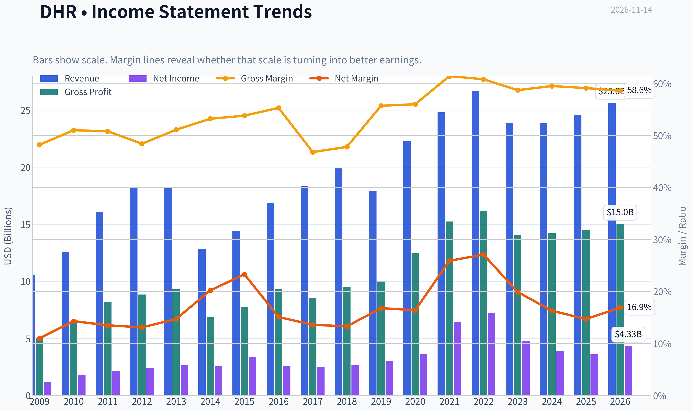

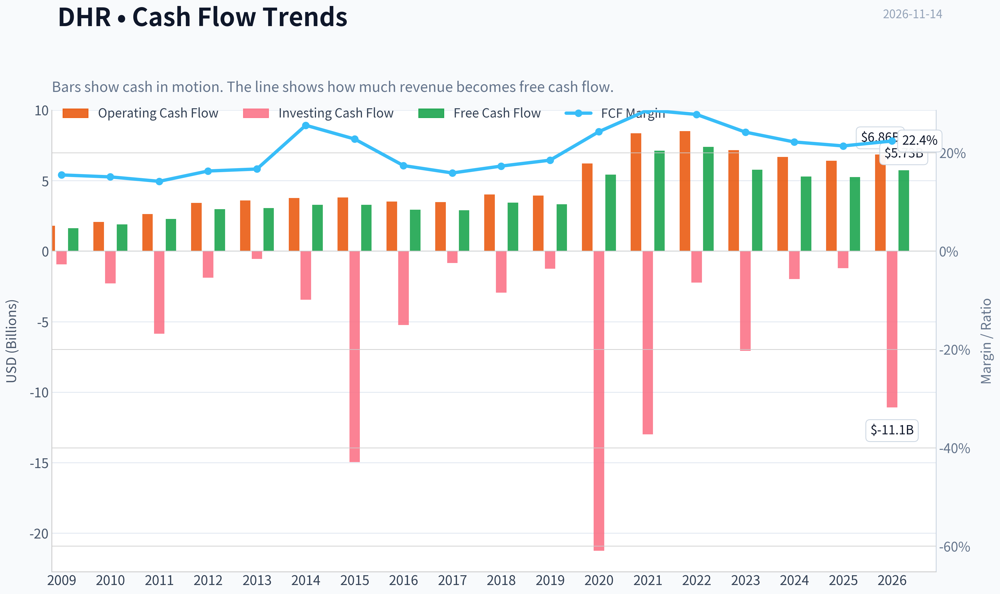

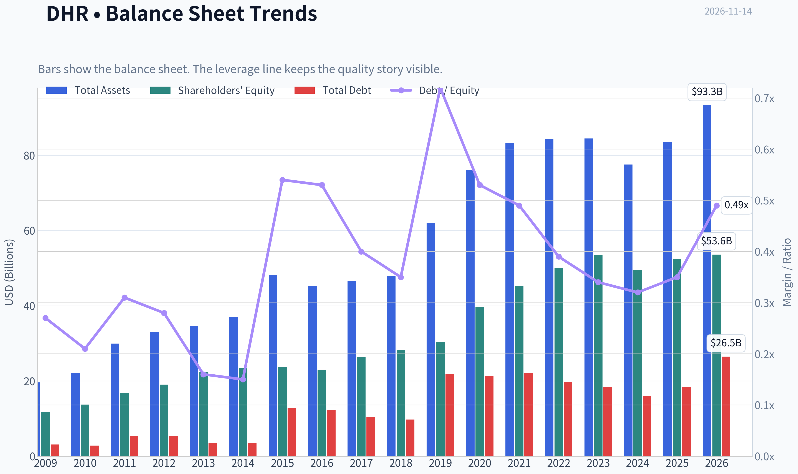

This graph tracks the profitability and return metrics (ROE, ROIC, Margins) of **DHR** over the past decade, highlighting capital efficiency trends.

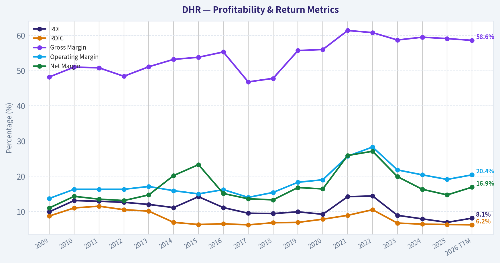

This chart illustrates the financial health of **DHR** over the last 10 years, mapping cash equivalents and free cash flow against total obligations (Debt).

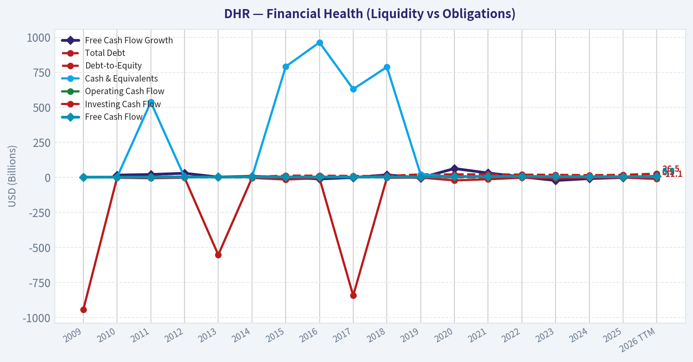

This comparison chart from *Profitability* stacks current figures against historical benchmarks for **DHR**, making it easy to see where the company trades relative to its own averages.

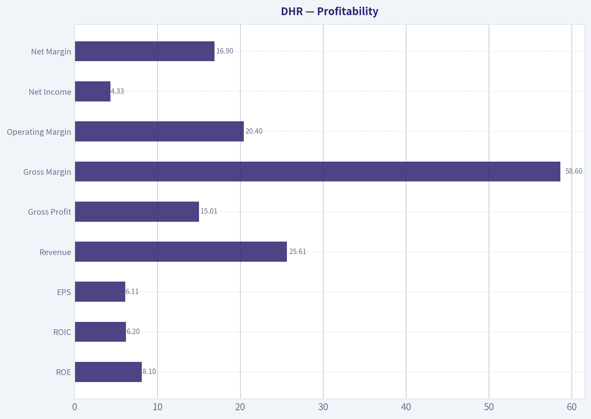

This breakdown chart from <em>Cash Flow and Capital Allocation</em> shows the proportional composition for **DHR** - useful for understanding what drives or risks the business.

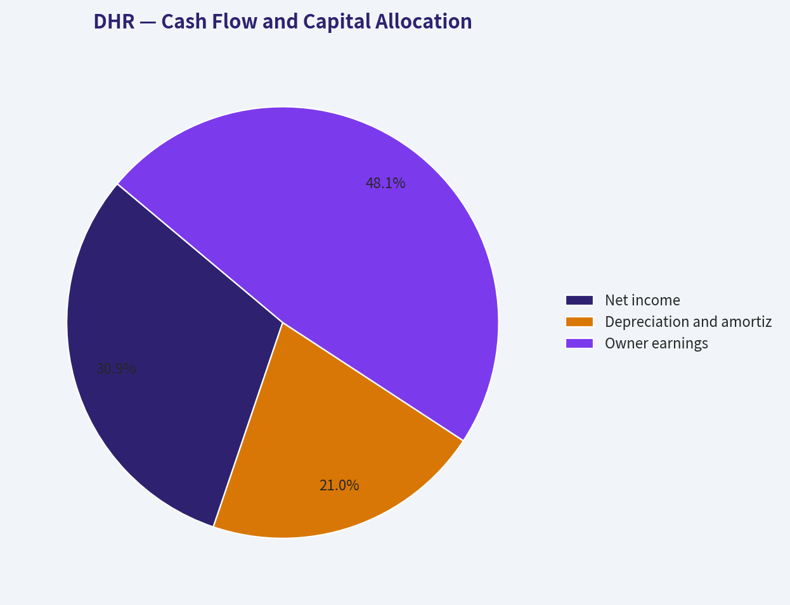

---

### Intrinsic Value Analysis (Buffett)

> *Following Warren Buffett's value investing philosophy: Circle of Competence, Economic Moat, Management Quality, and Margin of Safety.*

#### Intrinsic Value Snapshot

Price is what you pay. Intrinsic value is what the business may be worth based on the cash it can create for owners over time. We show a range, not one magic number.

- Current Price: $233.02
- Value Range (conservative to optimistic across both DCF methods): $63.60 to $168.94

##### Owner Earnings (Buffett Method)
- Net Income: $3,614,000,000.00
- Depreciation & Amortization: $2,447,000,000.00
- Capital Expenditures: $-1,156,000,000.00
- Working Capital Changes: $-719,000,000.00
- Owner Earnings: $5,624,000,000.00

##### Intrinsic Value
###### Buffett Method
Uses owner earnings. Stricter, and usually more conservative.
- Conservative: $77.87
- Average: $147.85
- Optimistic: $168.94
- Discount Rate: 10.0%

###### Cash Flow Method
Uses free cash flow. Better for companies spending heavily today to grow tomorrow.
- Conservative: $63.60
- Average: $104.05
- Optimistic: $159.54
- Discount Rate: 10.0%

ANALYST STANCE: **Neutral**

#### Executive Conclusion

Danaher is a high-quality life-sciences and diagnostics franchise with strong brands, embedded customer workflows, recurring consumables revenue, and a proven operating system for acquisitions. However, at approximately **$233 per share**, the stock appears priced for exceptionally strong future growth despite recent earnings normalization and a modest **2.9% revenue growth rate**.

The business merits ownership consideration, but the current price does not provide an adequate margin of safety. My weighted Buffett score is **3.1 out of 5**, supporting **Neutral** rather than an outright avoidance of the company.

#### 1. Factor Scorecard

| Factor | Score | Assessment |
|---|---:|---|
| Circle of Competence & Simplicity | 4/5 | Danaher sells instruments, consumables, and services used in healthcare, diagnostics, and bioprocessing. The model is understandable, though the portfolio is diversified and acquisition-driven. |
| Moat | 4/5 | Strong intellectual property, regulatory know-how, customer switching costs, installed equipment bases, and recurring consumables. Gross margin is approximately 59.1%. |
| Management & Capital Allocation | 4/5 | The Danaher Business System has historically supported disciplined operations and value-creating acquisitions. Capital allocation remains dependent on continued acquisition discipline. |
| Industry Structure | 4/5 | Life-science tools and diagnostics are specialized markets with high regulatory, technical, and workflow barriers. Competition exists, but the industry is not purely commoditized. |

**Key Takeaways:** Danaher scores well on business quality, moat, management, and industry structure. Its central weakness is not franchise quality but the price being paid for that quality.

#### 2. Moat Analysis

| Moat Source | Evidence | Durability |
|---|---|---|
| Intangible assets | Proprietary instruments, software, assays, patents, regulatory approvals, and trusted brands | High |
| Switching costs | Laboratories and biopharmaceutical manufacturers build workflows around Danaher equipment, consumables, and validated processes | High |
| Cost advantages | Scale in manufacturing, distribution, R&D, and customer support improves economics | Moderate to high |
| Network effects | Limited traditional network effects, but installed equipment creates a service and consumables ecosystem | Moderate |

Danaher's strongest moat is the combination of **workflow integration and recurring consumables**. Once a laboratory or bioprocessing customer validates equipment and methods, changing suppliers can require retraining, revalidation, operational disruption, and regulatory work.

The moat is not invulnerable. Biopharmaceutical funding cycles, customer inventory corrections, technology shifts, and aggressive competitors such as Thermo Fisher, Roche, Agilent, and Bio-Rad can pressure growth. Nevertheless, the franchise appears **wide and stable**, with some opportunity to widen through innovation and acquisitions.

#### 3. Management Quality Assessment

Danaher's management record is favorable, particularly regarding:

- Operating discipline through the Danaher Business System.
- Decentralized management and continuous-process improvement.
- Historical ability to acquire businesses and improve their margins.
- Willingness to reshape the portfolio, including the separation of Veralto.

The main risk is that Danaher's historical acquisition success can encourage investors to assume that every future acquisition will be equally attractive. Returns depend on purchasing durable businesses at sensible prices and avoiding excessive financial or strategic complexity.

There is no evidence in the supplied data of financial distress or an accounting integrity problem. Management quality is therefore scored **4 out of 5**, but future capital allocation should be monitored closely.

#### 4. Financial Summary

| Metric | Latest Available Reading |
|---|---:|
| Share price | $233 |
| Market capitalization | $163.94 billion |
| P/E ratio | 38.6x |
| Revenue growth, year over year | 2.9% |
| Gross margin | 59.1% |
| ROE | 6.9% |
| FCF yield | 3.2% |
| Approximate implied annual FCF | $5.25 billion |
| Current ratio | 1.87x |
| Three-year revenue growth trend | -16.4% |
| Five-year revenue growth trend | 14.5% |

**Key Takeaways:** Danaher retains excellent gross margins, but current growth is subdued and ROE is only 6.9%. A 3.2% free-cash-flow yield is not compelling for a company whose price implies approximately 22.7% annual growth over the next decade.

The negative three-year growth trend reflects the post-pandemic normalization and bioprocessing slowdown. The stronger five-year figure benefits from a favorable earlier period, making it a weak standalone basis for forecasting.

#### 5. Owner Earnings Calculation

The precise Buffett owner-earnings calculation is:

> Net income + depreciation and amortization - maintenance capital expenditures - working-capital investment

Using the supplied market capitalization and FCF yield:

| Calculation | Amount |
|---|---:|
| Market capitalization | $163.94 billion |
| FCF yield | 3.2% |
| Implied annual free cash flow | Approximately $5.25 billion |
| Owner-earnings proxy | Approximately $5.25 billion |

**Key Takeaways:** Free cash flow is used as a practical owner-earnings proxy because the supplied figures do not separately identify maintenance capital expenditures. The resulting $5.25 billion estimate implies that Danaher is generating substantial cash, but the current valuation still demands unusually strong future compounding.

#### 6. Three-Scenario DCF Valuation

Using approximately **$5.25 billion** as the owner-earnings proxy and approximately **704 million shares** implied by the market capitalization and share price:

| Scenario | Assumption | Estimated Value Per Share |
|---|---|---:|
| A. No growth | Owner earnings capitalized at 10% | $74.55 |
| B. GDP-like growth | 3% annual growth, 10% discount rate | $109.75 |
| C. Historical-growth sensitivity | 7.25% growth, representing 50% of the five-year growth rate | Approximately $291 |
| Research-pack blended intrinsic value | Weighted FCFF, reverse-DCF, and owner-earnings models | $119.91 |
| Current market price | - | $233 |

**Key Takeaways:** The conservative no-growth and GDP-growth cases produce values well below the current price. The historical-growth case can justify the price mathematically, but it is highly sensitive to an aggressive growth assumption and conflicts with the recent negative three-year trend. The blended intrinsic-value estimate of $119.91 is the more prudent anchor.

#### 7. Margin of Safety Analysis

| Valuation Reference | Value Per Share | Upside/(Downside) Versus $233 |
|---|---:|---:|
| Owner-earnings model | $147.85 | -36.5% |
| FCF model | $104.05 | -55.3% |
| Damodaran FCFF model | $33.00 | -85.8% |
| Blended intrinsic value | $119.91 | -48.5% |

The supplied research pack reports a headline margin-of-safety figure of **-94.3%**, but comparing the stated intrinsic value of $119.91 directly with the $233 share price indicates approximately **48.5% downside to intrinsic value**, or equivalently no current margin of safety.

The reverse-DCF is particularly concerning: the current price implies approximately **22.7% annual growth for ten years**. That is substantially above the recent three-year trend and requires Danaher to execute near an exceptional outcome for a prolonged period.

#### 8. Final Buffett Scorecard

| Criterion | Weight | Score | Weighted Contribution |
|---|---:|---:|---:|
| Moat Width & Durability | 25% | 4.0 | 1.00 |
| Valuation / Margin of Safety | 20% | 1.5 | 0.30 |
| Capital Returns - ROIC vs. WACC | 15% | 3.0 | 0.45 |
| Business Understanding & Predictability | 12% | 4.0 | 0.48 |
| Management Quality & Capital Allocation | 12% | 4.0 | 0.48 |
| Reinvestment Runway | 8% | 4.0 | 0.32 |
| Balance Sheet Strength | 4% | 3.0 | 0.12 |
| Industry Structure | 4% | 4.0 | 0.16 |
| **Total** | **100%** | - | **3.31 / 5.00** |

**Gate 5 - Quality/Solvency:** **Not tripped.** The supplied information does not indicate both deteriorating cash flow and a solvency red line. Valuation risk is significant, but it is not financial distress.

#### Investment Stance

**Neutral - Moderate-to-high conviction.**

Danaher is the type of business Buffett investors should want to own: understandable, mission-critical, protected by switching costs, supported by high gross margins, and managed with a strong operating culture. The problem is valuation. At $233, investors appear to be paying for a very strong decade before that decade has been demonstrated.

A more attractive entry range would be closer to the conservative intrinsic-value estimates, approximately **$120 to $150 per share**, depending on confidence in the recovery of bioprocessing growth and future acquisition returns. Until the price better reflects normalized growth rather than heroic growth, Danaher belongs on the watchlist rather than in the portfolio.
#### Valuation Bridge

This bridge places the current market price beside each intrinsic value lens so readers can see whether upside depends on one method or shows up across several methods.

| Scenario | Intrinsic Value / Share |
| --- | ---: |
| Buffett Method | $147.85 |
| Cash Flow Method | $104.05 |
| Damodaran Method | $33.00 |
| Current Price | $233.02 |

#### Key Takeaways

If one method is far above the others, the upside case depends on a specific modelling assumption. When several methods cluster together, the valuation story is more robust.

#### Valuation Visuals

This comparison chart from *Latest Earnings Snapshot* stacks current figures against historical benchmarks for **DHR**, making it easy to see where the company trades relative to its own averages.

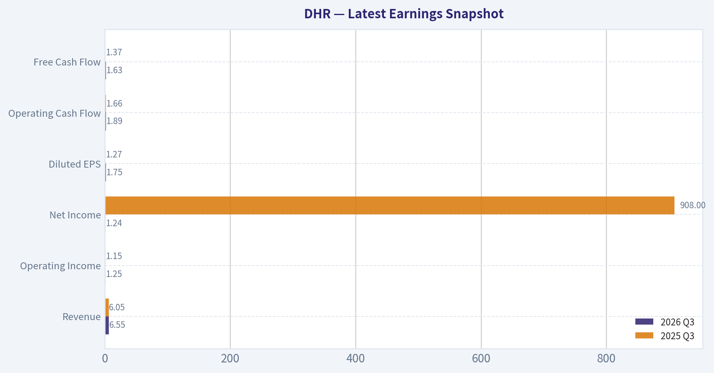

This comparison chart from *Current Metrics Versus Historical Averages* stacks current figures against historical benchmarks for **DHR**, making it easy to see where the company trades relative to its own averages.

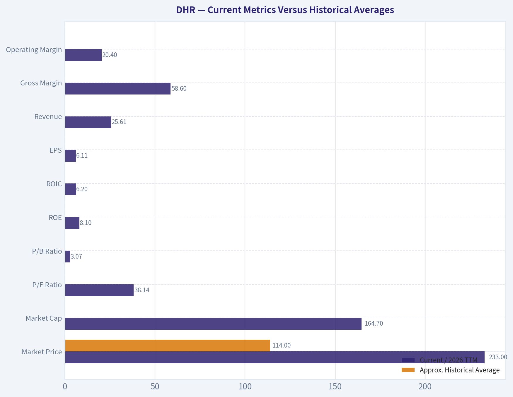

This comparison chart from *Balance Sheet and Financial Strength* stacks current figures against historical benchmarks for **DHR**, making it easy to see where the company trades relative to its own averages.

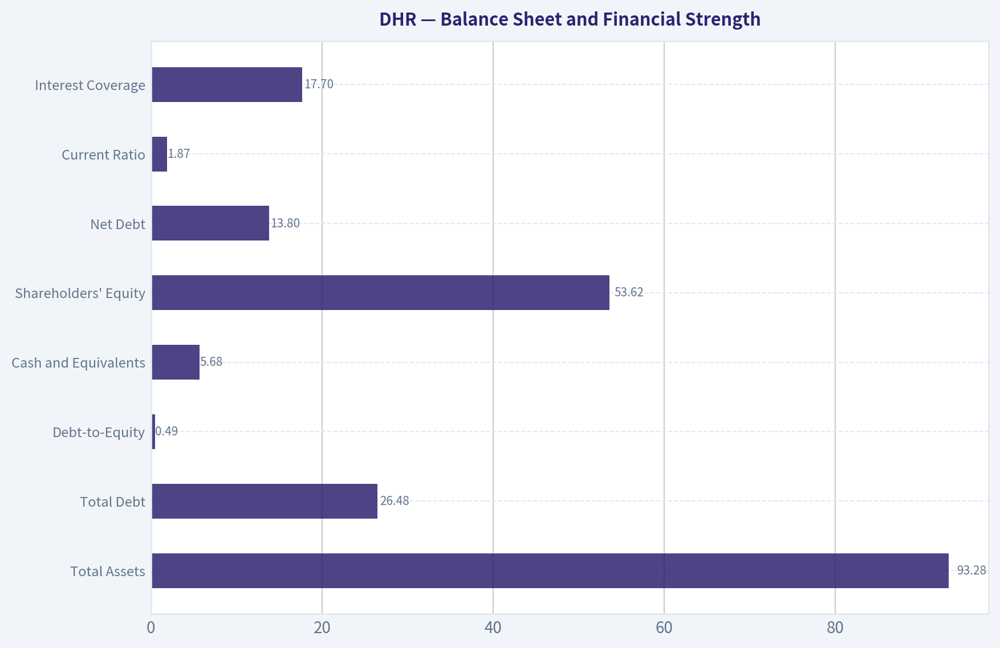

The following chart maps the **DHR** Owner Earnings DCF valuation scenarios (Conservative, Average, Optimistic) to visually represent the margin of safety based on intrinsic value calculations.

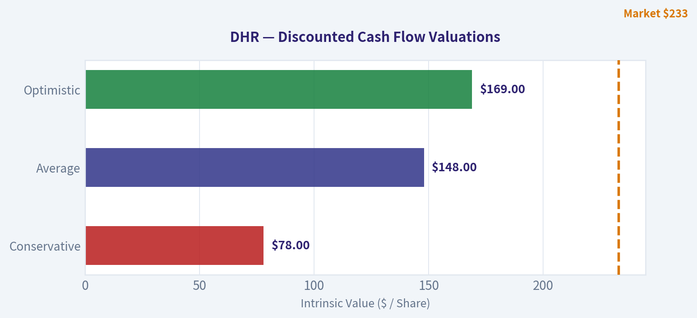

---

### Trend & Growth Analysis (Lynch/Druckenmiller/Fisher)

> *Following Peter Lynch's GARP, Stanley Druckenmiller's macro-aware approach, and Philip Fisher's scuttlebutt methodology.*

ANALYST STANCE: **Neutral**

#### 1. Lynch Classification

**Stalwart, currently behaving like a slow grower.** Danaher is a high-quality life-sciences and diagnostics compounder, but its latest reported revenue growth of **2.9% year over year** falls well below the 15-25% threshold for a fast grower. The company could become a recovery inflection candidate, but that evidence is not yet present.

#### 2. The Story in Three Bullets

- Danaher sells mission-critical instruments, diagnostics, bioprocessing equipment, and recurring consumables used in laboratories and pharmaceutical manufacturing.
- Its moat comes from switching costs, regulatory expertise, installed equipment, proprietary consumables, and the Danaher Business System.
- The investment case depends on a recovery in biopharma and life-sciences spending, followed by renewed organic growth and operating leverage-not on current growth momentum.

#### 3. TAM and Runway

| Item | Assessment |
|---|---|
| Core markets | Life-sciences tools, diagnostics, bioprocessing, laboratory equipment |
| Secular demand | Favorable over the long term due to biologics, personalized medicine, laboratory automation, and healthcare innovation |
| Current growth | Weak near-term, with revenue up 2.9% year over year |
| 10x revenue test | Cannot be completed reliably because current revenue was not provided in the research pack |
| Market saturation | Danaher is a major incumbent, but several end markets remain fragmented and innovation-driven |
| Runway quality | Long-term runway is attractive; near-term acceleration is unproven |

**Key Takeaways:** Danaher operates in structurally attractive markets, but its immediate growth rate is not consistent with a fast-growth investment. The long runway exists primarily through bioprocessing, diagnostics, consumables, and acquisitions, but the 10x test requires verified current revenue and TAM figures.

#### 4. Revenue Growth Trend

| Metric | Result | Interpretation |
|---|---:|---|
| Latest revenue growth | 2.9% YoY | Slow growth |
| Three-year revenue trend | Trailing three-year growth cited as approximately -16.4% | Distorted by portfolio changes and weak biopharma demand |
| Five-year revenue trend | Approximately 14.5% annualized according to the supplied reverse-DCF data | Historically stronger, but not a current acceleration signal |
| Trend classification | Decelerated/weak | No confirmed inflection yet |

**Key Takeaways:** Danaher's current revenue growth is subdued, and the recent multi-year trend has been affected by the Veralto separation, acquisitions, divestitures, and cyclical biopharma weakness. A sustained return to double-digit organic growth would be the key signal that the thesis is improving.

#### 5. Unit Economics and Cash Generation

| Metric | Result | Assessment |
|---|---:|---|
| Gross margin | 59.1% | Strong, consistent with differentiated products |
| FCF yield | 3.2% | Positive, but not compelling at the current price |
| LTV/CAC | Not disclosed | Not applicable in a conventional SaaS sense |
| Net revenue retention | Not disclosed | Not applicable/not reported |
| Rule of 40 | Not meaningful | Danaher is not primarily a subscription software company |
| Current ratio | 1.87 | Adequate liquidity |
| ROE | 6.9% | Modest for the valuation |

**Key Takeaways:** Danaher has attractive gross margins and meaningful free-cash-flow generation, but the available figures do not show exceptional current returns on equity or cash-flow yield. Its economics are better assessed through recurring consumables, installed-base retention, organic growth, and FCF conversion than through SaaS metrics.

#### 6. Inflection-Point Assessment

| Potential inflection | Current evidence | Status |
|---|---|---|
| Product cycle | Exposure to bioprocessing, single-use systems, diagnostics, and laboratory tools | Positive but unconfirmed |
| Market share | Strong competitive position, but no recent share data supplied | Neutral |
| Margin | Gross margin remains high; operating leverage data unavailable | Unconfirmed |
| TAM | Long-term life-science demand remains favorable | Positive |
| End-market recovery | Biopharma and research spending recovery is the central catalyst | Pending |
| Overall inflection | Revenue growth only 2.9% | Not yet demonstrated |

**Key Takeaways:** The ingredients for an inflection exist, particularly in bioprocessing and diagnostics, but Danaher has not yet shown the required acceleration in revenue or earnings. The next major confirmation would be several quarters of improving organic orders, revenue growth, and margins.

#### 7. Macro Setup

| Factor | Assessment |
|---|---|
| Secular trends | Favorable: healthcare innovation, biopharma, diagnostics, automation |
| Economic sensitivity | Moderate; exposed to research budgets, biotech funding, and pharmaceutical capital spending |
| Interest-rate sensitivity | Valuation is sensitive to discount rates because the stock trades at a high earnings multiple |
| China/geopolitical risk | Relevant due to healthcare equipment demand and supply-chain exposure |
| Macro stance | Mixed |

**Key Takeaways:** Danaher benefits from powerful long-term healthcare trends, but its near-term cycle is not clearly supportive. A lower-rate environment would help valuation, while weak biotech funding or renewed research-budget pressure would delay recovery.

#### 8. Fisher's 15-Point Score

| Fisher factor | Score / 5 | Comment |
|---|---:|---|
| Market potential | 5 | Large and expanding healthcare markets |
| New-product determination | 4 | Broad innovation and acquisition activity |
| R&D effectiveness | 4 | Strong technical and regulatory capabilities |
| Sales organization | 4 | Global distribution and service infrastructure |
| Profit margins | 4 | High gross margin and quality portfolio |
| Margin improvement | 3 | Recovery not yet evident |
| Labor relations | 3 | Limited evidence |
| Executive relations | 4 | Historically strong organizational culture |
| Management depth | 5 | Deep operating and acquisition expertise |
| Cost analysis/accounting | 4 | Danaher Business System is a strength |
| Outstanding moat features | 5 | Switching costs, consumables, regulation, installed base |
| Long-term profit outlook | 4 | Attractive, though cyclical |
| Dilution | 3 | Acquisition financing and equity exposure require monitoring |
| Management candor | 4 | Generally regarded as disciplined and credible |
| Management integrity | 4 | Strong historical reputation |
| **Total** | **60 / 75** | **Good, not outstanding at the current growth rate** |

**Key Takeaways:** Danaher scores well on market opportunity, management depth, operating culture, and competitive advantages. The main deductions are for currently weak growth, unproven margin acceleration, and limited visibility into dilution and near-term recovery.

#### 9. Valuation Analysis

| Metric | Result | Interpretation |
|---|---:|---|
| Share price | $233 | Supplied current price |
| Market capitalization | $163.94 billion | Large-cap valuation |
| P/E | 38.6x | High for 2.9% current revenue growth |
| FCF yield | 3.2% | Implies a demanding valuation |
| PEG | Not calculable reliably | EPS growth rate was not supplied |
| Headline intrinsic value | $119.91 | Materially below market price |
| Owner-earnings value | $147.85 | Below market price |
| FCF model value | $104.05 | Well below market price |
| Damodaran FCFF value | $33.00 | Highly conservative, but also below market price |
| Reverse-DCF implication | Approximately 22.7% annual growth for 10 years | Very demanding expectation |

**Key Takeaways:** Danaher's valuation is difficult to justify using current growth and cash-flow data. At 38.6 times earnings and a 3.2% FCF yield, the market appears to be pricing a substantial multi-year recovery, while the supplied intrinsic-value models place fair value well below the current price.

#### 10. Growth Investor Scorecard

| Criterion | Weight | Score / 5 | Weighted result |
|---|---:|---:|---:|
| Lynch story | 10% | 4.0 | 0.40 |
| TAM and runway | 20% | 4.0 | 0.80 |
| Revenue growth | 20% | 2.0 | 0.40 |
| Unit economics | 15% | 3.5 | 0.53 |
| Competitive position | 10% | 4.5 | 0.45 |
| Management quality | 10% | 4.5 | 0.45 |
| Macro setup | 5% | 3.0 | 0.15 |
| Profitability path | 5% | 3.5 | 0.18 |
| Valuation | 5% | 1.5 | 0.08 |
| **Total** | **100%** | - | **3.4 / 5.0** |

**Key Takeaways:** Danaher is an excellent business but not currently an attractive growth-stock setup. Its score falls in the upper Neutral range because competitive quality and runway are offset by weak current growth and an expensive valuation.

#### 11. Position Size Stance

| Investor situation | Suggested stance |
|---|---|
| New position | Avoid initiating at $233 |
| Existing holder | Hold/watch, but require recovery confirmation |
| High-conviction growth portfolio | 0%-1% starter position only if willing to pay for a recovery |
| Attractive entry framework | Prefer a materially lower valuation or clear evidence of accelerating organic growth |
| Re-rating trigger | Sustained double-digit organic growth plus margin expansion |

**Key Takeaways:** Danaher is suitable for a watchlist rather than an aggressive new position. Existing shareholders can hold if they have a long horizon, but the current price leaves little margin of safety if the recovery is delayed.

#### 12. Key Risks and Catalysts

| Catalysts | Risks |
|---|---|
| Biopharma spending recovery | Continued weak biotech and research funding |
| Accelerating organic orders | Valuation compression from higher rates |
| Growth in single-use bioprocessing | China and geopolitical restrictions |
| Diagnostics and molecular-testing innovation | Acquisition overpayment or integration problems |
| Operating-margin expansion | Customer inventory corrections |
| Stronger recurring consumables mix | Revenue remaining stuck near low-single-digit growth |

**Key Takeaways:** The principal catalyst is a measurable recovery in organic growth, especially in bioprocessing and life-sciences tools. The principal risk is that Danaher remains a high-quality but slow-growing company while investors continue paying a premium multiple.

#### Bottom Line

Danaher has many Fisher-quality attributes: a durable moat, strong management, recurring consumables, regulatory barriers, and attractive secular markets. However, Lynch and Druckenmiller frameworks currently flag two problems: **growth is too slow, and the valuation already discounts a major recovery**. I would keep DHR on the watchlist and wait for either a lower price or clear evidence of accelerating organic growth.

---

### Market Technical Analysis

ANALYST STANCE: **Neutral**

#### DHR technical analysis

DHR's latest available close was **$233.02 on November 13, 2026**; November 14 was not a trading day. The technical picture is constructive over the medium and long term, but short-term momentum has cooled enough that chasing the stock near current levels offers a less favorable risk-reward profile.

The selected indicators are **50 SMA, 200 SMA, 10 EMA, MACD, RSI, Bollinger Upper Band, Bollinger Lower Band, and ATR**. Together, they cover trend, momentum, overbought or oversold conditions, volatility, and practical risk control without relying too heavily on overlapping signals.

#### Trend structure

DHR remains clearly above its major trend benchmarks:

- **50-day SMA:** $222.38
- **200-day SMA:** $200.43
- **10-day EMA:** $232.70
- **Latest close:** $233.02

The close is approximately **4.8% above the 50-day SMA** and **16.3% above the 200-day SMA**, which confirms a favorable medium- and long-term trend. The 50-day average is also rising steadily, moving from roughly $202.44 in mid-September to $222.38 currently. This indicates that the recent advance is not merely a one- or two-day bounce; it has materially improved the intermediate trend.

The 200-day SMA, however, has been relatively flat near $200. This is not bearish by itself, but it indicates that the longer-term trend is still transitioning from stabilization into a more clearly rising phase. The most important strategic level remains the $200 area. A sustained decline below the 200-day average would materially weaken the bullish structure.

Short term, DHR is only marginally above its 10-day EMA. The close is about $0.32, or 0.1%, above that average, suggesting that immediate momentum is balanced rather than accelerating. A decisive close above the recent $236-$239 resistance zone would improve the short-term picture. Conversely, repeated closes below the 10-day EMA would suggest that the recent advance is entering a consolidation or pullback phase.

#### Momentum and MACD

MACD remains positive at approximately **3.02**, so the underlying momentum trend is still bullish. However, MACD has declined from about **5.01 on October 29** to its current level. This is an important loss of momentum: the stock is still advancing on a broader trend basis, but the rate of improvement has slowed.

This creates a distinction between trend and momentum:

- The positive MACD value supports the existing uptrend.
- The declining MACD reading warns that upside follow-through is becoming less forceful.
- A renewed rise in MACD, especially alongside a move above $239, would strengthen the bullish case.
- A move toward zero while price falls below the 50-day SMA would represent a more serious deterioration.

There is no clear evidence from the available readings of a fully established bearish trend reversal. The current signal is better interpreted as **positive momentum that is moderating**, rather than outright negative momentum.

#### RSI and price positioning

RSI is approximately **54.7**, which is neutral-to-mildly bullish. It is well below the conventional overbought threshold of 70 and above the bearish midpoint area near 50. This means DHR is not currently showing an extreme overbought condition, but it also lacks the strong momentum typically associated with a fresh upside breakout.

RSI has fallen from readings above 65 in late October and early November. That decline confirms that the recent rally has lost some internal strength. Importantly, RSI has not fallen below 30 or even approached deeply oversold conditions, so a pullback would not automatically imply a high-confidence reversal opportunity. Traders should look for RSI to hold above 50 during any consolidation; that would suggest that bullish momentum is being preserved.

#### Bollinger Bands and volatility

The current Bollinger Band readings are:

- **Upper band:** $238.98
- **Lower band:** $224.25
- **Approximate middle band:** $231.62, inferred from the midpoint of the two bands

DHR is trading in the upper half of its recent volatility range, but it is not pressing directly against the upper band. The stock is approximately **$5.96 below the upper band** and **$8.77 above the lower band**. This positioning is constructive but not an obvious breakout signal.

The upper band near $239 is the immediate technical ceiling. A close above that level, particularly if accompanied by expanding volume and a rising MACD, could signal continuation toward higher resistance. Failure near $237-$239 followed by a move below the middle band near $231-$232 would increase the probability of a retreat toward the lower band and the 50-day SMA region.

The Bollinger range is still relatively wide, reflecting the volatility generated during the recent price swings. This argues against using overly tight stops.

#### ATR and risk management

ATR is approximately **$6.39**, down from about $7.17 on November 9 but still substantial relative to the $233 share price. Current ATR represents roughly **2.7% of the stock price**, meaning normal daily movement can be large enough to trigger stops placed too close to the entry.

For short-term positions, a stop positioned only one or two dollars below the entry would be vulnerable to ordinary noise. More practical reference areas are:

- Around **$231-$232** for a very tight momentum-oriented invalidation level, although this could be breached by normal fluctuation.
- Around **$224-$225** for a wider technical stop near the lower Bollinger Band and recent support.
- Around **$219-$222** for a more conservative medium-term risk level near the 50-day SMA and prior consolidation structure.

Position size should be adjusted downward if using a wider stop.

#### Trading interpretation

The evidence supports a **bullish medium-term bias with cautious short-term positioning**.

A favorable setup would involve one of two developments:

1. **Breakout scenario:** DHR closes decisively above $239, with MACD turning upward and RSI recovering toward the 60-65 area. This would indicate that the recent loss of momentum has been resolved in favor of the buyers.
2. **Pullback scenario:** DHR retreats toward $224-$228, holds above or near the 50-day SMA, and then shows improving RSI and MACD. This would offer a more attractive entry because it would reduce the distance to technical support.

The less attractive setup is buying immediately into the current area without confirmation. The stock is above its major averages, but the latest close is close to the 10-day EMA, MACD is declining, and RSI is only moderately positive. That combination suggests that the market may need to consolidate before making its next directional move.

A sustained close below approximately **$224-$225** would weaken the near-term bullish case. A deeper break below the **$219-$222** area would challenge the intermediate trend. The long-term structure would become materially more defensive only if DHR moved toward and below the $200 region.

#### Key indicator summary

| Indicator | Latest reading | Interpretation | Important level or trigger |
|---|---:|---|---|
| 50-day SMA | $222.38 | Rising medium-term trend; price remains well above it | Support near $222 |
| 200-day SMA | $200.43 | Long-term trend is positive but still relatively flat | Major trend support near $200 |
| 10-day EMA | $232.70 | Short-term momentum is nearly flat around current price | Holding above $232 supports near-term strength |
| MACD | 3.02 | Positive, but declining from late-October highs | Rising MACD with a break above $239 would be bullish |
| RSI | 54.7 | Neutral-to-mildly bullish; not overbought | Holding above 50 would preserve momentum |
| Bollinger Upper Band | $238.98 | Immediate volatility resistance and breakout boundary | Close above $239 could signal continuation |
| Bollinger Lower Band | $224.25 | Important downside volatility reference | Break below $224 would weaken the setup |
| ATR | $6.39 | Volatility remains elevated despite recent moderation | Use wider stops and smaller position sizes |

Key Takeaways: DHR's broader trend is bullish because price is substantially above both its 50-day and 200-day moving averages. However, short-term momentum has cooled, with MACD declining and RSI settling near the neutral midpoint. The key decision zone is $239 on the upside and approximately $224-$225 on the downside; until one of those levels breaks decisively, a watchful or staged-entry approach is preferable to aggressive buying.

---

### Options Market Analysis

> *Reading options flow - put/call ratios, IV skew, and unusual activity - to gauge institutional positioning and event-driven risk.*

ANALYST STANCE: **Neutral**

#### DHR Options Positioning Overview

As of November 14, 2026, DHR's near-term options show a notable split: open interest is mildly call-dominant, while trading volume is strongly put-dominant. This suggests existing positioning is not broadly bearish, but current activity is tilted toward short-term hedging or bearish speculation.

| Near-Term Expiration | Days to Expiry | Call OI | Put OI | Put/Call OI Ratio | Call Volume | Put Volume |
|---|---:|---:|---:|---:|---:|---:|
| Nov. 20, 2026 | 6 | 13,774 | 9,771 | 0.71 | 586 | 1,945 |
| Nov. 27, 2026 | 13 | 521 | 560 | 1.07 | 43 | 176 |
| Dec. 4, 2026 | 20 | 109 | 74 | 0.68 | 54 | 19 |
| **Total** | - | **14,404** | **10,405** | **0.72** | **683** | **2,140** |

**Key Takeaways:** The aggregate put/call open-interest ratio of 0.72 is close to the historical neutral level of roughly 0.70 and indicates slightly call-heavy existing positioning. However, the put/call volume ratio is 3.13, meaning approximately three times as many puts traded as calls across these expirations. The divergence favors a cautious near-term interpretation, although the put activity may represent hedging rather than outright bearish bets.

#### Implied Volatility Assessment

| Expiration | Call ATM IV | Put ATM IV | IV Structure |
|---|---:|---:|---|
| Nov. 20, 2026 | 40.1% | 39.0% | Elevated front-week IV; call IV slightly higher |
| Nov. 27, 2026 | 35.3% | 37.4% | Put premium and moderate downside skew |
| Dec. 4, 2026 | 34.9% | 34.6% | Balanced IV |
| **Near-term range** | **34.9%-40.1%** | **34.6%-39.0%** | **Front-loaded volatility** |

**Key Takeaways:** Implied volatility is highest for the November 20 expiration, indicating meaningful near-term event or price-move risk. The November 27 chain shows puts trading at a higher ATM IV than calls, a modest sign of downside protection demand. The available data does not include explicit out-of-the-money put and call IV, so a full put-versus-call skew calculation is not possible.

The data does not identify a specific catalyst such as earnings, a product announcement, or a major macro event. Therefore, the elevated front-week IV should be treated as event-risk pricing, but not definitively attributed to earnings or another known catalyst.

#### Unusual Options Activity

The data provider identified no contracts with volume greater than five times open interest.

| Finding | Interpretation |
|---|---|
| No volume-to-OI outliers | No confirmed fresh, unusually large directional positions |
| Put volume concentration | Could reflect hedging, bearish trades, or closing activity |
| Contract-level strike data | Not supplied, so ITM, ATM, and OTM classification is unavailable |
| Smart-money versus retail | Cannot be reliably distinguished from the aggregate data |

**Key Takeaways:** There is no statistically confirmed unusual activity based on the five-times-volume-to-open-interest threshold. The heavy put volume is important, but without contract-level volume, bid-ask execution data, or strike information, it cannot be labeled confidently as institutional bearish buying. Confidence in any directional inference from the flow is therefore moderate to low.

#### Open Interest Concentration and Gamma Levels

| Expiration | Call OI | Put OI | Concentration Assessment |
|---|---:|---:|---|
| Nov. 20, 2026 | 13,774 | 9,771 | Dominant near-term OI concentration |
| Nov. 27, 2026 | 521 | 560 | Limited secondary concentration |
| Dec. 4, 2026 | 109 | 74 | Minimal concentration |

**Key Takeaways:** The November 20 expiration contains nearly all reported near-term open interest, making it the most important expiration for potential pinning or gamma effects. However, strike-by-strike open interest was not provided, so specific gamma walls, max-pain levels, and gravitational price zones cannot be identified. The concentration may dampen price movement near heavily held strikes, but it could also amplify moves if price breaks away from those strikes.

#### Overall Options Sentiment

The overall read is **cautiously bearish for the immediate term**, but not strongly bearish.

The primary bearish factor is the 3.13 put/call volume ratio, especially the heavy put activity in the November 20 expiration. The main counterpoint is the 0.72 put/call open-interest ratio, which remains close to neutral and shows that the existing positioning is slightly call-heavy rather than defensive. ATM IV is elevated in the front week, while the lack of confirmed unusual contracts and missing strike-level data reduces confidence.

This is best interpreted as **near-term downside protection demand or caution**, rather than a clear institutional bearish conviction signal. Traders should watch whether the put-heavy volume is followed by rising put open interest; if so, the bearish interpretation would strengthen. If put open interest fails to increase, much of the activity may have been hedging or closing trades.

#### Summary

| Category | Assessment |
|---|---|
| Put/Call Ratio | OI ratio of 0.72 is near neutral; volume ratio of 3.13 is strongly put-heavy |
| IV Level | Elevated in the front week at roughly 39%-40%; declines toward 35% in later expirations |
| Skew Direction | Modest downside skew in the November 27 expiration; full OTM skew unavailable |
| Unusual Activity | No contracts exceeded the five-times-volume-to-OI threshold |
| Overall Signal | **Cautiously bearish / Neutral** for the immediate term |

**Key Takeaways:** DHR's options market shows heavy short-term put trading against a broadly neutral-to-slightly-bullish open-interest structure. The signal leans cautiously bearish because of the strong put-volume imbalance and front-loaded IV, but the absence of unusual contract-level activity and strike data prevents a high-confidence bearish call.

---

## Research Team Commentary

> *The Research Manager synthesizes the Bull vs Bear debate into action-free commentary. This is a pre-risk view, not the final stance.*

Core Takeaway: Danaher is a genuinely high-quality franchise, but at roughly $233 the stock already discounts a meaningful recovery in biopharma demand, operating margins, and capital returns. The moat and management quality justify keeping the company under close consideration, but the current 38.6x earnings multiple provides too little protection while ROIC remains around 6%. I would wait for either stronger evidence that normalized earnings are arriving or a materially better price.

The strongest bull argument is the durability of the business. Danaher's instruments and consumables are embedded in regulated, mission-critical laboratory and biopharmaceutical workflows. Switching can require process revalidation, retraining, regulatory work, and production risk. The installed base also generates recurring consumables and service revenue. Combined with the Danaher Business System, these characteristics form a credible organizational and customer-switching moat.

The 59.1% gross margin supports the view that this is differentiated intellectual property rather than a commodity equipment company. Danaher also operates in markets with attractive decade-long prospects, including biologics, advanced therapies, diagnostics, laboratory automation, and more complex drug manufacturing. A cyclical slowdown in customer spending does not necessarily indicate permanent moat erosion.

Management deserves credit as well. Danaher has historically shown unusual skill in acquiring, integrating, improving, and, when appropriate, separating businesses. DBS is a real operating advantage rather than a marketing slogan. If biopharma demand normalizes, the combination of recurring revenue, operating leverage, and disciplined capital allocation could restore high-single-digit or low-double-digit per-share earnings growth.

The strongest bear argument is that investors are already paying for much of that favorable outcome. At 38.6x earnings, the stock is priced more like a demonstrated high-return compounder than a company currently producing 6.0% ROIC, 6.9% ROE, and 4.3% ROA. These figures may be depressed, but "normalized earnings" cannot simply be asserted; it needs to emerge in organic growth, margins, cash flow, and capital efficiency.

The simplified reverse-valuation work is also less comfortable than the bull framing suggests. Starting from approximately $6.04 of earnings per share, 10% annual growth for a decade only supports today's price if Danaher retains something close to a 32x terminal multiple. With a 25x-30x terminal multiple, the supplied rough values are closer to $188-$219. This is not a full free-cash-flow DCF, but it shows that the price appears to require both solid growth and continued premium valuation. That is not a robust margin of safety.

The recovery thesis contains several linked assumptions: customer inventory digestion must end, biopharma capital spending must improve, Danaher must capture that recovery, margins must expand, acquisitions must earn satisfactory returns, and the market must continue assigning a premium multiple. Each assumption is plausible, but the chain leaves limited downside protection if recovery is delayed or structurally weaker than expected.

Current market conditions do not suggest obvious capitulation. The shares are above the supplied longer-term moving averages and near the short-term EMA, while options activity shows more near-term put volume but broadly neutral open-interest positioning. These signals should not drive intrinsic value, but they indicate that the market is not offering the kind of fear-driven discount that would make contrarian buying especially compelling.

Rationale: The correct distinction is between business quality and investment attractiveness. Danaher likely deserves a premium to an average industrial or healthcare-equipment company because of its switching costs, recurring consumables, regulatory barriers, secular end markets, and superior operating culture. However, even a wonderful business needs a price that leaves room for ordinary execution problems.

For a business of this quality, I would accept a narrower margin of safety-perhaps 10%-15% rather than the 30% or more required for an average cyclical company. The available information does not demonstrate even that modest discount. Instead, the stock appears around fair value under an optimistic normalization case and above fair value under more conservative terminal assumptions.

This is why I would not classify Danaher as a permanent avoid or a low-quality business. There is no evidence here of financial distress or irreversible franchise deterioration. But I would also not advocate purchasing it today. A price closer to roughly $190-$205, absent deteriorating fundamentals, would offer a more credible valuation cushion based on the supplied earnings framework. Alternatively, the current price could become reasonable if several quarters of results demonstrate that earnings and ROIC are recovering faster than the market's embedded assumptions.

The key lesson from similar situations is not to confuse admiration for a company with a disciplined purchase decision. Management reputation and "normalized earnings" can become excuses for relaxing valuation standards. At the same time, it would be equally mistaken to interpret a cyclical life-sciences slowdown as permanent impairment without evidence. The appropriate response is patience and explicit operating milestones.

Monitoring Plan: Over the next one to four quarters, I would first watch organic revenue growth, particularly in bioprocessing and life sciences. A sustained return to mid- to high-single-digit organic growth, rather than one quarter helped by comparisons or acquisitions, would strengthen the thesis. Continued flat or negative organic growth after inventory normalization would weaken it.

Second, I would monitor orders, book-to-bill trends, customer inventory commentary, biotechnology funding conditions, and capital-spending plans from large pharmaceutical customers. Improving orders before reported revenue would provide useful confirmation that the recovery is real.

Third, operating margins and free-cash-flow conversion need to improve. Revenue recovery without operating leverage would suggest that prior margins were less sustainable or that pricing and cost pressures are offsetting volume growth.

Fourth, ROIC must move decisively above the current 6%. A progression toward double digits would support the claim that present returns are temporarily depressed. ROIC remaining near the cost of capital despite recovering revenue would challenge both the DBS narrative and the premium valuation.

Finally, I would examine net leverage, acquisition prices, integration progress, and management's use of repurchases. Additional large acquisitions at aggressive valuations would increase risk; disciplined transactions or repurchases made below conservatively estimated intrinsic value would strengthen confidence in capital allocation.

Danaher is a company worth owning at the right price, but today's price asks investors to underwrite the recovery before it is visible in capital returns. The prudent decision is to keep the franchise on the watchlist rather than pay in advance for a favorable cycle.

Neutral

---

## Value Investing Team Commentary

> *The Investor translates the research view into an investment thesis before risk review. This is still not the final stance.*

Danaher is a classic case where **business quality and stock attractiveness must be separated**. The company appears to possess a durable moat: mission-critical instruments, regulated workflows, proprietary consumables, high switching costs, and the Danaher Business System. These advantages can support recurring revenue, customer retention, and superior long-term operating performance.

However, the current valuation leaves limited room for execution mistakes. At approximately **$233 and 38.6 times earnings**, investors are paying for a substantial recovery in biopharma and life-sciences demand. That recovery may occur, but it is not yet adequately demonstrated by the supplied return metrics: **6% ROIC, 6.9% ROE, and 4.3% ROA**. The 59% gross margin confirms differentiation, but gross margin alone does not prove that incremental capital is being deployed at attractive returns.

### What the market may be missing

The bearish interpretation may be too simplistic. Danaher's weak current returns could reflect a cyclical trough, post-acquisition normalization, and depressed customer spending rather than permanent impairment. In a business with regulated products and deeply embedded workflows, customers may delay equipment purchases, but they generally cannot abandon validated processes easily. If biopharma inventories normalize, the company could benefit from operating leverage and renewed demand without requiring a fundamentally different business model.

The Danaher Business System is also more important than a conventional industrial-management slogan. Its value lies in repeatedly converting acquired businesses into better-run, higher-margin operations. If this capability remains intact, current earnings may understate normalized earning power.

That said, contrarian analysis should not become an excuse to assume recovery. The bullish thesis requires several events to occur together:

- Biopharma and life-sciences spending must recover.
- Organic growth must return, not merely revenue growth from acquisitions.
- Margins must expand as volumes improve.
- Acquisitions must continue earning attractive returns.
- Investors must maintain a premium valuation multiple.

The market may be underestimating the durability of Danaher's franchise, but it may also be correctly recognizing that the recovery is already reflected in the price.

### Valuation and margin of safety

The supplied reverse-valuation analysis is directionally useful, although it should not be treated as a complete DCF. A 10-year EPS projection with a terminal multiple still depends heavily on the starting earnings base, future free-cash-flow conversion, share count, reinvestment needs, and terminal valuation. Danaher's acquisition history and amortization profile make normalized free cash flow particularly important.

Even allowing for temporarily depressed earnings, a purchase around 39 times earnings does not offer an obvious margin of safety. A high-quality business can deserve a premium multiple, but the quality-scaled discount still matters. At this price, investors appear to be receiving a fair or modestly optimistic outcome rather than a compelling bargain.

A price in the approximate **$190-$205 range**, assuming the franchise remains intact, would provide a more attractive cushion under the supplied assumptions. Alternatively, the present price could become reasonable if operating evidence improves enough to justify higher normalized earnings rather than merely relying on management's historical reputation.

### What would change the view

The most important indicators are:

1. **Sustained organic revenue growth**, particularly in bioprocessing and life sciences.
2. **Improving orders and book-to-bill trends** before revenue acceleration appears in reported results.
3. **Operating-margin recovery** alongside revenue growth.
4. **Free-cash-flow conversion** that confirms earnings quality.
5. **ROIC moving decisively toward double digits**, demonstrating that the current weakness is cyclical rather than structural.
6. **Disciplined capital allocation**, including sensible acquisition prices and repurchases below conservatively estimated intrinsic value.

The options data and moving averages add little to the intrinsic-value case. Put-heavy recent volume may indicate hedging or short-term concern, but the relatively neutral open-interest ratio does not represent the kind of widespread pessimism that creates a strong contrarian opportunity. Technical positioning should therefore remain secondary to fundamentals.

The principal risk is not that Danaher becomes a bad company. It is that it remains a very good company whose recovery takes longer than expected, while the valuation gradually compresses. Conversely, the principal opportunity is that the market is treating a temporary life-sciences downturn as a permanent reduction in earning power. Evidence of improving demand and returns would make that contrarian opportunity more credible.

Danaher deserves a place on a high-quality watchlist, but admiration for its moat should not override valuation discipline. I would wait for either a materially better entry price or several quarters showing that organic growth, margins, free cash flow, and ROIC are recovering together.

**ANALYST STANCE: Neutral**

---

## Deep Values Commentary

> *The Risk Management Team debates and the Risk Judge provides the final action-free verdict. This section determines the final Bullish / Neutral / Bearish stance.*

#### Final Stance Scorecard

This scorecard converts the final research view into a weighted decision frame. It does not replace the narrative judgement, but it makes the main drivers of the verdict easier to scan.

| Criterion | Score | Weight | Commentary |
| --- | ---: | ---: | --- |
| Business Quality | 3.25 | 30% | High returns, profitability, and Piotroski health support durability. |
| Valuation Support | 2.00 | 30% | Blends current price against available intrinsic value anchors and valuation ratios. |
| Financial Strength | 4.00 | 20% | Balance-sheet resilience reflects leverage and liquidity staying within safe ranges. |
| Growth Durability | 1.33 | 20% | Recent revenue, earnings, and free cash flow growth indicate how durable expansion looks. |
| TOTAL / FINAL STANCE | 2.64 | 100% | Neutral |

#### Key Takeaways

The weighted score lands at **2.64 / 5.0**, while the final stance remains **Neutral**. This is useful as a quick calibration aid rather than a mechanical signal.

#### Risk Summary

Higher scores indicate more risk pressure. The watch threshold is a simple guardrail: above it, the position needs tighter monitoring or a wider margin of safety.

| Dimension | Current Score | Watch Threshold | Commentary |
| --- | ---: | ---: | --- |
| Business Quality | 2.75 | 3.00 | High returns, profitability, and Piotroski health support durability. |
| Valuation Support | 4.00 | 3.00 | Blends current price against available intrinsic value anchors and valuation ratios. |
| Financial Strength | 2.00 | 3.00 | Balance-sheet resilience reflects leverage and liquidity staying within safe ranges. |
| Growth Durability | 4.67 | 3.00 | Recent revenue, earnings, and free cash flow growth indicate how durable expansion looks. |

#### Key Takeaways

This view helps readers separate *where* the risk sits: valuation, business quality, balance sheet, or growth durability. It is especially useful when the final stance is close to the line between Neutral and Bearish.
