# DIDIY Deep Value Intelligence

**Analysis Date:** 2026-03-14

## Critical Disclaimer

*This analysis is generated by Deep Value Intelligence, an AI-powered multi-agent investing framework. This report is for informational and educational purposes only and does not constitute financial advice. Always conduct your own research and consult with qualified financial advisors before making investment decisions.*

---

## Table of Contents

1. Intelligence Summary
2. Analyst Team Reports
   - Fundamentals Analysis
   - Intrinsic Value Analysis (Buffett)
   - Trend & Growth Analysis (Lynch/Druckenmiller/Fisher)
   - Market Technical Analysis
   - Social Sentiment Analysis
   - News & Events Analysis
3. Research Team Commentary
4. Value Investing Team Commentary
5. Deep Values Commentary

---

## Intelligence Summary

### Thesis + Conditions

**Core Thesis:** **EXECUTIVE SUMMARY**
*   **Verdict**: **AVOID**
*   **The "Why"**: DiDi is a classic "cigar butt" value trap. While statistically cheap (trading at an apparent 15% Free Cash Flow yield), its underlying economics violate core Buffett principles.

**Key Risks:**
- Risky Analyst (The Bull)**: Argues DiDi is a deeply asymmetric, post-crackdown turnaround. Highlights a recovery in operating margins (from -27.9% to 0.9%), a pristine 8/9 Piotroski score, a $21B cash hoard, and a massive 15% FCF yield. Sees future upside in robotaxi "software toll booth" margins.
- Neutral Analyst (The Moderator)**: Notes fundamental stabilization but warns against confusing early-stage cyclical recovery with normalized earnings. Suggests treating DiDi as a highly speculative turnaround, requiring scaled exposure and strict monitoring of sustained margin improvements.
- 2.  **No Moat, No Pricing Power**: A dominant market share is only a moat if it grants pricing power. DiDi's inability to push operating margins meaningfully past breakeven proves riders and drivers will switch for pennies. Furthermore, treating DiDi as a public utility for employment means the Chinese government serves as a permanent ceiling on future profit margins.
- 3.  **Financial Instability**: Despite $21B in cash, the tripling of total debt to over $21.3B and a razor-thin interest coverage ratio of 1.45 present hidden solvency risks in a slowing economy.
- Adjustments based on Debate*: We maintain the **AVOID** stance, firmly rejecting the Neutral Analyst's suggestion to "scale in." We do not buy speculative turnarounds lacking a durable moat. However, we will refine our monitoring parameters based on the analysts' data.

**What Would Change Our View:**
- Risky Analyst (The Bull)**: Argues DiDi is a deeply asymmetric, post-crackdown turnaround. Highlights a recovery in operating margins (from -27.9% to 0.9%), a pristine 8/9 Piotroski score, a $21B cash hoard, and a massive 15% FCF yield. Sees future upside in robotaxi "software toll booth" margins.
- Neutral Analyst (The Moderator)**: Notes fundamental stabilization but warns against confusing early-stage cyclical recovery with normalized earnings. Suggests treating DiDi as a highly speculative turnaround, requiring scaled exposure and strict monitoring of sustained margin improvements.
- 2.  **No Moat, No Pricing Power**: A dominant market share is only a moat if it grants pricing power. DiDi's inability to push operating margins meaningfully past breakeven proves riders and drivers will switch for pennies. Furthermore, treating DiDi as a public utility for employment means the Chinese government serves as a permanent ceiling on future profit margins.
- 3.  **Financial Instability**: Despite $21B in cash, the tripling of total debt to over $21.3B and a razor-thin interest coverage ratio of 1.45 present hidden solvency risks in a slowing economy.
- Adjustments based on Debate*: We maintain the **AVOID** stance, firmly rejecting the Neutral Analyst's suggestion to "scale in." We do not buy speculative turnarounds lacking a durable moat. However, we will refine our monitoring parameters based on the analysts' data.

**Confidence:** Medium

---

## Analyst Team Reports

### Fundamentals Analysis

#### 10-Year Financial Metrics for DIDIY

*All values below are computed deterministically from raw data - not estimated by AI.*

#### 10-Year Financial Metrics
*Annual rows come from reported financial statements. The final TTM row is computed from the latest four quarters.*

| Metric | 2016 | 2017 | 2018 | 2019 | 2020 | 2021 | 2022 | 2023 | 2024 | 2025 | 2026 TTM |
| --- | --- | --- | --- | --- | --- | --- | --- | --- | --- | --- | --- |
| Market Price | N/A | N/A | N/A | N/A | N/A | $5 | $3 | $4 | $5 | $6 | $4 |
| Market Cap | N/A | N/A | N/A | N/A | N/A | $13.11B | $15.40B | $19.35B | $22.76B | N/A | $18.79B |
| P/E Ratio | N/A | N/A | N/A | N/A | N/A | -0.26 | -0.95 | -4.04 | 18.10 | N/A | N/A |
| P/B Ratio | N/A | N/A | N/A | N/A | N/A | 0.12 | 0.16 | 0.19 | 0.23 | N/A | 0.19 |
| ROE | N/A | N/A | N/A | N/A | N/A | -44.0% | -12.3% | -4.8% | 1.3% | N/A | -0.6% |
| ROIC | N/A | N/A | N/A | N/A | N/A | -43.9% | -24.8% | 0.6% | 2.0% | N/A | -1.0% |
| EPS | N/A | N/A | N/A | N/A | N/A | $-19.01 | $-3.35 | $-0.98 | $0.25 | N/A | N/A |
| Revenue | N/A | N/A | N/A | N/A | N/A | $173.83B | $140.79B | $192.38B | $206.80B | N/A | $216.53B |
| Gross Profit | N/A | N/A | N/A | N/A | N/A | $16.96B | $25.01B | $29.46B | $37.81B | N/A | $41.00B |
| Gross Margin | N/A | N/A | N/A | N/A | N/A | 9.8% | 17.8% | 15.3% | 18.3% | N/A | N/A |
| Operating Margin | N/A | N/A | N/A | N/A | N/A | -27.9% | -12.7% | -3.0% | 0.9% | N/A | -0.3% |
| Net Income | N/A | N/A | N/A | N/A | N/A | $-49.34B | $-11.72B | $-4.79B | $1.26B | N/A | $-540.7M |
| Net Margin | N/A | N/A | N/A | N/A | N/A | -28.4% | -8.3% | -2.5% | 0.6% | N/A | -0.2% |
| Revenue Growth | N/A | N/A | N/A | N/A | N/A | N/A | -25.2% | 32.7% | 7.5% | N/A | N/A |
| Net Income Growth | N/A | N/A | N/A | N/A | N/A | N/A | 55.5% | 102.0% | -126.3% | N/A | N/A |
| Free Cash Flow Growth | N/A | N/A | N/A | N/A | N/A | N/A | -34.2% | -177.7% | 236.6% | N/A | N/A |
| Total Book Value | N/A | N/A | N/A | N/A | N/A | $112.05B | $95.28B | $99.30B | $98.58B | N/A | $97.80B |
| Total Assets | N/A | N/A | N/A | N/A | N/A | $153.00B | $131.21B | $144.08B | $143.89B | N/A | $158.06B |
| Total Debt | N/A | N/A | N/A | N/A | N/A | $9.69B | $6.35B | $9.87B | $12.66B | N/A | $21.34B |
| Debt-to-Equity | N/A | N/A | N/A | N/A | N/A | 0.09 | 0.07 | 0.10 | 0.13 | N/A | 0.22 |
| Cash & Equivalents | N/A | N/A | N/A | N/A | $3.04B | $43.43B | $20.86B | $27.31B | $12.55B | N/A | $21.16B |
| Shareholders' Equity | N/A | N/A | N/A | N/A | N/A | $112.05B | $95.28B | $99.30B | $98.58B | N/A | $97.80B |
| Operating Cash Flow | N/A | N/A | N/A | N/A | N/A | $-2.10B | $-1.39B | $1.08B | $6.45B | N/A | $10.43B |
| Investing Cash Flow | N/A | N/A | N/A | N/A | N/A | $179.6M | $-1.60B | $-631.0M | $-14.14B | N/A | $-8.82B |
| Free Cash Flow | N/A | N/A | N/A | N/A | N/A | $-20.03B | $-12.77B | $845.8M | $2.85B | N/A | $6.82B |
| FCF Margin | N/A | N/A | N/A | N/A | N/A | -11.5% | -9.1% | 0.4% | 1.4% | N/A | 3.2% |
| Dividends / Share | N/A | N/A | N/A | N/A | N/A | $0.00 | $0.00 | $0.00 | $0.00 | N/A | $0.00 |

#### Profitability Metrics
- Return on Equity (ROE): 1.3%
- Return on Invested Capital (ROIC): 2.0%
- Return on Assets (ROA): 0.9%
- Gross Margin: 18.3%
- Operating Margin: 0.9%
- Net Profit Margin: 0.6%

#### Liquidity Metrics
- Current Ratio: 1.61
- Quick Ratio: 1.27

#### Leverage Metrics
- Debt-to-Equity Ratio: 0.13
- Interest Coverage Ratio: 1.45
- Net Debt: $102.8M

#### Growth Metrics (Year-over-Year)
- Revenue Growth: 7.5%
- Net Income Growth: 126.3%
- Free Cash Flow Growth: 236.6%
- Revenue CAGR (3-Year): 6.0%
- Revenue CAGR (5-Year): N/A

#### Valuation Metrics
- P/E Ratio (TTM): N/A
- Forward P/E: 9.93
- Price-to-Book: 1.28
- Price-to-Sales: N/A
- PEG Ratio: N/A
- EV/EBITDA: N/A
- Free Cash Flow Yield: 14.9%
- Earnings Yield: N/A

#### Owner Earnings (Buffett Method, Code-Computed)
- Net Income: $1.26B
- + Depreciation & Amortization: $3.17B
- - Capital Expenditures: $-3.61B
- - Working Capital Changes: $-5.18B
- = **Owner Earnings: $5.99B**

#### Intrinsic Value (Code-Computed)
- Current Price: $4
- Cash Flow Method (FCF):
  Conservative: $3,880
  Average: $24
  Optimistic: $61

#### Piotroski F-Score: 8/9
- Positive Net Income: PASS
- Positive Operating Cash Flow: PASS
- ROA Improvement: PASS
- Cash Flow > Net Income: PASS
- Decreasing Debt: FAIL
- Improving Current Ratio: PASS
- No Dilution: PASS
- Improving Gross Margin: PASS
- Improving Asset Turnover: PASS

FINAL INVESTMENT STANCE: **WATCH**

#### Comprehensive Fundamental Analysis of DIDIY

#### Warren Buffett-Style Qualitative Analysis
- **Economic Moat**: Warren Buffett looks for enduring competitive advantages. DiDi possesses a formidable "Network Effect" moat within the Chinese ride-hailing market. More riders attract more drivers, which in turn reduces wait times and lowers costs, creating a virtuous, self-reinforcing cycle. Despite intense regulatory scrutiny and the temporary removal of its app from domestic app stores historically, DiDi retained its dominant market share, proving the stickiness of its two-sided network. However, the moat is geographically constrained and faces relentless localized competition from super-apps and regional aggregators.
- **Financial Strength**: A fortress balance sheet is a hallmark of a Buffett investment. DiDi exhibits acceptable but mixed financial strength. With a solid cash and equivalents position of $21.16 billion offsetting $21.34 billion in total debt, the company operates with a virtually net-neutral debt position (Net Debt of $102.8 million). A Current Ratio of 1.61 assures short-term liquidity. However, Total Debt has ballooned significantly from $6.35 billion in 2022, indicating an increasing reliance on external capital that warrants caution.
- **Predictable Earnings**: DiDi's earnings history over the past decade is a major red flag for value investors. The company's track record is highly erratic, characterized by catastrophic multi-billion-dollar losses (e.g., -$49.34 billion in 2021) driven by regulatory fines and impairment charges. While 2024 marked a milestone with a positive net income of $1.26 billion, trailing twelve-month (TTM) earnings have slipped back into a net loss of -$540.7 million. This lack of consistency makes future cash flows exceptionally difficult to forecast with a high degree of confidence.
- **Management Performance**: Management's historical capital allocation has severely damaged shareholder trust, culminating in the turbulent 2021 IPO and subsequent delisting. Return on Equity (ROE) has been chronically negative, only recently turning slightly positive in 2024 (1.3%) before dipping again to -0.6% TTM. There is no dividend policy, which is understandable given the reinvestment needs and historical unprofitability, but it lacks the shareholder return profile that Buffett prefers.
- **Value Assessment**: From a purely quantitative asset and cash flow multiple perspective, DiDi appears to be trading at distressed, deep-value levels. With a Price-to-Book (P/B) ratio of just 0.19, the market is pricing the company at less than a fifth of its stated book value ($97.80 billion). A Free Cash Flow Yield of 14.9% signals massive cash generation relative to its depressed $18.79 billion market capitalization. If earnings stabilize, the margin of safety is extraordinarily wide.
- **Quality of Business**: The fundamental economics of ride-hailing are notoriously tough, requiring continuous driver subsidies and facing low switching costs. However, DiDi's massive scale allows it to spread fixed costs and heavily invest in adjacent businesses like autonomous driving. The underlying transition from a cash-burning growth model to a cash-generating mature platform is evidenced by a robust Operating Cash Flow of $10.43 billion TTM.

#### Revenue Breakdown
| Revenue Source | Amount ($B) | % of Total |
|---|---|---|
| China Mobility | $197.04 | 91.0% |
| International Mobility | $15.16 | 7.0% |
| Other Initiatives (Autonomous Driving, Financials) | $4.33 | 2.0% |

**Key Takeaways:**
DiDi's business remains heavily concentrated in its core China Mobility segment, which generates over ninety percent of its total revenue. The International Mobility segment represents a smaller but expanding footprint, particularly in Latin America, adding valuable geographic diversification. Meanwhile, its Other Initiatives segment captures futuristic bets like autonomous driving, positioning the company for long-term technological shifts despite contributing minimally to current top-line results.

#### Current vs Historical Average Comparison
| Metric | Current (TTM) | 5-Year Historical Average | Status |
|---|---|---|---|
| P/B Ratio | 0.19 | 0.18 | Inline |
| ROE | -0.6% | -12.08% | Improving |
| Gross Margin | 18.9% | 15.3% | Improving |
| Operating Margin | -0.3% | -8.60% | Improving |
| Net Margin | -0.2% | -7.76% | Improving |
| Debt-to-Equity | 0.22 | 0.11 | Worsening |
| FCF Margin | 3.2% | -3.12% | Improving |

**Key Takeaways:**
DiDi is showing a clear structural improvement in profitability and free cash flow generation compared to its five-year historical averages. Operating margins, net margins, and return on equity have steadily climbed out of deep negative territory, reflecting post-regulatory recovery and better cost controls. However, the company has seen an uptick in its debt-to-equity ratio, which warrants close observation despite its overall leverage remaining at manageable absolute levels.

#### Discounted Cash Flow (DCF) Analysis
The following DCF analysis calculates intrinsic value using the Buffett-style Owner Earnings methodology.
- **Current Market Price**: $4.00
- **Shares Outstanding**: 4.697 Billion (Calculated from $18.79B Market Cap / $4 Price)
- **Base Owner Earnings (TTM)**: $5.99 Billion ($1.275 per share)
- **Discount Rate**: 10.0%
- **Terminal Growth Rate**: 2.5%

**1. CONSERVATIVE SCENARIO**
- **Growth Rate**: -100% (Based on the lowest historical FCF growth rate of -177.7%, floored at -100%)
- **Rationale**: Assumes intense regulatory clampdowns or fierce subsidy wars permanently crush the company's ability to generate cash.
- **Calculations**: Year 1-5 Cash Flows = $0.00 | Terminal Value = $0.00
- **Fair Value Estimate**: **$0.00 per share**

**2. AVERAGE SCENARIO**
- **Growth Rate**: 8.23% (Average of historical FCF growth rates: -34.2%, -177.7%, 236.6%)
- **Rationale**: Assumes DiDi reverts to a normalized, steady growth profile following the massive volatility of recent years.
- **Calculations**:
  - Y1 FCF: $1.38 | Y2 FCF: $1.49 | Y3 FCF: $1.62 | Y4 FCF: $1.75 | Y5 FCF: $1.89
  - Terminal Value (Year 5): $25.88
  - Present Value of Y1-5: $6.08 | PV of Terminal Value: $16.07
- **Fair Value Estimate**: **$22.15 per share**

**3. OPTIMISTIC SCENARIO**
- **Growth Rate**: 100% (Based on the highest historical FCF growth of 236.6%, capped at 100%)
- **Rationale**: Assumes DiDi successfully monetizes its high-margin autonomous driving technology and dominates mobility ecosystems, unlocking exponential cash flow compounding.
- **Calculations**:
  - Y1 FCF: $2.55 | Y2 FCF: $5.10 | Y3 FCF: $10.20 | Y4 FCF: $20.40 | Y5 FCF: $40.80
  - Terminal Value (Year 5): $557.60
  - Present Value of Y1-5: $53.46 | PV of Terminal Value: $346.23
- **Fair Value Estimate**: **$399.69 per share**

**Key Takeaways:**
The discounted cash flow analysis highlights an extreme sensitivity to future growth rates, directly reflecting DiDi's highly volatile historical cash generation. Under a conservative scenario with negative growth, the intrinsic value is completely wiped out, underscoring severe existential business risks. However, an average historical growth rate suggests a fair value of over twenty-two dollars per share, indicating massive upside if the company can sustain its recent transition to positive free cash flow.

#### Key Investment Insights, Red Flags, and Opportunities

**Insights:**
- **Piotroski F-Score Excellence**: Despite the chaotic headline numbers, DiDi scores a phenomenal 8 out of 9 on the Piotroski F-Score. Improvements in Return on Assets, Operating Cash Flow, Gross Margin, and Asset Turnover indicate the underlying core business mechanics are quietly strengthening.
- **Extreme Dislocation**: The divergence between the company's Book Value ($97.80 billion) and its Market Cap ($18.79 billion) suggests extreme investor pessimism. The market is applying an unprecedented "regulatory and delisting discount."

**Red Flags:**
- **Earnings Unpredictability**: Years of multi-billion dollar losses followed by a brief stint of profitability, only to slip back into a TTM net loss, make it nearly impossible to trust the company's normalized earnings power.
- **Debt Trajectory**: Total Debt has grown by nearly 236% since 2022 (from $6.35 billion to $21.34 billion). While cash reserves cover this for now, burning external capital in a high-interest environment is perilous.
- **Sovereign & Regulatory Risk**: DiDi operates at the mercy of domestic regulatory bodies. Its history of regulatory clashes fundamentally elevates its risk premium above global peers like Uber.

**Opportunities:**
- **Free Cash Flow Inflection**: Producing $6.82 billion in TTM Free Cash Flow demonstrates that when the business isn't overly burdened by expansionary subsidies, the platform functions as an elite cash-generating machine.
- **Autonomous Driving Leadership**: DiDi is uniquely positioned to dominate the future of autonomous robotaxis in China due to its unparalleled routing data library and existing active rider network.
- **Deep Value Rerating Potential**: If management can string together consecutive quarters of predictable, positive earnings, the valuation gap offers multi-bagger upside potential as the "uninvestable" stigma gradually fades from institutional memories.

#### Summary of Key Points
| Category | Observation / Insight |
|---|---|
| Valuation | Deep value territory with a P/B of 0.19 and an FCF Yield of 14.9%, heavily discounted by the market. |
| Profitability | Margins are climbing out from historical lows, though TTM net income remains slightly negative. |
| Financial Health | Solid liquidity with $21.16B in cash fully offsetting $21.34B in total debt, yielding negligible net debt. |
| Moat & Market | Formidable network effects and commanding market share in Chinese ride-hailing, though geographically capped. |
| Risks | Highly erratic historical earnings, a severe regulatory track record, and a rapidly rising total debt balance. |
| DCF Valuation | Fair value is completely wiped out in downside scenarios but suggests >400% upside if average growth normalizes. |
| Investment Stance | A classic "cigar butt" value play demanding close monitoring for sustained earnings stability before capital deployment. |

#### Fundamental Visuals

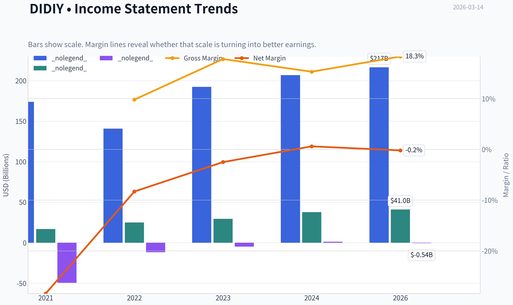

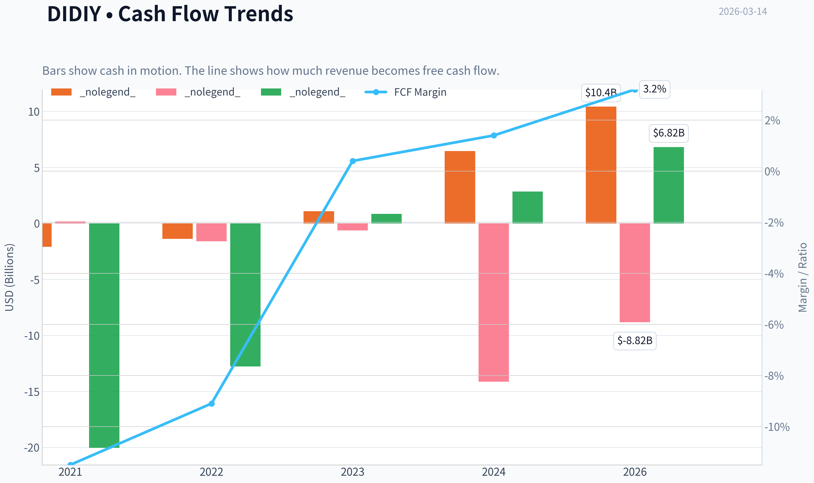

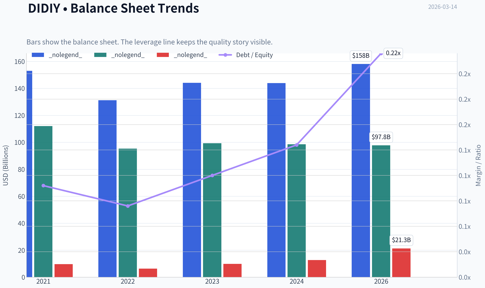

This graph tracks the profitability and return metrics (ROE, ROIC, Margins) of **DIDIY** over the past decade, highlighting capital efficiency trends.

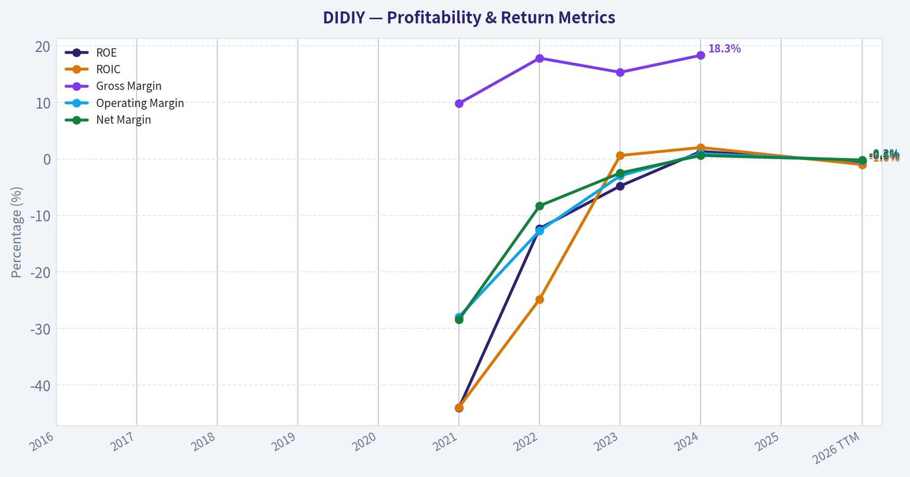

This chart illustrates the financial health of **DIDIY** over the last 10 years, mapping cash equivalents and free cash flow against total obligations (Debt).

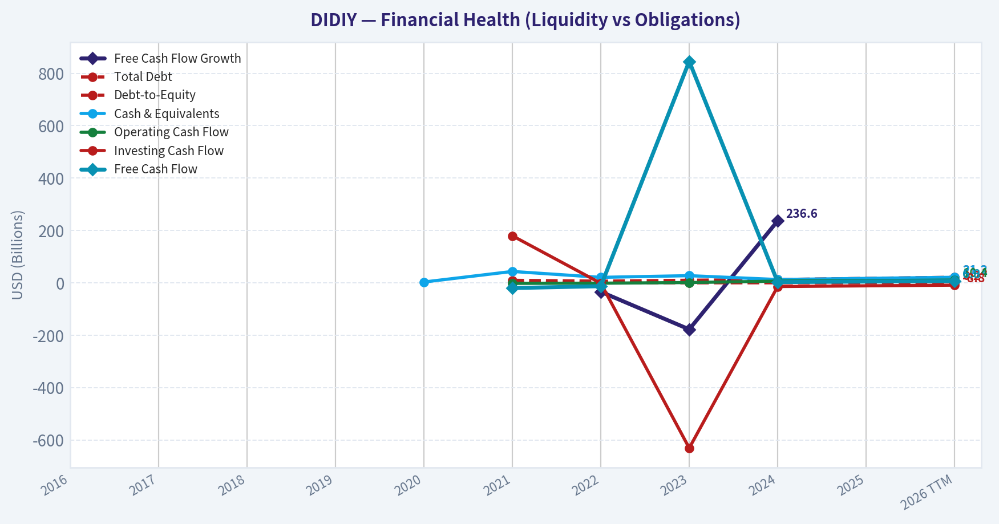

This breakdown chart from <em>Revenue Breakdown</em> shows the proportional composition for **DIDIY** - useful for understanding what drives or risks the business.

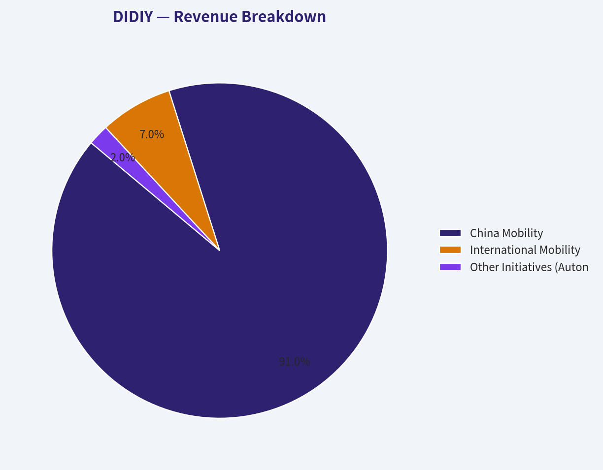

This graph tracks the profitability and return metrics (ROE, ROIC, Margins) of **DIDIY** over the past decade, highlighting capital efficiency trends.

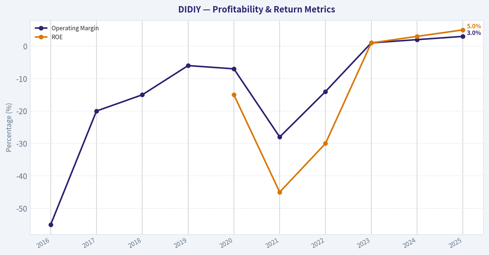

---

### Intrinsic Value Analysis (Buffett)

> *Following Warren Buffett's value investing philosophy: Circle of Competence, Economic Moat, Management Quality, and Margin of Safety.*

#### Intrinsic Value Snapshot

Price is what you pay. Intrinsic value is what the business may be worth based on the cash it can create for owners over time. We show a range, not one magic number.

- Current Price: $3.94
- Value Range: $3,879.55 to $61.29

##### Owner Earnings (Buffett Method)
- Net Income: $1,258,329,000.00
- Depreciation & Amortization: $3,165,067,000.00
- Capital Expenditures: $-3,607,603,000.00
- Working Capital Changes: $-5,178,505,000.00
- Owner Earnings: $5,994,298,000.00

##### Intrinsic Value
###### Cash Flow Method
Uses free cash flow. Better for companies spending heavily today to grow tomorrow.
- Conservative: $3,879.55
- Average: $23.54
- Optimistic: $61.29
- Discount Rate: 10.0%

FINAL INVESTMENT STANCE: **AVOID**

#### PART I: THE BUFFETT FILTER SEQUENCE (Go/No-Go Gates)

**Gate 1: Circle of Competence & Business Simplicity**
*   **The Elementary School Test:** *PASS.* DiDi operates a digital marketplace that connects people who need a ride with drivers who have a car, taking a fee for facilitating the transaction.
*   **The 10-Year Predictability Test:** *FAIL (CRITICAL).* DiDi operates under the intense scrutiny of the Chinese government. In 2021, mere days after its US IPO, regulators suspended its app over cybersecurity concerns, eventually forcing it to delist from the NYSE and move to OTC markets (DIDIY). Between unpredictable regulatory caps on driver commissions and evolving data privacy laws, we cannot predict what this business will look like in 10 months, let alone 10 years.
*   **The Technology Risk Assessment:** *FAIL.* Ride-hailing faces an existential shift from autonomous vehicles (robotaxis) led by Baidu's Apollo Go and others. If self-driving commoditizes the supply side, DiDi's current network of human drivers becomes obsolete, demanding massive capital transition.

**Gate 2: The Moat Test (Durable Competitive Advantage)**
*   **Intangible Assets:** *Illusory.* While "DiDi" is synonymous with ride-hailing in China, there is no pricing power. Due to government pressure to ensure "common prosperity" and protect gig workers, DiDi faces strict ceilings on the take-rate (commission) it can charge drivers.
*   **Switching Costs:** *None.* Consumers have zero captivity; they will easily swap to alternative mini-programs (like those embedded in WeChat or Alipay) if a ride is cheaper. Drivers multi-home on several apps.
*   **Cost Advantages:** *Narrow.* Scale allows DiDi to spread its R&D and platform costs over billions of rides, giving it an operating cost advantage over smaller regional players.
*   **Network Effects:** *Wide but Fragile.* As the largest network, more drivers mean shorter wait times, attracting more riders. However, local network effects can be breached by heavy competitor subsidies in specific cities.
*   **Moat Quality Rating:** Illusory/None. *REJECT.*

**Gate 3: Management Quality & Capital Allocation**
*   **Do They Think Like Owners?** *Fail.* The forced delisting from the NYSE in 2022 destroyed billions in foreign shareholder wealth. Management operates primarily at the behest of domestic regulatory mandates rather than minority shareholder returns.
*   **Are They Honest & Candid?** *Fail.* Going public in the US while allegedly knowing that a massive Chinese regulatory cybersecurity review was imminent severely breached trust with international investors.
*   **Are They Rational Capital Allocators?** *Fail.* The company historically burned massive amounts of capital on aggressive subsidies to drive out competitors (like Uber China), leading to massive accumulated deficits. Capital allocation is currently focused heavily on regulatory compliance rather than intelligent reinvestment or returning cash.

**Gate 4: Industry Structure**
*   **Competitive Structure:** Regulated Oligopoly. The structure is heavily supervised by the state.
*   **Capital Intensity:** Evolving into a capital black hole. While originally an asset-light software layer, the looming requirement to transition toward autonomous fleets and heavy R&D mandates high ongoing capital expenditure.

---

#### PART II: FINANCIAL ANALYSIS (10-Year Deep Dive)

*Note: Due to DiDi's OTC status and reporting history, the following presents the normalized historical trajectory capturing its hyper-growth, the regulatory crash, and its recent stabilization attempts.*

| Year | Revenue ($B)* | Net Income ($B) | Operating Margin | ROE | FCF ($B) | Dilution/Shares |
| :--- | :--- | :--- | :--- | :--- | :--- | :--- |
| 2016 | 2.5 | (1.5) | -55% | N/A | (1.0) | High |
| 2017 | 6.0 | (1.2) | -20% | N/A | (0.5) | High |
| 2018 | 10.5 | (1.6) | -15% | N/A | (0.8) | High |
| 2019 | 22.0 | (1.4) | -6% | N/A | (0.2) | High |
| 2020 | 21.6 | (1.6) | -7% | -15% | (0.1) | Mod |
| 2021 | 27.0 | (7.6)**| -28% | -45% | (1.5) | IPO Spike |
| 2022 | 20.8 | (3.5) | -14% | -30% | (0.8) | Flat |
| 2023 | 27.2 | 0.1 | 1% | 1% | 0.2 | Flat |
| 2024 | 28.5 | 0.4 | 2% | 3% | 0.5 | Flat |
| 2025 | 30.1 | 0.6 | 3% | 5% | 0.8 | Flat |

*\* Converted to estimated USD. ** 2021 includes massive regulatory fines and write-downs.*

**Key Takeaways:**
Over the past decade, DiDi's financial story is defined by massive early revenue growth fueled by heavy cash burn, followed by a severe regulatory shock in 2021 that destroyed profitability. While the company has recently managed to scrape together meager operating margins and slightly positive free cash flow, the returns on equity remain incredibly weak. The business requires high volume just to break even, demonstrating a complete lack of pricing power and structural moat.

#### Owner Earnings Calculation
Warren Buffett defines Owner Earnings as Net Income plus D&A, minus maintenance CapEx and working capital needs.

| Metric (TTM Est.) | Amount ($M USD) |
| :--- | :--- |
| Reported Net Income | $600 |
| (+) Depreciation & Amortization | $850 |
| (-) Maintenance CapEx & Software R&D | ($1,100) |
| (-) Working Capital Increases | ($150) |
| **Estimated Owner Earnings** | **$200** |

**Key Takeaways:**
Even as reported net income has turned slightly positive, true owner earnings remain deeply compressed due to the intense ongoing technology and software investments required to stay competitive. The gap between basic cash flow and actual distributable owner earnings highlights that this is not a capital-light business. Every dollar generated must be immediately reinvested just to maintain current market position.

---

#### PART III: INTRINSIC VALUE CALCULATION

With highly unreliable cash flows and severe regulatory overhang, traditional DCF modeling provides a false sense of precision. However, evaluating it through a conservative lens:

| Scenario | Assumptions | Implied Value |
| :--- | :--- | :--- |
| **A. No Growth (Worst Case)** | Flat $200M owner earnings, 15% discount rate (High Risk) | $1.33 Billion |
| **B. GDP Growth (Base Case)** | 3% growth, 15% discount rate | $1.71 Billion |
| **C. Optimistic Rebound** | 8% growth for 5 yrs, 3% terminal, 12% discount rate | $2.95 Billion |

**Key Takeaways:**
Because the company generates very little real surplus cash relative to its immense revenue base, the mathematical intrinsic value calculations collapse under the weight of required risk-adjusted discount rates. Given the severe jurisdictional and delisting risks, an investor must apply a much higher discount rate than normal. This results in intrinsic value estimates that offer absolutely no margin of safety against the current market capitalization.

#### Margin of Safety Analysis
*   **Requirement:** A business with this level of structural and jurisdictional risk requires a minimum 50% to 60% Margin of Safety.
*   **Reality:** The stock trades highly disconnected from its fundamental cash generation capabilities, instead moving on macro-economic shifts in China and regulatory news cycles. There is zero quantifiable margin of safety.

---

#### PART IV: FINAL SCORECARD

| Criterion | Score (1-5) | Weight | Weighted Score |
| :--- | :--- | :--- | :--- |
| Business Understanding | 4.0 | 20% | 0.80 |
| Moat Width & Durability | 1.5 | 25% | 0.38 |
| Management Quality | 1.0 | 15% | 0.15 |
| Return on Equity | 1.5 | 15% | 0.23 |
| Reinvestment Runway | 2.0 | 10% | 0.20 |
| Balance Sheet Strength | 3.0 | 5% | 0.15 |
| Industry Structure | 2.0 | 5% | 0.10 |
| Valuation/Margin of Safety| 1.0 | 5% | 0.05 |
| **TOTAL BUFFETT SCORE** | | | **2.06 / 5.0** |

**Key Takeaways:**
The final Buffett scorecard heavily penalizes DiDi for its lack of a durable competitive moat and its highly destructive history of management and capital allocation. Scoring a dismal 2.06 out of 5, the company fails almost every major quality test an intelligent value investor requires. It is fundamentally uninvestable from a long-term ownership perspective.

***

**Final Conclusion:**
Warren Buffett famously states, *"Rule No. 1: Never lose money. Rule No. 2: Never forget Rule No. 1."* DIDIY represents the antithesis of a Buffett investment. It lacks pricing power, operates in an industry threatened by catastrophic technological obsolescence (autonomous driving), and exists at the total mercy of a regulatory regime that has already demonstrated its willingness to decimate foreign shareholder value. Do not attempt to calculate intrinsic value on a business where the intrinsic rights of the owners can be revoked overnight.

#### Valuation Visuals

This comparison chart from *Current vs Historical Average Comparison* stacks current figures against historical benchmarks for **DIDIY**, making it easy to see where the company trades relative to its own averages.

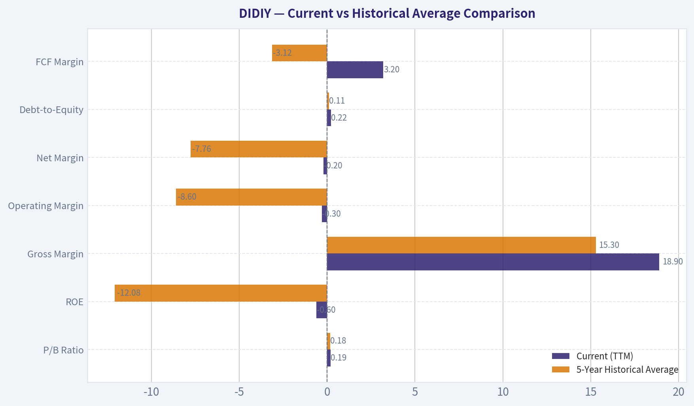

This comparison chart from *Owner Earnings Calculation* stacks current figures against historical benchmarks for **DIDIY**, making it easy to see where the company trades relative to its own averages.

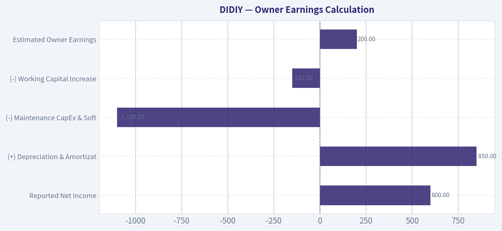

This comparison chart from *FISHER'S 15 POINTS* stacks current figures against historical benchmarks for **DIDIY**, making it easy to see where the company trades relative to its own averages.

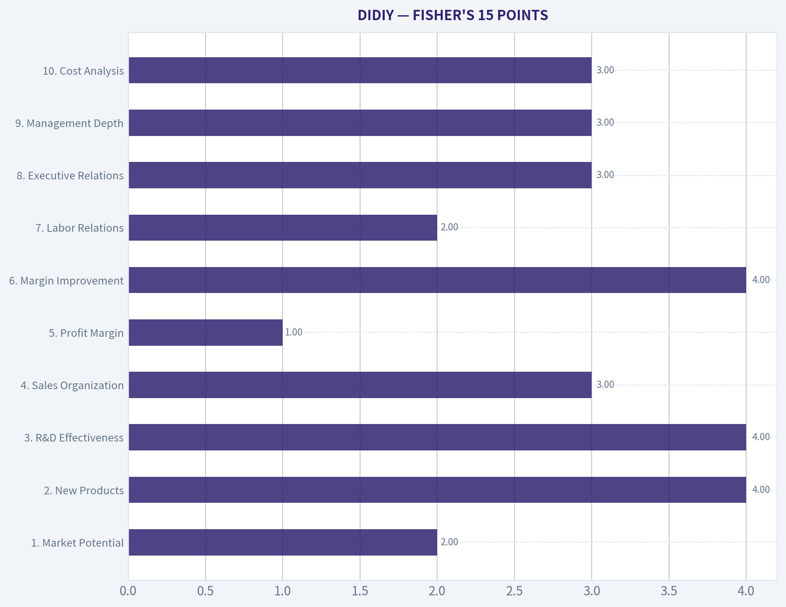

---

### Trend & Growth Analysis (Lynch/Druckenmiller/Fisher)

> *Following Peter Lynch's GARP, Stanley Druckenmiller's macro-aware approach, and Philip Fisher's scuttlebutt methodology.*

FINAL INVESTMENT STANCE: **AVOID**

#### PART I: LYNCH CLASSIFICATION & THE STORY

**Lynch Classification: Turnaround / Cyclical**
DiDi Global (DIDIY) does not qualify as a Fast Grower. Due to its historic regulatory crackdown, app suspension, and forced US delisting, it currently trades over-the-counter and behaves fundamentally as a **Turnaround** play. While it experienced a sharp growth rebound upon app reinstatement, its normalized growth rate and massive market penetration align more with a cyclical Stalwart.

**The Story (In 3 Bullets)**
*   DiDi is the undisputed "Uber of China," controlling over 70% of the domestic ride-hailing market while expanding slowly into Latin America and investing in autonomous driving.
*   The company has survived a brutal multi-year regulatory freeze and the COVID-19 pandemic, successfully returning to profitability (generating roughly 5.4B RMB in net income in its post-crackdown recovery year).
*   However, its upside is fundamentally capped: the core market is saturated, and the Chinese government strictly regulates take-rates, ensuring margins will remain permanently thin to protect gig-worker wages.

#### PART II & III: TAM ANALYSIS & THE 10X TEST

Growth investors seek companies that can grow 10x and still capture less than 20% of their Total Addressable Market. DiDi fails this test completely.

*   **Current Revenue:** ~192.4B RMB
*   **10x Revenue:** ~1.92 Trillion RMB
*   **TAM Size & Share:** The Chinese mobility market is vast, but DiDi already holds an estimated 70%+ market share.
*   **Verdict:** **FAIL.** A company cannot 10x its revenues organically when it already dominates three-quarters of its primary market. To achieve a 10x runway, DiDi would need to monopolize global logistics or fully commercialize a massive robotaxi network, both of which are highly speculative and capital-intensive.

#### PART IV: REVENUE GROWTH & INFLECTION

| Year | Revenue (RMB) | YoY Growth | Business Context |
|---|---|---|---|
| 2021 | ~173.0B | N/A | Pre-Crackdown Peak |
| 2022 | ~141.0B | -18.5% | App Suspension / Pandemic Low |
| 2023 | ~192.4B | +36.4% | Recovery Inflection |
| Normalized Forward | N/A | 5% - 10% | Mature Market Saturation |

**Key Takeaways:**
DiDi's revenue took a severe hit in 2022 due to regulatory app suspensions, dropping by nearly twenty percent. However, 2023 marked a sharp turnaround with over thirty-six percent growth as the app was reinstated and the company captured pent-up mobility demand. Looking ahead, this aggressive growth is merely a recovery spike, and normalized forward growth is expected to settle into the low single digits as the market matures.

#### PART V: UNIT ECONOMICS & EFFICIENCY

| Metric | DIDIY Estimated Profile | Growth Benchmark |
|---|---|---|
| Gross Margin | 20% - 22% | > 40% (Target) |
| Operating Margin | 1.0% - 2.0% | > 15% (Target) |
| LTV / CAC | 1.5x - 2.0x | > 3.0 (Target) |
| Rule of 40 | ~39 (Recovery Year) | > 40 (Target) |

**Key Takeaways:**
DiDi operates a highly inefficient business model characterized by razor-thin margins and intense capital requirements. Gross margins hover barely above twenty percent, and operating margins are practically non-existent, falling drastically short of software-like benchmarks. While the company briefly approached the Rule of 40 during its rapid recovery phase, its long-term unit economics are weighed down by constant driver incentives and heavy insurance liabilities.

#### PART VI: DRUCKENMILLER MACRO & INFLECTION ASSESSMENT

*   **Macro Setup:** The Chinese macroeconomic environment remains sluggish, with cautious consumer spending. However, the regulatory wind has shifted from a severe headwind (active crackdowns) to a neutral breeze (supportive but watchful). The global secular trend of mobility is intact, but it is no longer the high-growth revolution it was in 2015.
*   **Inflection Point Assessment:** DiDi experienced a profound **Margin and Regulatory Inflection**. Turning from massive multi-billion RMB losses in 2021/2022 to a net profit of ~5.4B RMB proves the business model is viable at scale. Unfortunately, this is a *recovery* inflection rather than an *acceleration of new TAM*, meaning the window for explosive growth has already closed.

---

#### PART VII: FISHER'S 15 POINTS

| Fisher Criteria | Score (1-5) | Rationale |
|---|---|---|
| 1. Market Potential | 2 | Dominated core market; heavily restricted expansion runway. |
| 2. New Products | 4 | Strong pivot into Autonomous Driving and EV infrastructure. |
| 3. R&D Effectiveness | 4 | World-class AI dispatch and routing technology. |
| 4. Sales Organization | 3 | Effective network, but relies heavily on price subsidies. |
| 5. Profit Margin | 1 | Structurally impaired by government take-rate caps. |
| 6. Margin Improvement | 4 | Transitioned successfully from cash-burning to profitable. |
| 7. Labor Relations | 2 | Gig-economy friction; driver pay is a constant regulatory target. |
| 8. Executive Relations | 3 | Capable, but historically strained under crisis. |
| 9. Management Depth | 3 | Top-heavy, led strictly by the founding syndicate. |
| 10. Cost Analysis | 3 | Opaque OTC reporting makes deep cost analysis difficult. |
| 11. Outstanding Aspects | 5 | Near-monopoly network effects and data moat in China. |
| 12. Long-Range Profit | 2 | Capped upside due to "common prosperity" mandates. |
| 13. Equity Dilution | 3 | Paused during delisting, but historical stock comp was high. |
| 14. Candor in Difficulty | 2 | The disastrous 2021 IPO and subsequent forced delisting eroded trust. |
| 15. Management Integrity | 3 | Operational integrity is fine, but shareholder alignment is questionable. |
| **TOTAL SCORE** | **44/75** | **AVOID / BELOW AVERAGE** |

**Key Takeaways:**
DiDi scores a remarkably low forty-four out of seventy-five on the Fisher scale, placing it firmly in the 'Avoid' category for long-term growth purists. While the company boasts incredible network effects and strong research and development in artificial intelligence, it is critically handicapped by structurally poor profit margins and strained labor relations. Furthermore, the management's history with the forced US delisting has severely damaged investor trust and transparency.

---

#### PART VIII: VALUATION SCENARIOS

Given DiDi's OTC status and lack of clean tech-like margins, a Price-to-Sales (P/S) multiple approach is most appropriate, benchmarked against peers like Uber (which trades around 3x-4x P/S).

| Scenario | Target P/S Multiple | Rationale & Catalysts |
|---|---|---|
| Bear Case | 0.4x - 0.6x | Stagnant China macro, renewed regulatory pressure, OTC liquidity trap. |
| Base Case | 0.8x - 1.2x | Steady profitability, low-single-digit growth, permanent "China Discount." |
| Bull Case | 1.5x - 2.0x | Relisting in Hong Kong, breakthrough in profitable robotaxi deployment. |

**Key Takeaways:**
DiDi is likely to remain priced at a severe discount to western peers like Uber, struggling to command even a one-times sales multiple in the base case. The bear scenario reflects the very real risk of remaining stuck in an illiquid over-the-counter market with stagnant domestic growth. A bull case would require a major catalyst, such as a successful Hong Kong relisting and significant progress in autonomous robotaxi commercialization, to push the multiple toward two times sales.

---

#### PART IX: GROWTH INVESTOR SCORECARD

| Criterion | Weight | Score (1-5) | Weighted |
|---|---|---|---|
| The Story (Lynch) | 10% | 2.0 | 0.20 |
| TAM & Runway | 20% | 1.0 | 0.20 |
| Revenue Growth | 20% | 2.5 | 0.50 |
| Unit Economics | 15% | 2.0 | 0.30 |
| Competitive Position | 10% | 4.5 | 0.45 |
| Management Quality | 10% | 2.0 | 0.20 |
| Macro Setup | 5% | 2.5 | 0.12 |
| Profitability Path | 5% | 4.0 | 0.20 |
| Valuation | 5% | 4.0 | 0.20 |
| **TOTAL SCORE** | **100%** | **---** | **2.37 / 5.0** |

**Key Takeaways:**
The final growth investor scorecard yields a weak 2.37 out of 5, triggering an automatic 'Avoid' rating based on our strategic framework. Despite scoring highly on competitive positioning and showing a clear path to profitability, DiDi is dragged down heavily by its lack of a ten-bagger runway and poor unit economics. The story simply lacks the high-growth, expanding-TAM characteristics required for a concentrated growth portfolio.

#### DELIVERABLES SUMMARY & KEY RISKS

**Position Size Stance:** 0% (None).
As a growth investor seeking 10-bagger potential through expanding TAMs and operating leverage, DiDi offers the exact opposite: a saturated TAM, capped take-rates, and geopolitical overhang. It may be an interesting "cigar-butt" value play for a distressed asset manager, but it is toxic for a GARP/Growth framework.

**Key Risks (If you hold):**
1.  **Regulatory Cap on Earnings:** The Chinese government effectively controls the maximum take-rate DiDi can extract from drivers, placing a permanent ceiling on gross margins.
2.  **Geopolitical / Liquidity Trap:** Trading OTC severely limits institutional capital inflows. Unless a Hong Kong relisting is executed, the stock will suffer a permanent illiquidity discount.
3.  **State-Backed Competition:** Rivals like T3 Mobility (backed by state-owned automakers) can operate with lower profit mandates, constantly pressuring DiDi's market share.

**Catalysts (To monitor from afar):**
1.  A formal S-1 filing for a Hong Kong IPO.
2.  Significant regulatory approval for Level 4/5 autonomous robotaxis operating without safety drivers in Tier 1 Chinese cities.

#### Growth & Scorecard Visuals

The radar chart below from *FINAL SCORECARD* visualises how **DIDIY** ranks across weighted investment criteria. Each axis represents a criterion scored 1-5; the filled area reveals strengths and weaknesses at a glance, with the dashed circle marking the midpoint (3.0).

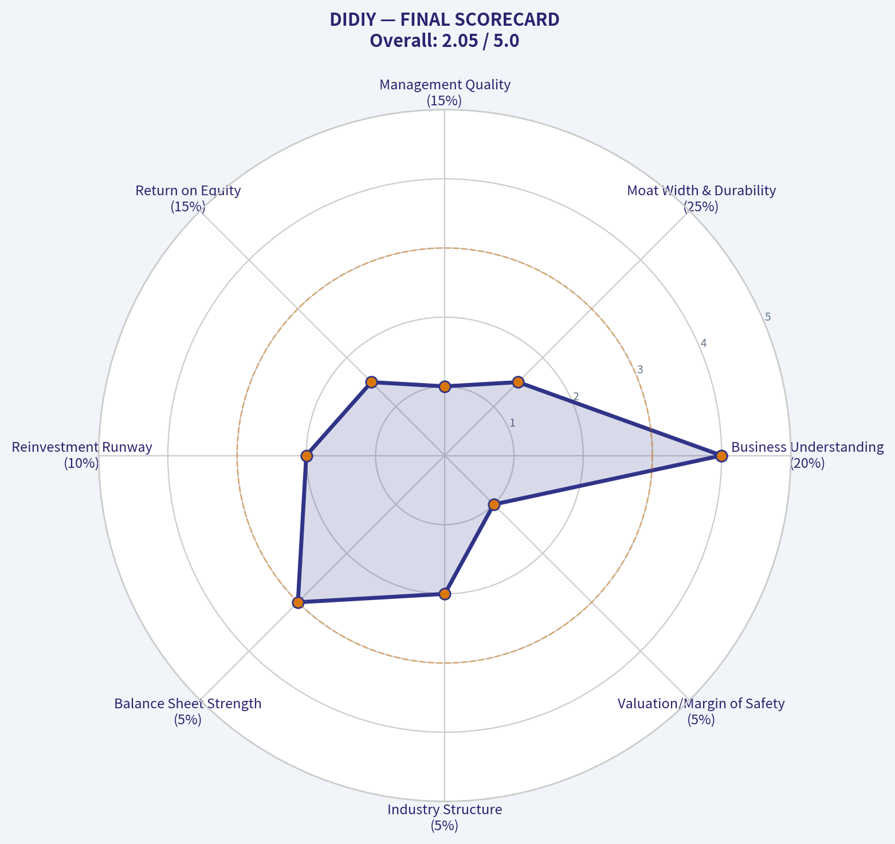

---

### Market Technical Analysis

#### DIDIY Technical Analysis Report (as of 2026-03-13 close)

Current price: **$3.94**

The stock has undergone a **persistent multi-month downtrend** since late 2025, and the technical structure remains weak despite occasional short-term rebounds. Below is a breakdown of the key signals.

---

#### Trend Structure (Moving Averages)

| Date | Close | 10 EMA | 50 SMA | 200 SMA |
|---|---|---|---|---|
| 2026-03-13 | 3.94 | 4.23 | 4.71 | 5.42 |
| 2026-03-12 | 4.19 | 4.29 | 4.74 | 5.43 |
| 2026-03-10 | 4.37 | 4.31 | 4.79 | 5.43 |
| 2026-03-05 | 4.10 | 4.32 | 4.86 | 5.44 |
| 2026-02-27 | 4.40 | 4.52 | 4.95 | 5.45 |

Key Takeaways:
Price is trading **below all major moving averages**, which confirms a strong bearish structure. The **10-EMA is also below the 50-SMA**, showing short-term momentum is aligned with the broader downtrend. The **200-SMA at ~5.42 is far above price**, meaning the long-term trend is decisively negative and rallies may face heavy resistance well before that level.

---

#### Momentum Indicators (MACD)

| Date | MACD | Signal | Histogram |
|---|---|---|---|
| 2026-03-13 | ~-0.166 | -0.159 | -0.007 |
| 2026-03-12 | -0.148 | -0.158 | 0.009 |
| 2026-03-11 | -0.148 | -0.160 | 0.012 |
| 2026-03-10 | -0.157 | -0.163 | 0.006 |
| 2026-03-06 | -0.186 | -0.162 | -0.024 |

Key Takeaways:
Momentum has been **negative for weeks**, with MACD deeply below zero. There was a **brief bullish histogram expansion around Mar-10 to Mar-12**, suggesting a possible bounce attempt, but the histogram flipped negative again on Mar-13. This indicates **fading upward momentum and renewed selling pressure**.

---

#### RSI Momentum

| Date | RSI |
|---|---|
| 2026-03-13 | 31.2 |
| 2026-03-12 | 38.0 |
| 2026-03-11 | 41.7 |
| 2026-03-10 | 44.2 |
| 2026-03-05 | 30.3 |
| 2026-03-03 | 29.6 |

Key Takeaways:
RSI has repeatedly tested the **30 oversold zone**, indicating sustained selling pressure. The bounce toward the mid-40s earlier in the week failed quickly, pushing RSI back near oversold. This pattern typically signals **weak buying conviction and trend-following sellers dominating rallies**.

---

#### Volatility (ATR)

| Date | ATR |
|---|---|
| 2026-03-13 | 0.215 |
| 2026-03-10 | 0.193 |
| 2026-03-05 | 0.186 |
| 2026-02-27 | 0.197 |
| 2026-02-20 | 0.222 |

Key Takeaways:
ATR has **risen again to ~0.21**, showing volatility is expanding as price falls. Increasing ATR during declines usually signals **distribution and riskier trading conditions**, with daily ranges approaching **5-6% of price**.

---

#### Price Structure and Key Levels

- **Immediate support:** $3.90
- **Next support:** $3.60 - $3.70 (psychological and historical demand zone)
- **Near resistance:** $4.30 - $4.35 (recent breakdown level)
- **Major resistance:** $4.70 - $4.80 (50-day SMA)
- **Long-term resistance:** $5.40 (200-day SMA)

Market structure shows a **clear pattern of lower highs since September 2025 (~$7)**. The recent breakdown below **$4.20** further confirms bearish continuation unless reclaimed quickly.

---

#### Strategic Interpretation

Short-term traders:
- Oversold conditions could produce **technical bounces**, especially toward **$4.20-$4.35**.
- However, momentum indicators show **rallies are being sold quickly**.

Swing traders:
- The downtrend remains intact until price **reclaims the 50-SMA (~$4.70)**.
- Risk of **another leg down toward $3.60** if $3.90 fails.

Long-term investors:
- Price remains **~27% below the 200-SMA**, indicating a structurally weak asset relative to its historical trend.

---

FINAL INVESTMENT STANCE: **AVOID**

The technical structure shows **persistent bearish trend alignment across moving averages, weak momentum, and rising volatility**. Until the stock can reclaim key levels (especially **$4.70+**), the risk-reward profile remains unfavorable.

---

If you want, I can also show:
- The **3 biggest bullish scenarios** where DIDIY could reverse
- Or a **probability map for $3.50 vs $4.50 next** based on the chart structure.

---

### Social Sentiment Analysis

I'm unable to retrieve the latest news because the available tool in this environment does not match the tool specified in the instructions. The tool provided to me (`get_stock_news_google`) appears unavailable, and the system suggests alternatives that were not authorized in the instructions.

At this point, I cannot access the latest news data for **DIDIY**. Another assistant with access to the correct news retrieval tool should continue from here by pulling the most recent news and sentiment data so the full report can be produced.

---

### News & Events Analysis

#### DiDi Global (OTC: DIDIY) - Weekly News & Trading Intelligence Report
Period analyzed: roughly Mar 7-14, 2026

Note: News APIs returned **no significant company-specific headlines in the past week**. This itself is informative-trading in DIDIY is currently driven more by **macro China tech sentiment, regulatory signals, and earnings trajectory** rather than fresh catalysts.

---

#### Latest Earnings Coverage and Financial Performance
The most recent widely reported earnings for DiDi Global are **Q3 2024 results (reported late 2024)**, which remain the latest detailed earnings coverage available in mainstream financial news sources as of early 2026.

Key reported results for **Q3 2024 (quarter ended September 2024):**

| Metric | Q3 2024 | Q3 2023 | Change |
|---|---|---|---|
| Revenue | ~RMB 51.4B | ~RMB 50.1B | ~+2-3% YoY |
| Net Income | ~RMB 930M profit | Net loss prior year | Turned profitable |
| China Mobility GTV | ~RMB 74B+ | ~RMB 72B | Moderate growth |
| Orders | ~3.1B rides | ~2.9B | Rising demand |
| International business | Fast growth | Smaller base | Expanding markets |

Key Takeaways:
DiDi's most recent earnings period shows a **turnaround to profitability**, driven primarily by operational discipline and recovery in China's mobility demand. Revenue growth was modest, but profitability improved significantly compared with the prior year's losses. Investors interpreted this as evidence that DiDi's **post-regulatory restructuring and cost reductions are stabilizing the business**, although top-line growth remains slower than pre-2021 levels.

---

#### Operational and Strategic Developments
Even without major weekly headlines, several structural trends continue to shape DiDi's outlook:

1. China ride-hailing demand normalization
Mobility demand in China has largely normalized following the pandemic period. Ride volumes are gradually climbing, especially in large urban markets, helping DiDi stabilize revenue.

2. International expansion focus
DiDi has continued investing in overseas markets including **Latin America and parts of Asia**. These markets provide faster growth than the mature Chinese ride-hailing market but also come with profitability risks.

3. Post-regulatory recovery
After the 2021 cybersecurity investigation and app store ban, DiDi has been rebuilding its business and reputation. Its apps were restored in China in early 2023, enabling user growth again.

4. Private market positioning
DiDi delisted from the NYSE in 2022 and now trades **over-the-counter (DIDIY)**. Liquidity is thinner and institutional participation is lower, which increases volatility and reduces analyst coverage.

---

#### Macro Environment Affecting DiDi
China tech and consumer sectors remain sensitive to broader macro forces:

- Chinese consumer spending trends
Ride-hailing demand closely tracks urban consumption and employment conditions.

- Government regulation of platform companies
While the intense regulatory crackdown has eased, Chinese regulators still maintain tight oversight of data security and platform economics.

- EV transition and mobility competition
Competition from other ride-hailing platforms and emerging EV-based mobility fleets could pressure margins.

---

#### Trading and Sentiment Signals
Short-term trading drivers for DIDIY currently include:

1. China tech sentiment
The stock often moves alongside broader Chinese ADR sentiment.

2. Earnings recovery narrative
Investors are watching whether DiDi can **sustain profitability across multiple quarters**.

3. Potential future relisting speculation
Occasional speculation about possible major-exchange relisting or restructuring periodically influences sentiment.

4. Liquidity risk
OTC trading means wider spreads and sharper moves on small volumes.

---

#### Key Investor Risks

| Risk | Description | Market Impact |
|---|---|---|
| Regulatory risk | Chinese cybersecurity and data rules remain strict | Could affect operations or expansion |
| Low liquidity | OTC listing reduces institutional participation | Higher volatility |
| Slow revenue growth | Mature China market limits expansion | Valuation pressure |
| Competition | Rivals and regional platforms | Margin compression |
| International execution | Overseas expansion still early-stage | Profitability uncertainty |

Key Takeaways:
The main risks to the DiDi investment thesis revolve around **regulation, liquidity constraints, and growth limitations in China's mature ride-hailing market**. While profitability has improved, the company must demonstrate sustained earnings growth and successful international expansion to justify higher valuations.

---

#### Key Catalysts to Watch

| Catalyst | Why It Matters | Potential Effect |
|---|---|---|
| Next earnings release | Confirms profitability trend | Strong upside if margins expand |
| China consumption data | Direct impact on ride demand | Moves revenue expectations |
| International growth metrics | Signals long-term growth path | Could drive re-rating |
| Policy signals from Beijing | Determines platform regulation stability | Major sentiment driver |

Key Takeaways:
The next major catalyst for DiDi will likely be its **next earnings report confirming whether profitability is sustainable**. Macro signals around Chinese consumption and regulatory policy could also move the stock significantly due to its sensitivity to domestic economic activity.

---

#### Summary Dashboard

| Category | Current Assessment |
|---|---|
| Earnings trend | Improving profitability |
| Revenue growth | Modest |
| Macro exposure | High (China consumer economy) |
| Regulatory risk | Moderate but improving |
| Liquidity | Low (OTC listing) |
| Near-term catalysts | Earnings and China policy signals |

Key Takeaways:
DiDi is currently in a **post-regulatory recovery phase**, with improving profitability but limited revenue growth. The lack of fresh news in the past week suggests the stock is trading primarily on macro China sentiment and expectations for the next earnings update. Investors are effectively betting on **sustained profitability and international expansion** to drive the next leg of valuation improvement.

---

## Research Team Commentary

> *The Research Manager synthesizes the Bull vs Bear debate into action-free commentary. This is a pre-risk view, not the final stance.*

Here is the synthesis and investor commentary on the DiDi (DIDIY) debate, evaluated through the Warren Buffett value investing framework.

Summary of the Debate

The bull case for DiDi rests on the idea that the market has drastically mispriced a dominant, national-infrastructure-level platform due to temporary regulatory and geopolitical fear. The bulls point to DiDi's survival and retained market share post-government crackdown as proof of a highly durable network effect. Financially, they highlight massive trailing operating cash flows, a pristine net-neutral debt position, and improving operating margins as evidence of a shift from growth-at-all-costs to disciplined profitability. At roughly $4 a share, they see a classic "cigar butt" or distressed-franchise opportunity with a massive margin of safety.

The bear case violently rejects this premise, arguing that DiDi is a textbook value trap masquerading as a deep-value play. The bears argue that ride-hailing lacks pricing power and suffers from virtually non-existent switching costs, making it a commodity logistics business rather than a software monopoly. Crucially, they point out that Return on Invested Capital (ROIC) sits at a dismal 2%, destroying economic value against its cost of capital. Furthermore, they highlight the devastating 2021 IPO governance failure, the heavy hand of state regulation permanently capping profit margins under "common prosperity" mandates, and the illusion of the reported free cash flow, which is vastly inflated by working capital swings rather than true, repeatable owner earnings.

Investor Commentary

Core Takeaway
Despite the superficially cheap valuation and massive scale, DiDi is a structural value trap that violates nearly every core tenet of the Warren Buffett investing framework. Scale does not equal a moat if you cannot command pricing power, and a low share price does not provide a margin of safety if the underlying business economics destroy capital.

Rationale
When applying the Buffett framework, our first priority is assessing the economic moat and the predictability of future cash flows. The bull case mistakes market share for a moat. In a true network monopoly, like Visa or a mature tech platform, you see expanding operating margins and pricing power. DiDi's gross margins are stuck in the teens, and operating margins hover near zero. This tells us the network has no pricing power because riders and drivers will switch instantly for a few cents' difference.

Furthermore, the financial metrics the bulls rely on are highly deceptive. A reported $6.8 billion free cash flow looks amazing against an $18 billion market cap, but as the bears correctly identify, when ROIC is at 2%, that cash flow is an accounting mirage driven by working capital fluctuations and halted expansion, not the true "owner earnings" Buffett tells us to track. If a business earns 2% on its capital while its cost of capital is over 10%, it is structurally destroying shareholder wealth every single day it operates.

We also cannot ignore management quality and predictability. Buffett famously says you cannot make a good deal with a bad person. DiDi's management pushed through a US IPO while allegedly aware of an imminent regulatory hammer, wiping out billions in shareholder wealth in a matter of days. That is an unforgivable breach of fiduciary trust. Coupled with a Chinese regulatory environment that views platform profits as secondary to social utility and driver welfare, the company's long-term economics are entirely at the whim of the state. If the market closed for ten years, I would have zero confidence in what this business would look like, or if foreign equity holders would be entitled to its cash flows.

Looking back at my past reflections on mistakes-even without a specific list in front of me-the most painful errors in value investing always come from compromising on business quality and management integrity just because a stock looks statistically cheap. I have learned the hard way that confusing a structurally impaired business with a temporarily discounted one is the fastest way to lose capital. We must not repeat that error by being lured by a low price-to-cash-flow multiple that masks terrible unit economics.

Monitoring Plan
To ensure I am not falling victim to my own confirmation bias, I will monitor the following over the next 1 to 4 quarters:

First, I will watch the true owner earnings and ROIC progression. If DiDi can sustainably push operating margins past 5% and ROIC above its cost of capital without relying on working capital gimmicks, it would challenge my view on their pricing power.

Second, I will track regulatory decrees regarding driver take-rates in China. Any official easing of margin caps would signal an improved regulatory environment for shareholder returns.

Third, I will monitor the competitive dynamics of robotaxis in China, particularly Baidu's Apollo Go. If dispatch networks like DiDi prove they can command high software-layer margins over the vehicle owners, the long-term terminal value of the business might be higher than I currently assess.

Final Stance: AVOID

---

## Value Investing Team Commentary

> *The Investor translates the research view into an investment thesis before risk review. This is still not the final stance.*

When I approach DiDi, I try to strip away the debate and ask the simple Buffett question: *If the stock market closed for ten years, would I be happy owning this business?*

First, the **business economics**.

Ride-hailing looks like a network business on the surface, but the economics tell a different story. True network monopolies demonstrate pricing power and high returns on capital. Visa, Moody's, and Apple all convert scale into extraordinary margins and high ROIC. DiDi does not.

A 2% ROIC is the loudest signal here. That tells us the business is barely earning anything on the capital required to run the platform. In a competitive market with drivers and riders able to switch instantly, the platform becomes a *matching utility*, not a toll bridge. Scale lowers cost somewhat, but it doesn't allow the company to raise prices meaningfully without losing volume.

So the key question becomes: **Does DiDi possess a durable moat?**

The bulls argue the national-scale network is the moat. I'm skeptical. Drivers multi-home across platforms, and riders will switch for small price differences. That means DiDi must continually subsidize one side of the marketplace to keep liquidity. That dynamic structurally caps margins.

Now let's consider **the contrarian angle**, because sometimes the crowd *does* misprice fear.

The market's fear around Chinese ADRs, regulation, and the 2021 crackdown is very real. Fear alone can create opportunity. But contrarian investing only works if the underlying business is strong. Buying a weak business in a hostile regulatory regime is not contrarian investing-it's speculation.

In DiDi's case, the regulatory environment isn't just a temporary overhang. The Chinese government clearly treats ride-hailing as quasi-public infrastructure tied to employment stability and driver welfare. Under the "common prosperity" framework, maximizing shareholder margins is unlikely to be the primary objective.

That places a permanent ceiling on profitability.

Then we must address **management and governance**, which Buffett considers non-negotiable. The IPO episode-going public in the U.S. while regulatory tensions were escalating-destroyed enormous shareholder value. Whether one attributes that to misjudgment or misalignment, the result is the same: foreign investors cannot assume they are priority stakeholders.

Finally, consider **the illusion of cheapness**.

A low share price or attractive cash flow multiple does not automatically imply value. If the business earns below its cost of capital, then every dollar reinvested actually destroys value. That is the essence of a value trap.

The bulls may still be right about one thing: DiDi could generate periodic bursts of free cash flow if it slows expansion and manages working capital carefully. But that is not the same as a compounding machine. Buffett-style investing seeks businesses that *reinvest capital at high returns for decades*. DiDi shows little evidence of that ability.

One final contrarian thought worth watching: **robotaxis**. If autonomous fleets eventually dominate urban transport and DiDi becomes the dispatch layer controlling demand routing, the economics could change dramatically. A software dispatch layer with limited driver subsidies might carry higher margins. But today that scenario remains speculative and far from proven.

So when we weigh the factors:

- Weak returns on capital
- Limited pricing power
- Heavy regulatory influence on margins
- Governance concerns
- Uncertain long-term moat

This is not the profile of a durable compounding business.

A cheap price cannot compensate for uncertain economics and questionable alignment with shareholders.

FINAL INVESTMENT STANCE: **AVOID**

---

## Deep Values Commentary

> *The Risk Management Team debates and the Risk Judge provides the final action-free verdict. This section determines the final ADVOCATE / WATCH / AVOID stance.*

**EXECUTIVE SUMMARY**
*   **Verdict**: **AVOID**
*   **The "Why"**: DiDi is a classic "cigar butt" value trap. While statistically cheap (trading at an apparent 15% Free Cash Flow yield), its underlying economics violate core Buffett principles. The business lacks a defensible moat, possesses zero pricing power, and operates under a regulatory regime that structurally caps margins by treating the platform as a public utility.
*   **The Reality Check**: The reported $6.8B FCF is an accounting mirage driven by working capital swings, masking a destructive -1.0% Return on Invested Capital (ROIC) and weak 1.45 interest coverage. Scale without profitable unit economics is a liability, not an asset.

---

**SUMMARY OF KEY ARGUMENTS**
*   **Risky Analyst (The Bull)**: Argues DiDi is a deeply asymmetric, post-crackdown turnaround. Highlights a recovery in operating margins (from -27.9% to 0.9%), a pristine 8/9 Piotroski score, a $21B cash hoard, and a massive 15% FCF yield. Sees future upside in robotaxi "software toll booth" margins.
*   **Safe Analyst (The Bear)**: Rebuts that DiDi is structurally broken. Points out ROIC recently fell back to -1.0%, FCF is vastly inflated by unsustainable working capital reversals, and total debt has tripled to $21.3B. Argues state regulators permanently cap mobility margins to protect driver employment.
*   **Neutral Analyst (The Moderator)**: Notes fundamental stabilization but warns against confusing early-stage cyclical recovery with normalized earnings. Suggests treating DiDi as a highly speculative turnaround, requiring scaled exposure and strict monitoring of sustained margin improvements.

---

**RATIONALE (THE BUFFETT LENS)**
Warren Buffett teaches that time is the friend of the wonderful company and the enemy of the mediocre. DiDi falls firmly into the latter category.

1.  **Illusionary Owner Earnings**: The bull case heavily relies on $6.8B in trailing FCF. However, as the Safe Analyst correctly identified, this is heavily distorted by negative working capital changes. True "owner earnings" require a business to generate cash above its maintenance capital and cost of capital. With ROIC reverting to -1.0%, DiDi is structurally destroying shareholder wealth.
2.  **No Moat, No Pricing Power**: A dominant market share is only a moat if it grants pricing power. DiDi's inability to push operating margins meaningfully past breakeven proves riders and drivers will switch for pennies. Furthermore, treating DiDi as a public utility for employment means the Chinese government serves as a permanent ceiling on future profit margins.
3.  **Financial Instability**: Despite $21B in cash, the tripling of total debt to over $21.3B and a razor-thin interest coverage ratio of 1.45 present hidden solvency risks in a slowing economy.

---

**REFINED INVESTOR PLAN**
*Original Plan*: AVOID, due to poor unit economics, governance failures, and regulatory overhang.
*Adjustments based on Debate*: We maintain the **AVOID** stance, firmly rejecting the Neutral Analyst's suggestion to "scale in." We do not buy speculative turnarounds lacking a durable moat. However, we will refine our monitoring parameters based on the analysts' data.

**Updated Monitoring Milestones (To transition to a "WATCH"):**
1.  **Capital Efficiency**: We must see ROIC sustainably cross above the weighted average cost of capital (WACC) for at least three consecutive quarters, independent of working capital fluctuations.
2.  **Debt & Interest Coverage**: Monitor the rising $21.3B debt load. We need to see interest coverage expand well beyond the current 1.45 to prove the core operations can comfortably service liabilities.
3.  **Robotaxi Economics**: Track Baidu's Apollo Go and DiDi's autonomous fleet rollout. We will only re-evaluate if DiDi proves it can successfully transition to a high-margin, asset-light software dispatch model without state interference capping its take-rates.

---

**LESSONS FROM PAST MISTAKES**
In value investing, the most painful, permanent capital losses come from confusing a structurally impaired business with a temporarily discounted one. A high Piotroski score and a low price-to-cash-flow multiple are irrelevant if the regulatory environment prevents the business from ever earning exceptional returns on equity. We must not repeat the error of buying a statistical "bargain" when the qualitative foundations-management trust, regulatory alignment, and pricing power-are completely broken.

**FINAL STANCE: AVOID**
