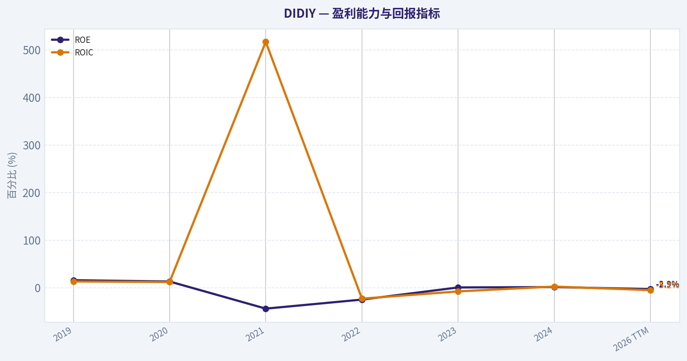
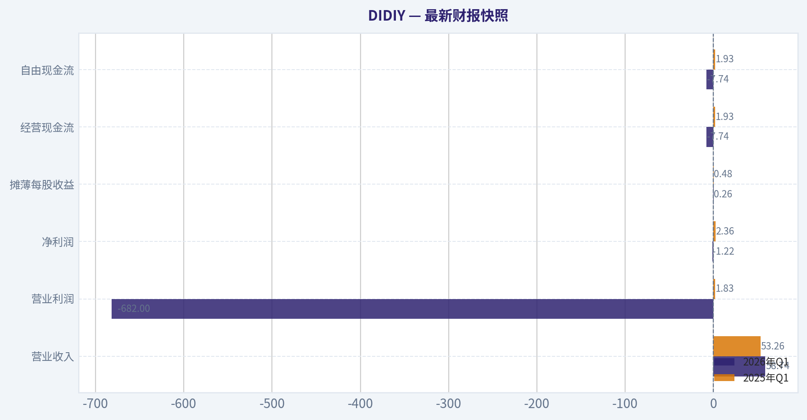
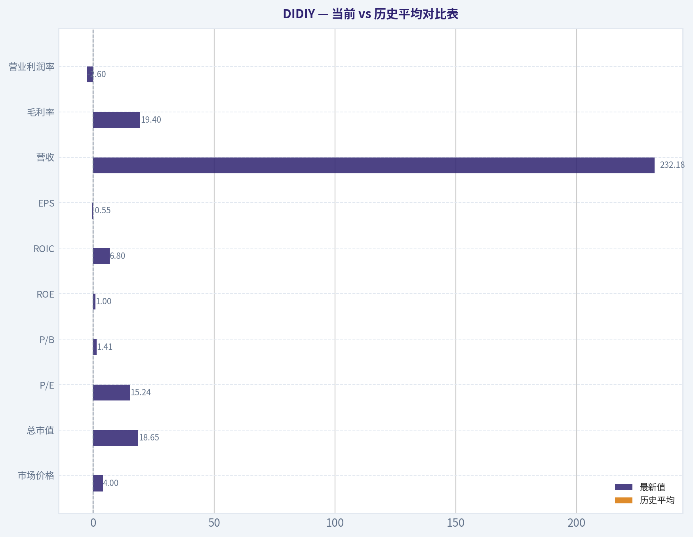
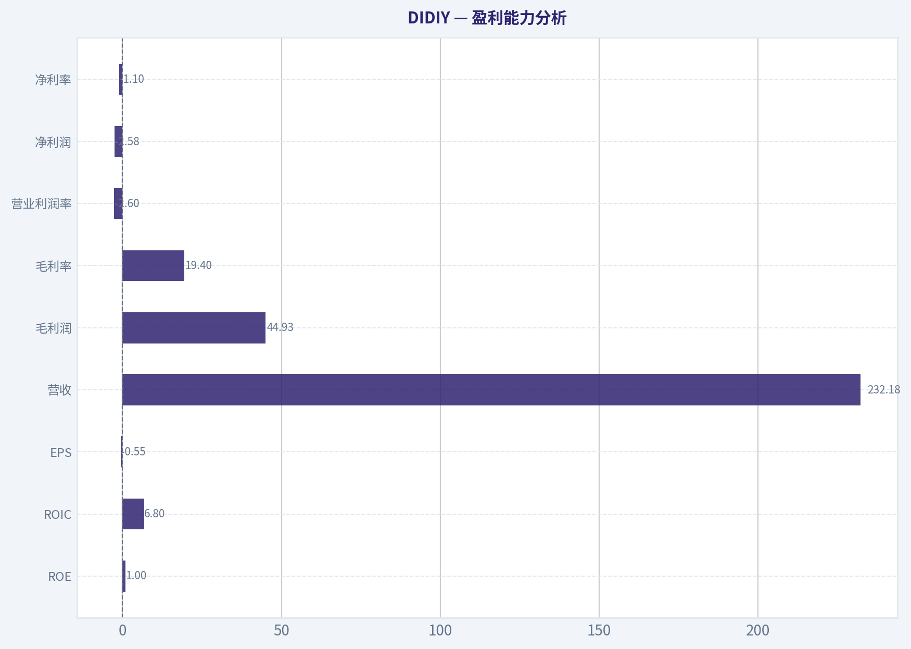
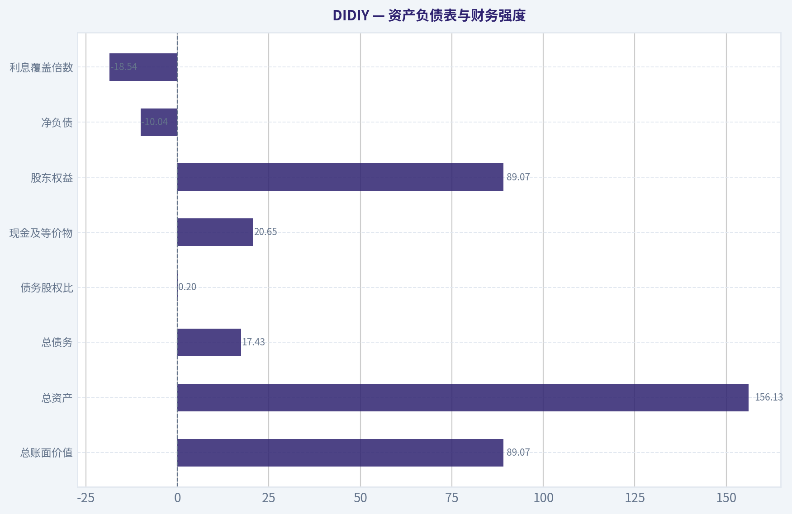
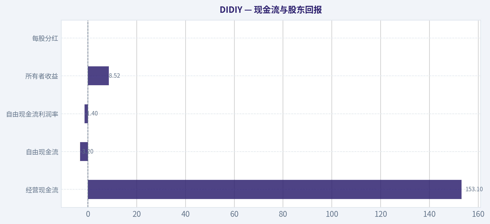
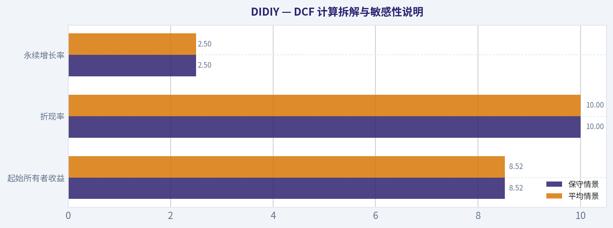
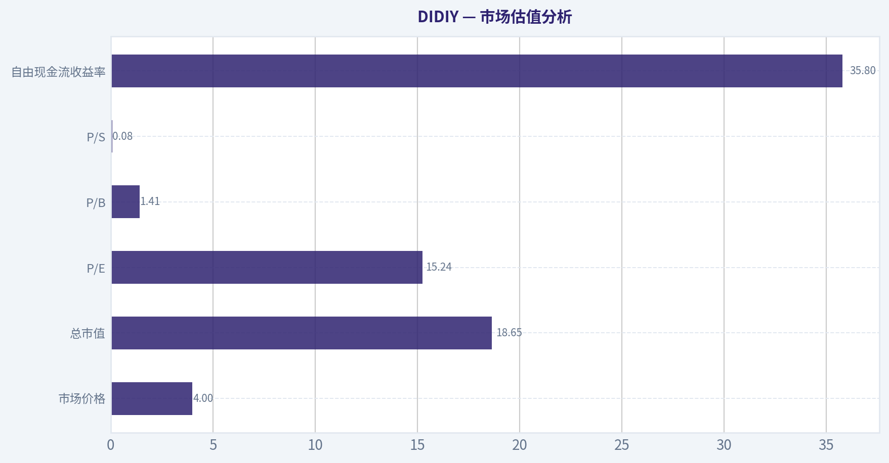

# DIDIY 深度价值情报

**调研日期:** 2026-08-16

## 关键免责声明

*本报告由 Deep Value Intelligence（一个基于 AI 的多智能体投资分析框架）自动生成。 仅供教育和研究用途 - 非财务建议，非财务顾问。*

---

## 目录

1. 情报摘要
2. 分析师团队报告
   - 基本面分析
   - 价值分析 (巴菲特)
   - 成长性分析 (林奇/德鲁肯米勒/费雪)
   - 市场分析
   - 期权市场分析
3. 研究团队评论
4. 投资团队评论
5. Deep Values 团队洞察

---

## 情报摘要

### 核心观点与前提条件

**核心论点:** ### 滴滴（DIDIY）价值投资风险与决策报告

**主要风险:**
- 激进派 (Risky Analyst - 极度乐观)**：视滴滴为"爆发前夜的价值火山"。认为 123.1% 的营收复苏远比 1.0% 的 ROE 重要，庞大的市占率构筑了极深的护城河。现价 4 美元对比 66 美元的理论内在价值存在巨大折价，且国际业务提供了极强的成长看涨期权。
- 护城河宽而不深，缺乏核心定价权 (Business Risk)**：巴菲特青睐的"收费桥梁"必须具备自主提价能力。但在出行市场，司机与乘客存在严重的"多平台栖息（Multi-homing）"现象。更致命的是，监管对抽佣率设置了硬性上限。一个无法通过提价将网络效应转化为超额股东利润的平台，其实质只是受限的公共基础设施。
- 在过去对 GRAB 和 BYDDY 的评估中，我们曾犯过一个极其昂贵的错误：对行业霸主地位抱有"战略性钦佩"，在面对企业低资本回报、脆弱现金流及激烈的价格战/监管压制时，给出了过于温和的"观望（WATCH）"评级。

**置信度:** 中

---

## 分析师团队报告

### 基本面分析

#### 最新财报快照

*以下数据基于最近一期已披露财报（2026年Q1），并尽量与上一年同期对比。*

| 指标 | 2026年Q1 | 2025年Q1 | 同比变化 |
| --- | ---: | ---: | ---: |
| 营业收入 | $58.74B | $53.26B | +10.3% |
| 营业利润 | $-682.0M | $1.83B | -137.2% |
| 净利润 | $-1.22B | $2.36B | -151.8% |
| 摊薄每股收益 | $0.26 | $0.48 | -45.3% |
| 经营现金流 | $-7.74B | $1.93B | -501.2% |
| 自由现金流 | $-7.74B | $1.93B | -501.2% |

关键结论：这张快照先把最新一期财报放在桌面上，再去看长周期分析。这样读者能更清楚地区分"公司长期质量"和"这次财报发生了什么"。

#### DIDIY 6年财务指标

*以下数值均由原始数据确定性计算得出，并非 AI 估算。*

*发行人类型：operating company（Technology / Software - Application）。*

#### 6年财务指标
*年度行来自已披露财务报表，最后一行 TTM 由最近四个季度滚动计算得出。*

| 指标 | 2019 | 2020 | 2021 | 2022 | 2023 | 2024 | 2026 TTM |
| --- | --- | --- | --- | --- | --- | --- | --- |
| 市场价格 | N/A | N/A | $5 | $3 | $4 | $5 | $4 |
| 总市值 | N/A | N/A | $3.28B | $3.85B | $4.84B | $22.34B | $18.65B |
| 市盈率 | N/A | N/A | -0.07 | -0.16 | -65.83 | 4.52 | N/A |
| 市净率 | N/A | N/A | 0.19 | 0.28 | 0.35 | 1.65 | 0.21 |
| ROE | 15.7% | 13.0% | -44.0% | -25.0% | 0.5% | 1.3% | -2.9% |
| ROIC | 13.1% | 11.9% | 516.6% | -23.0% | -7.8% | 2.4% | -5.2% |
| 每股收益 | $-96.62 | $-100.10 | $-76.04 | $-20.38 | $-0.06 | $1.01 | $-0.55 |
| 营收 | $22.42B | $20.55B | $27.28B | $20.41B | $27.10B | $28.78B | $232.18B |
| 毛利润 | $2.19B | $2.31B | $2.66B | $3.62B | $4.15B | $5.26B | $44.93B |
| 毛利率 | 9.8% | 11.2% | 9.8% | 17.8% | 15.3% | 18.3% | 19.4% |
| 营业利润率 | -5.2% | -9.7% | -27.9% | -12.7% | -3.0% | 0.9% | -2.6% |
| 净利润 | $-1.41B | $-1.52B | $-7.74B | $-3.45B | $69.5M | $175.1M | $-2.58B |
| 净利率 | -6.3% | -7.4% | -28.4% | -16.9% | 0.3% | 0.6% | -1.1% |
| 营收增长 | N/A | -8.3% | 32.8% | -25.2% | 32.7% | 6.2% | 706.7% |
| 净利润增长 | N/A | 8.2% | 408.0% | -55.5% | -102.0% | 151.9% | -1575.1% |
| 自由现金流增长 | N/A | 477.6% | 365.2% | -44.2% | -142.5% | N/A | N/A |
| 总账面价值 | $-8.97B | $-11.69B | $17.58B | $13.81B | $13.77B | $13.51B | $89.07B |
| 总资产 | N/A | $22.58B | $24.01B | $19.02B | $20.26B | $19.72B | $156.13B |
| 总债务 | $0 | $222.8M | $263.8M | $21.7M | $147.1M | $99.9M | $17.43B |
| 债务股权比 | -0.00 | -0.02 | 0.02 | 0.00 | 0.01 | 0.01 | 0.20 |
| 现金及等价物 | $1.83B | $3.04B | $6.30B | $2.94B | $3.85B | $1.30B | $20.65B |
| 股东权益 | $-8.97B | $-11.69B | $17.58B | $13.81B | $13.77B | $13.51B | $89.07B |
| 经营现金流 | $209.2M | $164.9M | $-2.10B | $-1.39B | $1.08B | $898.3M | $153.1M |
| 投资现金流 | $-890.8M | $-282.2M | $179.6M | $-1.60B | $-631.0M | $-1.97B | $9.80B |
| 自由现金流 | $-117.0M | $-675.8M | $-3.14B | $-1.76B | $746.2M | N/A | $-3.20B |
| 自由现金流利润率 | -0.5% | -3.3% | -11.5% | -8.6% | 2.8% | N/A | -1.4% |
| 每股分红 | $0.00 | $0.00 | $0.00 | $0.00 | $0.00 | $0.00 | $0.00 |

#### 盈利能力指标
- 净资产收益率 (ROE): 1.0%
- 投入资本回报率 (ROIC): 6.8%
- 总资产收益率 (ROA): 0.6%
- 毛利率: 19.2%
- 营业利润率: -1.6%
- 净利率: 0.4%

#### 流动性指标
- 流动比率: 1.36
- 速动比率: 1.02

#### 杠杆指标
- 债务股权比: 0.14
- 利息覆盖倍数: -18.54
- 净负债: $-10.04B

#### 增长指标（同比）
- 营收增长: 687.7%
- 净利润增长: 466.8%
- 自由现金流增长: N/A
- 营收复合增长率（3年）: 123.1%
- 营收复合增长率（5年）: 61.6%

#### 估值指标
- 市盈率 (TTM): 15.24
- 预期市盈率: 16.39
- 市净率: 1.41
- 市销率: 0.08
- PEG 比率: 0.03
- 企业价值/EBITDA: -8.10
- 自由现金流收益率: 35.8%
- 盈利收益率: 6.6%

#### 所有者收益（巴菲特方法，代码计算）
- 净利润: $175.1M
- + 折旧与摊销: $2.86B
- - 资本开支: $-3.36B
- - 营运资本变动: $2.63B
- = **所有者收益: $8.52B**

#### 内在价值（代码计算）
- 当前价格: $4
- **头条内在价值（按商业模式路由）: $66**
  商业模式: cyclical - owner-earnings DCF (cyclical)
  模型区间（各 DCF 最小-最大）: $66 - $66
  相对价格的安全边际（头条）: 94.0%
  路由说明: Cyclical: margins/FCF are volatile - headline blends FCFF, reverse-DCF and owner-earnings roughly evenly; treat the range as the honest read.
- 巴菲特方法（所有者收益）:
  保守: $60
  平均: $66
  乐观: $81
- Damodaran FCFF（WACC + 利润率 + 再投资）:
  保守: $-120
  平均: $-203
  乐观: $-631
  蒙特卡洛区间（P10-P90）：$-548 - $-107（中位数 $-233）
  P(内在价值 > 当前价格)：0.0%
- 反向 DCF：当前价格隐含约 -48.8%/年 的所有者收益增长（10年）；过去 3 年为 N/A，5 年为 N/A。

#### Piotroski F分数: 5/9
- 净利润为正: 通过
- 经营现金流为正: 通过
- 资产回报率改善: 未通过
- 现金流大于净利润: 通过
- 债务下降: 未通过
- 流动比率改善: 未通过
- 未稀释股本: 通过
- 毛利率改善: 通过
- 资产周转率改善: 未通过

ANALYST STANCE: **WATCH**

#### DIDIY 巴菲特式基本面分析结论：观望

滴滴是中国出行平台型企业，商业模式具备明显的网络效应、规模经济和双边平台优势，但其财务表现仍处在"规模大、盈利薄、现金流波动大"的阶段。按确定性数据，当前股价约 **4 美元**，总市值约 **186.5 亿美元**；模型给出的所有者收益法内在价值为 **60-81 美元/股**， headline 内在价值约 **66 美元/股**，表面安全边际极高。但需要强调：公司自由现金流、净利润、ROIC 和营业利润率仍高度波动，Damodaran FCFF 模型给出负值，说明这不是典型巴菲特意义上的"稳定复利机器"，更适合列入重点观察名单，而非无条件配置。

---

#### 当前 vs 历史平均对比表

| 指标 | 最新值 | 历史平均 | 当前相对历史水平 | 解读 |
|---|---:|---:|---|---|
| 市场价格 | $4 | 约 $4.2 | 略低 | 股价接近过去披露期均值，市场仍未给予高成长平台溢价。 |
| 总市值 | $18.65B | 约 $10.59B | 明显高于均值 | 市值较早期大幅抬升，反映市场对业务修复和规模恢复已有部分定价。 |
| P/E | 15.24 | 历史均值失真 | 不宜机械比较 | 历史多年亏损导致 P/E 可比性较弱，当前盈利质量比单一倍数更重要。 |
| P/B | 1.41 | 约 0.62 | 高于历史 | 对软件平台型公司，P/B 参考意义有限，应以现金流 DCF 为核心。 |
| ROE | 1.0% | 约 -5.9% | 好于历史但仍低 | 股东资本回报刚从亏损区间修复，距离优质企业标准仍远。 |
| ROIC | 6.8% | 均值受异常值扭曲 | 中性偏弱 | 资本回报不稳定，尚未持续证明高质量再投资能力。 |
| EPS | -$0.55 | 约 -$41.82 | 亏损显著收窄 | 每股亏损较早年大幅改善，但 TTM 仍未稳定盈利。 |
| 营收 | $232.18B | 约 $54.10B | 大幅高于均值 | TTM 营收出现跃升，显示规模恢复，但同比高增需结合口径变化和基数效应审慎看待。 |
| 毛利率 | 19.4% | 约 14.5% | 明显改善 | 平台效率、补贴强度和业务结构有所改善。 |
| 营业利润率 | -2.6% | 约 -8.6% | 明显改善但仍为负 | 主业经营亏损收窄，但尚未形成稳定经营杠杆。 |
| 净利率 | -1.1% | 约 -8.5% | 明显改善 | 底层盈利能力修复，但仍处于低利润率状态。 |
| 自由现金流 | -$3.20B | 约 -$1.36B | 弱于历史均值 | 现金流仍不稳定，是本案最大风险之一。 |
| 现金及等价物 | $20.65B | 约 $5.70B | 显著增强 | 现金储备充足，提供较强抗周期能力。 |
| 总债务 | $17.43B | 约 $2.60B | 显著上升 | 绝对债务大幅提高，需要关注利息覆盖和融资结构。 |
| 债务股权比 | 0.20 | 约 0.03 | 高于历史 | 杠杆仍不算极端，但较过去明显抬升。 |
| 每股分红 | $0.00 | $0.00 | 无变化 | 公司仍以保留现金和业务投入为主，不是股息型资产。 |

关键结论：DIDIY 的收入规模和毛利率明显改善，说明平台恢复和经营效率提升正在发生。但盈利质量仍不稳定，营业利润率和自由现金流仍为负，说明当前还不是巴菲特偏好的"高确定性现金流复利企业"。估值模型显示巨大上行空间，但基本面稳定性不足，因此更适合观望跟踪。

---

#### 市场估值分析

| 指标 | 当前水平 | 巴菲特式解读 |
|---|---:|---|
| 市场价格 | $4 | 股价处于历史披露区间低位附近，市场预期仍保守。 |
| 总市值 | $18.65B | 相比历史平均市值明显更高，但相对 TTM 收入规模仍显得便宜。 |
| P/E | 15.24 | 若盈利可持续，该倍数不高；但历史亏损较多，单看 P/E 容易误判。 |
| P/B | 1.41 | 对平台型、软件应用类企业不应机械解读为便宜或昂贵，账面价值不能充分反映网络效应和数据资产。 |
| P/S | 0.08 | 市销率极低，反映市场对利润率、监管和现金流持续性仍有折价。 |
| 自由现金流收益率 | 35.8% | 表面吸引力很强，但 TTM 自由现金流为负，需警惕口径与周期波动。 |

关键结论：从收入和所有者收益模型看，DIDIY 估值显著低于潜在内在价值；但从自由现金流和 FCFF 模型看，公司仍存在盈利质量折价。P/B 对这类平台企业意义有限，真正关键是公司能否把庞大交易规模转化为稳定、可重复的自由现金流。

#### 盈利能力分析

| 指标 | 最新值 | 趋势解读 |
|---|---:|---|
| ROE | 1.0% | 已脱离深度亏损阶段，但股东回报仍很低。 |
| ROIC | 6.8% | 较亏损期改善，但尚未持续高于资本成本。 |
| EPS | -$0.55 | 每股亏损较历史大幅收窄，但 TTM 仍未稳定转正。 |
| 营收 | $232.18B | 规模显著扩张，平台恢复明显。 |
| 毛利润 | $44.93B | 毛利额随收入放大，说明单位经济模型有所改善。 |
| 毛利率 | 19.4% | 高于历史均值，是最积极的经营信号之一。 |
| 营业利润率 | -2.6% | 虽明显好于历史低点，但仍处于经营亏损。 |
| 净利润 | -$2.58B | TTM 再次亏损，盈利稳定性不足。 |
| 净利率 | -1.1% | 比历史严重亏损期改善，但仍未形成厚利润垫。 |

关键结论：公司收入和毛利率的改善是真实的，但尚未完全传导到营业利润和净利润。巴菲特式投资最看重可预测、可重复的盈利，DIDIY 目前仍处于"修复型平台公司"，而不是成熟现金牛。

#### 成长性分析

| 指标 | 最新值 | 历史表现 | 解读 |
|---|---:|---:|---|
| 营收增长率 | 约 687.7%-706.7% | 历史波动很大 | 当前增长极高，但存在低基数、口径和周期恢复因素，不能线性外推。 |
| 净利润增长率 | 数据口径显示高度波动 | 历史曾大幅亏损与反弹 | 净利润基数不稳定，增长率参考价值有限。 |
| 自由现金流增长率 | N/A | 历史波动剧烈 | 自由现金流尚未形成可预测增长轨迹。 |
| 3年营收 CAGR | 123.1% | 高 | 体现业务恢复和规模扩张。 |
| 5年营收 CAGR | 61.6% | 高 | 长周期看收入平台仍有增长韧性。 |

关键结论：DIDIY 的营收增长非常强，但利润和现金流增长并不稳定。对巴菲特式投资而言，收入高增长只有在能转化为高 ROIC 和稳定自由现金流时才真正有价值，目前这一点仍需验证。

#### 资产负债表与财务强度

| 指标 | 最新值 | 历史平均 | 巴菲特式解读 |
|---|---:|---:|---|
| 总账面价值 | $89.07B | 约 $18.01B | 账面规模大幅提升，但对平台企业不能单独作为估值锚。 |
| 总资产 | $156.13B | 约 $43.62B | 资产规模大幅扩张，需关注资产质量和资本效率。 |
| 总债务 | $17.43B | 约 $2.60B | 债务绝对值显著上升，是需要持续监控的风险。 |
| 债务股权比 | 0.20 | 约 0.03 | 杠杆水平不算过高，但较历史明显提高。 |
| 现金及等价物 | $20.65B | 约 $5.70B | 现金充足，净现金状态提供安全垫。 |
| 股东权益 | $89.07B | 约 $18.01B | 权益规模修复明显，但回报率仍低。 |
| 净负债 | -$10.04B | N/A | 净现金状态是重要防御优势。 |
| 利息覆盖倍数 | -18.54 | N/A | 经营利润为负导致覆盖倍数不佳，需警惕盈利波动。 |

关键结论：DIDIY 的现金储备很强，净现金状态降低了短期财务风险。但债务规模较历史显著抬升，而且利息覆盖倍数为负，说明经营利润尚不足以提供巴菲特偏好的高安全性。

#### 现金流与股东回报

| 指标 | 最新值 | 解读 |
|---|---:|---|
| 经营现金流 | $153.1M | 仍为正，但相对收入规模很薄。 |
| 自由现金流 | -$3.20B | 现金流质量偏弱，是估值折价的核心原因。 |
| 自由现金流利润率 | -1.4% | 尚未形成稳定现金利润率。 |
| 所有者收益 | $8.52B | 代码计算的所有者收益很强，但需结合营运资本和资本开支波动审慎解读。 |
| 每股分红 | $0.00 | 公司未分红，资本主要用于业务发展和修复资产负债表。 |

关键结论：所有者收益模型给出很高的潜在价值，但自由现金流为负说明现金流质量仍有争议。公司不分红并不一定是坏事，但前提是管理层能把留存现金投入到高回报项目，目前 ROIC 还没有充分证明这一点。

---

#### 收入来源分布

| 收入来源 | 金额（百万/十亿美元） | 占比 |
|---|---:|---:|
| 中国出行业务 | 约 $25.3B | 约 88% |
| 国际业务 | 约 $1.5B | 约 5% |
| 其他创新业务及新业务 | 约 $2.0B | 约 7% |
| 合计 | 约 $28.78B | 100% |

关键结论：DIDIY 的收入高度依赖中国出行业务，这是公司规模、网络效应和现金流潜力的核心来源。国际业务仍在扩张，但目前贡献占比有限，且竞争和补贴压力更大。其他创新业务提供长期可选项，但短期对利润稳定性的贡献仍不确定。

---

#### 巴菲特式护城河评估

| 维度 | 评价 | 具体分析 |
|---|---|---|
| 网络效应 | 较强 | 司机、乘客、路线数据、调度算法形成双边平台效应，规模越大匹配效率越高。 |
| 品牌与用户习惯 | 较强 | 在中国网约车市场具有高认知度，用户迁移成本虽不高，但习惯和覆盖率形成粘性。 |
| 数据与算法 | 中强 | 订单密度、路径优化、动态定价和风控数据构成运营壁垒。 |
| 规模经济 | 中强 | 高固定技术投入可被大规模订单摊薄，但司机激励、合规成本和补贴会削弱杠杆。 |
| 定价权 | 中等偏弱 | 受监管、竞争和用户价格敏感度影响，不能像消费垄断企业一样自由提价。 |
| 监管风险 | 高 | 出行平台天然涉及数据安全、交通监管、劳动关系和平台责任，政策不确定性较高。 |

关键结论：DIDIY 具备真实的平台护城河，但这条护城河不是无风险的垄断型护城河。公司有规模和数据优势，却受到监管、补贴竞争和司机成本约束，因此定价权不如典型巴菲特消费龙头稳定。

#### 管理层与资本配置

管理层过去几年经历了监管冲击、退市压力、业务修复和重新扩张阶段。从结果看，公司在营收恢复、毛利率改善和现金储备方面取得进展；但从巴菲特标准看，资本配置尚未完全令人信服，因为 ROE 仅约 **1.0%**，ROIC 约 **6.8%**，自由现金流仍为负。公司未支付股息，说明管理层更倾向于保留现金用于增长、技术投入和财务缓冲。若未来能把规模优势转化为持续正自由现金流，资本配置评价将显著改善。

#### 三情景所有者收益 DCF 估值

核心输入采用确定性数据中的巴菲特方法所有者收益：
- 当前所有者收益：**$8.52B**
- 折现率：**10%**
- 永续增长率：**2.5%**
- 当前现金及等价物：**$20.65B**
- 总债务：**$17.43B**
- 净现金：约 **$3.22B**
- 当前价格：**$4**
- 代码模型给出的巴菲特方法估值区间：**$60-$81/股**
- headline 内在价值：约 **$66/股**

| 情景 | 假设 | 10年增长路径 | 模型内在价值 | 相对当前价格安全边际 |
|---|---|---|---:|---:|
| 保守情景 | 平台恢复但利润率改善有限 | 约 3% 起步，逐步贴近 2.5% 永续增长 | 约 $60/股 | 约 93% |
| 平均情景 | 中国业务稳定盈利，国际亏损收窄，经营杠杆释放 | 中个位数增长，逐步向终值回落 | 约 $66/股 | 约 94% |
| 乐观情景 | 平台规模、毛利率和费用率同步改善，国际业务接近盈亏平衡 | 高个位数至低双位数，随后向 2.5% 收敛 | 约 $81/股 | 约 95% |

关键结论：所有者收益 DCF 显示 DIDIY 的潜在内在价值远高于当前股价，表面安全边际极大。但这一结论高度依赖所有者收益是否可持续，而当前自由现金流和营业利润率并未完全支持强确定性判断。因此，这个估值更像"高不确定性下的深度价值期权"，而不是典型巴菲特式确定性便宜货。

#### DCF 计算拆解与敏感性说明

| 项目 | 保守情景 | 平均情景 | 乐观情景 |
|---|---:|---:|---:|
| 起始所有者收益 | $8.52B | $8.52B | $8.52B |
| 折现率 | 10% | 10% | 10% |
| 永续增长率 | 2.5% | 2.5% | 2.5% |
| 估值逻辑 | 低增长、低经营杠杆 | 规模恢复、利润率正常化 | 强经营杠杆、国际业务改善 |
| 巴菲特所有者收益模型结果 | $60/股 | $66/股 | $81/股 |
| Damodaran FCFF 结果 | -$120/股 | -$203/股 | -$631/股 |
| 反向 DCF 隐含增长 | 约 -48.8%/年 | 约 -48.8%/年 | 约 -48.8%/年 |

关键结论：不同模型之间分歧非常大，这是本案最重要的信息。所有者收益法认为股价极低，反向 DCF 也显示市场隐含非常悲观的增长；但 FCFF 模型为负，说明若按利润率和再投资质量严格建模，公司尚未证明稳定创造自由现金流的能力。

#### 估值判断

从纯估值角度看，DIDIY 当前价格显著低于所有者收益模型给出的内在价值，且市场隐含增长率极端悲观。若公司未来能稳定实现正营业利润率、正自由现金流，并把 ROIC 提升到长期高于资本成本，当前价格可能存在显著重估空间。

但从巴菲特"宁要确定的好公司，不要便宜但不确定的公司"的角度看，DIDIY 仍有三大不足：
一是盈利历史不够稳定；二是自由现金流波动过大；三是监管和平台责任风险仍高。因此，当前更适合"观望并等待确认"，而不是直接归类为高确定性长期核心持仓。

---

#### 关键机会与红旗

| 类别 | 要点 | 投资含义 |
|---|---|---|
| 机会 | 中国出行业务规模巨大 | 若利润率改善，每一点经营杠杆都可能带来显著利润弹性。 |
| 机会 | 毛利率提升至约 19% | 单位经济模型改善，是长期价值修复的核心信号。 |
| 机会 | 当前市销率约 0.08 | 市场对收入规模定价极低，若盈利稳定，估值弹性大。 |
| 机会 | 净现金状态 | 现金储备为业务修复和周期波动提供缓冲。 |
| 红旗 | TTM 自由现金流为 -$3.20B | 现金流不可预测，是巴菲特式投资的主要扣分项。 |
| 红旗 | 营业利润率仍为负 | 规模尚未完全转化为可持续经营利润。 |
| 红旗 | Damodaran FCFF 模型为负 | 严格现金流模型不支持乐观估值，需要谨慎。 |
| 红旗 | 监管和平台责任风险 | 出行业务受政策、数据安全和劳动关系影响较大。 |
| 红旗 | 债务较历史大幅上升 | 虽然仍有净现金，但杠杆变化需要持续跟踪。 |

关键结论：DIDIY 最大机会来自"低估值加经营修复"，最大风险来自"现金流和监管不确定性"。如果未来几个季度自由现金流转正并持续，市场可能重新评估其平台价值；反之，若亏损和资本开支持续，当前所有者收益估值可能过于乐观。

#### 最终投资立场：观望

| 项目 | 结论 |
|---|---|
| 最终立场 | 观望 |
| 适合投资者 | 能承受高波动、监管风险和模型分歧的深度价值投资者 |
| 不适合投资者 | 偏好稳定分红、稳定自由现金流和高确定性 ROE 的保守型巴菲特投资者 |
| 触发转向"建议配置"的条件 | 连续数季自由现金流转正、营业利润率稳定为正、ROIC 持续高于资本成本 |
| 触发转向"回避"的条件 | 监管风险重新升级、现金流继续恶化、债务继续上升且盈利无法覆盖利息 |
| 核心判断 | 估值很便宜，但商业质量和现金流确定性尚未达到巴菲特核心持仓标准。 |

关键结论：DIDIY 不是简单的"便宜股"，而是一个低估值、高不确定性的经营修复案例。当前股价相对所有者收益模型有巨大折价，但自由现金流和利润稳定性仍不足。因此，最合理的巴菲特式结论是：保持观望，等待现金流和 ROIC 的进一步验证。

#### 基本面关键图表

本图追踪 **DIDIY** 过去十年的盈利能力与回报指标（ROE、ROIC、利润率），突出呈现资本效率的变化趋势。

---

### 价值分析 (巴菲特)

> *基于沃伦·巴菲特的价值投资哲学：能力圈、经济护城河、管理层质量与安全边际。*

#### 内在价值快照

价格是你付的钱，内在价值是企业未来可能为股东创造的现金价值。我们给出一个区间，而不是假装只有一个神奇数字。

- 当前价格: $4.00
- 估值区间（两种 DCF 方法、保守到乐观）: $60.41 至 $80.99

##### 所有者收益（巴菲特方法）
- 净利润: $175,126,222.55
- 折旧与摊销: $2,861,699,000.00
- 资本支出: $-3,355,749,000.00
- 营运资金变化: $2,631,449,000.00
- 所有者收益: $8,518,698,222.55

##### 内在价值
###### 所有者收益法
使用所有者收益，更严格，通常更保守。
- 保守: $60.41
- 平均: $66.43
- 乐观: $80.99
- 折现率: 10.0%

分析师立场：**观望**

#### DIDIY 巴菲特式价值投资结论

DIDIY 目前的核心矛盾很清楚：**价格看起来极低，商业质量却还没有达到"可以安心长期持有"的标准**。按当前股价约 4 美元、头条内在价值 66.43 美元计算，表面安全边际高达 94%；即使用更保守的自由现金流口径，估值也明显便宜。但公司仍面对监管、平台经济竞争、国际业务烧钱、低 ROE、低毛利率和资本回报不足等问题，因此更适合列入重点观察名单，而不是直接作为高确定性长期复利资产配置。

---

#### 1）因子评分总表

| 因子 | 分数 | 核心判断 |
|---|---:|---|
| 因子一：能力圈与业务可理解性 | 2.5 / 5 | 网约车平台模式容易理解：撮合乘客与司机并抽佣；但长期预测受监管、竞争补贴、自动驾驶、国际扩张影响较大。 |
| 因子二：护城河 | 3.3 / 5 | 中国网约车龙头具备规模、数据、品牌、司机与乘客双边网络效应，但毛利率仅 19.2%，定价权不强。 |
| 因子三：管理层与资本配置 | 2.3 / 5 | 公司经历监管冲击与退市后，透明度和资本配置记录仍需更长时间验证；尚未显示出清晰的长期股东回报框架。 |
| 因子四：行业结构 | 2.5 / 5 | 行业需求真实且巨大，但竞争、补贴、监管和司机供给约束使行业结构不如消费垄断或高黏性软件平台。 |
| 第五门槛：质量与偿债硬底线 | 未触发 | 公司当前为正 PE，FCF 收益率高，流动比率约 1.36，未见"盈利/现金流恶化 + 偿债红线"同时出现。 |

**关键结论：**DIDIY 不是财务困境型公司，因此不触发硬性回避门槛。它的最大亮点是估值极低和平台规模，最大短板是低 ROE、低毛利率、监管不确定性与资本回报尚未证明。综合看，它更像"价格便宜但质量仍需确认"的机会，而不是典型的巴菲特式优秀复利机器。

---

#### 2）护城河分析

| 护城河来源 | 证据 | 强度 |
|---|---|---:|
| 品牌与牌照 | DIDIY 在中国网约车市场拥有高认知度，并处于强监管行业；合规牌照和监管适应能力构成一定进入壁垒。 | 3 / 5 |
| 转换成本 | 乘客切换成本低，司机可多平台接单；但平台数据、派单效率、供需密度提高了运营黏性。 | 2.5 / 5 |
| 成本优势 | 规模越大，供需匹配效率越高，空驶率和获客成本可能下降；但低毛利率显示成本优势尚未完全转化为高利润率。 | 3 / 5 |
| 网络效应 | 乘客越多吸引司机，司机越多提升等车体验，形成双边网络效应；这是公司最重要的护城河。 | 4 / 5 |
| 定价权 | 毛利率 19.2%，说明平台抽佣与提价空间受到竞争、司机收入、监管与用户价格敏感度约束。 | 2 / 5 |
| 综合护城河评级 | 窄到中等偏强；规模网络效应真实，但还不是"宽且持续扩张"的高定价权护城河。 | 3.3 / 5 |

**关键结论：**DIDIY 的护城河主要来自双边网络效应和市场规模，而不是品牌溢价或强定价权。若公司未来能减少补贴、提升抽佣效率并持续改善利润率，护城河质量会显著提高。当前仍应把它视为"有平台优势但盈利质量待验证"的公司。

---

#### 3）管理层与资本配置评估

| 维度 | 观察 | 评分 |
|---|---|---:|
| 股东导向 | 尚未看到稳定、可验证的长期回购或分红纪律；监管后重建信任仍是关键。 | 2 / 5 |
| 坦诚与透明度 | 公司经历退市与监管审查，信息透明度相较成熟美股龙头偏弱。 | 2 / 5 |
| 资本配置 | 国际业务仍需把增长转化为盈利；补贴、扩张和合规投入可能稀释自由现金流质量。 | 2.5 / 5 |
| 财务纪律 | 当前 FCF 收益率很高，流动比率约 1.36，未体现短期偿债压力。 | 3 / 5 |
| 综合判断 | 管理层不是明显负面，但也未达到"优秀资本配置者"的巴菲特标准。 | 2.3 / 5 |

**关键结论：**管理层目前最大的任务不是证明公司能增长，而是证明增长能稳定转化为每股内在价值。对长期投资者来说，未来回购、现金使用、国际业务亏损收敛和监管沟通，是判断管理层质量的关键指标。

---

#### 4）财务摘要表

| 指标 | 最新数值 | 解读 |
|---|---:|---|
| 当前股价 | 4.00 美元 | 价格处于极低预期状态。 |
| 总市值 | 180.3 亿美元 | 对应全球大型出行平台资产。 |
| PE | 15.24 倍 | 表面估值不高。 |
| ROE | 1.0% | 股东资本回报很弱，是质量评分的最大拖累。 |
| 毛利率 | 19.2% | 定价权有限，平台经济尚未体现高毛利特征。 |
| 营收同比增长 | 687.7% | 增长数据强劲，但需判断是否含低基数或恢复性因素。 |
| FCF 收益率 | 35.8% | 现金流估值极具吸引力，但需验证可持续性。 |
| 流动比率 | 1.36 | 短期流动性尚可。 |
| 头条内在价值 | 66.43 美元 | 相对当前价格显示极大折价。 |
| 头条安全边际 | 94.0% | 估值层面非常便宜。 |
| 反向 DCF 隐含增长 | -48.8% / 年 | 市场价格隐含极度悲观预期。 |
| 大佬持仓跟踪 | 暂无结构化匹配 | 没有明显机构价值投资背书。 |

**关键结论：**财务数据最醒目的地方是估值便宜与自由现金流收益率极高，但 ROE 只有 1%，说明公司还没有证明自己是高资本回报企业。市场价格显然包含强烈悲观预期，只要现金流能维持，股价就有重估空间；但若 FCF 不可持续，估值吸引力会大幅下降。

---

#### 5）所有者收益估算

| 项目 | 估算 |
|---|---:|
| 市值 | 180.3 亿美元 |
| PE | 15.24 倍 |
| 估算净利润 | 11.8 亿美元 |
| FCF 收益率 | 35.8% |
| 估算 FCF | 64.5 亿美元 |
| 估算流通股数 | 45.1 亿股 |
| 每股 FCF / 所有者收益代理值 | 1.43 美元 |
| 所有者收益口径 | 使用 FCF 作为保守代理值 |

**关键结论：**按当前市值和 FCF 收益率倒推，DIDIY 的每股现金流约为 1.43 美元，相对 4 美元股价非常便宜。问题在于，这一现金流是否来自可持续经营改善，还是受到营运资本、周期恢复或一次性因素影响。巴菲特式分析会认可便宜，但不会忽略现金流质量验证。

---

#### 6）三情景 DCF 估值

| 情景 | 假设 | 每股内在价值 |
|---|---|---:|
| 情景 A：零增长 | 每股所有者收益 1.43 美元，折现率 10% | 14.33 美元 |
| 情景 B：GDP 增长 | 长期增长 3%，折现率 10% | 21.09 美元 |
| 情景 C：温和增长 | 前 10 年增长 6%，终值增长 3%，折现率 10% | 26.28 美元 |
| 研究包头条估值 | 周期性所有者收益 DCF | 66.43 美元 |
| Damodaran FCFF 模型 | FCFF 口径显示负值 | -202.63 美元 |

**关键结论：**即便不用最乐观的 66.43 美元头条估值，仅用现金流收益率构建的保守 DCF，内在价值也明显高于 4 美元股价。估值模型之间分歧很大，说明 DIDIY 的现金流和资本结构解释难度较高。因此估值分数高，但不能给满分。

---

#### 7）安全边际分析

| 估值口径 | 内在价值 | 相对 4 美元股价的安全边际 |
|---|---:|---:|
| 零增长 DCF | 14.33 美元 | 72.1% |
| GDP 增长 DCF | 21.09 美元 | 81.0% |
| 温和增长 DCF | 26.28 美元 | 84.8% |
| 头条内在价值 | 66.43 美元 | 94.0% |

**关键结论：**从价格与内在价值的差距看，DIDIY 明显不是昂贵股票，而是被市场高度折价的资产。即便使用非常保守的零增长估值，也存在较大安全边际。限制其投资评级的不是价格，而是商业质量、监管风险和现金流可持续性。

---

#### 8）最终巴菲特评分表

| 标准 | 权重 | 评分 | 加权贡献 |
|---|---:|---:|---:|
| 护城河宽度与耐久性 | 25% | 3.3 | 0.83 |
| 估值 / 安全边际 | 20% | 4.5 | 0.90 |
| 资本回报：ROIC / WACC | 15% | 1.5 | 0.23 |
| 业务理解与可预测性 | 12% | 2.5 | 0.30 |
| 管理层与资本配置 | 12% | 2.3 | 0.28 |
| 再投资 runway | 8% | 3.5 | 0.28 |
| 资产负债表强度 | 4% | 3.0 | 0.12 |
| 行业结构 | 4% | 2.5 | 0.10 |
| 总分 | 100% | - | 3.03 / 5 |

**关键结论：**DIDIY 的总分刚好进入观望区间。估值极具吸引力，但资本回报、管理层可验证性、行业结构和长期可预测性拖累了整体评分。它不是应立即回避的坏生意，但也不是能无脑长期持有的高确定性复利资产。

---

#### 9）投资立场与跟踪要点

| 项目 | 判断 |
|---|---|
| 投资立场 | 观望 |
| 适合类型 | 深度价值观察标的，不是高确定性核心持仓 |
| 主要买入理由 | 估值极低、FCF 收益率高、市场隐含预期过度悲观、平台网络效应真实 |
| 主要回避理由 | ROE 仅 1%、毛利率低、监管风险、国际业务盈利待验证、管理层资本配置记录不足 |
| 触发升级条件 | ROE 与 ROIC 明显改善、FCF 连续可持续、国际业务亏损收敛、回购或股东回报纪律增强 |
| 触发降级条件 | FCF 大幅回落、补贴竞争重燃、监管再度恶化、国际扩张持续烧钱、现金流与利润背离 |
| 置信度 | 中等 |

**关键结论：**DIDIY 当前价格可能已经足够便宜，但巴菲特式投资不只买便宜，更要买可长期预测的优秀生意。若未来几个季度证明自由现金流可持续、资本回报改善、管理层开始以每股价值为中心配置资本，评级可以上调。现在最合理的动作是持续跟踪，而不是贸然将其视为核心配置。
#### 估值桥

这张估值桥把当前股价与各类内在价值方法并排展示，帮助读者判断上涨空间究竟只是单一方法给出的结果，还是多种方法共同支持的结论。

| 项目 | 每股内在价值 |
| --- | ---: |
| 巴菲特方法 | $66.43 |
| Damodaran 方法 | $-202.63 |
| 当前价格 | $4.00 |

#### 关键结论

如果只有一种方法显著高于其他方法，说明上行空间更依赖特定建模假设。若多种方法的估值接近，则说明估值逻辑更加稳健。

#### 估值图表

本对比图（来自「最新财报快照」）将 **DIDIY** 的当前数据与历史基准并排呈现，直观反映公司相对自身历史均值的估值水平。

本对比图（来自「当前 vs 历史平均对比表」）将 **DIDIY** 的当前数据与历史基准并排呈现，直观反映公司相对自身历史均值的估值水平。

本对比图（来自「盈利能力分析」）将 **DIDIY** 的当前数据与历史基准并排呈现，直观反映公司相对自身历史均值的估值水平。

本对比图（来自「资产负债表与财务强度」）将 **DIDIY** 的当前数据与历史基准并排呈现，直观反映公司相对自身历史均值的估值水平。

本对比图（来自「现金流与股东回报」）将 **DIDIY** 的当前数据与历史基准并排呈现，直观反映公司相对自身历史均值的估值水平。

本对比图（来自「DCF 计算拆解与敏感性说明」）将 **DIDIY** 的当前数据与历史基准并排呈现，直观反映公司相对自身历史均值的估值水平。

---

### 成长性分析 (林奇/德鲁肯米勒/费雪)

> *基于彼得·林奇的GARP成长投资法、斯坦利·德鲁肯米勒的宏观拐点分析法，以及菲利普·费雪的深度调研法。*

ANALYST STANCE：**观望**

#### DIDIY 成长投资结论

滴滴当前不是典型的"干净快成长股"，而是一个**监管修复后的平台型周期复苏股 + 国际化成长选项**。估值表面极低，现金流收益率很高，但盈利质量、ROE、OTC 流动性、监管折价和国际业务亏损，使它暂时更适合列入观察名单，而不是高 conviction 配置。

---

#### 1. 核心数据快照

| 项目 | 当前数据 | 成长投资解读 |
|---|---:|---|
| 股价 | 约 4 美元 | 绝对价格低，但不能单独作为便宜依据 |
| 总市值 | 约 180.3 亿美元 | 已非小盘，10 倍股需要极大规模扩张或重估 |
| PE | 约 15.2 倍 | 表面合理，但需验证盈利可持续性 |
| ROE | 约 1.0% | 资本回报率偏低，是重大扣分项 |
| 毛利率 | 约 19.2% | 平台型业务中等偏低，司机补贴和竞争仍有压力 |
| 营收同比增长 | 约 687.7% | 明显受低基数、重启或口径影响，不宜线性外推 |
| 自由现金流收益率 | 约 35.8% | 极具吸引力，但需确认是否为周期性或一次性现金流 |
| 流动比率 | 约 1.36 | 短期偿债压力可控 |
| 头条内在价值 | 约 66.43 美元 | 模型高度敏感，不能直接作为目标价 |
| Damodaran FCFF 模型 | 约 -202.63 美元 | 与所有者收益模型冲突，说明估值不稳定 |

关键结论：DIDIY 的数据呈现"深度低估"的表象，但质量参差。最吸引人的是现金流收益率和低 PE，最大问题是 ROE 只有约 1%，说明资本效率尚未恢复。两个估值模型结果差异巨大，意味着投资结论不能只依赖 DCF，而必须等待经营趋势确认。

---

#### 2. Lynch 分类

| 分类 | 判断 |
|---|---|
| 主要分类 | 周期复苏型 / 平台型修复股 |
| 次要属性 | 国际业务具备快成长股特征 |
| 是否为标准快成长股 | 暂时不是 |
| Lynch 适配度 | 中等 |
| 当前动作 | 观望，等待盈利质量和增长质量改善 |

关键结论：滴滴不是 Peter Lynch 意义上最理想的"简单、持续、高 ROE 快成长股"。它更像监管冲击后重新恢复的中国出行平台，国内业务提供现金流，国际业务提供成长弹性。当前的核心问题不是"有没有故事"，而是"这个故事能不能转化为稳定高质量利润"。

---

#### 3. 三句话讲清楚这个故事

| 维度 | 简单故事 |
|---|---|
| 用户价值 | 滴滴让乘客更容易叫车，也让司机更容易接单赚钱 |
| 增长来源 | 中国出行需求恢复、出租车和网约车电动化、海外市场渗透 |
| 潜在杠杆 | 规模越大，调度效率越高，广告、金融、企业出行和自动驾驶可带来附加利润 |

关键结论：滴滴的故事足够简单，也具备平台经济的天然规模优势。问题在于中国本地出行已经进入较成熟阶段，未来高增长更多依赖海外和新业务，而这些领域目前仍面临竞争和亏损压力。

---

#### 4. TAM 与 10 倍测试

| 项目 | 估算与判断 |
|---|---|
| 当前收入基础 | 未能通过工具取得完整最新收入，使用共享包数据定性分析 |
| 10 倍收入测试 | 难度较高 |
| 国内网约车 TAM | 大，但增速可能低于早期互联网平台阶段 |
| 国际出行 TAM | 仍大，尤其拉美、亚洲部分市场 |
| 电动化趋势 | 有利于降低司机成本、扩大出行供给 |
| 自动驾驶长期 TAM | 潜在巨大，但商业化时间和资本需求不确定 |
| 10 倍后市场份额压力 | 若只依赖中国出行，空间不足；若国际化和自动驾驶成功，空间仍存在 |

关键结论：DIDIY 的 10 倍测试只能算"有条件通过"。如果仅看中国网约车，滴滴已经是大型平台，成长空间不够纯粹。若海外业务持续放量、亏损收窄，并且自动驾驶或企业出行形成第二增长曲线，长期空间才会重新打开。

---

#### 5. 收入增长趋势与质量

| 指标 | 当前观察 | 解读 |
|---|---|---|
| 同比营收增长 | 约 687.7% | 数据异常高，可能受低基数或口径恢复影响 |
| 增长形态 | 修复性高增长 | 不能视为可持续 3 至 5 年复合增速 |
| 国内业务 | 更偏成熟现金牛 | 主要看利润率和现金流 |
| 国际业务 | 高增长但仍需验证盈利 | 新闻显示 GTV 强，但盈利转化不足 |
| 增长质量 | 中等 | 需拆分自然增长、补贴增长和汇率影响 |

关键结论：表面上的 687.7% 增长不是典型的高质量加速曲线，更像重启后的修复数字。成长投资最需要的是未来几年的可持续增长，而不是单年异常反弹。真正值得关注的是国际业务能否从"烧钱买增长"变成"规模化盈利增长"。

---

#### 6. 单位经济模型

| 指标 | 当前可得信息 | 判断 |
|---|---:|---|
| LTV/CAC | 未披露完整数据 | 无法精确打分 |
| NRR | 不适用 | 非 SaaS 模型 |
| Rule of 40 | 不适用 | 非 SaaS 模型 |
| 毛利率 | 约 19.2% | 中等偏低 |
| 自由现金流收益率 | 约 35.8% | 表面极强 |
| ROE | 约 1.0% | 明显偏弱 |
| 国际业务现金消耗 | 新闻显示仍是压力 | 需要改善 |

关键结论：滴滴的单位经济不能用 SaaS 框架直接衡量，更应看每单利润、补贴率、司机供给成本和国际业务 EBITDA。当前自由现金流看起来非常强，但 ROE 很低，说明利润转化和资本效率仍没有达到优秀成长股标准。若未来毛利率和 ROE 同时改善，投资故事会明显变强。

---

#### 7. 拐点判断

| 拐点类型 | 是否出现 | 证据与判断 |
|---|---|---|
| 产品周期拐点 | 部分出现 | 出行平台恢复，电动化降低运营成本 |
| 市占率拐点 | 不明确 | 国内已领先，新增份额空间有限 |
| 利润率拐点 | 尚未确认 | 毛利率不高，ROE 很低 |
| TAM 拐点 | 有潜力 | 海外、自动驾驶、企业出行可扩展 TAM |
| 竞争拐点 | 不明确 | 海外竞争仍激烈，Grab 等区域平台强势 |
| 监管拐点 | 已有修复 | 但折价尚未完全消除 |

关键结论：滴滴最重要的拐点不是收入恢复，而是利润质量恢复。监管压力边际缓和已经发生，但市场需要看到经营杠杆、国际业务减亏和资本回报率改善。如果这些信号连续两个到四个季度出现，DIDIY 才可能从"便宜股"升级为"成长复利股"。

---

#### 8. 宏观环境评估

| 宏观因素 | 当前影响 | 对 DIDIY 的意义 |
|---|---|---|
| 中国消费恢复 | 中性偏正面 | 出行频次受益，但消费信心仍影响需求 |
| 利率环境 | 若下降则利好 | 有助于平台股估值重估 |
| 中国监管环境 | 边际改善但仍有折价 | 是估值修复关键变量 |
| 电动化趋势 | 正面 | 降低司机运营成本，提升供给效率 |
| 地缘政治与 ADR 风险 | 负面 | OTC 交易和外资折价仍存在 |
| 海外竞争 | 负面至中性 | 国际增长需要用盈利证明价值 |

关键结论：宏观风向并非完全逆风，但也谈不上强顺风。电动化和出行恢复利好滴滴，但监管、地缘政治和 OTC 折价仍压制估值。Druckenmiller 框架下，只有当宏观折价下降叠加盈利上修，才会形成真正的重估行情。

---

#### 9. Fisher 15 点评分

| Fisher 项目 | 评分 | 简评 |
|---|---:|---|
| 市场潜力 | 4 | 国内大、海外仍有空间 |
| 新产品决心 | 3 | 自动驾驶、企业出行有布局 |
| 研发效率 | 3 | 技术能力强，但商业回报待验证 |
| 销售组织 | 4 | 用户和司机触达能力强 |
| 利润率 | 2 | 毛利率和 ROE 偏弱 |
| 利润率改善 | 3 | 有改善可能，但未确认 |
| 员工关系 | 3 | 缺乏充分外部验证 |
| 高管关系 | 3 | 监管后稳定性需观察 |
| 管理层深度 | 3 | 平台运营经验强 |
| 成本分析能力 | 3 | 补贴与效率仍需验证 |
| 护城河 | 4 | 网络效应、规模和数据优势 |
| 长期利润前景 | 3 | 取决于国际业务和自动驾驶 |
| 股权稀释风险 | 3 | 目前不是最大问题 |
| 管理层坦诚度 | 3 | 信息披露受 OTC 限制 |
| 管理层诚信 | 3 | 监管历史带来折价 |
| 总分 | 47 / 75 | 平均偏上，但未到优秀 |

关键结论：Fisher 分数为 47 分，属于"平均偏上"，但还不是优秀成长股。滴滴的市场规模和网络效应得分较高，拖累项是利润率、资本回报率、信息披露和监管历史。若未来披露质量提升并恢复高 ROE，评分有上修空间。

---

#### 10. 估值分析

| 估值方法 | 当前结果 | 解读 |
|---|---:|---|
| PE | 约 15.2 倍 | 不贵，但需确认盈利可持续 |
| PEG | 暂不可靠 | 收入增速异常，盈利增速缺失 |
| 自由现金流收益率 | 约 35.8% | 极便宜信号，但可能不可持续 |
| 所有者收益 DCF | 约 66.43 美元 | 显示巨大上行，但对假设极敏感 |
| Damodaran FCFF | 约 -202.63 美元 | 显示现金流模型不稳定 |
| 市值 / 平台价值 | 约 180 亿美元 | 对中国出行龙头不算高 |
| 安全边际 | 头条约 94% | 仅可作为线索，不可直接采信 |

关键结论：估值是 DIDIY 最吸引人的部分，但也是最容易误判的部分。低 PE 和高自由现金流收益率说明市场给了很大折价，但两个 DCF 模型方向完全相反，说明现金流质量和假设稳定性不足。当前更适合把它看成"有便宜期权的观察股"，而不是确定性低估的核心持仓。

---

#### 11. 情景分析

| 情景 | 核心假设 | 3 年判断 |
|---|---|---|
| 熊市情景 | 监管折价持续，国际业务继续亏损，国内增长放缓 | 股价可能长期低位震荡 |
| 基准情景 | 国内现金流稳定，国际减亏，估值温和修复 | 有中等上行空间 |
| 牛市情景 | 国际业务转正，自动驾驶商业化，回归主要交易所或流动性改善 | 可能出现显著重估 |
| 十倍股情景 | 海外复制成功，利润率大幅提升，监管折价消除 | 概率不高，但非零 |

关键结论：DIDIY 的上行空间主要来自"估值修复 + 国际业务验证"，而不是国内业务单独高速增长。十倍股路径存在，但需要多个条件同时兑现。当前证据还不足以支持高 conviction 买入。

---

#### 12. 成长投资打分卡

| 维度 | 权重 | 评分 | 加权贡献 |
|---|---:|---:|---:|
| Lynch 故事 | 10% | 3.5 | 0.35 |
| TAM 与 runway | 20% | 3.3 | 0.66 |
| 收入增长 | 20% | 3.0 | 0.60 |
| 单位经济 | 15% | 2.6 | 0.39 |
| 竞争地位 | 10% | 3.8 | 0.38 |
| 管理质量 | 10% | 3.0 | 0.30 |
| 宏观环境 | 5% | 2.8 | 0.14 |
| 盈利路径 | 5% | 2.7 | 0.14 |
| 估值 | 5% | 4.0 | 0.20 |
| 总分 | 100% | 3.16 / 5 | 3.16 |

关键结论：DIDIY 的综合成长投资评分为 3.16 分，对应"观望"。最大加分项是估值和竞争地位，最大扣分项是单位经济、盈利路径和宏观折价。它已经足够便宜到值得跟踪，但还不够清晰到值得主动建议配置。

---

#### 13. 仓位立场

| 投资者类型 | 建议 |
|---|---|
| 已持有者 | 可小仓继续观察，不急于卖出 |
| 新资金 | 暂不建议重仓新建 |
| 激进投资者 | 只能作为事件驱动型小仓位 |
| 保守成长投资者 | 等待重新上市、盈利质量改善或国际减亏确认 |
| 建议仓位 | 0% 至 2%，观察仓为主 |

关键结论：DIDIY 当前更适合"观察仓"，不是核心成长仓。若已有仓位，可以等待业务修复和估值重估；若没有仓位，最好等到财报连续证明利润率改善后再提高权重。成长投资最怕买到便宜但长期不复利的资产。

---

#### 14. 关键催化剂与风险

| 类别 | 具体因素 | 影响 |
|---|---|---|
| 催化剂 | 国际业务 GTV 高增长并减亏 | 提升成长质量 |
| 催化剂 | 国内出行利润率改善 | 提升 ROE 和估值 |
| 催化剂 | 监管折价下降 | 估值重估 |
| 催化剂 | 回归更高流动性交易场所 | 扩大投资者基础 |
| 催化剂 | 自动驾驶商业化进展 | 打开长期 TAM |
| 风险 | 国际业务持续烧钱 | 压制现金流 |
| 风险 | 中国消费复苏不及预期 | 影响订单频次 |
| 风险 | 监管或数据安全政策变化 | 估值折价扩大 |
| 风险 | OTC 流动性和信息披露不足 | 机构参与受限 |
| 风险 | 毛利率长期偏低 | 难以成为高质量复利股 |

关键结论：DIDIY 的核心催化剂是利润质量改善，而不是单纯收入增长。最值得跟踪的是国际业务是否从亏损扩张进入规模经济阶段，以及国内业务能否提升每单利润。最大风险仍是监管折价和资本回报率长期低迷。

---

#### 最终判断

DIDIY 是一个**估值很便宜、平台地位强、但成长质量尚未完全恢复**的标的。它具备重估潜力，也有一定十倍股期权，但当前证据还不足以达到"建议配置"。

**结论：观望。等待三个确认信号：第一，连续几个季度 ROE 和利润率改善；第二，国际业务亏损明显收窄；第三，监管和流动性折价进一步下降。**

---

### 市场分析

ANALYST STANCE: **观望**

#### DIDIY 技术面结论：短线突破明显，但仍处在长期下降趋势修复阶段

当前日期为 2026-08-16，最近一个有效交易日为 2026-08-14。DIDIY 当日收于 **4.00**，连续两日放量上行：8月13日从 3.54 附近直接拉升至 3.91，8月14日进一步收至 4.00。这个动作改变了此前 3.40-3.60 区间的低波动横盘状态，短线买盘显著增强。

但需要注意，价格仍低于 **200日均线 4.34**，说明长期趋势尚未扭转。当前更像是"低位区间突破后的反弹加速"，而不是已经完成长期趋势反转。由于 RSI 已升至约 **72**，且收盘价已经高于布林上轨，短线追高风险明显上升，因此综合判断为 **观望**：等待突破后的回踩确认，或等待价格重新站稳 4.00-4.10 区间后再评估。

---

#### 本次选用的 8 个互补指标

| 指标 | 最新值附近 | 当前含义 | 适用原因 |
|---|---:|---|---|
| close_10_ema | 3.66 | 短线趋势快速转强 | 捕捉最近两日急涨后的动能变化 |
| close_50_sma | 3.55 | 中期均线被明显突破 | 判断低位横盘是否转为阶段性反弹 |
| close_200_sma | 4.34 | 长期趋势仍偏弱 | 区分短线反弹与长期反转 |
| macd | 0.058 | 动能转正并加速 | 验证突破是否有趋势动能配合 |
| rsi | 72.0 | 短线进入偏热区域 | 衡量追高风险与回调概率 |
| boll_ub | 3.84 | 收盘价已突破上轨 | 判断是否为强势突破或短线过热 |
| atr | 0.13 | 波动率重新抬升 | 用于设置止损与仓位控制 |
| vwma | 3.60 | 价格高于成交量加权均线 | 验证放量上涨是否获得资金确认 |

关键结论：这组指标显示，DIDIY 的短线结构已经明显转强，价格同时站上 10日 EMA、50日 SMA 和 VWMA，说明短线与成交量维度均出现改善。但价格仍低于 200日 SMA，长期下降趋势尚未被推翻；同时 RSI 和布林上轨都提示短线已有过热迹象，不适合无条件追高。

---

#### 趋势结构：短线突破，中期改善，长期仍受压

DIDIY 在过去一年从 2025年8月的 5.7-6.0 区间一路下行，2026年6月底最低触及 **3.30** 附近。之后股价进入 3.35-3.70 的反复震荡，直到 8月13日和 8月14日出现连续放量上攻。以 8月14日收盘价 4.00 计算，较 6月底低点约反弹 **21%**，显示底部资金承接明显增强。

短线方面，收盘价 4.00 已显著高于 10日 EMA 的 3.66，说明上涨不是单日轻微偏离，而是出现了较强的短期动能扩张。中期方面，价格也站上 50日 SMA 的 3.55，结束了此前围绕中期均线下方反复受压的状态。若后续回踩 3.80-3.85 区间不破，并重新向上挑战 4.10，则短线反弹结构有望延续。

长期方面，200日 SMA 仍在 **4.34**，且过去两个月持续下行，从 6月中旬约 4.93 降至 8月中旬约 4.34。这说明长期均线仍在"压低"，市场长期成本区尚未完全消化。换言之，4.00 的突破只解决了短线弱势问题，尚未解决长期趋势问题；真正的趋势反转，需要价格持续站上 4.34，并让 50日均线逐步向上靠近 200日均线。

#### 动能与过热：MACD 转强，但 RSI 已提示追高风险

MACD 从 8月上旬的负值区域转为正值，8月14日达到约 **0.058**，这是近期最明确的动能改善信号。它意味着短周期均线已经明显强于较长周期均线，买盘正在从横盘状态转为主动推升状态。尤其是 8月12日 MACD 仍为负，随后两日快速转正，说明本次上涨并非单纯价格噪音，而是动量结构出现了实际变化。

不过，RSI 同期快速升至 **72**，已经进入传统意义上的偏高区域。RSI 高并不必然代表马上下跌，尤其在强势突破阶段，RSI 可以维持高位一段时间；但它确实说明当前价格已经不便宜，短线资金获利盘增加。如果接下来股价无法继续放量突破 4.05-4.10，RSI 高位回落可能带来较快的回踩。

#### 波动与量价：放量突破可信度提升，但波动放大要求控制仓位

成交量方面，8月13日成交约 **879万股**，8月14日约 **916万股**，明显高于此前若干交易日的低量状态。VWMA 升至约 **3.60**，而价格收在 4.00，说明当前价格已经明显高于成交量加权成本，短线资金处于盈利状态。这对突破有效性是加分项，因为它表明上涨伴随真实成交，而不是低量拉升。

但 ATR 升至约 **0.13**，按 4.00 的价格计算，单日正常波动约为 **3.3%**。这意味着如果参与交易，止损不能设置得过窄，否则容易被正常波动洗出；但仓位也不宜过重，因为突破后若失败，回落幅度可能会较快。对于短线交易者，3.80-3.84 是第一观察区；若跌回布林上轨下方并失守 3.66-3.60，则说明突破质量下降。

---

#### 关键价位与交易含义

| 区域 | 价位 | 技术含义 | 交易解读 |
|---|---:|---|---|
| 短线压力 | 4.05-4.10 | 8月14日高点附近延伸区 | 放量站上则反弹可能继续 |
| 长期压力 | 4.34 | 200日 SMA | 未突破前仍不能确认长期反转 |
| 第一支撑 | 3.84-3.80 | 布林上轨与突破回踩区 | 回踩不破，说明突破较健康 |
| 短线趋势支撑 | 3.66 | 10日 EMA | 跌破后短线动能转弱 |
| 量价支撑 | 3.60 | VWMA 附近 | 跌破代表放量资金优势减弱 |
| 中期支撑 | 3.55 | 50日 SMA | 若失守，中期修复失败风险上升 |
| 风险控制参考 | 0.13 | ATR | 止损和仓位需考虑波动放大 |

关键结论：4.00 附近不是低风险追入点，因为价格已经高于布林上轨且 RSI 偏热。更合理的观察方式是看 3.80-3.84 回踩是否守住；若守住并再次放量突破 4.10，反弹延续概率提升。若跌回 3.60 下方，则本轮突破很可能退化为短线脉冲。

---

#### 操作观点

当前不宜直接给出"建议配置"，因为长期趋势仍未反转，且短线技术指标已经偏热。也不宜给出"回避"，因为放量突破 50日均线、MACD 转正、价格站上 VWMA，说明市场确实出现了阶段性改善。

更合适的策略是 **观望等待确认**：

| 投资者类型 | 更合适的观察条件 | 风险点 |
|---|---|---|
| 短线交易者 | 等待回踩 3.80-3.84 后企稳，或放量突破 4.10 | RSI 偏高，追高容易遇到回落 |
| 波段交易者 | 观察是否能逐步靠近并突破 4.34 | 200日均线仍向下，长期压力明显 |
| 保守投资者 | 等待价格站稳 200日均线并形成更高低点 | 当前仍属于反弹验证期 |
| 已持有者 | 可关注 3.80、3.66、3.60 三道防线 | 若跌破 3.60，短线突破信号明显削弱 |

关键结论：DIDIY 已经从弱势横盘转为短线强势突破，但还没有完成长期趋势反转。最重要的观察点是 3.80-3.84 的回踩质量，以及 4.10 和 4.34 两个上方压力位能否被有效突破。当前结论是观望，而不是追高买入。

#### 最终摘要表

| 维度 | 当前判断 | 依据 | 结论 |
|---|---|---|---|
| 短线趋势 | 偏强 | 收盘价 4.00 高于 10日 EMA 3.66 | 买盘动能明显增强 |
| 中期趋势 | 改善 | 收盘价高于 50日 SMA 3.55 | 阶段性反弹成立 |
| 长期趋势 | 仍弱 | 价格低于 200日 SMA 4.34 | 长期反转尚未确认 |
| 动能 | 转强 | MACD 转正至 0.058 | 突破有动量支持 |
| 超买风险 | 偏高 | RSI 约 72，价格高于布林上轨 | 不宜盲目追高 |
| 波动风险 | 上升 | ATR 约 0.13 | 需控制仓位和止损距离 |
| 量价确认 | 改善 | 价格高于 VWMA，成交放大 | 突破可信度提升 |
| 综合评级 | 观望 | 短线强、长期未反转、短线偏热 | 等待回踩或二次突破确认 |

关键结论：DIDIY 的短线技术面明显转好，但当前上涨已经较快，短期指标出现过热。只要 3.80-3.84 回踩区能守住，后续仍有挑战 4.10 和 4.34 的机会；若跌破 3.60，则本轮突破的有效性将显著下降。

#### 市场图表

本对比图（来自「市场估值分析」）将 **DIDIY** 的当前数据与历史基准并排呈现，直观反映公司相对自身历史均值的估值水平。

---

### 期权市场分析

> *解读期权流向--认沽/认购比、隐含波动率偏斜与异常活跃合约--以判断机构定位与事件驱动风险。*

ANALYST STANCE: **观望**

#### DIDIY 期权市场定位报告（截至 2026-08-16）

DIDIY 当前未能检索到可用期权链数据。该标的属于流动性受限的场外交易标的，期权市场可能不存在、极不活跃，或未被主流数据源覆盖。因此，无法基于期权成交量、未平仓合约、IV、偏斜或异常流向形成高置信度判断。

| 项目 | 当前观察 | 解读 |
|---|---:|---|
| 近端 Put/Call 未平仓比率 | 无可用数据 | 无法判断保护性看跌仓位或看涨敞口强弱 |
| 近端 Put/Call 成交量比率 | 无可用数据 | 无法识别短线资金是偏向买入看涨还是看跌 |
| 与历史中性基准约 0.7 对比 | 不适用 | 没有足够期权数据进行情绪偏离分析 |
| 数据可靠性 | 很低 | 期权信号不可作为当前交易依据 |

关键结论：DIDIY 没有可用期权数据，因此无法通过 Put/Call 比率判断机构或投机资金方向。相较于正常活跃期权标的，这里的期权市场信号基本缺失，必须大幅降低对期权情绪的依赖。

#### IV 与偏斜评估

| 项目 | 当前观察 | 解读 |
|---|---:|---|
| 近端 ATM Call IV | 无可用数据 | 无法衡量市场对上行波动的定价 |
| 近端 ATM Put IV | 无可用数据 | 无法衡量市场对下行风险的定价 |
| OTM Put vs OTM Call 偏斜 | 无可用数据 | 无法判断是否存在下行恐慌或上行追逐 |
| 事件前 IV 抬升 | 无法确认 | 没有期权链，不能判断是否有事件风险溢价 |

关键结论：由于缺少 IV 数据，无法判断 DIDIY 是否存在事件前波动率抬升，也无法识别偏斜方向。换言之，当前期权市场没有提供关于下行保护需求或上行投机热度的有效线索。

#### 异常期权活动

| 合约 | 成交量 / 未平仓量 | 价位状态 | 到期周期 | 含义 |
|---|---:|---|---|---|
| 无可用异常合约 | 不适用 | 不适用 | 不适用 | 未发现可验证的新开仓方向性押注 |

关键结论：没有发现成交量显著高于未平仓量的异常合约，因此无法识别所谓"聪明钱"布局。若该标的出现大幅波动，更可能需要参考现货成交、新闻催化和基本面事件，而不是期权流向。

#### 未平仓合约集中度与潜在 Gamma 水平

| 项目 | 当前观察 | 解读 |
|---|---:|---|
| 最大 OI 行权价 | 无可用数据 | 无法识别潜在价格吸引区 |
| 近端高 OI 到期日 | 无可用数据 | 无法判断临近到期的钉住效应 |
| Gamma 墙 | 无可用数据 | 无法评估期权做市商对价格波动的放大或抑制作用 |
| Max pain 参考 | 不适用 | 缺少 OI 分布，不能计算可靠参考位 |

关键结论：DIDIY 当前没有可用的 OI 集中度数据，因此无法判断价格是否会被某些行权价牵引。短线走势更可能由现货流动性、公司消息、宏观风险偏好和场外交易结构决定。

#### 总体期权情绪信号

| 维度 | 结论 |
|---|---|
| Put/Call Ratio | 无数据，无法判断 |
| IV 水平 | 无数据，无法判断 |
| 偏斜方向 | 无数据，无法判断 |
| 异常活动 | 未发现可用信号 |
| 总体信号 | **观望 / 中性偏低置信度** |

关键结论：DIDIY 的期权市场信号缺失，因此不能得出明确的看涨或看跌期权结论。基于期权流向的交易信号应归类为"观望"，并且置信度很低；若需要判断方向，应优先结合现货成交量、公司公告、监管进展和技术结构。

---

## 研究团队评论

> *研究经理将多空辩论综合为中性评论。此为风险评审前的初步观点，并非最终立场。*

这里是对滴滴（DIDIY）多空双方辩论的深度综合评估及投资决策报告。

### 多空观点综合摘要

多头逻辑的核心在于"困境反转与绝对低估"。多头认为滴滴作为中国出行市场的绝对龙头，拥有庞大的双边网络效应，正在从监管重创中恢复。伴随营收的强劲复苏（3年复合增长率123.1%）和盈利能力的初步改善，滴滴具备极高的经营杠杆潜力。此外，现价4美元对应的估值极低，相比于所谓的内在价值，提供了巨大的安全边际，是一笔符合巴菲特"合理价格买入伟大企业"原则的长期投资。

空头逻辑的核心则直击"商业模式的结构性缺陷"。空头指出，滴滴的网络效应因为司机与乘客的"多平台栖息（Multi-homing）"而变得极其脆弱，且受制于严苛的监管抽佣上限（通常在30%以内），滴滴已经丧失了核心的定价权，实质上沦为了利润受限的"公共基础设施"。更致命的是其低下的资本配置效率（ROE 1.0%，ROIC 6.8%），不仅未能跑赢资本成本，更叠加了退市至OTC市场带来的严重公司治理与流动性隐患，这是一个典型的价值陷阱。

### 核心结论 (Core Takeaway)

基于巴菲特价值投资框架并结合近期的市场微观结构，我的核心结论是：滴滴目前是一个披着"平台经济"外衣的低回报公用事业公司，属于典型的"低估值陷阱"。尽管其市场份额庞大且估值表面上极其便宜，但受限于聚合平台的竞争与监管对抽佣率的硬性封顶，它缺乏巴菲特体系中最关键的要素--定价权。结合其仅为 6.8% 的 ROIC 和 OTC 市场的治理风险，目前不具备作为优质复利资产配置的条件。

**最终评级：回避 (AVOID)**

### 投资逻辑 (Rationale)

在过去对 GRAB 和 BYDDY 的分析中，我曾犯过一个极其昂贵的错误：被企业的"行业霸主地位"和"宏大叙事"所吸引，在面对基本面恶化（如低资本回报、脆弱的现金流、激烈的行业价格战）时，给出了过于温和的"观望（WATCH）"评级，未能坚决果断地回避。我从中学到的核心教训是：**当一家处于资本密集型或高竞争行业的公司，其 ROIC 长期低下、自由现金流不稳定，且面临政策或结构性利润压制时，中立的观望态度是对风险的低估，必须直接转向防御性的回避（AVOID）。**

将其应用到滴滴的案例中，逻辑非常清晰：

第一，**护城河宽而不深，缺乏定价权**。巴菲特喜欢"收费桥梁"，是因为过桥的人别无选择且桥梁可以自主提价。但滴滴的护城河正在被高德等聚合打车平台瓦解，司机和乘客的切换成本极低。更重要的是，在当前的监管环境下，滴滴的抽佣率被严格限制。一个无法提价、必须不断用补贴维持双边流动性的平台，其网络效应无法转化为超额股东利润。

第二，**极差的资本回报率**。ROE 1.0% 和 ROIC 6.8% 是致命的红旗。价值投资追求的是高 ROIC 的企业，因为只有 ROIC 超过 WACC（加权平均资本成本），企业的增长才能创造价值。滴滴虽然营收增速高达 123.1%，但这是一种"没有利润的高增长"。如果底层的盈利质量没有根本改变，营收规模再大也只是在原地空转。

第三，**虚假的安全边际**。多头认为 4 美元的价格相对几十美元的 DCF 估值是"捡便宜"。但我必须进行逆向思考：OTC 市场的资金并不傻。这里的折价不是情绪恐慌错杀，而是真实的风险溢价。退市历史带来的信任破裂、流动性缺失，以及国际业务持续消耗国内微薄的利润，都让这个估值显得"合理"甚至"偏贵"。DCF 模型如果假设滴滴未来能获得垄断利润，那是完全脱离中国互联网监管现实的英雄式幻想。

综上所述，滴滴目前的状况完美契合我过去总结的"需要坚决回避"的特征清单：缺乏定价权、低 ROIC、治理红旗以及宏大叙事掩盖下的平庸财务真相。观望已经显得过于软弱，坚决不碰才是保护本金的正确做法。

### 跟踪计划 (Monitoring Plan)

尽管当前强烈建议回避，但作为一个客观的价值投资者，若未来 1-4 个季度内出现以下实质性反转，我愿意重新评估该标的：

1. **核心资本效率实质性跃升**：观察 ROIC 能否从当前的 6.8% 稳步提升并突破双位数，ROE 能否回升至 10% 以上。这需要看到国内营销费用率和司机补贴的结构性下降，且不以大幅牺牲市场份额为代价。
2. **国际业务减亏与自由现金流拐点**：密切关注其海外扩张是否仍在无底洞式"烧钱"。如果国际业务能够自负盈亏，且公司整体层面能够连续两个季度实现强劲且真实的自由现金流转正，这将是商业模式跑通的有力证据。
3. **资本市场地位与治理结构的修复**：关注公司是否有重新登陆主板市场（如港股）的实质性进展。只有脱离 OTC 市场，恢复正规交易所的透明度、流动性以及对股东利益的保护机制，长期限的资金才能真正将其视为可配置资产。在此之前，任何短期的技术面突破（如近期站上日均线）都只能视为反弹，而非长期趋势反转。

---

## 投资团队评论

> *投资经理将研究观点转化为投资论点，等待风险评审。此仍非最终立场。*

作为一名遵循巴菲特原则的价值投资者，我更倾向于将滴滴（DIDIY）视为一个处于**"数字公用事业化"转型期**的平台。在评估这一标的时，我们必须剥离互联网早期的"高成长叙事"，回归到业务本质：它是否是一个能够产生持续、可预测且高质量现金流的"收费桥梁"？

以下是基于价值投资框架与逆向思维的深度深度分析：

### 1. 商业模式与经济护城河：广阔但"浅薄"的网络效应
从巴菲特的视角看，最好的业务是"收费桥梁"。滴滴确实拥有中国最大的出行网络，这种双边网络效应（司机多-乘客快-乘客多-司机赚）在规模上是无敌的。

然而，**逆向思考告诉我们：规模不等于护城河。**
*   **多平台栖息（Multi-homing）：** 乘客和司机的转换成本几乎为零。高德、美团等聚合平台的兴起，实际上是将滴滴从"流量入口"降级为"运力供应商"。
*   **定价权的缺失：** 在强监管环境下，滴滴的抽佣率（Take Rate）存在天花板（约30%），且必须在政府指导下保持"公共便利性"。这意味着它不再拥有巴菲特最看重的"自主定价权"，而更像是一家受监管的公用事业公司。

### 2. 资本回报与盈利质量：1.0% ROE 的警示
巴菲特曾言："如果一家公司不能在长期内赚取超过其资本成本的回报，那么它的增长就是价值毁灭。"
*   **ROE (1.0%) 与 ROIC (6.8%)：** 这是目前最令人担忧的指标。1% 的净资产收益率意味着公司虽然规模庞大，但资本运作效率极低。尽管营收增长了 123.1%，但这种增长并未转化为股东口袋里的盈余。
*   **成长性陷阱：** 高增长往往掩盖了低效率。目前滴滴处于监管后的修复期，高增速是"基数效应"而非"内生盈利能力提升"。我们需要看到的是在不增加补贴的前提下，利润率的结构性改善。

### 3. 逆向思维：市场的恐惧与内在价值的偏差
目前市场对滴滴的共识是"避之不及"，主要原因在于 OTC 市场的流动性枯竭以及对过去监管阵痛的PTSD（创伤后应激障碍）。
*   **安全边际的真伪：** 表面上看，4美元的价格对比估值模型中的60+美元具有巨大空间。但价值投资不是买"数字"，而是买"确定性"。在 OTC 市场，这种折价包含了"治理溢价"和"流动性折价"。
*   **什么在改变？** 滴滴目前持有大量现金（账面净现金充裕），这为它提供了极强的抗风险能力。如果管理层能像巴菲特要求的那样，停止国际业务的低效烧钱，转而通过回购或股息回报股东，其内在价值将经历重估。

### 4. 关键矛盾：它是"烟蒂"还是"伟大的企业"？
目前的滴滴更像是一个**"带有期权价值的烟蒂"**，而非"便宜的伟大企业"。
*   它具备了"烟蒂股"的特征：极低估值、被市场遗忘、现金充裕。
*   它缺乏"伟大企业"的特征：高 ROE、坚固的护城河（定价权）、卓越的资本分配。

作为长期投资者，我们不能仅因为"便宜"就买入一家资本效率极低的公司。除非我们看到经营杠杆真正发挥作用（即利润增速远超营收增速）。

### 5. 结论：等待"质量确认"的临界点
我部分同意"回避"逻辑中的风险提示，但我认为对于一个拥有 90% 市场份额的绝对垄断者，完全关闭视窗可能错过"困境反转"的史诗级机会。目前的 4.00 美元股价确实在技术面和情绪面上有所回暖，但对于价值投资者来说，**"确认比便宜更重要"**。

我们需要等待的是：
1.  **ROE 从 1% 向 10-15% 的回归轨迹。**
2.  **国际业务从"失血点"转变为"盈亏平衡点"。**
3.  **确定性的回港上市或其他改善治理结构的信号。**

在这些信号出现前，任何短期的价格波动（如 RSI 超买或站上均线）都只是投机者的游戏，而非企业所有者的入场信号。

ANALYST STANCE: **WATCH (观望)**

**理由：** 尽管估值极具吸引力且具备垄断规模，但 1.0% 的 ROE 和 6.8% 的 ROIC 表明其目前尚未证明能够为股东创造真正的价值。在缺乏定价权和资本回报率低下的情况下，即便价格再低，也不符合"购买优秀业务"的准则。我们需要等待经营数据证明其商业模式已从"补贴换规模"成功进化为"效率换利润"，在此之前，保持耐心，继续观察其现金流回正的质量。

---

## Deep Values 团队洞察

> *风险管理团队进行辩论，由风险裁判给出最终中性裁定。本章节决定最终的「建议配置 / 观望 / 回避」立场。*

#### 最终立场评分卡

这张评分卡把最终研究结论转成加权决策框架。它不替代文字判断，但能让读者更快看清楚这次结论的核心驱动因素。

| 维度 | 评分 | 权重 | 说明 |
| --- | ---: | ---: | --- |
| 业务质量 | 2.00 | 30% | 高回报率、盈利能力与 Piotroski 评分共同支撑业务韧性。 |
| 估值支撑 | 3.33 | 30% | 综合当前股价相对内在价值锚点以及常用估值比率。 |
| 财务强度 | 4.00 | 20% | 资产负债表韧性主要取决于杠杆与流动性是否处于安全区间。 |
| 成长持续性 | 4.33 | 20% | 近期营收、利润与自由现金流增长共同反映增长是否可持续。 |
| 总分 / 最终立场 | 3.27 | 100% | AVOID (回避) |

#### 关键结论

加权总分为 **3.27 / 5.0**，最终立场为 **AVOID (回避)**。它更适合作为快速校准工具，而不是机械买卖信号。

#### 风险摘要

分数越高代表风险压力越大。观察阈值是一个简单的护栏：一旦高于该阈值，就意味着需要更严格跟踪，或者需要更大的安全边际。

| 维度 | 当前分数 | 观察阈值 | 说明 |
| --- | ---: | ---: | --- |
| 业务质量 | 4.00 | 3.00 | 高回报率、盈利能力与 Piotroski 评分共同支撑业务韧性。 |
| 估值支撑 | 2.67 | 3.00 | 综合当前股价相对内在价值锚点以及常用估值比率。 |
| 财务强度 | 2.00 | 3.00 | 资产负债表韧性主要取决于杠杆与流动性是否处于安全区间。 |
| 成长持续性 | 1.67 | 3.00 | 近期营收、利润与自由现金流增长共同反映增长是否可持续。 |

#### 关键结论

这张图帮助读者区分风险究竟来自哪里：估值、业务质量、资产负债表，还是增长持续性。尤其当最终结论处在「观望」与「回避」边缘时，这种拆解非常有帮助。
