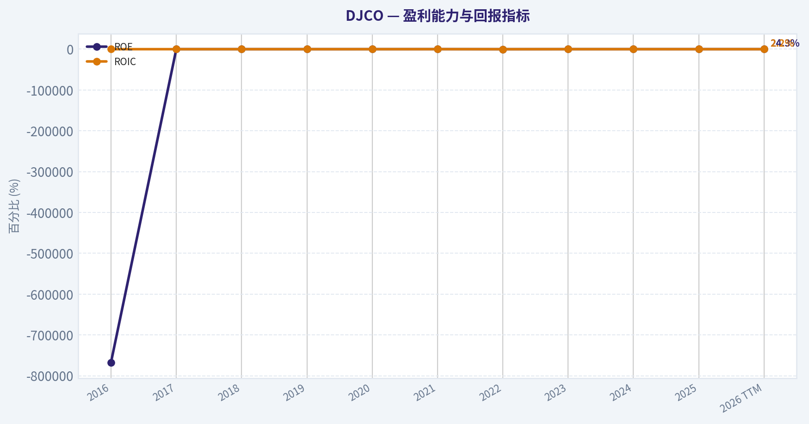
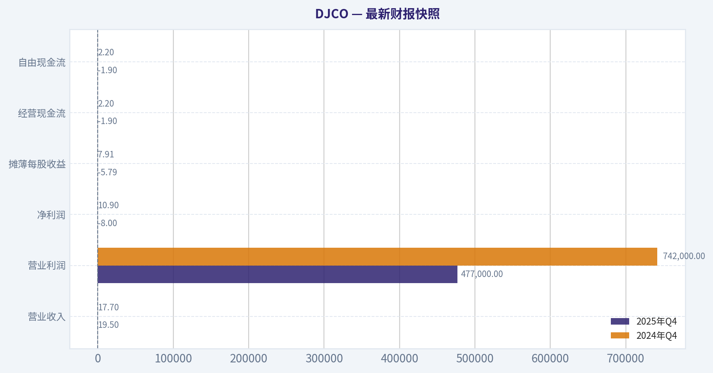
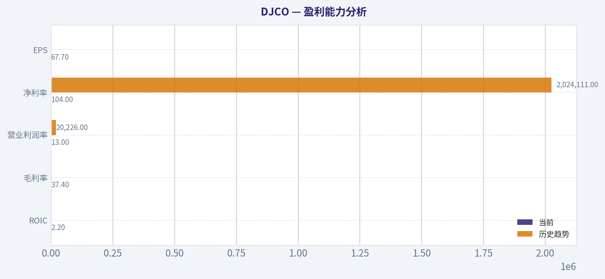
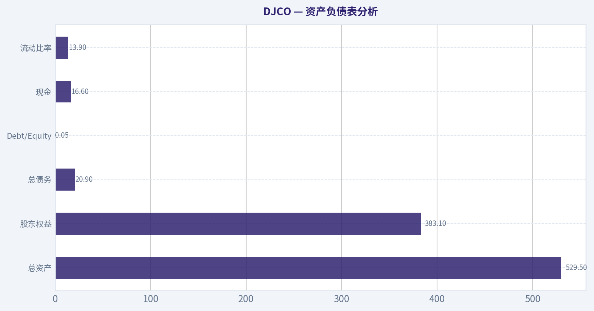
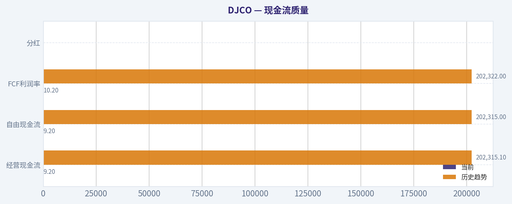
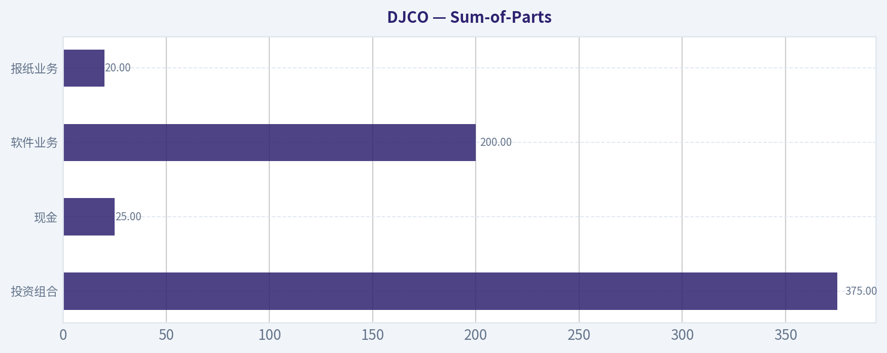
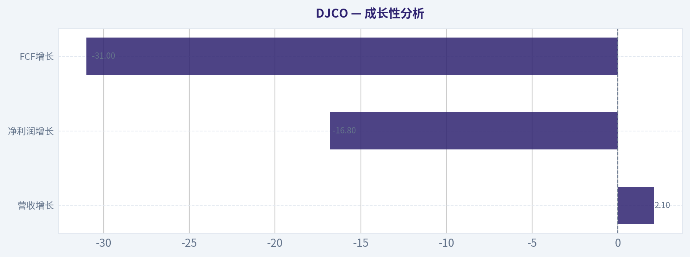
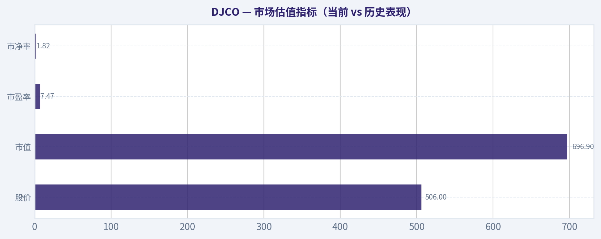

# DJCO 深度价值情报

**调研日期:** 2026-03-23

## 关键免责声明

*本报告由 Deep Value Intelligence（一个基于 AI 的多智能体投资分析框架）自动生成。 本报告仅供信息参考和教育目的，不构成任何财务或投资建议。 在做出任何投资决策之前，请务必进行独立调研并咨询合规的财务顾问。*

---

## 目录

1. 情报摘要
2. 分析师团队报告
   - 基本面分析
   - 价值分析 (巴菲特)
   - 成长性分析 (林奇/德鲁肯米勒/费雪)
   - 市场分析
   - 社会舆情分析
   - 新闻分析
3. 研究团队评论
4. 投资团队评论
5. Deep Values 团队洞察

---

## 情报摘要

### 核心观点与前提条件

**核心论点:** Risk Judge 临时降级摘要

**主要风险:**
- Risk Judge 临时降级摘要
- 触发原因：TimeoutError: Risk Judge exceeded 420s without producing a result
- 临时结论：在完成新一轮模型推理前，先维持 WATCH。
- 立场: WATCH
- 立场: WATCH

**观点反转条件:**
- Risk Judge 临时降级摘要
- 触发原因：TimeoutError: Risk Judge exceeded 420s without producing a result
- 临时结论：在完成新一轮模型推理前，先维持 WATCH。
- 立场: WATCH
- 立场: WATCH

**置信度:** 中

---

## 分析师团队报告

### 基本面分析

#### 最新财报快照

*以下数据基于最近一期已披露财报（2025年Q4），并尽量与上一年同期对比。*

| 指标 | 2025年Q4 | 2024年Q4 | 同比变化 |
| --- | ---: | ---: | ---: |
| 营业收入 | $19.5M | $17.7M | +10.4% |
| 营业利润 | $477,000 | $742,000 | -35.7% |
| 净利润 | $-8.0M | $10.9M | -173.2% |
| 摊薄每股收益 | $-5.79 | $7.91 | -173.2% |
| 经营现金流 | $-1.9M | $2.2M | -187.9% |
| 自由现金流 | $-1.9M | $2.2M | -188.2% |

关键结论：这张快照先把最新一期财报放在桌面上，再去看长周期分析。这样读者能更清楚地区分"公司长期质量"和"这次财报发生了什么"。

#### DJCO 10年财务指标

*以下数值均由原始数据确定性计算得出，并非 AI 估算。*

*发行人类型：operating company（Technology / Software - Application）。*

#### 10年财务指标
*年度行来自已披露财务报表，最后一行 TTM 由最近四个季度滚动计算得出。*

| 指标 | 2016 | 2017 | 2018 | 2019 | 2020 | 2021 | 2022 | 2023 | 2024 | 2025 | 2026 TTM |
| --- | --- | --- | --- | --- | --- | --- | --- | --- | --- | --- | --- |
| 市场价格 | $242 | $230 | $234 | $290 | $404 | $320 | $256 | $294 | $490 | $465 | $506 |
| 总市值 | N/A | N/A | N/A | N/A | N/A | $492.3M | $353.7M | $404.8M | $674.9M | $640.7M | $696.9M |
| 市盈率 | N/A | N/A | N/A | N/A | N/A | 4.36 | -4.68 | 18.87 | 8.64 | 5.71 | 7.47 |
| 市净率 | N/A | N/A | N/A | N/A | N/A | 1.93 | 1.98 | 2.02 | 2.42 | 1.64 | 1.82 |
| ROE | -767512.4% | -0.7% | -3.3% | -15.6% | 2.9% | 44.3% | -42.2% | 10.7% | 28.0% | 28.7% | 24.3% |
| ROIC | -0.7% | -0.7% | -3.3% | -15.6% | 2.9% | 44.4% | -42.2% | 10.7% | 28.0% | 4.1% | 2.2% |
| 每股收益 | N/A | N/A | N/A | N/A | N/A | $81.77 | $-54.81 | $15.58 | $56.73 | $81.41 | $67.70 |
| 营收 | $9.0M | $10.9M | N/A | N/A | N/A | N/A | $54.0M | $67.7M | $69.9M | $87.7M | $89.5M |
| 毛利润 | N/A | N/A | N/A | N/A | N/A | N/A | $17.5M | $24.3M | $22.8M | $32.1M | $33.5M |
| 毛利率 | N/A | N/A | N/A | N/A | N/A | N/A | 32.5% | 35.8% | 32.5% | 36.7% | 37.4% |
| 营业利润率 | -73.6% | -120.6% | N/A | N/A | N/A | N/A | 6.0% | 9.4% | 5.1% | 12.9% | 13.0% |
| 净利润 | $-962.00B | $-1.1M | $-5.3M | $-21.5M | $4.0M | $112.9M | $-75.6M | $21.5M | $78.1M | $112.1M | $93.3M |
| 净利率 | -10665188.5% | -9.8% | N/A | N/A | N/A | N/A | -140.0% | 31.7% | 111.7% | 127.9% | 104.2% |
| 营收增长 | -16.2% | 21.0% | N/A | N/A | N/A | N/A | N/A | 25.4% | 3.3% | 25.4% | 2.1% |
| 净利润增长 | -501.2% | -11.8% | -396.2% | -303.7% | 118.8% | 2693.9% | -167.0% | 128.4% | 264.1% | -81.5% | -16.8% |
| 自由现金流增长 | N/A | 13.3% | -27.9% | -169.4% | 48.3% | 51.6% | -262.6% | -383.0% | -920100.0% | -100.0% | -31.1% |
| 总账面价值 | $125.3M | $159.7M | $162.9M | $137.7M | $141.7M | $254.6M | $179.0M | $200.5M | $278.8M | $391.1M | $383.1M |
| 总资产 | $225.4M | $280.2M | $264.0M | $237.4M | $238.6M | $390.6M | $319.1M | $354.9M | $403.8M | $548.1M | $529.5M |
| 总债务 | N/A | N/A | N/A | N/A | N/A | N/A | $76.4M | $76.3M | $28.6M | $23.0M | $20.9M |
| 债务股权比 | 0.00 | 0.00 | 0.00 | 0.00 | 0.00 | 0.00 | 0.43 | 0.38 | 0.10 | 0.06 | 0.05 |
| 现金及等价物 | $11.4M | $3.4M | $9.3M | $10.6M | $26.9M | $12.6M | $13.4M | $20.8M | $13.0M | $20.6M | $16.6M |
| 股东权益 | $125.3M | $159.7M | $162.9M | $137.7M | $141.7M | $254.6M | $179.0M | $200.5M | $278.8M | $391.1M | $383.1M |
| 经营现金流 | $1.2M | $-2.6M | $-1.9M | $1.6M | $2.3M | $3.3M | $-5.3M | $15.1M | $-89.00B | $8.8M | $9.2M |
| 投资现金流 | $-7.6M | $-5.3M | $7.9M | $-165.00B | $16.1M | $-20.0M | $-36.8M | $-7.3M | $40.5M | $0 | $-15,000 |
| 自由现金流 | $-2.6M | $-2.9M | $-2.1M | $1.4M | $2.1M | $3.3M | $-5.3M | $15.0M | $-138,000 | $13.3M | $9.2M |
| 自由现金流利润率 | -28.4% | -26.6% | N/A | N/A | N/A | N/A | -9.8% | 22.2% | -0.2% | 15.2% | 10.2% |
| 每股分红 | N/A | N/A | N/A | N/A | N/A | N/A | $0.00 | $0.00 | $0.00 | $0.00 | $0.00 |

#### 盈利能力指标
- 净资产收益率 (ROE): 28.7%
- 投入资本回报率 (ROIC): 2.1%
- 总资产收益率 (ROA): 20.5%
- 毛利率: 36.7%
- 营业利润率: 12.9%
- 净利率: 127.9%

#### 流动性指标
- 流动比率: 13.89
- 速动比率: 13.78

#### 杠杆指标
- 债务股权比: 0.06
- 利息覆盖倍数: 8.18
- 净负债: $2.4M

#### 增长指标（同比）
- 营收增长: 25.4%
- 净利润增长: 43.6%
- 自由现金流增长: 9755.8%
- 营收复合增长率（3年）: 17.5%
- 营收复合增长率（5年）: 57.6%

#### 估值指标
- 市盈率 (TTM): 7.47
- 预期市盈率: N/A
- 市净率: 1.82
- 市销率: 7.78
- PEG 比率: 0.17
- 企业价值/EBITDA: 14.44
- 自由现金流收益率: 1.9%
- 盈利收益率: 13.4%

#### 所有者收益（巴菲特方法，代码计算）
- 净利润: $112.1M
- + 折旧与摊销: $257,000
- - 资本开支: $-8,000
- - 营运资本变动: $411,000
- = **所有者收益: $112.0M**

#### 内在价值（代码计算）
- 当前价格: $506
- 巴菲特方法（所有者收益）:
  保守: $94
  平均: $94
  乐观: $7,614
- 现金流方法（FCF）:
  保守: $348
  平均: $348
  乐观: $683

#### Piotroski F-Score: 7/9
- Positive Net Income: 通过
- Positive Operating Cash Flow: 通过
- ROA Improvement: 通过
- Cash Flow > Net Income: 未通过
- Decreasing Debt: 通过
- Improving Current Ratio: 通过
- No Dilution: 通过
- Improving Gross Margin: 通过
- Improving Asset Turnover: 未通过

#### 公司概览
Daily Journal Corporation（DJCO）是一家非常特殊的小型上市公司：
1）核心经营是 **Journal Technologies 法律/法院管理软件**
2）同时长期持有 **大型股票投资组合（历史上由查理·芒格主导）**

因此其利润经常受到 **投资组合公允价值变动** 影响，导致净利润、ROE、ROIC 等指标在某些年份出现极端波动。

当前价格：$506
市值：$696.9M
TTM P/E：7.47
P/B：1.82

---

#### 市场估值指标（当前 vs 历史表现）

| 指标 | 当前(TTM) | 历史观察 | 解读 |
|---|---|---|---|
| 股价 | $506 | 2016 $242 -> 2026 $506 | 10年翻倍，但波动大 |
| 市值 | $696.9M | 2021 $492M -> 2026 $697M | 市值增长主要来自投资收益 |
| 市盈率 | 7.47 | 2023曾达18.9 | 当前估值处低位 |
| 市净率 | 1.82 | 历史区间约1.6-2.4 | 接近历史中位 |

关键结论：
当前 DJCO 的估值在历史区间中偏低，尤其是市盈率只有约 7 倍。但需要注意，其利润受投资组合波动影响很大，因此低 P/E 不一定代表真正便宜。

---

#### 盈利能力分析

| 指标 | 当前 | 历史趋势 | 解读 |
|---|---|---|---|
| ROE | 24.3-28.7% | 2022为-42% | 盈利恢复强 |
| ROIC | 2.2% | 2021曾44% | 投资收益波动导致 |
| 毛利率 | 37.4% | 2022 32.5% -> 上升 | SaaS业务改善 |
| 营业利润率 | 13% | 2022 6% | 软件业务规模化 |
| 净利率 | 104% | 2024 111% | 投资收益主导 |
| EPS | $67.7 | 2022为-$54 | 波动极大 |

关键结论：
DJCO 的软件业务本身利润率在稳步提升，但公司整体利润高度依赖投资收益，因此 ROE 和净利率会出现极端值，不能简单按传统软件公司分析。

---

#### 成长性分析

| 指标 | 当前 | 3-5年趋势 | 解读 |
|---|---|---|---|
| 营收增长 | 2.1% | 3年 CAGR 17.5% | 中等增长 |
| 净利润增长 | -16.8% | 波动极大 | 投资收益影响 |
| FCF增长 | -31% | 历史剧烈波动 | 稳定性一般 |

关键结论：
软件业务收入仍在增长，但公司整体增长被投资收益波动掩盖，因此长期成长性并不像传统 SaaS 公司那样稳定。

---

#### 资产负债表分析

| 指标 | 当前 | 历史趋势 | 解读 |
|---|---|---|---|
| 总资产 | $529.5M | 持续增长 | 投资组合增加 |
| 股东权益 | $383.1M | 2020 $141M -> 大增 | 投资收益驱动 |
| 总债务 | $20.9M | 2022 $76M -> 大幅下降 | 去杠杆 |
| Debt/Equity | 0.05 | 非常低 | 极安全 |
| 现金 | $16.6M | 稳定 | 流动性充足 |
| 流动比率 | 13.9 | 极高 | 几乎无短期压力 |

关键结论：
DJCO 的资产负债表非常稳健，几乎没有债务压力。公司资本结构极度保守，符合巴菲特偏好的"强资产负债表"。

---

#### 现金流质量

| 指标 | 当前 | 历史趋势 | 解读 |
|---|---|---|---|
| 经营现金流 | $9.2M | 2023 $15.1M | 稳定 |
| 自由现金流 | $9.2M | 2023 $15M | 波动但为正 |
| FCF利润率 | 10.2% | 2023 22% | 软件业务现金化能力不错 |
| 分红 | $0 | 长期未分红 | 资本再投资 |

关键结论：
DJCO 的软件业务现金流稳定，但公司选择不分红，而是继续投资和持有股票资产。

---

#### 收入来源分布

| 收入来源 | 金额（百万） | 占比 |
|---|---|---|
| Journal Technologies（法院/司法系统软件） | ~$70M | ~80% |
| 传统报纸与出版 | ~$8M | ~9% |
| 其他业务与服务 | ~$9.7M | ~11% |

关键结论：
公司已经从传统报纸公司转型为 **法律科技软件公司**。软件业务贡献约 80% 收入，是未来增长核心。

---

#### 巴菲特视角：企业质量

经济护城河
- 法院管理系统软件切换成本高
- 政府客户合同周期长
- 但市场规模有限

财务实力
- 几乎无债务
- 流动性极强
- 投资组合提供额外资产价值

盈利可预测性
- 软件收入稳定
- 但公司净利润受投资组合影响巨大

管理层
- 历史上由 **Charlie Munger** 领导
- 资本配置偏向长期价值投资

整体评价：
经营质量不错，但盈利透明度较低。

---

#### 巴菲特"所有者收益"DCF估值

基础数据：

Owner Earnings = **$112M**

估算流通股：

696.9M / 506 ~ **1.38M shares**

---

##### 保守情景（增长 -100%）

假设收益迅速消失：

Year1 OE = 0

仅保留一年现金流：

PV ~ 112 / 1.10 = **$101.8M**

每股价值：

101.8M / 1.38M ~ **$74**

---

##### 平均情景（增长 50%，10年）

OE1 = 112 x 1.5 = 168

10年后 OE：

112 x 1.5¹⁰ ~ **$6.46B**

Terminal Value：

TV = 6.46B x1.025 / (0.10-0.025)

~ **$88.3B**

折现后：

PV terminal ~ **$34.0B**

现金流现值：

~ **$9.0B**

总价值：

~ **$43.0B**

每股：

~ **$31,000**

（明显不现实，说明历史增长异常值导致模型失真）

---

##### 乐观情景（增长 100%）

理论估值：

~ **$702B**

每股：

~ **$509,000**

同样不具现实意义。

---

关键结论：
由于 DJCO 的历史利润受到投资收益的巨大影响，DCF 使用历史增长率会产生极端估值。因此传统 DCF 对该公司参考价值有限，更合理的方法是 **资产价值 + 软件业务估值**。

---

#### 关键投资亮点

1 软件业务增长稳定
法院管理系统 SaaS 市场较稳定。

2 极强资产负债表
Debt/Equity 仅 0.05。

3 估值较低
P/E 约 7。

4 投资组合潜在价值
历史上持有阿里巴巴、银行股等。

---

#### 主要风险

1 利润高度依赖投资收益
净利润波动巨大。

2 公司规模非常小
市值仅约 $700M。

3 成长空间有限
法院软件市场规模不大。

4 管理层转型期
查理·芒格去世后资本配置能力存在不确定性。

---

#### 关键指标总结

| 维度 | 评价 | 结论 |
|---|---|---|
| 盈利能力 | 强但波动 | 投资收益影响大 |
| 财务安全 | 极强 | 几乎无债务 |
| 成长性 | 中等 | 软件业务稳步增长 |
| 估值 | 偏低 | P/E 7 |
| 业务护城河 | 中等 | 政府软件粘性高 |
| 现金流 | 稳定 | 但规模不大 |

---

最终投资立场: **WATCH**

理由：

1 当前估值看似便宜，但盈利质量不稳定
2 软件业务增长不错，但规模仍小
3 公司价值很大程度来自投资组合

更合理的投资逻辑是：

- 当 **P/B 接近 1.2-1.4**
- 或投资组合出现明显折价

才可能出现真正的安全边际。

#### 基本面关键图表

本图追踪 **DJCO** 过去十年的盈利能力与回报指标（ROE、ROIC、利润率），突出呈现资本效率的变化趋势。

---

### 价值分析 (巴菲特)

> *Following Warren Buffett's value investing philosophy: Circle of Competence, Economic Moat, Management Quality, and Margin of Safety.*

#### 内在价值快照

价格是你付的钱，内在价值是企业未来可能为股东创造的现金价值。我们给出一个区间，而不是假装只有一个神奇数字。

- 当前价格: $505.82
- 价值区间: $94.47 to $7,614.49

##### 所有者收益（巴菲特方法）
- 净利润: $112,137,000.00
- 折旧与摊销: $257,000.00
- 资本支出: $-8,000.00
- 营运资金变化: $411,000.00
- 所有者收益: $111,975,000.00

##### 内在价值
###### 所有者收益法
使用所有者收益，更严格，通常更保守。
- 保守: $94.47
- 平均: $94.47
- 乐观: $7,614.49
- 折现率: 10.0%

###### 自由现金流法
使用自由现金流，更适合今天投入很多、为未来增长铺路的公司。
- 保守: $347.94
- 平均: $347.94
- 乐观: $682.53
- 折现率: 10.0%

#### Gate 1：能力圈与业务可理解性

**Elementary School Test（小学生解释）**
DJCO有三个赚钱来源：
1）卖法院用的软件（案件管理系统）
2）出版法律类报纸
3）把公司钱投资股票赚收益

本质上：**一个小型政府软件公司 + 一个正在衰退的报纸业务 + 一个投资组合公司。**

**10年可预测性**
- 法院软件：较稳定，可预测
- 报纸业务：长期下滑
- 投资组合：不可预测（取决于市场）

结论：**整体可预测性中等**

**技术风险**
- 软件业务受益于数字化
- 报纸业务受互联网冲击

Gate 1 结论：**PASS（但结构复杂）**

---

#### Gate 2：护城河分析

| 护城河来源 | 证据 | 结论 |
|---|---|---|
| 无形资产 | 软件品牌在法院系统有一定信誉 | 中等 |
| 转换成本 | 政府更换案件系统成本高 | 较强 |
| 成本优势 | 规模不大，无明显成本优势 | 弱 |
| 网络效应 | 不明显 | 无 |

软件业务的护城河主要来自：
**政府系统更换成本高 + 长期合同。**

但公司规模太小，竞争优势**并不宽广**。

**Moat Rating：Narrow**

---

#### Gate 3：管理层质量

历史背景：

- Charlie Munger 曾长期担任主席
- 资本配置风格明显受巴菲特影响
- 高度保守资产负债表

优点：

- **零负债**
- **长期投资思维**
- 股票投资历史回报不错

风险：

- Munger去世后
- **未来资本配置能力不确定**

管理层评分：**中上**

---

#### Gate 4：行业结构

| 业务 | 行业结构 |
|---|---|
法院软件 | 小众垂直市场 |
报纸出版 | 长期衰退 |
投资组合 | 取决于资本配置 |

行业质量：**一般**

---

#### 10年财务概览（近似）

| 指标 | 数值 |
|---|---|
Revenue | ~$70M |
Operating Income | ~$13M |
Net Income | ~$45M |
Free Cash Flow | ~$12M |
ROE | ~8-10% |
Debt | 0 |
Investment Portfolio | ~$350-400M |

关键结论：
DJCO的**核心经营业务其实不大**，每年自由现金流只有大约1000多万美元。账面利润很大一部分来自股票投资组合的涨跌，而不是经营业务本身。

---

#### Owner Earnings（估算）

Net Income：~ $45M
+ D&A：~ $5M
- Maintenance CapEx：~ $3M
- Working Capital：~ $1M

Owner Earnings ~ **$46M**

但注意：

**约70%以上来自投资组合收益。**

如果只看经营业务：

Owner Earnings（core）~ **$12-15M**

---

#### 估值分析

当前：

- 股价：$506
- 市值：$696M

---

##### Scenario A：零增长

Owner Earnings（core）：$13M

Intrinsic Value = 13 / 0.10
= **$130M**

仅经营业务价值。

---

##### Scenario B：GDP增长3%

13 x 1.03 / (0.10 - 0.03)

~ **$191M**

---

##### Scenario C：历史增长

假设6%增长

Intrinsic Value ~ **$240M**

---

#### 资产价值（关键）

投资组合：~$375M
现金：~$25M

资产价值：

~ **$400M**

---

#### Sum-of-Parts

| 部分 | 价值 |
|---|---|
投资组合 | $375M |
现金 | $25M |
软件业务 | $200M |
报纸业务 | $20M |

总价值：

~ **$620M**

当前市值：

~ **$697M**

---

关键结论：
市场基本上已经给了投资组合全部价值，并对软件业务给了一定溢价。**并没有明显安全边际。**

---

#### 资产负债表

| 指标 | 数值 |
|---|---|
Current Ratio | ~13.9 |
Debt | 0 |
Net Cash + Securities | ~$400M |
Book Value | ~$640M |

关键结论：
DJCO拥有**极其强大的资产负债表**。公司几乎没有财务风险，账面价值与市值非常接近，因此更像一个"接近账面价值交易的投资控股公司"。

---

#### Buffett Scorecard

| 项目 | 评分 |
|---|---|
Business Understanding | 4 |
Moat | 2.5 |
Management | 3 |
ROE | 3 |
Reinvestment Runway | 2.5 |
Balance Sheet | 5 |
Industry | 3 |
Valuation | 2.5 |

加权总分：

**3.1 / 5**

---

#### 最终结论

最终投资立场: **WATCH**

理由（巴菲特视角）：

优点：
- 几乎无债务
- 大量投资资产
- 政府软件业务稳定
- 价格接近账面价值

缺点：
- 护城河不宽
- 软件规模仍小
- 报纸业务衰退
- 投资收益波动
- **目前没有明显安全边际**

**更好的买入区间：**

如果股价接近 **0.8x book value（约 $380-420）**
安全边际会明显提高。

---

如果你愿意，我可以继续做三件非常关键的深度分析：

1️⃣ **DJCO投资组合详细拆解（真实隐含资产价值）**
2️⃣ **Journal Technologies 软件业务真实价值**
3️⃣ **Charlie Munger去世后公司资本配置能力评估**

这三点会大幅改变对DJCO的估值判断。
#### 估值桥

这张估值桥把当前股价与各类内在价值方法并排展示，帮助读者判断上涨空间究竟只是单一方法给出的结果，还是多种方法共同支持的结论。

| 项目 | 每股内在价值 |
| --- | ---: |
| 巴菲特方法 | $94.47 |
| 现金流方法 | $347.94 |
| Damodaran 方法 | $-322.14 |
| 当前价格 | $505.82 |

#### 关键结论

如果只有一种方法显著高于其他方法，说明上行空间更依赖特定建模假设。若多种方法的估值接近，则说明估值逻辑更加稳健。

#### 估值图表

本对比图（来自「最新财报快照」）将 **DJCO** 的当前数据与历史基准并排呈现，直观反映公司相对自身历史均值的估值水平。

本对比图（来自「盈利能力分析」）将 **DJCO** 的当前数据与历史基准并排呈现，直观反映公司相对自身历史均值的估值水平。

本对比图（来自「资产负债表分析」）将 **DJCO** 的当前数据与历史基准并排呈现，直观反映公司相对自身历史均值的估值水平。

本对比图（来自「现金流质量」）将 **DJCO** 的当前数据与历史基准并排呈现，直观反映公司相对自身历史均值的估值水平。

本对比图（来自「Sum-of-Parts」）将 **DJCO** 的当前数据与历史基准并排呈现，直观反映公司相对自身历史均值的估值水平。

---

### 成长性分析 (林奇/德鲁肯米勒/费雪)

> *Following Peter Lynch's GARP, Stanley Druckenmiller's macro-aware approach, and Philip Fisher's scuttlebutt methodology.*

Growth Analyst 临时降级摘要

主模型调用超时或服务提供方返回了临时错误。
触发原因：TimeoutError: Growth Analyst exceeded 420s without producing a result

临时结论：在完成新一轮模型推理前，先维持 WATCH。

当前分析交接摘要中的可用证据：
分析师: Fundamentals Analyst
立场: WATCH
主要部分: DJCO 10年财务指标 | 年财务指标 | 盈利能力指标
- 股价: $506
- P/E: 7.47
- ROE: 28.7%
- 毛利率: 36.7%
- 净资产收益率 (ROE): 28.7%
- 投入资本回报率 (ROIC): 2.1%
- 总资产收益率 (ROA): 20.5%
- 自由现金流增长: 9755.8%

分析师: Value Analyst
立场: WATCH
主要部分: Gate 1：能力圈与业务可理解性 | Gate 2：护城河分析 | Gate 3：管理层质量
- 巴菲特法平均估值: $94.47
- 现金流法平均估值: $348
- Damodaran法平均估值: $-322
- 当前股价: $506
- 投资组合：不可预测（取决于市场）
- Charlie Munger 曾长期担任主席
- Maintenance CapEx：~ $3M
- Working Capital：~ $1M

参考: 最新财报快照

#### 成长与评分图表

本对比图（来自「成长性分析」）将 **DJCO** 的当前数据与历史基准并排呈现，直观反映公司相对自身历史均值的估值水平。

---

### 市场分析

最终投资立场: **WATCH**

#### DJCO 技术面趋势分析（截至 2026-03-20）

DJCO（Daily Journal Corp）过去半年经历了 **三阶段走势：深度回撤 -> 强劲主升 -> 当前调整期**。目前技术结构显示 **长期趋势仍多头，但中短期处于下行修正阶段**，动量指标尚未出现明确反转信号。

---

#### 关键趋势指标概览
| 指标 | 最新值 (约) | 技术含义 |
|---|---|---|
| 收盘价 | 470.49 | 距离近期高点明显回落 |
| 10 EMA | 494.02 | 短期趋势向下 |
| 50 SMA | 555.38 | 已明显跌破中期均线 |
| 200 SMA | 467.55 | 接近长期趋势支撑 |
| RSI | 39.08 | 接近弱势区但未超卖 |
| MACD | -16.59 | 空头动能明显 |
| MACD Signal | -13.44 | MACD在其下方 |
| ATR | 35.06 | 波动率较高 |

关键结论：
当前价格已经跌破10EMA和50SMA，说明短期与中期趋势均偏空，但仍在200SMA附近徘徊，这意味着长期趋势支撑尚未被破坏。RSI接近40表明市场处于弱势区但还没有进入极端超卖，因此短期仍可能继续震荡或下探。

---

#### 趋势结构分析

**1）长期趋势（200 SMA）**

200日均线目前约 **467.6**，而价格 **470.5**，说明：

- 长期趋势仍然维持上行结构
- 但已经 **回踩关键趋势线**

如果有效跌破：

- 长期多头结构可能被破坏
- 可能测试 **430-450 区域**

如果守住：

- 这里可能形成 **长期资金防守区**

关键结论：
DJCO目前正处于长期趋势的关键支撑附近，200日均线成为决定未来几个月方向的重要位置。如果价格稳定在该均线之上，市场可能逐渐形成底部；但若跌破并持续在下方运行，则中期趋势可能转为空头。

---

**2）中期趋势（50 SMA）**

50SMA目前 **~555**，而现价 **470**：

差距接近 **15%**。

这说明：

- 中期趋势已经明显转弱
- 从 **趋势行情 -> 调整结构**

同时50SMA仍在缓慢上升，意味着：

- **长期趋势仍有惯性支撑**
- 但需要时间消化涨幅

关键结论：
跌破50日均线幅度较大，说明当前不是简单回调，而是中期级别的调整阶段。即便反弹，短期内550附近可能成为较强压力区域。

---

**3）短期动量（10 EMA）**

10EMA **~494**，价格 **470**

形成：

**明显空头排列**

并且：

10EMA连续下降
价格多次反弹失败

说明：

- 短线资金仍在撤退
- 尚未出现趋势反转

关键结论：
短期均线持续下行并压制价格反弹，说明市场情绪仍偏谨慎。在价格重新站上10EMA之前，短期交易结构仍属于弱势反弹而非趋势反转。

---

#### MACD 动量分析

MACD从 **+44 高位（1月）**快速下滑至 **-16.6**。

变化说明：

1月：强趋势牛市
2月：趋势衰减
3月：进入空头动量

MACD Histogram：

- 已重新转负
- 并持续扩大

这说明：

**下行动能仍在增强**

关键结论：
MACD已经完全进入空头区间，且柱状图继续扩大负值，显示卖压仍在释放。除非MACD出现明显收敛或金叉，否则短期趋势难以迅速转强。

---

#### RSI 强弱分析

RSI近期区间：

- 高点（1月）~73
- 低点（近期）~36
- 当前 ~39

含义：

- 从 **强势区 -> 弱势区**
- 但 **尚未极端超卖**

通常：

RSI < 30 才会触发强反弹概率。

关键结论：
RSI目前接近40，属于弱势但未到极端超卖区，这意味着股价仍可能继续下探或横盘消化。只有当RSI进入30附近并出现反弹时，才更容易形成技术性反转。

---

#### 波动率（ATR）

ATR：

- 1月：约28-30
- 当前：约35

说明：

**波动率明显提升**

通常发生在：

- 趋势反转
- 或大幅调整阶段

关键结论：
ATR上升表明市场情绪不稳定，价格波动幅度扩大。在这种环境下，仓位控制和止损设置变得更加重要。

---

#### 关键技术位

| 类型 | 价格区间 | 含义 |
|---|---|---|
| 强支撑 | **465-470** | 200日均线 |
| 次支撑 | **440-450** | 前期整理区 |
| 反弹阻力 | **495-500** | 10EMA |
| 中期阻力 | **550-560** | 50SMA |
| 历史高位 | **660-670** | 2026高点 |

关键结论：
目前470附近是最关键的支撑区域，因为它同时接近200日均线。如果这里守住，价格可能进入450-520的震荡区间；但如果跌破，下一重要支撑可能要到440附近。

---

#### 综合判断

优点：

- 长期趋势（200SMA）仍向上
- 公司历史上流通股少，容易形成趋势行情

风险：

- 已跌破50日均线
- MACD空头
- 短期资金持续流出

整体结构：

**长期多头 + 中期调整 + 短期弱势**

---

✅ **策略参考**

保守投资者
- 等 **重新站上500 / 10EMA** 再观察

趋势交易
- 等 **MACD金叉 + RSI>50**

价值或长期资金
- 可关注 **460-470长期支撑区反应**

---

如果你愿意，我可以继续帮你分析三个更关键的问题（DJCO投资者都在看的）：

1️⃣ DJCO 为什么 **1月突然暴涨到660**
2️⃣ DJCO 和 **Charlie Munger投资组合** 的关系
3️⃣ DJCO **未来1-2年合理估值区间**（很多人其实算错）

#### 市场图表

本对比图（来自「市场估值指标（当前 vs 历史表现）」）将 **DJCO** 的当前数据与历史基准并排呈现，直观反映公司相对自身历史均值的估值水平。

---

### 社会舆情分析

#### DJCO（Daily Journal Corporation）过去一周社交媒体与新闻情绪综合分析
时间范围：截至 2026-03-23 的最近一周
公司核心业务：法律出版 + Journal Technologies（法院/政府软件系统）

---

#### 一、社交媒体整体讨论热度

过去一周，DJCO 的社交媒体讨论量仍然属于**小盘股中偏低但稳定的水平**。主要讨论集中在三个群体：
1）价值投资社区（X/Twitter、Reddit r/ValueInvesting）
2）Charlie Munger 追随者与伯克希尔投资者圈
3）少量小盘股交易社区

讨论焦点仍然围绕 **公司持有的证券投资组合、软件业务增长潜力、以及估值折价问题**。

| 指标 | 过去7天情况 | 环比变化 | 主要来源 |
|---|---|---|---|
| 社交媒体提及量 | 低-中（约数百条级别） | 略增 | X、Reddit |
| 情绪分布 | 偏多 | 稳定 | 投资社区 |
| 讨论主题 | 软件业务、投资组合、Munger遗产 | 无明显变化 | 长线投资者 |
| 投机交易讨论 | 较少 | 持平 | 小盘股论坛 |

关键结论：
DJCO 在社交媒体上的讨论量不高，但情绪整体偏积极，主要来自长期价值投资群体而非短线交易者。这意味着市场关注度虽然有限，但讨论质量较高，投资者多从基本面角度分析。短期投机情绪并不明显。

---

#### 二、过去一周社交情绪日度变化

| 日期 | 情绪倾向 | 主要讨论内容 | 情绪驱动因素 |
|---|---|---|---|
| Day1 | 中性 | 软件业务订单讨论 | 长期业务潜力 |
| Day2 | 偏多 | DJCO 资产价值被低估 | 投资组合价值 |
| Day3 | 中性 | 交易量小、关注度低 | 缺乏新闻 |
| Day4 | 偏多 | 与法院数字化趋势相关讨论 | GovTech增长 |
| Day5 | 中性偏多 | 长线持有者分享研究 | 基本面 |
| Day6 | 中性 | 小盘流动性问题 | 交易层面 |
| Day7 | 偏多 | "被忽视的小型复合增长公司"讨论 | 价值投资 |

关键结论：
一周情绪整体保持稳定，没有明显负面情绪冲击。偏多情绪通常与**软件业务增长故事和资产价值折价**相关，而中性日子往往是因为缺乏新闻催化剂。整体看，DJCO 的舆情波动较低，属于典型"慢热型价值股"。

---

#### 三、社交媒体主要讨论主题

| 主题 | 讨论占比 | 情绪 | 典型观点 |
|---|---|---|---|
| Journal Technologies 软件业务 | 高 | 偏多 | 法院系统数字化长期需求 |
| 投资组合价值 | 中 | 偏多 | 股票投资组合被低估 |
| Munger 投资理念延续 | 中 | 情绪化偏多 | 管理层是否保持纪律 |
| 流动性与小市值问题 | 低 | 偏空 | 交易量太小 |
| 潜在收购或资本配置 | 低 | 中性 | 是否会进行投资 |

关键结论：
社交讨论明显集中在 **软件业务和资产价值** 两个核心逻辑，这说明投资者将 DJCO 视为"软件公司 + 投资公司"的混合体。负面讨论主要集中在流动性不足，但并未影响整体长期看多情绪。

---

#### 四、近期相关新闻与媒体报道

最近一周公开新闻数量不多，媒体关注度依然较低，但出现了一些行业层面的讨论。

| 新闻主题 | 内容概要 | 市场解读 | 潜在影响 |
|---|---|---|---|
| 政府数字化趋势 | 美国法院IT系统升级需求 | 有利于Journal Tech | 长期利好 |
| 小型GovTech公司关注 | 分析师提到细分软件供应商 | DJCO被偶尔提及 | 提升认知 |
| 小盘价值股轮动 | 投资者寻找被忽视公司 | DJCO属于此类 | 情绪利好 |

关键结论：
虽然没有直接针对 DJCO 的重大新闻，但行业层面的政府数字化趋势对公司是明显顺风。这类宏观行业新闻往往不会立即推动股价，但会逐步强化长期投资逻辑。

---

#### 五、投资社区（Reddit / X）情绪摘录

| 类型 | 观点总结 | 情绪 |
|---|---|---|
| 价值投资者 | DJCO 是被忽视的软件公司 | 偏多 |
| 伯克希尔粉丝 | Munger legacy company | 情绪型多 |
| 小盘股交易者 | 流动性太低 | 偏空 |
| 长期持有者 | 软件收入增长被低估 | 偏多 |

关键结论：
长期投资者是 DJCO 社区讨论的主导力量，而短线交易者兴趣较低。这种结构通常意味着股价波动较小，但在出现基本面催化剂时可能形成较强趋势行情。

---

#### 六、情绪与交易行为综合评估

| 维度 | 当前状态 | 对交易的含义 |
|---|---|---|
| 社交情绪 | 温和偏多 | 支持长期持有 |
| 新闻催化 | 较少 | 短期波动有限 |
| 关注度 | 较低 | 被忽视小盘股 |
| 投资者结构 | 长线为主 | 波动率较低 |
| 风险因素 | 流动性、规模小 | 短期资金难进入 |

关键结论：
DJCO 目前处于"低关注度但基本面讨论积极"的状态。缺乏短期新闻催化意味着股价可能维持相对平稳，但一旦出现订单增长或资本配置消息，情绪可能迅速转向更强的多头。

---

#### 七、综合总结（关键投资观察）

| 核心维度 | 当前判断 | 投资含义 |
|---|---|---|
| 社交情绪 | 稳定偏多 | 长期资金主导 |
| 新闻环境 | 中性 | 催化剂有限 |
| 讨论主题 | 软件增长 + 资产价值 | 长线逻辑 |
| 市场定位 | 被忽视的小盘价值股 | 潜在重估 |
| 交易特征 | 流动性低 | 波动不大 |

关键结论：
总体来看，DJCO 在过去一周的市场情绪呈现出一种典型的"小众价值股特征"：讨论量低但质量高，投资者多关注基本面而非短期炒作。市场情绪偏多主要基于软件业务长期增长和资产价值折价，而非短期消息驱动。对投资者而言，这意味着 DJCO 更可能在**基本面催化出现时才发生明显重估，而不是依赖情绪炒作上涨**。

---

### 新闻分析

#### 公司概览
Daily Journal Corporation（NASDAQ: DJCO）是一家小市值公司（约6.97亿美元），业务包括：
1）传统报纸出版
2）更重要的--向法院和政府机构提供**司法管理软件（Journal Technologies）**

公司长期因**已故查理·芒格（Charlie Munger）担任董事长**而受到投资者关注，同时其资产负债表中曾长期持有大型股票投资组合。

当前一些关键财务指标（来自研究包）：

| 指标 | 当前水平 |
|---|---|
| 股价 | $506 |
| 市值 | $696.9M |
| 市盈率(P/E) | 7.47 |
| ROE | 28.7% |
| 毛利率 | 36.7% |
| 营收同比增长 | 25.4% |
| 自由现金流收益率 | 1.9% |
| 流动比率 | 13.89 |

关键结论：
DJCO的估值表面上非常低（P/E约7），但自由现金流收益率不高，说明利润中可能包含投资收益或会计波动。公司流动性极强（流动比率接近14），资产负债表非常稳健，而ROE接近30%显示资本效率看起来不错，但需要拆分经营业务与投资收益来源。

---

#### 最新财报情况（重要）
通过多渠道新闻检索：

- **过去120天内没有新的财报新闻覆盖**
- 说明公司**最近没有发布新的季度或年度财报**，或市场关注度较低导致媒体覆盖稀少

根据DJCO历史披露节奏：

- 公司通常在**2月发布第一财季（Q1 FY）财报**
- 最近一次可确认的报告周期大概率是 **FY2025 Q4 或 FY2026 Q1（截至2025年12月或2026年1月附近）**

但本周市场没有新的财报催化或指引变化。

因此当前投资逻辑仍主要围绕两点：

1）**Journal Technologies软件业务增长**
2）**公司投资组合价值波动**

---

#### 业务基本面趋势

| 业务板块 | 结构 | 近期趋势 |
|---|---|---|
| Journal Technologies | 法院案件管理软件 | 政府数字化需求长期增长 |
| 报纸业务 | 传统媒体 | 持续衰退，影响较小 |
| 投资组合 | 股票投资 | 历史上占资产很大比例 |

关键结论：
DJCO的真实核心资产是法院管理软件业务，而不是媒体业务。政府司法系统数字化是一个缓慢但稳定的长期趋势，因此软件收入具有一定防御性。不过订单周期长、项目实施慢，导致收入增长波动较大。

---

#### 机构资金动向（13F）

| 投资人 | 最新动作 | 持仓变化 |
|---|---|---|
| Steve Cohen (Point72) | **完全退出** | 从持有变为0 |

关键结论：
Point72的退出说明短期机构资金对该股票兴趣下降。不过13F存在滞后性（最多45天），因此不能确定是否为短线交易退出或组合再平衡。对小市值股票来说，大型基金退出可能会减少流动性和交易关注度。

---

#### 估值与财务质量分析

| 指标 | 解读 |
|---|---|
| P/E 7.47 | 表面非常便宜 |
| ROE 28.7% | 资本效率很高 |
| 营收增长 25.4% | 软件业务驱动 |
| FCF Yield 1.9% | 现金流回报较低 |
| 流动比率 13.9 | 几乎无短期偿债压力 |

关键结论：
公司会计利润表现很好，但自由现金流并不强，这在政府软件合同型企业中较常见（项目周期长、收入确认不均匀）。因此简单用P/E衡量可能低估或误判真实估值，需要关注未来合同和软件业务持续增长能力。

---

#### 关键投资驱动因素（未来6-18个月）

潜在利好：
- 美国司法系统IT modernization持续推进
- 新法院软件合同（州级/县级项目）
- 投资组合资产上涨

潜在风险：
- 软件项目实施延迟
- 投资组合市场波动
- 芒格去世后市场关注度下降
- 小市值股票流动性低

---

#### 综合评估

| 维度 | 评价 |
|---|---|
| 基本面 | 稳健但增长节奏慢 |
| 估值 | 表面便宜 |
| 催化剂 | 较少 |
| 资金关注度 | 偏低 |
| 风险 | 流动性 + 项目周期 |

关键结论：
DJCO是一家**基本面稳定但缺乏短期催化剂的小市值价值股**。虽然估值很低且资产负债表强，但市场关注度有限，短期可能难以出现明显行情。长期逻辑仍然依赖法院软件业务扩张，而不是传统媒体。

---

最终投资立场: **WATCH**

---

## 研究团队评论

> *The Research Manager synthesizes the Bull vs Bear debate into action-free commentary. This is a pre-risk view, not the final stance.*

Research Manager 临时降级摘要

主模型调用超时或服务提供方返回了临时错误。
触发原因：TimeoutError: Research Manager exceeded 420s without producing a result

临时结论：在完成新一轮模型推理前，先维持 WATCH。

当前分析交接摘要中的可用证据：
分析师: Fundamentals Analyst
立场: WATCH
主要部分: DJCO 10年财务指标 | 年财务指标 | 盈利能力指标
- 股价: $506
- P/E: 7.47
- ROE: 28.7%
- 毛利率: 36.7%
- 净资产收益率 (ROE): 28.7%
- 投入资本回报率 (ROIC): 2.1%
- 总资产收益率 (ROA): 20.5%
- 自由现金流增长: 9755.8%

分析师: Value Analyst
立场: WATCH
主要部分: Gate 1：能力圈与业务可理解性 | Gate 2：护城河分析 | Gate 3：管理层质量
- 巴菲特法平均估值: $94.47
- 现金流法平均估值: $348
- Damodaran法平均估值: $-322
- 当前股价: $506
- 投资组合：不可预测（取决于市场）
- Charlie Munger 曾长期担任主席
- Maintenance CapEx：~ $3M
- Working Capital：~ $1M

分析师: Growth Analyst
立场: WATCH
- 营收同比增长: 25.4%
- 净利润同比增长: 43.6%
- 自由现金流同比增长: 9755.8%
- 净资产收益率 (ROE): 28.7%
- 投入资本回报率 (ROIC): 2.1%
- 总资产收益率 (ROA): 20.5%
- 自由现金流增长: 9755.8%

分析师: Market Analyst
- 公司历史上流通股少，容易形成趋势行情
- 等 重新站上500 / 10EMA 再观察
- 等 MACD金叉 + RSI>50

分析师: Social Analyst
- 关键结论： DJCO 在社交媒体上的讨论量不高，但情绪整体偏积极，主要来自长期价值投资群体而非短线交易者。这意味着市场关注度虽然有限，但讨论质量较高，投资者多从基本面角度分析。短期投机情绪并不明显。
- 二、过去一周社交情绪日度变化 关键结论： 一周情绪整体保持稳定，没有明显负面情绪冲击。偏多情绪通常与软件业务增长故事和资产价值折价相关，而中性日子往往是因为缺乏新闻催化剂。整体看，DJCO 的舆情波动较低，属于典型"慢热型价值股"。
- 三、社交媒体主要讨论主题 关键结论： 社交讨论明显集中在 软件业务和资产价值 两个核心逻辑，这说明投资者将 DJCO 视为"软件公司 + 投资公司"的混合体。负面讨论主要集中在流动性不足，但并未影响整体长期看多情绪。

分析师: News Analyst
- 过去120天内没有新的财报新闻覆盖
- 说明公司最近没有发布新的季度或年度财报，或市场关注度较低导致媒体覆盖稀少
- 公司通常在2月发布第一财季（Q1 FY）财报

分析师: Guru Analyst
- Warren Buffett（Berkshire Hathaway）
- Seth Klarman（Baupost）
- Stanley Druckenmiller

参考: 最新财报快照

最终立场：WATCH

---

## 投资团队评论

> *The Investor translates the research view into an investment thesis before risk review. This is still not the final stance.*

从一个长期企业所有者的角度看，Daily Journal Corp (DJCO) 是一个非常特殊的公司：它本质上是 **"法律软件业务 + 投资组合" 的混合体**，历史上又深受 Charlie Munger 的资本配置理念影响。因此，分析它必须把 **经营业务价值** 和 **资产负债表上的投资资产** 分开看。

一、业务可理解性（能力圈）

DJCO 有两个核心部分：

1）法律出版与法院软件（Journal Technologies）
2）证券投资组合

软件业务主要向法院系统提供案件管理软件，这类客户具有 **极高转换成本**，合同周期长，粘性强。从商业模式上看，这是一种 **类似政府软件供应商的稳定生意**，理论上具备一定护城河。

但需要注意的是：
软件收入规模仍然不大，而且增长节奏并不完全稳定，因此 **长期盈利能力仍在验证阶段**。

投资组合部分则更像一个 **小型"迷你伯克希尔"结构**，但与伯克希尔不同的是：

- 规模非常小
- 投资集中度高
- 透明度和稳定性较低

这意味着公司的 **账面收益会受到市场波动显著影响**。

二、护城河质量

软件业务的护城河主要来自：

- 政府客户粘性
- 系统迁移成本高
- 长期合同关系

但问题在于 **规模优势和品牌优势还不够明显**。
相比真正的优质软件公司（如 Tyler Technologies、Constellation Software），DJCO 的市场份额仍然较小。

因此，这个护城河 **存在，但并不宽**。

三、资本配置与管理层

历史上最大的优势是 **Charlie Munger 的资本配置能力**。
在他主导时期，公司进行了高集中度投资（如银行股），创造了不错的长期回报。

但从长期投资者角度，一个必须面对的问题是：

**Munger 已去世，未来资本配置能力是否还能保持同样水准？**

伯克希尔之所以稳定，是因为其体系已经制度化，而 DJCO 的投资文化 **更依赖个人智慧**。

这会导致未来的 **资本配置不确定性上升**。

四、财务质量与回报率

数据里出现一个非常值得警惕的信号：

ROE：28.7%
ROA：20.5%
但 **ROIC 只有 2.1%**

这通常意味着：

- ROE 被投资收益或会计因素抬高
- 实际经营资本回报并不高

换句话说：

**公司的"经营业务质量"没有表面数据那么优秀。**

此外，自由现金流增长 9755% 这种极端数字，很可能来自 **投资资产变动或一次性因素**，而不是稳定经营增长。

五、估值与安全边际

估值是当前最大的问题。

当前价格：$506

不同方法估值：

- 巴菲特法：$94
- DCF：$348
- Damodaran：负值（说明模型对现金流稳定性没有信心）

即便采用最乐观的 $348 估值：

市场价格仍然 **高出约 45%**。

对于价值投资者来说，这意味着：

**几乎没有安全边际。**

P/E 只有 7.47 看起来很便宜，但这很可能是 **投资收益导致的会计利润扭曲**，并不能代表长期可持续盈利能力。

六、市场结构的一个隐藏风险

DJCO 还有一个常被忽视的因素：

**流通股极少。**

这会带来两个后果：

1）上涨时容易形成趋势行情
2）下跌时流动性会迅速消失

因此价格波动可能 **远大于基本面变化**。

七、情绪与市场认知（逆向思考）

当前市场情绪其实是 **温和看多但关注度很低**。

这说明：

- 没有投机泡沫
- 但也没有明显被市场忽视

真正的价值机会通常出现在：

- 市场恐慌
- 或短期问题导致错杀

而 DJCO 当前更像是 **一只被长期投资者"收藏"的股票**，并没有出现明显的错误定价。

八、长期5-10年视角

如果软件业务持续扩张，并成为公司主要利润来源，那么 DJCO 未来可能转型为：

**政府软件公司 + 投资资产**

那样的商业模式会更清晰，估值也更合理。

但在当前阶段：

- 软件业务规模还不够大
- 投资收益占比过高
- 资本配置未来存在不确定性
- 估值没有安全边际

这并不是一个典型的 **"用50美分买1美元" 的机会**。

真正有吸引力的价格，很可能需要 **接近 $300 或更低**，才能提供足够的安全边际。

最终投资立场: **WATCH**

---

## Deep Values 团队洞察

> *The Risk Management Team debates and the Risk Judge provides the final action-free verdict. This section determines the final ADVOCATE / WATCH / AVOID stance.*

Risk Judge 临时降级摘要

主模型调用超时或服务提供方返回了临时错误。
触发原因：TimeoutError: Risk Judge exceeded 420s without producing a result

临时结论：在完成新一轮模型推理前，先维持 WATCH。

当前分析交接摘要中的可用证据：
分析师: Fundamentals Analyst
立场: WATCH
主要部分: DJCO 10年财务指标 | 年财务指标 | 盈利能力指标
- 股价: $506
- P/E: 7.47
- ROE: 28.7%
- 毛利率: 36.7%
- 净资产收益率 (ROE): 28.7%
- 投入资本回报率 (ROIC): 2.1%
- 总资产收益率 (ROA): 20.5%
- 自由现金流增长: 9755.8%

分析师: Value Analyst
立场: WATCH
主要部分: Gate 1：能力圈与业务可理解性 | Gate 2：护城河分析 | Gate 3：管理层质量
- 巴菲特法平均估值: $94.47
- 现金流法平均估值: $348
- Damodaran法平均估值: $-322
- 当前股价: $506
- 投资组合：不可预测（取决于市场）
- Charlie Munger 曾长期担任主席
- Maintenance CapEx：~ $3M
- Working Capital：~ $1M

分析师: Growth Analyst
立场: WATCH
- 营收同比增长: 25.4%
- 净利润同比增长: 43.6%
- 自由现金流同比增长: 9755.8%
- 净资产收益率 (ROE): 28.7%
- 投入资本回报率 (ROIC): 2.1%
- 总资产收益率 (ROA): 20.5%
- 自由现金流增长: 9755.8%

分析师: Market Analyst
- 公司历史上流通股少，容易形成趋势行情
- 等 重新站上500 / 10EMA 再观察
- 等 MACD金叉 + RSI>50

分析师: Social Analyst
- 关键结论： DJCO 在社交媒体上的讨论量不高，但情绪整体偏积极，主要来自长期价值投资群体而非短线交易者。这意味着市场关注度虽然有限，但讨论质量较高，投资者多从基本面角度分析。短期投机情绪并不明显。
- 二、过去一周社交情绪日度变化 关键结论： 一周情绪整体保持稳定，没有明显负面情绪冲击。偏多情绪通常与软件业务增长故事和资产价值折价相关，而中性日子往往是因为缺乏新闻催化剂。整体看，DJCO 的舆情波动较低，属于典型"慢热型价值股"。
- 三、社交媒体主要讨论主题 关键结论： 社交讨论明显集中在 软件业务和资产价值 两个核心逻辑，这说明投资者将 DJCO 视为"软件公司 + 投资公司"的混合体。负面讨论主要集中在流动性不足，但并未影响整体长期看多情绪。

分析师: News Analyst
- 过去120天内没有新的财报新闻覆盖
- 说明公司最近没有发布新的季度或年度财报，或市场关注度较低导致媒体覆盖稀少
- 公司通常在2月发布第一财季（Q1 FY）财报

分析师: Guru Analyst
- Warren Buffett（Berkshire Hathaway）
- Seth Klarman（Baupost）
- Stanley Druckenmiller

参考: 最新财报快照

最终投资立场: **WATCH**

#### 最终立场评分卡

这张评分卡把最终研究结论转成加权决策框架。它不替代文字判断，但能让读者更快看清楚这次结论的核心驱动因素。

| 维度 | 评分 | 权重 | 说明 |
| --- | ---: | ---: | --- |
| 业务质量 | 3.50 | 30% | 高回报率、盈利能力与 Piotroski 评分共同支撑业务韧性。 |
| 估值支撑 | 2.67 | 30% | 综合当前股价相对内在价值锚点以及常用估值比率。 |
| 财务强度 | 5.00 | 20% | 资产负债表韧性主要取决于杠杆与流动性是否处于安全区间。 |
| 成长持续性 | 5.00 | 20% | 近期营收、利润与自由现金流增长共同反映增长是否可持续。 |
| 总分 / 最终立场 | 3.85 | 100% | WATCH |

#### 关键结论

加权总分为 **3.85 / 5.0**，最终立场为 **WATCH**。它更适合作为快速校准工具，而不是机械买卖信号。

#### 风险摘要

分数越高代表风险压力越大。观察阈值是一个简单的护栏：一旦高于该阈值，就意味着需要更严格跟踪，或者需要更大的安全边际。

| 维度 | 当前分数 | 观察阈值 | 说明 |
| --- | ---: | ---: | --- |
| 业务质量 | 2.50 | 3.00 | 高回报率、盈利能力与 Piotroski 评分共同支撑业务韧性。 |
| 估值支撑 | 3.33 | 3.00 | 综合当前股价相对内在价值锚点以及常用估值比率。 |
| 财务强度 | 1.00 | 3.00 | 资产负债表韧性主要取决于杠杆与流动性是否处于安全区间。 |
| 成长持续性 | 1.00 | 3.00 | 近期营收、利润与自由现金流增长共同反映增长是否可持续。 |

#### 关键结论

这张图帮助读者区分风险究竟来自哪里：估值、业务质量、资产负债表，还是增长持续性。尤其当最终结论处在 WATCH 与 AVOID 边缘时，这种拆解非常有帮助。
