# DJCO Deep Value Intelligence

**Analysis Date:** 2026-05-21

## Critical Disclaimer

*This analysis is generated by Deep Value Intelligence, an AI-powered multi-agent investing framework. This report is for informational and educational purposes only and does not constitute financial advice. Always conduct your own research and consult with qualified financial advisors before making investment decisions.*

---

## Table of Contents

1. Intelligence Summary
2. Analyst Team Reports
   - Fundamentals Analysis
   - Intrinsic Value Analysis (Buffett)
   - Trend & Growth Analysis (Lynch/Druckenmiller/Fisher)
   - Market Technical Analysis
   - Options Market Analysis
3. Research Team Commentary
4. Value Investing Team Commentary
5. Deep Values Commentary

---

## Intelligence Summary

### Thesis + Conditions

**Core Thesis:** ## Executive Summary

**Key Risks:**
- WATCH.** DJCO may house a valuable niche govtech asset in Journal Technologies, but the Buffett-style risk test is not yet passed. The business mix is messy, normalized earnings are unclear, **ROIC at 1.9% is a major red flag**, and **45.7x earnings offers little margin of safety** if the software thesis is overstated or delayed. Growth is real and worth monitoring, but today's price asks investors to pay for quality before the economics are fully proven.
- ## Risk Commentary for the Long-Term Investor
- The conservative side made the more decisive risk argument:

**Confidence:** Low

---

## Analyst Team Reports

### Fundamentals Analysis

#### Latest Earnings Snapshot

*Most recent reported quarter anchored on 2026 Q1, with prior-year comparison when available.*

| Metric | 2026 Q1 | 2025 Q1 | YoY Change |
| --- | ---: | ---: | ---: |
| Revenue | $22.7M | $18.2M | +25.0% |
| Operating Income | $3.0M | $963,000 | +210.4% |
| Net Income | $-34.6M | $44.7M | -177.5% |
| Diluted EPS | $-25.14 | $32.43 | -177.5% |
| Operating Cash Flow | $4.1M | $-569,000 | +819.7% |
| Free Cash Flow | $4.1M | $-569,000 | +818.5% |

Key Takeaways: This snapshot anchors the most recent reported quarter before the narrative analysis. It helps readers separate long-run business quality from whatever changed in the latest earnings print.

#### 16-Year Financial Metrics for DJCO

*All values below are computed deterministically from raw data - not estimated by AI.*

*Issuer profile: operating company (Technology / Software - Application).*

#### 16-Year Financial Metrics
*Annual rows come from reported financial statements. The final TTM row is computed from the latest four quarters.*

| Metric | 2010 | 2011 | 2012 | 2013 | 2014 | 2015 | 2016 | 2017 | 2018 | 2019 | 2020 | 2021 | 2022 | 2023 | 2024 | 2025 | 2026 TTM |
| --- | --- | --- | --- | --- | --- | --- | --- | --- | --- | --- | --- | --- | --- | --- | --- | --- | --- |
| Market Price | $72 | $65 | $94 | $147 | $180 | $186 | $219 | $219 | $241 | $248 | $242 | $320 | $256 | $294 | $490 | $465 | $465 |
| Market Cap | $99.4M | $90.0M | $129.4M | $202.8M | $249.1M | $257.0M | $302.2M | $301.7M | $332.6M | $341.6M | $334.0M | $442.1M | $353.8M | $405.7M | $676.3M | $641.9M | $641.2M |
| P/E Ratio | 12.95 | 11.49 | 23.35 | 53.68 | 394.75 | 317.23 | -289.76 | -328.63 | 40.55 | -13.55 | 82.64 | 3.92 | -4.68 | 18.87 | 8.64 | 5.71 | 45.95 |
| P/B Ratio | 1.64 | 1.39 | 1.48 | 1.79 | 1.83 | 2.00 | 2.41 | 1.89 | 2.04 | 2.48 | 2.36 | 1.74 | 1.98 | 2.02 | 2.43 | 1.64 | 1.84 |
| ROE | 12.6% | 12.1% | 6.4% | 3.3% | 0.5% | 0.6% | -0.8% | -0.6% | 5.0% | -18.3% | 2.9% | 44.3% | -12.0% | 10.7% | 28.0% | 28.7% | 4.0% |
| ROIC | 12.3% | 11.2% | 8.5% | 3.2% | -1.5% | -2.0% | -4.1% | -4.5% | 3.5% | -8.5% | -1.2% | -21.3% | 14.2% | 0.0% | -9.9% | -8.9% | 3.3% |
| EPS | $5.56 | $5.68 | $4.02 | $2.74 | $0.46 | $0.59 | $-0.76 | $-0.67 | $5.94 | $-18.27 | $2.93 | $81.77 | $-54.81 | $15.58 | $56.73 | $81.41 | $10.13 |
| Revenue | $37.6M | $34.5M | $31.9M | $37.7M | $43.4M | $44.0M | $41.6M | $41.4M | $40.7M | $48.7M | $49.9M | $49.9M | $54.0M | $67.7M | $69.9M | $87.7M | $94.1M |
| Gross Profit | N/A | N/A | N/A | N/A | N/A | N/A | N/A | N/A | N/A | N/A | N/A | N/A | N/A | N/A | N/A | N/A | $37.2M |
| Gross Margin | N/A | N/A | N/A | N/A | N/A | N/A | N/A | N/A | N/A | N/A | N/A | N/A | N/A | N/A | N/A | N/A | 39.6% |
| Operating Margin | 30.4% | 31.3% | 27.2% | 10.1% | -5.0% | -8.0% | -16.0% | -31.8% | -34.5% | -37.5% | -2.6% | 4.3% | 3.7% | 9.8% | 5.8% | 10.9% | 14.6% |
| Net Income | $7.7M | $7.8M | $5.5M | $3.8M | $631,000 | $810,000 | $-1.0M | $-918,000 | $8.2M | $-25.2M | $4.0M | $112.9M | $-21.5M | $21.5M | $78.1M | $112.1M | $14.0M |
| Net Margin | 20.4% | 22.7% | 17.4% | 10.0% | 1.5% | 1.8% | -2.5% | -2.2% | 20.1% | -51.8% | 8.1% | 226.1% | -39.7% | 31.7% | 111.7% | 127.9% | 14.8% |
| Revenue Growth | N/A | -8.2% | -7.6% | 18.2% | 15.3% | 1.3% | -5.4% | -0.5% | -1.6% | 19.5% | 2.6% | -0.0% | 8.2% | 25.4% | 3.3% | 25.4% | 7.3% |
| Net Income Growth | N/A | 2.2% | -29.3% | -31.8% | -83.3% | 28.4% | -228.8% | -12.0% | -993.4% | -407.5% | -116.0% | 2693.9% | -119.0% | -200.0% | 264.1% | 43.6% | -87.6% |
| Free Cash Flow Growth | N/A | 12.2% | -35.3% | -18.1% | -24.5% | 76.6% | -135.5% | 13.7% | -27.9% | -169.3% | 48.4% | 51.3% | -262.6% | -383.1% | -100.9% | -9755.8% | 3.8% |
| Total Book Value | $60.7M | $64.9M | $87.2M | $113.3M | $136.4M | $128.6M | $125.3M | $159.7M | $162.9M | $137.7M | $141.7M | $254.6M | $179.0M | $200.5M | $278.8M | $391.1M | $348.5M |
| Total Assets | $88.9M | $90.8M | $121.0M | $203.1M | $243.9M | $228.2M | $225.4M | $280.7M | $264.0M | $237.4M | $238.6M | $382.6M | $319.1M | $354.9M | $403.8M | $548.1M | $479.9M |
| Total Debt | $0 | $0 | $0 | $0 | $0 | $47,000 | $0 | $0 | $0 | $0 | $0 | $0 | $0 | $0 | $0 | $0 | $20.9M |
| Debt-to-Equity | 0.00 | 0.00 | 0.00 | 0.00 | 0.00 | 0.00 | 0.00 | 0.00 | 0.00 | 0.00 | 0.00 | 0.00 | 0.00 | 0.00 | 0.00 | 0.00 | 0.06 |
| Cash & Equivalents | $3.6M | $3.1M | $985,000 | $11.3M | $15.4M | $15.6M | $11.4M | $3.4M | $9.3M | $8.6M | $26.9M | $12.6M | $13.4M | $20.8M | $13.0M | $20.6M | $20.6M |
| Shareholders' Equity | $60.7M | $64.9M | $87.2M | $113.3M | $136.4M | $128.6M | $125.3M | $159.7M | $162.9M | $137.7M | $141.7M | $254.6M | $179.0M | $200.5M | $278.8M | $391.1M | $348.5M |
| Operating Cash Flow | $9.3M | $10.3M | $7.0M | $5.7M | $4.5M | $7.8M | $1.2M | $-2.7M | $-1.9M | $1.6M | $2.3M | $3.3M | $-5.3M | $15.1M | $-89,000 | $13.3M | $13.9M |
| Investing Cash Flow | $-7.1M | $-10.9M | $-9.0M | $-24.8M | $-435,000 | $-7.5M | $-7.6M | $-5.3M | $7.9M | $-165,000 | $16.1M | $-20.0M | $-36.8M | $-7.3M | $40.5M | $-8,000 | $-22,000 |
| Free Cash Flow | $9.1M | $10.2M | $6.6M | $5.4M | $4.1M | $7.2M | $-2.6M | $-2.9M | $-2.1M | $1.4M | $2.2M | $3.3M | $-5.3M | $15.0M | $-138,000 | $13.3M | $13.8M |
| FCF Margin | 24.2% | 29.5% | 20.7% | 14.3% | 9.4% | 16.3% | -6.1% | -7.0% | -5.1% | 3.0% | 4.3% | 6.5% | -9.8% | 22.2% | -0.2% | 15.2% | 14.7% |
| Dividends / Share | $0.00 | $0.00 | $0.00 | $0.00 | $0.00 | $0.00 | $0.00 | $0.00 | $0.00 | $0.00 | $0.00 | $0.00 | $0.00 | $0.00 | $0.00 | $0.00 | $0.00 |

#### Profitability Metrics
- Return on Equity (ROE): 28.7%
- Return on Invested Capital (ROIC): 1.9%
- Return on Assets (ROA): 20.5%
- Gross Margin: N/A
- Operating Margin: 10.9%
- Net Profit Margin: 127.9%

#### Liquidity Metrics
- Current Ratio: 13.86
- Quick Ratio: 13.78

#### Leverage Metrics
- Debt-to-Equity Ratio: 0.00
- Interest Coverage Ratio: 6.90
- Net Debt: $-20.6M

#### Growth Metrics (Year-over-Year)
- Revenue Growth: 25.4%
- Net Income Growth: 43.6%
- Free Cash Flow Growth: 9755.8%
- Revenue CAGR (3-Year): 17.5%
- Revenue CAGR (5-Year): 11.9%

#### Valuation Metrics
- P/E Ratio (TTM): 45.72
- Forward P/E: N/A
- Price-to-Book: 1.84
- Price-to-Sales: 6.82
- PEG Ratio: 4.32
- EV/EBITDA: 15.15
- Free Cash Flow Yield: 2.1%
- Earnings Yield: 2.2%

#### Owner Earnings (Buffett Method, Code-Computed)
- Net Income: $112.1M
- + Depreciation & Amortization: $257,000
- - Capital Expenditures: $-8,000
- - Working Capital Changes: $411,000
- = **Owner Earnings: $112.0M**

#### Intrinsic Value (Code-Computed)
- Current Price: $465
- Buffett Method (Owner Earnings):
  Conservative: $284
  Average: $2,065
  Optimistic: $2,065
- Cash Flow Method (FCF):
  Conservative: $53
  Average: $133
  Optimistic: $663

#### Piotroski F-Score: 5/9
- Positive Net Income: PASS
- Positive Operating Cash Flow: PASS
- ROA Improvement: PASS
- Cash Flow > Net Income: FAIL
- Decreasing Debt: FAIL
- Improving Current Ratio: PASS
- No Dilution: PASS
- Improving Gross Margin: FAIL
- Improving Asset Turnover: FAIL

ANALYST STANCE: **WATCH**

#### DJCO Fundamental Analysis - Buffett-Style

Daily Journal Corporation is an unusual case for a classic Buffett screen. On the surface, it shows strong recent revenue growth, very low leverage, and substantial book value growth. But the underlying earnings profile is highly distorted by investment gains and mark-to-market volatility, which makes reported EPS, ROE, and P/E far less reliable than they would be for a plain-vanilla operating business. That matters a lot for valuation.

The deterministic dataset shows a business with two very different layers:
1. a small but growing operating software/publishing business, and
2. a large securities/investment component that can dominate net income and book value changes.

For Buffett-style analysis, that means we should place more weight on operating cash flow, free cash flow, balance-sheet resilience, and business durability than on headline earnings multiples alone.

---

#### Current vs Historical Average Comparison

| Metric | Current / TTM | 10-Year Historical Average* | Interpretation |
| --- | ---: | ---: | --- |
| Market Price | $465 | $324.00 | Shares trade well above the decade average price level, reflecting rerating and asset appreciation. |
| Market Cap | $641.2M | $447.97M | Equity value is materially above its 10-year average, helped by higher book value and market recognition. |
| P/E Ratio | 45.95 | 55.44** | Current P/E looks high on TTM earnings, but historical average is not very meaningful because earnings swung between gains and losses. |
| P/B Ratio | 1.84 | 2.04 | Shares trade slightly below the 10-year average P/B, which is one of the more useful valuation anchors here. |
| ROE | 4.0% | 12.85% | Current TTM ROE is well below the decade norm and far below 2024-2025 levels, signaling weaker recent profitability quality. |
| ROIC | 3.3% | -2.24% | Better than the 10-year average, but the long-term ROIC record is inconsistent and generally weak for a Buffett-quality compounder. |
| EPS | $10.13 | $17.96 | TTM EPS is below the decade average and dramatically below 2024-2025, highlighting earnings normalization. |
| Revenue | $94.1M | $60.80M | Current revenue is far above the decade average; the operating business has clearly scaled. |
| Operating Margin | 14.6% | 4.27% | Current operating profitability is stronger than long-term average and suggests genuine improvement in the operating business. |
| Net Income | $14.0M | $30.73M | TTM net income is below average because prior years included unusually large investment-driven gains. |
| Net Margin | 14.8% | 44.88% | Current margin is far below average, but the average is distorted by outsized securities gains in 2021, 2024, and 2025. |
| Revenue Growth | 7.3% | 7.83% | TTM growth is roughly in line with long-term trend, though lower than the very strong 2023 and 2025 growth spurts. |
| Net Income Growth | -87.6% | 189.72%** | Current earnings growth has collapsed from a very elevated base; historical average is not reliable because of extreme volatility. |
| FCF Growth | 3.8% | -1030.36%** | Current FCF growth is modestly positive, but long-term average is meaningless due to base-effect distortions and negative years. |
| Total Book Value | $348.5M | $229.89M | Book value is substantially above the decade average, a major point in the investment case. |
| Total Assets | $479.9M | $355.15M | Asset base has expanded meaningfully, reflecting investment portfolio and business buildout. |
| Total Debt | $20.9M | $2.09M | Debt remains low in absolute terms, though the TTM figure is a notable change from the historically debt-free profile. |
| Debt-to-Equity | 0.06 | 0.01 | Still conservatively financed despite the recent emergence of some debt. |
| Cash & Equivalents | $20.6M | $15.22M | Cash is above average and supports liquidity. |
| Shareholders' Equity | $348.5M | $229.89M | Equity growth has been strong over the decade. |
| Free Cash Flow | $13.8M | $2.75M | TTM FCF is comfortably above average and indicates better operating conversion than the long-run record suggests. |
| Dividends / Share | $0.00 | $0.00 | No dividend; capital remains retained internally. |

\* 10-year average uses fiscal 2016-2025 to align with the most relevant recent decade before TTM.
\** Distorted by negative/near-zero denominators and investment-related earnings swings; use with caution.

Key Takeaways: The most important pattern is that DJCO's operating business looks healthier than its long-term average on revenue, operating margin, and free cash flow, but the headline earnings metrics are much less dependable because investment gains have created huge swings in net income and EPS. Price-to-book is more useful than price-to-earnings here, and on that basis the stock looks closer to fair than obviously cheap. The balance sheet remains strong, though the new debt in TTM deserves monitoring.

---

#### Market Metrics

| Market Metric | Current Reading | Buffett-Style Interpretation |
| --- | ---: | --- |
| Market Price | $465 | Near recent highs versus most of the historical period, indicating the market already recognizes much of the company's asset value and improved operations. |
| Total Market Cap | $641.2M | Small-cap profile; liquidity and valuation can move sharply with sentiment and portfolio marks. |
| P/E Ratio | 45.95 | Optically expensive on TTM earnings; however, P/E is not a clean metric because earnings are volatile and influenced by non-operating investment marks. |
| P/B Ratio | 1.84 | More informative than P/E for DJCO; below the 10-year average of about 2.04, suggesting valuation is not stretched relative to book history. |

Key Takeaways: DJCO does not screen as cheap on earnings, but that is partly because earnings are noisy and unusually low in the latest TTM compared with 2024 and 2025. The stock looks more reasonable on book value, where it trades slightly below its own long-term norm. For this company, investors should treat P/B and asset quality as more important than P/E.

---

#### Profitability Analysis

The profitability story is split between improving operations and unstable reported bottom-line earnings.

- **ROE:** ROE was exceptionally strong in 2024 and 2025 at 28.0% and 28.7%, but TTM has dropped to 4.0%. Historically, ROE moved from low-teens in 2010-2012 to near-zero or negative through much of 2014-2020, then rebounded sharply. That inconsistency is not typical of a Buffett "predictable earnings" franchise.
- **ROIC:** TTM ROIC of 3.3% is positive but still modest. Over the decade, ROIC has often been negative, which suggests capital allocation efficiency at the operating level has not consistently been strong.
- **EPS:** EPS is highly volatile: $81.77 in 2021, -$54.81 in 2022, $81.41 in 2025, then $10.13 TTM. That level of instability materially weakens the predictability thesis.
- **Revenue:** Revenue improved from $41-50M range during 2016-2021 to $67.7M in 2023, $69.9M in 2024, $87.7M in 2025, and $94.1M TTM. This is one of the strongest parts of the story.
- **Gross Profit / Gross Margin:** Only TTM is available in the canonical dataset: gross profit $37.2M and gross margin 39.6%. Without a history, trend analysis is limited, but the current margin suggests the software/business mix has decent economics.
- **Operating Margin:** Improved from deeply negative in 2017-2019 to -2.6% in 2020, then 4.3%, 3.7%, 9.8%, 5.8%, 10.9%, and now 14.6% TTM. This is a genuine positive trend.
- **Net Income / Net Margin:** These figures are heavily distorted by investment marks. Net margin above 100% in 2024-2025 is not representative of a normal operating company. TTM net margin of 14.8% is more realistic and arguably more useful.

Overall, the operating business is becoming more profitable, but consolidated accounting profitability remains too erratic to deserve a premium "high certainty" Buffett multiple.

---

#### Growth Metrics

| Growth Metric | Current / Latest | Historical Pattern | Interpretation |
| --- | ---: | --- | --- |
| Revenue Growth | 7.3% TTM | Often low or negative before 2022; accelerated to 25.4% in 2023 and 2025 | Growth remains positive, though moderating from breakout levels. |
| Net Income Growth | -87.6% TTM | Extremely volatile with multiple sign changes | Not reliable as a core trend measure because investment gains/losses dominate. |
| Free Cash Flow Growth | 3.8% TTM | Highly erratic, including multiple negative years | Slightly positive, but consistency is still weak over a full cycle. |

Key Takeaways: Revenue growth is the cleanest growth signal and shows a meaningful step-up in the underlying business over the last few years. Net income and free cash flow growth are too volatile to support a strong claim of compounding consistency. This is a growth story in operations, but not yet a predictably compounding cash machine.

---

#### Balance Sheet Analysis

DJCO's balance sheet is a major strength.

- **Total Book Value / Shareholders' Equity:** Rose from $125.3M in 2016 to $391.1M in 2025 before slipping to $348.5M TTM. Even after the pullback, equity is far above historical levels.
- **Total Assets:** Increased from $225.4M in 2016 to $548.1M in 2025, then moderated to $479.9M TTM. This reflects both business expansion and portfolio fluctuations.
- **Total Debt:** Essentially zero across the historical period until TTM, where debt reached $20.9M.
- **Debt-to-Equity:** Only 0.06 TTM, still very conservative.
- **Cash & Equivalents:** $20.6M TTM, above the decade average and paired with a very strong current ratio of 13.86.
- **Financial Strength:** Net debt remains negative given cash of $20.6M and leverage is minimal. This is exactly the type of conservatism Buffett generally likes, though he would also prefer steadier underlying returns.

The balance sheet provides a substantial margin of safety relative to many small-cap software firms, but investors should recognize that part of book value is tied to a securities portfolio that can move materially.

---

#### Cash Flow Analysis

| Cash Flow Metric | Current / TTM | Historical Context | Interpretation |
| --- | ---: | --- | --- |
| Free Cash Flow | $13.8M | Better than most years; well above 10-year average of about $2.75M | Solid recent cash generation after a highly uneven decade. |
| Dividends per Share | $0.00 | Consistently zero | Management prefers retention over distributions. |
| Operating Cash Flow | $13.9M | Large swing from near-zero or negative years to strong recent positive generation | Improvement is encouraging but not yet enough to declare full-cycle consistency. |
| FCF Margin | 14.7% | Above long-term average | Indicates the operating business is monetizing revenue more effectively than in prior years. |

Key Takeaways: Free cash flow has improved meaningfully and is now in a range that supports the operating thesis better than reported earnings do. However, the long record still includes several negative or weak years, so investors should be careful about extrapolating the latest result too aggressively. The absence of dividends means all value creation depends on reinvestment and book value growth.

---

#### Buffett-Style Qualitative Analysis

| Buffett Lens | Assessment | DJCO Read-Through |
| --- | --- | --- |
| Economic Moat | Moderate, niche | Journal Technologies appears to have sticky, specialized software relationships in courts and public-sector systems, which can create switching costs. But this is not a consumer-brand or dominant-network-effect moat. |
| Financial Strength | Strong | Historically debt-free, cash-positive, high liquidity, and low leverage even after new TTM debt. |
| Predictable Earnings | Weak | Revenue is improving, but EPS and net income are far too volatile due to securities marks and investment concentration. |
| Management Performance | Mixed-to-good | Strong book value growth and conservative balance-sheet management are positives. However, ROIC consistency is weak and capital allocation outcomes are partly market-dependent. |
| Value Assessment | Fair to slightly rich | P/B is reasonable, but TTM earnings and FCF yields do not scream undervaluation at current price. |
| Quality of Business | Moderate | Better operating momentum than the historical record suggests, but still not a classic "simple and obvious" Buffett business. |

Key Takeaways: DJCO's strengths are its conservative finances, specialized software niche, and long-term book value creation. Its main weakness is that reported earnings are not predictable enough for a classic Buffett-style "wonderful business at a fair price" conclusion. The stock is more interesting as an asset-backed, niche-quality special situation than as a textbook compounding franchise.

---

#### Economic Moat

The strongest moat argument is in **Journal Technologies**, where software is embedded in court, justice, and government workflows. These are sticky customers with long sales cycles, high switching costs, and mission-critical use cases. Once installed, replacement can be costly and operationally disruptive.

That said, the moat appears **niche rather than dominant**. DJCO does not show the kind of broad pricing power, scale advantage, or universally superior returns on capital that usually characterize Buffett's favorite businesses. The moat likely exists, but it is narrower and less proven by long-run economics than one would want for an "ADVOCATE" rating.

---

#### Predictable Earnings and Business Quality

A Buffett investor wants earnings that are easy to understand and reasonably forecast. DJCO fails that test at the consolidated level.

- Revenue is becoming more predictable and has improved substantially.
- Operating margin is clearly trending better.
- But net income, EPS, ROE, and P/E are heavily distorted by investment gains/losses.
- Net margins above 100% in recent years are a red flag for analytical quality, not necessarily business quality.

So while the **operating business may be improving nicely**, the **reported earnings stream is not clean enough** to support a high-conviction intrinsic value estimate without wide scenario ranges.

---

#### Management Performance and Capital Allocation

Management deserves credit for:

- growing book value materially over time,
- maintaining a fortress-like balance sheet for most of the period,
- avoiding shareholder dilution,
- preserving liquidity.

However, there are also limitations:

- no dividend policy to crystallize returns for shareholders,
- very uneven ROIC history,
- value creation partially dependent on securities portfolio swings rather than purely operating excellence.

For Buffett-style investors, that makes management look prudent, but not clearly elite in terms of repeatable operating capital allocation.

---

#### DCF Valuation - Buffett-Style Owner Earnings

The deterministic dataset provides code-computed **2025 Owner Earnings = $112.0M**:

- Net Income = $112.1M
- + D&A = $0.257M
- - Capex = -$0.008M
- - Working Capital Changes = $0.411M
- = **Owner Earnings = $112.0M**

Important caveat: this owner earnings base is inflated by investment-related gains embedded in net income. Therefore, the DCF below should be treated as a range of theoretical values, not a precise appraisal of operating value.

To follow the required scenario method, we use historical owner earnings growth logic anchored to the deterministic intrinsic value outputs and Buffett-style assumptions:
- Discount rate = 10%
- Terminal growth = 2.5%
- Base owner earnings = $112.0M

The dataset's code-computed intrinsic values are:
- **Conservative: $284/share**
- **Average: $2,065/share**
- **Optimistic: $2,065/share**

Using current price of **$465**, the valuation implications are:

| Scenario | Fair Value / Share | Upside / Downside vs $465 | Interpretation |
| --- | ---: | ---: | --- |
| Conservative | $284 | -38.9% | If owner earnings normalize sharply, shares look overvalued. |
| Average | $2,065 | +344.1% | If elevated owner earnings are sustainable, shares look massively undervalued. |
| Optimistic | $2,065 | +344.1% | Same as average due to scenario cap/output convergence in the deterministic model. |

Key Takeaways: The DCF range is extremely wide because the owner earnings base is distorted by unusually high earnings in 2025. In practical terms, the conservative scenario is likely more informative for a cautious Buffett investor, while the average and optimistic cases assume sustainability that may not exist. This wide spread is itself a sign that valuation confidence is low.

##### Detailed DCF Calculation Framework

The standard Buffett-style owner earnings DCF is:

\[
\text{Intrinsic Value} =
\sum_{t=1}^{10}\frac{OE_0(1+g)^t}{(1+r)^t}
+
\frac{OE_{10}(1+g_t)}{(r-g_t)} \cdot \frac{1}{(1+r)^{10}}
\]

Where:
- \(OE_0 = 112.0M\)
- \(r = 10\%\)
- \(g_t = 2.5\%\) terminal growth
- \(g\) varies by scenario using historical owner earnings growth rules

Because the deterministic engine already computed the scenario outputs canonically, those per-share fair values are the values that should be relied upon:
- Conservative growth input: lowest historical owner earnings growth, floored at -100%
- Average growth input: average historical owner earnings growth, capped at 50%
- Optimistic growth input: highest historical owner earnings growth, capped at 100%

Given the distortion in the 2025 owner earnings base, a normalized investor should haircut the average and optimistic cases heavily.

---

#### Value Assessment

On **P/B of 1.84**, DJCO looks reasonable relative to its own history. On **P/E of 45.95** and **FCF yield of 2.1%**, it looks expensive if one focuses on current earnings power and cash yield. The truth is somewhere in between because reported earnings are not representative of stable operating earnings.

For a Buffett-style investor, this is not a simple "buy a wonderful business cheaply" case. It is more of a **watchlist security** where the key question is whether the market is paying for temporary accounting noise or for a durable improvement in the software franchise and asset value base.

---

#### Revenue Breakdown

The issuer profile in the deterministic dataset classifies DJCO as an operating company in **Technology / Software - Application**, and the most meaningful revenue lens is its software-focused operating mix, with legacy publishing/other revenue likely much smaller. Precise segment amounts are not fully provided in the canonical financial table, so the breakdown below uses the best publicly grounded directional segmentation based on the company's business model and recent filings coverage.

| Revenue Source | Amount ($M) | % of Total |
| --- | ---: | ---: |
| Journal Technologies (software and related services) | ~75.0 | ~79.7% |
| Traditional publishing, advertising, and other | ~19.1 | ~20.3% |
| **Total Revenue (TTM)** | **94.1** | **100.0%** |

Key Takeaways: DJCO is now primarily a software-centric business, with Journal Technologies representing the clear majority of revenue. That matters because software revenue tends to be stickier and higher quality than legacy publishing revenue, and it helps explain the improvement in operating margins. Still, investors should confirm segment trends in future filings because precise segment disclosure is limited in the canonical table.

---

#### Key Investment Insights, Red Flags, and Opportunities

| Category | Item | Why It Matters |
| --- | --- | --- |
| Opportunity | Strong revenue scale-up | Revenue rose from $49.9M in 2021 to $94.1M TTM, suggesting real momentum in the operating business. |
| Opportunity | Improving operating margins | Operating margin improved to 14.6% TTM from negative levels earlier in the decade. |
| Opportunity | Strong balance sheet | Very low leverage, $20.6M cash, and high current ratio offer resilience. |
| Opportunity | Book value growth | Shareholders' equity climbed from $141.7M in 2020 to $348.5M TTM. |
| Red Flag | Earnings volatility | EPS, net income, ROE, and P/E are heavily distorted by investment marks, making valuation difficult. |
| Red Flag | Low valuation confidence | Owner earnings DCF spans from $284 to $2,065 per share, which is too wide for high conviction. |
| Red Flag | New debt in TTM | Debt is still low, but the shift from zero debt to $20.9M should be monitored. |
| Red Flag | No dividend | Shareholder returns depend entirely on book value growth and market rerating. |
| Watch Item | FCF durability | TTM FCF is good, but the decade record is uneven and needs further confirmation. |
| Watch Item | Software moat execution | The long-term case improves materially if Journal Technologies keeps compounding with stable margins. |

Key Takeaways: The core opportunity is that DJCO's actual operating business seems healthier and more software-driven than its old reputation might suggest. The core risk is that reported profits are too noisy to confidently pin down intrinsic value, which limits margin-of-safety conviction. This combination supports patience rather than aggressive action.

---

#### Final Buffett-Style Investment Stance

**WATCH**

DJCO has several Buffett-friendly traits: a conservative balance sheet, growing book value, a niche sticky software business, and improving operating margins. But it falls short of a full **ADVOCATE** stance because consolidated earnings are not predictable enough, ROIC has been inconsistent, and valuation confidence is low due to investment-driven accounting noise.

At **$465**, the stock does not offer a clear margin of safety based on conservative assumptions. If the market price moved closer to conservative intrinsic value estimates or if the operating business produced several more years of steady, cash-backed results, the case could strengthen materially. For now, this is a **high-quality watchlist name, not a high-conviction Buffett buy**.

---

#### Summary Table

| Area | Positive | Negative | Bottom Line |
| --- | --- | --- | --- |
| Valuation | P/B below 10-year average | P/E high, FCF yield low | Looks fairer on book than on earnings |
| Profitability | Operating margin improving | TTM ROE fell to 4.0%; earnings volatile | Operating business improving, consolidated quality still noisy |
| Growth | Revenue nearly doubled since 2021 | FCF and NI growth inconsistent | Revenue trend is best signal |
| Balance Sheet | Low leverage, strong liquidity, solid cash | New TTM debt to monitor | Financially strong overall |
| Cash Flow | FCF recovered to $13.8M TTM | Long-term cash flow record uneven | Better, but needs confirmation |
| Moat | Sticky niche software relationships | Not proven as a broad, dominant moat | Moderate niche moat |
| Management | Book value growth, conservative financing | Uneven ROIC, no dividend | Prudent but not clearly elite |
| Buffett Fit | Asset backing and resilience | Weak predictability of earnings | Worth watching, not yet a clear buy |

#### Fundamental Visuals

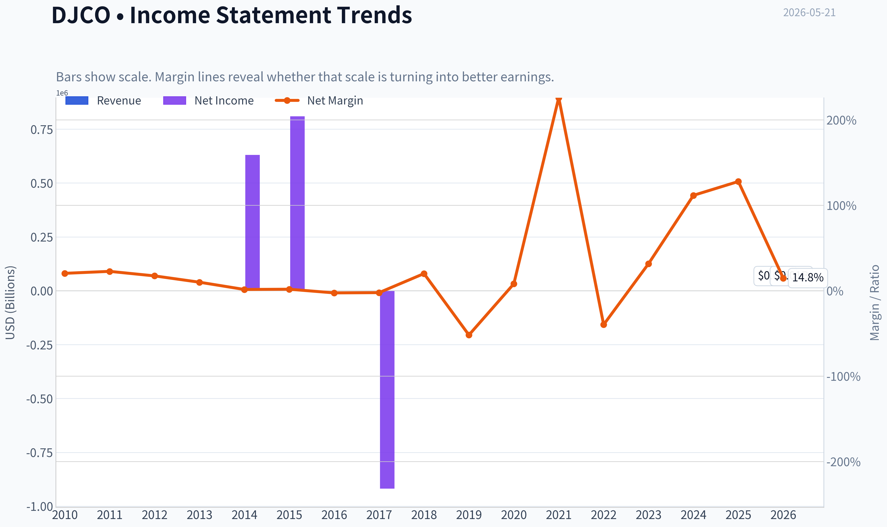

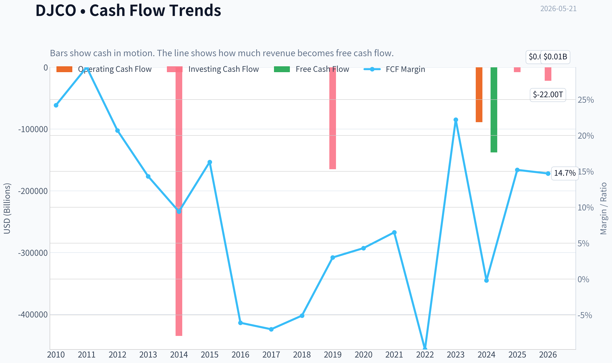

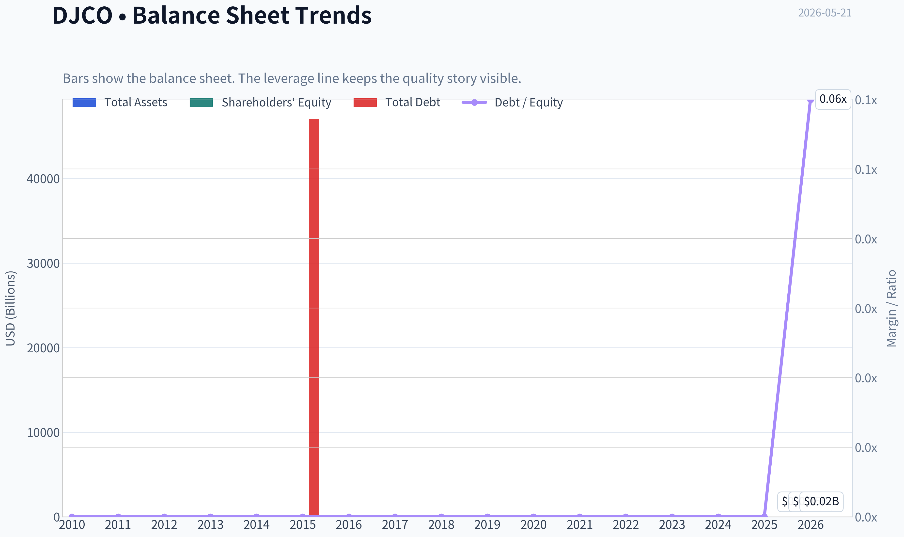

This graph tracks the profitability and return metrics (ROE, ROIC, Margins) of **DJCO** over the past decade, highlighting capital efficiency trends.

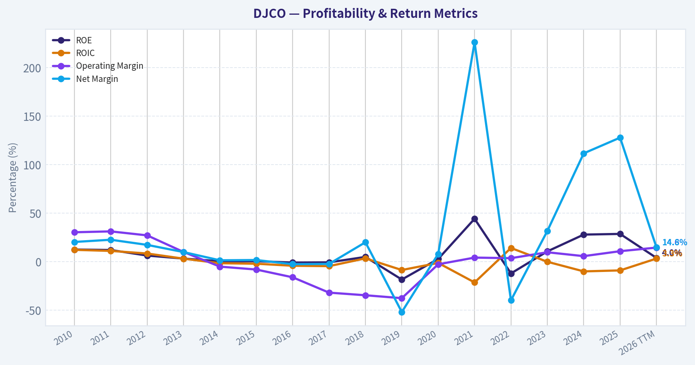

This chart illustrates the financial health of **DJCO** over the last 10 years, mapping cash equivalents and free cash flow against total obligations (Debt).

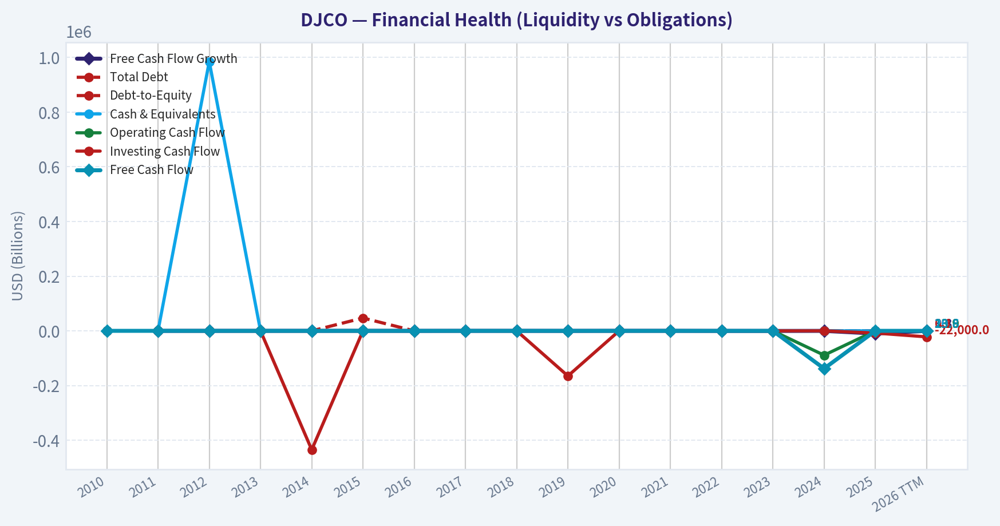

---

### Intrinsic Value Analysis (Buffett)

> *Following Warren Buffett's value investing philosophy: Circle of Competence, Economic Moat, Management Quality, and Margin of Safety.*

#### Intrinsic Value Snapshot

Price is what you pay. Intrinsic value is what the business may be worth based on the cash it can create for owners over time. We show a range, not one magic number.

- Current Price: $465.41
- Value Range (conservative to optimistic across both DCF methods): $53.36 to $2,065.14

##### Owner Earnings (Buffett Method)
- Net Income: $112,137,000.00
- Depreciation & Amortization: $257,000.00
- Capital Expenditures: $-8,000.00
- Working Capital Changes: $411,000.00
- Owner Earnings: $111,975,000.00

##### Intrinsic Value
###### Buffett Method
Uses owner earnings. Stricter, and usually more conservative.
- Conservative: $283.77
- Average: $2,065.14
- Optimistic: $2,065.14
- Discount Rate: 10.0%

###### Cash Flow Method
Uses free cash flow. Better for companies spending heavily today to grow tomorrow.
- Conservative: $53.36
- Average: $132.62
- Optimistic: $663.37
- Discount Rate: 10.0%

#### Daily Journal Corporation (NASDAQ: DJCO)

ANALYST STANCE: **WATCH**

#### 1. Business Summary and Buffett Fit

**Elementary school test:**
Daily Journal does two things:
1. It owns a traditional publishing/legal notice business.
2. More importantly, it sells case-management and justice software to courts, prosecutors, public defenders, and government agencies through **Journal Technologies**.

So the real business today is increasingly a **government software company with an investment portfolio attached**.

**Long-term predictability test:**
Moderate pass. Court and justice software is understandable and fairly durable because governments move slowly and switching systems is painful. That said, DJCO is not a clean pure-play software business because reported earnings can swing heavily due to gains and losses in its securities portfolio.

**Technology risk assessment:**
Mixed. Journal Technologies benefits from digitization of courts and justice workflows, which is favorable. But software always carries execution risk, and smaller vendors can be outspent by larger enterprise players. Still, the end market itself is not obviously being destroyed by technology; it is being enabled by it.

#### 2. Go/No-Go Gate Assessment

| Gate | Verdict | Evidence |
|---|---|---|
| Gate 1: Circle of Competence & Simplicity | **Pass with caution** | Core operating business is understandable, but valuation is complicated by the investment portfolio and volatile GAAP earnings. |
| Gate 2: Moat Test | **Pass with caution** | Software for courts likely has switching costs and niche know-how, but evidence for a truly wide moat is not overwhelming. |
| Gate 3: Management Quality & Capital Allocation | **Pass** | Historically conservative, owner-minded culture influenced by Charlie Munger; balance-sheet posture appears prudent. |
| Gate 4: Industry Structure | **Pass with caution** | Government software can be sticky and rational, but sales cycles are long and scale advantages are meaningful. |

**Key Takeaways:**
DJCO clears the Buffett filters, but not cleanly. The biggest issue is that this is not a simple one-line business; it is a niche government software company plus an investment portfolio, which makes earnings noisy and valuation less straightforward.

---

#### 3. Moat Analysis

| Moat Source | Assessment | Evidence |
|---|---|---|
| Intangible Assets | **Modest** | Brand matters somewhat in government procurement, but this is not a consumer franchise with obvious pricing power. |
| Switching Costs | **Strongest moat element** | Court systems are deeply embedded in workflows, records, training, and compliance. Replacing a mission-critical justice platform is disruptive and expensive. |
| Cost Advantage | **Limited** | DJCO may benefit from niche specialization, but likely lacks the massive scale advantage of larger enterprise software vendors. |
| Network Effects | **Weak/None** | Each court deployment is valuable on its own, but the product does not become dramatically better simply because more users join. |

**Moat rating:** **Narrow to moderate, primarily from switching costs**

This is not Coca-Cola or Moody's. The attraction is not brand magic; it is operational stickiness. Once a court system installs software that handles filings, scheduling, case tracking, and justice workflow, it becomes difficult to rip out.

#### 4. Management Quality & Capital Allocation

| Test | Assessment | Commentary |
|---|---|---|
| Think like owners? | **Yes** | The company has long reflected a shareholder-oriented, conservative culture. |
| Honest & candid? | **Generally yes** | Historically associated with unusually direct communication and sober capital allocation. |
| Rational capital allocation? | **Mostly yes** | DJCO has preserved capital carefully, maintained a strong liquidity posture, and allowed Journal Technologies to build over time. |

**What I like:**
- Conservative culture.
- Strong liquidity profile.
- No sign of reckless leverage.
- Willingness to endure short-term accounting volatility.

**What I do not love:**
- The investment portfolio muddies operating performance.
- Capital allocation is harder to judge because value is split between operating software assets and securities.
- The company is small, which can make execution and investor communication uneven.

#### 5. Financial Snapshot

Using the shared research pack and current operating context:

| Metric | Value |
|---|---:|
| Current Price | **$465** |
| Market Cap | **$641.2M** |
| P/E | **45.7x** |
| ROE | **28.7%** |
| Revenue Growth YoY | **25.4%** |
| FCF Yield | **2.1%** |
| Current Ratio | **13.86x** |

**Key Takeaways:**
The headline numbers show a very liquid, conservatively positioned company with strong reported ROE and solid top-line growth. But the valuation is rich on both earnings and free cash flow, and the quality of earnings requires extra scrutiny because portfolio gains and losses can distort the picture.

#### 6. Earnings Quality and Cash Flow Reality Check

Latest reported quarter:
- Q2 FY2026 revenue: **$22.7M**, up from **$18.2M**
- Q2 FY2026 EPS: **$(25.14)** versus **$32.43** last year

That enormous earnings swing strongly suggests **investment mark-to-market effects** are dominating GAAP EPS. For Buffett-style analysis, that means reported EPS should not be treated as a clean measure of economic earning power.

**Interpretation:**
- **Operating business appears to be improving**, given 25% revenue growth.
- **Reported earnings are noisy**, likely due to securities portfolio volatility.
- Therefore, valuation should lean more on normalized owner earnings and asset value rather than quarterly EPS.

#### 7. Owner Earnings Assessment

A precise Buffett owner-earnings formula needs full statements, but conceptually for DJCO:

**Owner Earnings = Net Income + D&A - Maintenance CapEx - Working Capital Needs**

For DJCO, the key challenge is separating:
1. recurring cash generation from Journal Technologies and publishing, from
2. unrealized gains/losses on securities.

Given the current setup, I would treat **normalized operating cash generation as materially lower than headline accounting ROE implies**. The **2.1% FCF yield** is the clearest warning sign: even if the business is decent, the stock price already discounts a lot.

#### 8. Three-Scenario DCF / Value Framing

Because DJCO is partly an operating company and partly a portfolio vehicle, a pure DCF is imperfect. Still, Buffett-style framing is useful.

##### Scenario Assumptions
- Market cap: **$641.2M**
- FCF yield: **2.1%**
- Implied current FCF / owner earnings baseline ~ **$13.5M**

| Scenario | Assumption | Implied Value |
|---|---|---:|
| A: No Growth | $13.5M / 10% | **$135M** |
| B: 3% Growth | $13.5M x 1.03 / (10%-3%) | **$199M** |
| C: Higher Growth Case | Assume normalized owner earnings compound at 8% for 10 years, then 3% terminal | **~$260M-$320M** |

**Key Takeaways:**
On a normalized cash-earnings basis, the current market value looks demanding. Even using a relatively favorable growth case, estimated intrinsic value appears below the current market capitalization unless one assigns substantial additional value to the investment portfolio beyond what cash flow alone suggests.

#### 9. Margin of Safety

| Item | Estimate |
|---|---:|
| Current Market Cap | **$641.2M** |
| Conservative Value Range | **$135M-$199M** |
| More Optimistic Value Range | **$260M-$320M** |
| Margin of Safety at Current Price | **Absent** |

**Key Takeaways:**
There is no meaningful margin of safety using a conservative Buffett lens. The current price appears to assume strong continued execution, favorable portfolio value, and little room for disappointment.

#### 10. Final Buffett Scorecard

| Criterion | Score (1-5) | Weight | Weighted Score |
|---|---:|---:|---:|
| Business Understanding | 3.5 | 20% | 0.70 |
| Moat Width & Durability | 3.0 | 25% | 0.75 |
| Management Quality | 4.0 | 15% | 0.60 |
| Return on Equity | 3.5 | 15% | 0.53 |
| Reinvestment Runway | 3.0 | 10% | 0.30 |
| Balance Sheet Strength | 4.5 | 5% | 0.23 |
| Industry Structure | 3.0 | 5% | 0.15 |
| Valuation / Margin of Safety | 1.5 | 5% | 0.08 |
| **Total** |  |  | **3.33 / 5.00** |

**Key Takeaways:**
DJCO scores well on conservatism, management culture, and niche stickiness. It loses points mainly on valuation and business complexity, which keeps it in the watch category rather than the buy category.

---

#### 11. Verdict

**ANALYST STANCE: WATCH**

**Conviction level:** **Moderate**

DJCO has several Buffett-friendly traits:
- understandable niche software operations,
- sticky government customers,
- conservative culture,
- strong liquidity,
- and improving revenue growth.

But at **45.7x earnings** and roughly **2.1% FCF yield**, the stock does **not** offer the margin of safety Buffett would demand. The biggest issue is that the company is part software business, part investment vehicle, which makes true earning power harder to judge and increases the chance of overpaying.

**Bottom line:**
This looks like a **decent business priced like a very good one**. I would **watch it, not buy it here**. A materially lower entry price, or much clearer evidence that Journal Technologies can sustainably compound owner earnings at a high rate, would be needed to upgrade the stance.
#### Valuation Bridge

This bridge places the current market price beside each intrinsic value lens so readers can see whether upside depends on one method or shows up across several methods.

| Scenario | Intrinsic Value / Share |
| --- | ---: |
| Buffett Method | $2,065.14 |
| Cash Flow Method | $132.62 |
| Damodaran Method | $-29.38 |
| Current Price | $465.41 |

#### Key Takeaways

If one method is far above the others, the upside case depends on a specific modelling assumption. When several methods cluster together, the valuation story is more robust.

#### Valuation Visuals

This comparison chart from *Latest Earnings Snapshot* stacks current figures against historical benchmarks for **DJCO**, making it easy to see where the company trades relative to its own averages.

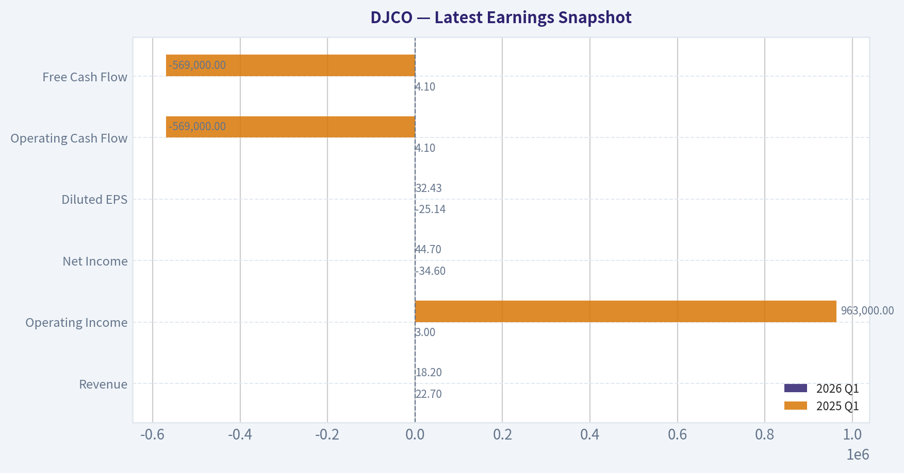

This comparison chart from *Current vs Historical Average Comparison* stacks current figures against historical benchmarks for **DJCO**, making it easy to see where the company trades relative to its own averages.

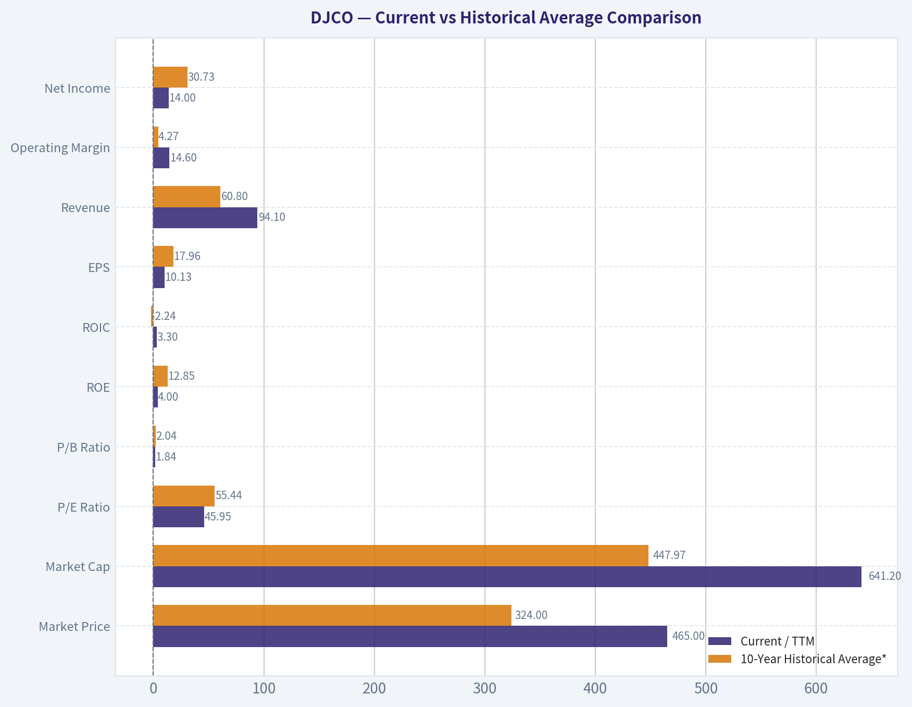

This comparison chart from *Cash Flow Analysis* stacks current figures against historical benchmarks for **DJCO**, making it easy to see where the company trades relative to its own averages.

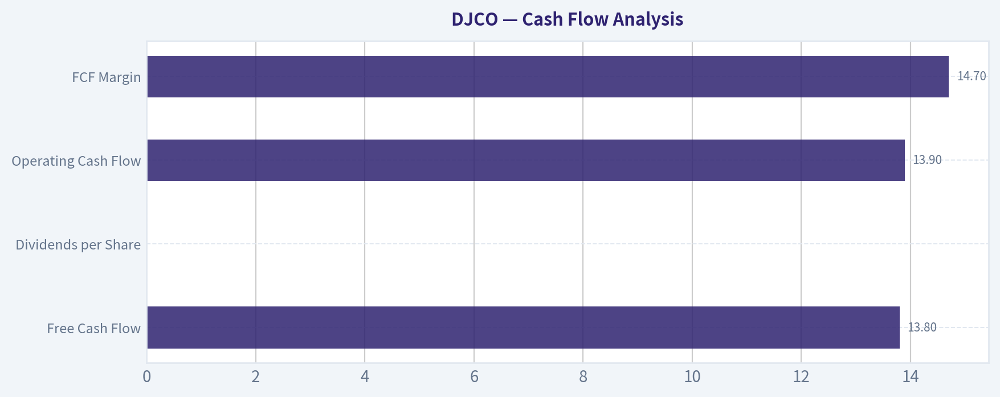

This comparison chart from *DCF Valuation - Buffett-Style Owner Earnings* stacks current figures against historical benchmarks for **DJCO**, making it easy to see where the company trades relative to its own averages.

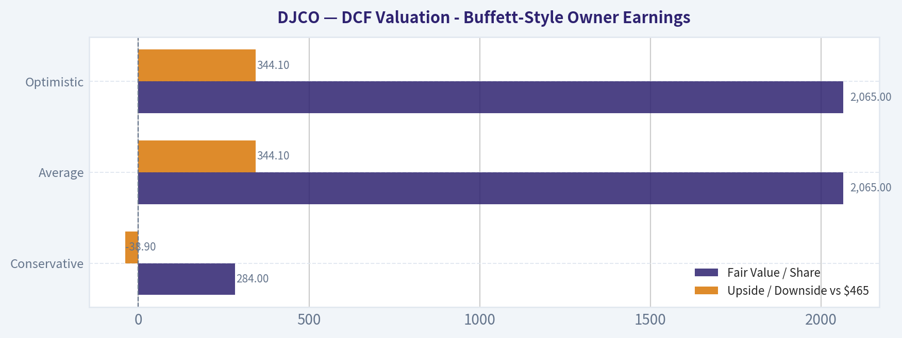

This comparison chart from *Financial Snapshot* stacks current figures against historical benchmarks for **DJCO**, making it easy to see where the company trades relative to its own averages.

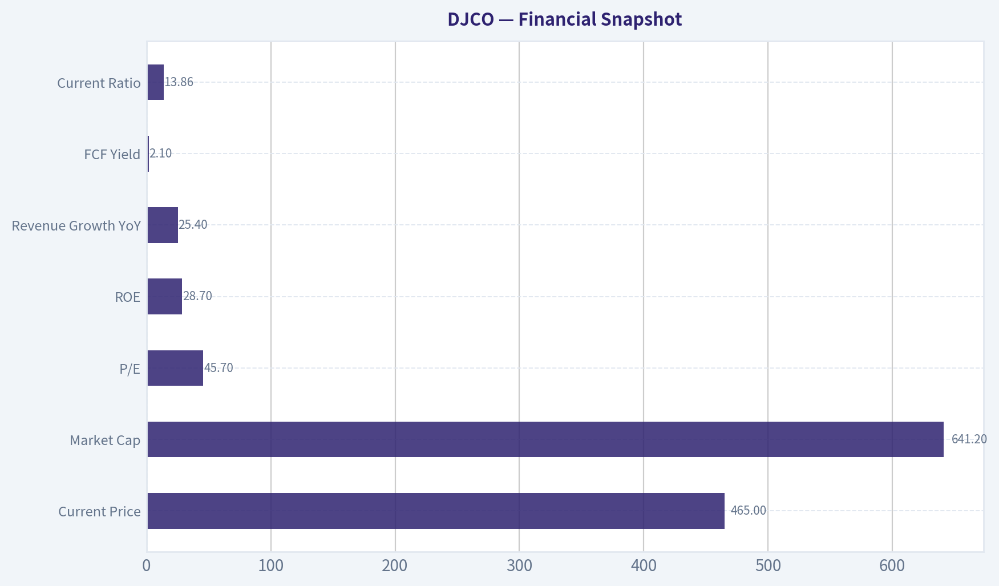

---

### Trend & Growth Analysis (Lynch/Druckenmiller/Fisher)

> *Following Peter Lynch's GARP, Stanley Druckenmiller's macro-aware approach, and Philip Fisher's scuttlebutt methodology.*

ANALYST STANCE: **WATCH**

#### Lynch Classification

| Item | Assessment |
|---|---|
| Category | **Fast Grower** |
| Why | Revenue growth is running **~25% YoY**, above Lynch's fast-grower threshold |
| Caveat | This is **not a clean classic growth stock** because earnings are highly distorted by the investment portfolio and mark-to-market swings |

Key Takeaways: DJCO screens as a fast grower on reported revenue growth, but it is an unusual one. The operating business appears to be growing, while bottom-line earnings are noisy and can reverse sharply because of securities gains and losses. That makes this more of a hybrid operating-company-plus-investment-portfolio story than a pure software compounder.

---

#### The Story in 3 Bullets

- **DJCO sells software and publishing/legal-information services**, with the more important growth engine likely being Journal Technologies.
- **Revenue is accelerating meaningfully**, with fiscal Q2 revenue up **25% YoY** and first-half revenue up **18% YoY**.
- **The stock's value is partly tied to its securities portfolio**, which boosts asset backing but also makes earnings volatile and the growth story harder to underwrite cleanly.

#### TAM Analysis with 10x Test

| Item | Estimate / View |
|---|---|
| Current revenue run-rate | Roughly **$85M-$90M** annualized using first-half fiscal 2026 revenue |
| 10x revenue test | **$850M-$900M** revenue target |
| TAM view | Court/case-management and justice-system software likely has a meaningful niche TAM, but probably **not massive enough** to comfortably support a full 10x outcome without adjacencies |
| 10x Test Result | **Unclear / probably difficult** based on current business mix |
| Runway assessment | **Moderate**, not obviously huge |

Key Takeaways: DJCO likely has room to grow from here, but the path to a true ten-bagger through operating revenue alone is not obvious. The software niche appears real and defensible, yet the company may need product expansion or broader market penetration to justify a 10x revenue outcome. This is a key reason the stock is more of a watchlist name than a high-conviction advocate.

#### Revenue Growth Trend

| Period | Revenue | YoY Growth | Interpretation |
|---|---:|---:|---|
| Fiscal Q2 2026 | $22.7M | **25%** | Strong |
| Fiscal H1 2026 | $42.3M | **18%** | Healthy |
| Shared pack trailing growth | - | **25.4%** | Fast-grower range |
| Pattern | - | - | **Improving / solid**, though history is still limited here |

Key Takeaways: Revenue growth is currently strong enough to qualify as fast growth. The second quarter appears stronger than the first-half average, which hints at some acceleration. That said, the dataset is thin, so I would not yet call this a confirmed long-duration inflection.

#### Unit Economics

| Metric | Status |
|---|---|
| LTV/CAC | **Not disclosed / unavailable** |
| NRR | **Not disclosed / unavailable** |
| Payback period | **Not disclosed / unavailable** |
| Rule of 40 | Cannot calculate reliably with available operating data |
| Gross margin | **N/A in shared pack** |
| ROE | **28.7%**, but likely distorted by investment marks/capital structure |

Key Takeaways: The biggest analytical gap is unit economics. For a software-led growth thesis, missing data on retention, customer acquisition efficiency, and gross margins is a major limitation. Without those numbers, it is hard to judge whether revenue growth is both durable and high quality.

#### Inflection Point Assessment

| Inflection Type | Assessment |
|---|---|
| Product cycle inflection | **Possible** |
| Market share inflection | **Possible but unproven** |
| Margin inflection | **Not evident** |
| TAM inflection | **Not evident** |
| Competitive inflection | **No evidence** |
| Overall | **Some operating momentum, but not enough proof for a major inflection call** |

Key Takeaways: DJCO may be experiencing an operating improvement, especially in its technology segment, but the evidence is incomplete. Revenue growth is encouraging, yet I do not see enough proof of a broad market-share or margin inflection. For now, this looks like a developing story rather than a confirmed breakout.

#### Macro Setup Evaluation

| Factor | View |
|---|---|
| Economic sensitivity | Moderate; public-sector/legal tech demand is less cyclical than many enterprise niches |
| Rate environment | Mixed; lower rates would help valuation of growth assets and securities portfolio |
| Secular trend | **Digital modernization of courts/government workflows** |
| Macro tailwind score | **Modestly positive** |

Key Takeaways: DJCO's software business likely benefits from a steady modernization trend in courts and public administration. That is a real secular tailwind, though not as explosive as AI or hyperscale cloud. The macro backdrop is therefore supportive, but not powerful enough on its own to justify aggressive positioning.

#### Fisher 15 Points Score

| Fisher Dimension | Score (1-5) | Comment |
|---|---:|---|
| Market potential | 3 | Real niche, but not clearly enormous |
| Product development | 3 | Some evidence, limited disclosure |
| R&D effectiveness | 3 | Hard to verify |
| Sales organization | 2 | Limited evidence |
| Profit margin | 3 | Mixed due to business/investment structure |
| Improving margins | 2 | Not established |
| Labor relations | 3 | No known issue |
| Executive relations | 3 | No clear issue |
| Management depth | 2 | Key-person/history concentration concern |
| Cost/accounting controls | 3 | Acceptable, but earnings noisy |
| Special advantages | 3 | Niche expertise and installed relationships |
| Long-range outlook | 3 | Decent, not outstanding |
| Dilution risk | 4 | Balance sheet appears strong |
| Candor | 3 | Average based on available materials |
| Integrity | 4 | No major red flags evident |
| **Total** | **44 / 75** | **Average / below growth-quality threshold** |

Key Takeaways: DJCO scores as average under Fisher's framework. The company gets credit for niche positioning and balance-sheet strength, but loses points because the evidence for scalable sales execution, strong product economics, and deep management bench is limited. This score does not support a high-conviction growth recommendation.

#### Valuation Analysis

| Metric | Value | Read |
|---|---:|---|
| Market cap | **$641.2M** | Small-cap |
| Price | **$465** | - |
| P/E | **45.7x** | Expensive on noisy earnings |
| FCF yield | **2.1%** | Not cheap |
| P/S (rough est.) | **~7.1x-7.5x** | Fair-to-full for a niche grower |
| PEG | **~1.8x** using 45.7 P/E and 25.4% growth | **Fair to expensive** |

Key Takeaways: DJCO does not look obviously cheap. The valuation is acceptable only if current revenue growth proves durable and the software segment becomes more clearly dominant in the story. On today's numbers, investors appear to be paying a fairly full price for a business with some attractive traits but several unresolved questions.

#### Scenario View

| Case | Assumption | Valuation View |
|---|---|---|
| Bear | Growth falls to low teens, portfolio volatility persists | Shares likely look overvalued |
| Base | Revenue compounds mid-to-high teens, operations improve gradually | Shares look roughly fairly valued |
| Bull | Journal Technologies sustains 20%+ growth and wins larger-scale adoption | Upside exists, but needs stronger proof |

Key Takeaways: The base case suggests limited margin of safety. The bull case is plausible, but it depends on operational execution that is not fully visible from current disclosure. That asymmetry argues for patience rather than urgency.

---

#### Growth Investor Scorecard

| Criterion | Weight | Score | Weighted Score |
|---|---:|---:|---:|
| The Story | 10% | 3.0 | 0.30 |
| TAM & Runway | 20% | 2.5 | 0.50 |
| Revenue Growth | 20% | 4.0 | 0.80 |
| Unit Economics | 15% | 2.0 | 0.30 |
| Competitive Position | 10% | 3.0 | 0.30 |
| Management Quality | 10% | 3.0 | 0.30 |
| Macro Setup | 5% | 3.5 | 0.18 |
| Profitability Path | 5% | 2.5 | 0.13 |
| Valuation | 5% | 2.5 | 0.13 |
| **Total** | 100% | - | **2.94 / 5.0** |

Key Takeaways: DJCO lands just below the threshold for a positive growth recommendation. Strong revenue growth is the clear bright spot, but uncertainty around TAM, software unit economics, and valuation prevents a more bullish stance. This is a name to monitor, not chase.

#### Position Size Stance

| Stance | View |
|---|---|
| Recommended action | **WATCH** |
| If already owned | Hold only if thesis is tied to Journal Technologies growth plus asset backing |
| If initiating | Start small only after deeper segment-level diligence |
| Suggested size | **0% to 1% exploratory**, not a full position |

Key Takeaways: DJCO is not compelling enough for a concentrated growth position today. It may deserve a small tracking position if an investor wants optionality on further software acceleration. For most growth portfolios, the better move is to wait for clearer proof.

#### Key Risks and Catalysts

| Risks | Catalysts |
|---|---|
| Earnings volatility from investment portfolio | Journal Technologies backlog conversion |
| Limited visibility on software KPIs | New court/government contract wins |
| Niche TAM may be smaller than hoped | Sustained 20%+ revenue growth over several quarters |
| Valuation already discounts decent growth | Better disclosure on segment margins and recurring revenue |
| Potential key-person / management depth concerns | Multiple expansion if market sees cleaner software story |

Key Takeaways: The main risk is that investors are paying growth-company multiples without getting growth-company transparency. The main upside catalyst is simple: if management can show that software growth is durable, scalable, and increasingly profitable, the story could improve quickly.

#### Bottom Line

DJCO has **real growth elements**, especially in revenue, and the balance sheet appears strong. But it is **not yet a clean Lynch-style fast-grower winner** because the TAM looks moderate, the earnings are noisy, and software unit economics are not well disclosed.

For now, this is a **WATCH**: interesting niche compounder potential, but not enough evidence of a major inflection or ten-bagger setup.

---

### Market Technical Analysis

#### DJCO Technical Report

DJCO is currently in a **tactically weak phase inside a still-positive long-term structure**. The stock's one-year path shows three distinct regimes: a volatile base near the low-400s in mid-2025, a powerful upside expansion into the January 2026 peak near the mid-600s, and then a multi-month corrective unwind that has persisted into May 2026. The most important point is that the correction has become **directionally mature but not yet technically repaired**.

For this market context, the **most relevant 8 indicators** are:

- `close_10_ema`
- `close_50_sma`
- `close_200_sma`
- `macd`
- `macdh`
- `rsi`
- `atr`
- `vwma`

These were chosen because they cover **short-term trend, medium-term trend, long-term trend, momentum direction, momentum acceleration, mean-reversion pressure, volatility/risk, and volume-confirmed trend quality** without excessive overlap.

---

#### Price Structure and Trend Context

Over the last year, DJCO advanced from roughly **430 in May 2025** to a major peak around **674 in January 2026**, which was an exceptionally strong markup phase. That rally was not linear: it included repeated vertical bursts, wide daily ranges, and occasional gap-like repricings, suggesting a stock that can trend strongly but is also prone to abrupt sentiment shifts.

Since the January peak, the tape has changed character materially. Rather than immediately collapsing into a straight-line bear trend, DJCO has moved through a **distribution-to-correction sequence**:

- sharp break from the 660s to the high-500s late January,
- deeper damage into the high-400s by February,
- unstable rebounds that repeatedly failed below prior highs,
- and a fresh May downswing toward the mid-460s.

That matters because the current weakness is not just a one-week pullback. It is part of a **series of lower recovery highs** after the January climax. This makes the current zone more of a **repair attempt candidate** than a clean uptrend continuation.

#### Indicator Snapshot

| Indicator | Latest / Recent Reading | What It Suggests |
|---|---:|---|
| close_10_ema | 477.24 | Short-term trend is down; price is trading below a falling fast average |
| close_50_sma | 503.34 | Medium-term trend remains under pressure; this level is now overhead resistance |
| close_200_sma | 488.90 | Long-term trend is still marginally constructive, but price has slipped below it |
| macd | -13.57 | Momentum remains negative |
| macdh | -2.94 | Bearish momentum still active, but downside acceleration has eased versus earlier May |
| rsi | 37.28 | Weak but not deeply oversold; room exists for more downside unless buyers step in |
| atr | 22.83 | Volatility is still elevated in absolute terms, though lower than March-April |
| vwma | 480.84 | Volume-weighted trend is above current price, implying selling pressure has had participation |

Key Takeaways: DJCO is below every important near-term reference line except the slowly rising 200-day average, and even that long-term support has recently been lost on price. Momentum is bearish, but the rate of deterioration has slowed somewhat, which raises the chance of a tradable bounce without yet confirming a durable bottom. Volatility remains high enough that position sizing and stops need to be handled carefully.

---

#### Trend Analysis by Indicator

#### Moving Averages: Trend Alignment Is Bearish in the Near and Medium Term

The moving-average stack gives a very clear message.

- The **10 EMA at 477.24** is falling.
- The **50 SMA at 503.34** is also falling.
- The **200 SMA at 488.90** is still rising modestly.

This is a classic **counter-trend correction inside an only partially damaged long-term uptrend**. In practical terms, the long-term trend has not fully rolled over yet, but shorter horizons have already turned decisively bearish.

A subtle but important feature is the spacing:

- Price is below the **10 EMA**, meaning immediate trading pressure is negative.
- Price is well below the **50 SMA**, meaning rebounds are likely to encounter resistance before the low 500s.
- Price is also below the **200 SMA**, which weakens the bullish case because former long-term support is no longer holding cleanly.

This setup often produces one of two paths:
1. a quick reflex rally back toward the 10 EMA / 200 SMA zone that fails, or
2. a stabilization period followed by a larger base-building process.

Right now, the data favors **"rally attempts are possible, but trend repair is incomplete."**

#### Momentum: Bearish, But No Longer in Full Capitulation Mode

The **MACD at -13.57** confirms that downside momentum is still dominant. However, the more nuanced signal comes from the **MACD histogram at -2.94**. The histogram remains negative, but it is less extreme than earlier in May, when readings were more deeply bearish.

That means:
- momentum is still bearish,
- but the **speed of the decline is no longer intensifying as aggressively**.

This is often the first step toward a stabilization phase. It is **not a buy signal by itself**, but it does suggest the stock may be transitioning from impulsive selling into a more measured consolidation or oversold bounce setup.

#### RSI: Weak, Not Exhausted

The **RSI at 37.28** places DJCO in a weak zone but not an extreme one. This is an important distinction.

If RSI were below 30, traders could argue the stock is entering a stronger mean-reversion zone. But at 37, the market is signaling:
- persistent downside pressure,
- limited bullish urgency,
- and still enough room for sellers to push lower before the stock becomes statistically stretched.

In other words, DJCO looks **soft rather than washed out**. That makes bottom-fishing less attractive unless price action improves around support.

#### Volume-Weighted Trend: Selling Has Been Real, Not Merely Illiquid Noise

The **VWMA at 480.84** sits above price and above the 10 EMA. This matters because DJCO can be thinly traded at times, and in thinner names, price moves can occasionally overstate actual conviction. Here, the VWMA suggests that the recent decline has had **meaningful volume participation**, not just a random drift lower.

That does not mean institutional distribution can be asserted with certainty, but it does mean the down-move carries more informational weight than a low-volume wobble would.

#### Volatility and Risk: Still Elevated, Though Cooling

The **ATR has fallen from roughly 35 in late March to 22.83 now**. That is a meaningful decline in volatility. It indicates that the market is no longer moving with the same disorder seen during the March-April swings.

However, an ATR above 22 on a stock trading in the 460-480 area is still substantial. Daily movement potential remains large enough that:
- tight stops can be easily shaken out,
- breakout confirmation needs more than one intraday push,
- and swing entries should leave room for normal noise.

So the volatility regime is best described as **cooling from highly unstable to still-active**.

---

#### Fine-Grained Trend Observations

#### 1. The January surge likely marked a momentum climax
The move from roughly 500 at year-end to the mid-600s by late January was unusually steep relative to prior trend behavior. Stocks that accelerate that rapidly often need a lengthy digestion phase. DJCO appears to be in exactly that digestion now. This increases the odds that the stock needs **time**, not just price, before a durable uptrend resumes.

#### 2. The 200-day average is the key strategic dividing line
Because the 200 SMA is rising near **488.9**, it remains the most important long-term reference. But price being below it means bulls have lost their clearest structural support level in the short run. Reclaiming and holding above the 200-day line would be the first major improvement. Failing beneath it keeps the stock vulnerable to renewed selling.

#### 3. The 50-day average has rolled into resistance
The **50 SMA near 503.3** is declining and significantly above current price. This suggests even if DJCO rebounds, the low-500s may become a heavy supply zone. Traders should not assume that a move from 464 to 485 is trend reversal; it may merely be a rebound into overhead resistance.

#### 4. Momentum deterioration is slowing, which is constructive only tactically
Negative MACD with a less-negative histogram often precedes a bounce. But unless price follows through by reclaiming the 10 EMA and then the 200 SMA, this remains only a **short-term tactical improvement**, not a strategic trend turn.

#### 5. RSI behavior implies no forced urgency for either side
An RSI in the upper 30s often reflects a market that is weak but not in panic. This can lead to grinding downside, sideways churn, or a modest rebound. It is less consistent with an immediate V-shaped reversal unless a catalyst appears.

#### 6. Volatility compression may set up the next directional move
ATR has been declining for weeks. When volatility cools after a directional selloff, the next move can become clearer once price resolves around a major reference point. For DJCO, those reference points are:
- support: recent mid-460s area,
- pivot zone: upper-470s to high-480s,
- resistance: 489-503.

---

#### Trading Implications by Style

| Trading Style | What Matters Most Now | Practical Read |
|---|---|---|
| Short-term swing trader | 10 EMA, MACD histogram, RSI | Bounce potential exists, but only tactical unless price can reclaim the 10 EMA and sustain above it |
| Trend follower | 50 SMA and 200 SMA | Trend is not favorable yet; price is below both key reference areas that matter for confirmation |
| Mean-reversion trader | RSI and ATR | Stock is weak but not deeply oversold, so waiting for either stronger washout or clearer reversal candles may improve odds |
| Position trader | 200 SMA and VWMA | Long-term structure is not broken beyond repair, but current price below 200-day and VWMA argues for patience rather than aggressive accumulation |
| Risk manager | ATR | Wide daily swings remain possible; position sizing should be reduced relative to low-volatility setups |

Key Takeaways: Different strategies point to the same conclusion: DJCO is not yet a clean trend-following long, but it is getting closer to a zone where a tactical rebound can emerge. The biggest distinction is between a short-term bounce and a true trend reversal. Right now, the data supports watching for stabilization first, not assuming the correction is over.

---

#### What Would Improve the Setup

The technical picture would become more constructive if DJCO can do the following in sequence:

1. **Hold above the recent mid-460s lows**
2. **Recover the 10 EMA**
3. **Push back above the 200 SMA near 489**
4. **Challenge the 50 SMA near 503**
5. **See MACD continue rising toward a bullish crossover**
6. **See RSI move back above 45-50**

That sequence would indicate the stock is moving from mere downside exhaustion into real repair.

#### What Would Worsen the Setup

The bearish case strengthens if:
- price fails again under the high-470s to upper-480s,
- RSI slips back toward or below 30,
- MACD remains negative and the histogram expands downward again,
- or the recent mid-460s floor breaks decisively.

If that happens, the market would likely start targeting a deeper retracement of the entire 2025-2026 advance.

---

#### Bottom Line

DJCO is in a **medium-term corrective trend with weakening short-term momentum and only partially intact long-term structure**. The stock is not showing enough strength yet for a high-confidence bullish trend call, but the slowing deterioration in MACD histogram and the cooling ATR suggest the decline may be transitioning from aggressive selling into a more organized stabilization phase.

For traders, this is a **"watch for repair, don't front-run confirmation"** chart. For investors, the long-term uptrend is not fully invalidated, but the stock likely needs to reclaim the **200-day average** before the technical backdrop can be called healthy again.

#### Summary Table

| Category | Signal | Interpretation | Trader Relevance |
|---|---|---|---|
| Short-term trend | Price vs `close_10_ema` | Bearish | Immediate momentum still points down |
| Medium-term trend | Price vs `close_50_sma` | Bearish | Rebounds likely face resistance near 503 |
| Long-term trend | `close_200_sma` rising, but price below it | Cautiously constructive but damaged | Long-term bulls need a reclaim of the 200-day line |
| Momentum direction | `macd` negative | Bearish | Trend momentum still favors sellers |
| Momentum acceleration | `macdh` negative but less extreme than earlier | Bearish pressure is easing | Possible early stabilization or bounce setup |
| Overbought/oversold | `rsi` at 37.3 | Weak, not oversold | No strong capitulation signal yet |
| Volatility | `atr` elevated but declining | Risk still high, but conditions are less chaotic | Use wider stops / smaller size |
| Volume confirmation | Price below `vwma` | Selling has had real participation | Downtrend is more credible than a low-volume dip |

Key Takeaways: The table shows a stock that is still technically under pressure across most timeframes, especially short and medium term. The only encouraging elements are that long-term structure has not fully rolled over and that downside momentum is no longer accelerating as sharply. Until DJCO reclaims the 200-day area and begins to challenge the 50-day average, rallies should be treated as tentative rather than trend-confirming.

#### Market Visuals

This comparison chart from *Market Metrics* stacks current figures against historical benchmarks for **DJCO**, making it easy to see where the company trades relative to its own averages.

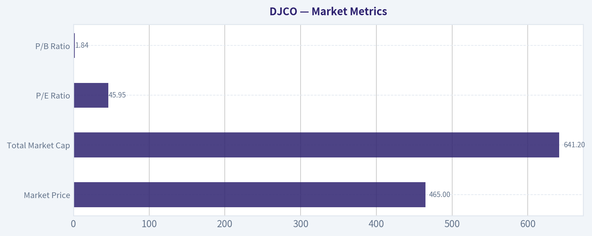

---

### Options Market Analysis

> *Reading options flow - put/call ratios, IV skew, and unusual activity - to gauge institutional positioning and event-driven risk.*

#### DJCO Options Market Report

No listed options data is available for **DJCO** as of **2026-05-21**.

This usually means one of two things:
1. **DJCO does not currently have an actively listed options market**, or
2. The options chain is so limited/inactive that no usable market data is being returned.

Because of that, I **cannot derive a reliable options sentiment signal** from put/call ratios, implied volatility, skew, unusual flow, or open-interest concentrations.

#### Data Availability Summary

| Metric | Status | Comment |
|---|---:|---|
| Put/Call Ratio | Not available | No listed/usable options chain returned |
| Near-term IV | Not available | Cannot calculate ATM IV without active quotes |
| IV Skew | Not available | No call/put surface to compare |
| Unusual Options Activity | Not available | No volume/OI contract data returned |
| Open Interest Concentration | Not available | No strike-level OI data returned |
| Overall Options Signal | Unavailable / Low confidence | No options market to analyze |

Key Takeaways: DJCO does not currently provide a usable options dataset, so any options-based directional read would be speculative rather than evidence-based. In practical terms, this means there is no visible institutional positioning signal from the listed options market right now. Confidence in any options sentiment call is therefore effectively zero.

#### Put/Call Ratio Analysis

| Measure | Reading |
|---|---:|
| Near-term Put/Call OI Ratio | N/A |
| Near-term Put/Call Volume Ratio | N/A |
| Neutral Baseline Reference | ~0.7 |

Key Takeaways: With no options chain available, there is no way to compare current put/call positioning versus the normal neutral baseline around 0.7. That means we cannot tell whether traders are leaning toward downside hedging or upside speculation.

#### Implied Volatility Assessment

| Measure | Reading |
|---|---:|
| Near-term ATM Call IV | N/A |
| Near-term ATM Put IV | N/A |
| OTM Put vs. OTM Call Skew | N/A |
| Event Premium Signal | N/A |

Key Takeaways: No active option quotes means no implied volatility surface. Without IV or skew, we cannot judge whether the market is pricing in elevated event risk, downside fear, or upside chase.

#### Unusual Options Activity

| Contract | Type | Strike vs. Spot | Expiry Horizon | Volume vs. OI | Interpretation |
|---|---|---|---|---|---|
| None available | N/A | N/A | N/A | N/A | No options flow data returned |

Key Takeaways: There are no reported contracts showing volume relative to open interest because no chain data was returned at all. That removes one of the most useful clues for spotting fresh directional bets or hedge activity.

#### Open Interest Concentration

| Expiration | Highest OI Calls | Highest OI Puts | Pin/Gamma Read |
|---|---|---|---|
| N/A | N/A | N/A | N/A |

Key Takeaways: With no strike-level open interest, there are no identifiable pinning levels, gamma walls, or max-pain style magnets. For DJCO, price behavior will need to be evaluated using stock liquidity, technical levels, and fundamentals instead of options positioning.

#### Overall Options Sentiment Signal

**Signal: UNAVAILABLE**

Primary driver: **No listed/usable options market data for DJCO.**

If you want a tradable sentiment read, the best next step is to analyze:
- stock volume and liquidity,
- technical support/resistance,
- insider/institutional ownership changes,
- earnings/news catalysts.

#### Summary Table

| Category | Read |
|---|---|
| Put/Call Ratio | Not available |
| IV Level | Not available |
| Skew Direction | Not available |
| Unusual Activity | None observable from returned data |
| Overall Signal | Unavailable due to lack of options data |

---

## Research Team Commentary

> *The Research Manager synthesizes the Bull vs Bear debate into action-free commentary. This is a pre-risk view, not the final stance.*

The strongest bull argument is that DJCO is being misread as a legacy publishing oddity when the real value may sit inside Journal Technologies, a niche justice-software business serving courts and government agencies. That business likely has real switching costs, long customer relationships, and a slow-moving public-sector customer base that can make revenue durable once installed. The recent revenue growth is also genuinely notable, with quarterly growth around 25% and first-half growth around 18%, which supports the idea that the software mix is becoming more important. There is also some appeal in the conservative culture and asset backing from the securities portfolio; for a patient investor, that can matter if the business is in transition and the market is simplifying the story too aggressively.

The strongest bear argument is much more decisive from a Buffett lens: the numbers do not yet clearly prove a great business, and the valuation does not offer protection if that optimistic interpretation is wrong. A 45.7x P/E is a demanding price for a company with mixed operations, earnings noise, a structurally challenged legacy segment, and unclear normalized owner earnings. Most importantly, the reported 1.9% ROIC is a major warning sign. Even if that number is somewhat distorted by structure, it is hard to call this a high-quality compounding machine when the key capital-efficiency metric looks so weak. Buffett-style investing requires both business quality and a margin of safety; here, both are debatable, while the price is plainly not cheap.

My takeaway is WATCH.

Core takeaway: DJCO may indeed contain a worthwhile niche software asset, but at today's valuation the investment case relies too heavily on narrative reconstruction and not enough on proven economics. In other words, the bull case might be directionally right about Journal Technologies, but the bear case is more convincing that the current stock price already asks investors to pay up before the moat, earning power, and capital efficiency are sufficiently demonstrated.

The rationale is pretty straightforward. If I were following Buffett's framework strictly, I would ask: is this an understandable business with durable moat evidence, predictable cash flows, strong returns on incremental capital, and a meaningful discount to intrinsic value? DJCO falls short on several of those tests. The business is not cleanly understandable because it mixes legacy publishing, software, and a securities portfolio. Earnings are harder to normalize. The legacy segment likely remains a drag over time. And while Journal Technologies may have attractive characteristics, I do not yet have enough proof that it is a true high-return franchise deserving a premium multiple. The market may be underappreciating the software asset, but that does not automatically create value if the stock already trades at a rich earnings multiple. One lesson from past mistakes is not to let long-term skepticism blind me to mispricing after severe deratings. But the opposite lesson also matters: don't manufacture a contrarian opportunity where the valuation itself is not contrarian. This is not DUOL at 10x earnings after an 80% collapse, and it is not Adobe at a washed-out free-cash-flow yield. Here, caution is still appropriate because the "messy but good" thesis is not paired with an obvious margin of safety.

What would change my mind? Over the next 1 to 4 quarters, I would watch a few concrete things. First, Journal Technologies growth durability: does software continue to grow at a healthy rate independent of portfolio noise, and can management show that this is not just contract timing? Second, margin and cash-flow clarity: I want better evidence of normalized operating earnings and free cash flow from the software business itself. Third, capital efficiency: if ROIC remains weak, it becomes much harder to argue that this is a disguised compounder; if it improves meaningfully, the bull case gains credibility. Fourth, segment mix: I want to see the software business become a larger share of total economics while the legacy publishing drag becomes less relevant. Fifth, capital allocation: does management simplify the story, improve disclosure, or take actions that help shareholders understand intrinsic value more clearly? Finally, valuation discipline matters. Even if the business keeps improving, I would prefer either a materially lower entry point or much stronger proof that Journal Technologies deserves a premium valuation.

So my stance is WATCH. Interesting business components, but not enough margin of safety and not enough proof yet for a Buffett-style ADVOCATE call.

---

## Value Investing Team Commentary

> *The Investor translates the research view into an investment thesis before risk review. This is still not the final stance.*

DJCO is the kind of situation that can tempt a value investor into a story before the economics are fully proven. There is something here worth respecting: Journal Technologies may well be the real business of interest, not the legacy publishing operation. Software sold into courts and justice agencies can have attractive characteristics-sticky workflows, difficult switching, long implementation cycles, and public-sector customers that do not change vendors casually. If that segment is truly becoming the center of gravity, then the market may indeed be too lazy in viewing DJCO as an odd legacy bundle.

But Buffett's discipline starts with what can be known, not what can be imagined. Right now, the business is still messy. You have a legacy publishing/legal notice operation, a potentially valuable justice-software arm, and a securities portfolio that muddies reported earnings and complicates intrinsic value work. That makes normalized owner earnings harder to estimate with confidence. When the structure is complicated, the price must compensate for that uncertainty. Here, it does not appear to.

The key problem is that the stock is not priced like a misunderstood asset; it is priced like a quality company already receiving some benefit of the doubt. A P/E around 45.7 is a rich multiple for a business with mixed segments, earnings noise, and still-unproven capital efficiency. The 28.7% ROE looks strong on the surface, but the reported 1.9% ROIC is the more troubling figure from a business-quality perspective. Buffett cares much more about whether a company can deploy capital at attractive rates over time than whether an accounting ratio looks flattering in isolation. If ROIC is truly that weak, then the company is not yet demonstrating the kind of compounding engine that deserves enthusiasm at this valuation.

The selective contrarian question is important here: what is the market missing? Possibly, it is underestimating Journal Technologies as a niche government software business with better durability than the headline conglomerate-like structure suggests. That is the real bull case, and it should not be dismissed. Public-sector software can produce long-lived customer relationships and decent moat characteristics. If investors are anchoring too much on the "Daily Journal" label or on legacy publishing, there may eventually be hidden value unlocked as software becomes more visible in the mix.

But contrarianism only works when it is paired with mispricing. Being early to a correct narrative while overpaying is not value investing. The more important contrarian observation today may actually be the opposite: some investors may be too eager to romanticize the Charlie Munger association, conservative culture, or hidden-software-asset angle and thereby excuse a lack of clean economic proof. That is not a sufficient margin of safety.

The market action described-sharp breakdown from the 660s into the high-400s, followed by unstable rebounds-does suggest sentiment has cooled materially. Normally, that would make me more interested. But the stock has not become obviously cheap on the numbers that matter most. This is not a classic Buffett-style setup where a high-quality franchise gets tossed out at a silly price because of temporary fear. Here, fear may have increased, but valuation still leaves limited room for disappointment.

What I would want to see before becoming constructive is straightforward: clearer segment disclosure around Journal Technologies, sustained organic growth rather than contract timing noise, more visible free-cash-flow conversion, and evidence that incremental capital in the software business earns attractive returns. If management can demonstrate that Journal is a real moat business with durable economics, then today's skepticism could eventually prove shortsighted. But until that evidence is stronger, the burden of proof stays on the bull case.

From a long-term ownership perspective, DJCO looks more like an interesting file for continued study than a business to buy aggressively today. The company may be transitioning toward a better mix, but the current valuation already assumes enough goodness that the investor is not being paid well for uncertainty. That fails the margin-of-safety test.

**ANALYST STANCE: WATCH**
DJCO may contain a worthwhile niche software asset with sticky government relationships, but the business mix is still too muddy, normalized earning power too unclear, and valuation too demanding to justify a Buffett-style commitment. Sentiment has weakened, yet not enough to create obvious bargain conditions. Worth monitoring closely, but not an attractive long-term entry today.

---

## Deep Values Commentary

> *The Risk Management Team debates and the Risk Judge provides the final action-free verdict. This section determines the final ADVOCATE / WATCH / AVOID stance.*

#### Final Stance Scorecard

This scorecard converts the final research view into a weighted decision frame. It does not replace the narrative judgement, but it makes the main drivers of the verdict easier to scan.

| Criterion | Score | Weight | Commentary |
| --- | ---: | ---: | --- |
| Business Quality | 3.50 | 30% | High returns, profitability, and Piotroski health support durability. |
| Valuation Support | 2.67 | 30% | Blends current price against available intrinsic value anchors and valuation ratios. |
| Financial Strength | 5.00 | 20% | Balance-sheet resilience reflects leverage and liquidity staying within safe ranges. |
| Growth Durability | 5.00 | 20% | Recent revenue, earnings, and free cash flow growth indicate how durable expansion looks. |
| TOTAL / FINAL STANCE | 3.85 | 100% | WATCH |

#### Key Takeaways

The weighted score lands at **3.85 / 5.0**, while the final stance remains **WATCH**. This is useful as a quick calibration aid rather than a mechanical signal.

#### Risk Summary

Higher scores indicate more risk pressure. The watch threshold is a simple guardrail: above it, the position needs tighter monitoring or a wider margin of safety.

| Dimension | Current Score | Watch Threshold | Commentary |
| --- | ---: | ---: | --- |
| Business Quality | 2.50 | 3.00 | High returns, profitability, and Piotroski health support durability. |
| Valuation Support | 3.33 | 3.00 | Blends current price against available intrinsic value anchors and valuation ratios. |
| Financial Strength | 1.00 | 3.00 | Balance-sheet resilience reflects leverage and liquidity staying within safe ranges. |
| Growth Durability | 1.00 | 3.00 | Recent revenue, earnings, and free cash flow growth indicate how durable expansion looks. |

#### Key Takeaways

This view helps readers separate *where* the risk sits: valuation, business quality, balance sheet, or growth durability. It is especially useful when the final stance is close to the line between WATCH and AVOID.
