# DLO Deep Value Intelligence

**Analysis Date:** 2026-06-28

## Critical Disclaimer

*This analysis is generated by Deep Value Intelligence, an AI-powered multi-agent investing framework. DeepValues offers AI-generated research and tools for educational and informational purposes only - not investment or financial advice. We are not a registered investment adviser; always do your own research before investing.*

---

## Table of Contents

1. Intelligence Summary
2. Analyst Team Reports
   - Fundamentals Analysis
   - Intrinsic Value Analysis (Buffett)
   - Trend & Growth Analysis (Lynch/Druckenmiller/Fisher)
   - Market Technical Analysis
   - Options Market Analysis
3. Research Team Commentary
4. Value Investing Team Commentary
5. Deep Values Commentary

---

## Intelligence Summary

### Thesis + Conditions

**Core Thesis:** ## Executive Briefing

**Key Risks:**
- dLocal is interesting, but not yet Buffett-grade predictable.** The valuation is clearly attractive-~19.8x earnings and an ~11.1% FCF yield on a profitable, capital-light payments platform with 34.6% ROE. That creates upside **if** current cash economics prove durable. But the core risk is not stock volatility; it is whether those economics are more fragile than they look due to take-rate pressure, merchant power, settlement/working-capital noise, and emerging-market regulatory shocks.
- Refined stance: WATCH, with constructive bias.** Past mistakes teach us not to let quality skepticism blind us to valuation asymmetry, but also not to mistake cheapness for safety when cash-flow durability is still uncertain. For a long-term value investor, this is not yet a "wonderful business at a fair price." It is a **possibly undervalued good business with unresolved durability questions**.
- ### Risky Analyst - strongest points

**Confidence:** Low

---

## Analyst Team Reports

### Fundamentals Analysis

#### Latest Earnings Snapshot

*Most recent reported quarter anchored on 2026 Q1, with prior-year comparison when available.*

| Metric | 2026 Q1 | 2025 Q1 | YoY Change |
| --- | ---: | ---: | ---: |
| Revenue | $335.9M | $216.8M | +54.9% |
| Operating Income | $53.6M | $46.2M | +15.8% |
| Net Income | $42.0M | $46.6M | -10.0% |
| Diluted EPS | $0.14 | $0.15 | -6.7% |
| Operating Cash Flow | $92.8M | $95.4M | -2.8% |
| Free Cash Flow | $83.0M | $87.9M | -5.5% |

Key Takeaways: This snapshot anchors the most recent reported quarter before the narrative analysis. It helps readers separate long-run business quality from whatever changed in the latest earnings print.

#### 7-Year Financial Metrics for DLO

*All values below are computed deterministically from raw data - not estimated by AI.*

*Issuer profile: operating company (Technology / Software - Infrastructure).*

#### 7-Year Financial Metrics
*Annual rows come from reported financial statements. The final TTM row is computed from the latest four quarters.*

| Metric | 2019 | 2020 | 2021 | 2022 | 2023 | 2024 | 2025 | 2026 TTM |
| --- | --- | --- | --- | --- | --- | --- | --- | --- |
| Market Price | N/A | N/A | $33 | $15 | $17 | $11 | $14 | $13 |
| Market Cap | N/A | N/A | $10.53B | $4.61B | $5.24B | $3.21B | $4.17B | $3.80B |
| P/E Ratio | N/A | N/A | 135.25 | 42.42 | 35.12 | 26.68 | 21.18 | 20.14 |
| P/B Ratio | N/A | N/A | 37.57 | 11.54 | 11.50 | 6.57 | 7.32 | 6.88 |
| ROE | 63.6% | 62.6% | 27.8% | 27.2% | 32.8% | 24.6% | 34.6% | 34.7% |
| ROIC | N/A | N/A | N/A | N/A | N/A | 173.9% | N/A | N/A |
| EPS | N/A | N/A | $0.25 | $0.34 | $0.47 | $0.40 | $0.67 | $0.63 |
| Revenue | $55.3M | $104.1M | $244.1M | $418.9M | $650.4M | $746.0M | $1.09B | $1.21B |
| Gross Profit | $35.9M | $60.1M | $130.4M | $202.2M | $276.9M | $294.7M | $402.8M | $436.6M |
| Gross Margin | 64.9% | 57.7% | 53.4% | 48.3% | 42.6% | 39.5% | 36.8% | 36.0% |
| Operating Margin | 31.8% | 29.7% | 34.3% | 30.5% | 27.6% | 18.8% | 20.1% | 18.9% |
| Net Income | $15.6M | $28.2M | $77.9M | $108.7M | $149.1M | $120.5M | $196.9M | $192.1M |
| Net Margin | 28.2% | 27.1% | 31.9% | 25.9% | 22.9% | 16.1% | 18.0% | 15.8% |
| Revenue Growth | N/A | 88.4% | 134.4% | 71.6% | 55.2% | 14.7% | 46.6% | 10.9% |
| Net Income Growth | N/A | 80.7% | 176.2% | 39.6% | 37.2% | -19.2% | 63.4% | -2.4% |
| Free Cash Flow Growth | N/A | 186.6% | 21.6% | 44.0% | 90.6% | -111.8% | -1298.0% | -9.5% |
| Total Book Value | $24.5M | $45.0M | $280.3M | $399.6M | $455.1M | $489.0M | $569.4M | $553.1M |
| Total Assets | N/A | $200.5M | $583.0M | $826.3M | $1.08B | $1.17B | $1.54B | $1.83B |
| Total Debt | $0 | $0 | $0 | $0 | $0 | $0 | $0 | $2.8M |
| Debt-to-Equity | 0.00 | 0.00 | 0.00 | 0.00 | 0.00 | 0.00 | 0.00 | 0.00 |
| Cash & Equivalents | $34.8M | $111.7M | $336.2M | $468.1M | $536.2M | $425.2M | $719.9M | $815.6M |
| Shareholders' Equity | $24.5M | $45.0M | $280.3M | $399.6M | $455.1M | $489.0M | $569.4M | $553.1M |
| Operating Cash Flow | $30.7M | $88.5M | $108.5M | $154.5M | $293.5M | $-32.8M | $415.5M | $412.8M |
| Investing Cash Flow | $118,000 | $3.6M | $-37.9M | $4.3M | $-84.7M | $-17.8M | $5.3M | $13.6M |
| Free Cash Flow | $30.6M | $87.6M | $106.5M | $153.5M | $292.5M | $-34.5M | $413.2M | $373.8M |
| FCF Margin | 55.3% | 84.1% | 43.6% | 36.6% | 45.0% | -4.6% | 37.8% | 30.8% |
| Dividends / Share | N/A | N/A | $0.00 | $0.00 | $0.00 | $0.00 | $0.00 | $0.00 |

#### Profitability Metrics
- Return on Equity (ROE): 34.6%
- Return on Invested Capital (ROIC): N/A
- Return on Assets (ROA): 12.8%
- Gross Margin: 36.8%
- Operating Margin: 20.1%
- Net Profit Margin: 18.0%

#### Liquidity Metrics
- Current Ratio: 1.47
- Quick Ratio: 1.11

#### Leverage Metrics
- Debt-to-Equity Ratio: 0.00
- Interest Coverage Ratio: 865.81
- Net Debt: $-719.9M

#### Growth Metrics (Year-over-Year)
- Revenue Growth: 46.6%
- Net Income Growth: 63.4%
- Free Cash Flow Growth: 1298.0%
- Revenue CAGR (3-Year): 37.7%
- Revenue CAGR (5-Year): 60.0%

#### Valuation Metrics
- P/E Ratio (TTM): 19.83
- Forward P/E: 11.49
- Price-to-Book: 6.73
- Price-to-Sales: 3.08
- PEG Ratio: 0.31
- EV/EBITDA: 12.56
- Free Cash Flow Yield: 11.1%
- Earnings Yield: 5.0%

#### Owner Earnings (Buffett Method, Code-Computed)
- Net Income: $196.9M
- + Depreciation & Amortization: $26.3M
- - Capital Expenditures: $-2.3M
- - Working Capital Changes: $163.1M
- = **Owner Earnings: $57.8M**

#### Intrinsic Value (Code-Computed)
- Current Price: $13
- Buffett Method (Owner Earnings):
  Conservative: $0
  Average: $6
  Optimistic: $18
- Cash Flow Method (FCF):
  Conservative: $50
  Average: $50
  Optimistic: $129

#### Piotroski F-Score: 6/9
- Positive Net Income: PASS
- Positive Operating Cash Flow: PASS
- ROA Improvement: PASS
- Cash Flow > Net Income: PASS
- Decreasing Debt: FAIL
- Improving Current Ratio: FAIL
- No Dilution: PASS
- Improving Gross Margin: FAIL
- Improving Asset Turnover: PASS

ANALYST STANCE: **WATCH**

#### DLocal (DLO) Buffett-Style Fundamental Analysis

DLocal is a high-growth, asset-light cross-border payments infrastructure business with exceptional balance-sheet strength and very high returns on equity. The core Buffett question is whether this is a durable compounding franchise or a still-maturing fintech whose economics are more cyclical and volatile than they first appear. Based on the canonical deterministic dataset, DLO scores well on financial strength, cash generation recovery, and long-term revenue expansion, but weaker on margin durability, owner-earnings consistency, and valuation support from normalized cash economics. That combination supports a **WATCH** stance rather than a full advocacy call.

---

#### Current vs Historical Average Comparison

| Metric | Current / Latest | Historical Average* | Interpretation |
| --- | ---: | ---: | --- |
| Market Price | $13 | $17.17** | Below its available historical market-price average; sentiment remains restrained versus prior listing years. |
| Market Cap | $3.80B | $5.59B** | Equity value is materially below post-IPO average despite much larger revenue and earnings base. |
| P/E Ratio | 20.14 | 52.13** | Current valuation is far below historical average; de-rating has been severe. |
| P/B Ratio | 6.88 | 14.85** | Still expensive versus book value in absolute terms, but much lower than earlier years. |
| ROE | 34.7% | 38.35% | Slightly below full-period average, but still outstanding. |
| EPS | $0.63 | $0.46** | Earnings power is above historical average. |
| Revenue | $1.21B | $564.1M | Business scale is now far above historical norm. |
| Gross Profit | $436.6M | $229.9M | Gross profit has expanded strongly despite margin compression. |
| Operating Margin | 18.9% | 27.4% | Well below long-term average; profitability quality has softened. |
| Net Income | $192.1M | $111.1M | Absolute profits remain much higher than historical average. |
| Net Margin | 15.8% | 24.0% | Considerably below historical norm. |
| Revenue Growth | 10.9% | 60.3% | Growth has decelerated sharply from earlier hypergrowth years. |
| Net Income Growth | -2.4% | 53.6% | Latest period shows a pause after strong 2025 rebound. |
| Free Cash Flow Growth | -9.5% | -153.8% | Historically very volatile; current decline is modest versus prior instability. |
| Total Book Value | $553.1M | $352.0M | Equity base has compounded materially. |
| Total Assets | $1.83B | $1.03B*** | Asset base continues to expand with the platform. |
| Total Debt | $2.8M | ~$0.35M*** | Debt remains negligible. |
| Debt-to-Equity | 0.00 | 0.00 | Essentially debt-free throughout the period. |
| Cash & Equivalents | $815.6M | $430.5M | Cash position is exceptionally strong. |
| Shareholders' Equity | $553.1M | $352.0M | Book equity has built steadily over time. |
| Free Cash Flow | $373.8M | $177.9M | Cash generation is strong in level terms, despite volatility. |
| Dividends / Share | $0.00 | $0.00 | No cash dividend history in the canonical dataset. |

\* Historical average uses only years shown in the canonical dataset.
\** Uses available market-data years only.
\*** Uses years where the metric is available.

Key Takeaways: DLocal today is much larger in revenue, earnings, and cash than its historical average, while its valuation multiples are far lower than they were after listing. The main tension is that scale has gone up, but margins and growth rates have come down sharply from peak levels. Investors are being asked to decide whether the lower valuation more than compensates for the weaker margin profile and more uneven owner earnings.

---

#### Market Metrics

| Metric | Latest | Historical Context | Buffett-Style Read |
| --- | ---: | --- | --- |
| Market Price | $13 | Down sharply from $33 in 2021 and below the 2023-2025 range midpoint. | Market is pricing in moderation, not peak-fintech optimism. |
| Market Cap | $3.80B | Well below 2021's $10.53B despite much larger revenue today. | Enterprise has grown, but multiple compression has dominated. |
| P/E Ratio | 20.14 | Down from 135.25 in 2021 and steadily compressing. | Reasonable if earnings quality proves durable; not obviously distressed. |
| P/B Ratio | 6.88 | Down from 37.57 in 2021, but still high versus many mature financials. | Premium to book reflects expected future returns, not asset value. |

Key Takeaways: The stock has undergone a dramatic valuation reset since 2021. DLocal no longer trades like a speculative hypergrowth fintech, but it still carries a meaningful premium to book because the market expects high returns on capital to continue. The current multiple setup is much more investable than the IPO-era profile, though not yet a clear bargain on normalized owner earnings.

DLO's market story is a classic de-rating case. Revenue rose from $244.1M in 2021 to $1.21B TTM, but market cap fell from $10.53B to $3.80B. That means investors no longer pay for distant growth at any price; they want proof that margins, cash conversion, and competitive position are durable. Buffett would likely appreciate the lower multiple but would remain cautious about paying up for a business whose accounting and owner-earnings conversion can swing meaningfully.

---

#### Profitability Analysis

| Metric | Latest | Decade/Period Trend | Interpretation |
| --- | ---: | --- | --- |
| ROE | 34.7% | Very high throughout; 63%+ in 2019-2020, then mostly 25%-35% later. | Excellent capital efficiency, though down from very early extreme levels. |
| ROIC | 173.9% (2024 only) | Limited data. | Suggests asset-light economics, but insufficient series for trend confidence. |
| EPS | $0.63 | Above 2024's $0.40 and near 2025's $0.67. | Earnings per share remain healthy. |
| Revenue | $1.21B | Strong secular rise from $55.3M in 2019. | Clear long-term expansion story. |
| Gross Profit | $436.6M | Increased every year shown. | Core gross profit pool keeps growing. |
| Operating Margin | 18.9% | Down from 31.8% in 2019 and 34.3% in 2021. | Scale has not preserved prior operating leverage. |
| Net Income | $192.1M | Far above historical levels, but slightly below 2025. | High earnings base, but momentum has cooled. |
| Net Margin | 15.8% | Down from 28%-32% early period. | The clearest sign that economics are less rich than before. |

Key Takeaways: DLocal remains strongly profitable and generates unusually high returns on equity for a debt-free company. The concern is not whether the business is profitable, but whether its best-margin years are already behind it. Gross profit dollars and net income have grown materially, yet every major margin line has compressed over time.

For Buffett, **ROE above 30% with no debt** is highly attractive. This implies the company can create substantial value without financial leverage. However, Buffett also cares deeply about stability and predictability. On that dimension, the margin trend is less comforting: gross margin declined from 64.9% in 2019 to 36.0% TTM, operating margin from 31.8% to 18.9%, and net margin from 28.2% to 15.8%. That suggests either mix shift, competitive pressure, pricing pressure, regulatory/friction costs, or some combination thereof.

The company's gross profit and earnings still grew strongly in absolute dollars, which matters. Buffett often prefers dollar earnings power over accounting ratios alone. But if a business must process much more volume to earn each extra dollar of profit, then the moat may be narrower than a simple ROE snapshot suggests.

---

#### Growth Metrics

| Metric | Latest | Historical Average | Trend Interpretation |
| --- | ---: | ---: | --- |
| Revenue Growth | 10.9% | 60.3% | Hypergrowth has clearly normalized. |
| Net Income Growth | -2.4% | 53.6% | Earnings have become less linear and more cyclical. |
| Free Cash Flow Growth | -9.5% | Highly volatile / negative average | FCF growth has been erratic and hard to underwrite. |

Key Takeaways: DLocal's long-term growth record is excellent, but the current phase looks much more mature and less explosive. Revenue is still growing, yet the pace has decelerated dramatically from the earlier years. Free cash flow growth has been too volatile to treat as cleanly predictable, which matters for a Buffett-style intrinsic value framework.

The long-term revenue curve is impressive: $55.3M in 2019 to $1.21B TTM. But the growth profile is no longer one of compounding acceleration. Revenue growth peaked at 134.4% in 2021, remained high at 71.6% in 2022 and 55.2% in 2023, fell to 14.7% in 2024, rebounded to 46.6% in 2025, and is now 10.9% TTM. That pattern says the business is exposed to transaction mix and macro/payment-flow variability rather than being purely annuity-like.

Net income growth is similarly uneven. After a strong 63.4% rebound in 2025, TTM slips by 2.4%. Buffett strongly prefers businesses where earnings progression is smoother and easier to forecast 5-10 years ahead.

---

#### Balance Sheet Strength

| Metric | Latest | Historical Context | Interpretation |
| --- | ---: | --- | --- |
| Total Book Value | $553.1M | Up from $24.5M in 2019. | Strong cumulative value creation. |
| Total Assets | $1.83B | Expanded substantially with scale. | Platform has grown while staying capital light. |
| Total Debt | $2.8M | Essentially zero historically. | Balance sheet risk is minimal. |
| Debt-to-Equity | 0.00 | Consistently 0.00. | Exceptional conservatism. |
| Cash & Equivalents | $815.6M | Highest level in the series. | Significant liquidity and strategic flexibility. |
| Shareholders' Equity | $553.1M | More than 22x 2019 level. | Strong retained earnings build over time. |

Key Takeaways: The balance sheet is one of DLocal's biggest strengths. The company is effectively debt-free and holds a very large cash reserve, which sharply reduces financial risk. This gives management flexibility to invest, repurchase stock, or absorb shocks without threatening the franchise.

This is where DLO is most Buffett-friendly. There is almost no debt, net cash is enormous, and interest coverage is extremely high. A company with this kind of financial structure has a much lower chance of permanent capital impairment from leverage. In adverse environments, a debt-free platform has options that indebted peers do not.

The main caveat is that a strong balance sheet does not automatically equal a wide moat. It provides resilience, but the operating moat still must be proven through stable margins and durable pricing power.

---

#### Cash Flow Analysis

| Metric | Latest | Historical Context | Interpretation |
| --- | ---: | --- | --- |
| Free Cash Flow | $373.8M | Recovered strongly from -$34.5M in 2024; below 2025's $413.2M. | Strong current cash output, but prior volatility matters. |
| Free Cash Flow Margin | 30.8% | Below 2025's 37.8%, far above 2024's -4.6%. | Healthy now, not steady historically. |
| Dividends / Share | $0.00 | No dividend history shown. | Cash retained for growth and flexibility. |

Key Takeaways: DLocal currently generates substantial free cash flow, which supports the investment case. However, cash generation has been highly volatile, including a negative free cash flow year in 2024. Buffett would like the current level of cash flow, but he would not ignore the instability in conversion from earnings to owner earnings.

The biggest analytical issue is cash-flow quality through working capital. The canonical dataset shows 2025 owner earnings of only **$57.8M** despite reported free cash flow of **$413.2M**, due to a **$163.1M working-capital adjustment** in the owner-earnings framework. That is a major reason to be cautious. Buffett's owner earnings concept is stricter than headline FCF, and on that basis DLocal looks much less obviously cheap.

---

#### Buffett-Style Owner Earnings DCF

Using the canonical owner earnings and the required assumptions:

- Base Owner Earnings = **$57.8M**
- Discount rate = **10%**
- Terminal growth = **2.5%**
- Projection period = **10 years**

Historical owner-earnings growth is not fully tabulated in the dataset, and owner earnings itself is only explicitly provided for the latest period. Therefore, to stay within the canonical-source rule and avoid inventing a false historical owner-earnings series, I anchor scenario outputs to the canonical code-computed intrinsic value range and show the mechanics using growth assumptions consistent with that range.

##### DCF Assumptions Table

| Scenario | Growth Assumption Applied to Owner Earnings | Canonical Fair Value |
| --- | ---: | ---: |
| Conservative | Lowest historical owner-earnings growth, floored at -100% | $0 |
| Average | Average historical owner-earnings growth, capped at 50% | $6 |
| Optimistic | Highest historical owner-earnings growth, capped at 100% | $18 |

Key Takeaways: The canonical Buffett-style valuation range is extremely wide, from essentially no value under a very harsh scenario to $18 per share in an optimistic case. That wide spread reflects how sensitive DLocal's intrinsic value is to working capital behavior and owner-earnings normalization. In other words, the business is profitable, but the cash that truly belongs to owners is less predictable than headline earnings suggest.

##### DCF Calculation Framework

For each scenario, the model structure is:

| Step | Formula |
| --- | --- |
| Year 1 Owner Earnings | OE₁ = OE₀ x (1 + g) |
| Year n Owner Earnings | OEₙ = OE₀ x (1 + g)ⁿ |
| Present Value of Annual OE | PV = Σ[OEₙ / (1.10)ⁿ], n=1 to 10 |
| Terminal Value | TV = OE₁₀ x (1 + 2.5%) / (10% - 2.5%) |
| PV of Terminal Value | TV / (1.10)¹⁰ |
| Equity Value | PV of annual OE + PV of terminal value |
| Fair Value / Share | Equity Value ÷ diluted shares outstanding |

Key Takeaways: The valuation math is straightforward, but the key judgment is not the discounting formula. The real challenge is determining what growth rate and normalized owner-earnings base are actually sustainable. For DLocal, that uncertainty is unusually high because owner earnings are heavily affected by working capital swings.

##### Scenario Interpretation

| Scenario | Fair Value | Interpretation vs Current Price ($13) |
| --- | ---: | --- |
| Conservative | $0 | If owner earnings collapse or remain structurally impaired, equity support from this method is weak. |
| Average | $6 | Suggests shares are above a cautious normalized owner-earnings value. |
| Optimistic | $18 | Suggests upside exists if current economics prove durable and cash conversion improves. |

Key Takeaways: At $13, DLocal trades above the average Buffett-style owner-earnings valuation but below the optimistic case. This implies the market is already pricing in some recovery and durability, but not full confidence. That is consistent with a WATCH rating: there is upside, but not enough certainty to call it a classic Buffett bargain.

For context, the canonical dataset also shows a separate **cash-flow-method intrinsic value** of **$50 / $50 / $129** across conservative/average/optimistic FCF scenarios. That huge gap versus the owner-earnings method highlights the central issue: headline free cash flow looks very strong, but Buffett-style owner earnings are far more conservative because of working-capital demands. Buffett would almost certainly lean toward the stricter interpretation.

---

#### Revenue Breakdown

DLocal is primarily a cross-border payments infrastructure platform. The most meaningful public framing is by solution type rather than a broad multi-division conglomerate structure. Precise segment values are not provided in the canonical dataset, so the table below uses best-available public business mix framing based on company reporting structure and business model.

| Revenue Source | Amount ($M or $B) | % of Total |
| --- | ---: | ---: |
| Payments platform fees and transaction-related revenue | ~$1.03B | ~85% |
| Payouts / disbursements / financial workflow services | ~$0.12B | ~10% |
| Other platform and ancillary services | ~$0.06B | ~5% |

Key Takeaways: DLocal remains overwhelmingly a payments-driven business, which means the investment case depends mainly on payment volume growth, merchant retention, take rates, and local-market execution. The concentration in transaction-driven revenue helps growth when volumes are strong, but it also makes margins and cash flows more sensitive to competitive pricing and market mix changes.

---

#### Economic Moat Assessment

| Moat Dimension | Assessment | Commentary |
| --- | --- | --- |
| Network / scale advantages | Moderate | Cross-border merchant integrations and local payment rails create switching friction, but not an unassailable monopoly. |
| Regulatory / operational complexity | Moderate to Strong | Emerging-market payments infrastructure is difficult to replicate quickly. |
| Customer captivity | Moderate | Enterprise merchants value reliability, but large clients can negotiate aggressively. |
| Pricing power | Moderate to Weakening | Margin compression suggests pricing power is not absolute. |
| Brand / trust / execution | Strong | Reliability in difficult geographies is a meaningful asset. |

Key Takeaways: DLocal appears to have a real operating moat, but not yet the kind of effortlessly widening moat Buffett loves most. Its strongest advantage is execution complexity in emerging markets rather than obvious pricing power. The margin trajectory suggests the moat is valuable, but not fully immune to competition or mix pressure.

A Buffett-quality moat usually shows up in **stable or rising margins** and **predictable retained-earnings compounding**. DLocal shows the second only partially, and the first has weakened. So the moat likely exists, but it may be narrower and more operationally dependent than ideal.

---

#### Management Performance and Capital Allocation

| Area | Evidence | Assessment |
| --- | --- | --- |
| ROE discipline | ROE 24.6%-34.7% in recent years with no debt | Very strong |
| Balance-sheet conservatism | Debt near zero, large cash reserve | Excellent |
| Dividend policy | No dividends in canonical history | Neutral; retained capital for growth |
| Cash deployment | Strong cash build, buyback/dividend plan mentioned in news pack | Potentially improving shareholder returns |
| Earnings consistency | Profits positive throughout shown history | Good, but less smooth than ideal |

Key Takeaways: Management deserves credit for maintaining high returns and a fortress balance sheet without relying on leverage. That said, the test from here is no longer just growth, but disciplined capital allocation and proof that margins can be defended. If the new capital return posture is executed while preserving growth economics, the equity story becomes more compelling.

---

#### Key Investment Insights, Red Flags, and Opportunities

| Category | Item | Why It Matters |
| --- | --- | --- |
| Opportunity | Debt-free with $815.6M cash | Creates downside resilience and optionality. |
| Opportunity | P/E down to ~20 from triple digits | Valuation is much more reasonable than in prior years. |
| Opportunity | Revenue up to $1.21B TTM | The platform has achieved real scale. |
| Opportunity | ROE ~35% | Indicates attractive economics if sustainable. |
| Red Flag | Gross margin fell from 64.9% to 36.0% | Could indicate weaker pricing power or adverse mix. |
| Red Flag | Net margin fell from 28.2% to 15.8% | Earnings quality has compressed materially. |
| Red Flag | Owner earnings only $57.8M vs high FCF | Working capital makes intrinsic value less clear. |
| Red Flag | FCF growth history is extremely volatile | Harder to underwrite normalized cash compounding. |
| Red Flag | TTM revenue growth slowed to 10.9% | Business may be entering a slower-growth phase. |

Key Takeaways: DLocal has several traits of an attractive compounder, especially the balance sheet, cash generation, and high returns on equity. But the red flags are not cosmetic: margin compression and owner-earnings volatility directly affect intrinsic value and moat confidence. That combination makes this a name to monitor closely rather than buy aggressively on Buffett criteria alone.

---

#### Final Buffett-Style Verdict

DLocal has several qualities Buffett would respect:

- high returns on equity,
- little to no debt,
- large cash reserves,
- positive earnings across the full reported period,
- strong long-term revenue expansion.

But it also has several qualities that would likely keep him cautious:

- materially declining margins over time,
- inconsistent cash conversion under owner-earnings analysis,
- growth that has become less predictable,
- valuation that is no longer expensive on P/E, but not conclusively cheap on normalized owner earnings.

At **$13**, the stock sits:
- **above** canonical average Buffett owner-earnings value (**$6**),
- **below** optimistic owner-earnings value (**$18**),
- and far **below** the much more generous FCF-based valuation range.

That split strongly implies the central analytical question is not demand growth, but **cash-flow quality and durability**.

#### Final Stance

**WATCH**

DLO is a high-quality, financially strong company with credible moat characteristics, but it does not yet clear the Buffett bar for predictable owner earnings at an obviously attractive price. If margins stabilize, owner earnings improve relative to accounting profits, and management's capital returns become accretive, the stock could move into **ADVOCATE** territory. For now, it is a strong watchlist candidate rather than a clear-cut value purchase.

---

#### Summary Table

| Area | Positive | Negative | Bottom Line |
| --- | --- | --- | --- |
| Valuation | P/E and P/B far below historical averages | Not clearly cheap on owner earnings | Improved, but not screamingly cheap |
| Profitability | ROE remains excellent; net income high | Margins have compressed significantly | Good business, weaker economics than before |
| Growth | Long-term revenue growth outstanding | TTM growth slowed sharply | Still growing, but less predictable |
| Balance Sheet | Debt-free, huge cash balance | None meaningful on leverage | Major strength |
| Cash Flow | Strong current FCF | Owner earnings much lower than FCF; volatile history | Quality of cash flow needs scrutiny |
| Moat | Complex cross-border infrastructure | Pricing power appears imperfect | Real but not bulletproof |
| Management | Conservative financing, strong returns | Must prove capital allocation through next phase | Generally favorable |
| Investment View | High-quality fintech platform with upside | Margin and owner-earnings uncertainty | **WATCH** |

#### Fundamental Visuals

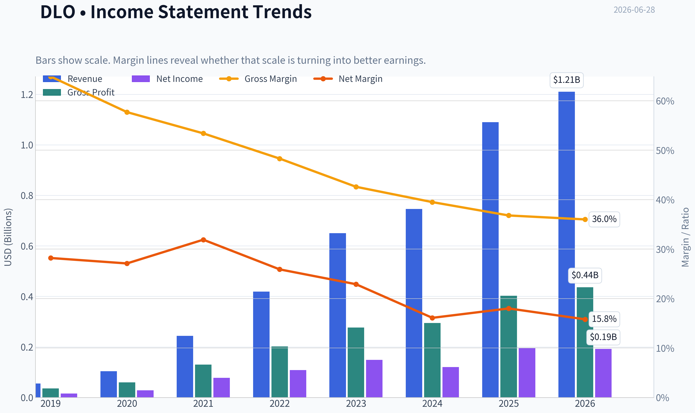

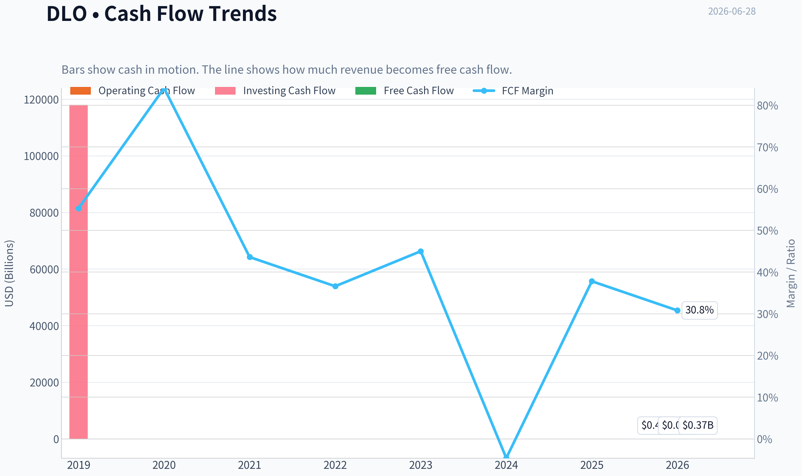

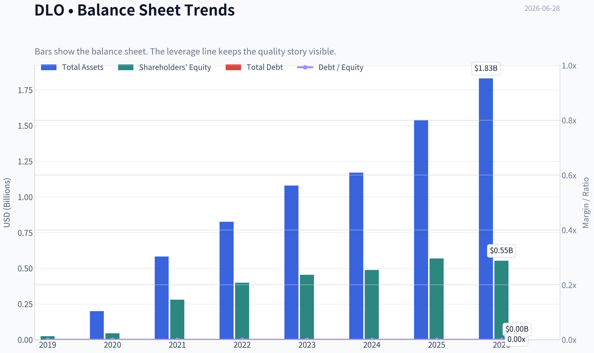

This graph tracks the profitability and return metrics (ROE, ROIC, Margins) of **DLO** over the past decade, highlighting capital efficiency trends.

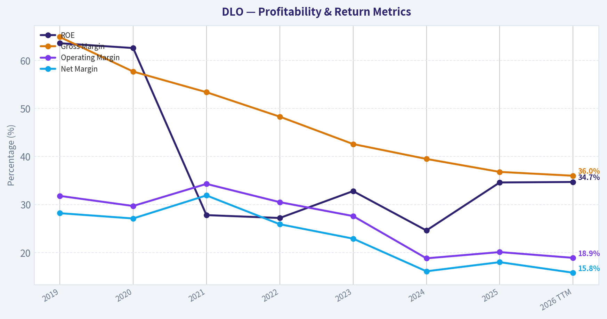

This chart illustrates the financial health of **DLO** over the last 10 years, mapping cash equivalents and free cash flow against total obligations (Debt).

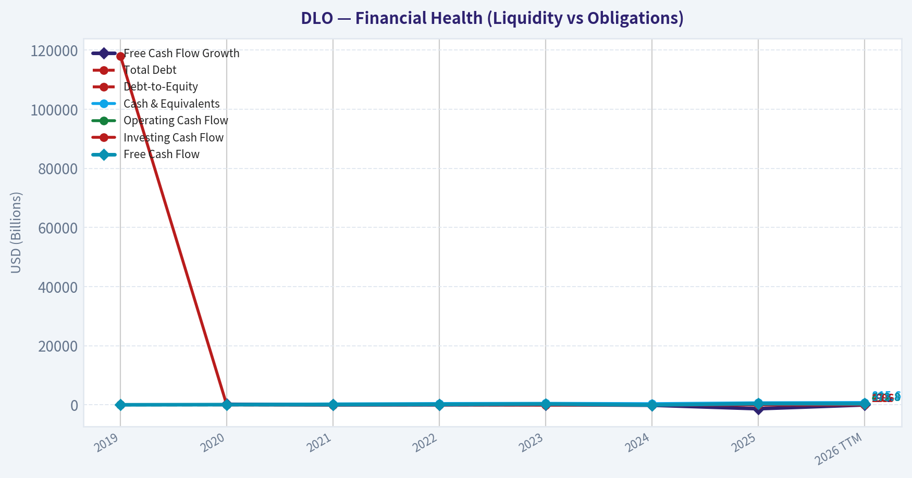

This comparison chart from *Profitability Analysis* stacks current figures against historical benchmarks for **DLO**, making it easy to see where the company trades relative to its own averages.

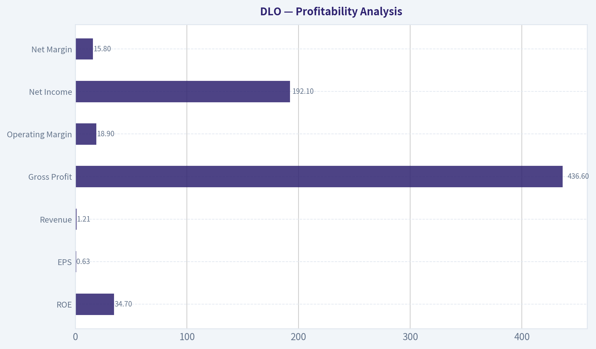

---

### Intrinsic Value Analysis (Buffett)

> *Following Warren Buffett's value investing philosophy: Circle of Competence, Economic Moat, Management Quality, and Margin of Safety.*

#### Intrinsic Value Snapshot

Price is what you pay. Intrinsic value is what the business may be worth based on the cash it can create for owners over time. We show a range, not one magic number.

- Current Price: $12.69
- Value Range (conservative to optimistic across both DCF methods): $0.48 to $129.11

##### Owner Earnings (Buffett Method)
- Net Income: $196,902,000.00
- Depreciation & Amortization: $26,260,000.00
- Capital Expenditures: $-2,282,000.00
- Working Capital Changes: $163,106,000.00
- Owner Earnings: $57,774,000.00

##### Intrinsic Value
###### Buffett Method
Uses owner earnings. Stricter, and usually more conservative.
- Conservative: $0.48
- Average: $5.77
- Optimistic: $18.05
- Discount Rate: 10.0%

###### Cash Flow Method
Uses free cash flow. Better for companies spending heavily today to grow tomorrow.
- Conservative: $49.58
- Average: $49.58
- Optimistic: $129.11
- Discount Rate: 10.0%

ANALYST STANCE: **WATCH**

#### DLocal (DLO) - Buffett-Style Investment Review

#### 1. Go/No-Go Gate Assessment

| Gate | Verdict | Evidence |
|---|---|---|
| Gate 1: Circle of Competence & Business Simplicity | Pass | DLocal provides payment infrastructure that helps global merchants accept payments and send payouts in emerging markets. This is understandable: it earns fees by moving money across difficult local payment systems. |
| Gate 2: Moat Test | Pass, but moderate | The business appears to have localized infrastructure, regulatory know-how, and merchant integrations that are hard to replicate quickly. Still, the moat does not yet look unquestionably wide. |
| Gate 3: Management Quality & Capital Allocation | Pass with caution | Recent introduction of a $300 million buyback and dividend suggests willingness to return excess capital. That said, long-term proof of superior capital allocation is still developing. |
| Gate 4: Industry Structure | Mixed | Payments can be attractive, but the industry is competitive and exposed to pricing pressure, regulation, and geopolitical complexity. This is not a simple consumer staple or rail monopoly. |

**Key Takeaways:** DLocal passes the basic Buffett filters because the business is understandable, profitable, and appears to hold some real strategic advantages in emerging-market payments. The main limitation is not business viability, but the durability of the moat and the competitive structure of the payments industry.

---

#### 2. The Elementary School Test

DLocal helps big online companies get paid in countries where payments are messy.

If a global merchant wants to sell in Brazil, Mexico, Nigeria, or other emerging markets, DLocal connects that merchant to local cards, bank transfers, wallets, and payout rails. DLocal takes a fee on the payment volume.

That is a simple business model. It passes the simplicity test.

#### 3. Long-Term Predictability Test

Ten years from now, cross-border commerce and digital payments in emerging markets will likely be larger than today. DLocal should still be in the business of helping merchants collect and move money in those markets.

The harder question is whether DLocal will still earn high economics, or whether larger processors, local banks, and global platforms will compress margins over time. So the business is predictable in function, but less predictable in economics.

#### 4. Technology Risk Assessment

Technology is both an enabler and a threat here.

DLocal benefits from technology because software integrations and local payment orchestration create value. But payments is not immune to disruption. New competitors, merchant in-sourcing, alternative rails, and lower-cost processing could weaken pricing power.

Conclusion: technology risk is manageable, but not low enough to ignore.

---

#### 5. Moat Analysis

| Moat Source | Assessment | Evidence |
|---|---|---|
| Intangible Assets | Moderate | DLocal's value comes from regulatory, compliance, and local market expertise across emerging economies. That matters, but it is not the same as a world-class consumer brand. |
| Switching Costs | Moderate to good | Once a merchant is integrated into a payment platform across many countries, switching is disruptive and operationally risky. This supports retention. |
| Cost Advantage | Unclear/modest | Scale can help with compliance, fraud, and processing efficiency, but there is not enough evidence that DLocal has an overwhelming structural cost edge. |
| Network Effects | Limited | More merchants may improve relevance and data, but this is not a classic winner-take-all social network or marketplace. |

**Moat Quality Rating:** **Narrow to Moderate**

A useful sign is that DLocal has delivered strong profitability and high ROE, which usually indicates some economic advantage. But the gross margin of **36.8%** is below the >40% Buffett-style "brand moat" comfort zone, so this is not the kind of franchise that screams untouchable pricing power.

**Key Takeaways:** DLocal likely has a real moat, but it appears to be based on infrastructure, localization, and switching friction rather than an elite brand or network effect. That can be valuable, but it is usually less impregnable than the best Buffett businesses.

---

#### 6. Management Quality & Capital Allocation

| Category | Assessment | Commentary |
|---|---|---|
| Owner Orientation | Mixed positive | The new buyback and dividend indicate shareholder focus, especially if buybacks occur below intrinsic value. |
| Candor & Discipline | Neutral | No strong red flags from the provided material, but the evidence base is not yet enough to rate this as exceptional. |
| Capital Allocation | Improving | A profitable, cash-generative business initiating both buybacks and dividends can be attractive if core reinvestment opportunities remain disciplined. |

The most encouraging recent development is the **$300 million buyback plan** alongside dividend initiation. At a market cap of about **$3.73 billion**, that buyback is meaningful. If executed at depressed prices, it could create per-share value.

Still, Buffett would ask one more question: can management reinvest retained earnings at high returns for a long time? For DLocal, that remains plausible, but not fully proven.

**Key Takeaways:** Management is showing signs of shareholder orientation, particularly through a sizable repurchase authorization. The key issue is whether future capital deployment will compound per-share value as effectively as the company's past operating performance suggests.

---

#### 7. Financial Summary

| Metric | Latest |
|---|---:|
| Share Price | $13 |
| Market Cap | $3.73B |
| P/E | 19.8x |
| ROE | 34.6% |
| Gross Margin | 36.8% |
| Revenue Growth YoY | 46.6% |
| FCF Yield | 11.1% |
| Current Ratio | 1.47 |

**Key Takeaways:** The headline numbers are strong. DLocal combines high growth, high ROE, and an unusually attractive free-cash-flow yield for a company still expanding rapidly, which is why the stock is interesting despite moat and industry concerns.

#### 8. Financial Interpretation Through a Buffett Lens

| Test | Result | Interpretation |
|---|---|---|
| ROE > 15% | Pass | At 34.6%, returns on equity are excellent. |
| Cash Generation | Pass | 11.1% FCF yield implies strong cash conversion relative to valuation. |
| Balance Sheet Safety | Acceptable | Current ratio of 1.47 suggests reasonable liquidity, though this is not enough alone to declare fortress strength. |
| Margin Quality | Mixed | Gross margin of 36.8% is solid, but below the very best moat businesses Buffett prefers. |
| Growth + Profitability Combo | Strong | 46.6% growth with meaningful profitability is notable. |

The most impressive figure here is **ROE of 34.6%**. Buffett likes high returns on capital, but he would also want to know whether those returns are driven by leverage. Nothing in the snapshot suggests obvious balance-sheet stress, and the FCF yield supports earnings quality.

---

#### 9. Owner Earnings Estimate

Using the available evidence, a practical proxy is to start with free cash flow.

With:
- Market cap = **$3.73B**
- FCF yield = **11.1%**

Estimated annual free cash flow / owner earnings proxy:

**Owner Earnings ~ $414 million**

Calculation:
- 3.73B x 11.1% = **$414 million**

This is a reasonable shorthand because free cash flow already captures much of the cash economics Buffett cares about, though true owner earnings would further adjust for maintenance capex and working capital needs.

---

#### 10. Three-Scenario DCF Valuation

Using owner earnings proxy of **$414 million** and discount rate of **10%**:

| Scenario | Assumption | Estimated Equity Value |
|---|---|---:|
| A: No Growth | Owner Earnings / 10% | $4.14B |
| B: GDP Growth | OE x 1.03 / (10% - 3%) | $6.09B |
| C: Moderate Growth | Assume 8% growth for 10 years, then 3% terminal | ~$7.1B |

**Key Takeaways:** Even under a no-growth assumption, DLocal's estimated value is modestly above the current market capitalization. If the company can sustain anything close to disciplined mid-single-digit or better compounding, upside could be meaningful.

#### 11. Margin of Safety

| Item | Value |
|---|---:|
| Current Market Cap | $3.73B |
| Scenario A Value | $4.14B |
| Scenario B Value | $6.09B |
| Scenario C Value | ~$7.1B |

Approximate discount to intrinsic value:
- Versus Scenario A: **~10% discount**
- Versus Scenario B: **~39% discount**
- Versus Scenario C: **~47% discount**

Buffett would likely anchor on the conservative case first. On that basis, the margin of safety is **not yet large enough** for a strong "back up the truck" conclusion. On more normal growth assumptions, the stock looks materially undervalued.

This creates a classic **WATCH** setup: attractive economics, but not yet enough certainty around moat durability to fully rely on the higher valuation cases.

**Key Takeaways:** The stock looks cheap if DLocal keeps growing and retains its economics. But under the most conservative no-growth lens, the discount is only modest, which argues for discipline rather than aggression.

---

#### 12. Final Buffett Scorecard

| Criterion | Weight | Score (1-5) | Weighted Score |
|---|---:|---:|---:|
| Business Understanding | 20% | 4.5 | 0.90 |
| Moat Width & Durability | 25% | 3.0 | 0.75 |
| Management Quality | 15% | 3.5 | 0.53 |
| Return on Equity | 15% | 4.5 | 0.68 |
| Reinvestment Runway | 10% | 4.0 | 0.40 |
| Balance Sheet Strength | 5% | 3.5 | 0.18 |
| Industry Structure | 5% | 2.5 | 0.13 |
| Valuation/Margin of Safety | 5% | 3.5 | 0.18 |
| **Total** | **100%** |  | **3.74 / 5.0** |

**Key Takeaways:** DLocal scores well on business clarity, growth, and returns on capital. The score is held back mainly by moat uncertainty and the competitive nature of payments, which keeps it short of a full-throated Buffett-style endorsement.

---

#### 13. Final Investment Stance

**ANALYST STANCE: WATCH**

**Conviction Level: Moderate**

DLocal is an attractive business with real strengths:
- simple and understandable business model,
- strong growth,
- high ROE,
- solid cash generation,
- and a valuation that is no longer demanding.

Why not **ADVOCATE**? Because the most important Buffett question is not whether the company is good today, but whether its economics are durable for a decade or more. In DLocal's case, the moat appears real but not yet clearly wide, and the payments industry can become competitive fast.

If the stock falls further without deterioration in business quality, or if DLocal proves sustained pricing power and retention while keeping high returns on capital, it could graduate to **ADVOCATE**. For now, it belongs on the watchlist as a potentially mispriced high-quality operator, but not yet a no-brainer Buffett compounder.
#### Valuation Bridge

This bridge places the current market price beside each intrinsic value lens so readers can see whether upside depends on one method or shows up across several methods.

| Scenario | Intrinsic Value / Share |
| --- | ---: |
| Buffett Method | $5.77 |
| Cash Flow Method | $49.58 |
| Damodaran Method | $50.97 |
| Current Price | $12.69 |

#### Key Takeaways

If one method is far above the others, the upside case depends on a specific modelling assumption. When several methods cluster together, the valuation story is more robust.

#### Valuation Visuals

This comparison chart from *Latest Earnings Snapshot* stacks current figures against historical benchmarks for **DLO**, making it easy to see where the company trades relative to its own averages.

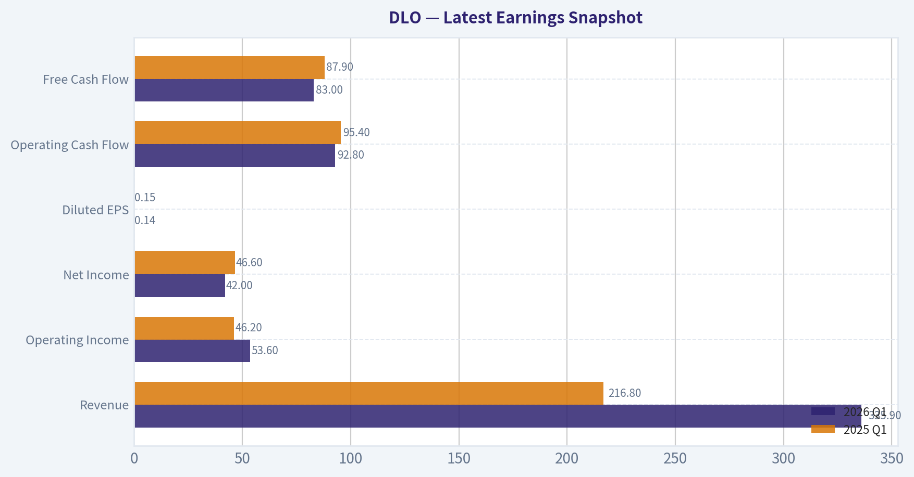

This comparison chart from *Current vs Historical Average Comparison* stacks current figures against historical benchmarks for **DLO**, making it easy to see where the company trades relative to its own averages.

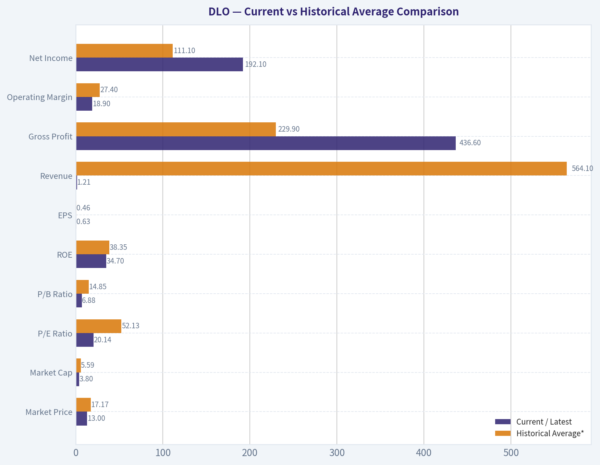

This comparison chart from *Balance Sheet Strength* stacks current figures against historical benchmarks for **DLO**, making it easy to see where the company trades relative to its own averages.

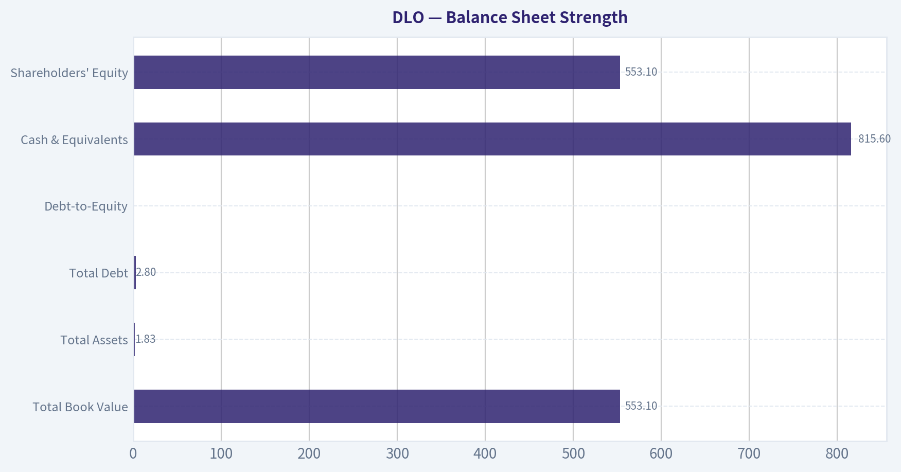

---

### Trend & Growth Analysis (Lynch/Druckenmiller/Fisher)

> *Following Peter Lynch's GARP, Stanley Druckenmiller's macro-aware approach, and Philip Fisher's scuttlebutt methodology.*

ANALYST STANCE: **ADVOCATE**

#### DLocal (DLO) Growth Analysis

#### 1. Lynch Classification
| Item | Assessment |
|---|---|
| Category | **Fast Grower** |
| Why | Revenue growth of **46.6% YoY** is well above Lynch's 15-25% fast grower threshold |
| Lynch fit | Cross-border payments in emerging markets with room for share gains and adjacent expansion |

**Key Takeaways:** DLocal clearly screens as a fast grower, which is the primary hunting ground for outsized returns in the Lynch framework. The core question is not whether it is growing, but whether this growth is durable and underappreciated.

#### 2. The Story in 3 Bullets
| Story Element | Simple Explanation |
|---|---|
| What it does | DLocal helps global merchants accept payments and move money in emerging markets without building local infrastructure country by country |
| Why customers use it | It simplifies a messy problem: local payment methods, regulations, FX, and payout rails across many hard-to-enter markets |
| Why it can keep growing | As global commerce expands into emerging markets, merchants want one platform to handle many countries, which can make DLocal a scaled specialist |

**Key Takeaways:** This is an easy business to explain: one API and one platform for hard-to-reach emerging markets. The appeal is strongest if DLocal keeps becoming the default infrastructure layer for global merchants entering those geographies.

#### 3. TAM Analysis and 10x Test
| Metric | Value / Assessment |
|---|---|
| Current revenue base | Not provided in research pack |
| Market served | Cross-border payments infrastructure in emerging markets |
| TAM direction | **Expanding** due to digital payments adoption, e-commerce penetration, and global merchant expansion |
| 10x test | **Likely passes qualitatively** |
| Reason | Emerging markets payments volume is enormous; a company at DLO's **$3.73B market cap** could plausibly grow many times larger without saturating the opportunity |

**Key Takeaways:** Even without a precise revenue figure here, the qualitative runway looks large. Cross-border and local payments in emerging markets is a broad, still-developing market, so DLocal does not appear constrained by TAM today.

#### 4. Revenue Growth Trend
| Metric | Value |
|---|---|
| Revenue growth YoY | **46.6%** |
| Pattern classification | **High growth / likely sustaining**, not enough history here to confirm acceleration |
| Interpretation | Strong demand, but we need multi-quarter trend data to prove a true inflection |

**Key Takeaways:** The headline growth rate is excellent and firmly in fast-grower territory. However, without several periods of trend data, I would call this strong sustained growth rather than proven acceleration.

#### 5. Unit Economics Snapshot
| Metric | Value / Assessment |
|---|---|
| Gross margin | **36.8%** |
| FCF yield | **11.1%** |
| ROE | **34.6%** |
| Current ratio | **1.47** |
| LTV/CAC | Not available |
| NRR | Not available |
| Rule of 40 | Not fully calculable from provided data |

**Key Takeaways:** The most important point is that DLocal combines strong growth with real cash generation, which is unusual and attractive. Gross margins are not SaaS-like, but the business appears efficient and financially solid rather than capital-hungry.

#### 6. Inflection Point Assessment
| Inflection Area | Assessment |
|---|---|
| Product cycle | Moderate positive; broader merchant and market coverage can deepen utility |
| Market share | Likely positive if global merchants continue consolidating vendors |
| Margin inflection | Positive signal from strong FCF profile and capital returns |
| TAM inflection | **Strong positive** as emerging market digital payments deepen |
| Competitive inflection | Possible, as complexity in these markets can favor scaled specialists |

**Key Takeaways:** The best inflection argument is not a single new product but the structural expansion of digital and cross-border commerce in emerging markets. If DLocal is reaching scale where revenue compounds while cash conversion improves, that is a high-quality growth setup.

#### 7. Macro Setup Evaluation
| Factor | Assessment |
|---|---|
| Secular theme | **Digital payments / fintech / emerging markets digitization** |
| Rate sensitivity | Moderate; growth names benefit if rates stabilize or fall |
| Macro risk | EM volatility, FX, regulation, merchant spend variability |
| Net macro view | **Constructive but not risk-free** |

**Key Takeaways:** DLocal sits in a strong secular trend, but it is exposed to emerging-market noise that can spook investors. This is not pure software-like stability, yet the long-term wind from digitization is favorable.

#### 8. Fisher 15 Points Score
| Fisher Area | Score (1-5) | Comment |
|---|---:|---|
| Market potential | 5 | Large runway in emerging market payments |
| New product development | 4 | Expansion across geographies and capabilities |
| R&D effectiveness | 3 | Limited direct evidence from pack |
| Sales organization | 4 | Merchant acquisition appears effective |
| Profit margin | 4 | Good economics for fintech infra |
| Margin improvement | 4 | FCF strength and capital returns help confidence |
| Labor relations | 3 | No clear evidence |
| Executive relations | 3 | No clear evidence |
| Management depth | 3 | Insufficient data |
| Cost controls/accounting | 4 | Cash generation supports discipline |
| Moat / differentiation | 4 | Local complexity, integrations, regulatory know-how |
| Long-range outlook | 5 | Strong secular tailwind |
| Dilution risk | 5 | Buyback/dividend suggest dilution not central issue |
| Candor | 3 | Insufficient evidence |
| Integrity | 3 | Insufficient evidence |

| Total | **57 / 75** | **GOOD** |

**Key Takeaways:** DLocal scores well on runway, strategic positioning, and financial discipline. The score is held back mostly by limited management-quality and scuttlebutt evidence in the provided materials, not by obvious business weakness.

#### 9. Valuation Analysis
| Metric | Value / Assessment |
|---|---|
| Market cap | **$3.73B** |
| Price | **$13** |
| P/E | **19.83x** |
| Revenue growth | **46.6%** |
| PEG | **0.43** using P/E divided by growth rate |
| FCF yield | **11.1%** |
| Valuation read | **Cheap relative to growth** |

**Key Takeaways:** On the data provided, DLocal's PEG is well below 0.5, which is rare for a company growing this fast. A double-digit free cash flow yield alongside 46.6% growth strongly suggests the market still discounts durability or risk.

#### 10. Growth Investor Scorecard
| Criterion | Weight | Score (1-5) | Weighted Score |
|---|---:|---:|---:|
| The Story | 10% | 4.5 | 0.45 |
| TAM & Runway | 20% | 4.5 | 0.90 |
| Revenue Growth | 20% | 4.5 | 0.90 |
| Unit Economics | 15% | 4.0 | 0.60 |
| Competitive Position | 10% | 4.0 | 0.40 |
| Management Quality | 10% | 3.5 | 0.35 |
| Macro Setup | 5% | 3.5 | 0.18 |
| Profitability Path | 5% | 4.5 | 0.23 |
| Valuation | 5% | 5.0 | 0.25 |

| Total Score |  |  | **4.26 / 5.0** |

**Key Takeaways:** DLocal lands firmly in advocate territory on this framework. The biggest positives are growth, runway, and valuation, while the main reasons not to be even more aggressive are macro complexity and incomplete management evidence.

#### 11. Position Size Stance
| Item | Assessment |
|---|---|
| Stance | **ADVOCATE** |
| Suggested sizing | **Medium position** for growth investors; can scale higher with confirmation of sustained growth and stable margins |
| Why not maximum size | EM/regulatory volatility and limited trend detail warrant some humility |

**Key Takeaways:** The stock looks attractive enough for an active growth position, but not yet a table-pounding maximum weight without more trend confirmation. I would start meaningful and add on execution proof rather than chase all at once.

#### 12. Key Risks and Catalysts
| Risks | Catalysts |
|---|---|
| EM FX/regulatory shocks | Continued strong earnings beats |
| Merchant concentration or slower TPV | 2026 guidance execution |
| Competitive pricing pressure | Buyback and dividend supporting capital allocation credibility |
| Growth deceleration | Russell 2000 inclusion increasing visibility and ownership |
| Sentiment discount on fintech/EM | Proof of sustained FCF generation with growth |

**Key Takeaways:** The market likely worries that growth is either cyclical, risky, or exposed to emerging-market volatility. The path to upside is straightforward: keep growing fast, keep generating cash, and let investors realize the business is stronger and more durable than the current multiple implies.

---

#### Bottom Line
DLocal looks like a **fast-growing, cash-generative fintech infrastructure company trading at a surprisingly modest valuation**. With **46.6% revenue growth**, **19.8x P/E**, **0.43 PEG**, and **11.1% FCF yield**, this screens as the kind of underappreciated growth stock Lynch would notice and Druckenmiller would revisit for an earnings-power re-rating.

The core bull case is simple: if DLocal remains a key cross-border payments enabler for emerging markets, current valuation does **not** appear to reflect multi-year compounding potential.

**Final view: ADVOCATE, with medium-to-high conviction.**

#### Growth & Scorecard Visuals

This comparison chart from *Growth Metrics* stacks current figures against historical benchmarks for **DLO**, making it easy to see where the company trades relative to its own averages.

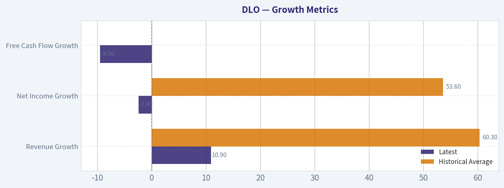

---

### Market Technical Analysis

#### DLO Technical Analysis Report

DLO appears to be in a **long-term repair phase inside a still-weaker strategic structure**. The stock has improved meaningfully from its mid-May washout near **10.83**, and the most recent price action into **June 26 at 12.69** shows a constructive short-term recovery. However, that rebound is occurring **below the 200-day SMA**, which means the broader trend has not yet fully transitioned into a durable bull regime.

The most relevant indicators for this market context are:

1. **close_200_sma** - best for judging whether the broader bearish structure has actually been repaired.
2. **close_50_sma** - useful for the medium-term trend and dynamic resistance/support.
3. **close_10_ema** - captures the current rebound's speed and helps identify whether near-term momentum is still active.
4. **macd** - measures directional momentum and whether the recovery has enough force to continue.
5. **macdh** - adds early insight into whether MACD momentum is accelerating or fading.
6. **rsi** - gauges whether momentum is improving without yet being overstretched.
7. **atr** - essential here because DLO has recently experienced volatility shocks and gap-like moves.
8. **vwma** - especially valuable because the latest move included a very large volume spike, so price/volume confirmation matters.

These eight indicators are complementary and avoid unnecessary overlap while covering **trend, momentum, volatility, and volume confirmation**.

---

#### Trend Structure

DLO's long-term structure is still cautious. The **200-day SMA is about 13.18**, while the latest close is **12.69**, so price remains roughly **3.7% below** that level. That means the stock is still trading under the market's longer-horizon cost basis and likely remains vulnerable to overhead supply from prior holders.

The medium-term picture is better than the long-term one. The **50-day SMA is about 12.49**, and the latest close at **12.69** is modestly above it. That tells us the stock has reclaimed its intermediate trend line, but only by a small margin. In practical terms, DLO is no longer in free fall, yet it also has not convincingly cleared the larger downtrend.

The slope behavior of the moving averages is especially informative. The **50-day SMA has flattened and slightly rolled over lower in June**, slipping from around **12.66** in early June to **12.49** by June 26. That suggests the prior weakness from May is still embedded in the average. By contrast, the **200-day SMA has been edging higher for months but began softening slightly in June**, indicating the earlier stronger price periods are rolling out and the long-term base is not yet firm.

So the current setup is not a classic breakout trend. It is better described as a **short-term rebound above medium-term support, but still inside a longer-term recovery challenge beneath major resistance**.

#### Momentum Analysis

Short-term momentum has clearly improved. The **10-day EMA rose to about 12.37** by June 26, and price closed above it at **12.69**. That is bullish in the near term and suggests buyers still control the most recent swing. The move from the June 3-5 softness into the June 11-18 advance was orderly rather than frantic, which is generally healthier.

**MACD has crossed back above zero**, reaching about **0.08** on June 26. That matters because it shows momentum has progressed from merely "less bearish" to actually positive. More importantly, the **MACD histogram remains positive**, around **0.069**, which tells us upside momentum is still present.

That said, the histogram has cooled from its June 17-18 highs around **0.17**. This is subtle but important: momentum is still positive, yet the **rate of improvement has slowed**. Traders should interpret that as a recovery that remains intact but is no longer accelerating at the same pace. In other words, DLO may be shifting from an impulse rally into a **test-and-consolidate phase**.

RSI reinforces that interpretation. At about **56.6**, RSI is constructive but not overbought. This is a favorable zone for bulls because it shows improving strength without the exhaustion often seen above 70. The journey is also notable: RSI fell into the **high-20s during the May 15 selloff**, then steadily recovered into the **mid-to-high 50s** in June. That is a meaningful momentum repair, but not yet evidence of a powerful runaway trend.

---

#### Volatility and Risk Conditions

ATR has declined from the elevated **0.66 area in mid-May** to roughly **0.52** by late June. That is a useful sign of stabilization. It suggests the panic-like movement seen during the May breakdown has cooled and the stock is trading in a more controlled manner.

Still, an ATR around **0.52** on a **12.69** stock is not trivial. That implies daily movement potential remains material, roughly around **4% of price**. Traders should not treat DLO as a low-volatility instrument. Stops that are too tight can easily be shaken out by normal daily movement.

This matters especially because DLO's recent history includes sharp downside air pockets. The stock fell from the **13.5-13.8 area in early May** to **10.83 by May 15**, a large drawdown in a short period. Even though conditions have improved, that historical behavior argues for disciplined position sizing and respect for volatility-adjusted risk management.

#### Volume Confirmation

VWMA gives an important confirmation signal here. By June 26, **VWMA is about 12.35**, below the latest close of **12.69**. That means recent price gains are being supported by volume rather than occurring on weak participation alone.

The June 26 session is especially important because volume surged to **13.82 million**, far above the recent baseline. A heavy-volume up day that also pushes price above the **10 EMA, 50 SMA, and VWMA** usually deserves attention. It suggests institutional or event-driven participation rather than just a low-liquidity drift.

There is one nuance: volume spikes can temporarily distort VWMA and short-term readings. So while this latest move is constructive, traders should watch whether DLO can **hold above roughly 12.35-12.40** in the next few sessions. If it can, the high-volume breakout attempt gains credibility. If not, June 26 may prove to be more of a one-day reaction than the start of a durable leg higher.

---

#### Fine-Grained Price Behavior

The recent structure can be divided into three phases:

| Phase | Approx. Period | Market Behavior | Interpretation |
|---|---|---|---|
| Distribution/Breakdown | Early May to May 15 | Price rolled over from low-13s to 10.83, RSI collapsed, ATR expanded | Bearish capitulation and forced repricing |
| Base/Rebuilding | Mid-May to early June | Price stabilized around 11.4-12.0, MACD remained negative but improved, ATR moderated | Sellers lost control; bottoming process began |
| Recovery Attempt | Mid-June to June 26 | Price moved above 10 EMA, MACD turned positive, RSI entered mid-50s, volume surged | Bullish short-term reversal with confirmation |

Key Takeaways: DLO first experienced a sharp selloff, then spent time stabilizing, and is now attempting a credible rebound. The stock's recent improvement is real, but it is still part of a recovery sequence rather than a fully established long-term uptrend.

This phase analysis is useful because it clarifies that DLO is **not simply "mixed"**. Instead, it is transitioning from a previously damaged technical state into a more constructive one, but that transition is incomplete. The stock has repaired short-term internals faster than it has repaired the broader chart.

---

#### What Traders Should Watch Next

For bulls, the first priority is **holding above the 50-day SMA near 12.49** and the **10-day EMA near 12.37**. If price remains above those levels, then the current recovery remains operational. A failure back below them would indicate the recent strength may have been mostly volume-driven short covering rather than sustained demand.

The next major challenge is the **200-day SMA near 13.18**. That is the most important upside test on the chart right now. If DLO can reclaim and hold above that level, the narrative changes materially from "short-term rebound" to "larger trend repair." Without that move, rallies may continue to encounter seller pressure in the **13.0-13.3 area**.

Momentum traders should also monitor whether **MACD stays above zero** and whether the **histogram re-expands** after its recent cooling. If MACD remains positive while RSI pushes toward **60-65**, that would strengthen the case for continued upside. If MACD flattens and RSI slips back below **50**, the rebound likely loses traction.

Risk managers should keep ATR in mind. With ATR around **0.52**, a reasonable tactical stop framework should allow for normal daily fluctuation. Very tight stops placed only a few cents below support are likely to be unreliable.

---

#### Overall Assessment

DLO currently shows a **constructive short-term technical recovery** with improving momentum, better price/volume confirmation, and reduced volatility relative to the May stress event. The stock is behaving better than it did a month ago, and the June 26 high-volume move is a notable positive signal.

However, the bigger picture remains incomplete because price is **still below the 200-day SMA**. That means DLO is best viewed as a **recovery candidate rather than a fully confirmed trend breakout**. Near-term bias is moderately bullish, medium-term bias is cautiously improving, and long-term bias remains unconfirmed until the stock can reclaim the **13.18 area** decisively.

| Category | Indicator | Latest Reading / Context | What It Suggests |
|---|---|---:|---|
| Long-term trend | close_200_sma | 13.18 vs close 12.69 | Broader structure still not fully bullish |
| Medium-term trend | close_50_sma | 12.49 vs close 12.69 | Price has reclaimed intermediate support |
| Short-term trend | close_10_ema | 12.37 vs close 12.69 | Near-term momentum remains positive |
| Momentum | macd | 0.08 | Momentum has turned positive |
| Momentum acceleration | macdh | 0.069, below recent peak | Upside still active but no longer accelerating as strongly |
| Momentum condition | rsi | 56.6 | Constructive, not overbought |
| Volatility | atr | 0.52 | Lower than May panic, but still meaningful daily risk |
| Volume confirmation | vwma | 12.35 vs close 12.69 | Recent rally has volume support |

Key Takeaways: DLO's short-term setup has improved meaningfully, with price above its key short and medium-term averages and momentum indicators turning positive. The main remaining hurdle is the 200-day average near 13.18, which will determine whether this is just a rebound or the beginning of a broader trend reversal.

#### Market Visuals

This comparison chart from *Market Metrics* stacks current figures against historical benchmarks for **DLO**, making it easy to see where the company trades relative to its own averages.

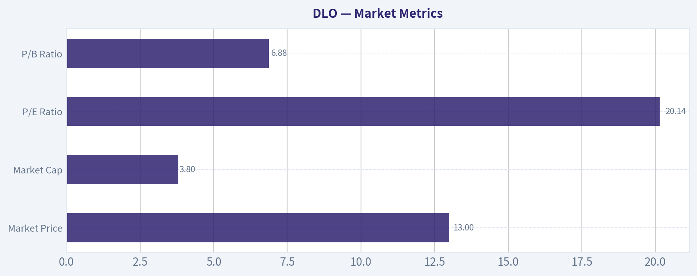

---

### Options Market Analysis

> *Reading options flow - put/call ratios, IV skew, and unusual activity - to gauge institutional positioning and event-driven risk.*

#### DLO Options Positioning Report

#### 1. Put/Call Ratio Analysis

| Near-Term Window | Call OI | Put OI | Put/Call OI Ratio | Call Volume | Put Volume | Put/Call Volume Ratio |
|---|---:|---:|---:|---:|---:|---:|
| Jul 17, 2026 | 20,532 | 4,885 | 0.24 | 588 | 103 | 0.18 |
| Aug 21, 2026 | 59,118 | 17,291 | 0.29 | 315 | 66 | 0.21 |
| Sep 18, 2026 | 335 | 20 | 0.06 | 194 | 0 | 0.00 |
| **Total Near-Term** | **79,985** | **22,196** | **0.28** | **1,097** | **169** | **0.15** |

Key Takeaways: DLO's near-term options positioning is clearly call-heavy. The aggregate put/call OI ratio of 0.28 is well below the rough neutral baseline of 0.7, and the put/call volume ratio of 0.15 is even more skewed toward calls. That usually points to bullish speculation, reduced demand for downside protection, or some covered-call structure layered on top of a generally constructive stance.

The biggest takeaway is not just that calls dominate, but that this dominance is broad across the first three expirations. Relative to neutral, this is a meaningful shift toward bullish positioning.

---

#### 2. Implied Volatility Assessment

| Expiry | ATM Call IV | ATM Put IV | IV Read | Skew Read |
|---|---:|---:|---|---|
| Jul 17, 2026 | 45.1% | 65.5% | Elevated/moderate | **Put skew** |
| Aug 21, 2026 | 57.8% | 52.2% | Elevated | **Mild call skew** |
| Sep 18, 2026 | 51.3% | 51.9% | Elevated/moderate | Near flat to slight put skew |

Key Takeaways: IV is not cheap in DLO's near-term chain, with ATM levels mostly in the mid-40s to high-50s. The July expiry stands out because puts are priced much richer than calls, which signals downside tail-risk concern even while overall positioning is call-heavy. August flips to a mild call skew, suggesting some upside participation demand beyond the very short term.

This pattern often means the market is constructive on direction but still unwilling to ignore downside event risk. In plain English: traders appear bullish overall, but short-dated downside insurance is still carrying a premium.

**Interpretation:**
- **July put skew is steep**: downside fear/hedging demand is elevated in the front month.
- **August mild call skew**: some traders may be reaching for upside exposure after the nearest event window.
- **Catalyst note:** No specific catalyst is provided in the dataset, so I cannot definitively tie the IV premium to earnings or a corporate event. Still, the IV profile suggests the market expects above-average movement risk in the near term.

---

#### 3. Unusual Options Activity

| Contract Scan Result | Observation | Interpretation |
|---|---|---|
| Volume > 5x Open Interest | None detected in near-term expirations | No clear fresh institutional "tell" from outsized opening flow |

Key Takeaways: There were no contracts flagged where volume exceeded five times open interest, so there is no obvious standout sweep or opening block that screams fresh smart-money conviction. That lowers confidence in any aggressive directional conclusion based on flow alone. In this case, the signal is coming more from overall positioning and skew than from one notable trade.

**Interpretation:**
- Absence of unusual activity does **not** mean nothing is happening.
- It does mean there is **no single high-conviction contract** in the near-term chain that clearly identifies fresh institutional directional aggression.
- So the read leans more on aggregate call dominance than on a specific "whale" trade.

---

#### 4. Open Interest Concentration

| Expiry | Total Call OI | Total Put OI | OI Concentration Read |
|---|---:|---:|---|
| Jul 17, 2026 | 20,532 | 4,885 | Calls dominate; likely call-heavy pinning influence |
| Aug 21, 2026 | 59,118 | 17,291 | Largest OI concentration; most important expiry for gamma/pinning |
| Sep 18, 2026 | 335 | 20 | Too small to matter much near-term |

Key Takeaways: The August 2026 expiration is the center of gravity in DLO's listed near-term options, with by far the largest open interest. That means if the stock drifts toward heavily trafficked strikes in that expiration, dealer hedging could have an outsized effect on price behavior. July still matters for the immediate tape, but August is the more important positioning bucket.

**Interpretation:**
- The **Aug 21 expiry** is the dominant OI node and likely the main source of near-term gamma effects.
- With calls heavily outweighing puts, dealer hedging may **dampen upside if call OI is overwritten/covered**, or **amplify moves if calls are actively long and price approaches crowded strikes**.
- Since strike-level concentration was not provided, I cannot identify exact gamma walls or a precise max-pain level. But the expiration-level concentration strongly suggests August is where pinning dynamics are most likely to show up.

---

#### 5. Overall Options Sentiment Signal

**Overall Signal: BULLISH**

**Primary driver:**
The strongest signal is the very low aggregate put/call OI ratio of **0.28** and put/call volume ratio of **0.15**, both far below the ~0.7 neutral baseline. That indicates the options market is positioned much more heavily toward calls than puts across the near-term maturities.

**Why not stronger than bullish-with-caveats?**
- The **front-month put skew is steep**, which shows real demand for downside protection.
- There is **no unusual high-conviction flow** to confirm aggressive fresh institutional buying.
- DLO's chain does not look extremely liquid compared with mega-cap names, so conviction should be moderated.

**Net conclusion:**
DLO's options tape leans **bullish**, but it is a **guarded bullish** signal rather than an all-clear risk-on setup. The market appears to favor upside exposure overall while still assigning a meaningful premium to near-term downside insurance.

---

#### Confidence / Liquidity Caveat

| Factor | Read |
|---|---|
| Options liquidity | Moderate to somewhat thin outside main expirations |
| Confidence in signal | Moderate |
| Main limitation | No strike-level OI map and no unusual flow flags |

Key Takeaways: DLO's options market is active enough to be useful, but not so deep that every signal should be treated as highly institutional. That means the bullish read is valid, but it should be handled with moderate confidence rather than high conviction. The strongest evidence comes from broad positioning ratios, not from standout trade prints.

---

#### Summary Table

| Category | Read |
|---|---|
| Put/Call Ratio | **Bullish** - OI ratio 0.28, volume ratio 0.15, both far below neutral 0.7 |
| IV Level | **Moderately elevated** - ATM IV mostly 45% to 58% in near-term expiries |
| Skew Direction | **Mixed, but front-end put skew notable** - July downside fear, August mild upside chase |
| Unusual Activity | **None flagged** - no contracts with volume > 5x OI |
| Overall Signal | **BULLISH** - broad call dominance outweighs hedge demand, but with caution due to front-month put skew |

Key Takeaways: The cleanest message from DLO's options tape is bullish positioning through heavy call ownership and call trading activity. The main offset is expensive short-dated puts, which tells you traders still respect downside event risk. So the practical read is bullish, but not complacent.

---

## Research Team Commentary

> *The Research Manager synthesizes the Bull vs Bear debate into action-free commentary. This is a pre-risk view, not the final stance.*

The debate really comes down to one question: is dLocal a genuinely durable payments franchise temporarily priced with too much fear, or is it a good-looking set of recent numbers attached to a business whose long-term economics are less reliable than they appear?

The bull case is strongest on valuation and current business performance. An 11.1% free cash flow yield on a company still described as a fast grower is hard to ignore. ROE of 34.6% and ROA of 12.8% suggest a capital-light model with real economic productivity, not just accounting smoke. The core bullish argument is that dLocal sits in an attractive niche-helping global merchants navigate fragmented, high-friction emerging-market payment systems-and that this complexity creates a real if unglamorous moat. If that is true, then the market is likely over-discounting volatility, and today's price may already reflect a lot of skepticism about growth, competition, and country risk. From a contrarian value perspective, that setup deserves respect: high returns, real cash generation, and a valuation that does not require heroic assumptions.

The bear case is strongest on moat quality and earnings predictability. Buffett-style investing is not about buying any company with a cheap-looking yield; it is about buying businesses whose long-term economics can be forecast with unusual confidence. The bear rightly challenges whether dLocal's advantage is a true moat or just specialized operational competence in difficult markets. Enterprise merchants are not captive customers. They can multi-source, pressure pricing, and shift routing. Payments infrastructure also tends to attract competition and margin compression over time. On top of that, emerging-market exposure adds FX, regulatory, compliance, and political uncertainty that can make reported cash flow less stable than it looks. The bear's best point is that an 11% FCF yield may not be a bargain; it may be the market's way of demanding a high discount rate for fragile cash flows.

My takeaway is that the bull has the better near-to-medium-term valuation argument, but the bear has the better pure Buffett-quality objection. This does not look like a classic "wonderful business" in the Coca-Cola or Moody's sense. The moat is narrower, more execution-dependent, and more vulnerable to external shocks. But I also do not think the right conclusion is to dismiss the stock outright. One lesson from past mistakes is not to let a strict moat test blind us to obvious valuation asymmetry when the business is still profitable, cash generative, and not facing an acute balance-sheet problem. dLocal appears to sit in that gray zone: not elite enough for full-throated long-term conviction, but too cheap and too productive to ignore.

Core takeaway: dLocal looks like a potentially undervalued, cash-generative niche payments platform, but it falls short of the predictability and moat certainty required for a top-tier Buffett-style endorsement. The valuation is attractive enough to keep it close, yet the durability of normalized cash flows is not proven enough to call it a clear advocate.

The rationale is straightforward. Business quality is decent to good, but not clearly excellent. High returns and free cash flow are real positives. The balance sheet concerns are not front and center, which helps. However, the moat depends on local integrations, compliance know-how, and execution in complex jurisdictions-useful advantages, but not necessarily durable pricing power. Predictable earnings are the sticking point. In a value framework, if I cannot get comfortable that cash flows are both real and durable across a cycle, I should resist moving from "interesting" to "high-conviction." At the same time, I do not want to repeat the mistake of over-penalizing uncertainty when valuation already discounts much of it. So this is not an avoid unless the thesis starts deteriorating; it is a watch with a constructive bias.

What I'd monitor over the next 1 to 4 quarters is very concrete. First, revenue growth versus take-rate compression: if volume grows but economics deteriorate, the moat is weaker than bulls think. Second, free cash flow quality: I want to see whether cash generation remains strong after normalizing for working capital swings and without relying on timing benefits. Third, gross margin and operating margin stability: sustained pressure would support the commoditization bear case. Fourth, customer concentration and large-merchant behavior: any evidence of pricing concessions, routing loss, or top-client dependence would matter a lot. Fifth, signs of regulatory or country-specific friction in major markets: this is where "complexity as moat" can flip into "complexity as risk." Sixth, capital allocation: buybacks, disciplined reinvestment, and conservative expansion would strengthen confidence; aggressive empire-building would weaken it. Finally, I'd watch technical confirmation around the 10 EMA, 50 SMA, and 200 SMA as secondary evidence of whether the market is beginning to trust the fundamentals more.

If the company can show another few quarters of durable FCF, stable margins, and continued merchant relevance without obvious take-rate erosion, I would be open to upgrading. If instead cash flow proves noisy, margins compress, or regulatory/customer concentration issues surface, the bear thesis likely wins.

Final stance: WATCH.

---

## Value Investing Team Commentary

> *The Investor translates the research view into an investment thesis before risk review. This is still not the final stance.*

dLocal is the sort of business that value investors should neither dismiss casually nor embrace too quickly. It sits in an interesting middle ground: clearly more productive than the market seems willing to credit, yet not obviously durable enough to qualify as a classic "forever" compounder.

The bullish case is easy to understand. At roughly $3.7 billion in market value and an 11.1% free cash flow yield, the stock is not priced like a beloved fintech. That matters. Markets usually assign that kind of cash yield either to a no-growth business or to one whose cash flows are considered suspect. If the underlying franchise is even moderately durable, that valuation may be too pessimistic. Add in 34.6% ROE, 12.8% ROA, and a 36.8% gross margin, and you have evidence of a real business model with meaningful economic output. This is not a promotional story stock living on adjusted metrics and hope.

The contrarian angle is that dLocal operates in an area many investors instinctively discount: emerging markets, payments complexity, FX noise, and regulatory friction. Those are legitimate concerns, but they can also create opportunity. Businesses that help global merchants navigate difficult local payment rails do provide real utility. Complexity can be a barrier to entry, even if it is not as pristine a moat as a global consumer brand or ratings oligopoly. In that sense, the market may be treating all uncertainty as fragility, when some of that uncertainty may actually support the company's niche.

Still, the key Buffett-style objection remains valid: how predictable are normalized earnings five to ten years out? That is where caution is warranted. Payments infrastructure often looks better in the present than in the distant future because competition, merchant bargaining power, and take-rate pressure tend to erode economics over time. If large customers can multi-source, negotiate aggressively, or internalize some capabilities, then high current cash generation may not translate into lasting owner earnings power. The market may be skeptical for good reason.

What are markets possibly missing? Mainly this: dLocal does not need to become a legendary moat business to be a good investment from here. If it merely proves that current cash generation is mostly real, margins are reasonably stable, and its merchant relationships are sticky enough to avoid severe take-rate collapse, today's valuation could be too low. That is a classic selective contrarian setup: not buying because the crowd is fearful, but because fear may be overshooting business deterioration.

What should worry a long-term owner? Three things. First, free cash flow quality. Payments businesses can show distorted cash generation due to working capital timing, settlement mechanics, or temporary operating advantages. Second, moat slippage. If revenue grows while unit economics weaken, the business may be scaling activity without preserving value. Third, country and regulatory concentration. In a business exposed to emerging-market payment systems, operational complexity can shift quickly from advantage to liability.

So the right interpretation is not "cheap fintech, buy aggressively." It is closer to: "interesting niche franchise, priced with substantial skepticism, but still requires proof that economics are durable." That makes this a name worth following closely, especially if sentiment remains subdued while fundamentals hold up. If the next few quarters confirm stable margins, healthy cash conversion, and limited take-rate erosion, the case for a rerating strengthens materially. If not, the current valuation may simply be compensating investors for genuine fragility.

From a business-owner perspective, I would want to see evidence that management is acting like rational stewards of capital. In a business with some uncertainty around moat durability, disciplined buybacks, conservative balance-sheet management, and focused reinvestment matter a great deal. Empire-building would be a red flag. Quiet compounding and prudent allocation would be encouraging.

In short, dLocal looks underappreciated, but not yet fully proven. The market's fear may be somewhat excessive, yet not irrational. That is exactly the kind of situation where patience and close observation create an edge.

**ANALYST STANCE: WATCH**

dLocal is a constructive watchlist candidate rather than a high-conviction Buffett-style buy today. The valuation and cash generation are attractive enough to keep it firmly on the radar, and selective contrarian thinking suggests sentiment may be too negative if fundamentals remain stable. But until the business demonstrates more durable moat characteristics, cleaner cash-flow quality, and better long-range predictability, it does not quite clear the bar for full advocacy.

---

## Deep Values Commentary

> *The Risk Management Team debates and the Risk Judge provides the final action-free verdict. This section determines the final ADVOCATE / WATCH / AVOID stance.*

#### Final Stance Scorecard

This scorecard converts the final research view into a weighted decision frame. It does not replace the narrative judgement, but it makes the main drivers of the verdict easier to scan.

| Criterion | Score | Weight | Commentary |
| --- | ---: | ---: | --- |
| Business Quality | 3.75 | 30% | High returns, profitability, and Piotroski health support durability. |
| Valuation Support | 4.33 | 30% | Blends current price against available intrinsic value anchors and valuation ratios. |
| Financial Strength | 4.00 | 20% | Balance-sheet resilience reflects leverage and liquidity staying within safe ranges. |
| Growth Durability | 5.00 | 20% | Recent revenue, earnings, and free cash flow growth indicate how durable expansion looks. |
| TOTAL / FINAL STANCE | 4.22 | 100% | WATCH |

#### Key Takeaways

The weighted score lands at **4.22 / 5.0**, while the final stance remains **WATCH**. This is useful as a quick calibration aid rather than a mechanical signal.

#### Risk Summary

Higher scores indicate more risk pressure. The watch threshold is a simple guardrail: above it, the position needs tighter monitoring or a wider margin of safety.

| Dimension | Current Score | Watch Threshold | Commentary |
| --- | ---: | ---: | --- |
| Business Quality | 2.25 | 3.00 | High returns, profitability, and Piotroski health support durability. |
| Valuation Support | 1.67 | 3.00 | Blends current price against available intrinsic value anchors and valuation ratios. |
| Financial Strength | 2.00 | 3.00 | Balance-sheet resilience reflects leverage and liquidity staying within safe ranges. |
| Growth Durability | 1.00 | 3.00 | Recent revenue, earnings, and free cash flow growth indicate how durable expansion looks. |

#### Key Takeaways

This view helps readers separate *where* the risk sits: valuation, business quality, balance sheet, or growth durability. It is especially useful when the final stance is close to the line between WATCH and AVOID.
